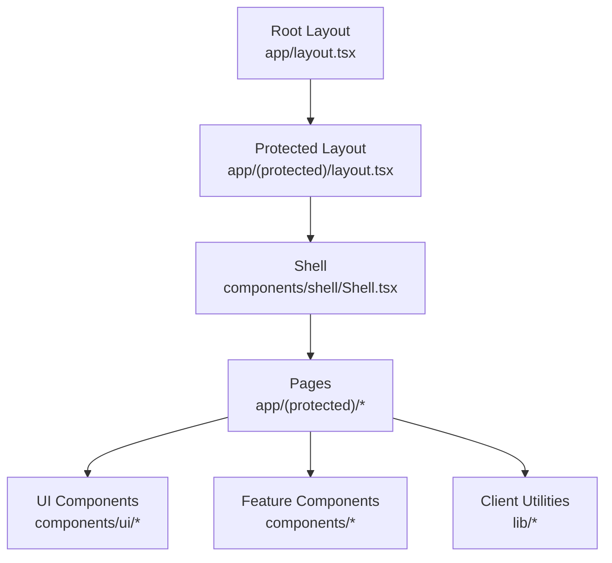
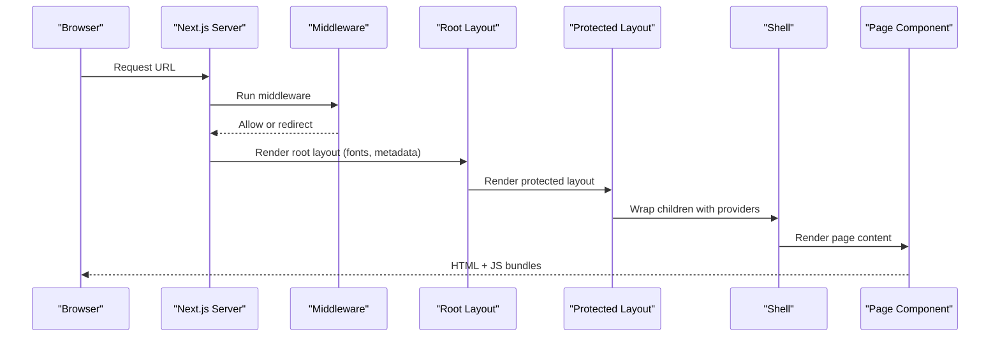
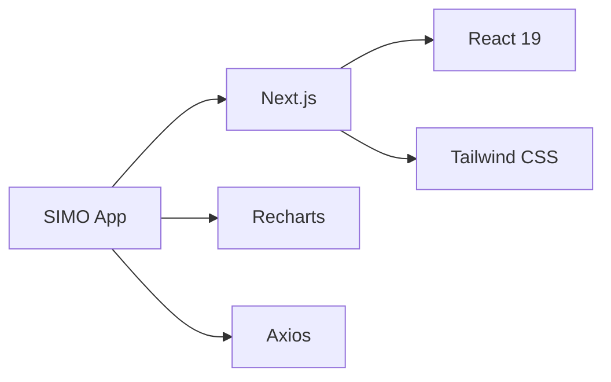

# Frontend Performance

<cite>
**Referenced Files in This Document**
- [next.config.ts](file://simoapp/next.config.ts)
- [package.json](file://simoapp/package.json)
- [layout.tsx](file://simoapp/app/layout.tsx)
- [middleware.ts](file://simoapp/middleware.ts)
- [protected layout.tsx](file://simoapp/app/(protected)/layout.tsx)
- [Shell.tsx](file://simoapp/components/shell/Shell.tsx)
- [ProductosContext.tsx](file://simoapp/components/catalogo/ProductosContext.tsx)
- [DataTable.tsx](file://simoapp/components/ui/DataTable.tsx)
- [GraficoVentasPeriodo.tsx](file://simoapp/components/dashboard/GraficoVentasPeriodo.tsx)
- [catalogo page.tsx](file://simoapp/app/(protected)/catalogo/page.tsx)
- [globals.css](file://simoapp/app/globals.css)
- [useConexion.ts](file://simoapp/lib/red/useConexion.ts)
- [BannerConexion.tsx](file://simoapp/components/shell/BannerConexion.tsx)
</cite>

## Table of Contents
1. [Introduction](#introduction)
2. [Project Structure](#project-structure)
3. [Core Components](#core-components)
4. [Architecture Overview](#architecture-overview)
5. [Detailed Component Analysis](#detailed-component-analysis)
6. [Dependency Analysis](#dependency-analysis)
7. [Performance Considerations](#performance-considerations)
8. [Troubleshooting Guide](#troubleshooting-guide)
9. [Conclusion](#conclusion)

## Introduction
This document provides a comprehensive frontend performance optimization guide for SIMO’s Next.js application. It focuses on code splitting, image optimization, bundle size reduction, React component optimization patterns, memoization strategies, state management efficiency, lazy loading, font optimization, static asset optimization, Next.js-specific optimizations (ISR, image optimization, script loading), browser caching policies, service worker implementation, and progressive web app features. The guidance references actual project files to ensure recommendations are grounded in the current codebase.

## Project Structure
The SIMO frontend is organized using Next.js App Router with:
- Global layout and fonts at the root layout
- Protected routes under app/(protected)
- Shared UI components under components/ui
- Feature modules under components/* (shell, dashboard, catalogo, ventas, etc.)
- Client-side utilities under lib/*

**Diagram sources**
- [layout.tsx:1-34](file://simoapp/app/layout.tsx#L1-L34)
- [protected layout.tsx:1-11](file://simoapp/app/(protected)/layout.tsx#L1-L11)
- [Shell.tsx:1-40](file://simoapp/components/shell/Shell.tsx#L1-L40)

**Section sources**
- [layout.tsx:1-34](file://simoapp/app/layout.tsx#L1-L34)
- [protected layout.tsx:1-11](file://simoapp/app/(protected)/layout.tsx#L1-L11)
- [Shell.tsx:1-40](file://simoapp/components/shell/Shell.tsx#L1-L40)

## Core Components
Key areas impacting performance:
- Fonts via next/font/google in the root layout
- Client-only shell and shared state provider
- Data table with sorting and pagination
- Charts using Recharts
- Network status awareness

Optimization highlights:
- Use next/font/google to preload and subset fonts
- Keep heavy client logic behind "use client" boundaries
- Memoize expensive computations (sorting, filtering)
- Lazy-load non-critical charts and modals
- Avoid unnecessary re-renders by lifting minimal state

**Section sources**
- [layout.tsx:1-34](file://simoapp/app/layout.tsx#L1-L34)
- [Shell.tsx:1-40](file://simoapp/components/shell/Shell.tsx#L1-L40)
- [ProductosContext.tsx:1-303](file://simoapp/components/catalogo/ProductosContext.tsx#L1-L303)
- [DataTable.tsx:1-394](file://simoapp/components/ui/DataTable.tsx#L1-L394)
- [GraficoVentasPeriodo.tsx:1-132](file://simoapp/components/dashboard/GraficoVentasPeriodo.tsx#L1-L132)

## Architecture Overview
The application uses Next.js App Router with server-rendered layouts and selective client components. Middleware protects routes and enforces roles. Shared state is provided via a context provider wrapping protected routes.

**Diagram sources**
- [middleware.ts:1-37](file://simoapp/middleware.ts#L1-L37)
- [layout.tsx:1-34](file://simoapp/app/layout.tsx#L1-L34)
- [protected layout.tsx:1-11](file://simoapp/app/(protected)/layout.tsx#L1-L11)
- [Shell.tsx:1-40](file://simoapp/components/shell/Shell.tsx#L1-L40)

## Detailed Component Analysis

### Code Splitting and Lazy Loading
Recommendations:
- Use dynamic imports for heavy components (charts, modals, large tables).
- Apply Suspense boundaries around dynamically imported components.
- Prefer route-level code splitting (already handled by Next.js App Router).
- Defer third-party libraries until after initial paint.

Implementation examples:
- Lazy load charts: import GraficoVentasPeriodo dynamically where used.
- Lazy load modals: wrap Modal usage with dynamic() when not immediately needed.
- Lazy load data-heavy pages: split catalog search and filters.

[No sources needed since this section provides conceptual guidance]

### Image Optimization
Recommendations:
- Use Next.js Image component for automatic optimization, format selection, and responsive sizes.
- Configure preferred formats and device widths in next.config.ts.
- Set explicit width/height to avoid layout shifts.
- Use placeholder="blur" for perceived performance.

Configuration targets:
- next.config.ts: enable image optimization settings and remotePatterns if images are hosted remotely.

**Section sources**
- [next.config.ts:1-8](file://simoapp/next.config.ts#L1-L8)

### Bundle Size Reduction
Recommendations:
- Remove unused dependencies; audit with bundle analyzer.
- Prefer tree-shakeable libraries; avoid bundling entire charting suites unless necessary.
- Use dynamic imports for optional features.
- Minimize global CSS; leverage Tailwind’s purge strategy.
- Avoid importing heavy utilities in top-level modules.

Current dependencies include Recharts and Axios; consider lazy-loading charts and network calls.

**Section sources**
- [package.json:1-29](file://simoapp/package.json#L1-L29)

### React Component Optimization Patterns
Patterns observed and recommended:
- Memoize derived data with useMemo (sorting, filtering).
- Stabilize callbacks with useCallback to prevent child re-renders.
- Lift minimal state up; keep local state close to where it’s used.
- Avoid inline objects/functions in render that cause unnecessary re-renders.

Examples:
- DataTable uses useMemo for sorted rows and computes pagination efficiently.
- ProductosContext centralizes product state and updates; consider memoizing selectors if needed.

**Section sources**
- [DataTable.tsx:104-127](file://simoapp/components/ui/DataTable.tsx#L104-L127)
- [ProductosContext.tsx:129-150](file://simoapp/components/catalogo/ProductosContext.tsx#L129-L150)

### Memoization Strategies
Guidelines:
- Use useMemo for expensive computations (sorting, formatting, aggregations).
- Use useCallback for event handlers passed to memoized children.
- Avoid over-memoizing trivial operations; measure before optimizing.

Example:
- Sorting and slicing in DataTable are wrapped in useMemo to avoid recomputation on every render.

**Section sources**
- [DataTable.tsx:104-127](file://simoapp/components/ui/DataTable.tsx#L104-L127)

### State Management Efficiency
Guidelines:
- Keep global state minimal; prefer local state for UI-only concerns.
- Normalize data structures to reduce duplication.
- Debounce user inputs (search, filters) to limit re-renders.
- Use optimistic updates with rollback on error for better UX.

Observations:
- ProductosContext holds product list and actions; consider adding memoized selectors for filtered views.

**Section sources**
- [ProductosContext.tsx:129-303](file://simoapp/components/catalogo/ProductosContext.tsx#L129-L303)

### Lazy Loading Implementation
Approach:
- Dynamically import heavy components (charts, modals, large lists).
- Wrap with Suspense and provide fallback UI.
- Preload critical paths; defer non-critical assets.

[No sources needed since this section provides conceptual guidance]

### Font Optimization
Current setup:
- Uses next/font/google to preload and subset fonts in the root layout.

Recommendations:
- Keep subsets minimal (latin only).
- Use variable fonts where possible to reduce requests.
- Ensure display=swap for fast text rendering.

**Section sources**
- [layout.tsx:1-34](file://simoapp/app/layout.tsx#L1-L34)

### Static Asset Optimization
Recommendations:
- Serve static assets from CDN.
- Compress assets (images, fonts, scripts).
- Use cache headers for long-lived assets.
- Leverage Next.js public folder best practices.

[No sources needed since this section provides general guidance]

### Next.js-Specific Optimizations

#### Incremental Static Regeneration (ISR)
- Use generateStaticParams and revalidate for pages that can be partially static.
- For data-driven pages like catalog, consider ISR to refresh stale data without full rebuilds.

[No sources needed since this section provides conceptual guidance]

#### Image Optimization
- Configure next/image with preferred formats and device widths.
- Use next.config.ts to set remotePatterns for external images.

**Section sources**
- [next.config.ts:1-8](file://simoapp/next.config.ts#L1-L8)

#### Script Loading Strategies
- Defer non-critical scripts; use next/script with strategy="lazyOnload".
- Avoid blocking the main thread during initial render.

[No sources needed since this section provides conceptual guidance]

### Browser Caching Policies
Recommendations:
- Set Cache-Control headers for static assets (long-lived).
- Use immutable for hashed assets.
- Implement versioning for CSS/JS to bust caches.

[No sources needed since this section provides general guidance]

### Service Worker and PWA Features
Recommendations:
- Add a service worker for offline support and background sync.
- Provide manifest.json for installability.
- Cache critical shell and fonts; precache API responses selectively.

[No sources needed since this section provides conceptual guidance]

## Dependency Analysis
The frontend depends on:
- Next.js runtime and App Router
- React 19 and React DOM
- Recharts for charts
- Tailwind CSS for styling
- Axios for HTTP requests

**Diagram sources**
- [package.json:1-29](file://simoapp/package.json#L1-L29)

**Section sources**
- [package.json:1-29](file://simoapp/package.json#L1-L29)

## Performance Considerations
- Prioritize critical rendering path: fonts, layout, and essential UI first.
- Defer non-critical JavaScript and analytics.
- Use Suspense and streaming SSR where applicable.
- Monitor bundle size and Lighthouse metrics regularly.
- Optimize network requests: batch, paginate, and cache aggressively.

[No sources needed since this section provides general guidance]

## Troubleshooting Guide
Common issues and resolutions:
- Slow initial load due to heavy client components: move heavy logic to lazy-loaded components.
- Excessive re-renders: apply useMemo/useCallback and stabilize props.
- Poor font performance: ensure subsets and swap are configured.
- Chart rendering lag: lazy-load charts and memoize data transformations.
- Network flakiness: use connection-aware banners and graceful fallbacks.

References:
- Connection banner and hook demonstrate robust handling of online/offline states.

**Section sources**
- [useConexion.ts:1-33](file://simoapp/lib/red/useConexion.ts#L1-L33)
- [BannerConexion.tsx:1-32](file://simoapp/components/shell/BannerConexion.tsx#L1-L32)

## Conclusion
By applying the outlined strategies—code splitting, image optimization, bundle size reduction, React optimization patterns, memoization, efficient state management, lazy loading, font optimization, static asset optimization, and Next.js-specific techniques—the SIMO frontend can achieve faster load times, smoother interactions, and improved user experience. Continuous monitoring and iterative improvements will further enhance performance.