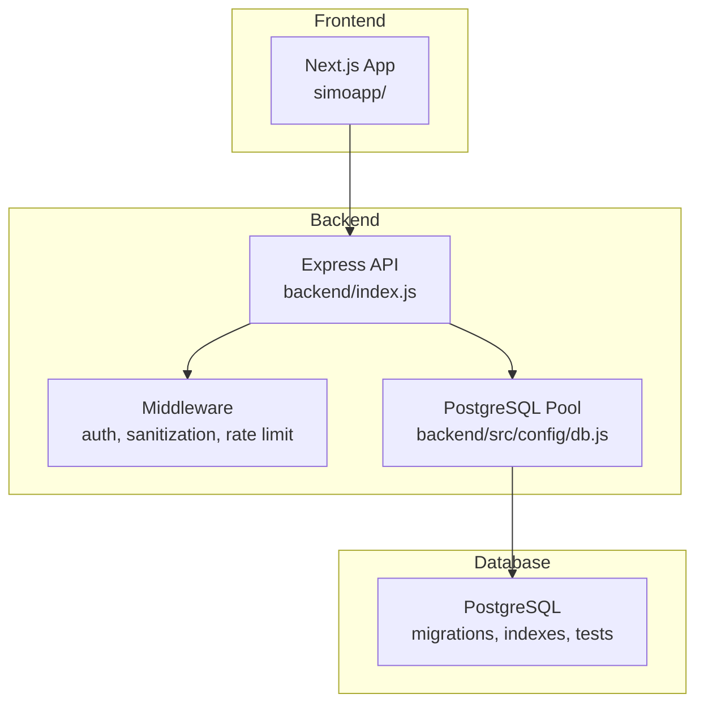
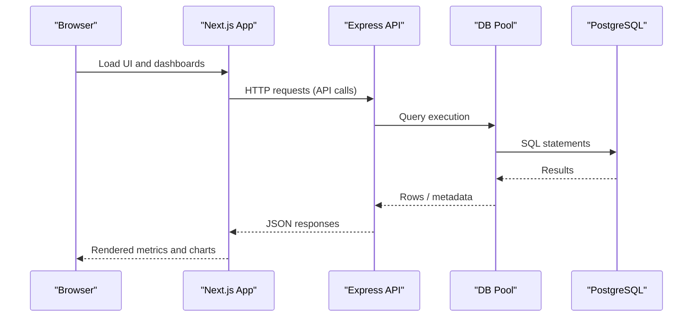
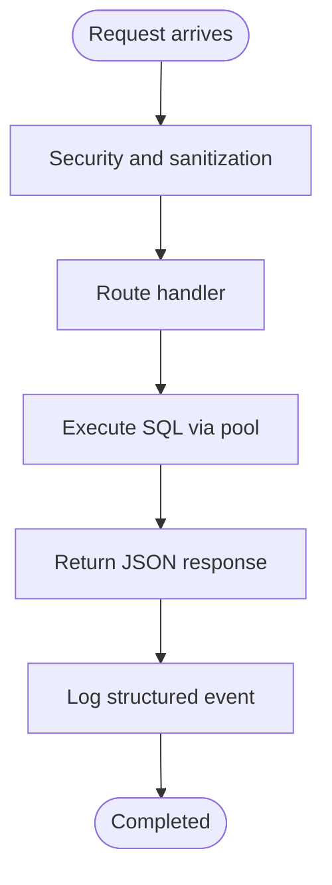
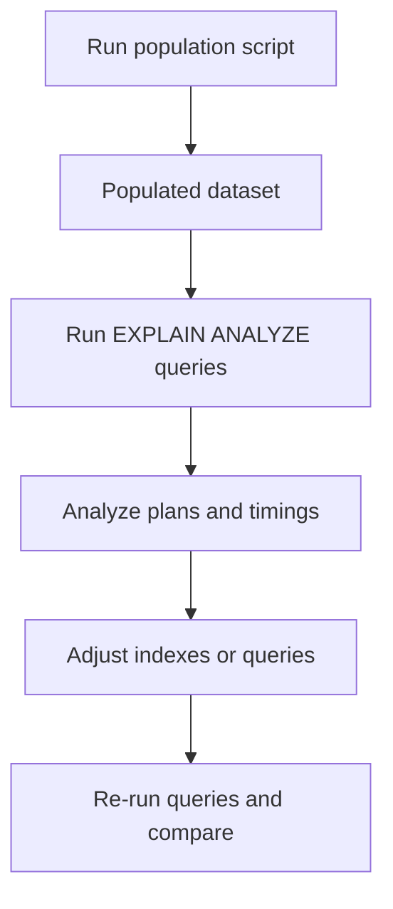
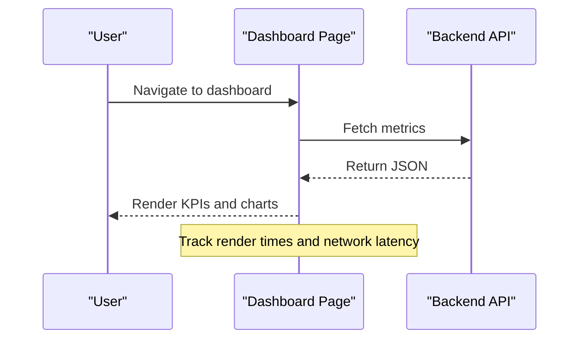
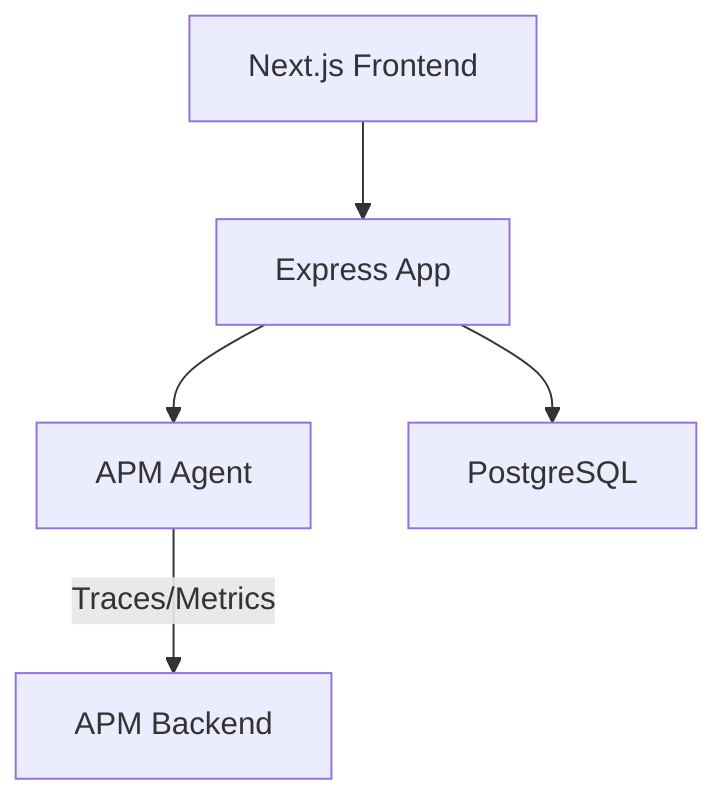
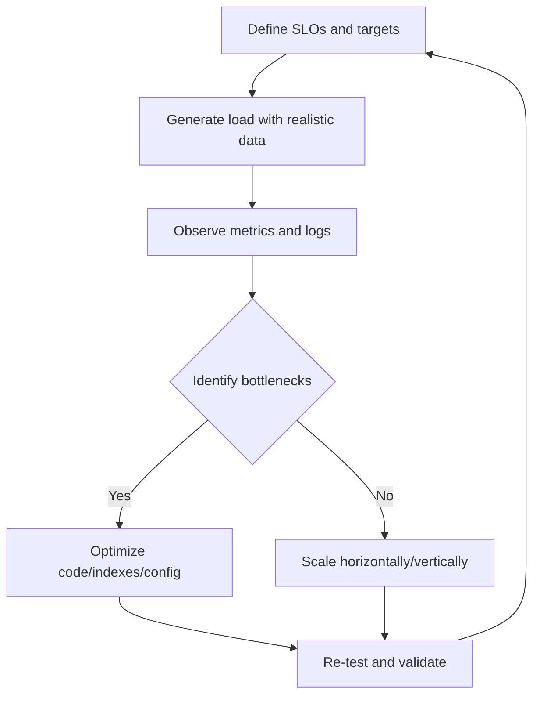
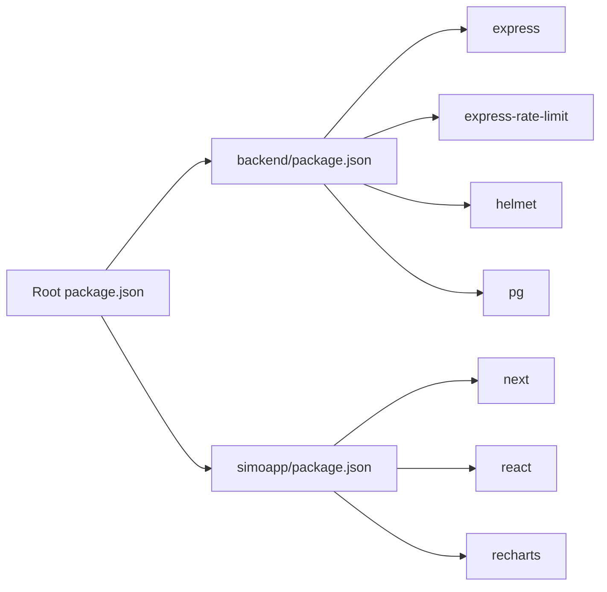

# Monitoring & Profiling

<cite>
**Referenced Files in This Document**
- [README.md](file://README.md)
- [package.json](file://package.json)
- [backend/package.json](file://backend/package.json)
- [simoapp/package.json](file://simoapp/package.json)
- [backend/index.js](file://backend/index.js)
- [backend/src/config/db.js](file://backend/src/config/db.js)
- [backend/db/index.js](file://backend/db/index.js)
- [backend/db/README.md](file://backend/db/README.md)
- [backend/db/carga/poblar_masivo.sql](file://backend/db/carga/poblar_masivo.sql)
- [backend/db/carga/consultas_rendimiento.sql](file://backend/db/carga/consultas_rendimiento.sql)
- [render.yaml](file://render.yaml)
- [simoapp/app/(protected)/page.tsx](file://simoapp/app/(protected)/page.tsx)
- [simoapp/components/dashboard/TarjetaMetrica.tsx](file://simoapp/components/dashboard/TarjetaMetrica.tsx)
- [simoapp/lib/dashboard/tipos.ts](file://simoapp/lib/dashboard/tipos.ts)
- [simoapp/components/catalogo/ProductosContext.tsx](file://simoapp/components/catalogo/ProductosContext.tsx)
</cite>

## Table of Contents
1. [Introduction](#introduction)
2. [Project Structure](#project-structure)
3. [Core Components](#core-components)
4. [Architecture Overview](#architecture-overview)
5. [Detailed Component Analysis](#detailed-component-analysis)
6. [Dependency Analysis](#dependency-analysis)
7. [Performance Considerations](#performance-considerations)
8. [Troubleshooting Guide](#troubleshooting-guide)
9. [Conclusion](#conclusion)

## Introduction
This document provides a comprehensive monitoring and profiling guide for SIMO, covering backend Node.js performance, frontend React/Next.js observability, database query profiling, log aggregation, error tracking, alerting, load testing, stress testing, capacity planning, and how to interpret performance reports to identify optimization opportunities.

SIMO is a retail inventory and sales system with:
- A Next.js frontend (App Router, React, TypeScript).
- An Express 5 backend (Node.js) connected to PostgreSQL.
- Docker-based orchestration and deployment configuration.

The repository currently uses basic logging via `console` and does not include an integrated APM or structured logger. The following guidance shows how to extend the existing codebase with production-grade monitoring while leveraging the built-in health endpoint, rate limiting, and database performance scripts already present.

## Project Structure
At a high level:
- Backend: Express application under `backend/`, with routes, controllers, middleware, and a shared PostgreSQL connection pool.
- Frontend: Next.js application under `simoapp/`, including pages, components, and dashboard types.
- Database: PostgreSQL schema, migrations, seeds, load data scripts, and performance reference queries.
- Deployment: Render configuration for the backend service.

**Diagram sources**
- [backend/index.js:1-56](file://backend/index.js#L1-L56)
- [backend/src/config/db.js:1-29](file://backend/src/config/db.js#L1-L29)

**Section sources**
- [README.md:27-64](file://README.md#L27-L64)
- [backend/index.js:1-56](file://backend/index.js#L1-L56)
- [backend/src/config/db.js:1-29](file://backend/src/config/db.js#L1-L29)

## Core Components
Key areas relevant to monitoring and profiling:
- Backend entry point and security middleware:
  - Health check endpoint for liveness/readiness probes.
  - Rate limiting to protect against traffic spikes.
  - Helmet and XSS sanitization for secure headers and input handling.
- Database connection pool:
  - Shared pool configuration supporting environment variables and SSL options.
  - Connection event logging for troubleshooting connectivity issues.
- Frontend dashboard:
  - Operational metrics displayed as KPI cards and charts.
  - Types defining dashboard data structures.

Operational hooks available today:
- `/api/health` returns service and database status.
- Console logs for errors and startup messages.
- Database performance reference queries using `EXPLAIN ANALYZE`.

**Section sources**
- [backend/index.js:62-70](file://backend/index.js#L62-L70)
- [backend/index.js:24-48](file://backend/index.js#L24-L48)
- [backend/db/index.js:14-20](file://backend/db/index.js#L14-L20)
- [simoapp/app/(protected)/page.tsx:255-285](file://simoapp/app/(protected)/page.tsx#L255-L285)
- [simoapp/lib/dashboard/tipos.ts:1-89](file://simoapp/lib/dashboard/tipos.ts#L1-L89)

## Architecture Overview
The runtime architecture includes:
- Browser running the Next.js app.
- Express server exposing REST endpoints.
- PostgreSQL database storing business data.
- Optional external services for APM, logging, and alerting (not yet integrated).

**Diagram sources**
- [backend/index.js:53-56](file://backend/index.js#L53-L56)
- [backend/src/config/db.js:17-26](file://backend/src/config/db.js#L17-L26)

## Detailed Component Analysis

### Backend Observability Baseline
Current capabilities:
- Health endpoint:
  - Probes database connectivity and returns status.
  - Useful for Kubernetes liveness/readiness checks and uptime monitors.
- Security and resilience:
  - Helmet sets secure HTTP headers.
  - Rate limiter protects API endpoints from excessive requests.
- Logging:
  - Uses `console.error` for error paths and `console.log` for startup/connection events.
  - No structured logger or request tracing yet.

Recommended enhancements:
- Add a structured logger (e.g., Pino or Winston) with correlation IDs per request.
- Introduce an APM agent (e.g., OpenTelemetry + a vendor backend) to capture:
  - Request latency, throughput, error rates.
  - Database query durations and slow queries.
  - CPU and memory usage over time.
- Centralize error reporting to an error tracking platform (e.g., Sentry) with stack traces and context.

**Diagram sources**
- [backend/index.js:24-56](file://backend/index.js#L24-L56)
- [backend/index.js:62-70](file://backend/index.js#L62-L70)

**Section sources**
- [backend/index.js:24-70](file://backend/index.js#L24-L70)
- [backend/db/index.js:14-20](file://backend/db/index.js#L14-L20)

### Database Performance and Query Profiling
Existing assets:
- Performance reference queries:
  - `backend/db/carga/consultas_rendimiento.sql` contains `EXPLAIN ANALYZE` queries for typical dashboard and history operations.
- Massive dataset generator:
  - `backend/db/carga/poblar_masivo.sql` generates coherent products, clients, and sales for load testing.
- Index documentation:
  - `backend/db/README.md` documents index improvements and measured query plans.

Profiling workflow:
- Populate test data using the massive population script.
- Run the performance reference queries to measure plan changes and timings.
- Compare before/after results after adding or adjusting indexes.
- Monitor slow queries in production by enabling statement logging at the database level and correlating with APM traces.

**Diagram sources**
- [backend/db/carga/poblar_masivo.sql:1-19](file://backend/db/carga/poblar_masivo.sql#L1-L19)
- [backend/db/carga/consultas_rendimiento.sql:1-19](file://backend/db/carga/consultas_rendimiento.sql#L1-L19)
- [backend/db/README.md:159-171](file://backend/db/README.md#L159-L171)

**Section sources**
- [backend/db/carga/consultas_rendimiento.sql:1-19](file://backend/db/carga/consultas_rendimiento.sql#L1-L19)
- [backend/db/carga/poblar_masivo.sql:1-19](file://backend/db/carga/poblar_masivo.sql#L1-L19)
- [backend/db/README.md:159-171](file://backend/db/README.md#L159-L171)

### Frontend Performance Tracking
Current state:
- Dashboard displays operational metrics (sales, units sold, rotation) using typed data models.
- No explicit frontend performance instrumentation or analytics SDKs are present.

Recommendations:
- Instrument network requests:
  - Wrap API calls with timing and error tracking.
  - Capture Time to First Byte (TTFB), Total Time, and payload sizes.
- Measure Core Web Vitals:
  - Largest Contentful Paint (LCP), First Input Delay (FID)/Interaction to Next Paint (INP), Cumulative Layout Shift (CLS).
- Use browser DevTools:
  - Performance tab for JavaScript execution and rendering.
  - Network tab for request waterfall and caching behavior.
- Optional: integrate a lightweight analytics or RUM (Real User Monitoring) library to collect user-facing metrics.

**Diagram sources**
- [simoapp/app/(protected)/page.tsx:255-285](file://simoapp/app/(protected)/page.tsx#L255-L285)
- [simoapp/lib/dashboard/tipos.ts:1-89](file://simoapp/lib/dashboard/tipos.ts#L1-L89)

**Section sources**
- [simoapp/app/(protected)/page.tsx:255-285](file://simoapp/app/(protected)/page.tsx#L255-L285)
- [simoapp/components/dashboard/TarjetaMetrica.tsx:1-37](file://simoapp/components/dashboard/TarjetaMetrica.tsx#L1-L37)
- [simoapp/lib/dashboard/tipos.ts:1-89](file://simoapp/lib/dashboard/tipos.ts#L1-L89)

### Application Monitoring Setup (APM)
To implement APM across the stack:
- Backend:
  - Install an APM agent compatible with Node.js and Express.
  - Configure it to trace HTTP requests, database queries, and background tasks.
  - Export traces/metrics to your chosen backend (vendor or self-hosted).
- Frontend:
  - Enable RUM if supported by the APM solution.
  - Alternatively, instrument fetch/axios calls to send custom metrics.

Integration points:
- Express middleware can be extended to add correlation IDs and span contexts.
- Database client can be wrapped to capture query duration and parameters (sanitized).
- Frontend API client should attach correlation IDs to requests for end-to-end tracing.

[No diagram sources needed since this diagram shows conceptual integration, not actual code structure]

### Log Aggregation, Error Tracking, and Alerting
Current logging:
- Backend uses `console.error` for exceptions and `console.log` for startup/connection events.
- No centralized log aggregation or structured format.

Recommended strategy:
- Structured logging:
  - Replace `console` with a structured logger that outputs JSON lines.
  - Include fields such as timestamp, level, message, correlationId, userId, route, method, statusCode, durationMs.
- Centralized collection:
  - Ship logs to a log aggregator (e.g., CloudWatch, Datadog, Elasticsearch).
- Error tracking:
  - Integrate an error tracking service to capture unhandled exceptions, stack traces, and contextual data.
- Alerting:
  - Define alerts for:
    - High error rates on critical endpoints.
    - Elevated p95/p99 latencies.
    - Database connection failures.
    - Rate limit rejections exceeding thresholds.

**Section sources**
- [backend/index.js:130-150](file://backend/index.js#L130-L150)
- [backend/db/index.js:14-20](file://backend/db/index.js#L14-L20)

### Load Testing, Stress Testing, and Capacity Planning
Load testing:
- Use the provided massive data population script to create realistic datasets.
- Simulate concurrent users hitting key endpoints (login, product listing, sales creation).
- Measure throughput, latency percentiles, and resource utilization.

Stress testing:
- Gradually increase load until error rates rise or latency exceeds SLOs.
- Identify breaking points for CPU, memory, database connections, and I/O.

Capacity planning:
- Establish baseline metrics under normal and peak loads.
- Define scaling triggers based on:
  - CPU utilization thresholds.
  - Database connection pool saturation.
  - Latency percentiles (p95/p99).
  - Error rates and rate-limit hits.

**Diagram sources**
- [backend/db/carga/poblar_masivo.sql:1-19](file://backend/db/carga/poblar_masivo.sql#L1-L19)
- [backend/db/carga/consultas_rendimiento.sql:1-19](file://backend/db/carga/consultas_rendimiento.sql#L1-L19)

**Section sources**
- [backend/db/carga/poblar_masivo.sql:1-19](file://backend/db/carga/poblar_masivo.sql#L1-L19)
- [backend/db/carga/consultas_rendimiento.sql:1-19](file://backend/db/carga/consultas_rendimiento.sql#L1-L19)

### Interpreting Performance Reports and Optimization Opportunities
What to look for:
- Backend:
  - Slow endpoints (high p95/p99 latency).
  - Frequent timeouts or 5xx errors.
  - High rate-limit rejection counts indicating abuse or misconfiguration.
- Database:
  - Full table scans where index scans are expected.
  - Long-running queries and lock contention.
- Frontend:
  - Slow network requests or large payloads.
  - Excessive re-renders or heavy computations on the main thread.

Optimization techniques:
- Backend:
  - Add caching for read-heavy endpoints.
  - Paginate and filter aggressively.
  - Reduce N+1 queries by batching or joining where appropriate.
- Database:
  - Tune indexes based on `EXPLAIN ANALYZE` results.
  - Partition large tables if necessary.
  - Adjust connection pool size and query timeouts.
- Frontend:
  - Lazy-load heavy components.
  - Debounce search inputs and reduce unnecessary re-renders.
  - Minimize payload sizes and enable compression.

**Section sources**
- [backend/index.js:34-48](file://backend/index.js#L34-L48)
- [backend/db/README.md:159-171](file://backend/db/README.md#L159-L171)

## Dependency Analysis
Runtime dependencies relevant to monitoring:
- Backend:
  - Express 5, rate limiting, helmet, pg client.
  - No APM or structured logger dependency currently.
- Frontend:
  - Next.js, React, Recharts; no analytics or RUM dependency currently.
- Deployment:
  - Render service definition sets environment variables and start command.

**Diagram sources**
- [package.json:1-15](file://package.json#L1-L15)
- [backend/package.json:15-24](file://backend/package.json#L15-L24)
- [simoapp/package.json:11-17](file://simoapp/package.json#L11-L17)

**Section sources**
- [package.json:1-15](file://package.json#L1-L15)
- [backend/package.json:15-24](file://backend/package.json#L15-L24)
- [simoapp/package.json:11-17](file://simoapp/package.json#L11-L17)
- [render.yaml:1-12](file://render.yaml#L1-L12)

## Performance Considerations
- Backend:
  - Keep rate limits aligned with expected traffic patterns.
  - Avoid blocking operations on the event loop; offload heavy work to workers or queues.
  - Use connection pooling efficiently and monitor pool saturation.
- Database:
  - Prefer indexed scans over full table scans.
  - Batch writes and minimize round trips.
  - Regularly review slow query logs and adjust indexes.
- Frontend:
  - Minimize bundle size and avoid unnecessary re-renders.
  - Cache static assets and use CDN where possible.
  - Monitor Core Web Vitals and optimize critical rendering path.

[No sources needed since this section provides general guidance]

## Troubleshooting Guide
Common issues and diagnostics:
- Health endpoint failures:
  - Check database connectivity and credentials.
  - Inspect pool error logs for connection issues.
- High error rates:
  - Review structured logs for stack traces and context.
  - Correlate with APM traces to pinpoint failing endpoints.
- Rate limit spikes:
  - Investigate bot activity or misconfigured clients.
  - Adjust rate limits or implement IP-based throttling.
- Slow queries:
  - Run `EXPLAIN ANALYZE` on problematic queries.
  - Verify indexes exist and match query predicates.

Actionable steps:
- Enable verbose logging temporarily during incidents.
- Collect APM traces around the failure window.
- Reproduce with controlled load using the population script.
- Validate fixes by re-running performance queries and monitoring metrics.

**Section sources**
- [backend/index.js:62-70](file://backend/index.js#L62-L70)
- [backend/db/index.js:14-20](file://backend/db/index.js#L14-L20)
- [backend/db/carga/consultas_rendimiento.sql:1-19](file://backend/db/carga/consultas_rendimiento.sql#L1-L19)

## Conclusion
SIMO has a solid foundation for monitoring and profiling:
- A health endpoint and rate limiting provide immediate operational visibility.
- Database performance scripts and index documentation support iterative optimization.
- The frontend dashboard exposes operational metrics but lacks dedicated performance instrumentation.

To reach production-grade observability:
- Introduce structured logging and APM across backend and frontend.
- Centralize logs and errors, and define alerting rules tied to SLOs.
- Use load and stress testing methodologies grounded in the provided data generation and performance queries.
- Continuously interpret performance reports to identify and resolve bottlenecks.

[No sources needed since this section summarizes without analyzing specific files]