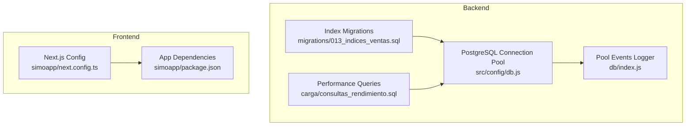
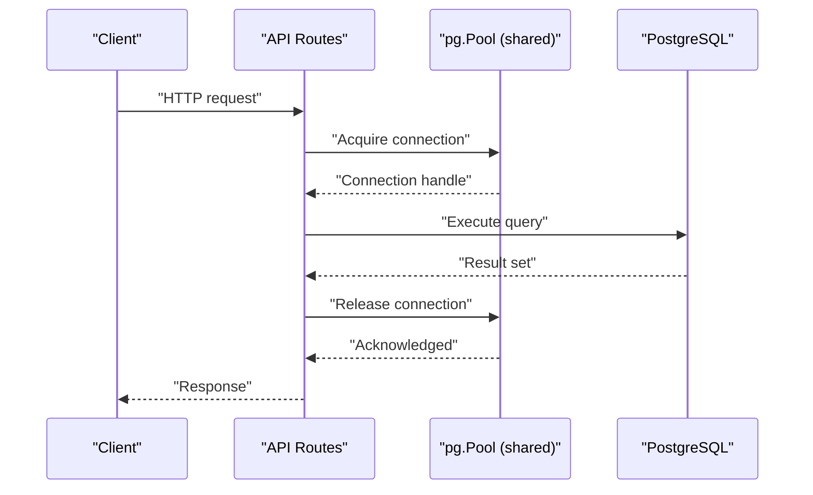
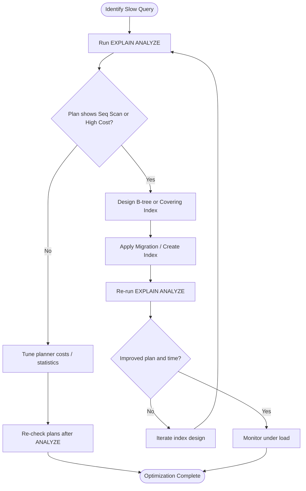
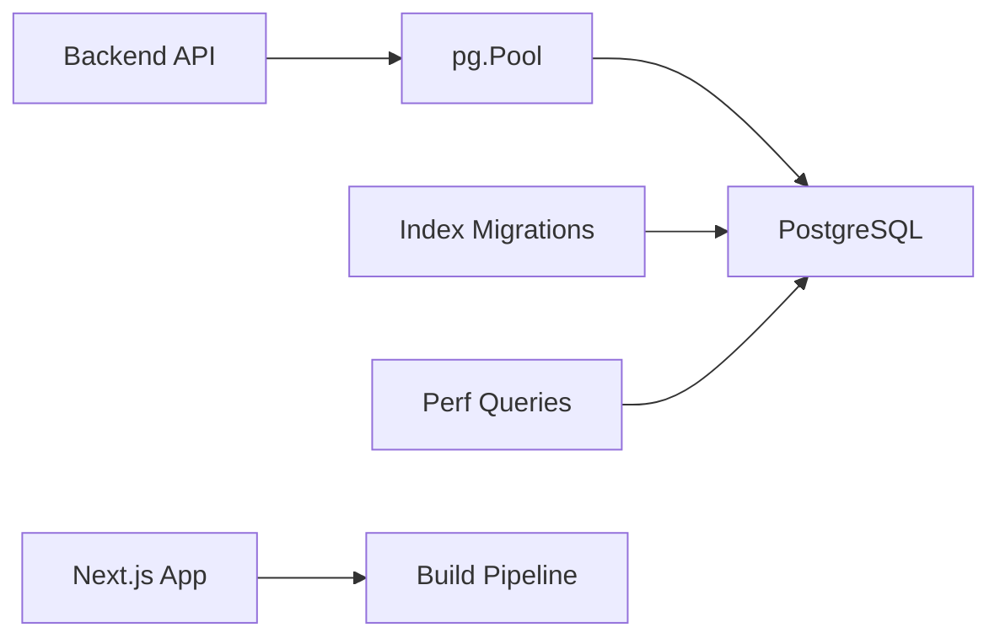

# Performance Optimization

<cite>
**Referenced Files in This Document**
- [db.js](file://backend/src/config/db.js)
- [index.js](file://backend/db/index.js)
- [013_indices_ventas.sql](file://backend/db/migrations/013_indices_ventas.sql)
- [consultas_rendimiento.sql](file://backend/db/carga/consultas_rendimiento.sql)
- [README.md](file://backend/db/README.md)
- [next.config.ts](file://simoapp/next.config.ts)
- [package.json](file://simoapp/package.json)
</cite>

## Table of Contents
1. [Introduction](#introduction)
2. [Project Structure](#project-structure)
3. [Core Components](#core-components)
4. [Architecture Overview](#architecture-overview)
5. [Detailed Component Analysis](#detailed-component-analysis)
6. [Dependency Analysis](#dependency-analysis)
7. [Performance Considerations](#performance-considerations)
8. [Troubleshooting Guide](#troubleshooting-guide)
9. [Conclusion](#conclusion)

## Introduction
This document provides performance optimization guidance for SIMO, focusing on database query tuning, indexing strategies, connection pooling configuration, frontend bundle and image optimization, profiling techniques, bottleneck identification, scalability considerations, and resource utilization. It is grounded in the repository’s existing database migrations, performance test queries, connection pool setup, and Next.js frontend configuration.

## Project Structure
SIMO consists of:
- A Node.js backend with a shared PostgreSQL connection pool and SQL-based performance tests and indexes.
- A Next.js frontend application that currently uses a minimal Next.js configuration file.

**Diagram sources**
- [db.js:1-29](file://backend/src/config/db.js#L1-L29)
- [index.js:1-23](file://backend/db/index.js#L1-L23)
- [013_indices_ventas.sql:1-71](file://backend/db/migrations/013_indices_ventas.sql#L1-L71)
- [consultas_rendimiento.sql:1-19](file://backend/db/carga/consultas_rendimiento.sql#L1-L19)
- [next.config.ts:1-8](file://simoapp/next.config.ts#L1-L8)
- [package.json:1-29](file://simoapp/package.json#L1-L29)

**Section sources**
- [db.js:1-29](file://backend/src/config/db.js#L1-L29)
- [index.js:1-23](file://backend/db/index.js#L1-L23)
- [013_indices_ventas.sql:1-71](file://backend/db/migrations/013_indices_ventas.sql#L1-L71)
- [consultas_rendimiento.sql:1-19](file://backend/db/carga/consultas_rendimiento.sql#L1-L19)
- [next.config.ts:1-8](file://simoapp/next.config.ts#L1-L8)
- [package.json:1-29](file://simoapp/package.json#L1-L29)

## Core Components
- Database connection pool: A single shared `pg.Pool` instance configured via environment variables, with optional SSL toggling.
- Pool event logging: Connect and error events are logged to aid operational visibility.
- Indexing strategy: B-tree indexes and covering indexes on sales tables, plus a database-level planner cost setting tuned for SSD storage.
- Performance query suite: EXPLAIN ANALYZE scripts to validate index effectiveness and identify slow queries.
- Frontend build configuration: A Next.js config placeholder ready for bundling and image optimizations.

Key implementation references:
- Connection pool creation and SSL handling: [db.js:1-29](file://backend/src/config/db.js#L1-L29)
- Shared pool export and event logging: [index.js:1-23](file://backend/db/index.js#L1-L23)
- Sales indexes and planner tuning: [013_indices_ventas.sql:1-71](file://backend/db/migrations/013_indices_ventas.sql#L1-L71)
- Performance query examples: [consultas_rendimiento.sql:1-19](file://backend/db/carga/consultas_rendimiento.sql#L1-L19)
- Next.js config entry point: [next.config.ts:1-8](file://simoapp/next.config.ts#L1-L8)

**Section sources**
- [db.js:1-29](file://backend/src/config/db.js#L1-L29)
- [index.js:1-23](file://backend/db/index.js#L1-L23)
- [013_indices_ventas.sql:1-71](file://backend/db/migrations/013_indices_ventas.sql#L1-L71)
- [consultas_rendimiento.sql:1-19](file://backend/db/carga/consultas_rendimiento.sql#L1-L19)
- [next.config.ts:1-8](file://simoapp/next.config.ts#L1-L8)

## Architecture Overview
The backend exposes APIs backed by PostgreSQL. All API routes share one connection pool instance. The database includes targeted indexes for high-frequency sales queries and a planner setting optimized for SSD-backed storage. The frontend is a Next.js app whose build pipeline can be extended for code splitting and image optimization.

**Diagram sources**
- [db.js:17-26](file://backend/src/config/db.js#L17-L26)
- [index.js:14-20](file://backend/db/index.js#L14-L20)

## Detailed Component Analysis

### Database Query Optimization and Indexing Strategy
The sales workload benefits from:
- Date-range indexes for history and dashboard queries.
- Covering indexes to avoid table lookups.
- Updated unique constraints with INCLUDE columns to support join-heavy reports.
- Planner cost tuning for SSD environments.

**Diagram sources**
- [consultas_rendimiento.sql:7-18](file://backend/db/carga/consultas_rendimiento.sql#L7-L18)
- [013_indices_ventas.sql:33-57](file://backend/db/migrations/013_indices_ventas.sql#L33-L57)
- [013_indices_ventas.sql:59-65](file://backend/db/migrations/013_indices_ventas.sql#L59-L65)

Concrete examples present in the repository:
- Historical sales by date range: [consultas_rendimiento.sql:8](file://backend/db/carga/consultas_rendimiento.sql#L8)
- Daily totals for dashboard: [consultas_rendimiento.sql:10](file://backend/db/carga/consultas_rendimiento.sql#L10)
- Top-selling products report: [consultas_rendimiento.sql:12](file://backend/db/carga/consultas_rendimiento.sql#L12)
- Product sales history: [consultas_rendimiento.sql:14](file://backend/db/carga/consultas_rendimiento.sql#L14)
- Quarterly units sold: [consultas_rendimiento.sql:16](file://backend/db/carga/consultas_rendimiento.sql#L16)
- Latest sales list: [consultas_rendimiento.sql:18](file://backend/db/carga/consultas_rendimiento.sql#L18)

Indexing actions implemented:
- Date-range index for sales history and latest sales: [013_indices_ventas.sql:33-34](file://backend/db/migrations/013_indices_ventas.sql#L33-L34)
- Partial covering index for completed sales by date: [013_indices_ventas.sql:36-38](file://backend/db/migrations/013_indices_ventas.sql#L36-L38)
- Unique constraint with INCLUDE columns for product-report joins: [013_indices_ventas.sql:40-52](file://backend/db/migrations/013_indices_ventas.sql#L40-L52)
- Covering index for product sales details: [013_indices_ventas.sql:54-57](file://backend/db/migrations/013_indices_ventas.sql#L54-L57)
- Planner cost tuning for SSD: [013_indices_ventas.sql:59-65](file://backend/db/migrations/013_indices_ventas.sql#L59-L65)

Operational notes:
- After large data loads, run VACUUM ANALYZE to keep Index Only Scans efficient: [README.md:173-179](file://backend/db/README.md#L173-L179)

**Section sources**
- [consultas_rendimiento.sql:1-19](file://backend/db/carga/consultas_rendimiento.sql#L1-L19)
- [013_indices_ventas.sql:1-71](file://backend/db/migrations/013_indices_ventas.sql#L1-L71)
- [README.md:173-179](file://backend/db/README.md#L173-L179)

### Connection Pool Configuration
The backend uses a single shared `pg.Pool`:
- Environment-driven configuration supports both cloud DSN (`DATABASE_URL`) and local Docker setups.
- SSL behavior is controlled via `DB_SSL`.
- Pool events log successful connections and unexpected errors.

Recommendations for high-load scenarios:
- Set explicit pool size based on CPU cores and expected concurrency.
- Configure timeouts:
  - `connectionTimeoutMillis` to fail fast when acquiring connections.
  - `idleTimeoutMillis` to reclaim idle connections.
- Keep a small minimum pool size to reduce cold-start latency.
- Enable connection lifecycle metrics in production.

Implementation reference:
- Pool creation and SSL handling: [db.js:17-26](file://backend/src/config/db.js#L17-L26)
- Event logging: [index.js:14-20](file://backend/db/index.js#L14-L20)

**Section sources**
- [db.js:1-29](file://backend/src/config/db.js#L1-L29)
- [index.js:1-23](file://backend/db/index.js#L1-L23)

### Caching Mechanisms
Current state:
- No application-level caching layer is visible in the analyzed files.

Recommended approach:
- Add an in-memory cache (e.g., Redis or an in-process cache) for read-heavy endpoints such as catalog listings, dashboard aggregates, and recent sales lists.
- Use cache-aside pattern:
  - Read: check cache; if miss, query DB and populate cache with TTL.
  - Write: invalidate or update cache entries.
- Cache keys should include tenant/user context where applicable.
- For dashboard aggregates, consider materialized views or periodic refresh jobs.

[No sources needed since this section provides general guidance]

### Frontend Performance Tuning
Current state:
- Next.js configuration is minimal and ready for enhancements.
- Dependencies include React, Next.js, and charting libraries.

Actionable optimizations:
- Code splitting:
  - Prefer dynamic imports for heavy pages and charts.
  - Route-based lazy loading for admin sections.
- Image optimization:
  - Use Next.js `<Image>` component for automatic resizing and modern formats.
  - Preload critical images; defer non-critical assets.
- Bundle size reduction:
  - Remove unused dependencies.
  - Tree-shake third-party libraries.
  - Analyze bundle with Next.js built-in tools.
- Rendering performance:
  - Memoize expensive computations.
  - Virtualize large tables/lists.
  - Debounce user inputs and search.

Configuration reference:
- Next.js config entry point: [next.config.ts:1-8](file://simoapp/next.config.ts#L1-L8)
- Frontend dependencies: [package.json:11-17](file://simoapp/package.json#L11-L17)

**Section sources**
- [next.config.ts:1-8](file://simoapp/next.config.ts#L1-L8)
- [package.json:1-29](file://simoapp/package.json#L1-L29)

### Profiling Tools and Bottleneck Identification
Database profiling:
- Use EXPLAIN ANALYZE with buffers and timing to inspect execution plans and I/O: [consultas_rendimiento.sql:7-18](file://backend/db/carga/consultas_rendimiento.sql#L7-L18)
- Track long-running queries and lock waits using database monitoring tools.

Application profiling:
- Enable Node.js profiling flags in development/staging to capture CPU and memory profiles.
- Log request durations and database call times at the API layer.

Bottleneck identification workflow:
- Identify slow endpoints via request logs.
- Correlate with database query plans.
- Validate improvements post-index or query changes.

**Section sources**
- [consultas_rendimiento.sql:1-19](file://backend/db/carga/consultas_rendimiento.sql#L1-L19)

### Scalability Considerations
- Database scaling:
  - Ensure proper indexing and planner settings for SSD-backed storage: [013_indices_ventas.sql:59-65](file://backend/db/migrations/013_indices_ventas.sql#L59-L65)
  - Partition large tables by date ranges if growth continues.
- Application scaling:
  - Horizontal scaling behind a load balancer; ensure connection pool sizing per instance.
  - Offload heavy analytics to background jobs or read replicas.
- Frontend scaling:
  - CDN for static assets and images.
  - Edge caching for public content.

**Section sources**
- [013_indices_ventas.sql:59-65](file://backend/db/migrations/013_indices_ventas.sql#L59-L65)

### Memory Management and Garbage Collection Tuning
Guidance:
- Monitor heap usage and GC pauses during load testing.
- Tune Node.js GC flags (e.g., max-old-space-size) according to container limits.
- Avoid retaining large objects in closures or global scopes.
- Stream large responses and datasets instead of buffering in memory.

[No sources needed since this section provides general guidance]

### Resource Utilization Optimization
- Right-size containers and set CPU/memory requests/limits.
- Use connection pooling to cap concurrent DB connections.
- Batch writes and use transactions to reduce round-trips.
- Compress API responses where appropriate.

[No sources needed since this section provides general guidance]

## Dependency Analysis
The backend relies on a single shared connection pool and SQL migrations for performance. The frontend depends on Next.js and related tooling.

**Diagram sources**
- [db.js:17-26](file://backend/src/config/db.js#L17-L26)
- [013_indices_ventas.sql:33-57](file://backend/db/migrations/013_indices_ventas.sql#L33-L57)
- [consultas_rendimiento.sql:7-18](file://backend/db/carga/consultas_rendimiento.sql#L7-L18)
- [next.config.ts:1-8](file://simoapp/next.config.ts#L1-L8)

**Section sources**
- [db.js:1-29](file://backend/src/config/db.js#L1-L29)
- [013_indices_ventas.sql:1-71](file://backend/db/migrations/013_indices_ventas.sql#L1-L71)
- [consultas_rendimiento.sql:1-19](file://backend/db/carga/consultas_rendimiento.sql#L1-L19)
- [next.config.ts:1-8](file://simoapp/next.config.ts#L1-L8)

## Performance Considerations
- Prioritize query optimization before adding caches.
- Validate all index changes with EXPLAIN ANALYZE against realistic data volumes.
- Monitor connection pool saturation and adjust sizes accordingly.
- Continuously profile both database and application layers under load.
- Optimize frontend bundles and images to reduce client-side latency.

[No sources needed since this section provides general guidance]

## Troubleshooting Guide
Common issues and remedies:
- Slow historical sales queries:
  - Verify date-range indexes exist and are used: [013_indices_ventas.sql:33-34](file://backend/db/migrations/013_indices_ventas.sql#L33-L34)
  - Run performance queries to confirm plan improvements: [consultas_rendimiento.sql:8](file://backend/db/carga/consultas_rendimiento.sql#L8)
- Dashboard aggregation slowness:
  - Confirm partial covering index for completed sales: [013_indices_ventas.sql:36-38](file://backend/db/migrations/013_indices_ventas.sql#L36-L38)
  - Check planner cost setting for SSD: [013_indices_ventas.sql:59-65](file://backend/db/migrations/013_indices_ventas.sql#L59-L65)
- Product report joins:
  - Ensure unique constraint with INCLUDE columns: [013_indices_ventas.sql:40-52](file://backend/db/migrations/013_indices_ventas.sql#L40-L52)
  - Validate covering index for product details: [013_indices_ventas.sql:54-57](file://backend/db/migrations/013_indices_ventas.sql#L54-L57)
- Connection pool errors:
  - Inspect pool event logs for connect and error events: [index.js:14-20](file://backend/db/index.js#L14-L20)
  - Review SSL configuration and environment variables: [db.js:11-15](file://backend/src/config/db.js#L11-L15)

**Section sources**
- [013_indices_ventas.sql:33-65](file://backend/db/migrations/013_indices_ventas.sql#L33-L65)
- [consultas_rendimiento.sql:7-18](file://backend/db/carga/consultas_rendimiento.sql#L7-L18)
- [index.js:14-20](file://backend/db/index.js#L14-L20)
- [db.js:11-15](file://backend/src/config/db.js#L11-L15)

## Conclusion
SIMO’s performance foundation centers on targeted PostgreSQL indexes, planner tuning for SSD storage, and a shared connection pool. The provided EXPLAIN ANALYZE scripts enable ongoing validation of query performance. To scale further, adopt application-level caching, extend frontend optimizations through Next.js configuration, and continuously monitor database and application metrics. These practices will help maintain low latency and stable resource utilization under increasing load.