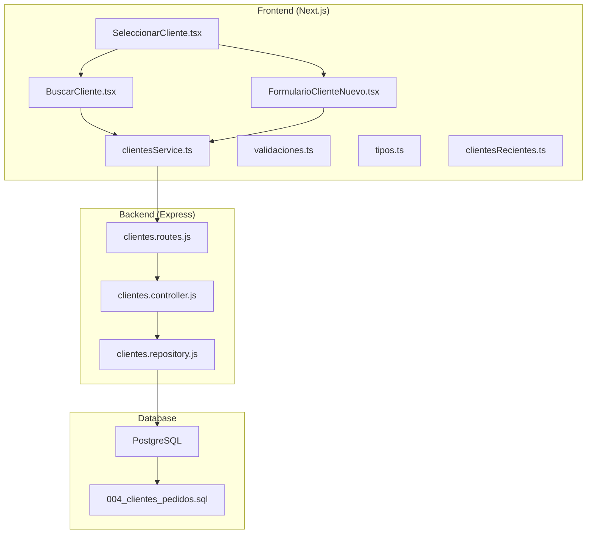
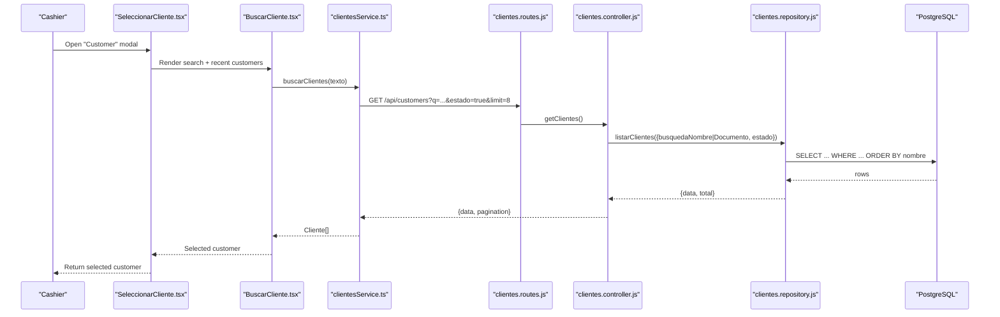
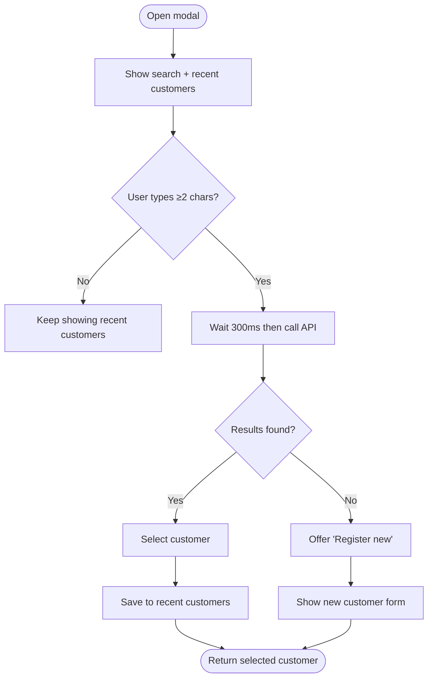
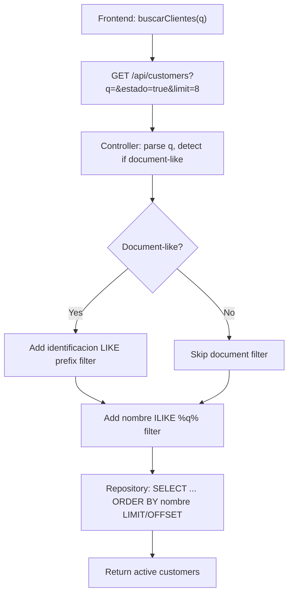
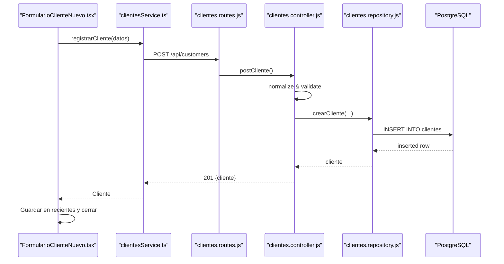
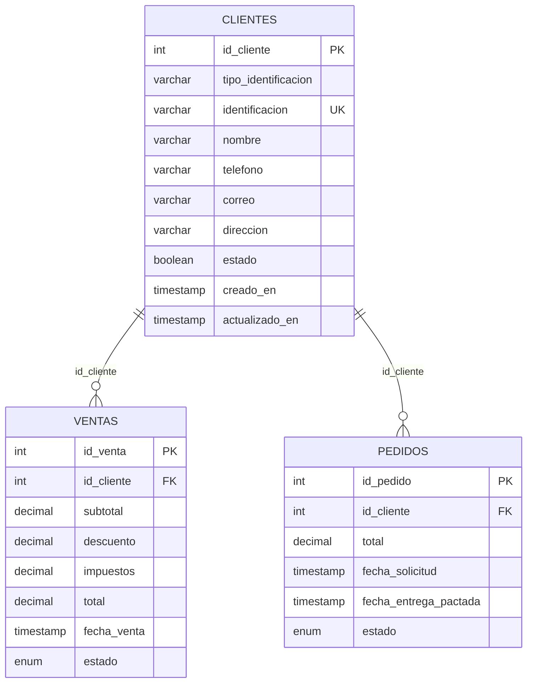
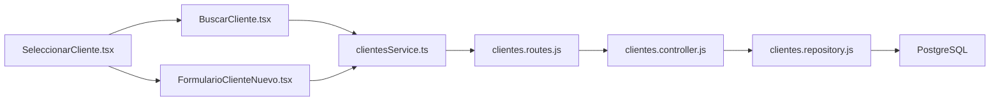

# Customer Integration

<cite>
**Referenced Files in This Document**
- [README.md](file://README.md)
- [clientes.controller.js](file://backend/src/controllers/clientes.controller.js)
- [clientes.repository.js](file://backend/src/repositories/clientes.repository.js)
- [clientes.routes.js](file://backend/src/routes/clientes.routes.js)
- [BuscarCliente.tsx](file://simoapp/components/ventas/BuscarCliente.tsx)
- [FormularioClienteNuevo.tsx](file://simoapp/components/ventas/FormularioClienteNuevo.tsx)
- [SeleccionarCliente.tsx](file://simoapp/components/ventas/SeleccionarCliente.tsx)
- [clientesService.ts](file://simoapp/lib/clientes/clientesService.ts)
- [validaciones.ts](file://simoapp/lib/clientes/validaciones.ts)
- [tipos.ts](file://simoapp/lib/clientes/tipos.ts)
- [clientesRecientes.ts](file://simoapp/lib/clientes/clientesRecientes.ts)
- [004_clientes_pedidos.sql](file://backend/db/migrations/004_clientes_pedidos.sql)
</cite>

## Table of Contents
1. [Introduction](#introduction)
2. [Project Structure](#project-structure)
3. [Core Components](#core-components)
4. [Architecture Overview](#architecture-overview)
5. [Detailed Component Analysis](#detailed-component-analysis)
6. [Dependency Analysis](#dependency-analysis)
7. [Performance Considerations](#performance-considerations)
8. [Troubleshooting Guide](#troubleshooting-guide)
9. [Conclusion](#conclusion)

## Introduction
This document explains how customers are integrated into the POS system, focusing on:
- How customers are associated with sales transactions and purchase history.
- The customer selection interface during checkout.
- Search functionality for finding existing customers by name or document number.
- New customer registration at checkout when no match is found.
- Data validation, duplicate detection, and privacy considerations.

The implementation spans a Next.js frontend (POS UI), an Express backend API, and PostgreSQL. The customer module provides search, creation, update, and history endpoints that the POS uses to associate customers with sales and track their purchases.

## Project Structure
Customer integration involves three layers:
- Frontend components for searching and registering customers in the POS.
- Backend routes, controllers, and repositories for data access.
- Database schema defining the customer table and related sales/pedidos tables.

**Diagram sources**
- [BuscarCliente.tsx:1-209](file://simoapp/components/ventas/BuscarCliente.tsx#L1-L209)
- [FormularioClienteNuevo.tsx:1-202](file://simoapp/components/ventas/FormularioClienteNuevo.tsx#L1-L202)
- [SeleccionarCliente.tsx:1-59](file://simoapp/components/ventas/SeleccionarCliente.tsx#L1-L59)
- [clientesService.ts:1-184](file://simoapp/lib/clientes/clientesService.ts#L1-L184)
- [validaciones.ts:1-64](file://simoapp/lib/clientes/validaciones.ts#L1-L64)
- [tipos.ts:1-40](file://simoapp/lib/clientes/tipos.ts#L1-L40)
- [clientesRecientes.ts:1-42](file://simoapp/lib/clientes/clientesRecientes.ts#L1-L42)
- [clientes.routes.js:1-27](file://backend/src/routes/clientes.routes.js#L1-L27)
- [clientes.controller.js:1-283](file://backend/src/controllers/clientes.controller.js#L1-L283)
- [clientes.repository.js:1-131](file://backend/src/repositories/clientes.repository.js#L1-L131)
- [004_clientes_pedidos.sql](file://backend/db/migrations/004_clientes_pedidos.sql)

**Section sources**
- [README.md:222-238](file://README.md#L222-L238)
- [clientes.routes.js:1-27](file://backend/src/routes/clientes.routes.js#L1-L27)
- [clientes.controller.js:1-283](file://backend/src/controllers/clientes.controller.js#L1-L283)
- [clientes.repository.js:1-131](file://backend/src/repositories/clientes.repository.js#L1-L131)
- [BuscarCliente.tsx:1-209](file://simoapp/components/ventas/BuscarCliente.tsx#L1-L209)
- [FormularioClienteNuevo.tsx:1-202](file://simoapp/components/ventas/FormularioClienteNuevo.tsx#L1-L202)
- [SeleccionarCliente.tsx:1-59](file://simoapp/components/ventas/SeleccionarCliente.tsx#L1-L59)
- [clientesService.ts:1-184](file://simoapp/lib/clientes/clientesService.ts#L1-L184)
- [validaciones.ts:1-64](file://simoapp/lib/clientes/validaciones.ts#L1-L64)
- [tipos.ts:1-40](file://simoapp/lib/clientes/tipos.ts#L1-L40)
- [clientesRecientes.ts:1-42](file://simoapp/lib/clientes/clientesRecientes.ts#L1-L42)

## Core Components
- Customer selection modal: orchestrates search and new registration flows.
- Predictive search component: debounced search with keyboard navigation and recent customers.
- New customer form: validates input, handles duplicates, and allows reusing an existing record.
- Service layer: calls backend APIs, maps responses, and centralizes error handling.
- Validation utilities: mirror backend rules for immediate feedback.
- Recent customers storage: local browser storage for quick access.
- Backend routes/controllers/repository: expose REST endpoints, validate inputs, and query the database.
- Database schema: defines customer records and relationships to sales and orders.

Key responsibilities:
- BuscarCliente.tsx: Debounced search, keyboard navigation, recent list, “register new” trigger.
- FormularioClienteNuevo.tsx: Client-side validation, duplicate handling, submission flow.
- SeleccionarCliente.tsx: Modal state management between search and registration.
- clientesService.ts: API contract, mock support, error mapping.
- validaciones.ts: Field-level validation mirroring backend rules.
- clientesRecientes.ts: LocalStorage-based recent customers.
- clientes.routes.js: Protected routes for customer operations.
- clientes.controller.js: Input normalization/validation, business rules, error responses.
- clientes.repository.js: SQL queries for CRUD, search, and history.

**Section sources**
- [SeleccionarCliente.tsx:1-59](file://simoapp/components/ventas/SeleccionarCliente.tsx#L1-L59)
- [BuscarCliente.tsx:1-209](file://simoapp/components/ventas/BuscarCliente.tsx#L1-L209)
- [FormularioClienteNuevo.tsx:1-202](file://simoapp/components/ventas/FormularioClienteNuevo.tsx#L1-L202)
- [clientesService.ts:1-184](file://simoapp/lib/clientes/clientesService.ts#L1-L184)
- [validaciones.ts:1-64](file://simoapp/lib/clientes/validaciones.ts#L1-L64)
- [clientesRecientes.ts:1-42](file://simoapp/lib/clientes/clientesRecientes.ts#L1-L42)
- [clientes.routes.js:1-27](file://backend/src/routes/clientes.routes.js#L1-L27)
- [clientes.controller.js:1-283](file://backend/src/controllers/clientes.controller.js#L1-L283)
- [clientes.repository.js:1-131](file://backend/src/repositories/clientes.repository.js#L1-L131)

## Architecture Overview
The POS customer integration follows a layered architecture:
- UI Layer: React components handle user interactions and display results.
- Service Layer: Normalizes requests/responses and handles errors.
- API Layer: Express routes protect endpoints and delegate to controllers.
- Controller Layer: Validates and normalizes input, enforces business rules.
- Repository Layer: Executes parameterized SQL queries.
- Database Layer: Stores customers and links them to sales and orders.

**Diagram sources**
- [SeleccionarCliente.tsx:1-59](file://simoapp/components/ventas/SeleccionarCliente.tsx#L1-L59)
- [BuscarCliente.tsx:1-209](file://simoapp/components/ventas/BuscarCliente.tsx#L1-L209)
- [clientesService.ts:84-96](file://simoapp/lib/clientes/clientesService.ts#L84-L96)
- [clientes.routes.js:18-24](file://backend/src/routes/clientes.routes.js#L18-L24)
- [clientes.controller.js:127-168](file://backend/src/controllers/clientes.controller.js#L127-L168)
- [clientes.repository.js:32-68](file://backend/src/repositories/clientes.repository.js#L32-L68)

## Detailed Component Analysis

### Customer Selection Interface
The selection modal manages two screens:
- Search screen: predictive search with recent customers shown when no query is entered.
- Registration screen: short form to register a new customer using what was typed in the search box.

Behavior highlights:
- Keyboard navigation (arrow keys, Enter).
- Debounced search after 300 ms of inactivity.
- Error retry option.
- “Register new customer” link when no active matches are found.
- On selection, the customer is saved to recent customers and returned to the caller.

**Diagram sources**
- [SeleccionarCliente.tsx:1-59](file://simoapp/components/ventas/SeleccionarCliente.tsx#L1-L59)
- [BuscarCliente.tsx:47-90](file://simoapp/components/ventas/BuscarCliente.tsx#L47-L90)
- [clientesRecientes.ts:33-41](file://simoapp/lib/clientes/clientesRecientes.ts#L33-L41)

**Section sources**
- [SeleccionarCliente.tsx:1-59](file://simoapp/components/ventas/SeleccionarCliente.tsx#L1-L59)
- [BuscarCliente.tsx:1-209](file://simoapp/components/ventas/BuscarCliente.tsx#L1-L209)
- [clientesRecientes.ts:1-42](file://simoapp/lib/clientes/clientesRecientes.ts#L1-L42)

### Search Functionality Implementation
Search supports:
- Name search by content (case-insensitive).
- Document number search by prefix (normalized without dots/spaces).
- Only active customers are returned.
- Pagination parameters are supported; the POS requests a limited set of suggestions.

Algorithm details:
- Frontend debounces input to reduce network calls.
- Service layer sends q and estado=true to the backend.
- Controller normalizes the query and builds filters:
  - If the query looks like a document, it adds a prefix match on identificacion.
  - It always adds a case-insensitive substring match on nombre.
- Repository executes a single query with OR conditions and returns paginated results.

**Diagram sources**
- [clientesService.ts:84-96](file://simoapp/lib/clientes/clientesService.ts#L84-L96)
- [clientes.controller.js:127-168](file://backend/src/controllers/clientes.controller.js#L127-L168)
- [clientes.repository.js:32-68](file://backend/src/repositories/clientes.repository.js#L32-L68)

**Section sources**
- [BuscarCliente.tsx:47-90](file://simoapp/components/ventas/BuscarCliente.tsx#L47-L90)
- [clientesService.ts:84-96](file://simoapp/lib/clientes/clientesService.ts#L84-L96)
- [clientes.controller.js:127-168](file://backend/src/controllers/clientes.controller.js#L127-L168)
- [clientes.repository.js:32-68](file://backend/src/repositories/clientes.repository.js#L32-L68)

### New Customer Registration During Checkout
When no active customer matches the search, the cashier can register a new one directly from the POS.

Flow:
- The form pre-fills fields based on whether the search text looks like a document or a name.
- Client-side validation mirrors backend rules.
- On submit, the service normalizes data and calls POST /api/customers.
- If the backend returns 409 (duplicate document), the form shows the existing customer and offers to reuse them.
- On success, the newly created or reused customer is saved to recent customers and returned to the caller.

**Diagram sources**
- [FormularioClienteNuevo.tsx:66-86](file://simoapp/components/ventas/FormularioClienteNuevo.tsx#L66-L86)
- [clientesService.ts:98-116](file://simoapp/lib/clientes/clientesService.ts#L98-L116)
- [clientes.controller.js:73-122](file://backend/src/controllers/clientes.controller.js#L73-L122)
- [clientes.repository.js:10-18](file://backend/src/repositories/clientes.repository.js#L10-L18)

**Section sources**
- [FormularioClienteNuevo.tsx:1-202](file://simoapp/components/ventas/FormularioClienteNuevo.tsx#L1-L202)
- [clientesService.ts:98-116](file://simoapp/lib/clientes/clientesService.ts#L98-L116)
- [clientes.controller.js:73-122](file://backend/src/controllers/clientes.controller.js#L73-L122)
- [clientes.repository.js:10-18](file://backend/src/repositories/clientes.repository.js#L10-L18)

### Customer Lookup Examples
- By name: Type a full or partial name; the backend performs a case-insensitive substring match.
- By document number: Type a document prefix (e.g., first digits of cédula/NIT); the backend matches the normalized identificacion prefix.
- By phone: The search does not include phone matching; use name or document. Phone appears in results if present.

Notes:
- The search excludes inactive customers.
- The maximum number of suggestions requested by the POS is limited to improve performance.

**Section sources**
- [README.md:228-230](file://README.md#L228-L230)
- [clientes.controller.js:144-153](file://backend/src/controllers/clientes.controller.js#L144-L153)
- [clientes.repository.js:40-50](file://backend/src/repositories/clientes.repository.js#L40-L50)
- [clientesService.ts:84-96](file://simoapp/lib/clientes/clientesService.ts#L84-L96)

### Relationship Between Customers and Sales History
Customers are linked to sales and orders through foreign keys. The repository exposes a history endpoint that aggregates:
- Completed purchases count, total amount spent, last purchase date.
- Total open orders and overdue indicators.
- Recent sales and orders with payment method and product counts.

Automatic association:
- When a customer is selected during checkout, the sale should be recorded with the customer’s ID so that future history queries reflect the transaction.
- The history endpoint reads from ventas and pedidos tables filtered by id_cliente.

**Diagram sources**
- [clientes.repository.js:84-121](file://backend/src/repositories/clientes.repository.js#L84-L121)
- [004_clientes_pedidos.sql](file://backend/db/migrations/004_clientes_pedidos.sql)

**Section sources**
- [clientes.repository.js:84-121](file://backend/src/repositories/clientes.repository.js#L84-L121)
- [README.md:233](file://README.md#L233)

### Data Validation, Duplicate Detection, and Privacy Considerations
Validation:
- Frontend validation mirrors backend rules for immediate feedback.
- Backend validates required fields, formats, lengths, and allowed values.
- Document normalization removes dots/spaces and uppercases letters to ensure consistent storage and comparison.

Duplicate detection:
- POST /api/customers returns 409 with the existing customer if the document already exists.
- The frontend displays the existing customer and allows reusing them instead of creating a duplicate.

Privacy:
- Sensitive contact fields (phone, email, address) are optional and validated but not exposed beyond necessary endpoints.
- Recent customers are stored locally in the browser and do not leak to the server.
- Only active customers are returned by default in search to prevent billing inactive accounts.

Best practices:
- Always send normalized documents to the backend.
- Handle 409 gracefully by offering to reuse the existing customer.
- Avoid storing unnecessary PII in local storage; only keep minimal identifiers and names for UX.

**Section sources**
- [validaciones.ts:9-63](file://simoapp/lib/clientes/validaciones.ts#L9-L63)
- [clientes.controller.js:23-68](file://backend/src/controllers/clientes.controller.js#L23-L68)
- [clientes.controller.js:73-122](file://backend/src/controllers/clientes.controller.js#L73-L122)
- [FormularioClienteNuevo.tsx:76-86](file://simoapp/components/ventas/FormularioClienteNuevo.tsx#L76-L86)
- [clientesService.ts:72-82](file://simoapp/lib/clientes/clientesService.ts#L72-L82)
- [clientesRecientes.ts:1-42](file://simoapp/lib/clientes/clientesRecientes.ts#L1-L42)

## Dependency Analysis
The following diagram shows key dependencies among modules involved in customer integration.

**Diagram sources**
- [SeleccionarCliente.tsx:1-59](file://simoapp/components/ventas/SeleccionarCliente.tsx#L1-L59)
- [BuscarCliente.tsx:1-209](file://simoapp/components/ventas/BuscarCliente.tsx#L1-L209)
- [FormularioClienteNuevo.tsx:1-202](file://simoapp/components/ventas/FormularioClienteNuevo.tsx#L1-L202)
- [clientesService.ts:1-184](file://simoapp/lib/clientes/clientesService.ts#L1-L184)
- [clientes.routes.js:1-27](file://backend/src/routes/clientes.routes.js#L1-L27)
- [clientes.controller.js:1-283](file://backend/src/controllers/clientes.controller.js#L1-L283)
- [clientes.repository.js:1-131](file://backend/src/repositories/clientes.repository.js#L1-L131)

**Section sources**
- [SeleccionarCliente.tsx:1-59](file://simoapp/components/ventas/SeleccionarCliente.tsx#L1-L59)
- [BuscarCliente.tsx:1-209](file://simoapp/components/ventas/BuscarCliente.tsx#L1-L209)
- [FormularioClienteNuevo.tsx:1-202](file://simoapp/components/ventas/FormularioClienteNuevo.tsx#L1-L202)
- [clientesService.ts:1-184](file://simoapp/lib/clientes/clientesService.ts#L1-L184)
- [clientes.routes.js:1-27](file://backend/src/routes/clientes.routes.js#L1-L27)
- [clientes.controller.js:1-283](file://backend/src/controllers/clientes.controller.js#L1-L283)
- [clientes.repository.js:1-131](file://backend/src/repositories/clientes.repository.js#L1-L131)

## Performance Considerations
- Debounced search reduces unnecessary API calls while typing.
- Backend search uses efficient LIKE and ILIKE patterns with pagination.
- Limiting suggestion count prevents large payloads to the POS.
- Recent customers are cached locally to avoid repeated lookups for frequent clients.
- Use of parameterized queries avoids injection and leverages database indexes where available.

[No sources needed since this section provides general guidance]

## Troubleshooting Guide
Common issues and resolutions:
- No results in search:
  - Ensure the customer is active; inactive customers are excluded by default.
  - Verify the query length is at least two characters.
  - Check network connectivity and API availability.
- Duplicate document on registration:
  - The backend returns 409 with the existing customer; reuse the provided record instead of creating a duplicate.
- Validation errors:
  - Confirm document format (3–30 alphanumeric/dash), name length (≤150), phone format (7–30 chars), email format (≤150), address length (≤200).
- Recent customers not showing:
  - Browser may block localStorage; the app degrades gracefully without recent suggestions.

Operational checks:
- Validate environment variables for API base URL and feature flags.
- Inspect browser console for Axios errors and map them using the service’s error handler.
- Review backend logs for controller/repository errors.

**Section sources**
- [clientes.controller.js:127-168](file://backend/src/controllers/clientes.controller.js#L127-L168)
- [clientes.controller.js:73-122](file://backend/src/controllers/clientes.controller.js#L73-L122)
- [clientesService.ts:72-82](file://simoapp/lib/clientes/clientesService.ts#L72-L82)
- [clientesService.ts:118-130](file://simoapp/lib/clientes/clientesService.ts#L118-L130)
- [clientesRecientes.ts:24-41](file://simoapp/lib/clientes/clientesRecientes.ts#L24-L41)

## Conclusion
The POS customer integration provides a streamlined workflow for selecting or registering customers during checkout, robust search capabilities, and reliable history tracking tied to sales and orders. Validation and duplicate detection ensure data integrity, while local caching improves usability. Following the documented flows and best practices will help maintain a smooth, secure, and performant customer experience in the POS.

[No sources needed since this section summarizes without analyzing specific files]