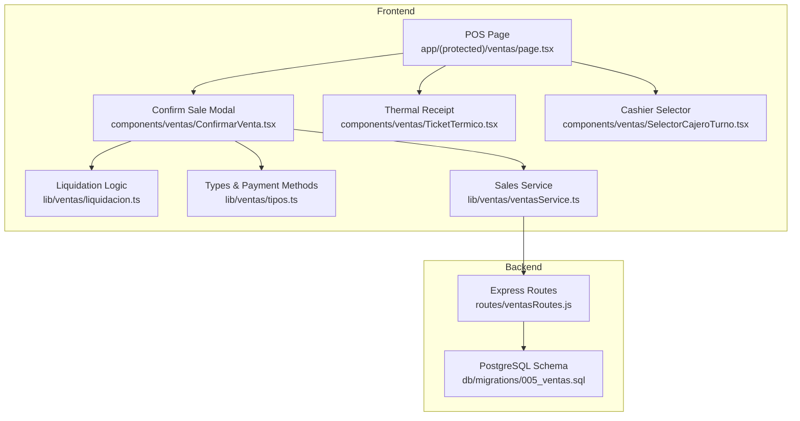
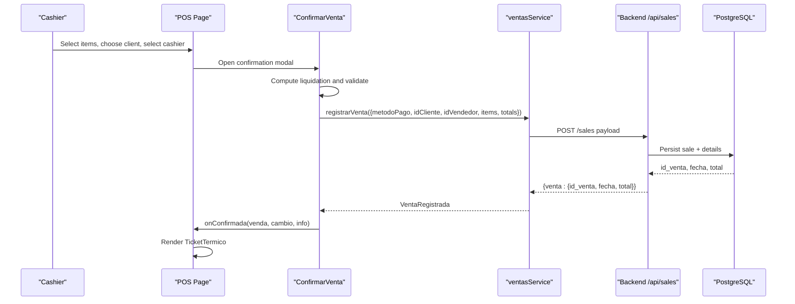
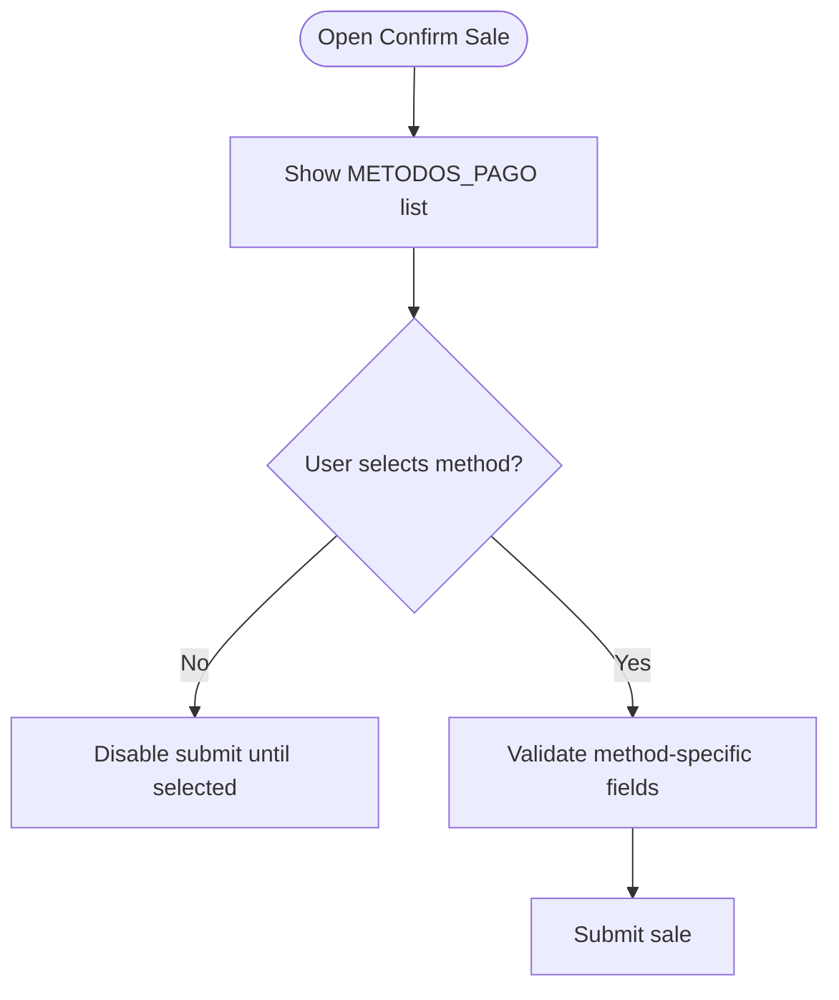
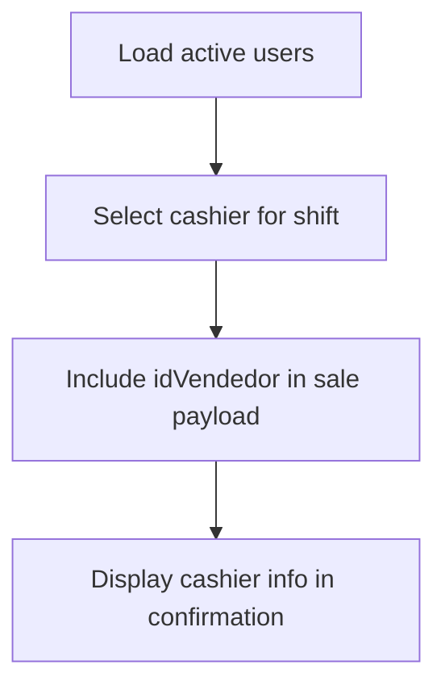
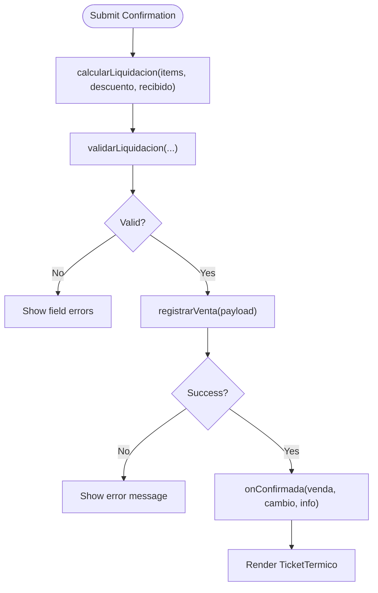
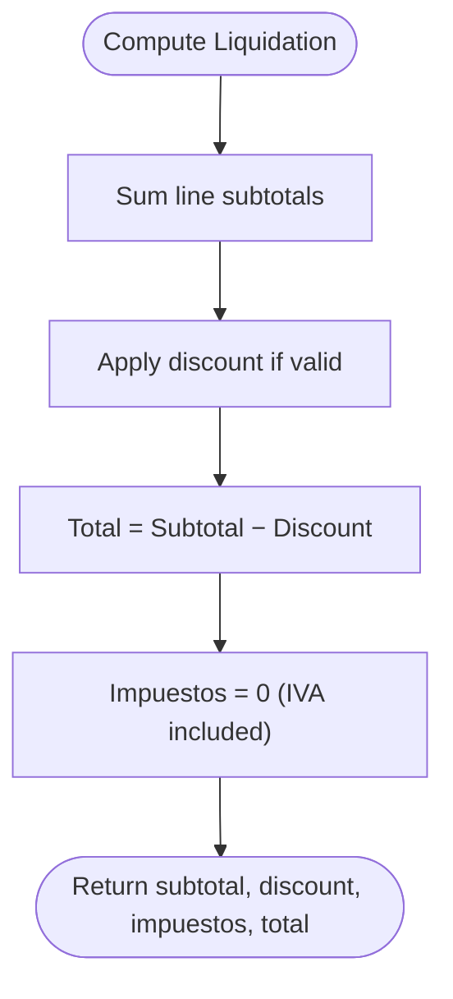
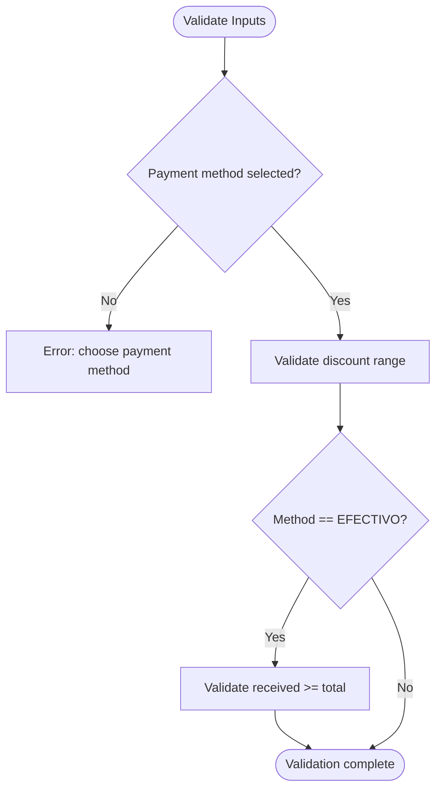
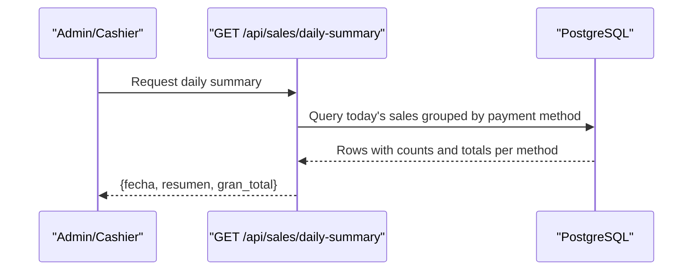
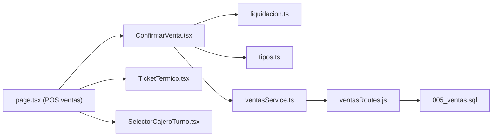

# Payment Processing

<cite>
**Referenced Files in This Document**
- [ConfirmarVenta.tsx](file://simoapp/components/ventas/ConfirmarVenta.tsx)
- [liquidacion.ts](file://simoapp/lib/ventas/liquidacion.ts)
- [tipos.ts](file://simoapp/lib/ventas/tipos.ts)
- [ventasService.ts](file://simoapp/lib/ventas/ventasService.ts)
- [TicketTermico.tsx](file://simoapp/components/ventas/TicketTermico.tsx)
- [page.tsx (POS ventas)](file://simoapp/app/(protected)/ventas/page.tsx)
- [SelectorCajeroTurno.tsx](file://simoapp/components/ventas/SelectorCajeroTurno.tsx)
- [ventasRoutes.js](file://backend/routes/ventasRoutes.js)
- [005_ventas.sql](file://backend/db/migrations/005_ventas.sql)
</cite>

## Table of Contents
1. [Introduction](#introduction)
2. [Project Structure](#project-structure)
3. [Core Components](#core-components)
4. [Architecture Overview](#architecture-overview)
5. [Detailed Component Analysis](#detailed-component-analysis)
6. [Dependency Analysis](#dependency-analysis)
7. [Performance Considerations](#performance-considerations)
8. [Troubleshooting Guide](#troubleshooting-guide)
9. [Conclusion](#conclusion)

## Introduction
This document explains payment processing in the POS system, focusing on how payment methods are handled, how cashiers are assigned to transactions, and how sales are confirmed. It also covers supported payment types, tax handling, discount application, validation rules, amount verification, receipt generation, daily cash summary reporting, and end-of-day reconciliation considerations. The implementation uses a frontend-first approach with a proposed backend contract for sales registration and an existing daily-summary endpoint.

## Project Structure
The payment flow spans the Next.js frontend and the Express backend:
- Frontend components handle cashier selection, payment method selection, liquidation calculations, validation, and receipt printing.
- A service layer abstracts whether the sale is recorded via a mock or the real API.
- The backend defines database schema for payments and sales, and exposes endpoints for processing sales and generating daily summaries.

**Diagram sources**
- [page.tsx (POS ventas):109-125](file://simoapp/app/(protected)/ventas/page.tsx#L109-L125)
- [ConfirmarVenta.tsx:68-142](file://simoapp/components/ventas/ConfirmarVenta.tsx#L68-L142)
- [liquidacion.ts:28-49](file://simoapp/lib/ventas/liquidacion.ts#L28-L49)
- [tipos.ts:35-56](file://simoapp/lib/ventas/tipos.ts#L35-L56)
- [ventasService.ts:43-75](file://simoapp/lib/ventas/ventasService.ts#L43-L75)
- [TicketTermico.tsx:57-79](file://simoapp/components/ventas/TicketTermico.tsx#L57-L79)
- [SelectorCajeroTurno.tsx:1-22](file://simoapp/components/ventas/SelectorCajeroTurno.tsx#L1-L22)
- [ventasRoutes.js:10-11](file://backend/routes/ventasRoutes.js#L10-L11)
- [005_ventas.sql:13-29](file://backend/db/migrations/005_ventas.sql#L13-L29)

**Section sources**
- [page.tsx (POS ventas):109-125](file://simoapp/app/(protected)/ventas/page.tsx#L109-L125)
- [ConfirmarVenta.tsx:68-142](file://simoapp/components/ventas/ConfirmarVenta.tsx#L68-L142)
- [ventasService.ts:43-75](file://simoapp/lib/ventas/ventasService.ts#L43-L75)
- [ventasRoutes.js:10-11](file://backend/routes/ventasRoutes.js#L10-L11)
- [005_ventas.sql:13-29](file://backend/db/migrations/005_ventas.sql#L13-L29)

## Core Components
- Payment method configuration and display:
  - Supported codes and labels are defined centrally and used by both confirmation UI and receipts.
- Liquidation engine:
  - Computes subtotal, discount, taxes, total, change, and shortage; validates inputs.
- Sales service:
  - Encapsulates calling either a mock or the real API; maps errors to user-friendly messages.
- Confirmation modal:
  - Orchestrates cashier info, client data, payment method selection, discounts, cash received, and submission.
- Thermal receipt:
  - Formats and prints an 80mm receipt including totals, IVA note, payment method, received amount, and change.
- Daily cash summary:
  - Backend endpoint aggregates sales by payment method for the current day.

**Section sources**
- [tipos.ts:35-56](file://simoapp/lib/ventas/tipos.ts#L35-L56)
- [liquidacion.ts:28-49](file://simoapp/lib/ventas/liquidacion.ts#L28-L49)
- [ventasService.ts:43-75](file://simoapp/lib/ventas/ventasService.ts#L43-L75)
- [ConfirmarVenta.tsx:68-142](file://simoapp/components/ventas/ConfirmarVenta.tsx#L68-L142)
- [TicketTermico.tsx:57-79](file://simoapp/components/ventas/TicketTermico.tsx#L57-L79)
- [ventasRoutes.js:113-147](file://backend/routes/ventasRoutes.js#L113-L147)

## Architecture Overview
The POS confirms a sale through a multi-step workflow:
1. The cashier is selected for the shift and associated with the transaction.
2. The customer may be selected; otherwise it defaults to end consumer.
3. The confirmation modal computes liquidation, validates inputs, and sends a sale record to the backend service.
4. The service calls the backend (or mock), which persists the sale and returns identifiers and totals.
5. The POS renders a thermal receipt with all relevant details.

**Diagram sources**
- [ConfirmarVenta.tsx:109-142](file://simoapp/components/ventas/ConfirmarVenta.tsx#L109-L142)
- [ventasService.ts:43-75](file://simoapp/lib/ventas/ventasService.ts#L43-L75)
- [ventasRoutes.js:10-11](file://backend/routes/ventasRoutes.js#L10-L11)
- [005_ventas.sql:40-67](file://backend/db/migrations/005_ventas.sql#L40-L67)

## Detailed Component Analysis

### Payment Method Handling
- Supported payment types are defined centrally and include cash, digital wallets, bank transfers, card, and other methods.
- The confirmation UI presents these options and enforces that one must be selected before submission.
- Non-cash methods do not integrate with banks; they are informational only at this stage.

**Diagram sources**
- [tipos.ts:35-42](file://simoapp/lib/ventas/tipos.ts#L35-L42)
- [ConfirmarVenta.tsx:247-300](file://simoapp/components/ventas/ConfirmarVenta.tsx#L247-L300)

**Section sources**
- [tipos.ts:35-42](file://simoapp/lib/ventas/tipos.ts#L35-L42)
- [ConfirmarVenta.tsx:247-300](file://simoapp/components/ventas/ConfirmarVenta.tsx#L247-L300)

### Cashier Assignment
- The POS loads active users and allows selecting the cashier on duty.
- The selected cashier’s identifier is included when confirming the sale.
- The confirmation modal displays the cashier’s name and role for transparency.

**Diagram sources**
- [page.tsx (POS ventas):109-125](file://simoapp/app/(protected)/ventas/page.tsx#L109-L125)
- [ConfirmarVenta.tsx:224-242](file://simoapp/components/ventas/ConfirmarVenta.tsx#L224-L242)
- [SelectorCajeroTurno.tsx:1-22](file://simoapp/components/ventas/SelectorCajeroTurno.tsx#L1-L22)

**Section sources**
- [page.tsx (POS ventas):109-125](file://simoapp/app/(protected)/ventas/page.tsx#L109-L125)
- [ConfirmarVenta.tsx:224-242](file://simoapp/components/ventas/ConfirmarVenta.tsx#L224-L242)
- [SelectorCajeroTurno.tsx:1-22](file://simoapp/components/ventas/SelectorCajeroTurno.tsx#L1-L22)

### Transaction Confirmation Workflow
- The confirmation modal calculates liquidation, validates inputs, and submits the sale.
- For cash payments, it requires the received amount and shows change or shortage.
- On success, it triggers receipt rendering and clears the cart state.

**Diagram sources**
- [ConfirmarVenta.tsx:109-142](file://simoapp/components/ventas/ConfirmarVenta.tsx#L109-L142)
- [liquidacion.ts:28-49](file://simoapp/lib/ventas/liquidacion.ts#L28-L49)
- [liquidacion.ts:60-98](file://simoapp/lib/ventas/liquidacion.ts#L60-L98)
- [ventasService.ts:43-75](file://simoapp/lib/ventas/ventasService.ts#L43-L75)

**Section sources**
- [ConfirmarVenta.tsx:109-142](file://simoapp/components/ventas/ConfirmarVenta.tsx#L109-L142)
- [liquidacion.ts:28-49](file://simoapp/lib/ventas/liquidacion.ts#L28-L49)
- [liquidacion.ts:60-98](file://simoapp/lib/ventas/liquidacion.ts#L60-L98)
- [ventasService.ts:43-75](file://simoapp/lib/ventas/ventasService.ts#L43-L75)

### Supported Payment Types
- The system supports:
  - EFECTIVO (cash)
  - NEQUI (digital wallet)
  - DAVIPLATA (digital wallet)
  - TRANSFERENCIA (bank transfer)
  - TARJETA (debit/credit card)
  - OTRO (other)
- These codes are enforced in the database and mirrored in the frontend type definitions.

**Section sources**
- [tipos.ts:35-42](file://simoapp/lib/ventas/tipos.ts#L35-L42)
- [005_ventas.sql:22-29](file://backend/db/migrations/005_ventas.sql#L22-L29)

### Tax Calculations and Discount Applications
- Prices are treated as inclusive of IVA; the liquidation engine sets impuestos to zero and ensures total equals subtotal minus discount.
- Discounts are validated to be non-negative and not exceed the subtotal.
- Backend schema enforces total = subtotal − descuento + impuestos and discount ≤ subtotal.

**Diagram sources**
- [liquidacion.ts:28-49](file://simoapp/lib/ventas/liquidacion.ts#L28-L49)
- [005_ventas.sql:47-57](file://backend/db/migrations/005_ventas.sql#L47-L57)

**Section sources**
- [liquidacion.ts:28-49](file://simoapp/lib/ventas/liquidacion.ts#L28-L49)
- [005_ventas.sql:47-57](file://backend/db/migrations/005_ventas.sql#L47-L57)

### Payment Validation and Amount Verification
- Payment method selection is mandatory.
- For cash:
  - Received amount is required.
  - Must be greater than or equal to total; otherwise, shortage is shown.
  - Quick buttons suggest exact or rounded amounts.
- For non-cash methods:
  - No integration checks; cashier verifies payment externally.

**Diagram sources**
- [liquidacion.ts:60-98](file://simoapp/lib/ventas/liquidacion.ts#L60-L98)
- [ConfirmarVenta.tsx:342-396](file://simoapp/components/ventas/ConfirmarVenta.tsx#L342-L396)

**Section sources**
- [liquidacion.ts:60-98](file://simoapp/lib/ventas/liquidacion.ts#L60-L98)
- [ConfirmarVenta.tsx:342-396](file://simoapp/components/ventas/ConfirmarVenta.tsx#L342-L396)

### Receipt Generation
- After successful confirmation, the POS renders a thermal receipt with:
  - Company header, NIT, address, phone
  - Sale number, date/time, cashier, client info
  - Line items with quantities, unit prices, and subtotals
  - Subtotal, discount, IVA note, total
  - Payment method, received amount, and change (for cash)
- Printing is isolated into an iframe to avoid affecting the POS UI.

**Section sources**
- [TicketTermico.tsx:57-79](file://simoapp/components/ventas/TicketTermico.tsx#L57-L79)
- [TicketTermico.tsx:81-180](file://simoapp/components/ventas/TicketTermico.tsx#L81-L180)
- [TicketTermico.tsx:230-355](file://simoapp/components/ventas/TicketTermico.tsx#L230-L355)

### Integration with Daily Cash Summary and End-of-Day Reconciliation
- The backend provides a daily summary endpoint that groups sales by payment method for the current date and computes a grand total.
- This supports cash drawer reconciliation and end-of-day reporting.
- Frontend dashboards can aggregate historical sales by payment method to visualize revenue distribution.

**Diagram sources**
- [ventasRoutes.js:113-147](file://backend/routes/ventasRoutes.js#L113-L147)

**Section sources**
- [ventasRoutes.js:113-147](file://backend/routes/ventasRoutes.js#L113-L147)

### Currency Handling
- All monetary values are displayed and processed in Colombian pesos (COP).
- Formatting uses locale-aware currency formatting without fractional units.
- Liquidation rounds to whole pesos to match practical cash handling.

**Section sources**
- [ConfirmarVenta.tsx:41-45](file://simoapp/components/ventas/ConfirmarVenta.tsx#L41-L45)
- [TicketTermico.tsx:22-26](file://simoapp/components/ventas/TicketTermico.tsx#L22-L26)
- [liquidacion.ts:24-26](file://simoapp/lib/ventas/liquidacion.ts#L24-L26)

### Financial Reporting Requirements
- Sales records include:
  - Client (optional), cashier, payment method, timestamps
  - Subtotal, discount, taxes, total
  - State (completed or cancelled) with audit fields for cancellations
- Daily summaries support cash reconciliation by payment method.
- Historical reports can compute totals and percentages per payment method.

**Section sources**
- [005_ventas.sql:40-67](file://backend/db/migrations/005_ventas.sql#L40-L67)
- [ventasRoutes.js:113-147](file://backend/routes/ventasRoutes.js#L113-L147)

## Dependency Analysis
The following diagram shows key dependencies between frontend modules and backend routes/schema.

**Diagram sources**
- [ConfirmarVenta.tsx:68-142](file://simoapp/components/ventas/ConfirmarVenta.tsx#L68-L142)
- [liquidacion.ts:28-49](file://simoapp/lib/ventas/liquidacion.ts#L28-L49)
- [tipos.ts:35-56](file://simoapp/lib/ventas/tipos.ts#L35-L56)
- [ventasService.ts:43-75](file://simoapp/lib/ventas/ventasService.ts#L43-L75)
- [ventasRoutes.js:10-11](file://backend/routes/ventasRoutes.js#L10-L11)
- [005_ventas.sql:40-67](file://backend/db/migrations/005_ventas.sql#L40-L67)
- [page.tsx (POS ventas):109-125](file://simoapp/app/(protected)/ventas/page.tsx#L109-L125)
- [TicketTermico.tsx:57-79](file://simoapp/components/ventas/TicketTermico.tsx#L57-L79)
- [SelectorCajeroTurno.tsx:1-22](file://simoapp/components/ventas/SelectorCajeroTurno.tsx#L1-L22)

**Section sources**
- [ConfirmarVenta.tsx:68-142](file://simoapp/components/ventas/ConfirmarVenta.tsx#L68-L142)
- [ventasService.ts:43-75](file://simoapp/lib/ventas/ventasService.ts#L43-L75)
- [ventasRoutes.js:10-11](file://backend/routes/ventasRoutes.js#L10-L11)
- [005_ventas.sql:40-67](file://backend/db/migrations/005_ventas.sql#L40-L67)

## Performance Considerations
- Liquidation calculations are pure functions and operate on small arrays; complexity is linear in the number of items.
- Mock mode simulates network latency to reflect UX under real API conditions.
- Database queries for daily summary use grouping and filtering by date; ensure indexes exist on date columns for performance.

[No sources needed since this section provides general guidance]

## Troubleshooting Guide
Common issues and resolutions:
- Missing payment method:
  - Ensure a payment method is selected before submitting.
- Insufficient cash received:
  - Enter a received amount equal to or greater than the total; use quick suggestion buttons.
- Invalid discount:
  - Discount must be non-negative and not exceed the subtotal.
- Network or server errors:
  - The service maps Axios errors to user-friendly messages; check connection and retry.
- Stock-related failures:
  - If using the real backend, insufficient stock will return a specific error; adjust quantities.

**Section sources**
- [liquidacion.ts:60-98](file://simoapp/lib/ventas/liquidacion.ts#L60-L98)
- [ventasService.ts:77-91](file://simoapp/lib/ventas/ventasService.ts#L77-L91)

## Conclusion
The POS payment processing pipeline combines robust frontend validation and calculation with a clear backend contract and schema. Payment methods are centrally configured, cash handling includes precise change computation, and receipts provide comprehensive transaction details. Daily summaries enable cash reconciliation and financial reporting. Future enhancements should focus on completing the sales endpoint implementation and integrating external payment providers where required.