# Point of Sale (POS) System

<cite>
**Referenced Files in This Document**
- [backend/index.js](file://backend/index.js)
- [backend/routes/ventasRoutes.js](file://backend/routes/ventasRoutes.js)
- [simoapp/app/(protected)/ventas/page.tsx](file://simoapp/app/(protected)/ventas/page.tsx)
- [simoapp/components/ventas/ConfirmarVenta.tsx](file://simoapp/components/ventas/ConfirmarVenta.tsx)
- [simoapp/components/ventas/TicketTermico.tsx](file://simoapp/components/ventas/TicketTermico.tsx)
- [simoapp/lib/pos/discounts.ts](file://simoapp/lib/pos/discounts.ts)
- [simoapp/lib/ventas/tipos.ts](file://simoapp/lib/ventas/tipos.ts)
- [simoapp/lib/ventas/liquidacion.ts](file://simoapp/lib/ventas/liquidacion.ts)
- [backend/src/routes/inventario.routes.js](file://backend/src/routes/inventario.routes.js)
- [backend/src/routes/clientes.routes.js](file://backend/src/routes/clientes.routes.js)
</cite>

## Table of Contents
1. [Introduction](#introduction)
2. [Project Structure](#project-structure)
3. [Core Components](#core-components)
4. [Architecture Overview](#architecture-overview)
5. [Detailed Component Analysis](#detailed-component-analysis)
6. [Dependency Analysis](#dependency-analysis)
7. [Performance Considerations](#performance-considerations)
8. [Troubleshooting Guide](#troubleshooting-guide)
9. [Conclusion](#conclusion)

## Introduction
This document explains the Point of Sale system implemented across a Node.js backend and a Next.js frontend. It covers the complete sales workflow from cart management to checkout, payment method handling, customer association, sales ticket generation, real-time inventory updates, transaction validation, and sales history tracking. It also documents configuration options for payment methods, tax calculations, discount rules, relationships with inventory and customer systems, offline mode considerations, rollback procedures, and performance optimization strategies for high-volume environments.

## Project Structure
The POS spans two main layers:
- Backend API (Express): exposes endpoints for sales, inventory, and customers; enforces business rules and persists transactions.
- Frontend POS (Next.js): provides the cashier interface, cart management, checkout modal, thermal receipt printing, and sales history.

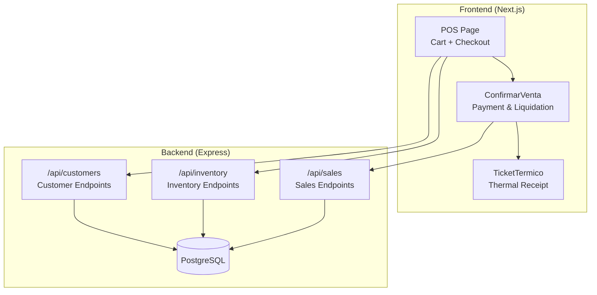

**Diagram sources**
- [backend/index.js:53-56](file://backend/index.js#L53-L56)
- [backend/routes/ventasRoutes.js:10-111](file://backend/routes/ventasRoutes.js#L10-L111)
- [simoapp/app/(protected)/ventas/page.tsx:48-789](file://simoapp/app/(protected)/ventas/page.tsx#L48-L789)
- [simoapp/components/ventas/ConfirmarVenta.tsx:68-142](file://simoapp/components/ventas/ConfirmarVenta.tsx#L68-L142)
- [simoapp/components/ventas/TicketTermico.tsx:57-180](file://simoapp/components/ventas/TicketTermico.tsx#L57-L180)

**Section sources**
- [backend/index.js:1-56](file://backend/index.js#L1-L56)
- [simoapp/app/(protected)/ventas/page.tsx:48-113](file://simoapp/app/(protected)/ventas/page.tsx#L48-L113)

## Core Components
- POS Page: manages product search, barcode scanning, cart state, client selection, cashier assignment, and triggers checkout and receipt printing.
- ConfirmarVenta: validates liquidation, selects payment method, computes change, and calls the sales service.
- TicketTermico: renders and prints an 80mm thermal receipt with all sale details.
- Backend Sales Route: validates stock, calculates taxes, records sales and details atomically, and updates inventory.
- Inventory and Customer Routes: provide catalog and client data used by the POS.

Key responsibilities:
- Cart management and persistence.
- Real-time stock checks and updates.
- Payment method handling and cash change calculation.
- Sales ticket generation.
- Sales history tracking and cancellation flow.

**Section sources**
- [simoapp/app/(protected)/ventas/page.tsx:149-274](file://simoapp/app/(protected)/ventas/page.tsx#L149-L274)
- [simoapp/components/ventas/ConfirmarVenta.tsx:84-142](file://simoapp/components/ventas/ConfirmarVenta.tsx#L84-L142)
- [simoapp/components/ventas/TicketTermico.tsx:76-180](file://simoapp/components/ventas/TicketTermico.tsx#L76-L180)
- [backend/routes/ventasRoutes.js:10-111](file://backend/routes/ventasRoutes.js#L10-L111)

## Architecture Overview
The POS follows a layered architecture:
- UI Layer: React components handle user interactions and local state.
- Service Layer: Client-side services call backend APIs and manage error messages.
- API Layer: Express routes enforce authentication, authorization, and business rules.
- Data Layer: PostgreSQL stores products, sales, details, and related entities.

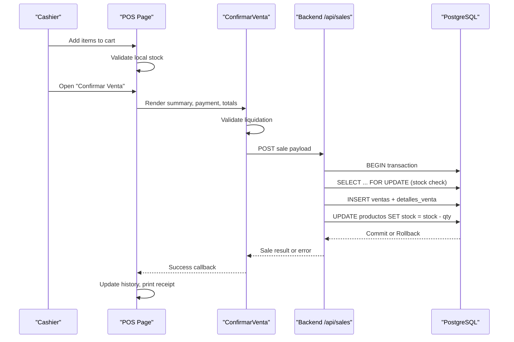

**Diagram sources**
- [simoapp/app/(protected)/ventas/page.tsx:689-757](file://simoapp/app/(protected)/ventas/page.tsx#L689-L757)
- [simoapp/components/ventas/ConfirmarVenta.tsx:109-142](file://simoapp/components/ventas/ConfirmarVenta.tsx#L109-L142)
- [backend/routes/ventasRoutes.js:19-110](file://backend/routes/ventasRoutes.js#L19-L110)

## Detailed Component Analysis

### Sales Processing Workflow
The sales workflow ensures accurate pricing, tax computation, stock reservation, and atomic persistence.

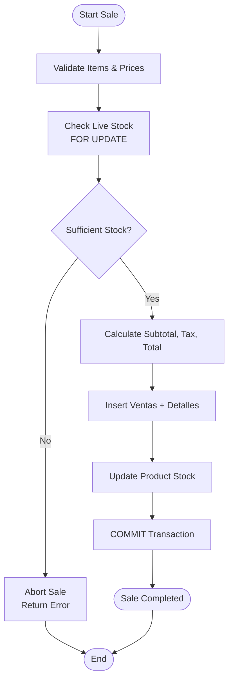

**Diagram sources**
- [backend/routes/ventasRoutes.js:19-110](file://backend/routes/ventasRoutes.js#L19-L110)

**Section sources**
- [backend/routes/ventasRoutes.js:10-111](file://backend/routes/ventasRoutes.js#L10-L111)

### Customer Association During Transactions
- The POS allows selecting a customer or leaving it as “End Consumer.”
- Selected customer data is included in the confirmation modal and receipt.
- Customer endpoints support CRUD and history retrieval.

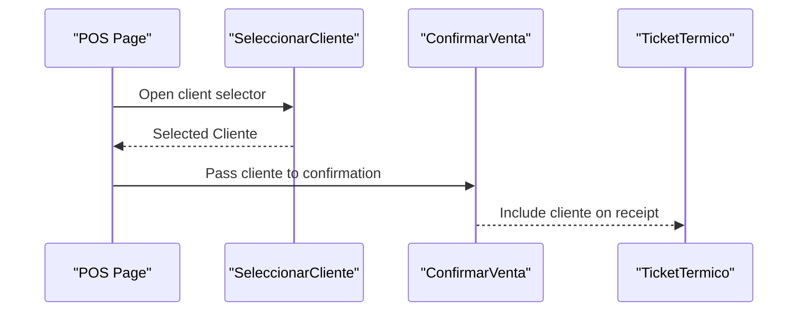

**Diagram sources**
- [simoapp/app/(protected)/ventas/page.tsx:101-107](file://simoapp/app/(protected)/ventas/page.tsx#L101-L107)
- [simoapp/app/(protected)/ventas/page.tsx:592-627](file://simoapp/app/(protected)/ventas/page.tsx#L592-L627)
- [simoapp/components/ventas/ConfirmarVenta.tsx:183-222](file://simoapp/components/ventas/ConfirmarVenta.tsx#L183-L222)
- [simoapp/components/ventas/TicketTermico.tsx:250-278](file://simoapp/components/ventas/TicketTermico.tsx#L250-L278)
- [backend/src/routes/clientes.routes.js:1-27](file://backend/src/routes/clientes.routes.js#L1-L27)

**Section sources**
- [simoapp/app/(protected)/ventas/page.tsx:101-107](file://simoapp/app/(protected)/ventas/page.tsx#L101-L107)
- [simoapp/components/ventas/ConfirmarVenta.tsx:183-222](file://simoapp/components/ventas/ConfirmarVenta.tsx#L183-L222)
- [backend/src/routes/clientes.routes.js:1-27](file://backend/src/routes/clientes.routes.js#L1-L27)

### Payment Method Handling
- Supported methods are defined centrally and rendered as selectable options.
- For cash payments, the system computes received amount and change, with quick-suggestion buttons.
- Non-cash methods require manual verification before confirming.

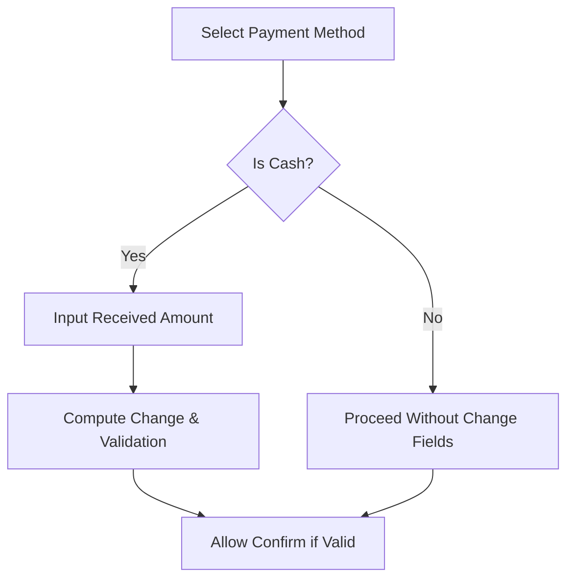

**Diagram sources**
- [simoapp/lib/ventas/tipos.ts:37-42](file://simoapp/lib/ventas/tipos.ts#L37-L42)
- [simoapp/components/ventas/ConfirmarVenta.tsx:247-300](file://simoapp/components/ventas/ConfirmarVenta.tsx#L247-L300)
- [simoapp/components/ventas/ConfirmarVenta.tsx:342-396](file://simoapp/components/ventas/ConfirmarVenta.tsx#L342-L396)

**Section sources**
- [simoapp/lib/ventas/tipos.ts:37-42](file://simoapp/lib/ventas/tipos.ts#L37-L42)
- [simoapp/components/ventas/ConfirmarVenta.tsx:247-300](file://simoapp/components/ventas/ConfirmarVenta.tsx#L247-L300)
- [simoapp/components/ventas/ConfirmarVenta.tsx:342-396](file://simoapp/components/ventas/ConfirmarVenta.tsx#L342-L396)

### Sales Ticket Generation
- The thermal receipt component formats an 80mm ticket including header, metadata, line items, totals, payment details, and footer.
- Printing uses an isolated iframe to avoid affecting the POS UI.

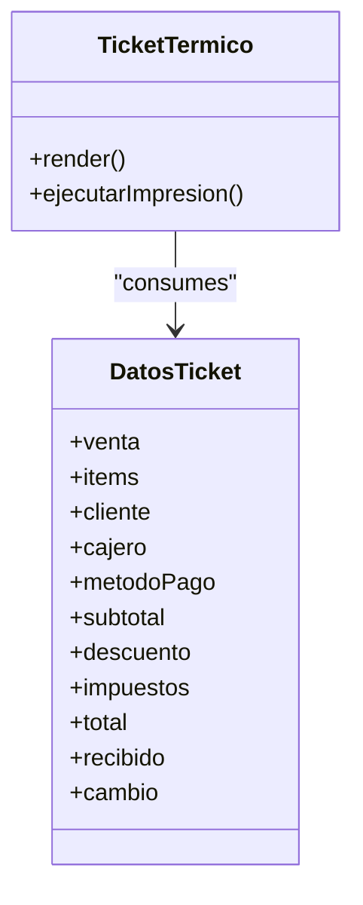

**Diagram sources**
- [simoapp/components/ventas/TicketTermico.tsx:37-49](file://simoapp/components/ventas/TicketTermico.tsx#L37-L49)
- [simoapp/components/ventas/TicketTermico.tsx:81-180](file://simoapp/components/ventas/TicketTermico.tsx#L81-L180)

**Section sources**
- [simoapp/components/ventas/TicketTermico.tsx:57-180](file://simoapp/components/ventas/TicketTermico.tsx#L57-L180)
- [simoapp/components/ventas/TicketTermico.tsx:230-368](file://simoapp/components/ventas/TicketTermico.tsx#L230-L368)

### Cart Management
- Products can be added via search or barcode scanner.
- Local stock checks prevent overselling at the UI level.
- Cart persists across sessions using browser storage.

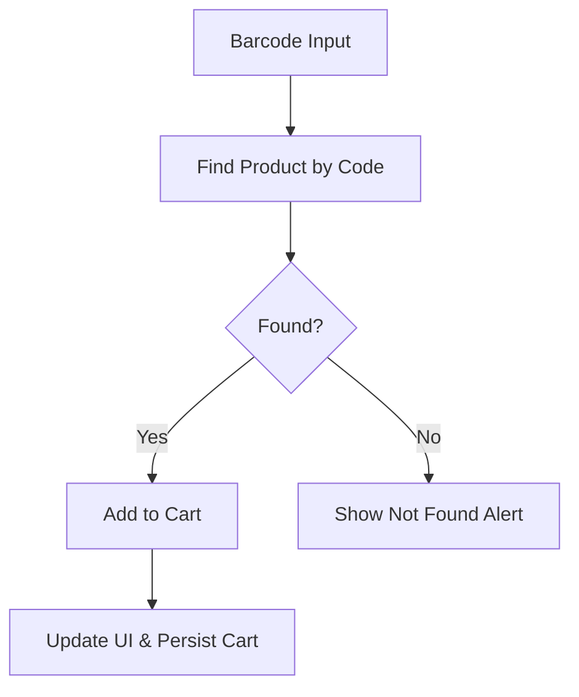

**Diagram sources**
- [simoapp/app/(protected)/ventas/page.tsx:188-205](file://simoapp/app/(protected)/ventas/page.tsx#L188-L205)
- [simoapp/app/(protected)/ventas/page.tsx:207-247](file://simoapp/app/(protected)/ventas/page.tsx#L207-L247)
- [simoapp/app/(protected)/ventas/page.tsx:79-95](file://simoapp/app/(protected)/ventas/page.tsx#L79-L95)

**Section sources**
- [simoapp/app/(protected)/ventas/page.tsx:149-274](file://simoapp/app/(protected)/ventas/page.tsx#L149-L274)
- [simoapp/app/(protected)/ventas/page.tsx:79-95](file://simoapp/app/(protected)/ventas/page.tsx#L79-L95)

### Checkout Process
- The confirmation modal collects payment method, optional discount, and cash received.
- Liquidation logic computes subtotal, discount, taxes, total, and change.
- On success, the POS updates local state, clears cart, and prepares the receipt.

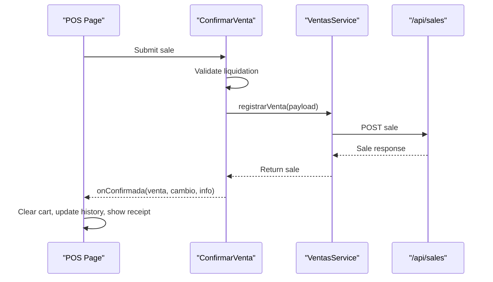

**Diagram sources**
- [simoapp/components/ventas/ConfirmarVenta.tsx:109-142](file://simoapp/components/ventas/ConfirmarVenta.tsx#L109-L142)
- [simoapp/app/(protected)/ventas/page.tsx:704-757](file://simoapp/app/(protected)/ventas/page.tsx#L704-L757)

**Section sources**
- [simoapp/components/ventas/ConfirmarVenta.tsx:84-142](file://simoapp/components/ventas/ConfirmarVenta.tsx#L84-L142)
- [simoapp/app/(protected)/ventas/page.tsx:689-757](file://simoapp/app/(protected)/ventas/page.tsx#L689-L757)

### Real-Time Inventory Updates
- Backend locks rows during stock checks to prevent race conditions.
- Stock is decremented only after successful insertion of sale and details.
- Frontend reflects available stock and prevents adding out-of-stock items.

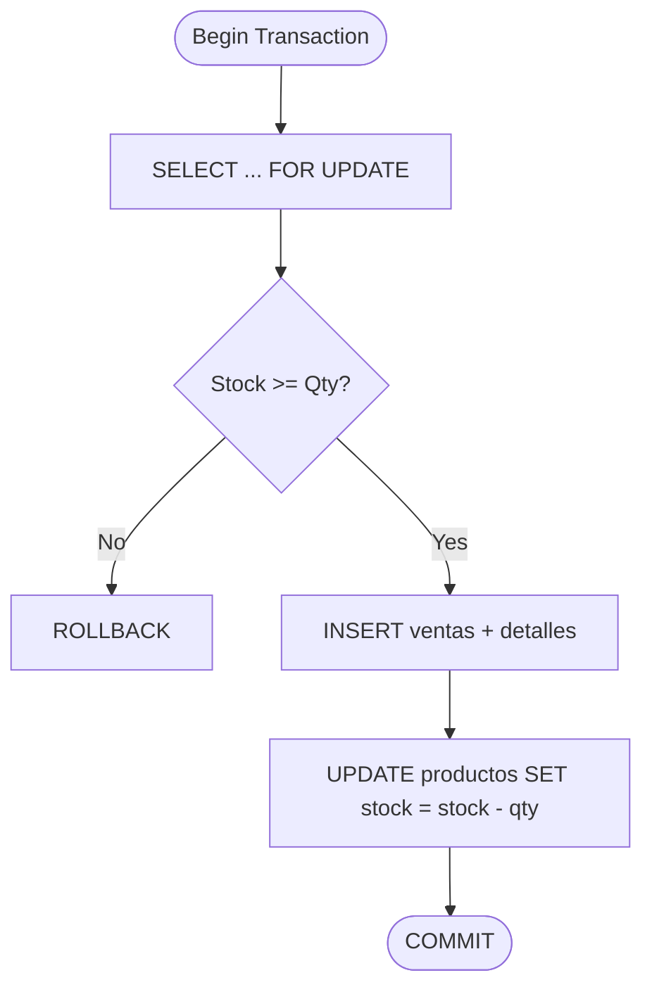

**Diagram sources**
- [backend/routes/ventasRoutes.js:19-110](file://backend/routes/ventasRoutes.js#L19-L110)

**Section sources**
- [backend/routes/ventasRoutes.js:19-110](file://backend/routes/ventasRoutes.js#L19-L110)

### Transaction Validation
- Backend validates item existence and sufficient stock within a transaction.
- Frontend validates liquidation fields (payment method, discount range, cash received).

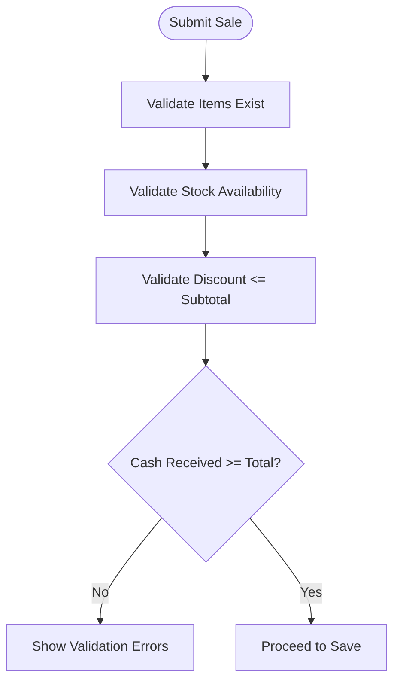

**Diagram sources**
- [backend/routes/ventasRoutes.js:30-64](file://backend/routes/ventasRoutes.js#L30-L64)
- [simoapp/components/ventas/ConfirmarVenta.tsx:92-102](file://simoapp/components/ventas/ConfirmarVenta.tsx#L92-L102)

**Section sources**
- [backend/routes/ventasRoutes.js:30-64](file://backend/routes/ventasRoutes.js#L30-L64)
- [simoapp/components/ventas/ConfirmarVenta.tsx:92-102](file://simoapp/components/ventas/ConfirmarVenta.tsx#L92-L102)

### Sales History Tracking
- The POS loads and displays sales history, supports cancellation workflows, and updates local state upon successful cancellation.
- Backend provides daily summaries grouped by payment method for cash reconciliation.

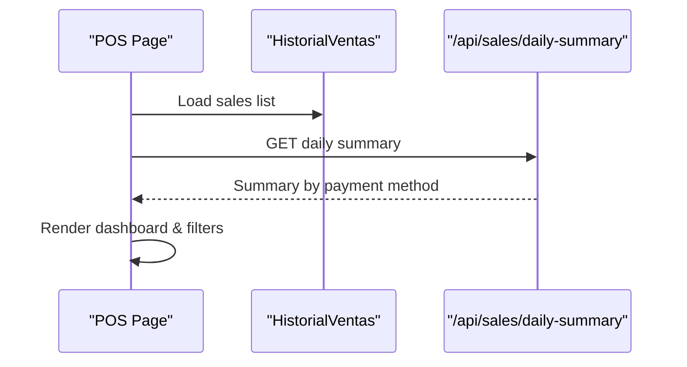

**Diagram sources**
- [simoapp/app/(protected)/ventas/page.tsx:54-77](file://simoapp/app/(protected)/ventas/page.tsx#L54-L77)
- [backend/routes/ventasRoutes.js:113-147](file://backend/routes/ventasRoutes.js#L113-L147)

**Section sources**
- [simoapp/app/(protected)/ventas/page.tsx:54-77](file://simoapp/app/(protected)/ventas/page.tsx#L54-L77)
- [backend/routes/ventasRoutes.js:113-147](file://backend/routes/ventasRoutes.js#L113-L147)

### Configuration Options

#### Payment Methods
- Defined centrally in types and rendered in the confirmation modal.
- Includes cash, digital wallets, bank transfers, card, and other methods.

**Section sources**
- [simoapp/lib/ventas/tipos.ts:37-42](file://simoapp/lib/ventas/tipos.ts#L37-L42)
- [simoapp/components/ventas/ConfirmarVenta.tsx:247-300](file://simoapp/components/ventas/ConfirmarVenta.tsx#L247-L300)

#### Tax Calculations
- Backend applies a fixed tax rate per item subtotal when processing sales.
- Frontend indicates that prices include IVA; liquidation sets impuestos based on backend behavior.

**Section sources**
- [backend/routes/ventasRoutes.js:7-8](file://backend/routes/ventasRoutes.js#L7-L8)
- [backend/routes/ventasRoutes.js:48-54](file://backend/routes/ventasRoutes.js#L48-L54)
- [simoapp/lib/ventas/liquidacion.ts:6-9](file://simoapp/lib/ventas/liquidacion.ts#L6-L9)

#### Discount Rules
- Frontend supports optional monetary discounts validated against subtotal.
- Utility functions compute item-level and global discounts with percentage or fixed value.

**Section sources**
- [simoapp/components/ventas/ConfirmarVenta.tsx:302-339](file://simoapp/components/ventas/ConfirmarVenta.tsx#L302-L339)
- [simoapp/lib/pos/discounts.ts:19-65](file://simoapp/lib/pos/discounts.ts#L19-L65)

### Relationships with Inventory System and Customer Database
- Inventory endpoints allow inbound stock entries and purchase confirmations.
- Customer endpoints support CRUD operations and history retrieval.
- POS integrates both to display product availability and associate clients with sales.

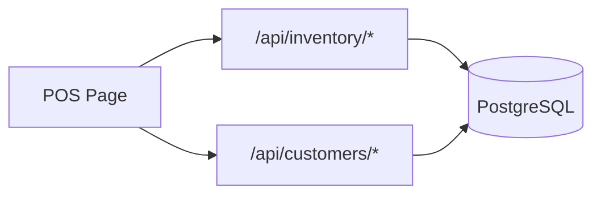

**Diagram sources**
- [backend/src/routes/inventario.routes.js:1-17](file://backend/src/routes/inventario.routes.js#L1-L17)
- [backend/src/routes/clientes.routes.js:1-27](file://backend/src/routes/clientes.routes.js#L1-L27)

**Section sources**
- [backend/src/routes/inventario.routes.js:1-17](file://backend/src/routes/inventario.routes.js#L1-L17)
- [backend/src/routes/clientes.routes.js:1-27](file://backend/src/routes/clientes.routes.js#L1-L27)

### Offline Mode Considerations
- The POS persists the cart locally to recover incomplete sessions.
- In offline scenarios, consider queuing sales locally and syncing when connectivity is restored.
- Ensure idempotent sync operations to avoid duplicate sales.

[No sources needed since this section provides general guidance]

### Transaction Rollback Procedures
- Backend wraps sales processing in a transaction; any error triggers ROLLBACK.
- Frontend shows errors without closing the modal, allowing correction and retry.

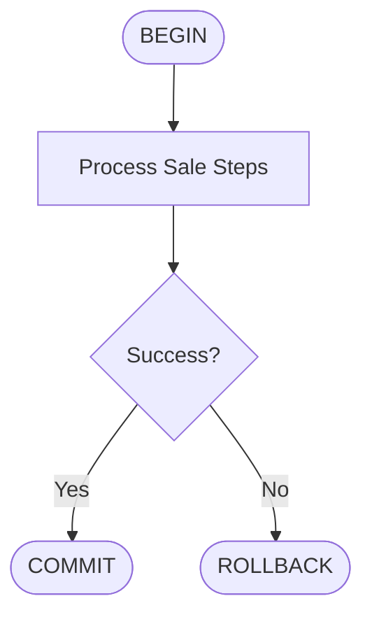

**Diagram sources**
- [backend/routes/ventasRoutes.js:19-110](file://backend/routes/ventasRoutes.js#L19-L110)

**Section sources**
- [backend/routes/ventasRoutes.js:19-110](file://backend/routes/ventasRoutes.js#L19-L110)

## Dependency Analysis
The POS depends on:
- Authentication and authorization middleware for protected routes.
- Inventory and customer modules for catalog and client data.
- Sales route for transactional processing and reporting.

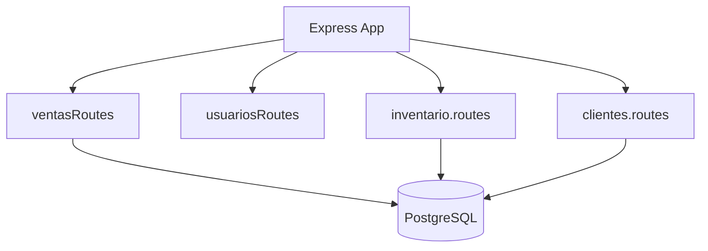

**Diagram sources**
- [backend/index.js:53-56](file://backend/index.js#L53-L56)
- [backend/routes/ventasRoutes.js:1-5](file://backend/routes/ventasRoutes.js#L1-L5)
- [backend/src/routes/inventario.routes.js:1-17](file://backend/src/routes/inventario.routes.js#L1-L17)
- [backend/src/routes/clientes.routes.js:1-27](file://backend/src/routes/clientes.routes.js#L1-L27)

**Section sources**
- [backend/index.js:53-56](file://backend/index.js#L53-L56)
- [backend/routes/ventasRoutes.js:1-5](file://backend/routes/ventasRoutes.js#L1-L5)

## Performance Considerations
- Use row-level locking (FOR UPDATE) to prevent race conditions during concurrent sales.
- Batch operations within a single transaction to reduce round-trips and ensure consistency.
- Keep frontend validations minimal and rely on backend for authoritative checks.
- Optimize queries for daily summaries and sales history with appropriate indexes.
- Avoid unnecessary re-renders in the POS by memoizing computed values and limiting state updates.

[No sources needed since this section provides general guidance]

## Troubleshooting Guide
Common issues and resolutions:
- Insufficient stock: Backend returns a validation error; verify product availability and adjust quantities.
- Invalid discount: Ensure discount does not exceed subtotal; correct input in the confirmation modal.
- Cash insufficient: Enter adequate received amount or use exact-change suggestions.
- Print issues: Verify printer settings for 80mm tickets and test the isolated print function.

**Section sources**
- [backend/routes/ventasRoutes.js:101-107](file://backend/routes/ventasRoutes.js#L101-L107)
- [simoapp/components/ventas/ConfirmarVenta.tsx:92-102](file://simoapp/components/ventas/ConfirmarVenta.tsx#L92-L102)
- [simoapp/components/ventas/TicketTermico.tsx:81-180](file://simoapp/components/ventas/TicketTermico.tsx#L81-L180)

## Conclusion
The POS system provides a robust, transactional sales workflow with strong validation, clear payment handling, and reliable inventory synchronization. It supports customer association, comprehensive receipts, and sales history tracking. With careful attention to concurrency, error handling, and performance tuning, it is well-suited for high-volume retail environments.