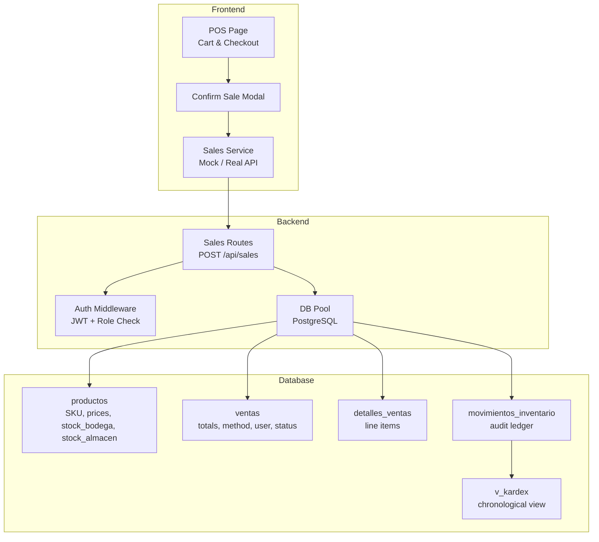
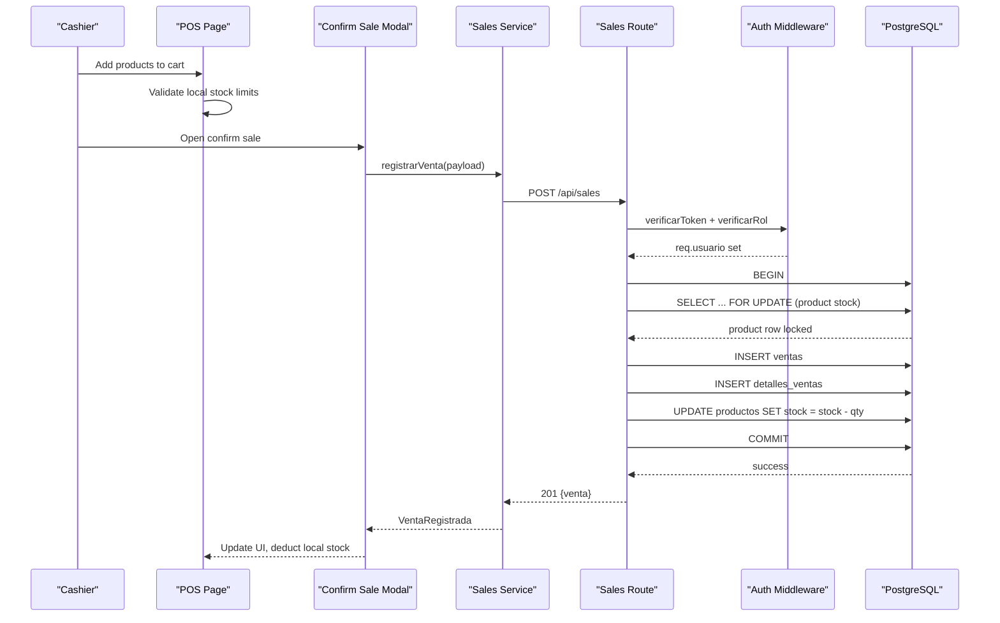
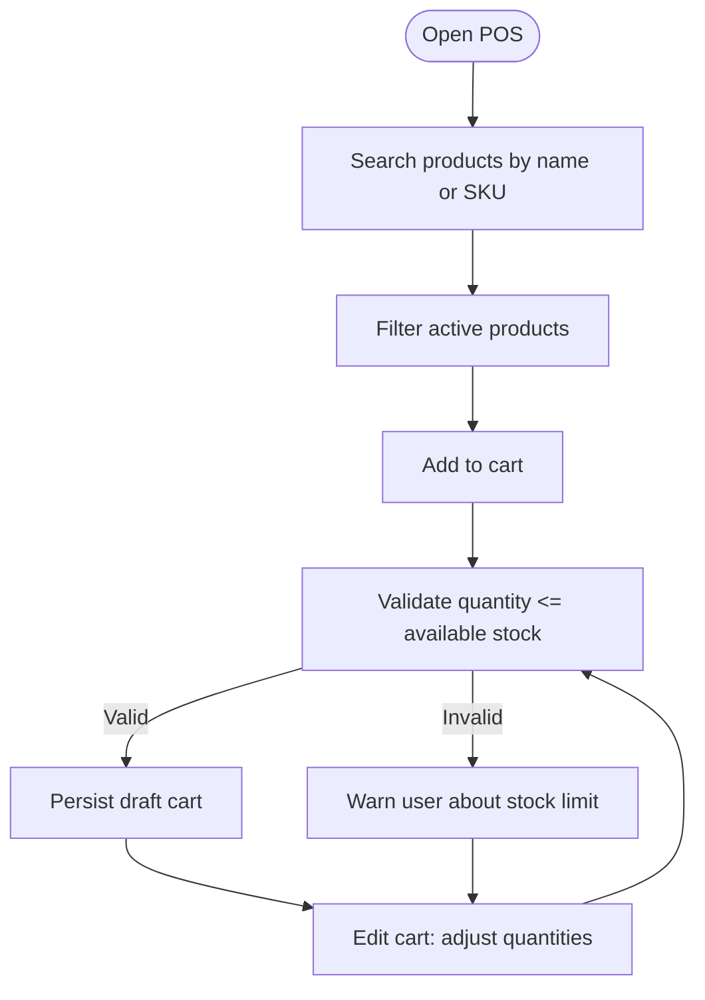
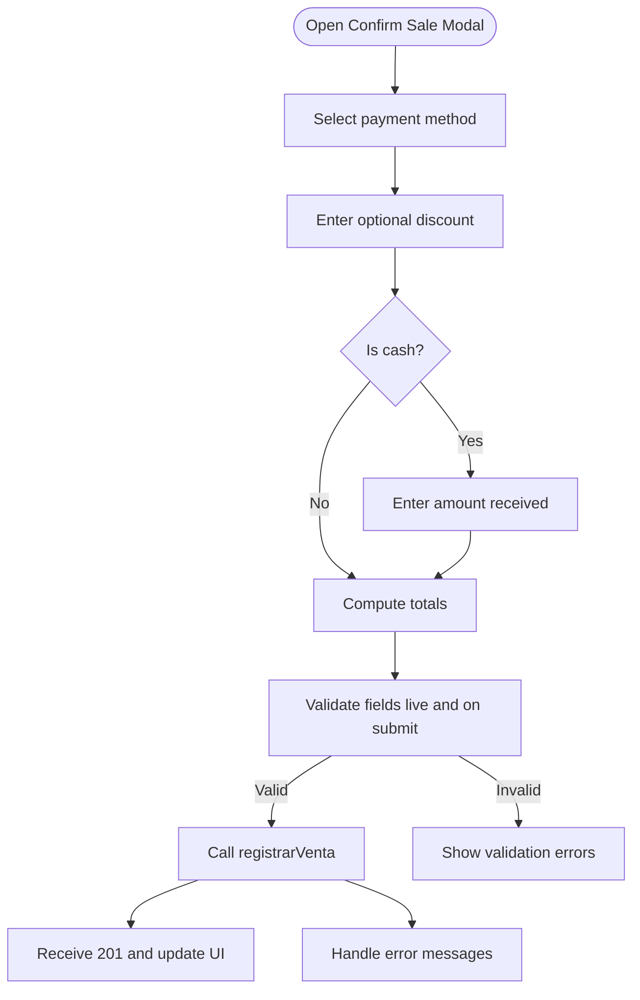
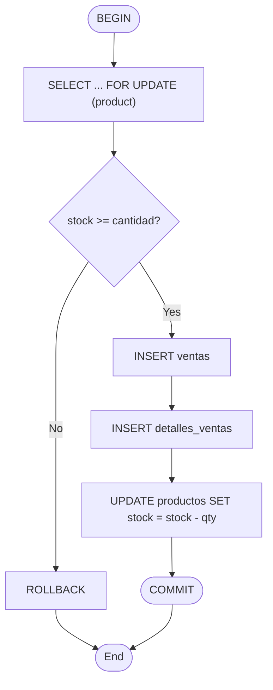
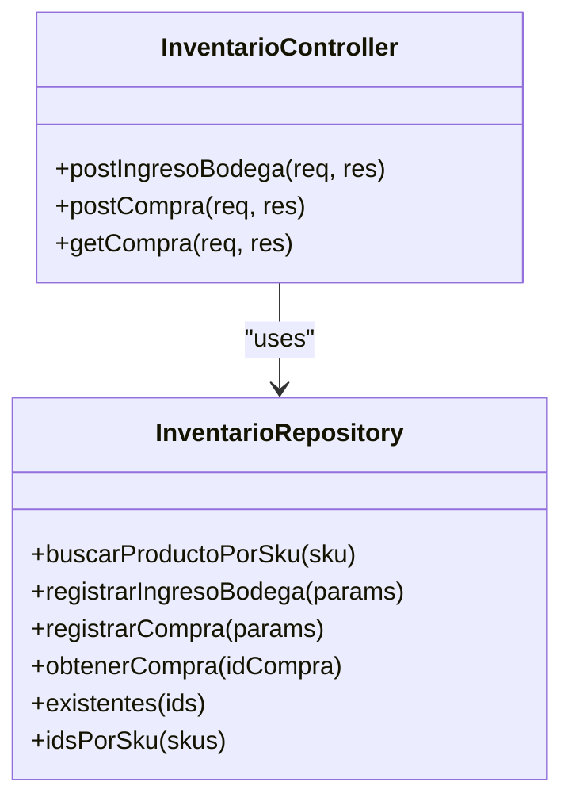
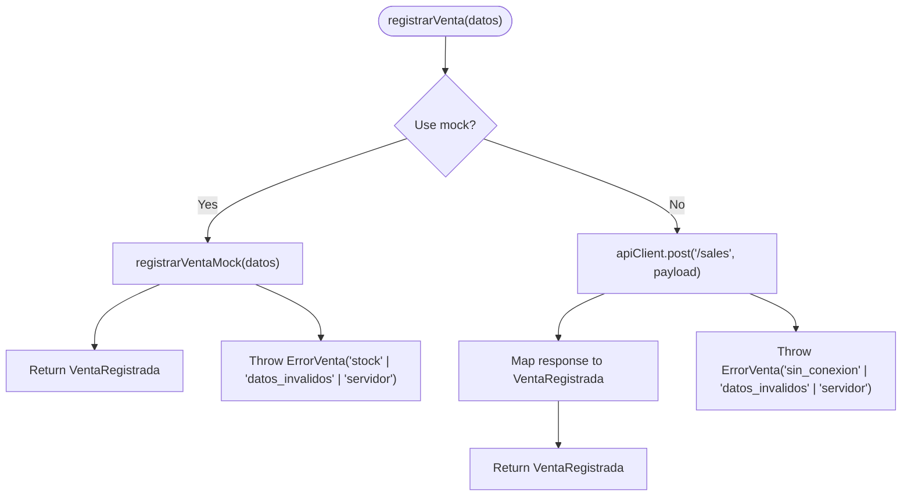
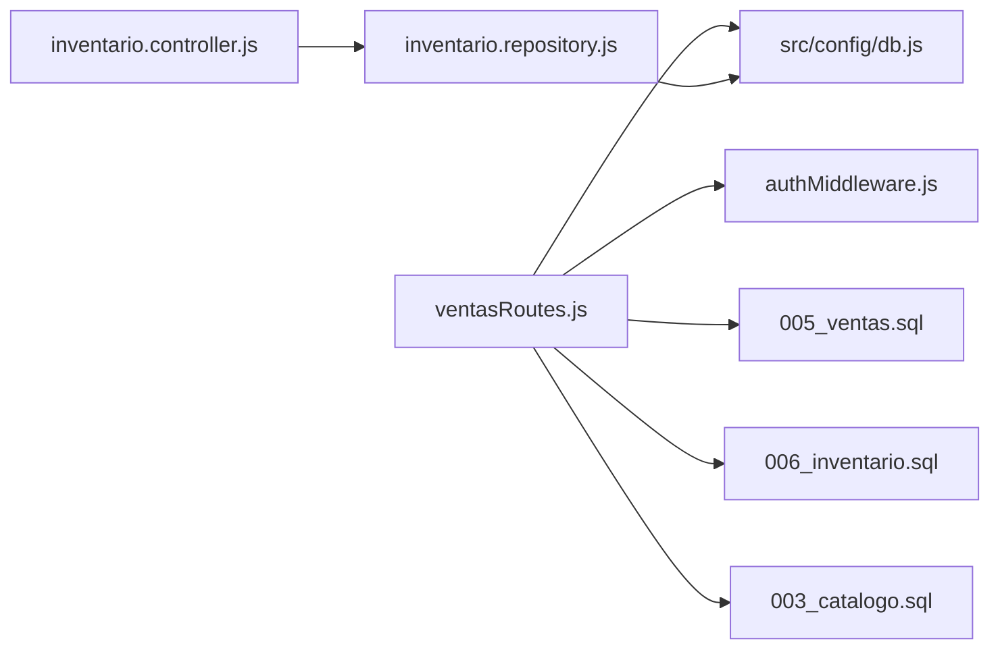

# Sales Processing Workflow

<cite>
**Referenced Files in This Document**
- [ventasRoutes.js](file://backend/routes/ventasRoutes.js)
- [authMiddleware.js](file://backend/middleware/authMiddleware.js)
- [db.js](file://backend/src/config/db.js)
- [005_ventas.sql](file://backend/db/migrations/005_ventas.sql)
- [006_inventario.sql](file://backend/db/migrations/006_inventario.sql)
- [003_catalogo.sql](file://backend/db/migrations/003_catalogo.sql)
- [inventario.controller.js](file://backend/src/controllers/inventario.controller.js)
- [inventario.repository.js](file://backend/src/repositories/inventario.repository.js)
- [ConfirmarVenta.tsx](file://simoapp/components/ventas/ConfirmarVenta.tsx)
- [ventasService.ts](file://simoapp/lib/ventas/ventasService.ts)
- [page.tsx](file://simoapp/app/(protected)/ventas/page.tsx)
- [ProductosContext.tsx](file://simoapp/components/catalogo/ProductosContext.tsx)
- [canastaGuardada.ts](file://simoapp/lib/ventas/canastaGuardada.ts)
- [ventas.test.js](file://backend/tests/ventas.test.js)
</cite>

## Table of Contents
1. [Introduction](#introduction)
2. [Project Structure](#project-structure)
3. [Core Components](#core-components)
4. [Architecture Overview](#architecture-overview)
5. [Detailed Component Analysis](#detailed-component-analysis)
6. [Dependency Analysis](#dependency-analysis)
7. [Performance Considerations](#performance-considerations)
8. [Troubleshooting Guide](#troubleshooting-guide)
9. [Conclusion](#conclusion)

## Introduction
This document explains the complete sales processing workflow from cart creation to sale completion. It covers product validation, stock checking, transaction processing, backend API endpoints, request and response schemas, error handling patterns, database transactions, stock deduction mechanisms, audit trail generation, concurrent access handling with row locks, rollback procedures, and data consistency guarantees. The documentation is designed for both technical and non-technical readers.

## Project Structure
The sales workflow spans frontend POS components, a Node.js Express backend, and PostgreSQL schema migrations:

- Frontend POS:
  - Cart management and checkout UI
  - Client-side validation and mock or real API calls
- Backend:
  - Authentication and authorization middleware
  - Sales route handling with explicit database transactions
  - Inventory operations (purchases and warehouse entries)
- Database:
  - Product catalog with dual inventory locations
  - Sales tables and details
  - Immutable inventory movement ledger and Kardex view

**Diagram sources**
- [page.tsx:48-162](file://simoapp/app/(protected)/ventas/page.tsx#L48-L162)
- [ConfirmarVenta.tsx:68-142](file://simoapp/components/ventas/ConfirmarVenta.tsx#L68-L142)
- [ventasService.ts:43-75](file://simoapp/lib/ventas/ventasService.ts#L43-L75)
- [ventasRoutes.js:10-111](file://backend/routes/ventasRoutes.js#L10-L111)
- [authMiddleware.js:9-75](file://backend/middleware/authMiddleware.js#L9-L75)
- [005_ventas.sql:40-97](file://backend/db/migrations/005_ventas.sql#L40-L97)
- [006_inventario.sql:62-161](file://backend/db/migrations/006_inventario.sql#L62-L161)
- [003_catalogo.sql:65-90](file://backend/db/migrations/003_catalogo.sql#L65-L90)

**Section sources**
- [page.tsx:48-162](file://simoapp/app/(protected)/ventas/page.tsx#L48-L162)
- [ConfirmarVenta.tsx:68-142](file://simoapp/components/ventas/ConfirmarVenta.tsx#L68-L142)
- [ventasService.ts:43-75](file://simoapp/lib/ventas/ventasService.ts#L43-L75)
- [ventasRoutes.js:10-111](file://backend/routes/ventasRoutes.js#L10-L111)
- [authMiddleware.js:9-75](file://backend/middleware/authMiddleware.js#L9-L75)
- [005_ventas.sql:40-97](file://backend/db/migrations/005_ventas.sql#L40-L97)
- [006_inventario.sql:62-161](file://backend/db/migrations/006_inventario.sql#L62-L161)
- [003_catalogo.sql:65-90](file://backend/db/migrations/003_catalogo.sql#L65-L90)

## Core Components
- Frontend POS page: manages product search, cart state, client-side stock checks, and triggers checkout confirmation.
- Confirm sale modal: collects payment method, optional discount, cash received, computes totals, and calls the sales service.
- Sales service: sends POST requests to the backend or uses a mock implementation during development.
- Backend sales route: validates input, enforces roles, starts a transaction, validates stock with row locks, inserts sale records, updates stock, commits, and returns results.
- Database schema: defines products, sales, sale details, and an immutable inventory movement ledger with a Kardex view.

Key responsibilities:
- Cart lifecycle: add/remove items, enforce available stock locally, persist draft cart.
- Checkout: validate payment method and amounts, call backend, handle errors, update local stock.
- Transaction safety: BEGIN/COMMIT/ROLLBACK, FOR UPDATE locks, consistent totals and tax calculations.
- Audit trail: record every stock change in movements_inventario; Kardex view provides chronological history.

**Section sources**
- [page.tsx:48-162](file://simoapp/app/(protected)/ventas/page.tsx#L48-L162)
- [ConfirmarVenta.tsx:68-142](file://simoapp/components/ventas/ConfirmarVenta.tsx#L68-L142)
- [ventasService.ts:43-75](file://simoapp/lib/ventas/ventasService.ts#L43-L75)
- [ventasRoutes.js:10-111](file://backend/routes/ventasRoutes.js#L10-L111)
- [005_ventas.sql:40-97](file://backend/db/migrations/005_ventas.sql#L40-L97)
- [006_inventario.sql:62-161](file://backend/db/migrations/006_inventario.sql#L62-L161)

## Architecture Overview
The sales flow integrates frontend UI, backend routes, authentication, and database transactions:

**Diagram sources**
- [ConfirmarVenta.tsx:109-142](file://simoapp/components/ventas/ConfirmarVenta.tsx#L109-L142)
- [ventasService.ts:43-75](file://simoapp/lib/ventas/ventasService.ts#L43-L75)
- [ventasRoutes.js:10-111](file://backend/routes/ventasRoutes.js#L10-L111)
- [authMiddleware.js:9-75](file://backend/middleware/authMiddleware.js#L9-L75)

## Detailed Component Analysis

### Frontend Cart Management
- Product selection: search by name or SKU, filter active products, show available stock.
- Cart operations: add items, remove items, adjust quantities up to available stock.
- Local stock enforcement: prevent adding more than current stock; display limits.
- Draft persistence: save and recover cart across sessions with expiration and validation.

Concrete examples:
- Adding a product: select from catalog, click “Add”, quantity validated against stockActual.
- Updating quantity: increment/decrement buttons capped at stockActual minus cart quantity.
- Recovering a saved cart: restore lines, remove invalid or out-of-stock items, adjust quantities to current stock.

**Diagram sources**
- [page.tsx:149-162](file://simoapp/app/(protected)/ventas/page.tsx#L149-L162)
- [ProductosContext.tsx:229-261](file://simoapp/components/catalogo/ProductosContext.tsx#L229-L261)
- [canastaGuardada.ts:68-142](file://simoapp/lib/ventas/canastaGuardada.ts#L68-L142)

**Section sources**
- [page.tsx:149-162](file://simoapp/app/(protected)/ventas/page.tsx#L149-L162)
- [ProductosContext.tsx:229-261](file://simoapp/components/catalogo/ProductosContext.tsx#L229-L261)
- [canastaGuardada.ts:68-142](file://simoapp/lib/ventas/canastaGuardada.ts#L68-L142)

### Checkout Process and Payment Validation
- Collect payment method, optional discount, and cash received (for cash).
- Compute subtotal, taxes, total, and change due.
- Validate inputs live and on submit; disable submit until valid.
- Call registrarVenta; handle success and error states.

**Diagram sources**
- [ConfirmarVenta.tsx:84-142](file://simoapp/components/ventas/ConfirmarVenta.tsx#L84-L142)
- [ventasService.ts:43-75](file://simoapp/lib/ventas/ventasService.ts#L43-L75)

**Section sources**
- [ConfirmarVenta.tsx:84-142](file://simoapp/components/ventas/ConfirmarVenta.tsx#L84-L142)
- [ventasService.ts:43-75](file://simoapp/lib/ventas/ventasService.ts#L43-L75)

### Backend API Endpoints for Sales Processing
- POST /api/sales
  - Purpose: process a sale, validate stock, insert sale records, update stock, commit transaction.
  - Authorization: requires authenticated token and role check (Admin or Seller).
  - Request body: array of line items with product IDs and quantities; additional fields may include payment method, client ID, seller ID, totals, and unit prices.
  - Response: 201 with sale summary including id_venta, subtotal, taxes, total, and details.
  - Errors: 400 for invalid input or insufficient stock; 500 for server errors.

- GET /api/sales/daily-summary
  - Purpose: daily cash register summary grouped by payment method.
  - Authorization: requires authenticated token and role check (Admin or Manager).
  - Response: 200 with date, summary rows, and grand total.

Request/response schemas:
- POST /api/sales
  - Request:
    - productos: array of objects with id_producto and cantidad
    - Optional: metodo_pago, id_cliente, id_vendedor, subtotal, descuento, impuestos, total, detalles
  - Response:
    - message: string
    - venta: object with id_venta, subtotal, impuestos, total, detalles

- GET /api/sales/daily-summary
  - Response:
    - mensaje: string
    - fecha: YYYY-MM-DD
    - resumen: array of {metodo_pago, cantidad_transacciones, total_ingresos}
    - gran_total: number

Error handling patterns:
- Input validation returns 400 with descriptive messages.
- Insufficient stock returns 400 with specific product stock information.
- Server errors return 500 with generic messages.

**Section sources**
- [ventasRoutes.js:10-111](file://backend/routes/ventasRoutes.js#L10-L111)
- [ventasRoutes.js:113-147](file://backend/routes/ventasRoutes.js#L113-L147)
- [authMiddleware.js:9-75](file://backend/middleware/authMiddleware.js#L9-L75)

### Database Transactions and Stock Deduction
- Transaction boundaries:
  - BEGIN before validations and writes.
  - COMMIT after successful insertion and stock updates.
  - ROLLBACK on any error path.

- Stock validation and locking:
  - SELECT ... FOR UPDATE per product to lock rows and prevent race conditions.
  - Validate stock >= requested quantity; throw error if insufficient.

- Insertion and updates:
  - Insert into ventas with totals and user reference.
  - Insert into detalles_ventas for each line item.
  - Update productos stock by subtracting quantities.

- Audit trail:
  - movements_inventario records all stock changes with type, origin/destination, quantities, costs, and balances.
  - v_kardex provides chronological view of inventory movements.

**Diagram sources**
- [ventasRoutes.js:22-111](file://backend/routes/ventasRoutes.js#L22-L111)
- [005_ventas.sql:40-97](file://backend/db/migrations/005_ventas.sql#L40-L97)
- [006_inventario.sql:62-161](file://backend/db/migrations/006_inventario.sql#L62-L161)

**Section sources**
- [ventasRoutes.js:22-111](file://backend/routes/ventasRoutes.js#L22-L111)
- [005_ventas.sql:40-97](file://backend/db/migrations/005_ventas.sql#L40-L97)
- [006_inventario.sql:62-161](file://backend/db/migrations/006_inventario.sql#L62-L161)

### Concurrent Access Handling and Data Consistency
- Row-level locking:
  - FOR UPDATE ensures exclusive access to product rows during validation and updates.
  - Prevents two sellers from selling the same units simultaneously.

- Rollback procedures:
  - Any validation failure or unexpected error triggers ROLLBACK to maintain consistency.

- Data consistency guarantees:
  - Totals computed server-side; frontend values used for comparison only.
  - CHECK constraints ensure non-negative stock and valid relationships.
  - Immutable movements_inventario prevents tampering; Kardex view reflects accurate chronology.

**Section sources**
- [ventasRoutes.js:30-46](file://backend/routes/ventasRoutes.js#L30-L46)
- [ventasRoutes.js:101-110](file://backend/routes/ventasRoutes.js#L101-L110)
- [003_catalogo.sql:75-90](file://backend/db/migrations/003_catalogo.sql#L75-L90)
- [006_inventario.sql:121-129](file://backend/db/migrations/006_inventario.sql#L121-L129)

### Inventory Operations and Purchase Confirmation
- Warehouse entry:
  - Controller validates inputs and calls repository function to register inventory entry.
  - Repository executes atomic operation that increases stock_bodega and logs ENTRADA_COMPRA movement.

- Purchase registration:
  - Controller normalizes line items, validates SKUs and IDs, and registers purchase.
  - Repository wraps purchase creation and optional confirmation in a transaction; on error, rolls back.

**Diagram sources**
- [inventario.controller.js:48-147](file://backend/src/controllers/inventario.controller.js#L48-L147)
- [inventario.controller.js:163-247](file://backend/src/controllers/inventario.controller.js#L163-L247)
- [inventario.repository.js:12-27](file://backend/src/repositories/inventario.repository.js#L12-L27)
- [inventario.repository.js:32-62](file://backend/src/repositories/inventario.repository.js#L32-L62)

**Section sources**
- [inventario.controller.js:48-147](file://backend/src/controllers/inventario.controller.js#L48-L147)
- [inventario.controller.js:163-247](file://backend/src/controllers/inventario.controller.js#L163-L247)
- [inventario.repository.js:12-27](file://backend/src/repositories/inventario.repository.js#L12-L27)
- [inventario.repository.js:32-62](file://backend/src/repositories/inventario.repository.js#L32-L62)

### Frontend Mock vs Real API Behavior
- Mock mode:
  - Simulates backend behavior, enforces RN-01 stock rule locally, returns synthetic sale ID and timestamp.
- Real API mode:
  - Sends payload to POST /api/sales, maps backend response to frontend model, handles connection and server errors.

**Diagram sources**
- [ventasService.ts:43-75](file://simoapp/lib/ventas/ventasService.ts#L43-L75)
- [ventasService.ts:99-117](file://simoapp/lib/ventas/ventasService.ts#L99-L117)

**Section sources**
- [ventasService.ts:43-75](file://simoapp/lib/ventas/ventasService.ts#L43-L75)
- [ventasService.ts:99-117](file://simoapp/lib/ventas/ventasService.ts#L99-L117)

## Dependency Analysis
The sales workflow depends on authentication, database configuration, and schema definitions:

**Diagram sources**
- [ventasRoutes.js:1-11](file://backend/routes/ventasRoutes.js#L1-L11)
- [authMiddleware.js:1-81](file://backend/middleware/authMiddleware.js#L1-L81)
- [db.js:1-29](file://backend/src/config/db.js#L1-L29)
- [005_ventas.sql:1-104](file://backend/db/migrations/005_ventas.sql#L1-L104)
- [006_inventario.sql:1-166](file://backend/db/migrations/006_inventario.sql#L1-L166)
- [003_catalogo.sql:1-93](file://backend/db/migrations/003_catalogo.sql#L1-L93)
- [inventario.controller.js:1-269](file://backend/src/controllers/inventario.controller.js#L1-L269)
- [inventario.repository.js:1-102](file://backend/src/repositories/inventario.repository.js#L1-L102)

**Section sources**
- [ventasRoutes.js:1-11](file://backend/routes/ventasRoutes.js#L1-L11)
- [authMiddleware.js:1-81](file://backend/middleware/authMiddleware.js#L1-L81)
- [db.js:1-29](file://backend/src/config/db.js#L1-L29)
- [005_ventas.sql:1-104](file://backend/db/migrations/005_ventas.sql#L1-L104)
- [006_inventario.sql:1-166](file://backend/db/migrations/006_inventario.sql#L1-L166)
- [003_catalogo.sql:1-93](file://backend/db/migrations/003_catalogo.sql#L1-L93)
- [inventario.controller.js:1-269](file://backend/src/controllers/inventario.controller.js#L1-L269)
- [inventario.repository.js:1-102](file://backend/src/repositories/inventario.repository.js#L1-L102)

## Performance Considerations
- Use row-level locks (FOR UPDATE) to avoid race conditions during high-concurrency sales.
- Keep transactions short: validate, insert, update, commit promptly.
- Avoid exposing confidential fields like purchase price to sellers.
- Leverage indexes on frequently queried columns (e.g., product category, movement dates).
- Prefer server-side calculation of totals and taxes to reduce client-server discrepancies.

[No sources needed since this section provides general guidance]

## Troubleshooting Guide
Common issues and resolutions:
- Unauthorized or forbidden:
  - Ensure JWT is present and valid; verify user account is active.
  - Check role permissions for the endpoint.
- Bad request:
  - Validate required fields and numeric formats.
  - Ensure product IDs exist and quantities are positive.
- Insufficient stock:
  - Verify stock levels and avoid over-booking in the cart.
  - Retry after stock replenishment or adjust quantities.
- Server errors:
  - Check database connectivity and transaction integrity.
  - Review logs for SQL exceptions or constraint violations.

Validation references:
- Authentication and role checks:
  - Token verification and blacklist checks.
  - Role-based access control for sales endpoints.
- Transaction safety:
  - BEGIN/COMMIT/ROLLBACK usage in sales route.
  - Tests asserting correct HTTP statuses and rollback behavior.

**Section sources**
- [authMiddleware.js:9-75](file://backend/middleware/authMiddleware.js#L9-L75)
- [ventasRoutes.js:101-111](file://backend/routes/ventasRoutes.js#L101-L111)
- [ventas.test.js:49-106](file://backend/tests/ventas.test.js#L49-L106)

## Conclusion
The sales processing workflow combines robust frontend validation, secure backend transactions, and comprehensive database auditing. By using FOR UPDATE locks, explicit transaction boundaries, and immutable inventory movements, the system ensures data consistency under concurrent access. The API endpoints provide clear contracts for clients, while error handling patterns guide users through common issues. Inventory operations complement sales by maintaining accurate stock levels and providing full traceability through the Kardex view.

[No sources needed since this section summarizes without analyzing specific files]