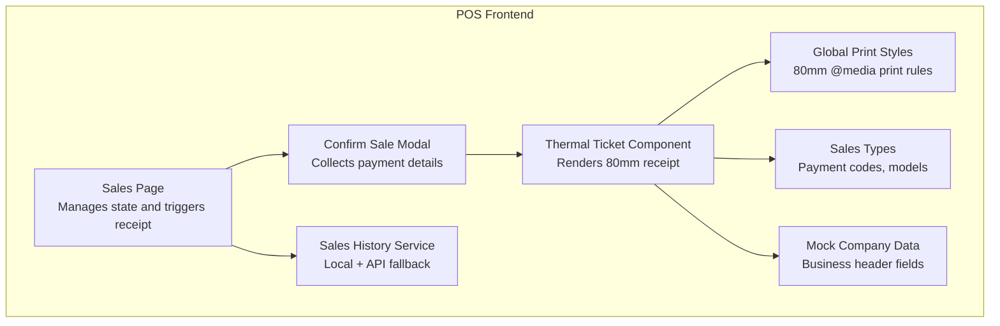
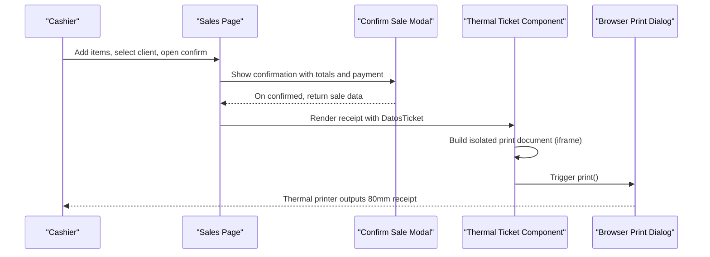
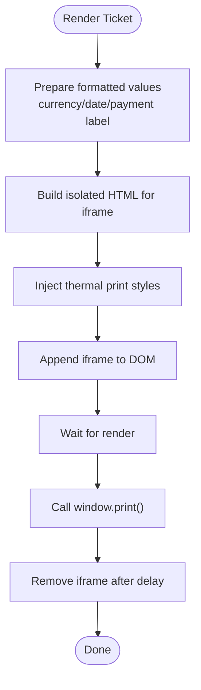
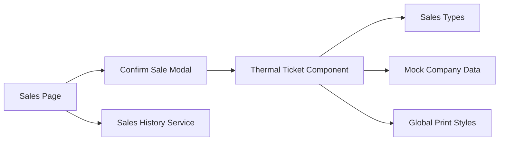

# Ticket & Receipt Generation

<cite>
**Referenced Files in This Document**
- [TicketTermico.tsx](file://simoapp/components/ventas/TicketTermico.tsx)
- [globals.css](file://simoapp/app/globals.css)
- [datos.mock.ts](file://simoapp/components/shell/datos.mock.ts)
- [tipos.ts](file://simoapp/lib/ventas/tipos.ts)
- [anulacionService.ts](file://simoapp/lib/ventas/anulacionService.ts)
- [ConfirmarVenta.tsx](file://simoapp/components/ventas/ConfirmarVenta.tsx)
- [page.tsx](file://simoapp/app/(protected)/ventas/page.tsx)
</cite>

## Table of Contents
1. [Introduction](#introduction)
2. [Project Structure](#project-structure)
3. [Core Components](#core-components)
4. [Architecture Overview](#architecture-overview)
5. [Detailed Component Analysis](#detailed-component-analysis)
6. [Dependency Analysis](#dependency-analysis)
7. [Performance Considerations](#performance-considerations)
8. [Troubleshooting Guide](#troubleshooting-guide)
9. [Conclusion](#conclusion)

## Introduction
This document explains the ticket and receipt generation functionality for the POS module. It covers thermal ticket printing, receipt layout configuration, digital receipt options, template customization (including company information), print job management, error handling for printer connectivity issues, integration with point-of-sale hardware, print queue considerations, offline receipt storage, receipt numbering, tax compliance display, and archival policies.

## Project Structure
The receipt system is implemented primarily in the frontend Next.js application:
- Thermal receipt rendering and printing are handled by a dedicated React component.
- Global print styles define 80mm thermal paper formatting.
- Company information used on receipts comes from mock data until integrated with a real company profile.
- Sales types and payment methods provide the data model for receipts.
- Sales history and cancellation logic support archival and auditability.

**Diagram sources**
- [page.tsx:100-120](file://simoapp/app/(protected)/ventas/page.tsx#L100-L120)
- [ConfirmarVenta.tsx:26-72](file://simoapp/components/ventas/ConfirmarVenta.tsx#L26-L72)
- [TicketTermico.tsx:1-12](file://simoapp/components/ventas/TicketTermico.tsx#L1-L12)
- [globals.css:28-68](file://simoapp/app/globals.css#L28-L68)
- [tipos.ts:15-42](file://simoapp/lib/ventas/tipos.ts#L15-L42)
- [datos.mock.ts:9-15](file://simoapp/components/shell/datos.mock.ts#L9-L15)
- [anulacionService.ts:127-140](file://simoapp/lib/ventas/anulacionService.ts#L127-L140)

**Section sources**
- [TicketTermico.tsx:1-12](file://simoapp/components/ventas/TicketTermico.tsx#L1-L12)
- [globals.css:28-68](file://simoapp/app/globals.css#L28-L68)
- [datos.mock.ts:9-15](file://simoapp/components/shell/datos.mock.ts#L9-L15)
- [tipos.ts:15-42](file://simoapp/lib/ventas/tipos.ts#L15-L42)
- [anulacionService.ts:127-140](file://simoapp/lib/ventas/anulacionService.ts#L127-L140)

## Core Components
- Thermal Ticket Component: Renders an 80mm thermal receipt with business header, sale metadata, line items, totals, taxes, payment method, cash received/change, and footer text. It supports manual print via a button and optional auto-print on mount.
- Global Print Styles: Enforce 80mm page size, hide UI elements during print, and constrain the receipt width to match thermal printers.
- Mock Company Data: Provides business name, NIT, address, phone, and logo URL placeholder for the receipt header.
- Sales Types: Defines payment method codes and data structures for sales and registered sales responses.
- Sales History Service: Persists sales locally and falls back to API; supports cancellation with authorization and audit fields.

Key responsibilities:
- Rendering: The ticket component composes all receipt sections using provided props.
- Printing: Uses an isolated iframe to trigger browser print dialog for the receipt only.
- Formatting: Applies locale-aware currency and date formats for Colombian pesos and timestamps.
- Offline persistence: Local storage-backed sales history ensures records exist even when the backend is unavailable.

**Section sources**
- [TicketTermico.tsx:22-49](file://simoapp/components/ventas/TicketTermico.tsx#L22-L49)
- [globals.css:28-68](file://simoapp/app/globals.css#L28-L68)
- [datos.mock.ts:9-15](file://simoapp/components/shell/datos.mock.ts#L9-L15)
- [tipos.ts:44-63](file://simoapp/lib/ventas/tipos.ts#L44-L63)
- [anulacionService.ts:83-122](file://simoapp/lib/ventas/anulacionService.ts#L83-L122)

## Architecture Overview
The receipt flow starts at the sales page, which manages state and opens the confirmation modal. After confirming payment, the system renders the thermal ticket component. The component prepares an isolated print document and invokes the browser’s print dialog. If configured, it can auto-print after mounting.

**Diagram sources**
- [page.tsx:100-120](file://simoapp/app/(protected)/ventas/page.tsx#L100-L120)
- [ConfirmarVenta.tsx:26-72](file://simoapp/components/ventas/ConfirmarVenta.tsx#L26-L72)
- [TicketTermico.tsx:81-180](file://simoapp/components/ventas/TicketTermico.tsx#L81-L180)

## Detailed Component Analysis

### Thermal Ticket Component
Responsibilities:
- Accepts structured receipt data including sale info, items, client, cashier, payment method, and financial summaries.
- Formats currency and dates using locale-specific formatters.
- Renders a complete 80mm thermal receipt layout with business header, sale metadata, product table, totals, taxes, payment details, and footer.
- Supports manual print via a button and optional auto-print on mount.
- Creates an isolated iframe containing only the receipt content to avoid printing the entire POS interface.

Data contract:
- DatosTicket includes sale record, cart items, client, cashier, payment code, subtotal, discount, taxes, total, and optional cash received/change.

Print behavior:
- Builds a minimal HTML document inside an iframe with inline CSS matching thermal constraints.
- Waits briefly for rendering before invoking print().
- Cleans up the temporary iframe after printing.

Template customization:
- Business header uses mock company data (name, NIT, address, phone). Logo URL is available but not rendered in the current implementation.
- Footer includes tax regime note and software version string.

**Diagram sources**
- [TicketTermico.tsx:81-180](file://simoapp/components/ventas/TicketTermico.tsx#L81-L180)

**Section sources**
- [TicketTermico.tsx:37-49](file://simoapp/components/ventas/TicketTermico.tsx#L37-L49)
- [TicketTermico.tsx:81-180](file://simoapp/components/ventas/TicketTermico.tsx#L81-L180)
- [TicketTermico.tsx:231-368](file://simoapp/components/ventas/TicketTermico.tsx#L231-L368)

### Global Print Styles
- Enforces 80mm page size and zero margins for thermal printing.
- Hides general UI elements during print.
- Constrains the receipt container width to 76mm to fit within printable area.

These rules ensure consistent output across browsers and devices.

**Section sources**
- [globals.css:28-68](file://simoapp/app/globals.css#L28-L68)

### Mock Company Data
- Provides business name, NIT, phone, address, and logo URL placeholder.
- Used by the receipt header to display company information.

Logo inclusion:
- A logo URL field exists in the mock company object, but the current receipt does not render the logo image. Extending the component to include a logo would require adding an image element and ensuring proper sizing for 80mm tickets.

**Section sources**
- [datos.mock.ts:9-15](file://simoapp/components/shell/datos.mock.ts#L9-L15)
- [TicketTermico.tsx:235-248](file://simoapp/components/ventas/TicketTermico.tsx#L235-L248)

### Sales Types and Payment Methods
- Defines payment method codes and labels used throughout the POS.
- Includes data structures for sending sale data to services and receiving registered sale responses.

Receipt implications:
- Payment method names are resolved from the predefined list for display on receipts.
- Cash-only flows show received amount and change when applicable.

**Section sources**
- [tipos.ts:15-42](file://simoapp/lib/ventas/tipos.ts#L15-L42)
- [tipos.ts:44-63](file://simoapp/lib/ventas/tipos.ts#L44-L63)
- [TicketTermico.tsx:76-79](file://simoapp/components/ventas/TicketTermico.tsx#L76-L79)

### Sales History and Archival
- Maintains a local sales history with fallback to seed data if storage is empty or corrupted.
- Adds completed sales to the local history immediately upon registration.
- Provides functions to list sales (local or API) and cancel sales with managerial authorization.

Archival policy:
- Local storage acts as immediate archival for POS operations.
- When the backend is reachable, listing sales retrieves them from the API; otherwise, it falls back to local storage.

Cancellation and audit:
- Cancellation requires valid credentials and appropriate role.
- Audit fields capture cancellation date, authorizer identity, role, and reason.

**Section sources**
- [anulacionService.ts:50-78](file://simoapp/lib/ventas/anulacionService.ts#L50-L78)
- [anulacionService.ts:83-122](file://simoapp/lib/ventas/anulacionService.ts#L83-L122)
- [anulacionService.ts:127-140](file://simoapp/lib/ventas/anulacionService.ts#L127-L140)
- [anulacionService.ts:146-260](file://simoapp/lib/ventas/anulacionService.ts#L146-L260)

### Integration with Point-of-Sale Hardware
- Thermal printer integration relies on the browser’s print dialog invoked from an isolated iframe.
- No direct USB/ESC/POS SDK integration is present in the analyzed files.
- Print queue management is delegated to the operating system and printer driver.

Recommendations for future enhancement:
- Integrate with ESC/POS libraries for raw command printing.
- Implement retry and offline queuing for failed print jobs.
- Provide printer capability detection (width, supported fonts, graphics).

[No sources needed since this section provides general guidance]

### Digital Receipt Options
- Current implementation focuses on thermal printing.
- To add digital receipts (PDF/email/SMS), extend the component to export the receipt content to a PDF generator or send via email/SMS APIs.
- Ensure digital receipts preserve the same data fields and legal notices as printed receipts.

[No sources needed since this section provides general guidance]

### Receipt Numbering
- Receipt number is taken from the registered sale identifier returned by the sales service.
- Displayed prominently in the receipt header.

Numbering strategy:
- Use server-assigned sequential IDs to guarantee uniqueness and compliance.
- Avoid client-side generation to prevent collisions and ensure auditability.

**Section sources**
- [tipos.ts:58-63](file://simoapp/lib/ventas/tipos.ts#L58-L63)
- [TicketTermico.tsx:251-255](file://simoapp/components/ventas/TicketTermico.tsx#L251-L255)

### Tax Compliance Requirements
- Displays IVA included percentage and calculated tax amount.
- Footer references tax regime and retention advice.

Compliance notes:
- Ensure tax calculations align with local regulations.
- Include required legal notices and software identification strings.
- Maintain immutable records for audits and cancellations.

**Section sources**
- [TicketTermico.tsx:325-334](file://simoapp/components/ventas/TicketTermico.tsx#L325-L334)
- [TicketTermico.tsx:357-368](file://simoapp/components/ventas/TicketTermico.tsx#L357-L368)

### Template Customization Examples
- Business header: Name, NIT, address, phone.
- Sale metadata: Invoice/ticket number, date/time, cashier, client, client ID type/document.
- Product table: Quantity, description, unit price, subtotal per line.
- Totals: Total articles, subtotal, discount, IVA, grand total.
- Payment details: Method, cash received, change.
- Footer: Thank-you message, tax regime note, software version.

To customize:
- Update mock company data or integrate a real company profile endpoint.
- Adjust font sizes and spacing to fit specific thermal printer widths.
- Add logo image support by extending the header section.

**Section sources**
- [TicketTermico.tsx:235-368](file://simoapp/components/ventas/TicketTermico.tsx#L235-L368)
- [datos.mock.ts:9-15](file://simoapp/components/shell/datos.mock.ts#L9-L15)

### Print Job Management
- Manual print: Button triggers isolated print job.
- Auto-print: Optional flag prints automatically after component mounts.
- Isolation: Uses iframe to prevent printing the entire POS UI.

Error handling:
- If iframe creation fails, falls back to standard window.print().
- Removes temporary iframe after a short delay to free resources.

**Section sources**
- [TicketTermico.tsx:81-180](file://simoapp/components/ventas/TicketTermico.tsx#L81-L180)

### Error Handling for Printer Connectivity Issues
- Thermal printing depends on OS-level printer availability.
- If the default printer is missing or disconnected, the browser will prompt or fail to print.
- Recommended UX:
  - Detect printer availability where possible.
  - Offer alternative actions: download PDF, email receipt, or queue for later.
  - Log errors and surface user-friendly messages.

[No sources needed since this section provides general guidance]

### Offline Receipt Storage
- Local storage persists sales history when the backend is unreachable.
- Seed data initializes history for development and testing.
- Listing sales prefers API data; falls back to local storage on failure.

Operational guidance:
- Periodically sync local history to the backend when connectivity resumes.
- Resolve conflicts and duplicates deterministically.

**Section sources**
- [anulacionService.ts:50-78](file://simoapp/lib/ventas/anulacionService.ts#L50-L78)
- [anulacionService.ts:127-140](file://simoapp/lib/ventas/anulacionService.ts#L127-L140)

## Dependency Analysis

**Diagram sources**
- [page.tsx:100-120](file://simoapp/app/(protected)/ventas/page.tsx#L100-L120)
- [ConfirmarVenta.tsx:26-72](file://simoapp/components/ventas/ConfirmarVenta.tsx#L26-L72)
- [TicketTermico.tsx:1-12](file://simoapp/components/ventas/TicketTermico.tsx#L1-L12)
- [tipos.ts:15-42](file://simoapp/lib/ventas/tipos.ts#L15-L42)
- [datos.mock.ts:9-15](file://simoapp/components/shell/datos.mock.ts#L9-L15)
- [globals.css:28-68](file://simoapp/app/globals.css#L28-L68)
- [anulacionService.ts:127-140](file://simoapp/lib/ventas/anulacionService.ts#L127-L140)

**Section sources**
- [page.tsx:100-120](file://simoapp/app/(protected)/ventas/page.tsx#L100-L120)
- [ConfirmarVenta.tsx:26-72](file://simoapp/components/ventas/ConfirmarVenta.tsx#L26-L72)
- [TicketTermico.tsx:1-12](file://simoapp/components/ventas/TicketTermico.tsx#L1-L12)
- [tipos.ts:15-42](file://simoapp/lib/ventas/tipos.ts#L15-L42)
- [datos.mock.ts:9-15](file://simoapp/components/shell/datos.mock.ts#L9-L15)
- [globals.css:28-68](file://simoapp/app/globals.css#L28-L68)
- [anulacionService.ts:127-140](file://simoapp/lib/ventas/anulacionService.ts#L127-L140)

## Performance Considerations
- Keep receipt content minimal to reduce print job size.
- Avoid heavy images; if logos are added, use small vector or optimized raster assets.
- Defer non-critical UI updates until after print dialog is shown.
- Use locale formatters once and reuse results where possible.

[No sources needed since this section provides general guidance]

## Troubleshooting Guide
Common issues and resolutions:
- Receipt not printing:
  - Verify default printer is set and online.
  - Check browser print preview for correct 80mm layout.
  - Ensure no console errors blocking iframe creation.
- Incorrect layout or truncation:
  - Validate global print styles are applied.
  - Confirm receipt width matches printer capabilities.
- Missing company information:
  - Update mock company data or integrate a real company profile source.
- Digital receipt not generated:
  - Extend the component to export PDF or send via email/SMS APIs.
- Offline sales not syncing:
  - Ensure backend is reachable and implement sync logic for local history.

**Section sources**
- [TicketTermico.tsx:81-180](file://simoapp/components/ventas/TicketTermico.tsx#L81-L180)
- [globals.css:28-68](file://simoapp/app/globals.css#L28-L68)
- [datos.mock.ts:9-15](file://simoapp/components/shell/datos.mock.ts#L9-L15)
- [anulacionService.ts:127-140](file://simoapp/lib/ventas/anulacionService.ts#L127-L140)

## Conclusion
The POS receipt system provides a robust thermal printing solution tailored for 80mm printers, with clear separation between rendering, styling, and data modeling. While currently focused on printed receipts, the architecture supports extension to digital formats and deeper hardware integration. Local storage ensures continuity during outages, and cancellation workflows provide auditability. Future enhancements should prioritize printer capability detection, digital receipt exports, and seamless synchronization of offline records.