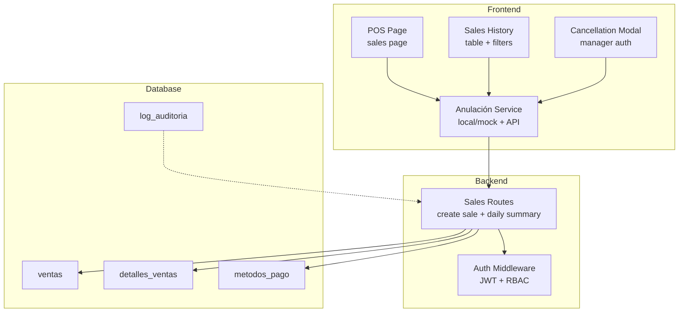
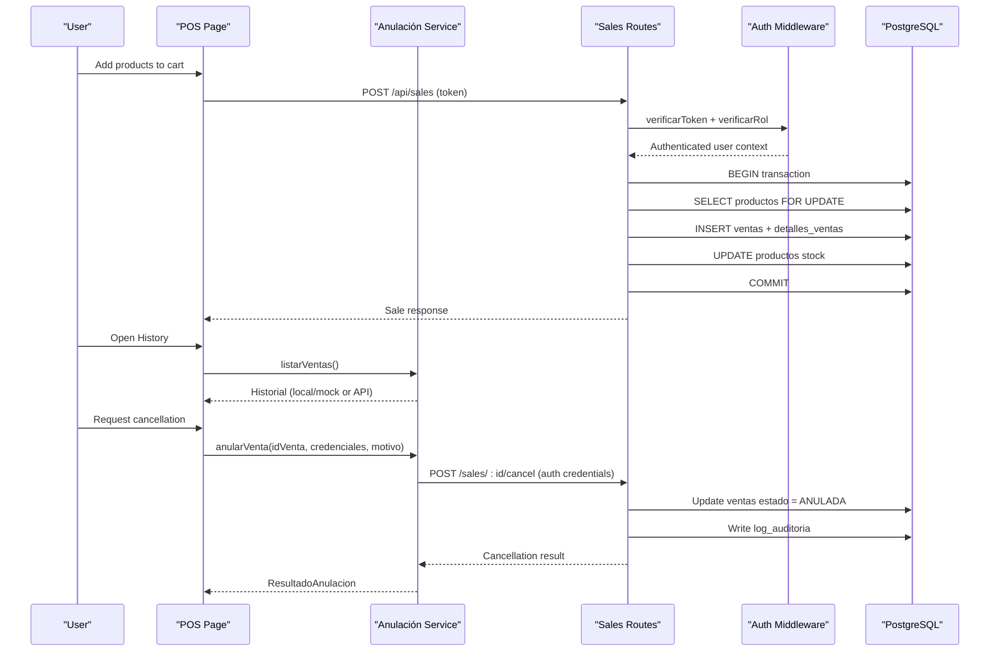
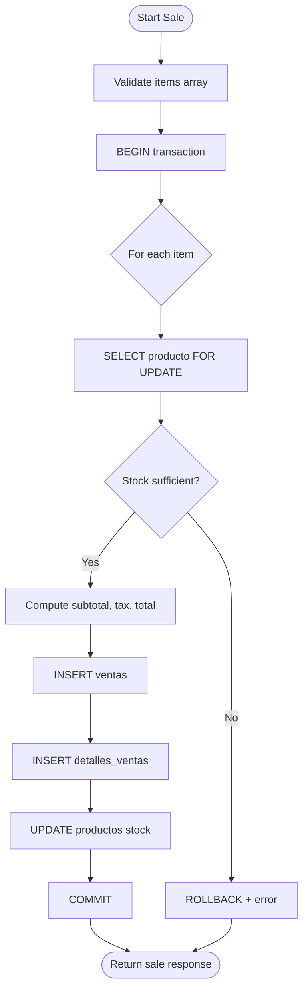
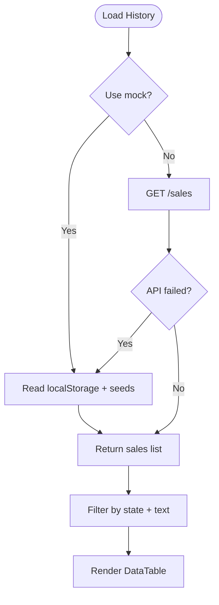
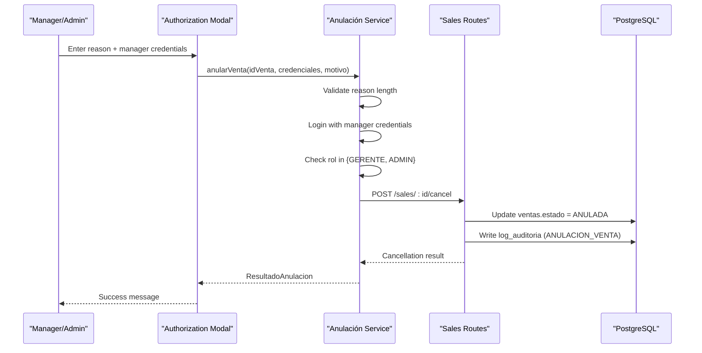
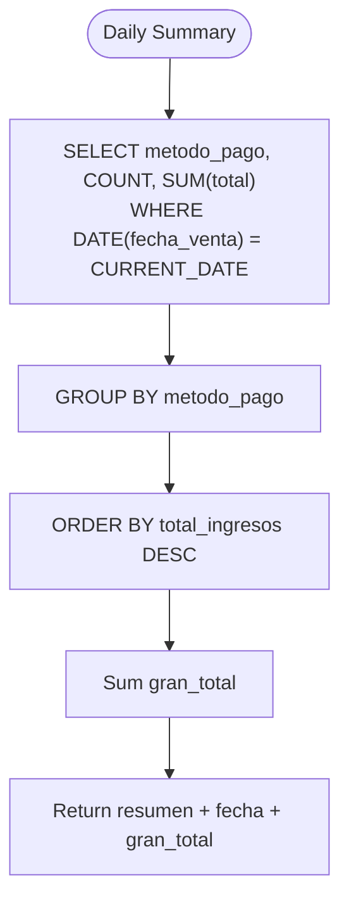
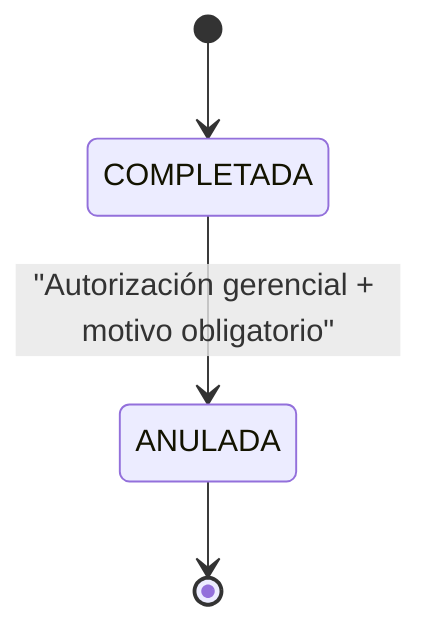
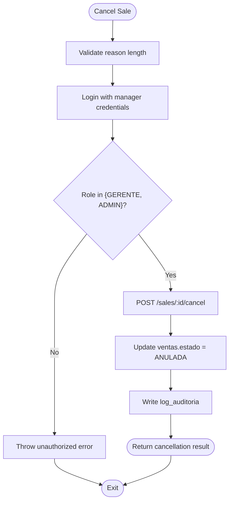
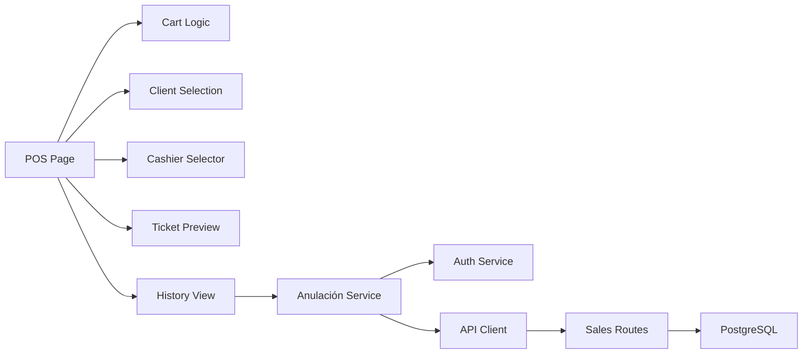

# Transaction Management

<cite>
**Referenced Files in This Document**
- [005_ventas.sql](file://backend/db/migrations/005_ventas.sql)
- [007_auditoria.sql](file://backend/db/migrations/007_auditoria.sql)
- [013_indices_ventas.sql](file://backend/db/migrations/013_indices_ventas.sql)
- [ventasRoutes.js](file://backend/routes/ventasRoutes.js)
- [authMiddleware.js](file://backend/middleware/authMiddleware.js)
- [page.tsx](file://simoapp/app/(protected)/ventas/page.tsx)
- [HistorialVentas.tsx](file://simoapp/components/ventas/HistorialVentas.tsx)
- [anulacionService.ts](file://simoapp/lib/ventas/anulacionService.ts)
</cite>

## Table of Contents
1. [Introduction](#introduction)
2. [Project Structure](#project-structure)
3. [Core Components](#core-components)
4. [Architecture Overview](#architecture-overview)
5. [Detailed Component Analysis](#detailed-component-analysis)
6. [Dependency Analysis](#dependency-analysis)
7. [Performance Considerations](#performance-considerations)
8. [Troubleshooting Guide](#troubleshooting-guide)
9. [Conclusion](#conclusion)

## Introduction
This document explains the transaction management capabilities implemented for sales, cancellation, and reporting. It covers:
- Sales history tracking and querying from both the frontend and backend.
- Transaction status management with completed and cancelled states.
- Cancellation procedures requiring managerial authorization.
- Reporting features such as daily summaries and dashboard metrics.
- Database schema for sales records, line items, payment methods, and audit logs.
- Performance optimization for large datasets through targeted indexes.
- Security, authorization, and compliance logging requirements.

The system supports a point-of-sale interface, an immutable audit trail, and role-based access control to ensure that sensitive operations like cancellations are properly authorized and recorded.

## Project Structure
Transaction-related functionality spans the database layer, backend API routes, middleware, and the Next.js frontend:
- Database migrations define sales tables, constraints, and performance indexes.
- Backend routes handle POS sale creation and daily cash summary.
- Middleware enforces authentication and role checks.
- Frontend pages provide POS entry, sales history, filtering, and cancellation authorization.



**Diagram sources**
- [page.tsx:48-78](file://simoapp/app/(protected)/ventas/page.tsx#L48-L78)
- [HistorialVentas.tsx:41-60](file://simoapp/components/ventas/HistorialVentas.tsx#L41-L60)
- [anulacionService.ts:127-140](file://simoapp/lib/ventas/anulacionService.ts#L127-L140)
- [ventasRoutes.js:10-111](file://backend/routes/ventasRoutes.js#L10-L111)
- [authMiddleware.js:9-49](file://backend/middleware/authMiddleware.js#L9-L49)
- [005_ventas.sql:13-103](file://backend/db/migrations/005_ventas.sql#L13-L103)
- [007_auditoria.sql:13-67](file://backend/db/migrations/007_auditoria.sql#L13-L67)

**Section sources**
- [page.tsx:48-78](file://simoapp/app/(protected)/ventas/page.tsx#L48-L78)
- [HistorialVentas.tsx:41-60](file://simoapp/components/ventas/HistorialVentas.tsx#L41-L60)
- [anulacionService.ts:127-140](file://simoapp/lib/ventas/anulacionService.ts#L127-L140)
- [ventasRoutes.js:10-111](file://backend/routes/ventasRoutes.js#L10-L111)
- [authMiddleware.js:9-49](file://backend/middleware/authMiddleware.js#L9-L49)
- [005_ventas.sql:13-103](file://backend/db/migrations/005_ventas.sql#L13-L103)
- [007_auditoria.sql:13-67](file://backend/db/migrations/007_auditoria.sql#L13-L67)

## Core Components
- Sales route: creates transactions, validates stock, computes totals, inserts sale headers and lines, and updates inventory within a transaction.
- Daily summary route: aggregates completed sales by payment method for the current day.
- Authentication middleware: validates JWT tokens, checks session blacklists, verifies user active status, and enforces role-based access.
- Frontend POS page: manages cart, client selection, cashier assignment, ticket preview, and integrates with local mock or real API for sales and history.
- Sales history component: provides filtering by state and text search, displays transaction details, and triggers cancellation workflow.
- Cancellation service: enforces manager/admin authorization, supports mock/local fallback, and calls backend cancellation endpoint when available.

Key responsibilities:
- Data integrity: constraints on totals, discounts, taxes, and cancellation fields.
- Auditability: immutable audit log entries for critical operations.
- Authorization: role checks for POS creation and cancellation workflows.
- Reporting: daily summary and dashboard metrics based on completed sales.

**Section sources**
- [ventasRoutes.js:10-111](file://backend/routes/ventasRoutes.js#L10-L111)
- [ventasRoutes.js:113-147](file://backend/routes/ventasRoutes.js#L113-L147)
- [authMiddleware.js:9-75](file://backend/middleware/authMiddleware.js#L9-L75)
- [page.tsx:48-78](file://simoapp/app/(protected)/ventas/page.tsx#L48-L78)
- [HistorialVentas.tsx:41-60](file://simoapp/components/ventas/HistorialVentas.tsx#L41-L60)
- [anulacionService.ts:146-260](file://simoapp/lib/ventas/anulacionService.ts#L146-L260)

## Architecture Overview
The transaction flow involves frontend components interacting with backend routes protected by middleware, persisting data into relational tables, and optionally recording audit events.



**Diagram sources**
- [page.tsx:692-759](file://simoapp/app/(protected)/ventas/page.tsx#L692-L759)
- [anulacionService.ts:146-260](file://simoapp/lib/ventas/anulacionService.ts#L146-L260)
- [ventasRoutes.js:10-111](file://backend/routes/ventasRoutes.js#L10-L111)
- [authMiddleware.js:9-49](file://backend/middleware/authMiddleware.js#L9-L49)
- [005_ventas.sql:40-67](file://backend/db/migrations/005_ventas.sql#L40-L67)
- [007_auditoria.sql:13-67](file://backend/db/migrations/007_auditoria.sql#L13-L67)

## Detailed Component Analysis

### Sales Creation Flow
The POS creates a sale by validating product availability, computing totals including taxes, inserting sale header and line items, and updating inventory within a single database transaction. If any step fails, the transaction is rolled back.



**Diagram sources**
- [ventasRoutes.js:10-111](file://backend/routes/ventasRoutes.js#L10-L111)

**Section sources**
- [ventasRoutes.js:10-111](file://backend/routes/ventasRoutes.js#L10-L111)

### Sales History and Filtering
The history view loads sales via the service layer, which prefers the backend API but falls back to local storage and seed data when needed. The UI supports:
- Text search across sale ID, client name, seller name, and payment method.
- State filter: all, completed, or cancelled.
- Detail modal showing transaction metadata, line items, totals, and cancellation audit information if applicable.



**Diagram sources**
- [anulacionService.ts:127-140](file://simoapp/lib/ventas/anulacionService.ts#L127-L140)
- [HistorialVentas.tsx:41-60](file://simoapp/components/ventas/HistorialVentas.tsx#L41-L60)

**Section sources**
- [anulacionService.ts:127-140](file://simoapp/lib/ventas/anulacionService.ts#L127-L140)
- [HistorialVentas.tsx:41-60](file://simoapp/components/ventas/HistorialVentas.tsx#L41-L60)

### Cancellation Workflow and Authorization
Cancellations require managerial authorization. The frontend collects the reason and manager credentials, validates them, checks roles, and then calls the backend cancellation endpoint. On success, the sale state becomes cancelled and audit records are created.



**Diagram sources**
- [anulacionService.ts:146-260](file://simoapp/lib/ventas/anulacionService.ts#L146-L260)
- [005_ventas.sql:40-67](file://backend/db/migrations/005_ventas.sql#L40-L67)
- [007_auditoria.sql:13-67](file://backend/db/migrations/007_auditoria.sql#L13-L67)

**Section sources**
- [anulacionService.ts:146-260](file://simoapp/lib/ventas/anulacionService.ts#L146-L260)
- [005_ventas.sql:40-67](file://backend/db/migrations/005_ventas.sql#L40-L67)
- [007_auditoria.sql:13-67](file://backend/db/migrations/007_auditoria.sql#L13-L67)

### Reporting Features
- Daily cash summary: Aggregates completed sales by payment method for the current date and calculates the grand total.
- Dashboard metrics: Computes time series and summaries over selected ranges using completed sales only.



**Diagram sources**
- [ventasRoutes.js:113-147](file://backend/routes/ventasRoutes.js#L113-L147)

**Section sources**
- [ventasRoutes.js:113-147](file://backend/routes/ventasRoutes.js#L113-L147)

### Database Schema for Sales Records
The schema defines:
- Payment methods catalog.
- Sales header with mandatory fields, totals, and cancellation metadata.
- Line items with frozen purchase cost at sale time.
- Constraints ensuring data integrity and consistent totals.

```mermaid
erDiagram
METODOS_PAGO {
int id_metodo_pago PK
varchar codigo UK
varchar nombre UK
boolean estado
}
VENTAS {
int id_venta PK
int id_cliente FK
int id_usuario FK
int id_pedido UK FK
int id_metodo_pago FK
timestamptz fecha_venta
numeric subtotal
numeric descuento
numeric impuestos
numeric total
varchar estado
timestamptz anulada_en
int anulada_por FK
int autorizada_por FK
text motivo_anulacion
}
DETALLES_VENTAS {
int id_detalle_venta PK
int id_venta FK
int id_producto FK
numeric cantidad
numeric precio_unitario
numeric costo_unitario
numeric subtotal_linea
}
LOG_AUDITORIA {
bigint id_log PK
timestamptz fecha
int id_usuario FK
int id_usuario_autorizador FK
varchar accion
varchar entidad
bigint id_entidad
text justificacion
jsonb datos_anteriores
jsonb datos_nuevos
inet direccion_ip
}
VENTAS ||--o{ DETALLES_VENTAS : "has lines"
VENTAS }o--|| METODOS_PAGO : "uses"
LOG_AUDITORIA }o--|| VENTAS : "audits"
```

**Diagram sources**
- [005_ventas.sql:13-103](file://backend/db/migrations/005_ventas.sql#L13-L103)
- [007_auditoria.sql:13-67](file://backend/db/migrations/007_auditoria.sql#L13-L67)

**Section sources**
- [005_ventas.sql:13-103](file://backend/db/migrations/005_ventas.sql#L13-L103)
- [007_auditoria.sql:13-67](file://backend/db/migrations/007_auditoria.sql#L13-L67)

### Transaction Status Management
- States: COMPLETADA and ANULADA.
- Completed sales have null cancellation fields; cancelled sales must include cancellation timestamp, executor, authorizer, and a non-empty reason.
- Constraints enforce these rules at the database level.



**Diagram sources**
- [005_ventas.sql:40-67](file://backend/db/migrations/005_ventas.sql#L40-L67)

**Section sources**
- [005_ventas.sql:40-67](file://backend/db/migrations/005_ventas.sql#L40-L67)

### Cancellation Procedures
- Requires a detailed reason (minimum length enforced in service).
- Manager or Admin credentials validated via login.
- Role check ensures only GERENTE or ADMIN can authorize.
- Backend updates sale state and writes audit record.



**Diagram sources**
- [anulacionService.ts:146-260](file://simoapp/lib/ventas/anulacionService.ts#L146-L260)
- [007_auditoria.sql:13-67](file://backend/db/migrations/007_auditoria.sql#L13-L67)

**Section sources**
- [anulacionService.ts:146-260](file://simoapp/lib/ventas/anulacionService.ts#L146-L260)
- [007_auditoria.sql:13-67](file://backend/db/migrations/007_auditoria.sql#L13-L67)

### Refund Processing
- The repository does not implement a dedicated refund endpoint or refund-specific table.
- The closest operation is cancellation (ANULADA), which reverses the sale state and requires authorization.
- Inventory restoration is handled in the frontend after successful cancellation by re-stocking items.

Note: If formal refunds are required beyond cancellation, additional backend endpoints and schema changes would be necessary.

**Section sources**
- [anulacionService.ts:146-260](file://simoapp/lib/ventas/anulacionService.ts#L146-L260)
- [page.tsx:649-687](file://simoapp/app/(protected)/ventas/page.tsx#L649-L687)

### Examples: Search, Filtering, and Export
- Search: The history component supports text search across sale ID, client, seller, and payment method.
- Filtering by date range: The UI currently filters by state and text; date-range filtering is present in other modules (e.g., orders) and can be extended to sales history.
- Export: No explicit export endpoint or button is present in the analyzed files. Export could be added by extending the history component and backend to support CSV/Excel generation.

Practical usage patterns:
- Use the history table’s text input to find a specific sale by ID or client name.
- Toggle between “Todas”, “Completadas”, and “Anuladas” to narrow results.
- Open the detail modal to inspect line items and cancellation audit info.

**Section sources**
- [HistorialVentas.tsx:41-60](file://simoapp/components/ventas/HistorialVentas.tsx#L41-L60)
- [HistorialVentas.tsx:171-234](file://simoapp/components/ventas/HistorialVentas.tsx#L171-L234)

### Database Schema for Audit Trails
Audit logs capture critical operations with:
- Action type (including ANULACION_VENTA).
- Entity affected and identifier.
- Justification text (mandatory for certain actions).
- Before/after JSON snapshots.
- IP address of the request.
- Immutable protection via triggers and revokes.

Indexes optimize queries by date, entity, user, and action.

**Section sources**
- [007_auditoria.sql:13-67](file://backend/db/migrations/007_auditoria.sql#L13-L67)

### Performance Optimization for Large Datasets
Targeted B-tree indexes improve query performance for:
- Date-based history and last-sales queries.
- Dashboard aggregations over completed sales.
- Product sales reports joining sales and line items.
- Covering indexes reduce table visits.

Additional configuration adjusts planner costs for SSD-backed databases.

**Section sources**
- [013_indices_ventas.sql:1-71](file://backend/db/migrations/013_indices_ventas.sql#L1-L71)

### Transaction Security and Authorization
- All sale creation routes require a valid JWT token and appropriate roles (ADMIN or VENDEDOR).
- Session validation includes blacklist checks and active user verification.
- Cancellation requires manager/admin credentials and role enforcement in the service layer.
- Audit logs record who performed the operation and who authorized it.

```mermaid
classDiagram
class AuthMiddleware {
+verificarToken(req, res, next)
+verificarRol(...rolesPermitidos)
}
class SalesRoutes {
+POST "/api/sales"
+GET "/api/sales/daily-summary"
}
class AnulacionService {
+listarVentas()
+anularVenta(datos)
}
class PostgreSQL {
+ventas
+detalles_ventas
+metodos_pago
+log_auditoria
}
SalesRoutes --> AuthMiddleware : "verificarToken + verificarRol"
AnulacionService --> SalesRoutes : "POST /sales/ : id/cancel"
SalesRoutes --> PostgreSQL : "CRUD + constraints"
AnulacionService --> PostgreSQL : "audit log"
```

**Diagram sources**
- [authMiddleware.js:9-75](file://backend/middleware/authMiddleware.js#L9-L75)
- [ventasRoutes.js:10-111](file://backend/routes/ventasRoutes.js#L10-L111)
- [anulacionService.ts:146-260](file://simoapp/lib/ventas/anulacionService.ts#L146-L260)
- [005_ventas.sql:13-103](file://backend/db/migrations/005_ventas.sql#L13-L103)
- [007_auditoria.sql:13-67](file://backend/db/migrations/007_auditoria.sql#L13-L67)

**Section sources**
- [authMiddleware.js:9-75](file://backend/middleware/authMiddleware.js#L9-L75)
- [ventasRoutes.js:10-111](file://backend/routes/ventasRoutes.js#L10-L111)
- [anulacionService.ts:146-260](file://simoapp/lib/ventas/anulacionService.ts#L146-L260)

## Dependency Analysis
Key dependencies:
- Frontend POS depends on product context, client selection, cashier selection, and ticket printing.
- History component depends on the cancellation service for loading and filtering sales.
- Cancellation service depends on authentication service and API client.
- Backend routes depend on database pool and middleware for security.
- Database schema relies on foreign keys and constraints for referential integrity.



**Diagram sources**
- [page.tsx:48-78](file://simoapp/app/(protected)/ventas/page.tsx#L48-L78)
- [HistorialVentas.tsx:41-60](file://simoapp/components/ventas/HistorialVentas.tsx#L41-L60)
- [anulacionService.ts:127-140](file://simoapp/lib/ventas/anulacionService.ts#L127-L140)
- [ventasRoutes.js:10-111](file://backend/routes/ventasRoutes.js#L10-L111)

**Section sources**
- [page.tsx:48-78](file://simoapp/app/(protected)/ventas/page.tsx#L48-L78)
- [HistorialVentas.tsx:41-60](file://simoapp/components/ventas/HistorialVentas.tsx#L41-L60)
- [anulacionService.ts:127-140](file://simoapp/lib/ventas/anulacionService.ts#L127-L140)
- [ventasRoutes.js:10-111](file://backend/routes/ventasRoutes.js#L10-L111)

## Performance Considerations
- Use covering indexes to avoid table scans for common queries (date-based history, dashboard totals).
- Prefer indexed joins for product sales reports.
- Tune planner costs for SSD environments to favor index-only scans.
- Keep transaction scopes minimal and deterministic to reduce lock contention during high-volume POS operations.

[No sources needed since this section provides general guidance]

## Troubleshooting Guide
Common issues and resolutions:
- Unauthorized or forbidden errors: Ensure the JWT is valid, not blacklisted, and the user is active. Verify role permissions for the requested route.
- Stock insufficient: Confirm product availability before creating a sale; the backend locks rows with FOR UPDATE to prevent race conditions.
- Cancellation denied: Check that the reason meets minimum length, credentials are correct, and the user has GERENTE or ADMIN role.
- History not loading: If the API is unavailable, the service falls back to local storage and seed data; verify environment flags and network connectivity.

Operational tips:
- Inspect audit logs for cancellation reasons and authorizers.
- Review daily summaries to reconcile cash and payment methods.
- Monitor constraint violations in sales totals and cancellation fields.

**Section sources**
- [authMiddleware.js:9-49](file://backend/middleware/authMiddleware.js#L9-L49)
- [ventasRoutes.js:10-111](file://backend/routes/ventasRoutes.js#L10-L111)
- [anulacionService.ts:146-260](file://simoapp/lib/ventas/anulacionService.ts#L146-L260)
- [007_auditoria.sql:13-67](file://backend/db/migrations/007_auditoria.sql#L13-L67)

## Conclusion
The transaction management implementation provides robust sales creation, history tracking, and reporting with strong security and audit controls. Cancellations are strictly governed by managerial authorization and fully audited. The database schema enforces data integrity, while targeted indexes optimize performance for large datasets. Future enhancements may include explicit refund processing, advanced date-range filtering in the sales history, and export capabilities for reporting needs.

[No sources needed since this section summarizes without analyzing specific files]