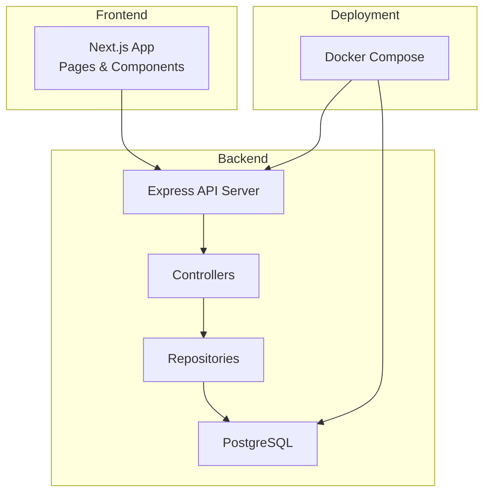
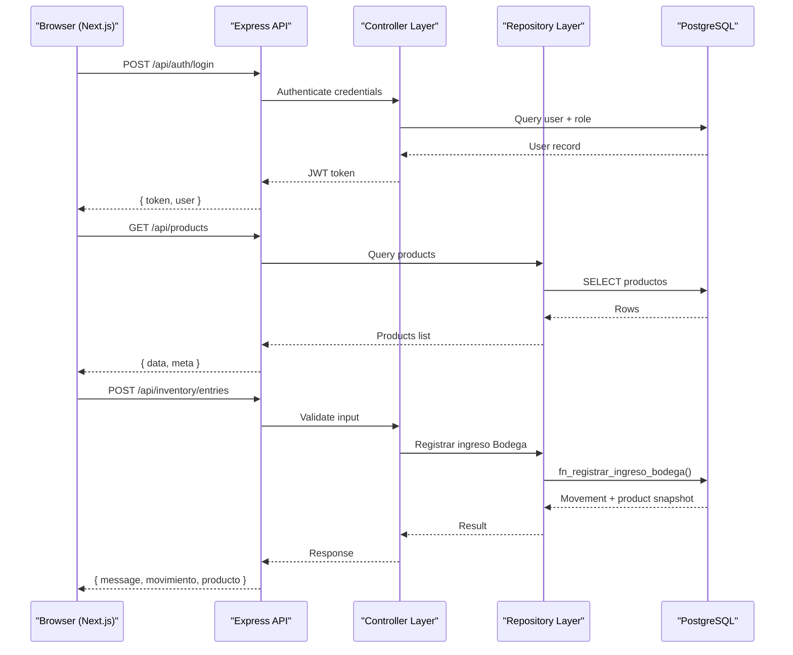
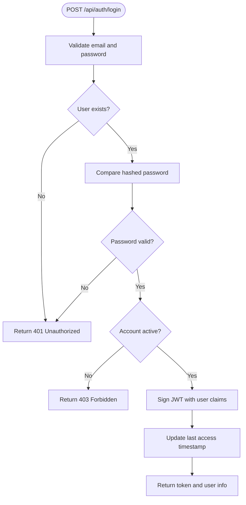
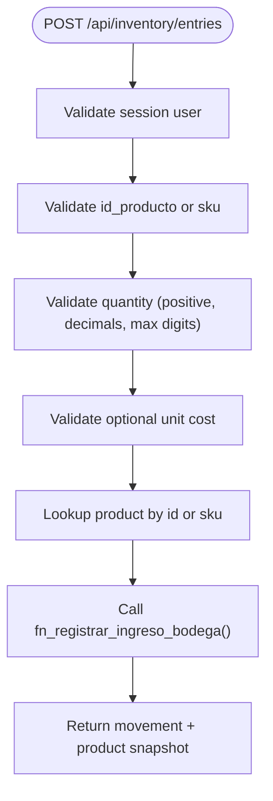
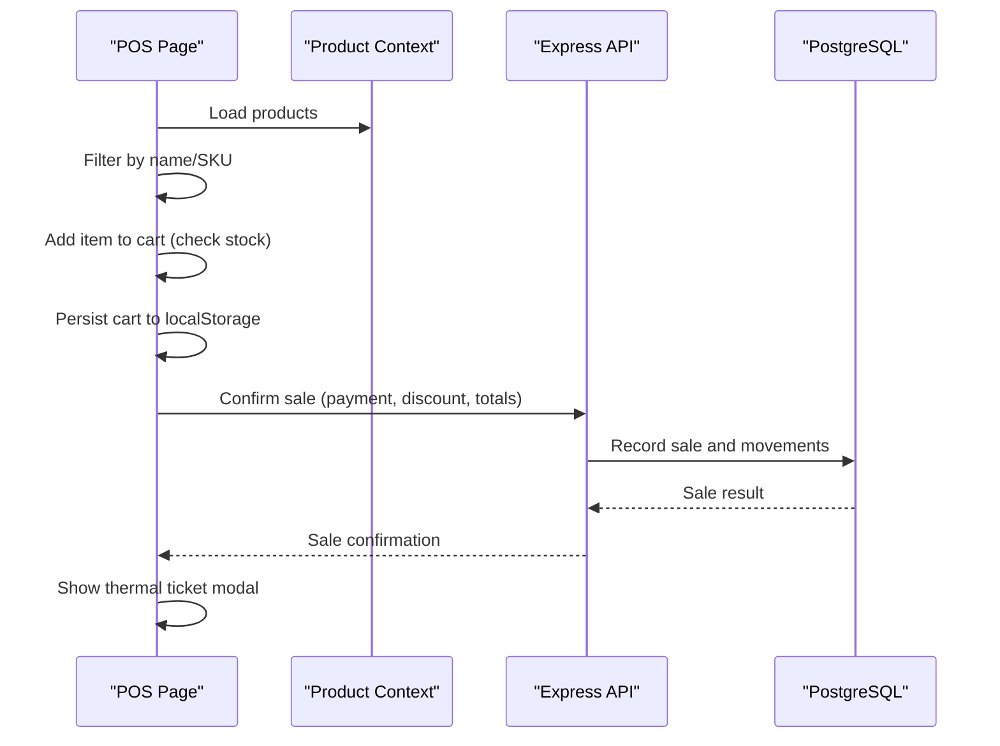
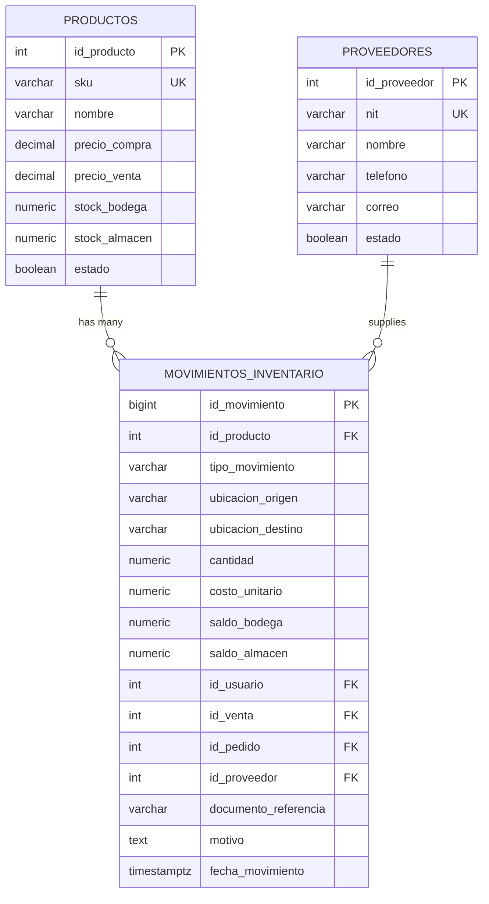
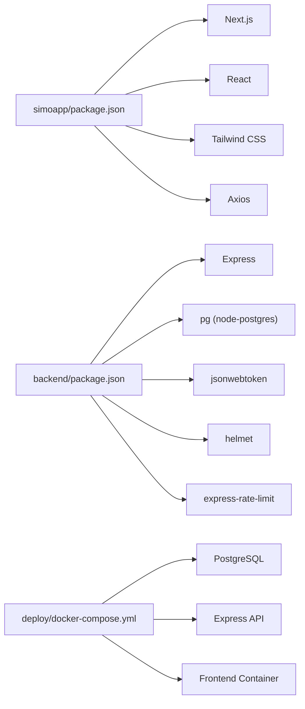

# Project Overview

<cite>
**Referenced Files in This Document**
- [README.md](file://README.md)
- [backend/index.js](file://backend/index.js)
- [backend/package.json](file://backend/package.json)
- [simoapp/package.json](file://simoapp/package.json)
- [simoapp/next.config.ts](file://simoapp/next.config.ts)
- [backend/src/config/db.js](file://backend/src/config/db.js)
- [backend/src/controllers/inventario.controller.js](file://backend/src/controllers/inventario.controller.js)
- [backend/src/repositories/inventario.repository.js](file://backend/src/repositories/inventario.repository.js)
- [backend/src/routes/inventario.routes.js](file://backend/src/routes/inventario.routes.js)
- [backend/db/migrations/001_base.sql](file://backend/db/migrations/001_base.sql)
- [backend/db/migrations/006_inventario.sql](file://backend/db/migrations/006_inventario.sql)
- [simoapp/app/(protected)/ventas/page.tsx](file://simoapp/app/(protected)/ventas/page.tsx)
- [deploy/docker-compose.yml](file://deploy/docker-compose.yml)
</cite>

## Table of Contents
1. [Introduction](#introduction)
2. [Project Structure](#project-structure)
3. [Core Components](#core-components)
4. [Architecture Overview](#architecture-overview)
5. [Detailed Component Analysis](#detailed-component-analysis)
6. [Dependency Analysis](#dependency-analysis)
7. [Performance Considerations](#performance-considerations)
8. [Troubleshooting Guide](#troubleshooting-guide)
9. [Conclusion](#conclusion)

## Introduction
SIMO is a complete retail management solution designed for small businesses. It provides inventory management, sales processing (POS), order traceability, and user administration. The system supports dual-location inventory tracking (warehouse and store room), customer management, and a business intelligence dashboard to monitor performance.

Target audience:
- Small retail businesses needing an integrated POS, inventory control, and reporting tool.

Key features:
- Point-of-Sale interface with barcode scanning support and thermal receipt preview.
- Dual-location inventory tracking with Kardex-style audit trail.
- Customer management and purchase orders from suppliers.
- User administration with role-based access control.
- Business intelligence dashboard with charts and metrics.

Technology stack:
- Frontend: Next.js (App Router), React, TypeScript, Tailwind CSS.
- Backend: Node.js with Express, PostgreSQL, JWT authentication, security middleware.
- Orchestration: Docker Compose for local and deployment environments.

Architectural approach:
- Full-stack MVC on the backend with a repository pattern separating HTTP routes, controllers, and data access.
- Frontend organized by feature pages and reusable UI components.
- Database migrations and seed scripts manage schema evolution and initial data.

[No sources needed since this section summarizes without analyzing specific files]

## Project Structure
The repository is organized into three main areas:
- simoapp: Next.js frontend application with pages, components, and libraries.
- backend: Express API server with routes, controllers, repositories, configuration, and database migrations.
- deploy: Docker Compose orchestration for database, API, frontend, backups, and Cloudflare tunnel.

**Diagram sources**
- [simoapp/package.json:1-29](file://simoapp/package.json#L1-L29)
- [backend/package.json:1-38](file://backend/package.json#L1-L38)
- [deploy/docker-compose.yml:1-120](file://deploy/docker-compose.yml#L1-L120)

**Section sources**
- [README.md:1-245](file://README.md#L1-L245)
- [simoapp/package.json:1-29](file://simoapp/package.json#L1-L29)
- [backend/package.json:1-38](file://backend/package.json#L1-L38)
- [deploy/docker-compose.yml:1-120](file://deploy/docker-compose.yml#L1-L120)

## Core Components
- Authentication and Authorization:
  - Login/logout endpoints using JWT tokens.
  - Role-based authorization for protected routes.
- Inventory Management:
  - Supplier purchases and stock entries.
  - Dual-location stock balances and Kardex audit view.
- Sales Processing (POS):
  - Product search and barcode scanning.
  - Cart management, client selection, payment confirmation, and thermal ticket preview.
  - Sales history and authorized cancellation workflow.
- Customer Management:
  - CRUD operations and search by document number.
- User Administration:
  - List, create, update users; toggle status; role constraints.

Implementation highlights:
- Backend uses Express with security middleware (Helmet, CORS, rate limiting, XSS sanitization).
- Database connection pooling via node-postgres with environment-driven configuration.
- Repository layer encapsulates SQL queries and stored procedures for inventory operations.

**Section sources**
- [backend/index.js:1-57](file://backend/index.js#L1-L57)
- [backend/index.js:347-423](file://backend/index.js#L347-L423)
- [backend/src/config/db.js:1-29](file://backend/src/config/db.js#L1-L29)
- [backend/src/controllers/inventario.controller.js:1-269](file://backend/src/controllers/inventario.controller.js#L1-L269)
- [backend/src/repositories/inventario.repository.js:1-102](file://backend/src/repositories/inventario.repository.js#L1-L102)
- [simoapp/app/(protected)/ventas/page.tsx:1-789](file://simoapp/app/(protected)/ventas/page.tsx#L1-L789)

## Architecture Overview
The system follows a full-stack MVC architecture on the backend with a repository pattern. The frontend communicates with the API over HTTP, handling state locally and persisting cart data in the browser.

**Diagram sources**
- [backend/index.js:347-423](file://backend/index.js#L347-L423)
- [backend/index.js:157-232](file://backend/index.js#L157-L232)
- [backend/src/controllers/inventario.controller.js:48-147](file://backend/src/controllers/inventario.controller.js#L48-L147)
- [backend/src/repositories/inventario.repository.js:12-27](file://backend/src/repositories/inventario.repository.js#L12-L27)

## Detailed Component Analysis

### Authentication and Authorization
- Login endpoint validates email/password, checks account status, and issues a signed JWT with user claims.
- Logout endpoint blacklists the token in the database to invalidate sessions.
- Protected routes use middleware to verify tokens and roles.

**Diagram sources**
- [backend/index.js:347-423](file://backend/index.js#L347-L423)

**Section sources**
- [backend/index.js:347-423](file://backend/index.js#L347-L423)
- [backend/index.js:428-469](file://backend/index.js#L428-L469)

### Inventory Management
- Stock entry to warehouse:
  - Validates user identity from session, product identification (id or SKU), quantity rules, optional cost and supplier details.
  - Uses a database function to atomically lock the product, update warehouse stock, and record movement.
- Supplier purchases:
  - Accepts multiple lines with id or SKU per line, validates quantities and costs, ensures product existence, and optionally confirms the purchase to move stock into warehouse via a stored procedure.

**Diagram sources**
- [backend/src/controllers/inventario.controller.js:48-147](file://backend/src/controllers/inventario.controller.js#L48-L147)
- [backend/src/repositories/inventario.repository.js:12-27](file://backend/src/repositories/inventario.repository.js#L12-L27)

**Section sources**
- [backend/src/controllers/inventario.controller.js:1-269](file://backend/src/controllers/inventario.controller.js#L1-L269)
- [backend/src/repositories/inventario.repository.js:1-102](file://backend/src/repositories/inventario.repository.js#L1-L102)
- [backend/src/routes/inventario.routes.js:1-17](file://backend/src/routes/inventario.routes.js#L1-L17)

### Sales Processing (POS)
- Product catalog browsing and filtering by name or code.
- Barcode scanner integration via keyboard event listener that buffers rapid keystrokes and triggers product lookup on Enter.
- Cart management with stock validation and persistence across sessions.
- Client selection and thermal receipt preview.
- Sales history and authorized cancellation workflow.

**Diagram sources**
- [simoapp/app/(protected)/ventas/page.tsx:1-789](file://simoapp/app/(protected)/ventas/page.tsx#L1-L789)

**Section sources**
- [simoapp/app/(protected)/ventas/page.tsx:1-789](file://simoapp/app/(protected)/ventas/page.tsx#L1-L789)

### Data Model Highlights
- Base utilities include timezone configuration and functions to maintain updated timestamps, capture transactional user context, and block modifications to audit tables.
- Inventory model includes suppliers, immutable inventory movements, and a Kardex view summarizing chronological stock changes by location.

**Diagram sources**
- [backend/db/migrations/001_base.sql:1-60](file://backend/db/migrations/001_base.sql#L1-L60)
- [backend/db/migrations/006_inventario.sql:20-166](file://backend/db/migrations/006_inventario.sql#L20-L166)

**Section sources**
- [backend/db/migrations/001_base.sql:1-60](file://backend/db/migrations/001_base.sql#L1-L60)
- [backend/db/migrations/006_inventario.sql:1-166](file://backend/db/migrations/006_inventario.sql#L1-L166)

## Dependency Analysis
- Frontend dependencies:
  - Next.js, React, Recharts, Axios, Tailwind CSS, TypeScript.
- Backend dependencies:
  - Express, pg (node-postgres), bcrypt, jsonwebtoken, helmet, cors, express-rate-limit, xss-clean.
- Deployment:
  - Docker Compose orchestrates PostgreSQL, API, frontend, backup, and Cloudflare tunnel services.

**Diagram sources**
- [simoapp/package.json:1-29](file://simoapp/package.json#L1-L29)
- [backend/package.json:1-38](file://backend/package.json#L1-L38)
- [deploy/docker-compose.yml:1-120](file://deploy/docker-compose.yml#L1-L120)

**Section sources**
- [simoapp/package.json:1-29](file://simoapp/package.json#L1-L29)
- [backend/package.json:1-38](file://backend/package.json#L1-L38)
- [deploy/docker-compose.yml:1-120](file://deploy/docker-compose.yml#L1-L120)

## Performance Considerations
- Database indexing:
  - Indexes on inventory movements by product/date and foreign keys improve query performance for Kardex and historical reports.
- Connection pooling:
  - PostgreSQL pool configured via environment variables reduces connection overhead.
- Security and rate limiting:
  - Global rate limiter protects API endpoints against abuse.
- Frontend optimizations:
  - Local cart persistence avoids unnecessary network calls during POS interactions.
  - Efficient filtering and rendering of product catalogs.

[No sources needed since this section provides general guidance]

## Troubleshooting Guide
Common issues and resolutions:
- Authentication failures:
  - Ensure correct email/password and active account status; check JWT expiration settings.
- Inventory operation errors:
  - Validate required fields (product id or SKU, positive quantity); ensure product is active.
  - For purchases, avoid duplicate product lines and confirm product existence.
- Database connectivity:
  - Verify DATABASE_URL or DB_* environment variables; check SSL settings for cloud databases.
- Docker services:
  - Use healthchecks to confirm DB and API readiness; inspect logs for service startup issues.

**Section sources**
- [backend/index.js:63-70](file://backend/index.js#L63-L70)
- [backend/src/controllers/inventario.controller.js:138-147](file://backend/src/controllers/inventario.controller.js#L138-L147)
- [backend/src/controllers/inventario.controller.js:235-246](file://backend/src/controllers/inventario.controller.js#L235-L246)
- [backend/src/config/db.js:11-26](file://backend/src/config/db.js#L11-L26)
- [deploy/docker-compose.yml:33-63](file://deploy/docker-compose.yml#L33-L63)

## Conclusion
SIMO delivers a robust, secure, and scalable retail management platform tailored for small businesses. Its modular architecture, comprehensive inventory controls, intuitive POS interface, and strong audit trails make it suitable for day-to-day retail operations. With Dockerized deployment and clear separation of concerns, teams can extend and maintain the system effectively while focusing on business value.

[No sources needed since this section summarizes without analyzing specific files]