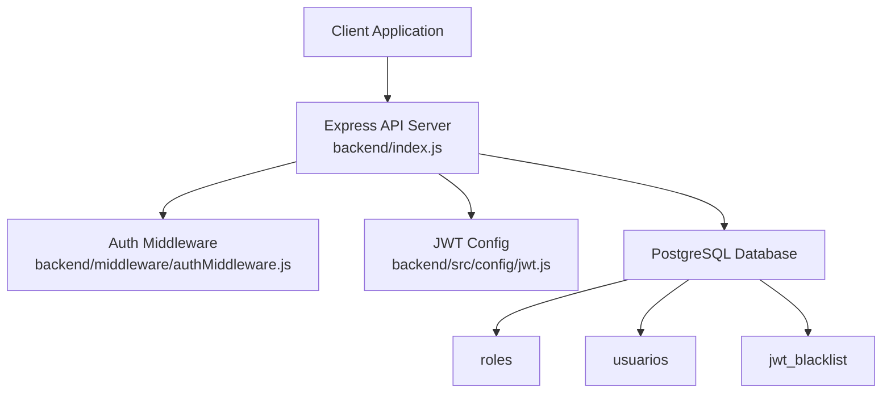
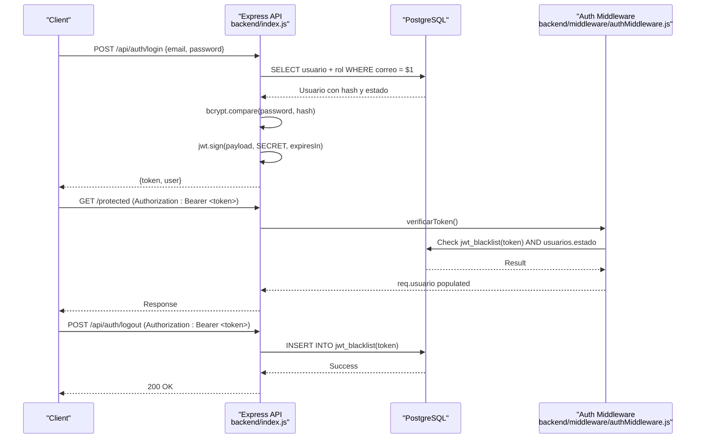
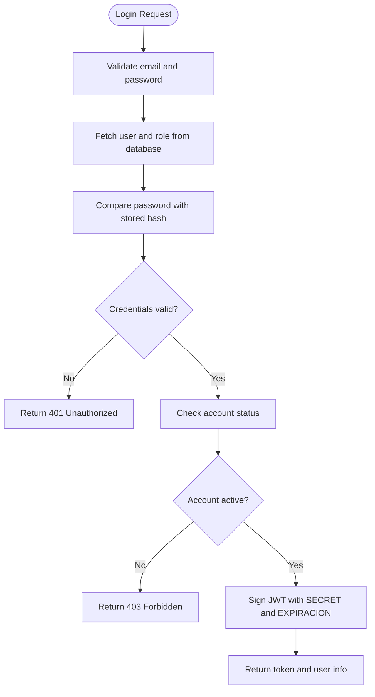
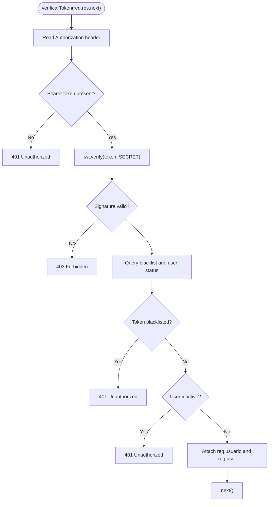
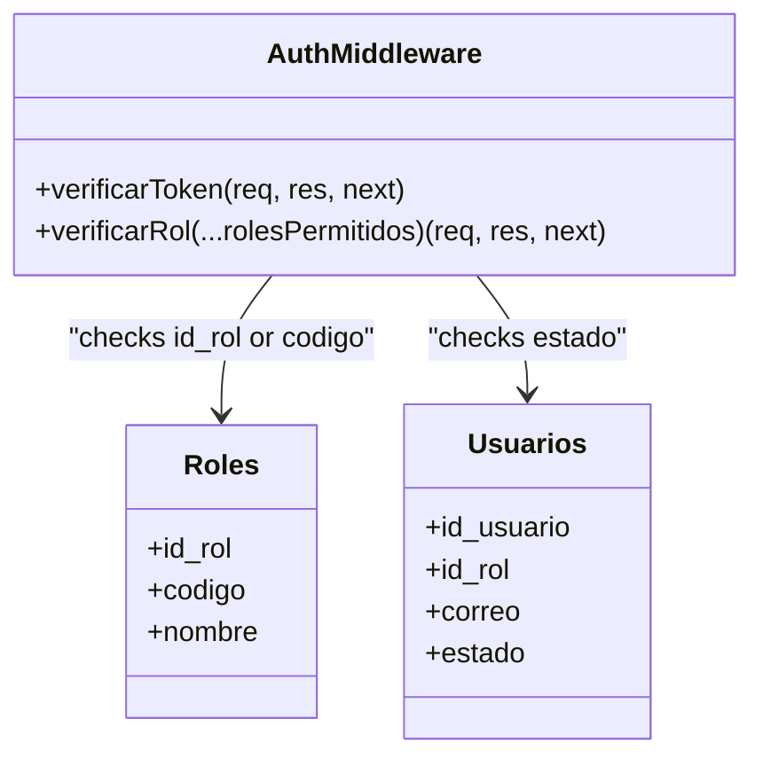
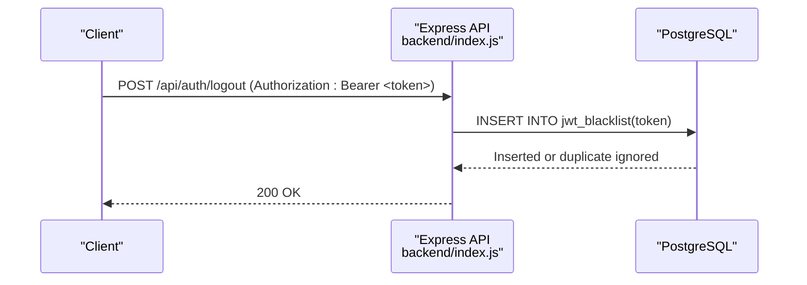
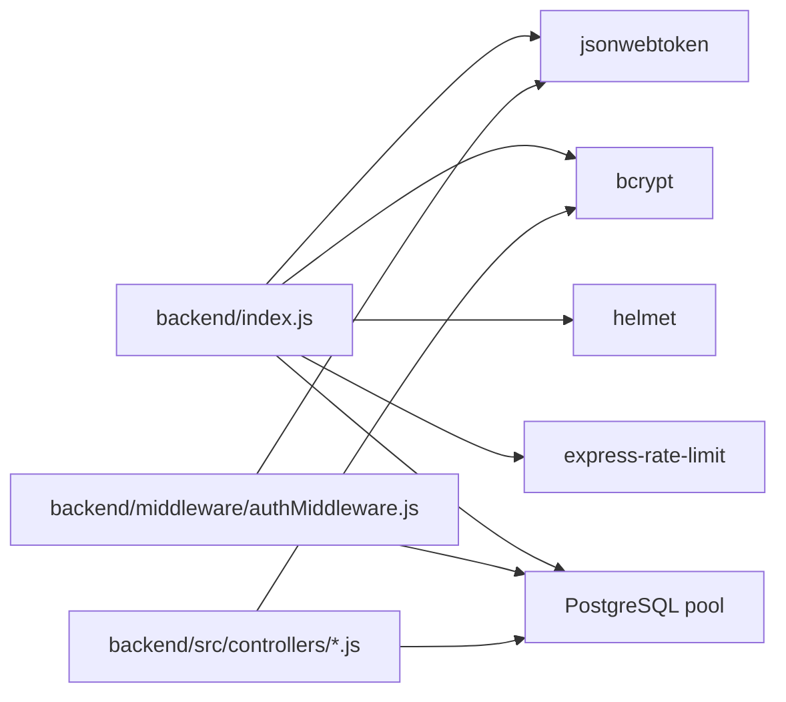

# Authentication Security

<cite>
**Referenced Files in This Document**
- [index.js](file://backend/index.js)
- [jwt.js](file://backend/src/config/jwt.js)
- [authMiddleware.js](file://backend/middleware/authMiddleware.js)
- [usuariosRoutes.js](file://backend/routes/usuariosRoutes.js)
- [usuarios.controller.js](file://backend/src/controllers/usuarios.controller.js)
- [001_base.sql](file://backend/db/migrations/001_base.sql)
- [002_seguridad.sql](file://backend/db/migrations/002_seguridad.sql)
- [010_sesiones.sql](file://backend/db/migrations/010_sesiones.sql)
</cite>

## Table of Contents
1. [Introduction](#introduction)
2. [Project Structure](#project-structure)
3. [Core Components](#core-components)
4. [Architecture Overview](#architecture-overview)
5. [Detailed Component Analysis](#detailed-component-analysis)
6. [Dependency Analysis](#dependency-analysis)
7. [Performance Considerations](#performance-considerations)
8. [Troubleshooting Guide](#troubleshooting-guide)
9. [Conclusion](#conclusion)

## Introduction
This document explains the authentication and authorization security model implemented in the backend. It covers JWT token lifecycle, session invalidation through a blacklist, role-based access control, secure password handling, rate limiting, XSS sanitization, and HTTP security headers. It also provides guidance on refresh tokens, multi-factor authentication, session timeouts, logout procedures, and API response security.

The system uses:
- JSON Web Tokens for short-lived authenticated sessions.
- A database-backed blacklist to invalidate tokens immediately after logout or when a user is deactivated.
- Role-based access control using roles stored in the database and validated by middleware.
- Secure password hashing with bcrypt.
- Global security middleware including Helmet, CORS, input sanitization, and rate limiting.

## Project Structure
Authentication-related code is primarily located under:
- Backend entry point and authentication endpoints: `backend/index.js`
- JWT configuration: `backend/src/config/jwt.js`
- Authentication and RBAC middleware: `backend/middleware/authMiddleware.js`
- User management routes and controllers: `backend/routes/usuariosRoutes.js`, `backend/src/controllers/usuarios.controller.js`
- Database schema and migrations: `backend/db/migrations/002_seguridad.sql`, `backend/db/migrations/010_sesiones.sql`, `backend/db/migrations/001_base.sql`

**Diagram sources**
- [index.js:1-18](file://backend/index.js#L1-L18)
- [authMiddleware.js:1-81](file://backend/middleware/authMiddleware.js#L1-L81)
- [jwt.js:1-16](file://backend/src/config/jwt.js#L1-L16)
- [002_seguridad.sql:15-58](file://backend/db/migrations/002_seguridad.sql#L15-L58)
- [010_sesiones.sql:12-19](file://backend/db/migrations/010_sesiones.sql#L12-L19)

**Section sources**
- [index.js:1-56](file://backend/index.js#L1-L56)
- [jwt.js:1-16](file://backend/src/config/jwt.js#L1-L16)
- [authMiddleware.js:1-81](file://backend/middleware/authMiddleware.js#L1-L81)
- [002_seguridad.sql:15-58](file://backend/db/migrations/002_seguridad.sql#L15-L58)
- [010_sesiones.sql:12-19](file://backend/db/migrations/010_sesiones.sql#L12-L19)

## Core Components
- JWT configuration defines the signing secret and expiration time used by both login and verification.
- Authentication middleware validates tokens, checks the blacklist, and ensures the user account is active.
- Role-based access control middleware restricts routes to specific roles.
- Login endpoint authenticates users, verifies passwords, and issues JWTs.
- Logout endpoint adds the current token to the blacklist to invalidate it immediately.
- User management endpoints use bcrypt for secure password hashing and enforce validation rules.

Key responsibilities:
- Token signing and verification: `backend/index.js`, `backend/src/config/jwt.js`
- Session invalidation and state checks: `backend/middleware/authMiddleware.js`
- RBAC enforcement: `backend/middleware/authMiddleware.js`
- Password hashing and user creation/update: `backend/src/controllers/usuarios.controller.js`, `backend/routes/usuariosRoutes.js`
- Database schema for roles, users, and blacklist: `backend/db/migrations/002_seguridad.sql`, `backend/db/migrations/010_sesiones.sql`

**Section sources**
- [jwt.js:11-15](file://backend/src/config/jwt.js#L11-L15)
- [authMiddleware.js:9-49](file://backend/middleware/authMiddleware.js#L9-L49)
- [authMiddleware.js:57-75](file://backend/middleware/authMiddleware.js#L57-L75)
- [index.js:347-423](file://backend/index.js#L347-L423)
- [index.js:428-469](file://backend/index.js#L428-L469)
- [usuarios.controller.js:29-84](file://backend/src/controllers/usuarios.controller.js#L29-L84)
- [usuariosRoutes.js:22-46](file://backend/routes/usuariosRoutes.js#L22-L46)

## Architecture Overview
The authentication flow consists of:
- Login: client sends credentials; server verifies identity, checks account status, signs a JWT, and returns it.
- Protected requests: client includes the JWT in the Authorization header; middleware verifies signature, checks blacklist, and confirms account activity.
- RBAC: route handlers apply role checks to ensure only permitted roles can execute sensitive operations.
- Logout: client sends the current token; server adds it to the blacklist so subsequent requests are rejected even if the token has not expired.

**Diagram sources**
- [index.js:347-423](file://backend/index.js#L347-L423)
- [index.js:428-469](file://backend/index.js#L428-L469)
- [authMiddleware.js:9-49](file://backend/middleware/authMiddleware.js#L9-L49)
- [010_sesiones.sql:12-19](file://backend/db/migrations/010_sesiones.sql#L12-L19)

## Detailed Component Analysis

### JWT Configuration and Token Lifecycle
- The JWT secret is loaded from environment variables with a development fallback.
- Expiration is configurable via environment variables and defaults to 30 minutes.
- Login signs a token containing user identifiers, email, and role code.
- Verification reads the Authorization header, decodes the token, checks the blacklist, and validates account status.

Security considerations:
- Use strong secrets in production and never commit them to source control.
- Keep token payloads minimal; avoid storing sensitive data in JWTs.
- Enforce short lifetimes and handle expiration gracefully on the client.

**Diagram sources**
- [index.js:347-423](file://backend/index.js#L347-L423)
- [jwt.js:11-15](file://backend/src/config/jwt.js#L11-L15)

**Section sources**
- [jwt.js:1-16](file://backend/src/config/jwt.js#L1-L16)
- [index.js:347-423](file://backend/index.js#L347-L423)

### Authentication Middleware and Session Validation
- Extracts the bearer token from the Authorization header.
- Verifies the token signature using the shared secret.
- Checks whether the token is present in the blacklist.
- Ensures the user’s account is active; inactive accounts are denied access immediately.
- Populates request objects with decoded user data for downstream handlers.

Error handling:
- Missing or malformed tokens return 401.
- Invalid or expired tokens return 403.
- Blacklisted tokens return 401 with a message indicating session closure.
- Database errors during blacklist or status checks return 500.

**Diagram sources**
- [authMiddleware.js:9-49](file://backend/middleware/authMiddleware.js#L9-L49)

**Section sources**
- [authMiddleware.js:1-81](file://backend/middleware/authMiddleware.js#L1-L81)

### Role-Based Access Control (RBAC)
- Roles are defined in the database with stable codes used in JWT payloads and middleware checks.
- The RBAC middleware accepts allowed role IDs or role codes and denies access if the user does not match.
- Routes protect sensitive endpoints by applying both authentication and role checks.

Roles:
- ADMIN
- GERENTE
- INVENTARIO
- VENDEDOR

Usage patterns:
- List users requires ADMIN or GERENTE.
- Create user requires ADMIN.

**Diagram sources**
- [authMiddleware.js:57-75](file://backend/middleware/authMiddleware.js#L57-L75)
- [002_seguridad.sql:15-31](file://backend/db/migrations/002_seguridad.sql#L15-L31)
- [002_seguridad.sql:40-58](file://backend/db/migrations/002_seguridad.sql#L40-L58)

**Section sources**
- [authMiddleware.js:57-75](file://backend/middleware/authMiddleware.js#L57-L75)
- [usuariosRoutes.js:10-20](file://backend/routes/usuariosRoutes.js#L10-L20)
- [usuariosRoutes.js:22-46](file://backend/routes/usuariosRoutes.js#L22-L46)
- [002_seguridad.sql:15-31](file://backend/db/migrations/002_seguridad.sql#L15-L31)

### Secure Password Handling
- Passwords are hashed using bcrypt with a configurable salt rounds value.
- Login compares provided passwords against stored hashes securely.
- User creation and update endpoints validate inputs and reject attempts to modify passwords through non-password endpoints.

Best practices:
- Use appropriate salt rounds balancing security and performance.
- Never log or expose password hashes.
- Enforce minimum password length and complexity at the application layer.

**Section sources**
- [usuarios.controller.js:16-20](file://backend/src/controllers/usuarios.controller.js#L16-L20)
- [usuarios.controller.js:29-84](file://backend/src/controllers/usuarios.controller.js#L29-L84)
- [usuarios.controller.js:172-255](file://backend/src/controllers/usuarios.controller.js#L172-L255)
- [index.js:380-384](file://backend/index.js#L380-L384)
- [usuariosRoutes.js:30-46](file://backend/routes/usuariosRoutes.js#L30-L46)

### Session Timeout and Token Expiration Handling
- Tokens expire according to the configured expiration time (default 30 minutes).
- Clients should handle 401/403 responses due to expiration by prompting re-authentication.
- For immediate session termination, use the logout endpoint to add the token to the blacklist.

Recommended client behavior:
- Store tokens securely (e.g., httpOnly cookies or secure storage mechanisms).
- Refresh or re-authenticate before expiration based on UI requirements.
- On receiving an unauthorized or forbidden response, clear local auth state and redirect to login.

**Section sources**
- [jwt.js:11-15](file://backend/src/config/jwt.js#L11-L15)
- [authMiddleware.js:22-27](file://backend/middleware/authMiddleware.js#L22-L27)
- [index.js:401-414](file://backend/index.js#L401-L414)

### Logout Procedure and Token Invalidation
- The logout endpoint expects a valid Authorization header with a bearer token.
- It inserts the token into the blacklist table; duplicate insertions are tolerated.
- Subsequent requests with the same token will be rejected by the authentication middleware.

**Diagram sources**
- [index.js:428-469](file://backend/index.js#L428-L469)
- [010_sesiones.sql:12-19](file://backend/db/migrations/010_sesiones.sql#L12-L19)

**Section sources**
- [index.js:428-469](file://backend/index.js#L428-L469)
- [010_sesiones.sql:1-20](file://backend/db/migrations/010_sesiones.sql#L1-L20)

### Security Headers and Input Protection
- Helmet configures secure HTTP headers across all responses.
- CORS is enabled for cross-origin requests.
- JSON body parsing is applied globally.
- Custom XSS sanitization middleware processes incoming requests.
- Rate limiting protects against abuse by restricting requests per IP.

Recommendations:
- Restrict CORS origins to trusted domains in production.
- Configure Helmet policies explicitly rather than relying solely on defaults.
- Tune rate limits based on expected traffic patterns.

**Section sources**
- [index.js:10-48](file://backend/index.js#L10-L48)

### Multi-Factor Authentication Setup
The current implementation does not include multi-factor authentication. To implement MFA:
- Add a TOTP secret column to the users table and mark it as encrypted at rest.
- Extend the login flow to require a second factor after initial credential verification.
- Issue separate short-lived tokens for each factor or bind factors to the session context.
- Store MFA recovery codes securely and allow users to rotate them.
- Update RBAC and audit logs to record MFA events.

Note: This section describes conceptual steps and is not tied to existing code.

[No sources needed since this section doesn't analyze specific files]

### Refresh Token Strategy
The current implementation uses short-lived access tokens without refresh tokens. To introduce refresh tokens:
- Generate a long-lived refresh token and store its hash in the database associated with the user and device/session metadata.
- Return both access and refresh tokens on successful login.
- Implement a dedicated refresh endpoint that validates the refresh token and issues a new access token.
- Rotate refresh tokens on use and revoke them on logout or suspicious activity.
- Set strict expiration and scope for refresh tokens.

Note: This section describes conceptual steps and is not tied to existing code.

[No sources needed since this section doesn't analyze specific files]

## Dependency Analysis
The authentication subsystem depends on:
- Express middleware for request processing and security headers.
- JSON Web Tokens library for signing and verifying tokens.
- PostgreSQL database for roles, users, and token blacklist.
- bcrypt for secure password hashing.
- Rate limiting and XSS sanitization modules for defense-in-depth.

**Diagram sources**
- [index.js:1-15](file://backend/index.js#L1-L15)
- [authMiddleware.js:1-4](file://backend/middleware/authMiddleware.js#L1-L4)
- [usuarios.controller.js:4-14](file://backend/src/controllers/usuarios.controller.js#L4-L14)

**Section sources**
- [index.js:1-15](file://backend/index.js#L1-L15)
- [authMiddleware.js:1-4](file://backend/middleware/authMiddleware.js#L1-L4)
- [usuarios.controller.js:4-14](file://backend/src/controllers/usuarios.controller.js#L4-L14)

## Performance Considerations
- Token verification is lightweight but involves database queries for blacklist and user status; consider caching frequently accessed user states if necessary.
- bcrypt hashing cost should be tuned to balance security and latency; default salt rounds are reasonable for most applications.
- Rate limiting helps mitigate brute-force attacks; adjust thresholds based on load testing results.
- Avoid logging sensitive data such as tokens or passwords.

[No sources needed since this section provides general guidance]

## Troubleshooting Guide
Common issues and resolutions:
- Missing Authorization header: Ensure clients send `Authorization: Bearer <token>` on protected requests.
- Malformed token: Verify token format and encoding; check for extra spaces or incorrect prefixes.
- Expired token: Handle 403 responses by prompting re-authentication or refreshing tokens if implemented.
- Blacklisted token: After logout, clients must obtain a new token; do not reuse invalidated tokens.
- Inactive account: Administrators must activate the account before allowing login.
- Duplicate blacklist insertion: Logout endpoint tolerates duplicates; no action required.
- Database connection errors: Check database connectivity and migration status.

Operational tips:
- Monitor 401/403 rates to detect potential authentication issues.
- Review blacklist growth and consider periodic cleanup jobs if retention becomes large.
- Audit failed login attempts and consider implementing lockout policies aligned with business requirements.

**Section sources**
- [authMiddleware.js:10-49](file://backend/middleware/authMiddleware.js#L10-L49)
- [index.js:428-469](file://backend/index.js#L428-L469)

## Conclusion
The backend implements a robust authentication and authorization model centered around short-lived JWTs, immediate session invalidation via a blacklist, and role-based access control. Security headers, rate limiting, and XSS sanitization provide additional layers of protection. While multi-factor authentication and refresh tokens are not currently implemented, the architecture supports their addition with careful design and secure storage practices. Proper client-side handling of token expiration and logout flows is essential to maintain a secure user experience.

[No sources needed since this section summarizes without analyzing specific files]