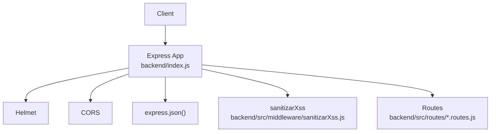
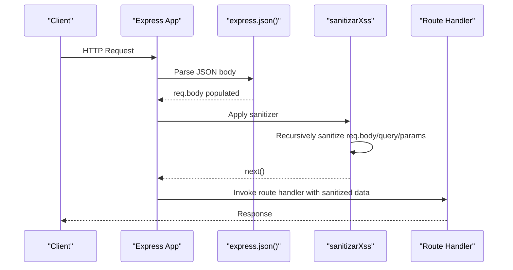
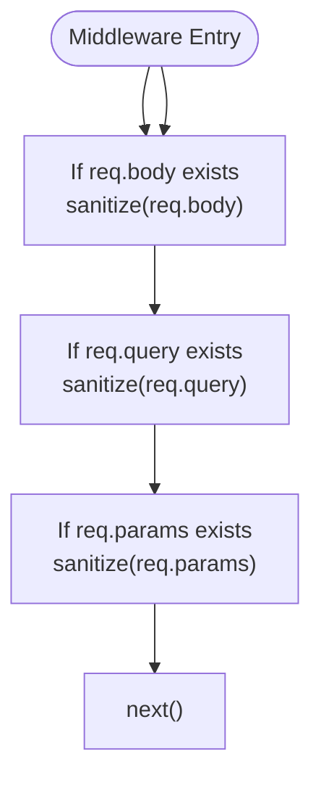
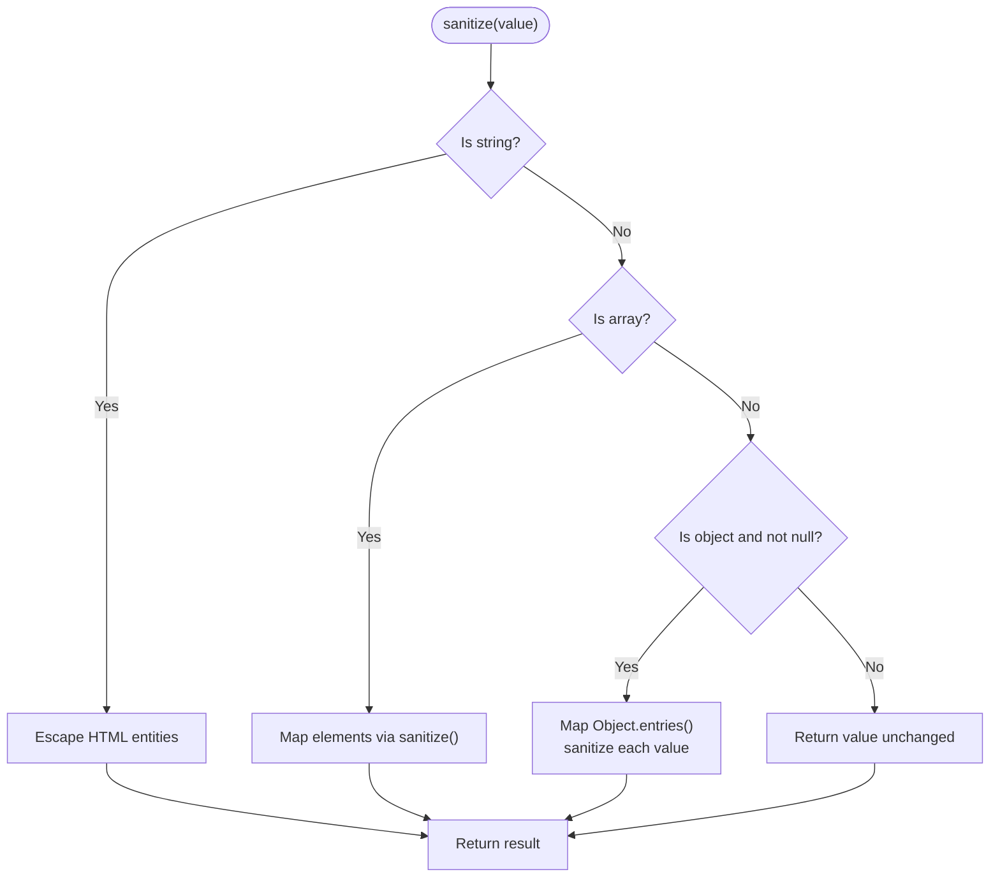
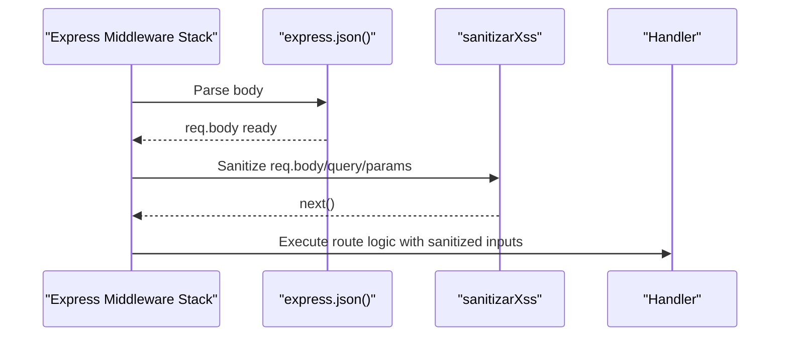
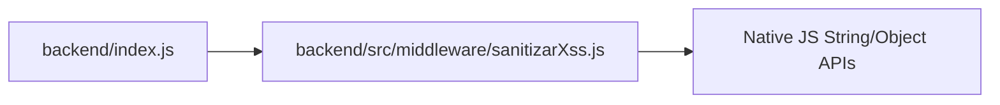

# Input Validation & Sanitization

<cite>
**Referenced Files in This Document**
- [index.js](file://backend/index.js)
- [sanitizarXss.js (src)](file://backend/src/middleware/sanitizarXss.js)
- [sanitizarXss.js (root middleware)](file://backend/middleware/sanitizarXss.js)
- [usuarios.routes.js](file://backend/src/routes/usuarios.routes.js)
</cite>

## Table of Contents
1. [Introduction](#introduction)
2. [Project Structure](#project-structure)
3. [Core Components](#core-components)
4. [Architecture Overview](#architecture-overview)
5. [Detailed Component Analysis](#detailed-component-analysis)
6. [Dependency Analysis](#dependency-analysis)
7. [Performance Considerations](#performance-considerations)
8. [Troubleshooting Guide](#troubleshooting-guide)
9. [Conclusion](#conclusion)

## Introduction
This document explains SIMO’s input validation and sanitization mechanisms with a focus on the custom XSS sanitization middleware. It covers how request bodies, query parameters, and URL parameters are processed; the recursive sanitization algorithm for strings, arrays, and nested objects; the HTML entity encoding strategy used to prevent script injection; examples of sanitized versus unsanitized data processing; performance considerations for large payloads; integration patterns within the Express.js middleware chain; and edge cases such as null values, special characters, and Unicode handling.

## Project Structure
SIMO uses an Express application that registers global security middleware early in the pipeline. The active XSS sanitizer is implemented under `backend/src/middleware/sanitizarXss.js` and is mounted globally before routes. A legacy variant exists at `backend/middleware/sanitizarXss.js`, but it is not imported by the running application.

**Diagram sources**
- [index.js:24-32](file://backend/index.js#L24-L32)
- [sanitizarXss.js (src):40-45](file://backend/src/middleware/sanitizarXss.js#L40-L45)

**Section sources**
- [index.js:1-32](file://backend/index.js#L1-L32)

## Core Components
- Custom XSS sanitizer middleware: recursively traverses incoming request data and escapes dangerous HTML characters.
- Global middleware registration: applied after body parsing so all string inputs are sanitized before route handlers.
- Route-level validation: controllers perform additional business validations (e.g., type checks, allowed values), complementing the global sanitizer.

Key responsibilities:
- Normalize and escape unsafe characters in strings across `req.body`, `req.query`, and `req.params`.
- Preserve non-string types (numbers, booleans, dates, null).
- Maintain compatibility with Express 5 where `req.query` is read-only.

**Section sources**
- [sanitizarXss.js (src):11-35](file://backend/src/middleware/sanitizarXss.js#L11-L35)
- [index.js:29-32](file://backend/index.js#L29-L32)

## Architecture Overview
The request lifecycle relevant to input sanitization:

**Diagram sources**
- [index.js:29-32](file://backend/index.js#L29-L32)
- [sanitizarXss.js (src):40-45](file://backend/src/middleware/sanitizarXss.js#L40-L45)

## Detailed Component Analysis

### Custom XSS Sanitizer Middleware
The active implementation performs:
- HTML entity escaping for potentially dangerous characters.
- Recursive traversal over arrays and plain objects.
- Safe handling of non-string primitives and null.

**Diagram sources**
- [sanitizarXss.js (src):40-45](file://backend/src/middleware/sanitizarXss.js#L40-L45)

#### Recursive Sanitization Algorithm
The sanitizer processes:
- Strings: apply HTML entity encoding.
- Arrays: map each element through the same function.
- Plain objects: iterate entries and sanitize values while preserving keys.
- Other types (null, numbers, booleans, Date): pass-through unchanged.

**Diagram sources**
- [sanitizarXss.js (src):11-35](file://backend/src/middleware/sanitizarXss.js#L11-L35)

#### HTML Entity Encoding Strategy
The sanitizer escapes the following characters to neutralize script injection vectors:
- Ampersand (`&`) → `&amp;`
- Less-than (`<`) → `&lt;`
- Greater-than (`>`) → `&gt;`
- Double quote (`"`) → `&quot;`
- Single quote (`'`) → `&#x27;`
- Forward slash (`/`) → `&#x2F;`

This approach ensures that even if user-supplied text is later embedded into HTML or JavaScript contexts, the dangerous characters are rendered inert.

**Section sources**
- [sanitizarXss.js (src):11-19](file://backend/src/middleware/sanitizarXss.js#L11-L19)

#### Integration with Express.js Middleware Chain
- Body parser runs first to populate `req.body`.
- The sanitizer runs immediately after, ensuring all string inputs are escaped before route handlers.
- Query and params are also sanitized; for Express 5 compatibility, the sanitizer defines a new own property for `req.query` rather than mutating the getter-backed original.

**Diagram sources**
- [index.js:29-32](file://backend/index.js#L29-L32)
- [sanitizarXss.js (src):40-45](file://backend/src/middleware/sanitizarXss.js#L40-L45)

#### Examples: Sanitized vs Unsanitized Data Processing
- Unsanitized input containing `<script>` tags would be converted to safe HTML entities, preventing execution when rendered in a browser.
- Arrays and nested objects containing strings are fully traversed; only string values are encoded, leaving numeric and boolean fields intact.
- Null values remain null; they are not converted to strings.

These behaviors ensure that downstream code can safely use sanitized values without risking XSS when rendering content.

[No sources needed since this section provides conceptual examples]

#### Edge Cases
- Null values: preserved as-is; no conversion to string.
- Special characters: ampersands, quotes, slashes, and angle brackets are encoded.
- Unicode: handled naturally by JavaScript string operations; no explicit normalization is performed by the sanitizer.
- Non-string types: numbers, booleans, dates, and null pass through unchanged.
- Express 5 query immutability: the sanitizer replaces `req.query` with a new object using `Object.defineProperty` to avoid errors from read-only getters.

**Section sources**
- [sanitizarXss.js (src):26-35](file://backend/src/middleware/sanitizarXss.js#L26-L35)
- [sanitizarXss.js (root middleware):28-35](file://backend/middleware/sanitizarXss.js#L28-L35)

### Legacy Variant Notes
A legacy version exists at `backend/middleware/sanitizarXss.js`. It implements a similar recursive sanitizer but encodes fewer characters and includes a specific workaround for Express 5’s read-only `req.query`. This file is not imported by the running application and should be considered deprecated.

**Section sources**
- [sanitizarXss.js (root middleware):1-38](file://backend/middleware/sanitizarXss.js#L1-L38)

## Dependency Analysis
The sanitizer has minimal external dependencies:
- No third-party libraries are required for sanitization.
- It relies on native JavaScript string methods and object iteration utilities.
- It integrates with Express’s request/response cycle and body parser.

**Diagram sources**
- [index.js:13](file://backend/index.js#L13)
- [sanitizarXss.js (src):11-35](file://backend/src/middleware/sanitizarXss.js#L11-L35)

**Section sources**
- [index.js:13](file://backend/index.js#L13)
- [sanitizarXss.js (src):11-35](file://backend/src/middleware/sanitizarXss.js#L11-L35)

## Performance Considerations
- Time complexity: O(N) relative to the total number of string characters across all sanitized fields. Each character may be replaced multiple times due to sequential regex replacements.
- Space complexity: O(N) due to creation of new sanitized copies of objects and arrays.
- Large payloads: deep recursion over large nested structures can increase memory usage and CPU time. Consider:
  - Enforcing maximum payload sizes at the proxy/load balancer level.
  - Limiting nesting depth and field counts in API contracts.
  - Using streaming parsers for very large JSON bodies if applicable.
- Regex order: placing more frequent replacements earlier can reduce overall cost.
- Avoid redundant sanitization: ensure the sanitizer runs once per request to prevent repeated passes.

[No sources needed since this section provides general guidance]

## Troubleshooting Guide
Common issues and resolutions:
- Requests fail with “Cannot set property query” on Express 5:
  - Ensure you use the active sanitizer that defines a new own property for `req.query` instead of mutating the getter-backed original.
- Unexpected empty or missing fields:
  - Verify that `express.json()` is registered before the sanitizer so `req.body` is available.
- Sanitized output differs from expected:
  - Remember that only string values are encoded; numbers, booleans, and null remain unchanged.
- Unicode rendering anomalies:
  - The sanitizer does not normalize Unicode; ensure your client and server handle UTF-8 consistently.

**Section sources**
- [index.js:29-32](file://backend/index.js#L29-L32)
- [sanitizarXss.js (src):26-35](file://backend/src/middleware/sanitizarXss.js#L26-L35)

## Conclusion
SIMO’s input validation and sanitization strategy centers around a lightweight, dependency-free XSS sanitizer that recursively escapes dangerous HTML characters in all string inputs across `req.body`, `req.query`, and `req.params`. It is integrated early in the Express middleware chain after body parsing, ensuring route handlers receive sanitized data. While the sanitizer protects against script injection, route-level validators provide additional business rule enforcement. For high-volume or deeply nested payloads, consider payload size limits and careful design to maintain performance.

[No sources needed since this section summarizes without analyzing specific files]