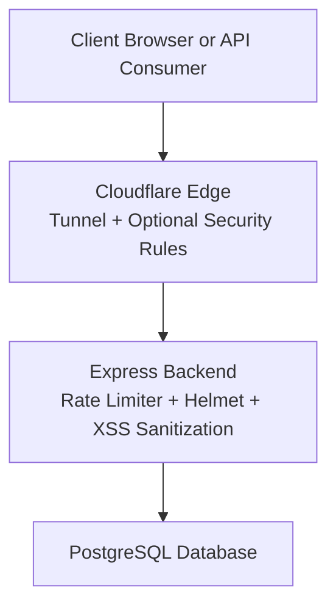
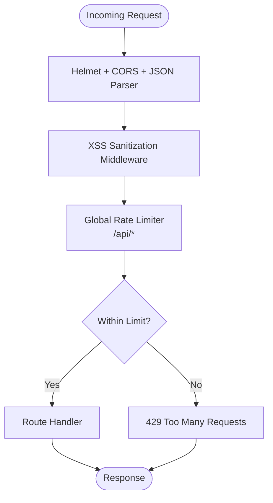
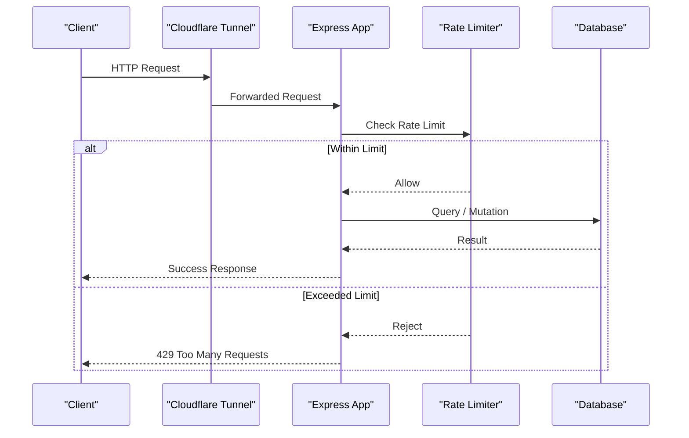
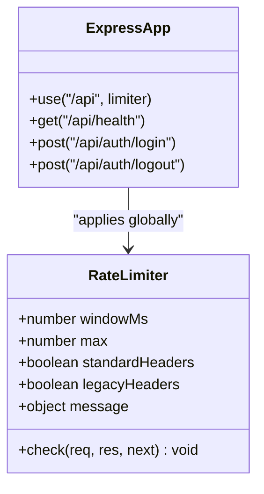
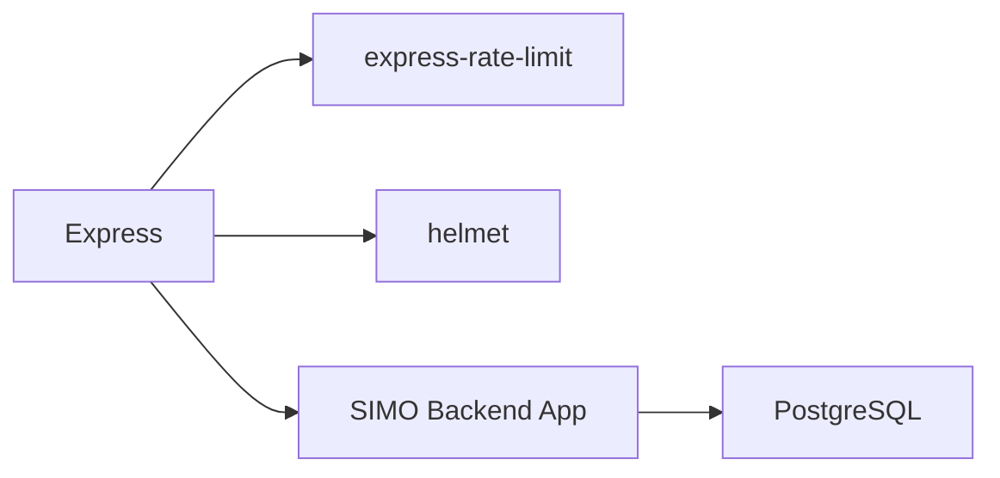

# Rate Limiting & DDoS Protection

<cite>
**Referenced Files in This Document**
- [backend/index.js](file://backend/index.js)
- [backend/package.json](file://backend/package.json)
- [backend/docker-compose.yml](file://backend/docker-compose.yml)
- [deploy/docker-compose.yml](file://deploy/docker-compose.yml)
- [deploy/README.md](file://deploy/README.md)
- [deploy/GUIA_EQUIPO.md](file://deploy/GUIA_EQUIPO.md)
</cite>

## Table of Contents
1. [Introduction](#introduction)
2. [Project Structure](#project-structure)
3. [Core Components](#core-components)
4. [Architecture Overview](#architecture-overview)
5. [Detailed Component Analysis](#detailed-component-analysis)
6. [Dependency Analysis](#dependency-analysis)
7. [Performance Considerations](#performance-considerations)
8. [Troubleshooting Guide](#troubleshooting-guide)
9. [Conclusion](#conclusion)
10. [Appendices](#appendices)

## Introduction
This document explains the rate limiting and DDoS protection mechanisms implemented in SIMO, focusing on request throttling, IP-based limiting, endpoint-specific controls, configuration across environments, burst handling, sliding window behavior, custom limit handlers, abuse detection patterns, monitoring integration, CDN integration, geographic restrictions, and bot detection strategies.

The backend uses a global rate limiter for all API routes under `/api`, with the maximum requests per window controlled by an environment variable. The deployment exposes the application through Cloudflare Tunnel, which provides network-level access control and can be extended with Cloudflare security features such as DDoS protection, WAF rules, geographic restrictions, and bot management.

## Project Structure
SIMO is composed of:
- A Node.js Express backend that implements HTTP security middleware and rate limiting.
- A Next.js frontend that calls the backend API.
- Docker Compose configurations for local development and deployment.
- Deployment documentation describing Cloudflare Tunnel usage.

**Diagram sources**
- [backend/index.js:24-48](file://backend/index.js#L24-L48)
- [deploy/docker-compose.yml:107-116](file://deploy/docker-compose.yml#L107-L116)

**Section sources**
- [backend/index.js:1-56](file://backend/index.js#L1-L56)
- [deploy/docker-compose.yml:1-120](file://deploy/docker-compose.yml#L1-L120)

## Core Components
The core rate limiting and security components are defined in the backend entry point:
- Helmet configures secure HTTP headers.
- CORS enables cross-origin requests.
- JSON body parsing is enabled.
- Custom XSS sanitization middleware cleans input data.
- `express-rate-limit` applies a global rate limit to all routes under `/api`.

Key behaviors:
- Default limit: 100 requests per minute per client IP.
- Window size: 1 minute.
- Standard response headers are enabled; legacy headers are disabled.
- The maximum request count is configurable via `RATE_LIMIT_MAX`.

**Diagram sources**
- [backend/index.js:24-48](file://backend/index.js#L24-L48)

**Section sources**
- [backend/index.js:24-48](file://backend/index.js#L24-L48)

## Architecture Overview
At runtime, traffic flows through Cloudflare before reaching the backend. In the provided deployment, Cloudflare Tunnel (`cloudflared`) is used to securely expose services without opening ports. The backend applies rate limiting at the application layer.

**Diagram sources**
- [deploy/docker-compose.yml:107-116](file://deploy/docker-compose.yml#L107-L116)
- [backend/index.js:34-48](file://backend/index.js#L34-L48)

## Detailed Component Analysis

### Global Rate Limiting
The backend defines a single rate limiter instance applied to all routes under `/api`. It uses:
- A one-minute sliding window.
- A default maximum of 100 requests per window.
- Standard headers for rate limit information.
- A JSON error message when the limit is exceeded.

Configuration options:
- `windowMs`: 60 seconds.
- `max`: Read from `RATE_LIMIT_MAX`; defaults to 100.
- `standardHeaders`: Enabled.
- `legacyHeaders`: Disabled.
- `message`: JSON object with error and message fields.

**Diagram sources**
- [backend/index.js:34-48](file://backend/index.js#L34-L48)

**Section sources**
- [backend/index.js:34-48](file://backend/index.js#L34-L48)

### Endpoint-Specific Controls
Currently, there is no endpoint-specific rate limiter in the codebase. All API endpoints share the same global limiter. To implement stricter limits for sensitive endpoints (for example, login), you would define a separate limiter and apply it only to those routes.

Recommended approach:
- Create a dedicated limiter for authentication endpoints with a lower `max`.
- Apply it before the global limiter so stricter rules take precedence.
- Use different messages or headers to distinguish endpoint-specific throttling.

[No sources needed since this section proposes future enhancements not present in the code]

### Configuration Options Across Environments
Environment variables influence runtime behavior:
- `PORT`: Backend server port.
- `RATE_LIMIT_MAX`: Maximum requests per window for the global limiter.
- Database connection variables (`DB_*` or `DATABASE_URL`) depending on deployment mode.

Development and local Docker Compose:
- The backend container exposes port `3000` locally.
- No explicit `RATE_LIMIT_MAX` is set in the local compose file, so the default of 100 applies.

Deployment Docker Compose:
- The API service is exposed via Cloudflare Tunnel.
- No explicit `RATE_LIMIT_MAX` is set in the deploy compose file, so the default of 100 applies.

To customize limits per environment:
- Set `RATE_LIMIT_MAX` in your environment configuration (for example, `.env`, CI/CD secrets, or platform settings).
- Lower values for production to reduce abuse risk.
- Higher values for staging or testing to avoid false positives during load tests.

**Section sources**
- [backend/index.js:17-18](file://backend/index.js#L17-L18)
- [backend/index.js:34-48](file://backend/index.js#L34-L48)
- [backend/docker-compose.yml:23-37](file://backend/docker-compose.yml#L23-L37)
- [deploy/docker-compose.yml:39-63](file://deploy/docker-compose.yml#L39-L63)

### Burst Handling and Sliding Window Algorithm
The current implementation uses a fixed-window approach configured by `windowMs`. While `express-rate-limit` supports advanced store backends and sliding windows, the repository does not configure a custom store or sliding window algorithm. Therefore:
- Requests are counted within each fixed one-minute window.
- Bursts up to the configured `max` are allowed within the window.
- Once the limit is reached, additional requests are rejected until the window resets.

If you need true sliding windows or distributed counting:
- Configure a Redis-backed store in `express-rate-limit`.
- Enable sliding window options provided by the library.
- Monitor memory and latency impacts of the chosen store.

**Section sources**
- [backend/index.js:34-48](file://backend/index.js#L34-L48)

### Custom Rate Limit Handlers
The current limiter returns a JSON error object when the limit is exceeded. You can extend this behavior by providing a custom handler to:
- Log abuse attempts.
- Update metrics or alerting systems.
- Return structured responses for clients.
- Integrate with external abuse detection services.

Example pattern:
- Define a `handler` function in the limiter configuration.
- Inside the handler, record event details such as IP, timestamp, and endpoint.
- Emit metrics or trigger alerts based on thresholds.

[No sources needed since this section describes extension patterns not present in the code]

### Abuse Detection Patterns
Common patterns to detect abuse include:
- High request frequency from a single IP.
- Repeated failed authentication attempts.
- Unusual request patterns targeting specific endpoints.
- Sudden spikes in error rates or 429 responses.

Implementation ideas:
- Track failed login attempts per IP and temporarily block or throttle after repeated failures.
- Correlate 429 responses with upstream logs to identify attack patterns.
- Use Cloudflare WAF rules to block known malicious IPs or suspicious user agents.

[No sources needed since this section provides general guidance]

### Monitoring Integration
To integrate monitoring:
- Add logging around rate limit events using a custom handler.
- Export metrics (requests per second, 429 counts, average latency) to a monitoring system.
- Alert on sustained high 429 rates or sudden traffic spikes.
- Include health check endpoints to verify service status.

The backend already exposes a health endpoint under `/api/health`.

**Section sources**
- [backend/index.js:62-70](file://backend/index.js#L62-L70)

### CDN Integration, Geographic Restrictions, and Bot Detection
The deployment uses Cloudflare Tunnel to expose services securely. Cloudflare can provide:
- DDoS protection at the edge.
- WAF rules to block malicious traffic.
- Geographic restrictions to allow or deny traffic by country.
- Bot management to challenge or block automated traffic.

Operational notes:
- Ensure the tunnel token is configured in the deployment environment.
- Apply Cloudflare security policies aligned with SIMO’s threat model.
- Combine edge protections with application-layer rate limiting for defense in depth.

**Section sources**
- [deploy/docker-compose.yml:107-116](file://deploy/docker-compose.yml#L107-L116)
- [deploy/README.md:14-37](file://deploy/README.md#L14-L37)
- [deploy/GUIA_EQUIPO.md:7-15](file://deploy/GUIA_EQUIPO.md#L7-L15)

## Dependency Analysis
The backend depends on:
- `express` for HTTP routing and middleware.
- `express-rate-limit` for request throttling.
- `helmet` for secure HTTP headers.
- PostgreSQL driver for database access.

**Diagram sources**
- [backend/package.json:15-23](file://backend/package.json#L15-L23)
- [backend/index.js:1-15](file://backend/index.js#L1-L15)

**Section sources**
- [backend/package.json:15-23](file://backend/package.json#L15-L23)
- [backend/index.js:1-15](file://backend/index.js#L1-L15)

## Performance Considerations
- Keep `RATE_LIMIT_MAX` tuned to expected traffic patterns to avoid unnecessary rejections.
- Prefer edge-level filtering (Cloudflare) for large-scale DDoS mitigation.
- Avoid expensive operations inside rate limit checks; use fast in-memory counters unless distributed state is required.
- Monitor 429 response rates and adjust limits accordingly.
- Use health checks to detect degraded performance or database connectivity issues.

[No sources needed since this section provides general guidance]

## Troubleshooting Guide
Common issues and resolutions:
- Unexpected 429 errors:
  - Verify `RATE_LIMIT_MAX` is set appropriately for the environment.
  - Check whether clients are sending too many requests within the one-minute window.
  - Consider adding endpoint-specific limits for sensitive routes.
- Health check failures:
  - Confirm database connectivity and credentials.
  - Inspect the health endpoint response for database status.
- Cloudflare Tunnel connectivity:
  - Ensure the tunnel token is correctly configured.
  - Validate that the tunnel service is running and healthy.

**Section sources**
- [backend/index.js:62-70](file://backend/index.js#L62-L70)
- [deploy/docker-compose.yml:107-116](file://deploy/docker-compose.yml#L107-L116)

## Conclusion
SIMO implements application-layer rate limiting using `express-rate-limit` with a one-minute window and a default maximum of 100 requests per IP. The configuration is environment-driven via `RATE_LIMIT_MAX`. Deployment uses Cloudflare Tunnel, enabling additional edge protections such as DDoS mitigation, WAF rules, geographic restrictions, and bot management. For stronger abuse resistance, consider endpoint-specific limits, custom rate limit handlers, and monitoring integrations.

[No sources needed since this section summarizes without analyzing specific files]

## Appendices

### Environment Variables Summary
- `PORT`: Backend server port.
- `RATE_LIMIT_MAX`: Maximum requests per window for the global limiter.
- Database variables: `DB_USER`, `DB_PASSWORD`, `DB_HOST`, `DB_PORT`, `DB_NAME`, or `DATABASE_URL`.
- Cloudflare Tunnel: `CLOUDFLARE_TUNNEL_TOKEN`.

**Section sources**
- [backend/index.js:17-18](file://backend/index.js#L17-L18)
- [backend/index.js:34-48](file://backend/index.js#L34-L48)
- [backend/docker-compose.yml:23-37](file://backend/docker-compose.yml#L23-L37)
- [deploy/docker-compose.yml:39-63](file://deploy/docker-compose.yml#L39-L63)
- [deploy/docker-compose.yml:107-116](file://deploy/docker-compose.yml#L107-L116)