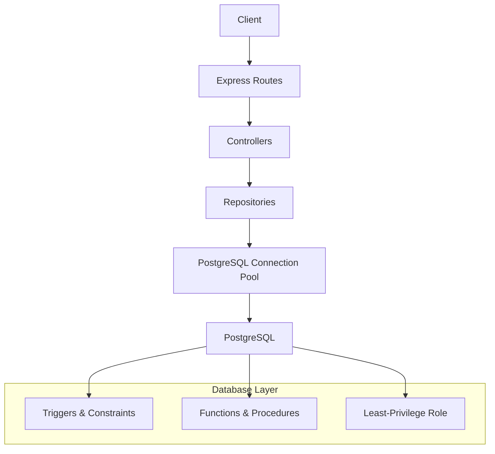
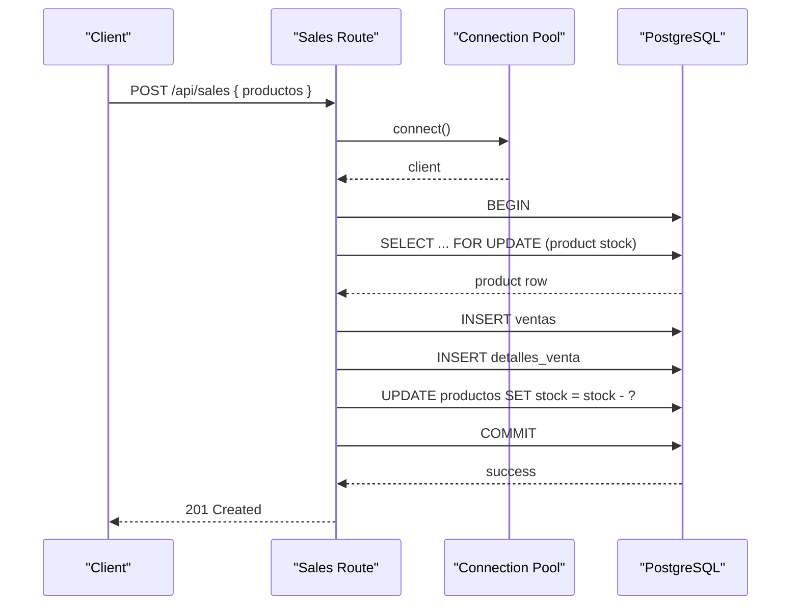
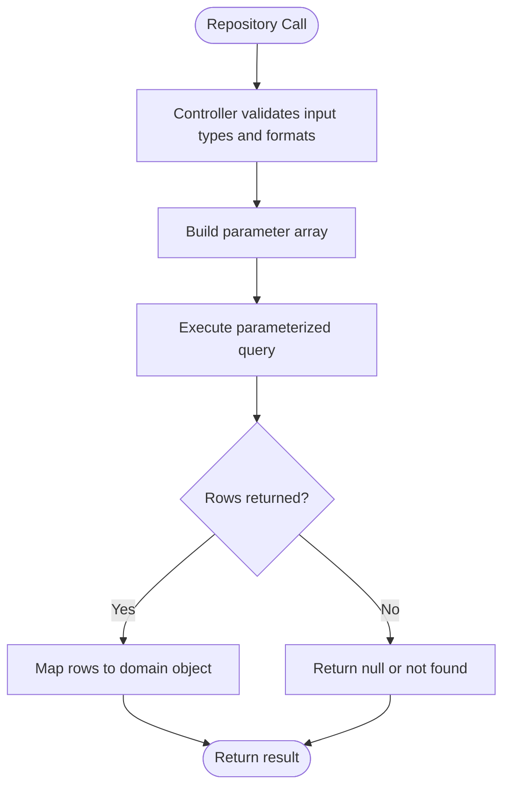
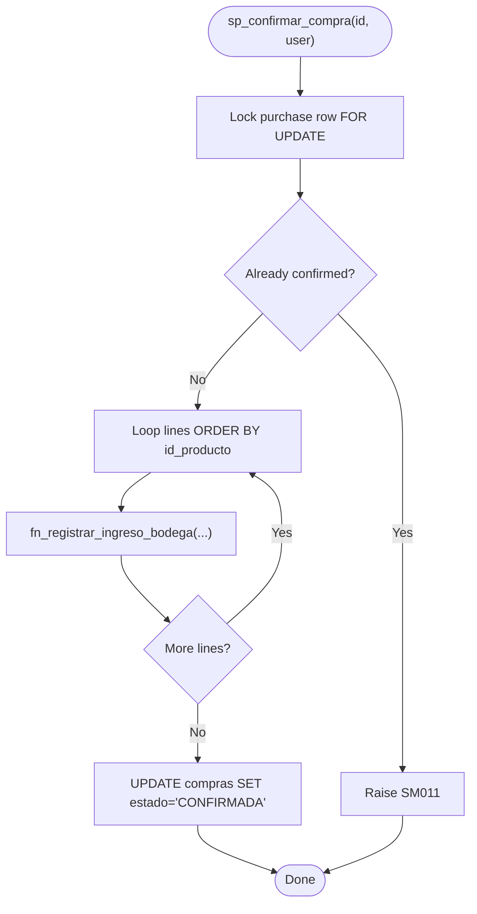
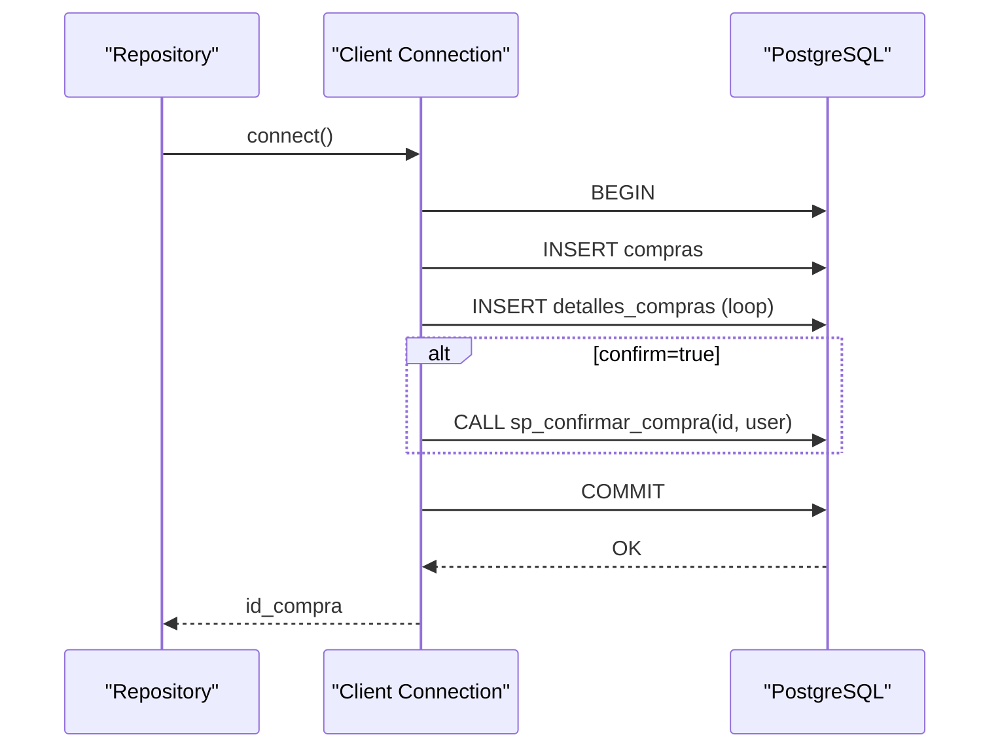
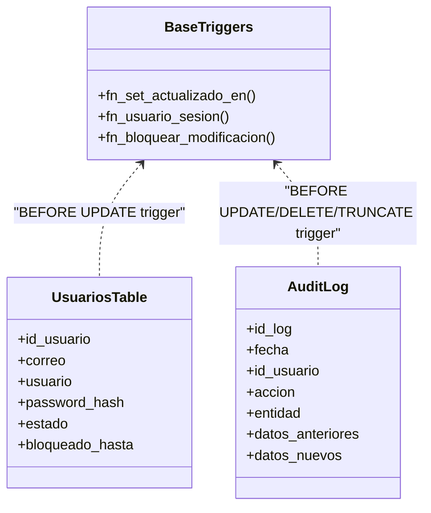
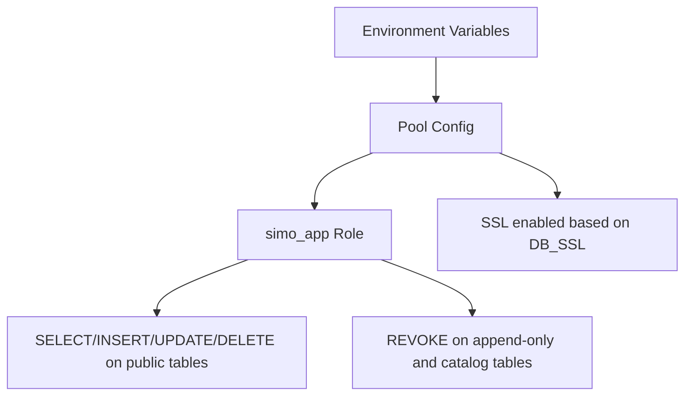
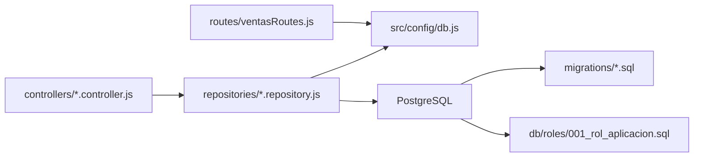

# SQL Injection Prevention

<cite>
**Referenced Files in This Document**
- [db.js](file://backend/src/config/db.js)
- [clientes.repository.js](file://backend/src/repositories/clientes.repository.js)
- [inventario.repository.js](file://backend/src/repositories/inventario.repository.js)
- [usuarios.repository.js](file://backend/src/repositories/usuarios.repository.js)
- [clientes.controller.js](file://backend/src/controllers/clientes.controller.js)
- [inventario.controller.js](file://backend/src/controllers/inventario.controller.js)
- [usuarios.controller.js](file://backend/src/controllers/usuarios.controller.js)
- [ventasRoutes.js](file://backend/routes/ventasRoutes.js)
- [index.js](file://backend/index.js)
- [001_base.sql](file://backend/db/migrations/001_base.sql)
- [002_seguridad.sql](file://backend/db/migrations/002_seguridad.sql)
- [007_auditoria.sql](file://backend/db/migrations/007_auditoria.sql)
- [008_ingreso_bodega.sql](file://backend/db/migrations/008_ingreso_bodega.sql)
- [011_compras.sql](file://backend/db/migrations/011_compras.sql)
- [001_rol_aplicacion.sql](file://backend/db/roles/001_rol_aplicacion.sql)
- [sanitizarXss.js](file://backend/middleware/sanitizarXss.js)
</cite>

## Table of Contents
1. [Introduction](#introduction)
2. [Project Structure](#project-structure)
3. [Core Components](#core-components)
4. [Architecture Overview](#architecture-overview)
5. [Detailed Component Analysis](#detailed-component-analysis)
6. [Dependency Analysis](#dependency-analysis)
7. [Performance Considerations](#performance-considerations)
8. [Troubleshooting Guide](#troubleshooting-guide)
9. [Conclusion](#conclusion)

## Introduction
This document explains how SIMO prevents SQL injection across the application, database, and deployment layers. It focuses on:
- Parameterized queries through a repository pattern
- Stored functions and procedures that encapsulate business rules
- Database-level constraints, triggers, and roles
- Input validation at the controller layer
- Secure connection configuration and least-privilege access
- Audit logging for critical operations

The goal is to make the security model clear for both developers and operators while keeping implementation details traceable to source files.

## Project Structure
SIMO’s backend follows a layered structure:
- Routes and controllers validate input and orchestrate use cases
- Repositories perform all database access using parameterized queries or stored routines
- Database migrations define schema, constraints, triggers, functions, and procedures
- A dedicated PostgreSQL role enforces least privilege

**Diagram sources**
- [ventasRoutes.js:1-33](file://backend/routes/ventasRoutes.js#L1-L33)
- [clientes.controller.js:70-122](file://backend/src/controllers/clientes.controller.js#L70-L122)
- [clientes.repository.js:10-18](file://backend/src/repositories/clientes.repository.js#L10-L18)
- [db.js:17-26](file://backend/src/config/db.js#L17-L26)
- [001_base.sql:31-57](file://backend/db/migrations/001_base.sql#L31-L57)
- [008_ingreso_bodega.sql:23-84](file://backend/db/migrations/008_ingreso_bodega.sql#L23-L84)
- [011_compras.sql:217-255](file://backend/db/migrations/011_compras.sql#L217-L255)
- [001_rol_aplicacion.sql:14-45](file://backend/db/roles/001_rol_aplicacion.sql#L14-L45)

**Section sources**
- [ventasRoutes.js:1-33](file://backend/routes/ventasRoutes.js#L1-L33)
- [clientes.controller.js:70-122](file://backend/src/controllers/clientes.controller.js#L70-L122)
- [clientes.repository.js:10-18](file://backend/src/repositories/clientes.repository.js#L10-L18)
- [db.js:17-26](file://backend/src/config/db.js#L17-L26)
- [001_base.sql:31-57](file://backend/db/migrations/001_base.sql#L31-L57)
- [008_ingreso_bodega.sql:23-84](file://backend/db/migrations/008_ingreso_bodega.sql#L23-L84)
- [011_compras.sql:217-255](file://backend/db/migrations/011_compras.sql#L217-L255)
- [001_rol_aplicacion.sql:14-45](file://backend/db/roles/001_rol_aplicacion.sql#L14-L45)

## Core Components
- Repository pattern centralizes data access and ensures every query uses parameters instead of string concatenation.
- Controllers enforce strict input validation before calling repositories.
- Database functions/procedures encapsulate atomic operations and business rules.
- Migrations add constraints, triggers, and audit tables to prevent tampering.
- The application connects with a least-privilege PostgreSQL role.

Key security mechanisms:
- Parameterized queries via positional placeholders
- Stored procedures/functions for complex transactions
- Database constraints and triggers for integrity and immutability
- Least-privilege database role
- Controlled error responses to avoid information leakage

**Section sources**
- [clientes.repository.js:10-18](file://backend/src/repositories/clientes.repository.js#L10-L18)
- [inventario.repository.js:12-27](file://backend/src/repositories/inventario.repository.js#L12-L27)
- [usuarios.repository.js:25-36](file://backend/src/repositories/usuarios.repository.js#L25-L36)
- [008_ingreso_bodega.sql:23-84](file://backend/db/migrations/008_ingreso_bodega.sql#L23-L84)
- [011_compras.sql:217-255](file://backend/db/migrations/011_compras.sql#L217-L255)
- [001_rol_aplicacion.sql:23-45](file://backend/db/roles/001_rol_aplicacion.sql#L23-L45)

## Architecture Overview
The following sequence shows a secure sales flow where user input is validated, executed as a parameterized transaction, and protected by database locks and constraints.

**Diagram sources**
- [ventasRoutes.js:19-33](file://backend/routes/ventasRoutes.js#L19-L33)
- [ventasRoutes.js:69-84](file://backend/routes/ventasRoutes.js#L69-L84)

**Section sources**
- [ventasRoutes.js:19-33](file://backend/routes/ventasRoutes.js#L19-L33)
- [ventasRoutes.js:69-84](file://backend/routes/ventasRoutes.js#L69-L84)

## Detailed Component Analysis

### Repository Pattern and Parameterized Queries
All repositories use parameterized queries with positional placeholders. No dynamic SQL concatenation is used for values. Column names are either static or derived from controlled arrays of allowed fields.

Examples:
- Inserting a customer with six parameters
- Selecting by id or document number
- Building dynamic WHERE clauses only with prevalidated filters and positional parameters
- Updating only whitelisted columns with safe assignment construction

**Diagram sources**
- [clientes.repository.js:10-18](file://backend/src/repositories/clientes.repository.js#L10-L18)
- [clientes.repository.js:20-28](file://backend/src/repositories/clientes.repository.js#L20-L28)
- [clientes.repository.js:32-68](file://backend/src/repositories/clientes.repository.js#L32-L68)
- [clientes.repository.js:71-81](file://backend/src/repositories/clientes.repository.js#L71-L81)
- [usuarios.repository.js:39-85](file://backend/src/repositories/usuarios.repository.js#L39-L85)

**Section sources**
- [clientes.repository.js:10-18](file://backend/src/repositories/clientes.repository.js#L10-L18)
- [clientes.repository.js:20-28](file://backend/src/repositories/clientes.repository.js#L20-L28)
- [clientes.repository.js:32-68](file://backend/src/repositories/clientes.repository.js#L32-L68)
- [clientes.repository.js:71-81](file://backend/src/repositories/clientes.repository.js#L71-L81)
- [usuarios.repository.js:39-85](file://backend/src/repositories/usuarios.repository.js#L39-L85)

### Stored Procedures and Functions
Stored logic centralizes business rules and protects against concurrent modifications:
- Inventory entry function locks the product row, validates inputs, updates stock, and records inventory movement atomically.
- Purchase confirmation procedure iterates purchase lines in a deterministic order, calls the inventory function per line, and marks the purchase confirmed.

**Diagram sources**
- [011_compras.sql:217-255](file://backend/db/migrations/011_compras.sql#L217-L255)
- [008_ingreso_bodega.sql:23-84](file://backend/db/migrations/008_ingreso_bodega.sql#L23-L84)

**Section sources**
- [008_ingreso_bodega.sql:23-84](file://backend/db/migrations/008_ingreso_bodega.sql#L23-L84)
- [011_compras.sql:217-255](file://backend/db/migrations/011_compras.sql#L217-L255)

### Transaction Management
Transactions ensure consistency across multiple statements:
- Sales route begins a transaction, performs locked reads, inserts sales and details, updates stock, then commits.
- Purchase registration wraps insertions into purchases and details; it optionally calls the confirmation procedure within the same transaction and rolls back on failure.
- User update and status change operations use advisory locks to serialize admin-related changes safely.

**Diagram sources**
- [inventario.repository.js:32-62](file://backend/src/repositories/inventario.repository.js#L32-L62)
- [011_compras.sql:217-255](file://backend/db/migrations/011_compras.sql#L217-L255)

**Section sources**
- [ventasRoutes.js:19-33](file://backend/routes/ventasRoutes.js#L19-L33)
- [inventario.repository.js:32-62](file://backend/src/repositories/inventario.repository.js#L32-L62)
- [usuarios.repository.js:115-172](file://backend/src/repositories/usuarios.repository.js#L115-L172)
- [usuarios.repository.js:178-230](file://backend/src/repositories/usuarios.repository.js#L178-L230)

### Input Validation and Type Safety
Controllers validate and normalize inputs before they reach repositories:
- Positive integer checks for ids and pagination
- Email format validation
- Enumerated values for document types and statuses
- Numeric range and decimal precision checks for quantities and costs
- Text length limits and sanitization helpers

This reduces the attack surface by rejecting malformed or out-of-range values early.

**Section sources**
- [clientes.controller.js:12-68](file://backend/src/controllers/clientes.controller.js#L12-L68)
- [clientes.controller.js:127-168](file://backend/src/controllers/clientes.controller.js#L127-L168)
- [inventario.controller.js:29-41](file://backend/src/controllers/inventario.controller.js#L29-L41)
- [inventario.controller.js:48-111](file://backend/src/controllers/inventario.controller.js#L48-L111)
- [usuarios.controller.js:29-84](file://backend/src/controllers/usuarios.controller.js#L29-L84)

### Database-Level Security Constraints and Triggers
Migrations enforce integrity and immutability:
- Base utilities provide an updated timestamp trigger and a helper to reject modifications on append-only tables.
- Users table includes constraints for email normalization, password hash storage, and optional lockout fields.
- Audit log table is protected by triggers and revokes to prevent UPDATE, DELETE, or TRUNCATE.
- Purchase tables include constraints ensuring confirmed purchases cannot be modified and totals are recalculated automatically.

**Diagram sources**
- [001_base.sql:31-57](file://backend/db/migrations/001_base.sql#L31-L57)
- [002_seguridad.sql:40-66](file://backend/db/migrations/002_seguridad.sql#L40-L66)
- [007_auditoria.sql:13-65](file://backend/db/migrations/007_auditoria.sql#L13-L65)

**Section sources**
- [001_base.sql:31-57](file://backend/db/migrations/001_base.sql#L31-L57)
- [002_seguridad.sql:40-66](file://backend/db/migrations/002_seguridad.sql#L40-L66)
- [007_auditoria.sql:13-65](file://backend/db/migrations/007_auditoria.sql#L13-L65)

### Database User Permissions and Connection Security
- The application connects via a dedicated PostgreSQL role with minimal privileges.
- The role can read/write most tables but cannot modify append-only tables or system catalogs.
- Default privileges are set so future tables inherit appropriate grants.
- Connection pool supports SSL when configured via environment variables.

**Diagram sources**
- [db.js:11-26](file://backend/src/config/db.js#L11-L26)
- [001_rol_aplicacion.sql:14-45](file://backend/db/roles/001_rol_aplicacion.sql#L14-L45)

**Section sources**
- [db.js:11-26](file://backend/src/config/db.js#L11-L26)
- [001_rol_aplicacion.sql:14-45](file://backend/db/roles/001_rol_aplicacion.sql#L14-L45)

### Secure Query Construction Examples
- Parameterized inserts and selects in repositories
- Dynamic WHERE clause building with positional parameters
- Safe column assignment lists built from whitelisted keys
- Use of stored functions/procedures for complex operations

These patterns eliminate direct SQL manipulation by design.

**Section sources**
- [clientes.repository.js:10-18](file://backend/src/repositories/clientes.repository.js#L10-L18)
- [clientes.repository.js:32-68](file://backend/src/repositories/clientes.repository.js#L32-L68)
- [clientes.repository.js:71-81](file://backend/src/repositories/clientes.repository.js#L71-L81)
- [usuarios.repository.js:39-85](file://backend/src/repositories/usuarios.repository.js#L39-L85)
- [usuarios.repository.js:115-172](file://backend/src/repositories/usuarios.repository.js#L115-L172)

### Error Handling That Prevents Information Leakage
Controllers map database errors to generic HTTP responses:
- Business rule violations return specific codes (e.g., custom SQLSTATE classes) mapped to meaningful HTTP statuses
- Duplicate key violations are converted to 409 Conflict
- Unexpected errors return 500 with a non-sensitive message
- Health endpoint returns service status without exposing internals

**Section sources**
- [clientes.controller.js:113-121](file://backend/src/controllers/clientes.controller.js#L113-L121)
- [inventario.controller.js:138-146](file://backend/src/controllers/inventario.controller.js#L138-L146)
- [usuarios.controller.js:73-83](file://backend/src/controllers/usuarios.controller.js#L73-L83)
- [index.js:63-70](file://backend/index.js#L63-L70)

### Audit Logging for Suspicious or Critical Operations
Audit logging is enforced at the database level:
- The audit log table restricts actions to a fixed list and requires justifications for sensitive operations
- Triggers block any modification attempts
- The application role cannot truncate or delete audit entries

This provides a tamper-resistant record of critical changes.

**Section sources**
- [007_auditoria.sql:13-65](file://backend/db/migrations/007_auditoria.sql#L13-L65)
- [001_rol_aplicacion.sql:31-37](file://backend/db/roles/001_rol_aplicacion.sql#L31-L37)

## Dependency Analysis
The following diagram maps the main runtime dependencies related to security:

**Diagram sources**
- [ventasRoutes.js:1-33](file://backend/routes/ventasRoutes.js#L1-L33)
- [clientes.controller.js:70-122](file://backend/src/controllers/clientes.controller.js#L70-L122)
- [clientes.repository.js:1-18](file://backend/src/repositories/clientes.repository.js#L1-L18)
- [db.js:17-26](file://backend/src/config/db.js#L17-L26)
- [001_base.sql:31-57](file://backend/db/migrations/001_base.sql#L31-L57)
- [001_rol_aplicacion.sql:14-45](file://backend/db/roles/001_rol_aplicacion.sql#L14-L45)

**Section sources**
- [ventasRoutes.js:1-33](file://backend/routes/ventasRoutes.js#L1-L33)
- [clientes.controller.js:70-122](file://backend/src/controllers/clientes.controller.js#L70-L122)
- [clientes.repository.js:1-18](file://backend/src/repositories/clientes.repository.js#L1-L18)
- [db.js:17-26](file://backend/src/config/db.js#L17-L26)
- [001_base.sql:31-57](file://backend/db/migrations/001_base.sql#L31-L57)
- [001_rol_aplicacion.sql:14-45](file://backend/db/roles/001_rol_aplicacion.sql#L14-L45)

## Performance Considerations
- Parameterized queries enable query plan reuse and reduce parsing overhead.
- Stored procedures minimize round trips and centralize locking logic.
- Advisory locks serialize admin-related updates to avoid contention and deadlocks.
- Indexes on frequently filtered columns improve query performance.

[No sources needed since this section provides general guidance]

## Troubleshooting Guide
Common issues and mitigations:
- Duplicate key errors: Controllers convert SQLSTATE 23505 to 409 Conflict with user-friendly messages.
- Business rule violations: Custom SQLSTATE classes (SM*) are mapped to appropriate HTTP statuses.
- Concurrency problems: Use FOR UPDATE locks and advisory locks to serialize conflicting operations.
- Permission errors: Ensure the application role has correct grants and revokes; verify default privileges for new tables.
- Connection failures: Verify DATABASE_URL or DB_* environment variables and SSL settings.

**Section sources**
- [clientes.controller.js:113-121](file://backend/src/controllers/clientes.controller.js#L113-L121)
- [inventario.controller.js:138-146](file://backend/src/controllers/inventario.controller.js#L138-L146)
- [usuarios.controller.js:73-83](file://backend/src/controllers/usuarios.controller.js#L73-L83)
- [db.js:11-26](file://backend/src/config/db.js#L11-L26)

## Conclusion
SIMO’s SQL injection prevention strategy combines strict input validation, a repository pattern with parameterized queries, stored functions and procedures for atomic operations, robust database constraints and triggers, least-privilege database roles, and controlled error handling. Together, these layers ensure that user input never directly shapes SQL execution and that critical data remains consistent, auditable, and protected.

[No sources needed since this section summarizes without analyzing specific files]