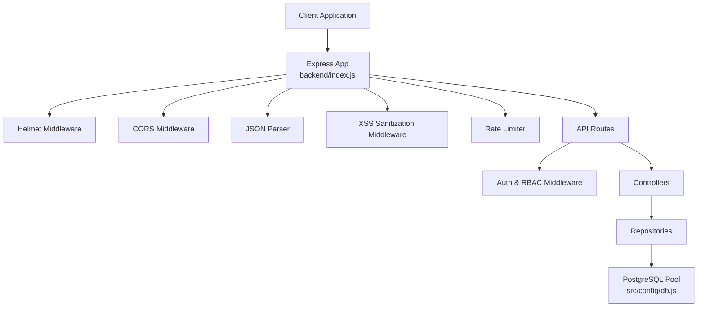
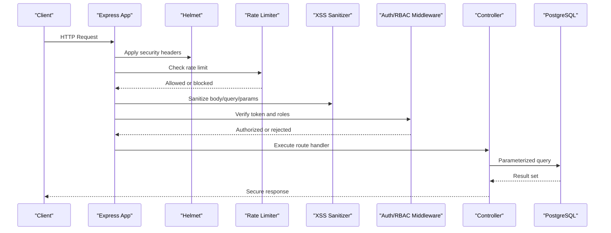
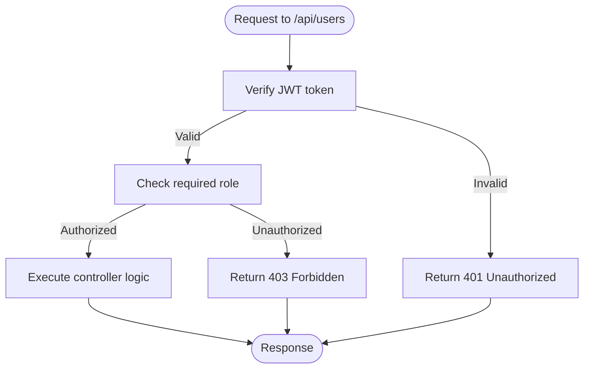
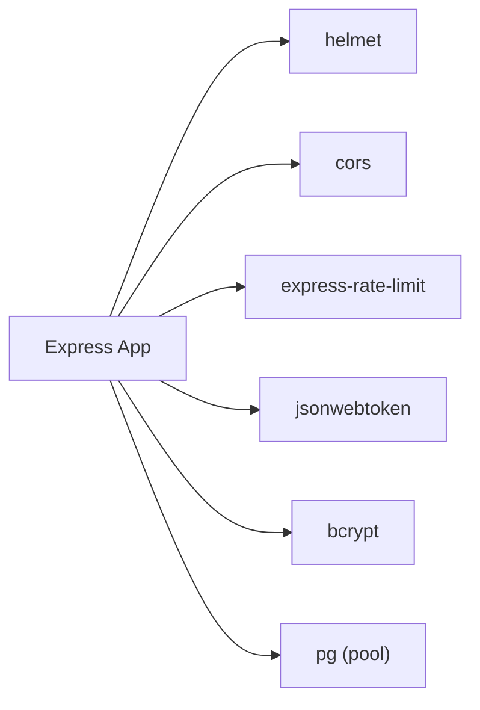

# Security Considerations

<cite>
**Referenced Files in This Document**
- [backend/index.js](file://backend/index.js)
- [backend/middleware/authMiddleware.js](file://backend/middleware/authMiddleware.js)
- [backend/middleware/sanitizarXss.js](file://backend/middleware/sanitizarXss.js)
- [backend/src/middleware/sanitizarXss.js](file://backend/src/middleware/sanitizarXss.js)
- [backend/src/config/db.js](file://backend/src/config/db.js)
- [backend/src/config/jwt.js](file://backend/src/config/jwt.js)
- [backend/src/routes/usuarios.routes.js](file://backend/src/routes/usuarios.routes.js)
- [backend/src/controllers/usuarios.controller.js](file://backend/src/controllers/usuarios.controller.js)
- [backend/db/migrations/007_auditoria.sql](file://backend/db/migrations/007_auditoria.sql)
- [backend/db/tests/001_reglas_esquema.sql](file://backend/db/tests/001_reglas_esquema.sql)
</cite>

## Table of Contents
1. [Introduction](#introduction)
2. [Project Structure](#project-structure)
3. [Core Components](#core-components)
4. [Architecture Overview](#architecture-overview)
5. [Detailed Component Analysis](#detailed-component-analysis)
6. [Dependency Analysis](#dependency-analysis)
7. [Performance Considerations](#performance-considerations)
8. [Troubleshooting Guide](#troubleshooting-guide)
9. [Conclusion](#conclusion)

## Introduction
This document explains SIMO’s security measures with a focus on input validation and sanitization, SQL injection prevention, XSS protection, rate limiting, security headers, CORS configuration, session security, data encryption, secure file upload considerations, compliance, incident response, and regular security assessments. It is intended for developers, operators, and auditors who need to understand how the backend protects user data and API endpoints.

## Project Structure
The backend is an Express application that centralizes security middleware at startup, applies authentication and role-based access control (RBAC) through middleware, validates inputs in controllers, uses parameterized queries for database operations, and configures environment-driven settings for JWT and database connections.

**Diagram sources**
- [backend/index.js:1-56](file://backend/index.js#L1-L56)
- [backend/middleware/authMiddleware.js:1-81](file://backend/middleware/authMiddleware.js#L1-L81)
- [backend/src/config/db.js:1-29](file://backend/src/config/db.js#L1-L29)

**Section sources**
- [backend/index.js:1-56](file://backend/index.js#L1-L56)

## Core Components
- Security middleware pipeline: Helmet, CORS, JSON parsing, XSS sanitization, and rate limiting are applied globally before routes.
- Authentication and authorization: JWT verification and RBAC middleware protect sensitive routes.
- Input validation: Controllers validate and sanitize business-critical fields before persistence.
- Database security: Parameterized queries and connection options ensure safe database interactions.
- Session management: JWT tokens with configurable expiration and blacklist support for logout.

Key implementation references:
- Global security middleware and rate limiter setup: [backend/index.js:24-48](file://backend/index.js#L24-L48)
- JWT configuration and expiration policy: [backend/src/config/jwt.js:1-16](file://backend/src/config/jwt.js#L1-L16)
- Database pool and SSL behavior: [backend/src/config/db.js:1-29](file://backend/src/config/db.js#L1-L29)
- Authentication and RBAC middleware: [backend/middleware/authMiddleware.js:1-81](file://backend/middleware/authMiddleware.js#L1-L81)
- User creation and password hashing: [backend/src/controllers/usuarios.controller.js:29-84](file://backend/src/controllers/usuarios.controller.js#L29-L84)

**Section sources**
- [backend/index.js:24-48](file://backend/index.js#L24-L48)
- [backend/src/config/jwt.js:1-16](file://backend/src/config/jwt.js#L1-L16)
- [backend/src/config/db.js:1-29](file://backend/src/config/db.js#L1-L29)
- [backend/middleware/authMiddleware.js:1-81](file://backend/middleware/authMiddleware.js#L1-L81)
- [backend/src/controllers/usuarios.controller.js:29-84](file://backend/src/controllers/usuarios.controller.js#L29-L84)

## Architecture Overview
The request flow enforces multiple layers of security:

**Diagram sources**
- [backend/index.js:24-56](file://backend/index.js#L24-L56)
- [backend/middleware/authMiddleware.js:9-49](file://backend/middleware/authMiddleware.js#L9-L49)
- [backend/src/controllers/usuarios.controller.js:29-84](file://backend/src/controllers/usuarios.controller.js#L29-L84)

## Detailed Component Analysis

### Input Validation and Sanitization
SIMO performs strict input validation in controllers and sanitizes text inputs via middleware:
- Controllers validate required fields, types, lengths, formats (e.g., email regex), and business rules before persisting data.
- Two XSS sanitization implementations exist; one replaces only angle brackets, while another escapes additional characters for stronger protection. The global middleware applies sanitization to `req.body`, `req.query`, and `req.params`.

Recommendations:
- Prefer the more comprehensive sanitizer that escapes HTML entities beyond angle brackets.
- Ensure all routes use the selected sanitizer consistently.

References:
- Controller-level validation and business rules: [backend/src/controllers/usuarios.controller.js:29-84](file://backend/src/controllers/usuarios.controller.js#L29-L84)
- Angle-bracket-only sanitizer: [backend/middleware/sanitizarXss.js:1-39](file://backend/middleware/sanitizarXss.js#L1-L39)
- Comprehensive HTML entity sanitizer: [backend/src/middleware/sanitizarXss.js:1-47](file://backend/src/middleware/sanitizarXss.js#L1-L47)

**Section sources**
- [backend/src/controllers/usuarios.controller.js:29-84](file://backend/src/controllers/usuarios.controller.js#L29-L84)
- [backend/middleware/sanitizarXss.js:1-39](file://backend/middleware/sanitizarXss.js#L1-L39)
- [backend/src/middleware/sanitizarXss.js:1-47](file://backend/src/middleware/sanitizarXss.js#L1-L47)

### SQL Injection Prevention
All database interactions use parameterized queries with placeholders, preventing SQL injection by separating code from data. Examples include product CRUD and user login flows.

Best practices observed:
- Use positional parameters (`$1`, `$2`) exclusively.
- Avoid string concatenation in SQL statements.
- Validate numeric IDs and pagination parameters before building queries.

References:
- Product creation and update using parameterized queries: [backend/index.js:103-122](file://backend/index.js#L103-L122), [backend/index.js:281-312](file://backend/index.js#L281-L312)
- User login query: [backend/index.js:360-366](file://backend/index.js#L360-L366)

**Section sources**
- [backend/index.js:103-122](file://backend/index.js#L103-L122)
- [backend/index.js:281-312](file://backend/index.js#L281-L312)
- [backend/index.js:360-366](file://backend/index.js#L360-L366)

### XSS Protection Implementation
Two sanitizers are present:
- One escapes `<` and `>` only.
- Another escapes common HTML entities including `&`, `<`, `>`, `"`, `'`, `/`.

Global application:
- The app uses a sanitizer middleware early in the pipeline to sanitize incoming text across body, query, and params.

Recommendations:
- Standardize on the comprehensive sanitizer for consistent protection.
- Combine server-side sanitization with client-side output encoding where appropriate.

References:
- Angle-bracket sanitizer: [backend/middleware/sanitizarXss.js:1-39](file://backend/middleware/sanitizarXss.js#L1-L39)
- Comprehensive sanitizer: [backend/src/middleware/sanitizarXss.js:1-47](file://backend/src/middleware/sanitizarXss.js#L1-L47)
- Global usage: [backend/index.js:31-32](file://backend/index.js#L31-L32)

**Section sources**
- [backend/middleware/sanitizarXss.js:1-39](file://backend/middleware/sanitizarXss.js#L1-L39)
- [backend/src/middleware/sanitizarXss.js:1-47](file://backend/src/middleware/sanitizarXss.js#L1-L47)
- [backend/index.js:31-32](file://backend/index.js#L31-L32)

### Rate Limiting Strategy
SIMO uses a per-IP rate limiter configured for the `/api` prefix:
- Default window: 1 minute.
- Default max requests: 100 per window.
- Configurable via `RATE_LIMIT_MAX` environment variable.
- Uses standard headers and returns a structured error message when exceeded.

Operational guidance:
- Tune limits based on expected traffic patterns.
- Monitor rate-limited responses to detect abuse or misconfiguration.

References:
- Rate limiter configuration and application: [backend/index.js:34-48](file://backend/index.js#L34-L48)

**Section sources**
- [backend/index.js:34-48](file://backend/index.js#L34-L48)

### Security Headers Configuration
Helmet is enabled globally to set secure HTTP headers such as Content-Security-Policy, X-Frame-Options, and others.

Configuration reference:
- Helmet initialization: [backend/index.js:24-25](file://backend/index.js#L24-L25)

Recommendations:
- Review and customize Helmet policies according to application needs.
- Align CSP with frontend asset loading and third-party scripts.

**Section sources**
- [backend/index.js:24-25](file://backend/index.js#L24-L25)

### CORS Policies
CORS is enabled globally with default settings. This allows cross-origin requests but should be tightened for production by specifying allowed origins, methods, and headers.

Configuration reference:
- CORS initialization: [backend/index.js:27-28](file://backend/index.js#L27-L28)

Recommendations:
- Restrict `origin` to known frontends.
- Disable unnecessary methods and headers.
- Enable credentials handling only when necessary.

**Section sources**
- [backend/index.js:27-28](file://backend/index.js#L27-L28)

### Secure Cookie Settings
No explicit cookie configuration was found in the analyzed files. If cookies are used elsewhere, ensure they are configured with:
- `Secure` flag (HTTPS only).
- `HttpOnly` flag (prevent JavaScript access).
- `SameSite=Strict` or `Lax` (CSRF mitigation).
- Short lifetimes and rotation strategies.

[No sources needed since this section provides general guidance]

### Session Security
Session security relies on JWTs:
- Tokens are signed with a secret from environment variables or a development fallback.
- Expiration is configurable via `JWT_EXPIRES_IN` (default 30 minutes).
- Logout invalidates tokens by adding them to a blacklist table checked during authentication.

References:
- JWT secret and expiration configuration: [backend/src/config/jwt.js:1-16](file://backend/src/config/jwt.js#L1-L16)
- Token verification and blacklist check: [backend/middleware/authMiddleware.js:9-49](file://backend/middleware/authMiddleware.js#L9-L49)
- Login token issuance and last-access update: [backend/index.js:394-403](file://backend/index.js#L394-L403)
- Logout blacklist insertion: [backend/index.js:448-456](file://backend/index.js#L448-L456)

**Section sources**
- [backend/src/config/jwt.js:1-16](file://backend/src/config/jwt.js#L1-L16)
- [backend/middleware/authMiddleware.js:9-49](file://backend/middleware/authMiddleware.js#L9-L49)
- [backend/index.js:394-403](file://backend/index.js#L394-L403)
- [backend/index.js:448-456](file://backend/index.js#L448-L456)

### Data Encryption Methods
- Passwords are hashed using bcrypt with a salt rounds constant.
- Database connections can use SSL depending on environment variables.

References:
- Password hashing: [backend/src/controllers/usuarios.controller.js:63-63](file://backend/src/controllers/usuarios.controller.js#L63-L63)
- Database SSL configuration logic: [backend/src/config/db.js:11-15](file://backend/src/config/db.js#L11-L15)

**Section sources**
- [backend/src/controllers/usuarios.controller.js:63-63](file://backend/src/controllers/usuarios.controller.js#L63-L63)
- [backend/src/config/db.js:11-15](file://backend/src/config/db.js#L11-L15)

### Secure File Upload Handling
No file upload endpoints were identified in the analyzed backend files. When implementing file uploads:
- Validate file type, size, and extension server-side.
- Store files outside the web root.
- Generate random filenames and avoid trusting user-provided names.
- Scan uploaded files for malware.
- Set restrictive permissions and serve via controlled endpoints.

[No sources needed since this section provides general guidance]

### Authentication and Authorization Flow
Routes under `/api/users` require valid JWT tokens and specific roles:
- Admin-only endpoints for creating and updating users.
- Admin and Manager roles permitted for listing and retrieving users.
- Role checks occur after token verification.

**Diagram sources**
- [backend/src/routes/usuarios.routes.js:9-15](file://backend/src/routes/usuarios.routes.js#L9-L15)
- [backend/middleware/authMiddleware.js:57-75](file://backend/middleware/authMiddleware.js#L57-L75)

**Section sources**
- [backend/src/routes/usuarios.routes.js:9-15](file://backend/src/routes/usuarios.routes.js#L9-L15)
- [backend/middleware/authMiddleware.js:57-75](file://backend/middleware/authMiddleware.js#L57-L75)

### Compliance Considerations
- Audit logging: An immutable audit log table captures critical operations with constraints ensuring justifications and authorizations where required.
- Schema tests enforce integrity rules for audit entries.

References:
- Audit schema and constraints: [backend/db/migrations/007_auditoria.sql:25-50](file://backend/db/migrations/007_auditoria.sql#L25-L50)
- Audit integrity tests: [backend/db/tests/001_reglas_esquema.sql:153-173](file://backend/db/tests/001_reglas_esquema.sql#L153-L173)

**Section sources**
- [backend/db/migrations/007_auditoria.sql:25-50](file://backend/db/migrations/007_auditoria.sql#L25-L50)
- [backend/db/tests/001_reglas_esquema.sql:153-173](file://backend/db/tests/001_reglas_esquema.sql#L153-L173)

### Security Incident Response Procedures
Recommended procedures aligned with current controls:
- Detect anomalies via rate-limit responses and health checks.
- Revoke sessions immediately by blacklisting tokens upon suspected compromise.
- Investigate audit logs for unauthorized changes.
- Rotate secrets (JWT_SECRET) and review CORS/Helmet configurations.
- Notify stakeholders and apply patches following change management.

[No sources needed since this section provides general guidance]

### Regular Security Assessment Practices
- Perform dependency vulnerability scans regularly.
- Run static analysis and linting on codebases.
- Test input validation and sanitization with fuzzing tools.
- Validate SQL injection defenses with parameterized query audits.
- Review and update security headers and CORS policies periodically.
- Conduct penetration testing focused on authentication, authorization, and data handling.

[No sources needed since this section provides general guidance]

## Dependency Analysis
Security-related dependencies and their roles:
- Helmet: Sets secure HTTP headers.
- CORS: Controls cross-origin request policies.
- express-rate-limit: Enforces request rate limits.
- jsonwebtoken: Signs and verifies JWTs.
- bcrypt: Hashes passwords securely.
- pg: Provides PostgreSQL connection pooling and parameterized queries.

**Diagram sources**
- [backend/index.js:1-15](file://backend/index.js#L1-L15)
- [backend/src/config/db.js:9-28](file://backend/src/config/db.js#L9-L28)

**Section sources**
- [backend/index.js:1-15](file://backend/index.js#L1-L15)
- [backend/src/config/db.js:9-28](file://backend/src/config/db.js#L9-L28)

## Performance Considerations
- Rate limiting adds minimal overhead but protects against abuse; tune thresholds to balance usability and security.
- JWT verification includes a database lookup for blacklist and user status; consider caching strategies if latency becomes a concern.
- XSS sanitization traverses request payloads; ensure payload sizes are reasonable and consider optimizing sanitizer selection.

[No sources needed since this section provides general guidance]

## Troubleshooting Guide
Common issues and resolutions:
- Unauthorized or forbidden responses:
  - Verify Authorization header format and token validity.
  - Confirm user account is active and not blacklisted.
- Too Many Requests:
  - Adjust `RATE_LIMIT_MAX` or increase window duration.
- CORS errors:
  - Configure allowed origins explicitly in production.
- Database connectivity:
  - Check `DATABASE_URL` or individual DB environment variables and SSL settings.

References:
- Auth middleware error handling: [backend/middleware/authMiddleware.js:22-49](file://backend/middleware/authMiddleware.js#L22-L49)
- Rate limiter configuration: [backend/index.js:34-48](file://backend/index.js#L34-L48)
- Database pool configuration: [backend/src/config/db.js:17-26](file://backend/src/config/db.js#L17-L26)

**Section sources**
- [backend/middleware/authMiddleware.js:22-49](file://backend/middleware/authMiddleware.js#L22-L49)
- [backend/index.js:34-48](file://backend/index.js#L34-L48)
- [backend/src/config/db.js:17-26](file://backend/src/config/db.js#L17-L26)

## Conclusion
SIMO implements a layered security approach: global security headers, CORS, XSS sanitization, rate limiting, robust authentication with JWT and RBAC, strict input validation, parameterized database queries, and audit logging. To strengthen security further, standardize on the comprehensive XSS sanitizer, tighten CORS policies, configure secure cookies where applicable, and integrate automated vulnerability scanning into CI/CD pipelines. Regular audits and incident response drills will help maintain a resilient security posture.