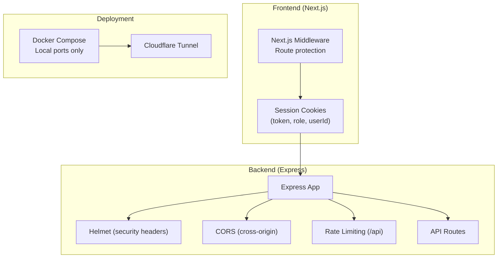
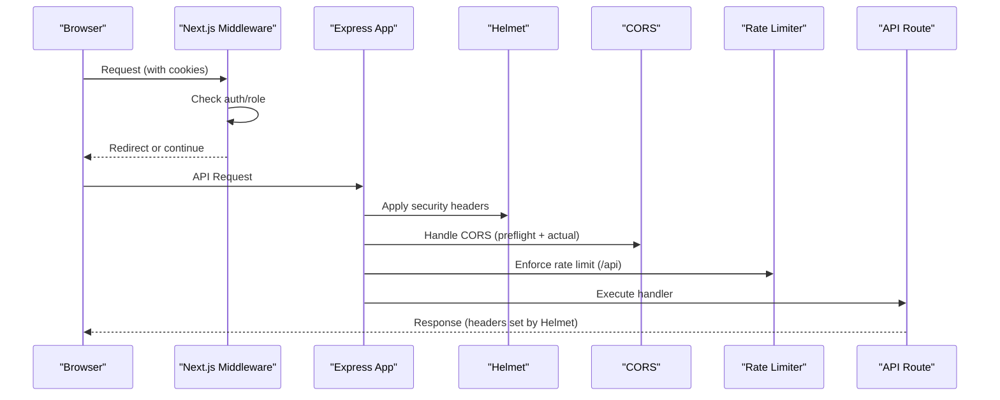
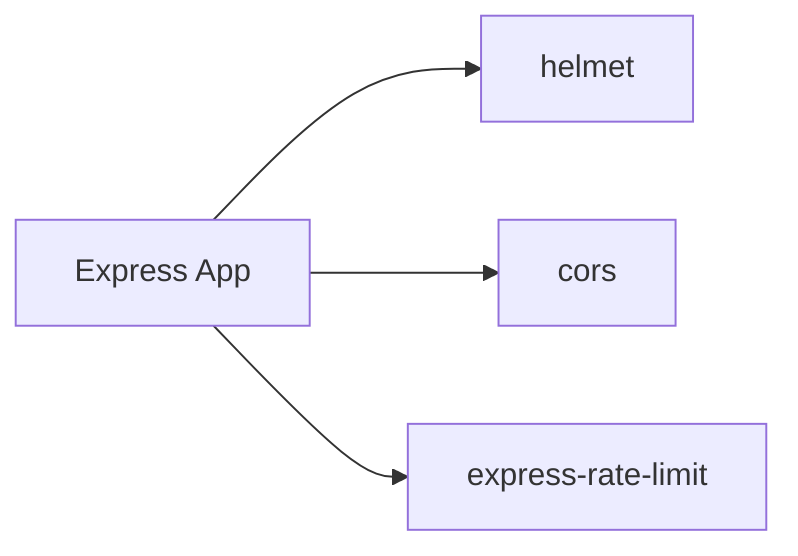

# Security Headers & CORS Configuration

<cite>
**Referenced Files in This Document**
- [backend/index.js](file://backend/index.js)
- [backend/package.json](file://backend/package.json)
- [backend/src/middleware/sanitizarXss.js](file://backend/src/middleware/sanitizarXss.js)
- [simoapp/middleware.ts](file://simoapp/middleware.ts)
- [simoapp/lib/auth/sesion.ts](file://simoapp/lib/auth/sesion.ts)
- [deploy/docker-compose.yml](file://deploy/docker-compose.yml)
</cite>

## Table of Contents
1. [Introduction](#introduction)
2. [Project Structure](#project-structure)
3. [Core Components](#core-components)
4. [Architecture Overview](#architecture-overview)
5. [Detailed Component Analysis](#detailed-component-analysis)
6. [Dependency Analysis](#dependency-analysis)
7. [Performance Considerations](#performance-considerations)
8. [Troubleshooting Guide](#troubleshooting-guide)
9. [Conclusion](#conclusion)

## Introduction
This document explains how HTTP security headers and Cross-Origin Resource Sharing (CORS) are configured in the project, with a focus on:
- Content Security Policy (CSP) and other security headers via Helmet
- CORS policy for cross-origin requests, including preflight handling
- Cookie security settings used by the frontend
- HTTPS enforcement and HSTS considerations for production deployments

The backend uses Express 5 with Helmet and CORS middleware. The frontend is a Next.js application that manages session cookies and enforces route-level access control.

## Project Structure
Security-related configuration spans both backend and frontend:
- Backend: Express app initializes Helmet and CORS early in the middleware stack; rate limiting is applied to API routes.
- Frontend: Next.js middleware protects routes based on cookies; client-side session utilities set cookies with SameSite=Lax.
- Deployment: Docker Compose exposes services only on localhost; external traffic enters through Cloudflare Tunnel.

**Diagram sources**
- [backend/index.js:24-48](file://backend/index.js#L24-L48)
- [simoapp/middleware.ts:4-28](file://simoapp/middleware.ts#L4-L28)
- [deploy/docker-compose.yml:39-80](file://deploy/docker-compose.yml#L39-L80)

**Section sources**
- [backend/index.js:24-48](file://backend/index.js#L24-L48)
- [simoapp/middleware.ts:4-28](file://simoapp/middleware.ts#L4-L28)
- [deploy/docker-compose.yml:39-80](file://deploy/docker-compose.yml#L39-L80)

## Core Components
- Helmet: Applied globally to set secure HTTP response headers.
- CORS: Enabled globally with default options.
- XSS Sanitization: Custom middleware sanitizes request inputs.
- Rate Limiting: Applied to /api routes to mitigate abuse.
- Frontend Session Management: Sets cookies with SameSite=Lax and reads them in Next.js middleware.

Key responsibilities:
- Helmet sets default security headers (e.g., X-Content-Type-Options). CSP can be customized if needed.
- CORS allows cross-origin requests from any origin by default; preflight requests are handled automatically.
- XSS sanitizer escapes dangerous HTML characters in body/query/params.
- Rate limiter restricts request volume per IP on API endpoints.
- Frontend cookie utility writes cookies with path=/ and SameSite=Lax.

**Section sources**
- [backend/index.js:24-48](file://backend/index.js#L24-L48)
- [backend/src/middleware/sanitizarXss.js:1-48](file://backend/src/middleware/sanitizarXss.js#L1-L48)
- [simoapp/lib/auth/sesion.ts:17-21](file://simoapp/lib/auth/sesion.ts#L17-L21)
- [simoapp/middleware.ts:4-28](file://simoapp/middleware.ts#L4-L28)

## Architecture Overview
The request flow includes security middleware before reaching route handlers. CORS and Helmet run first, followed by JSON parsing, XSS sanitization, and rate limiting.

**Diagram sources**
- [backend/index.js:24-48](file://backend/index.js#L24-L48)
- [simoapp/middleware.ts:4-28](file://simoapp/middleware.ts#L4-L28)

## Detailed Component Analysis

### Security Headers (Helmet)
- Helmet is initialized at the top of the middleware stack, ensuring all responses include recommended security headers.
- Default behaviors include setting headers such as X-Content-Type-Options: nosniff.
- CSP can be customized by configuring Helmet’s contentSecurityPolicy if stricter policies are required.

Operational notes:
- CSP is not explicitly configured in the codebase; Helmet’s defaults apply.
- If your app requires specific directives (e.g., script-src, img-src), configure Helmet accordingly.

**Section sources**
- [backend/index.js:24-25](file://backend/index.js#L24-L25)

### CORS Configuration
- CORS is enabled globally with default options, allowing requests from any origin.
- Preflight requests (OPTIONS) are handled automatically by the CORS middleware.
- Credentials handling is not explicitly configured; default behavior applies.

Recommendations:
- Restrict allowed origins to known frontends.
- Explicitly allow necessary methods and headers.
- Enable credentials support when cookies are sent cross-origin.

**Section sources**
- [backend/index.js:28-28](file://backend/index.js#L28-L28)

### XSS Sanitization
- A custom middleware sanitizes string values in req.body, req.query, and req.params by escaping HTML entities.
- This mitigates reflected XSS risks at the input layer.

Complexity:
- Traverses objects/arrays recursively; O(n) over input size.

**Section sources**
- [backend/src/middleware/sanitizarXss.js:1-48](file://backend/src/middleware/sanitizarXss.js#L1-L48)

### Rate Limiting
- Rate limiting is applied to all /api routes with a configurable window and max requests.
- Uses standard headers and returns a structured error message when exceeded.

Configuration:
- Window: 1 minute
- Max requests: configurable via RATE_LIMIT_MAX (default 100)

**Section sources**
- [backend/index.js:34-48](file://backend/index.js#L34-L48)

### Frontend Cookie Security
- Next.js middleware checks for token and role cookies to protect routes.
- Session utility sets cookies with path=/ and SameSite=Lax.

Implications:
- SameSite=Lax allows cookies on same-site navigations and some cross-site GET requests.
- For strict cross-site scenarios, consider SameSite=None with Secure where applicable.

**Section sources**
- [simoapp/middleware.ts:4-28](file://simoapp/middleware.ts#L4-L28)
- [simoapp/lib/auth/sesion.ts:17-21](file://simoapp/lib/auth/sesion.ts#L17-L21)

### Production Deployment and HTTPS/HSTS
- Services are exposed only on localhost via Docker Compose; external access goes through Cloudflare Tunnel.
- This architecture relies on the edge proxy (Cloudflare) for TLS termination and potential HSTS.

Considerations:
- Ensure Cloudflare enforces HTTPS and HSTS.
- Avoid exposing raw ports directly to the internet.

**Section sources**
- [deploy/docker-compose.yml:39-80](file://deploy/docker-compose.yml#L39-L80)

## Dependency Analysis
The following dependencies are relevant to security headers and CORS:

- helmet: Provides security headers.
- cors: Handles cross-origin requests.
- express-rate-limit: Protects against excessive requests.

**Diagram sources**
- [backend/package.json:15-23](file://backend/package.json#L15-L23)

**Section sources**
- [backend/package.json:15-23](file://backend/package.json#L15-L23)

## Performance Considerations
- Helmet adds minimal overhead but improves security posture significantly.
- CORS preflight caching depends on browser behavior; keep allowed origins/methods minimal to reduce unnecessary OPTIONS requests.
- Rate limiting reduces load during abuse; tune window and max based on expected traffic patterns.

[No sources needed since this section provides general guidance]

## Troubleshooting Guide
Common issues and resolutions:
- Mixed content warnings: Ensure frontend assets and API calls use HTTPS.
- CORS errors: Verify allowed origins, methods, and headers; enable credentials if cookies are required.
- CSP blocking resources: Adjust CSP directives to allow required scripts/styles/images.
- XSS payloads still appearing: Confirm sanitization middleware runs before route handlers.
- Rate limit errors: Increase RATE_LIMIT_MAX temporarily for testing; ensure legitimate traffic is not blocked.

**Section sources**
- [backend/index.js:24-48](file://backend/index.js#L24-L48)
- [backend/src/middleware/sanitizarXss.js:1-48](file://backend/src/middleware/sanitizarXss.js#L1-L48)

## Conclusion
The project implements a solid baseline for HTTP security using Helmet and CORS, with additional protections like XSS sanitization and rate limiting. Frontend cookie management follows reasonable defaults. For production, rely on an edge proxy (e.g., Cloudflare) for HTTPS and HSTS, and refine CORS and CSP policies to match exact needs.

[No sources needed since this section summarizes without analyzing specific files]