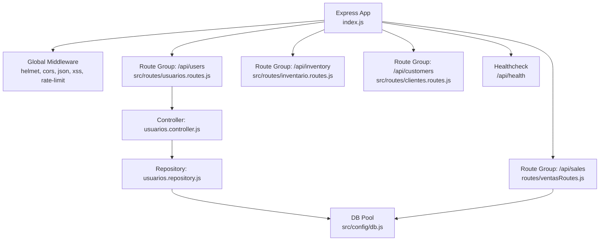
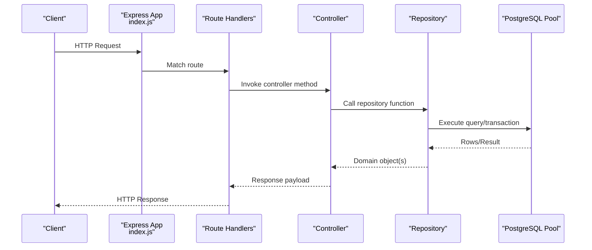
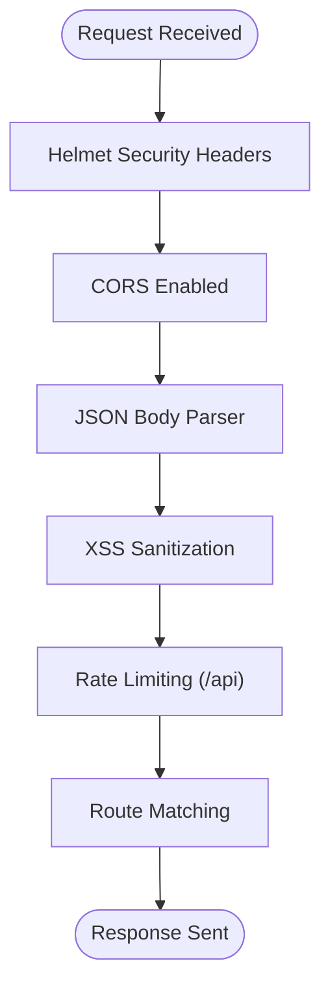
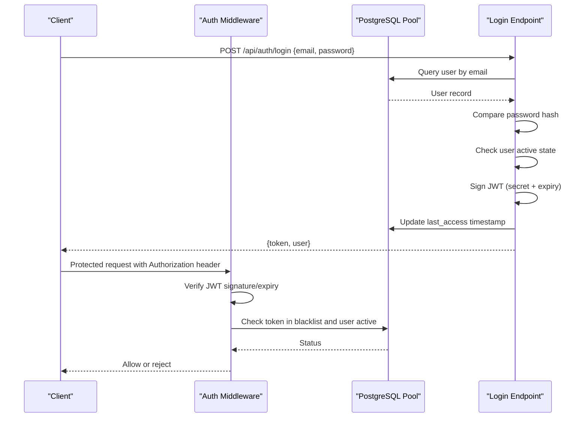
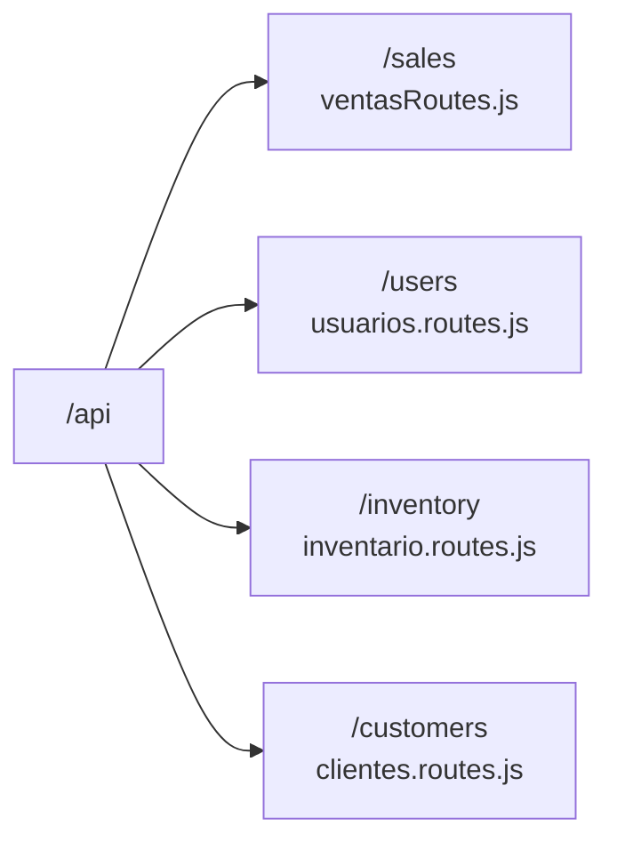
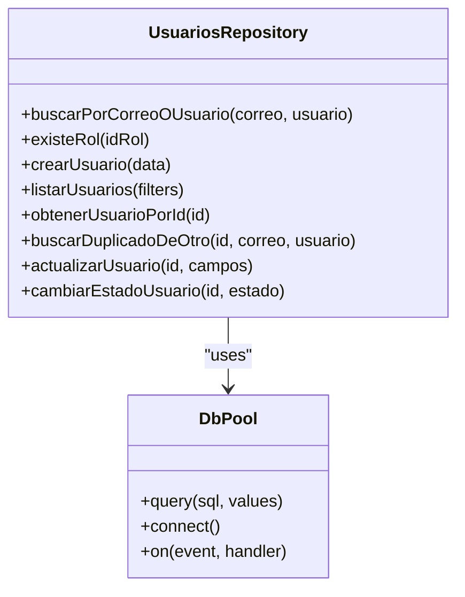
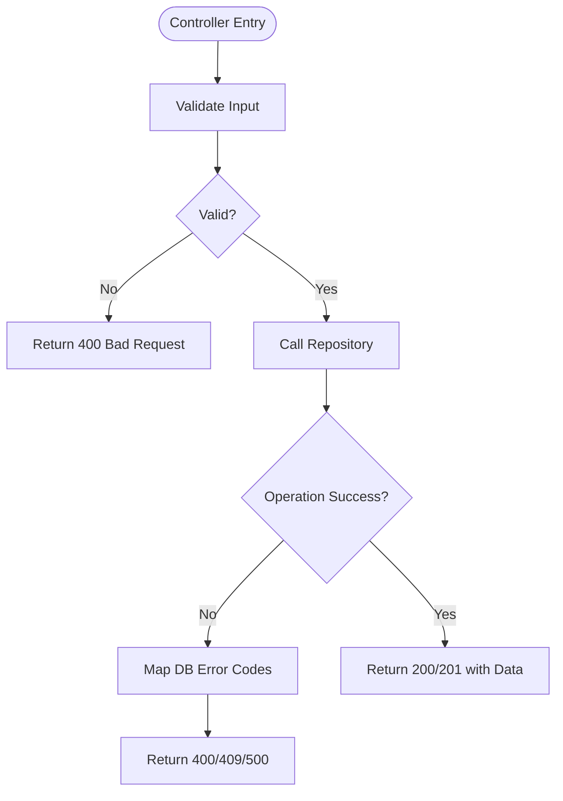
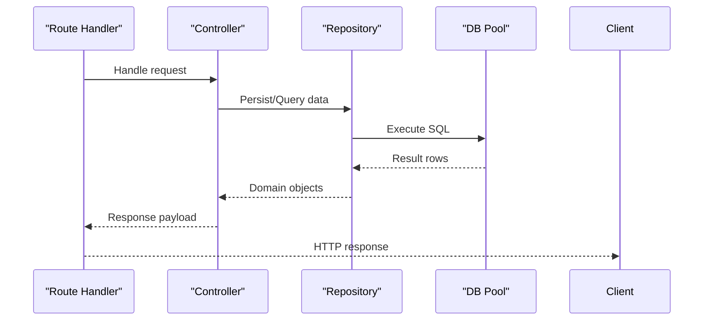
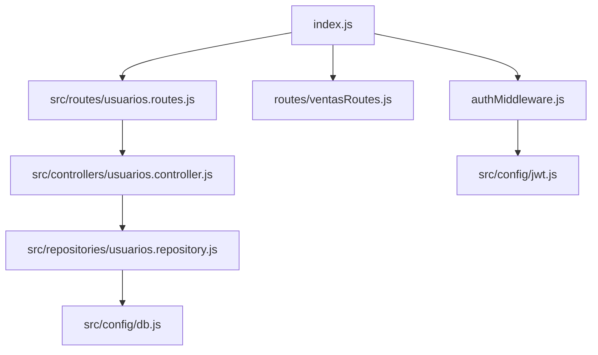

# Backend Architecture

<cite>
**Referenced Files in This Document**
- [index.js](file://backend/index.js)
- [package.json](file://backend/package.json)
- [db/index.js](file://backend/db/index.js)
- [src/config/db.js](file://backend/src/config/db.js)
- [src/config/jwt.js](file://backend/src/config/jwt.js)
- [middleware/authMiddleware.js](file://backend/middleware/authMiddleware.js)
- [src/middleware/sanitizarXss.js](file://backend/src/middleware/sanitizarXss.js)
- [routes/ventasRoutes.js](file://backend/routes/ventasRoutes.js)
- [src/routes/usuarios.routes.js](file://backend/src/routes/usuarios.routes.js)
- [src/controllers/usuarios.controller.js](file://backend/src/controllers/usuarios.controller.js)
- [src/repositories/usuarios.repository.js](file://backend/src/repositories/usuarios.repository.js)
</cite>

## Table of Contents
1. [Introduction](#introduction)
2. [Project Structure](#project-structure)
3. [Core Components](#core-components)
4. [Architecture Overview](#architecture-overview)
5. [Detailed Component Analysis](#detailed-component-analysis)
6. [Dependency Analysis](#dependency-analysis)
7. [Performance Considerations](#performance-considerations)
8. [Troubleshooting Guide](#troubleshooting-guide)
9. [Conclusion](#conclusion)

## Introduction
This document explains the backend architecture of the SIMO API server. It covers the Express.js application setup, middleware chain, modular routing, repository pattern for database access, authentication and authorization, security headers, rate limiting, CORS, error handling, logging strategy, monitoring endpoints, and data flow across layers. The goal is to make the system understandable for both developers and stakeholders with limited technical background.

## Project Structure
The backend is an Express 5 application that mixes a legacy route-based implementation with a newer MVC-style structure under `src/`. Key areas:
- Application entry point and global middleware are defined at the root.
- Domain-specific routes live both at the root (`routes/`) and under `src/routes/`.
- Controllers and repositories are organized by domain under `src/controllers/` and `src/repositories/`.
- Shared configuration lives under `src/config/`.
- Database connection pooling is centralized and reused across modules.

**Diagram sources**
- [index.js:1-56](file://backend/index.js#L1-L56)
- [routes/ventasRoutes.js:1-10](file://backend/routes/ventasRoutes.js#L1-L10)
- [src/routes/usuarios.routes.js:1-17](file://backend/src/routes/usuarios.routes.js#L1-L17)
- [src/controllers/usuarios.controller.js:1-20](file://backend/src/controllers/usuarios.controller.js#L1-L20)
- [src/repositories/usuarios.repository.js:1-10](file://backend/src/repositories/usuarios.repository.js#L1-L10)
- [src/config/db.js:1-29](file://backend/src/config/db.js#L1-L29)

**Section sources**
- [index.js:1-56](file://backend/index.js#L1-L56)
- [package.json:1-38](file://backend/package.json#L1-L38)

## Core Components
- Express application bootstrap and global middleware: security headers, CORS, JSON parsing, XSS sanitization, and rate limiting.
- Modular route groups for sales, users, inventory, and customers.
- Authentication and authorization middleware using JWT and role-based access control.
- Repository layer abstracting PostgreSQL queries with a shared connection pool.
- Controllers implementing business validation and orchestrating repository calls.
- Health check endpoint for service monitoring.

**Section sources**
- [index.js:20-56](file://backend/index.js#L20-L56)
- [middleware/authMiddleware.js:1-81](file://backend/middleware/authMiddleware.js#L1-L81)
- [src/config/db.js:1-29](file://backend/src/config/db.js#L1-L29)
- [src/controllers/usuarios.controller.js:1-295](file://backend/src/controllers/usuarios.controller.js#L1-L295)
- [src/repositories/usuarios.repository.js:1-242](file://backend/src/repositories/usuarios.repository.js#L1-L242)

## Architecture Overview
The API follows a layered approach:
- Presentation Layer: Express routes and controllers handle HTTP requests and responses.
- Business Layer: Controllers enforce input validation and business rules.
- Data Access Layer: Repositories encapsulate SQL queries and transactions.
- Infrastructure Layer: Database pool, JWT configuration, and environment-driven settings.

**Diagram sources**
- [index.js:52-56](file://backend/index.js#L52-L56)
- [src/routes/usuarios.routes.js:7-17](file://backend/src/routes/usuarios.routes.js#L7-L17)
- [src/controllers/usuarios.controller.js:29-84](file://backend/src/controllers/usuarios.controller.js#L29-L84)
- [src/repositories/usuarios.repository.js:25-36](file://backend/src/repositories/usuarios.repository.js#L25-L36)
- [src/config/db.js:17-26](file://backend/src/config/db.js#L17-L26)

## Detailed Component Analysis

### Express Application and Global Middleware
- Security headers via Helmet.
- CORS enabled globally.
- JSON body parser.
- Custom XSS sanitization middleware applied globally.
- Rate limiter configured per minute with a configurable maximum; applied to `/api`.
- Route groups mounted under `/api/sales`, `/api/users`, `/api/inventory`, `/api/customers`.
- Health check endpoint validates database connectivity.

**Diagram sources**
- [index.js:24-48](file://backend/index.js#L24-L48)

**Section sources**
- [index.js:24-56](file://backend/index.js#L24-L56)

### Authentication and Authorization
- JWT verification middleware checks token presence, format, signature, expiration, blacklist status, and user account state.
- Role-based access control middleware allows specifying allowed roles by ID or code.
- Login endpoint verifies credentials, issues JWT, updates last access time, and returns user info.
- Logout endpoint blacklists the current token.

**Diagram sources**
- [middleware/authMiddleware.js:9-50](file://backend/middleware/authMiddleware.js#L9-L50)
- [index.js:347-423](file://backend/index.js#L347-L423)
- [index.js:428-469](file://backend/index.js#L428-L469)

**Section sources**
- [middleware/authMiddleware.js:1-81](file://backend/middleware/authMiddleware.js#L1-L81)
- [index.js:347-469](file://backend/index.js#L347-L469)

### Security Headers, CORS, and Rate Limiting
- Helmet sets secure HTTP response headers.
- CORS is enabled globally.
- Rate limiter applies to all `/api` routes with a default of 100 requests per minute, configurable via environment variable.

**Section sources**
- [index.js:24-48](file://backend/index.js#L24-L48)

### Request Sanitization
- Custom XSS sanitizer escapes dangerous HTML characters in `req.body`, `req.query`, and `req.params`.
- Designed to be compatible with Express 5 where older libraries may not work.

**Section sources**
- [src/middleware/sanitizarXss.js:1-48](file://backend/src/middleware/sanitizarXss.js#L1-L48)

### Modular Route Organization
- Sales routes under `/api/sales` implement transactional sale processing and daily summary reporting.
- Users routes under `/api/users` provide CRUD operations protected by JWT and RBAC.
- Inventory and customer routes are mounted similarly under their respective prefixes.

**Diagram sources**
- [index.js:52-56](file://backend/index.js#L52-L56)
- [routes/ventasRoutes.js:1-10](file://backend/routes/ventasRoutes.js#L1-L10)
- [src/routes/usuarios.routes.js:1-17](file://backend/src/routes/usuarios.routes.js#L1-L17)

**Section sources**
- [routes/ventasRoutes.js:1-149](file://backend/routes/ventasRoutes.js#L1-L149)
- [src/routes/usuarios.routes.js:1-17](file://backend/src/routes/usuarios.routes.js#L1-L17)

### Repository Pattern and Database Abstraction
- Repositories encapsulate all database interactions for each domain.
- They use a shared PostgreSQL connection pool configured centrally.
- Transactions and advisory locks ensure consistency for critical operations like user role changes and state toggles.

**Diagram sources**
- [src/repositories/usuarios.repository.js:12-242](file://backend/src/repositories/usuarios.repository.js#L12-L242)
- [src/config/db.js:17-26](file://backend/src/config/db.js#L17-L26)

**Section sources**
- [src/repositories/usuarios.repository.js:1-242](file://backend/src/repositories/usuarios.repository.js#L1-L242)
- [src/config/db.js:1-29](file://backend/src/config/db.js#L1-L29)

### Connection Pooling Configuration
- Centralized pool creation supports two modes:
  - Cloud provider via `DATABASE_URL` with SSL unless disabled.
  - Local/Docker via individual host/port/database/user/password variables.
- Pool events log successful connections and unexpected errors.
- Root-level `db/index.js` re-exports the same pool used by legacy routes and other modules.

**Section sources**
- [src/config/db.js:1-29](file://backend/src/config/db.js#L1-L29)
- [db/index.js:1-23](file://backend/db/index.js#L1-L23)

### Error Handling Strategies
- Controllers validate inputs and return structured error responses with consistent fields (`error`, `message`).
- Database constraint violations are mapped to appropriate HTTP statuses (e.g., conflict for duplicates).
- Transactional routes roll back on failure and release clients properly.
- Global health check reports database availability.

**Diagram sources**
- [src/controllers/usuarios.controller.js:29-84](file://backend/src/controllers/usuarios.controller.js#L29-L84)
- [routes/ventasRoutes.js:20-110](file://backend/routes/ventasRoutes.js#L20-L110)

**Section sources**
- [src/controllers/usuarios.controller.js:29-295](file://backend/src/controllers/usuarios.controller.js#L29-L295)
- [routes/ventasRoutes.js:20-110](file://backend/routes/ventasRoutes.js#L20-L110)

### Logging Strategy
- Console logging is used for operational messages such as successful DB connections, errors during login/logout, and repository/controller failures.
- No structured logger is configured; logs are plain console outputs.

**Section sources**
- [db/index.js:14-20](file://backend/db/index.js#L14-L20)
- [index.js:416-421](file://backend/index.js#L416-L421)
- [index.js:462-467](file://backend/index.js#L462-L467)
- [src/controllers/usuarios.controller.js:73-83](file://backend/src/controllers/usuarios.controller.js#L73-L83)

### Monitoring and Health Checks
- Health check endpoint performs a simple database query to verify connectivity and responds with status and database state.
- Suitable for liveness probes and basic uptime monitoring.

**Section sources**
- [index.js:62-70](file://backend/index.js#L62-L70)

### Service Layer Architecture
- There is no explicit service layer; business logic resides in controllers and repositories.
- Controllers orchestrate validation and call repositories; repositories perform SQL operations and manage transactions.

**Section sources**
- [src/controllers/usuarios.controller.js:1-295](file://backend/src/controllers/usuarios.controller.js#L1-L295)
- [src/repositories/usuarios.repository.js:1-242](file://backend/src/repositories/usuarios.repository.js#L1-L242)

### Dependency Injection Patterns
- Dependencies are imported directly rather than injected through a DI container.
- Shared configuration (JWT secret, pool) is accessed via module exports.

**Section sources**
- [src/config/jwt.js:1-16](file://backend/src/config/jwt.js#L1-L16)
- [src/config/db.js:1-29](file://backend/src/config/db.js#L1-L29)

### Examples of Controller Implementations and Repository Methods
- User creation controller validates required fields, normalizes email, hashes password, checks role existence, prevents duplicates, and delegates insertion to the repository.
- Repository methods include creating users, listing with pagination and filters, fetching by ID, checking duplicates excluding self, updating with advisory locks, and toggling user state while protecting the last admin.

**Section sources**
- [src/controllers/usuarios.controller.js:29-84](file://backend/src/controllers/usuarios.controller.js#L29-L84)
- [src/repositories/usuarios.repository.js:25-36](file://backend/src/repositories/usuarios.repository.js#L25-L36)
- [src/repositories/usuarios.repository.js:115-172](file://backend/src/repositories/usuarios.repository.js#L115-L172)
- [src/repositories/usuarios.repository.js:178-230](file://backend/src/repositories/usuarios.repository.js#L178-L230)

### Relationship Between Architectural Layers and Data Flow
- Routes define endpoints and apply auth/RBAC middleware.
- Controllers parse and validate request payloads, enforce business rules, and delegate persistence to repositories.
- Repositories execute parameterized queries and transactions against the shared pool.
- Responses are standardized and returned through routes.

**Diagram sources**
- [src/routes/usuarios.routes.js:7-17](file://backend/src/routes/usuarios.routes.js#L7-L17)
- [src/controllers/usuarios.controller.js:29-84](file://backend/src/controllers/usuarios.controller.js#L29-L84)
- [src/repositories/usuarios.repository.js:25-36](file://backend/src/repositories/usuarios.repository.js#L25-L36)
- [src/config/db.js:17-26](file://backend/src/config/db.js#L17-L26)

## Dependency Analysis
Key dependencies and relationships:
- Express app depends on middleware modules and route modules.
- Legacy routes depend on the shared DB pool and auth middleware.
- New MVC routes depend on controllers and repositories.
- Repositories depend on the central DB config.
- JWT configuration is shared between login and auth middleware.

**Diagram sources**
- [index.js:1-15](file://backend/index.js#L1-L15)
- [routes/ventasRoutes.js:1-4](file://backend/routes/ventasRoutes.js#L1-L4)
- [src/routes/usuarios.routes.js:1-6](file://backend/src/routes/usuarios.routes.js#L1-L6)
- [src/controllers/usuarios.controller.js:1-14](file://backend/src/controllers/usuarios.controller.js#L1-L14)
- [src/repositories/usuarios.repository.js:1-5](file://backend/src/repositories/usuarios.repository.js#L1-L5)
- [src/config/db.js:1-9](file://backend/src/config/db.js#L1-L9)
- [src/config/jwt.js:1-5](file://backend/src/config/jwt.js#L1-L5)

**Section sources**
- [index.js:1-15](file://backend/index.js#L1-L15)
- [routes/ventasRoutes.js:1-4](file://backend/routes/ventasRoutes.js#L1-L4)
- [src/routes/usuarios.routes.js:1-6](file://backend/src/routes/usuarios.routes.js#L1-L6)
- [src/controllers/usuarios.controller.js:1-14](file://backend/src/controllers/usuarios.controller.js#L1-L14)
- [src/repositories/usuarios.repository.js:1-5](file://backend/src/repositories/usuarios.repository.js#L1-L5)
- [src/config/db.js:1-9](file://backend/src/config/db.js#L1-L9)
- [src/config/jwt.js:1-5](file://backend/src/config/jwt.js#L1-L5)

## Performance Considerations
- Use parameterized queries to prevent SQL injection and improve plan caching.
- Leverage pagination and filtering in repositories to reduce payload sizes.
- Keep transactions short and scope them to necessary operations.
- Monitor DB pool utilization and tune pool size based on workload.
- Avoid unnecessary string concatenation in queries; prefer prepared statements.
- Consider adding structured logging and metrics collection for observability.

[No sources needed since this section provides general guidance]

## Troubleshooting Guide
Common issues and resolutions:
- Authentication failures: Ensure JWT secret is set and matches between signing and verification; verify token format and expiration.
- Session invalidation: Confirm logout inserts into blacklist; check user active state.
- Duplicate constraints: Map database error codes to 409 Conflict responses.
- Transaction errors: Ensure rollback on failure and client release in finally blocks.
- Health check failures: Verify database connectivity and environment variables.

**Section sources**
- [middleware/authMiddleware.js:9-50](file://backend/middleware/authMiddleware.js#L9-L50)
- [index.js:347-469](file://backend/index.js#L347-L469)
- [routes/ventasRoutes.js:101-110](file://backend/routes/ventasRoutes.js#L101-L110)
- [src/controllers/usuarios.controller.js:73-83](file://backend/src/controllers/usuarios.controller.js#L73-L83)
- [index.js:62-70](file://backend/index.js#L62-L70)

## Conclusion
The SIMO API backend combines a pragmatic Express setup with a growing MVC structure. Security is enforced through Helmet, CORS, XSS sanitization, and rate limiting. Authentication uses JWT with role-based access control, and the repository pattern centralizes database interactions with robust transaction handling. While logging is currently console-based, the architecture supports extension to structured logging and monitoring. The health check endpoint provides basic service monitoring. Future improvements can include a formal service layer, dependency injection, and comprehensive observability.