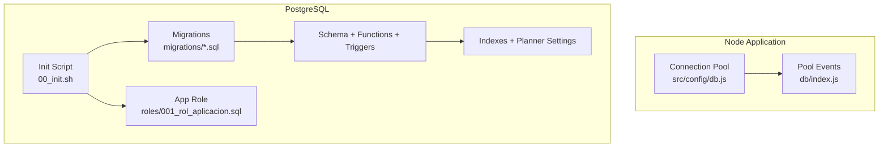
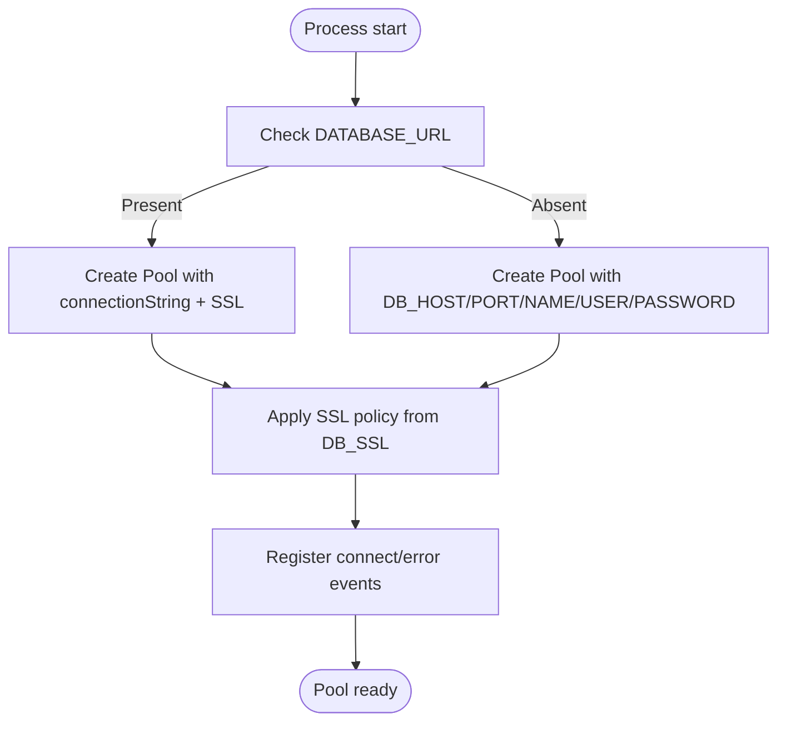
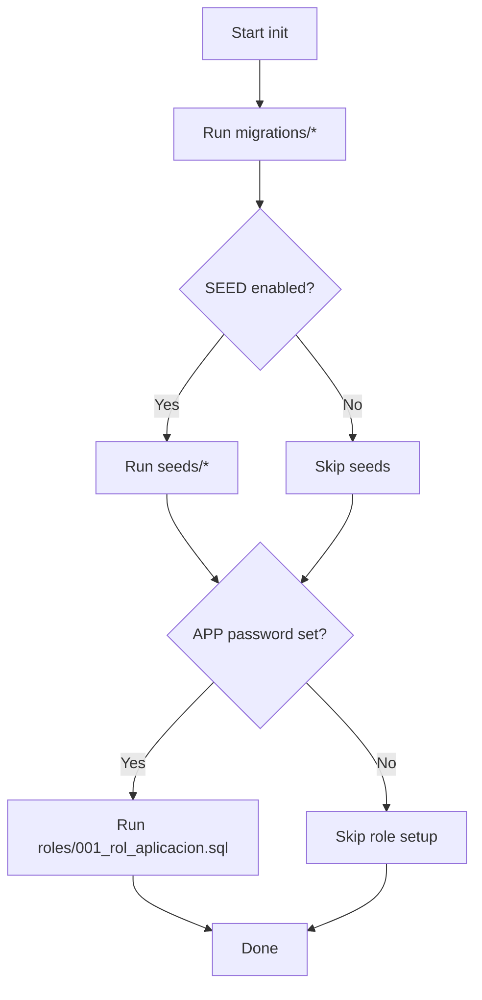
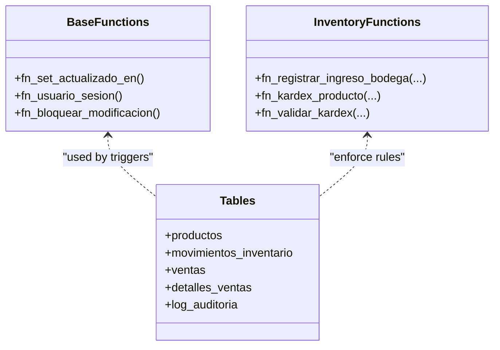
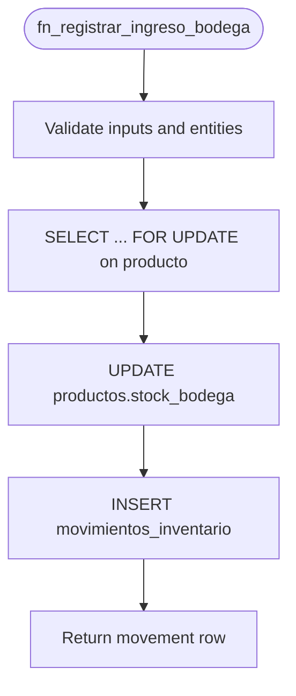
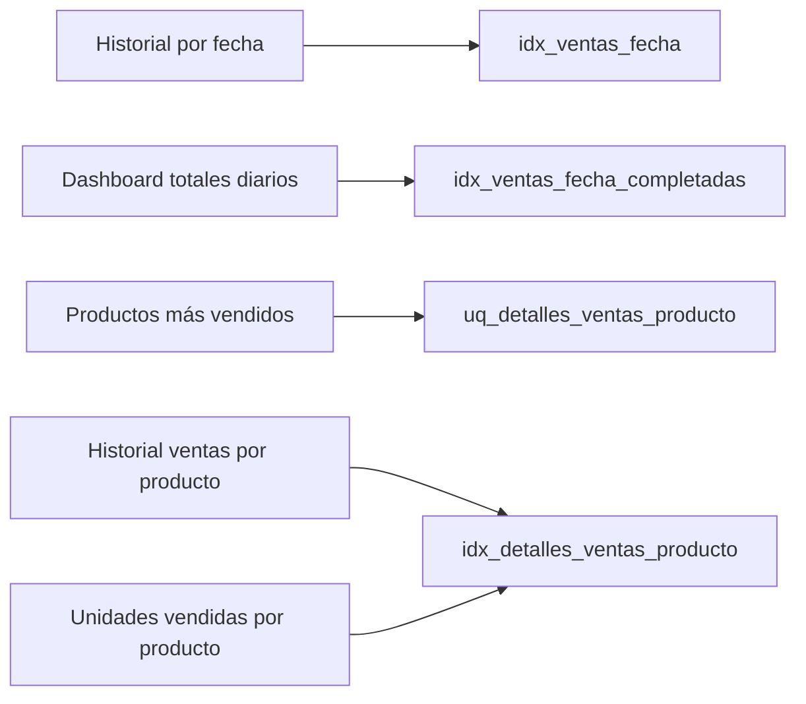
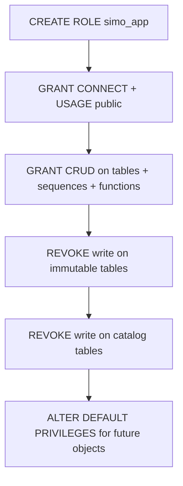
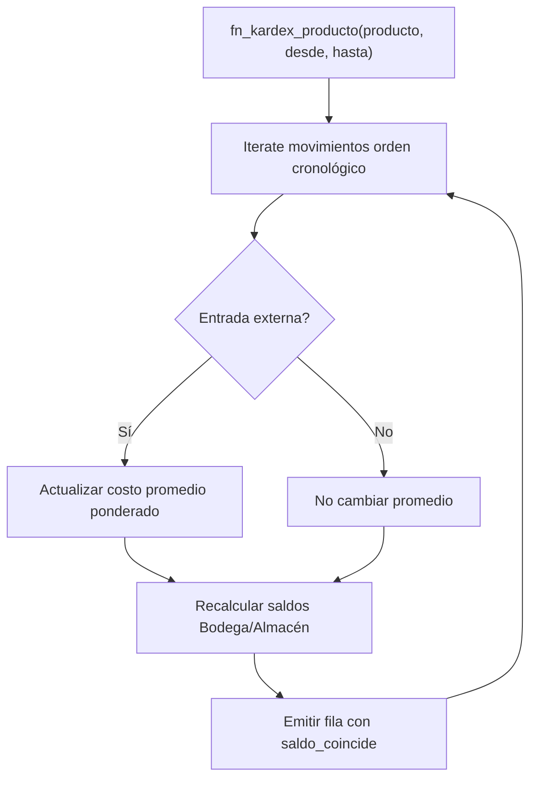
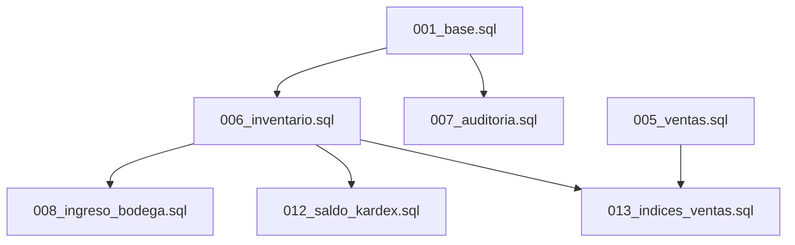

# Database Layer

<cite>
**Referenced Files in This Document**
- [db.js](file://backend/src/config/db.js)
- [index.js](file://backend/db/index.js)
- [00_init.sh](file://backend/db/00_init.sh)
- [README.md](file://backend/db/README.md)
- [001_base.sql](file://backend/db/migrations/001_base.sql)
- [002_seguridad.sql](file://backend/db/migrations/002_seguridad.sql)
- [005_ventas.sql](file://backend/db/migrations/005_ventas.sql)
- [006_inventario.sql](file://backend/db/migrations/006_inventario.sql)
- [007_auditoria.sql](file://backend/db/migrations/007_auditoria.sql)
- [008_ingreso_bodega.sql](file://backend/db/migrations/008_ingreso_bodega.sql)
- [012_saldo_kardex.sql](file://backend/db/migrations/012_saldo_kardex.sql)
- [013_indices_ventas.sql](file://backend/db/migrations/013_indices_ventas.sql)
- [001_rol_aplicacion.sql](file://backend/db/roles/001_rol_aplicacion.sql)
</cite>

## Table of Contents
1. [Introduction](#introduction)
2. [Project Structure](#project-structure)
3. [Core Components](#core-components)
4. [Architecture Overview](#architecture-overview)
5. [Detailed Component Analysis](#detailed-component-analysis)
6. [Dependency Analysis](#dependency-analysis)
7. [Performance Considerations](#performance-considerations)
8. [Troubleshooting Guide](#troubleshooting-guide)
9. [Conclusion](#conclusion)

## Introduction
This document explains the SIMO database layer built on PostgreSQL. It covers connection pooling and lifecycle, environment-specific configuration, migration strategy, stored procedures and triggers that enforce business rules, indexing and query optimization, security and permissions, and examples of complex queries and transaction patterns. The goal is to make the system understandable for both developers and operators while preserving technical precision.

## Project Structure
The database layer is organized around:
- A shared Node.js connection pool configured via environment variables.
- Ordered SQL migrations under `backend/db/migrations`.
- An initialization script that runs migrations, optional seeds, and application role setup.
- Business logic implemented as PostgreSQL functions, triggers, constraints, and views.
- Performance tuning through indexes and planner settings.



**Diagram sources**
- [db.js:1-29](file://backend/src/config/db.js#L1-L29)
- [index.js:1-22](file://backend/db/index.js#L1-L22)
- [00_init.sh:1-43](file://backend/db/00_init.sh#L1-L43)
- [001_base.sql:1-60](file://backend/db/migrations/001_base.sql#L1-L60)
- [013_indices_ventas.sql:1-71](file://backend/db/migrations/013_indices_ventas.sql#L1-L71)

**Section sources**
- [README.md:1-32](file://backend/db/README.md#L1-L32)
- [00_init.sh:1-43](file://backend/db/00_init.sh#L1-L43)

## Core Components
- Connection pool configuration and SSL handling.
- Environment-driven database settings (local vs cloud).
- Migration orchestration and idempotent execution.
- Business rule enforcement via constraints, triggers, and functions.
- Inventory Kardex model with auditability.
- Sales schema with integrity checks and reporting indexes.
- Application role with least privilege.

Key responsibilities:
- `src/config/db.js`: Creates a single shared `pg.Pool` based on environment variables and SSL policy.
- `db/index.js`: Reuses the same pool and logs connect/error events.
- `db/00_init.sh`: Runs migrations, optional seeds, and app role creation.
- Migrations: Define schema, functions, triggers, indexes, and planner settings.

**Section sources**
- [db.js:1-29](file://backend/src/config/db.js#L1-L29)
- [index.js:1-22](file://backend/db/index.js#L1-L22)
- [00_init.sh:1-43](file://backend/db/00_init.sh#L1-L43)

## Architecture Overview
SIMO uses a layered approach:
- Application layer: Express routes/controllers call repositories using the shared pool.
- Data access layer: Uses parameterized queries and transactions.
- Database layer: Enforces business rules at the data level via constraints, triggers, and functions.

```mermaid
sequenceDiagram
participant API as "API Routes"
participant Repo as "Repositories"
participant Pool as "pg.Pool"
participant PG as "PostgreSQL"
API->>Repo : "Handle request"
Repo->>Pool : "Acquire client"
Pool-->>Repo : "Client instance"
Repo->>PG : "BEGIN; DML/queries"
PG-->>Repo : "Results or error"
Repo->>PG : "COMMIT/ROLLBACK"
Repo->>Pool : "Release client"
```

[No sources needed since this diagram shows conceptual workflow, not actual code structure]

## Detailed Component Analysis

### Connection Pooling and Lifecycle
- Single shared pool created once per process.
- Two configuration modes:
  - Cloud provider via `DATABASE_URL` with SSL enabled by default unless disabled.
  - Local/Docker via individual host/port/user/password/database variables.
- SSL behavior controlled by `DB_SSL`:
  - `true` forces SSL with relaxed certificate validation.
  - `false` disables SSL.
  - Default depends on whether `DATABASE_URL` is present.
- Lifecycle hooks log successful connections and unexpected errors.



**Diagram sources**
- [db.js:1-29](file://backend/src/config/db.js#L1-L29)
- [index.js:1-22](file://backend/db/index.js#L1-L22)

**Section sources**
- [db.js:1-29](file://backend/src/config/db.js#L1-L29)
- [index.js:1-22](file://backend/db/index.js#L1-L22)

### Environment-Specific Database Settings
- Variables:
  - `DATABASE_URL`: Full connection string (e.g., Neon), SSL enabled by default unless overridden.
  - `DB_HOST`, `DB_PORT`, `DB_NAME`, `DB_USER`, `DB_PASSWORD`: Local/Docker setup.
  - `DB_SSL`: Controls SSL (`true`/`false`).
- Timezone: Database timezone set to `America/Bogota` for consistent timestamps.

Operational guidance:
- For local development, prefer explicit host/port/user/password without SSL.
- For cloud providers, use `DATABASE_URL`; override SSL only if required.

**Section sources**
- [db.js:1-29](file://backend/src/config/db.js#L1-L29)
- [001_base.sql:19-26](file://backend/db/migrations/001_base.sql#L19-L26)

### Migration Strategy and Version Control
- Migrations are ordered SQL files under `backend/db/migrations`.
- Initialization script executes all migrations, then optional seeds, then app role setup.
- Migrations are designed to be re-executable safely (idempotent where possible).
- Example flow:
  - Docker first run: `00_init.sh` runs migrations and seeds.
  - Manual run: `psql` against `simo_retail` with variables.

Rollback strategy:
- No automatic rollback scripts are provided.
- Recommended approach:
  - Maintain backward-compatible migrations.
  - Use point-in-time recovery from backups for critical rollbacks.
  - Apply reverse migrations manually when necessary, ensuring referential integrity and data consistency.



**Diagram sources**
- [00_init.sh:1-43](file://backend/db/00_init.sh#L1-L43)

**Section sources**
- [README.md:34-58](file://backend/db/README.md#L34-L58)
- [00_init.sh:1-43](file://backend/db/00_init.sh#L1-L43)

### Stored Procedures, Triggers, and Functions
Shared utilities:
- `fn_set_actualizado_en()`: Updates `actualizado_en` on row updates.
- `fn_usuario_sesion()`: Reads the current user ID from session config.
- `fn_bloquear_modificacion()`: Blocks UPDATE/DELETE/TRUNCATE on immutable tables.

Business functions:
- `fn_registrar_ingreso_bodega(...)`: Atomic purchase receipt into warehouse, validates inputs, locks product row, updates stock, and records inventory movement.
- `fn_kardex_producto(...)`: Recalculates chronological balances per location and weighted average cost for a product.
- `fn_validar_kardex(...)`: Audits Kardex consistency against product stock.

Triggers:
- Update timestamp triggers on multiple tables.
- Immutable table triggers on inventory movements, order state history, and audit log.
- Location and reference validation triggers/constraints on inventory movements.

Constraints:
- Stock non-negative checks.
- Movement type/location validations.
- Sale totals and discount constraints.
- Audit justification requirements.



**Diagram sources**
- [001_base.sql:28-57](file://backend/db/migrations/001_base.sql#L28-L57)
- [008_ingreso_bodega.sql:23-88](file://backend/db/migrations/008_ingreso_bodega.sql#L23-L88)
- [012_saldo_kardex.sql:26-152](file://backend/db/migrations/012_saldo_kardex.sql#L26-L152)
- [006_inventario.sql:62-129](file://backend/db/migrations/006_inventario.sql#L62-L129)
- [005_ventas.sql:40-97](file://backend/db/migrations/005_ventas.sql#L40-L97)
- [007_auditoria.sql:13-63](file://backend/db/migrations/007_auditoria.sql#L13-L63)

**Section sources**
- [001_base.sql:1-60](file://backend/db/migrations/001_base.sql#L1-L60)
- [008_ingreso_bodega.sql:1-91](file://backend/db/migrations/008_ingreso_bodega.sql#L1-L91)
- [012_saldo_kardex.sql:1-155](file://backend/db/migrations/012_saldo_kardex.sql#L1-L155)
- [006_inventario.sql:1-166](file://backend/db/migrations/006_inventario.sql#L1-L166)
- [005_ventas.sql:1-104](file://backend/db/migrations/005_ventas.sql#L1-L104)
- [007_auditoria.sql:1-68](file://backend/db/migrations/007_auditoria.sql#L1-L68)

### Transaction Management and Data Integrity
- Purchase receipt function locks the product row (`FOR UPDATE`) before updating stock and recording the movement, preventing race conditions.
- Inventory movements are immutable; triggers block modifications and truncation.
- Sales totals and discounts are enforced by constraints.
- Audit entries are required for critical operations and protected similarly to inventory movements.



**Diagram sources**
- [008_ingreso_bodega.sql:37-83](file://backend/db/migrations/008_ingreso_bodega.sql#L37-L83)

**Section sources**
- [008_ingreso_bodega.sql:1-91](file://backend/db/migrations/008_ingreso_bodega.sql#L1-L91)
- [006_inventario.sql:121-129](file://backend/db/migrations/006_inventario.sql#L121-L129)
- [005_ventas.sql:56-66](file://backend/db/migrations/005_ventas.sql#L56-L66)
- [007_auditoria.sql:53-63](file://backend/db/migrations/007_auditoria.sql#L53-L63)

### Indexing Strategy and Query Optimization
- Sales indexes:
  - `idx_ventas_fecha`: Supports historical queries and recent sales lists across all statuses.
  - `idx_ventas_fecha_completadas`: Partial index for dashboard aggregations over completed sales.
  - `uq_detalles_ventas_producto`: Unique constraint extended with included columns for covering scans.
  - `idx_detalles_ventas_producto`: Optimizes product-centric reports and unit sales queries.
- Planner tuning:
  - `random_page_cost = 1.1` for SSD storage to favor index usage.
- Maintenance:
  - Run `VACUUM ANALYZE` after large loads to improve Index Only Scan performance.



**Diagram sources**
- [013_indices_ventas.sql:31-57](file://backend/db/migrations/013_indices_ventas.sql#L31-L57)

**Section sources**
- [013_indices_ventas.sql:1-71](file://backend/db/migrations/013_indices_ventas.sql#L1-L71)
- [README.md:159-180](file://backend/db/README.md#L159-L180)

### Security, SSL, and Permissions
- SSL:
  - Enabled by default for cloud URLs; can be toggled via `DB_SSL`.
- Application role:
  - `simo_app` has minimal privileges: read/write data, execute functions, but cannot alter schema.
  - Explicitly revoked write/delete/truncate on immutable tables (inventory movements, order state history, audit log).
  - Catalog tables are read-only for the app role.
- Default privileges ensure future tables remain accessible to the app role.



**Diagram sources**
- [001_rol_aplicacion.sql:14-45](file://backend/db/roles/001_rol_aplicacion.sql#L14-L45)

**Section sources**
- [001_rol_aplicacion.sql:1-46](file://backend/db/roles/001_rol_aplicacion.sql#L1-L46)
- [db.js:11-15](file://backend/src/config/db.js#L11-L15)

### Complex Queries and Business Logic Enforcement
- Kardex calculation:
  - Function recalculates balances per location and weighted average cost chronologically.
  - Validation function compares computed balances with product stock and flags inconsistencies.
- Inventory movement rules:
  - Location transitions enforced by constraints (purchase to warehouse, internal transfer warehouse to store, etc.).
  - References validated per movement type (sale/purchase/order reversals).
- Sales integrity:
  - Totals and discount constraints ensure arithmetic correctness.
  - One sale per delivered order enforced by unique constraint.



**Diagram sources**
- [012_saldo_kardex.sql:26-108](file://backend/db/migrations/012_saldo_kardex.sql#L26-L108)

**Section sources**
- [012_saldo_kardex.sql:1-155](file://backend/db/migrations/012_saldo_kardex.sql#L1-L155)
- [006_inventario.sql:84-107](file://backend/db/migrations/006_inventario.sql#L84-L107)
- [005_ventas.sql:56-66](file://backend/db/migrations/005_ventas.sql#L56-L66)

## Dependency Analysis
The database layer components depend on each other as follows:
- `001_base.sql` provides shared functions used by later migrations.
- `006_inventario.sql` defines inventory movements and Kardex view, relying on base functions.
- `008_ingreso_bodega.sql` implements business logic using base functions and inventory tables.
- `012_saldo_kardex.sql` builds on inventory movements to compute and validate balances.
- `013_indices_ventas.sql` optimizes sales-related queries and adjusts planner settings.
- `007_auditoria.sql` adds an immutable audit log used by business processes.
- `005_ventas.sql` defines sales schema and constraints consumed by inventory flows.



**Diagram sources**
- [001_base.sql:1-60](file://backend/db/migrations/001_base.sql#L1-L60)
- [005_ventas.sql:1-104](file://backend/db/migrations/005_ventas.sql#L1-L104)
- [006_inventario.sql:1-166](file://backend/db/migrations/006_inventario.sql#L1-L166)
- [007_auditoria.sql:1-68](file://backend/db/migrations/007_auditoria.sql#L1-L68)
- [008_ingreso_bodega.sql:1-91](file://backend/db/migrations/008_ingreso_bodega.sql#L1-L91)
- [012_saldo_kardex.sql:1-155](file://backend/db/migrations/012_saldo_kardex.sql#L1-L155)
- [013_indices_ventas.sql:1-71](file://backend/db/migrations/013_indices_ventas.sql#L1-L71)

**Section sources**
- [001_base.sql:1-60](file://backend/db/migrations/001_base.sql#L1-L60)
- [005_ventas.sql:1-104](file://backend/db/migrations/005_ventas.sql#L1-L104)
- [006_inventario.sql:1-166](file://backend/db/migrations/006_inventario.sql#L1-L166)
- [007_auditoria.sql:1-68](file://backend/db/migrations/007_auditoria.sql#L1-L68)
- [008_ingreso_bodega.sql:1-91](file://backend/db/migrations/008_ingreso_bodega.sql#L1-L91)
- [012_saldo_kardex.sql:1-155](file://backend/db/migrations/012_saldo_kardex.sql#L1-L155)
- [013_indices_ventas.sql:1-71](file://backend/db/migrations/013_indices_ventas.sql#L1-L71)

## Performance Considerations
- Prefer parameterized queries and avoid full table scans by leveraging defined indexes.
- Use the Kardex functions for accurate balance and valuation calculations.
- After bulk loads, run `VACUUM ANALYZE` to keep statistics fresh and enable Index Only Scans.
- Monitor slow queries with `EXPLAIN ANALYZE` and compare plans before/after index changes.
- Keep planner settings aligned with storage type (SSD vs HDD); the project sets `random_page_cost = 1.1` for SSD environments.

[No sources needed since this section provides general guidance]

## Troubleshooting Guide
Common issues and resolutions:
- Connection failures:
  - Verify environment variables (`DATABASE_URL` or `DB_*`) and `DB_SSL` setting.
  - Check pool error logs emitted by `db/index.js`.
- Permission errors:
  - Ensure `simo_app` role exists and has correct grants/revoke policies.
  - Confirm immutable tables are not being modified directly by the application.
- Constraint violations:
  - Negative stock or invalid movement types indicate incorrect business logic in the application layer.
  - Sales total mismatches suggest rounding or discount calculation errors.
- Performance regressions:
  - Review index usage with `EXPLAIN ANALYZE`.
  - Rebuild statistics with `ANALYZE` after large data changes.

**Section sources**
- [index.js:14-20](file://backend/db/index.js#L14-L20)
- [001_rol_aplicacion.sql:23-45](file://backend/db/roles/001_rol_aplicacion.sql#L23-L45)
- [006_inventario.sql:84-107](file://backend/db/migrations/006_inventario.sql#L84-L107)
- [005_ventas.sql:56-66](file://backend/db/migrations/005_ventas.sql#L56-L66)
- [013_indices_ventas.sql:59-65](file://backend/db/migrations/013_indices_ventas.sql#L59-L65)

## Conclusion
SIMO’s database layer combines robust connection management, clear migration practices, and strong business rule enforcement at the database level. The design emphasizes immutability for auditability, precise inventory control with dual-location tracking, and performance-oriented indexing. Security is enforced through least-privilege roles and SSL configuration. Operators should monitor pool health, maintain indexes, and follow the documented transaction patterns to preserve data integrity and performance.

[No sources needed since this section summarizes without analyzing specific files]