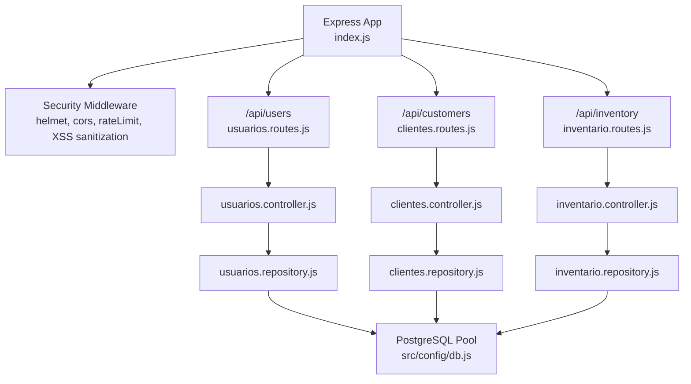
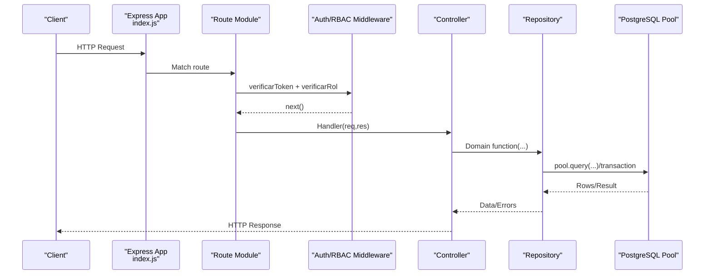
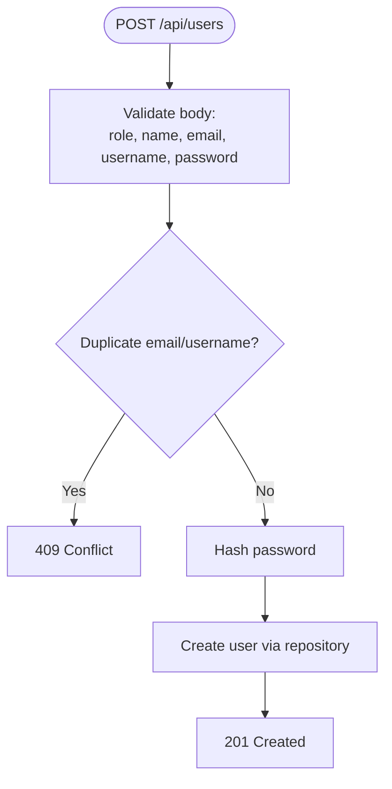
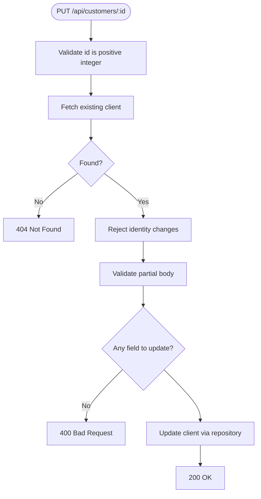
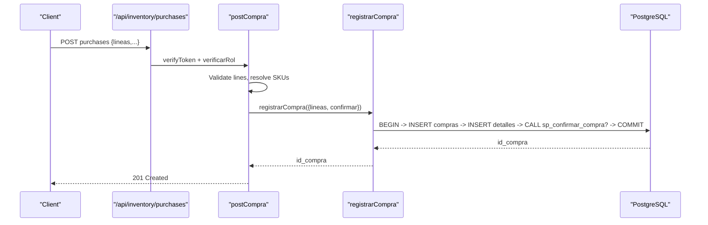
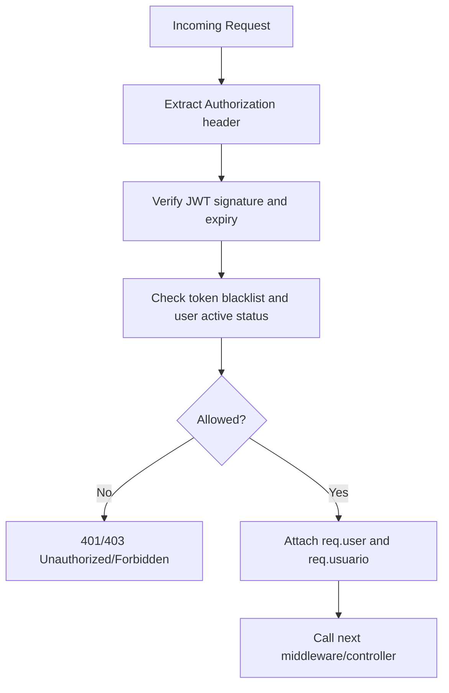
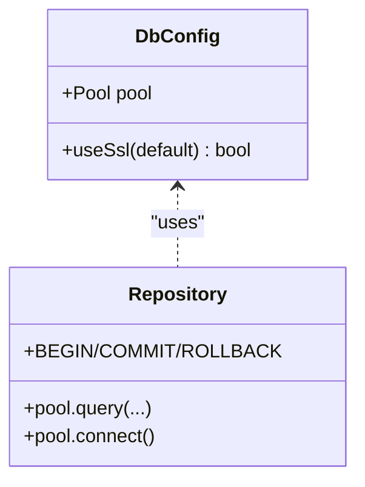
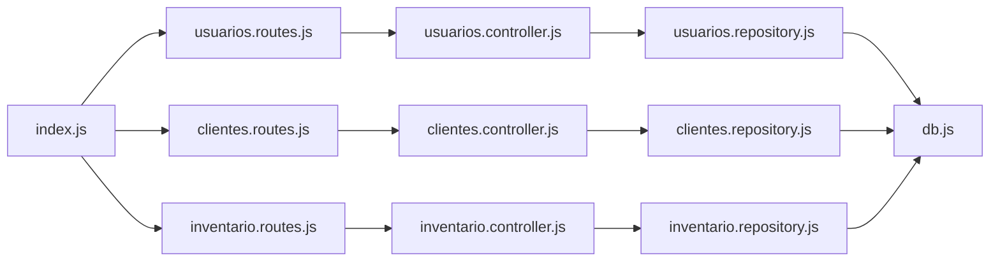

# MVC Pattern Implementation

<cite>
**Referenced Files in This Document**
- [index.js](file://backend/index.js)
- [authMiddleware.js](file://backend/middleware/authMiddleware.js)
- [db.js](file://backend/src/config/db.js)
- [clientes.controller.js](file://backend/src/controllers/clientes.controller.js)
- [inventario.controller.js](file://backend/src/controllers/inventario.controller.js)
- [usuarios.controller.js](file://backend/src/controllers/usuarios.controller.js)
- [clientes.repository.js](file://backend/src/repositories/clientes.repository.js)
- [inventario.repository.js](file://backend/src/repositories/inventario.repository.js)
- [usuarios.repository.js](file://backend/src/repositories/usuarios.repository.js)
- [clientes.routes.js](file://backend/src/routes/clientes.routes.js)
- [inventario.routes.js](file://backend/src/routes/inventario.routes.js)
- [usuarios.routes.js](file://backend/src/routes/usuarios.routes.js)
- [clientes.test.js](file://backend/tests/integracion/clientes.test.js)
- [inventario.test.js](file://backend/tests/integracion/inventario.test.js)
- [usuarios.test.js](file://backend/tests/integracion/usuarios.test.js)
</cite>

## Table of Contents
1. [Introduction](#introduction)
2. [Project Structure](#project-structure)
3. [Core Components](#core-components)
4. [Architecture Overview](#architecture-overview)
5. [Detailed Component Analysis](#detailed-component-analysis)
6. [Dependency Analysis](#dependency-analysis)
7. [Performance Considerations](#performance-considerations)
8. [Troubleshooting Guide](#troubleshooting-guide)
9. [Conclusion](#conclusion)

## Introduction
This document explains how SIMO’s backend implements the Model-View-Controller (MVC) pattern using Express.js. The application separates concerns into:
- Routes: HTTP endpoints that map to controller methods and apply authentication and authorization middleware.
- Controllers: Request validation, business rules, and coordination between repositories.
- Repositories: Database access with connection pooling, query composition, transactions, and concurrency controls.
- Configuration: Shared database pool and security settings.

The documentation focuses on how controllers handle business logic, how repositories abstract database operations, how routes map to controllers, and how data flows through each layer. It also covers error handling strategies and testing approaches for MVC components.

## Project Structure
The backend is organized by feature modules under src/controllers, src/repositories, and src/routes, with shared configuration and middleware at the top level. The application entry point wires global middleware, mounts route modules, and exposes health and legacy endpoints.

**Diagram sources**
- [index.js:17-56](file://backend/index.js#L17-L56)
- [usuarios.routes.js:1-18](file://backend/src/routes/usuarios.routes.js#L1-L18)
- [clientes.routes.js:1-27](file://backend/src/routes/clientes.routes.js#L1-L27)
- [inventario.routes.js:1-17](file://backend/src/routes/inventario.routes.js#L1-L17)
- [db.js:1-29](file://backend/src/config/db.js#L1-L29)

**Section sources**
- [index.js:17-56](file://backend/index.js#L17-L56)

## Core Components
- Route modules define endpoints and attach authentication and role-based access control (RBAC) middleware before invoking controller handlers.
- Controllers validate inputs, enforce business rules, and delegate persistence to repositories. They translate repository results into HTTP responses.
- Repositories encapsulate SQL queries, manage connections via a shared pool, implement transactions where needed, and expose domain-specific functions.
- Configuration provides a single PostgreSQL connection pool used across repositories.

Key responsibilities:
- Routes: URL-to-controller mapping, middleware composition, RBAC enforcement.
- Controllers: Input normalization/validation, business rule checks, response shaping.
- Repositories: Query building, parameter binding, transaction management, concurrency safeguards.
- Config: Connection pooling, SSL options, environment-driven configuration.

**Section sources**
- [clientes.routes.js:1-27](file://backend/src/routes/clientes.routes.js#L1-L27)
- [inventario.routes.js:1-17](file://backend/src/routes/inventario.routes.js#L1-L17)
- [usuarios.routes.js:1-18](file://backend/src/routes/usuarios.routes.js#L1-L18)
- [clientes.controller.js:1-283](file://backend/src/controllers/clientes.controller.js#L1-L283)
- [inventario.controller.js:1-269](file://backend/src/controllers/inventario.controller.js#L1-L269)
- [usuarios.controller.js:1-295](file://backend/src/controllers/usuarios.controller.js#L1-L295)
- [clientes.repository.js:1-131](file://backend/src/repositories/clientes.repository.js#L1-L131)
- [inventario.repository.js:1-102](file://backend/src/repositories/inventario.repository.js#L1-L102)
- [usuarios.repository.js:1-242](file://backend/src/repositories/usuarios.repository.js#L1-L242)
- [db.js:1-29](file://backend/src/config/db.js#L1-L29)

## Architecture Overview
The request lifecycle follows a clear MVC flow:
1. Client sends an HTTP request to an endpoint under /api.
2. Global middleware applies security headers, CORS, JSON parsing, XSS sanitization, and rate limiting.
3. Route module validates roles and invokes the corresponding controller method.
4. Controller validates input, enforces business rules, and calls repository functions.
5. Repository executes SQL against the PostgreSQL pool, optionally within transactions or advisory locks.
6. Controller maps repository results to HTTP responses with appropriate status codes.

**Diagram sources**
- [index.js:24-56](file://backend/index.js#L24-L56)
- [authMiddleware.js:9-75](file://backend/middleware/authMiddleware.js#L9-L75)
- [clientes.routes.js:18-24](file://backend/src/routes/clientes.routes.js#L18-L24)
- [inventario.routes.js:10-14](file://backend/src/routes/inventario.routes.js#L10-L14)
- [usuarios.routes.js:9-15](file://backend/src/routes/usuarios.routes.js#L9-L15)

## Detailed Component Analysis

### Users Module
Routes:
- POST /api/users: Create user (ADMIN only).
- GET /api/users: List users with pagination and filters (ADMIN, GERENTE).
- GET /api/users/:id: Get user detail (ADMIN, GERENTE).
- PUT /api/users/:id: Update user fields (ADMIN).
- PATCH /api/users/:id/status or /estado: Toggle active state (ADMIN).

Controllers:
- Validate required fields, email format, password length, role existence.
- Hash passwords before persisting.
- Prevent removing the last active admin during updates or state changes.
- Return normalized responses with public fields only.

Repositories:
- Provide functions for creation, listing with filters, lookup by ID, duplicate checks excluding self, update with advisory locking, and state change with advisory locking.
- Use transactions and FOR UPDATE locks to prevent race conditions when changing admin roles or deactivating the last admin.

**Diagram sources**
- [usuarios.controller.js:29-84](file://backend/src/controllers/usuarios.controller.js#L29-L84)
- [usuarios.repository.js:25-36](file://backend/src/repositories/usuarios.repository.js#L25-L36)

**Section sources**
- [usuarios.routes.js:1-18](file://backend/src/routes/usuarios.routes.js#L1-L18)
- [usuarios.controller.js:1-295](file://backend/src/controllers/usuarios.controller.js#L1-L295)
- [usuarios.repository.js:1-242](file://backend/src/repositories/usuarios.repository.js#L1-L242)

### Customers Module
Routes:
- POST /api/customers: Register client (VENDEDOR, GERENTE, ADMIN).
- GET /api/customers: List clients with search, status filter, pagination.
- GET /api/customers/document/:documento: Lookup by normalized document.
- GET /api/customers/:id: Lookup by ID.
- PUT /api/customers/:id: Edit contact fields; identity document immutable.
- GET /api/customers/:id/history: Sales and orders summary and lists.

Controllers:
- Normalize and validate documents, names, emails, phones, addresses.
- Enforce business rules such as immutable identity document and default active state on creation.
- Map database errors to HTTP statuses (e.g., conflict on duplicates, specific SQLSTATEs).

Repositories:
- Implement CRUD and list with dynamic WHERE clauses and parallel count/query.
- Provide history aggregation over sales and orders with limits.

**Diagram sources**
- [clientes.controller.js:213-247](file://backend/src/controllers/clientes.controller.js#L213-L247)
- [clientes.repository.js:71-81](file://backend/src/repositories/clientes.repository.js#L71-L81)

**Section sources**
- [clientes.routes.js:1-27](file://backend/src/routes/clientes.routes.js#L1-L27)
- [clientes.controller.js:1-283](file://backend/src/controllers/clientes.controller.js#L1-L283)
- [clientes.repository.js:1-131](file://backend/src/repositories/clientes.repository.js#L1-L131)

### Inventory Module
Routes:
- POST /api/inventory/entries: Record stock entry to warehouse (INVENTARIO, ADMIN).
- POST /api/inventory/purchases: Create purchase with multiple lines; optional confirmation.
- GET /api/inventory/purchases/:id: Retrieve purchase with lines.

Controllers:
- Validate quantities, costs, references, and line items.
- Resolve product IDs from SKU if provided.
- Map business errors (SQLSTATE SM*) to HTTP statuses.

Repositories:
- Call stored functions/procedures for atomic stock updates.
- Manage multi-step purchases within transactions; confirm via procedure if requested.
- Batch-check product existence and build SKU-to-ID maps.

**Diagram sources**
- [inventario.controller.js:163-247](file://backend/src/controllers/inventario.controller.js#L163-L247)
- [inventario.repository.js:32-62](file://backend/src/repositories/inventario.repository.js#L32-L62)

**Section sources**
- [inventario.routes.js:1-17](file://backend/src/routes/inventario.routes.js#L1-L17)
- [inventario.controller.js:1-269](file://backend/src/controllers/inventario.controller.js#L1-L269)
- [inventario.repository.js:1-102](file://backend/src/repositories/inventario.repository.js#L1-L102)

### Authentication and Authorization
- Token verification extracts user info, checks blacklist, and ensures account is active.
- Role checking allows numeric IDs or role codes.
- Controllers receive req.user populated by middleware.

**Diagram sources**
- [authMiddleware.js:9-75](file://backend/middleware/authMiddleware.js#L9-L75)

**Section sources**
- [authMiddleware.js:1-81](file://backend/middleware/authMiddleware.js#L1-L81)

### Database Abstraction and Connection Management
- A shared PostgreSQL pool is configured via environment variables (DATABASE_URL or DB_*), with SSL toggling.
- Repositories use pool.query for simple operations and pool.connect for explicit transactions.
- Transactions include BEGIN/COMMIT/ROLLBACK and release connections in finally blocks.
- Advisory locks protect critical sections (e.g., preventing removal of the last active admin).

**Diagram sources**
- [db.js:1-29](file://backend/src/config/db.js#L1-L29)
- [inventario.repository.js:32-62](file://backend/src/repositories/inventario.repository.js#L32-L62)
- [usuarios.repository.js:115-172](file://backend/src/repositories/usuarios.repository.js#L115-L172)
- [usuarios.repository.js:178-230](file://backend/src/repositories/usuarios.repository.js#L178-L230)

**Section sources**
- [db.js:1-29](file://backend/src/config/db.js#L1-L29)
- [inventario.repository.js:32-62](file://backend/src/repositories/inventario.repository.js#L32-L62)
- [usuarios.repository.js:115-172](file://backend/src/repositories/usuarios.repository.js#L115-L172)
- [usuarios.repository.js:178-230](file://backend/src/repositories/usuarios.repository.js#L178-L230)

## Dependency Analysis
High-level dependencies:
- index.js depends on route modules and global middleware.
- Route modules depend on controllers and auth middleware.
- Controllers depend on repositories.
- Repositories depend on db.js pool.

**Diagram sources**
- [index.js:1-16](file://backend/index.js#L1-L16)
- [usuarios.routes.js:1-18](file://backend/src/routes/usuarios.routes.js#L1-L18)
- [clientes.routes.js:1-27](file://backend/src/routes/clientes.routes.js#L1-L27)
- [inventario.routes.js:1-17](file://backend/src/routes/inventario.routes.js#L1-L17)
- [db.js:1-29](file://backend/src/config/db.js#L1-L29)

**Section sources**
- [index.js:1-16](file://backend/index.js#L1-L16)

## Performance Considerations
- Pagination: All list endpoints support page and limit parameters; repositories compute offset and total counts efficiently.
- Parallel queries: Repositories use Promise.all for concurrent count and data queries to reduce latency.
- Transactional integrity: Critical operations wrap multiple statements in transactions to avoid partial updates.
- Concurrency protection: Advisory locks serialize sensitive admin operations to prevent race conditions.
- Parameterized queries: All SQL uses parameter binding to prevent injection and leverage prepared statements.
- Minimal payload exposure: Public columns are selected explicitly; secrets like password_hash are never returned.

[No sources needed since this section provides general guidance]

## Troubleshooting Guide
Common issues and resolutions:
- 401 Unauthorized: Missing or malformed Authorization header; fix by including Bearer token.
- 403 Forbidden: Invalid/expired token or insufficient role; refresh token or adjust role assignment.
- 409 Conflict: Duplicate entities (users, customers) or business rule violations (last admin); ensure uniqueness or add another admin.
- 404 Not Found: Invalid IDs or non-existent resources; verify identifiers.
- 400 Bad Request: Validation failures (missing fields, invalid formats, out-of-range values); correct request body.
- Database errors: Check SQLSTATE codes (e.g., 23505 unique violation, 23503 foreign key violation) and map to appropriate HTTP responses.

Testing approach:
- Integration tests spawn the server on a test port, authenticate as seeded roles, and assert API contracts and database state.
- Tests cover success paths, validation errors, concurrency scenarios, and RBAC enforcement.
- Cleanup routines deactivate or remove test data to keep the database consistent across runs.

**Section sources**
- [clientes.test.js:1-256](file://backend/tests/integracion/clientes.test.js#L1-L256)
- [inventario.test.js:1-297](file://backend/tests/integracion/inventario.test.js#L1-L297)
- [usuarios.test.js:1-366](file://backend/tests/integracion/usuarios.test.js#L1-L366)

## Conclusion
SIMO’s backend cleanly implements MVC with Express.js:
- Routes declare endpoints and enforce authentication and authorization.
- Controllers centralize validation and business logic while delegating persistence to repositories.
- Repositories encapsulate database interactions, ensuring safe transactions and concurrency controls.
- Error handling is consistent across layers, translating domain and database errors into meaningful HTTP responses.
- Comprehensive integration tests validate behavior, contracts, and concurrency guarantees.

This separation of concerns improves maintainability, testability, and scalability of the system.