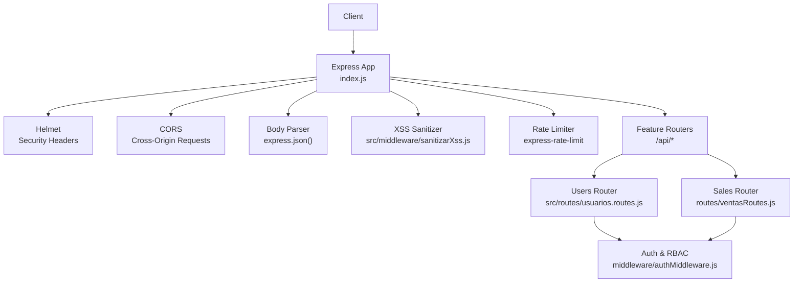
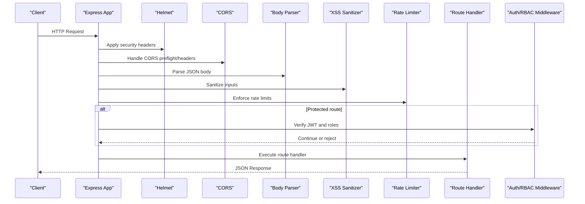
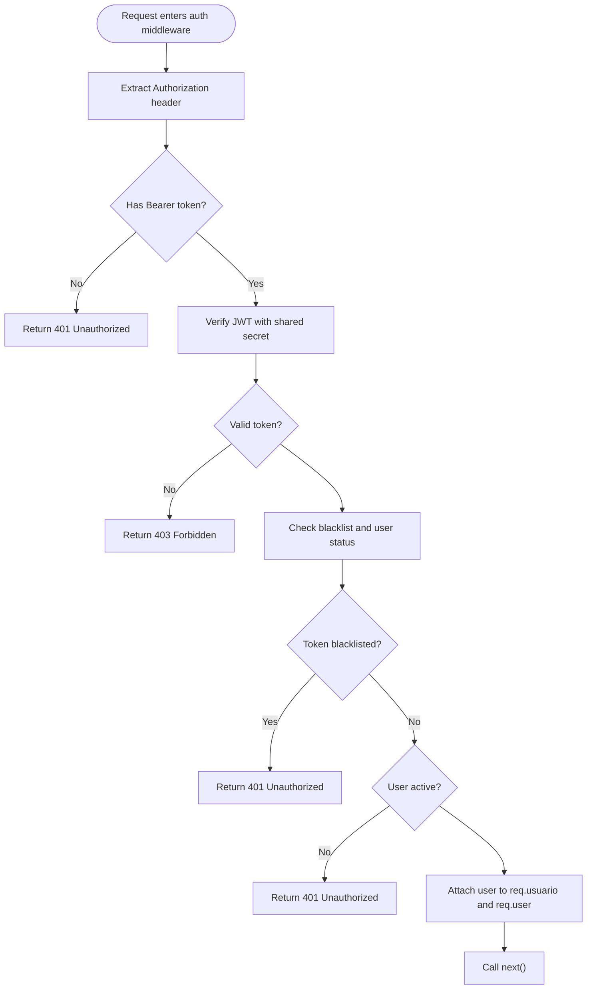
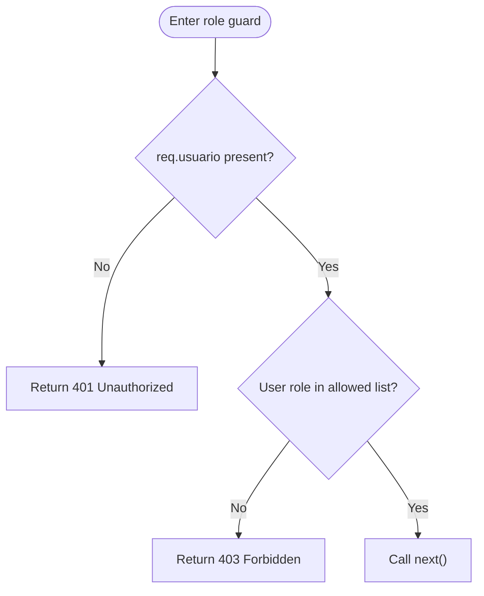
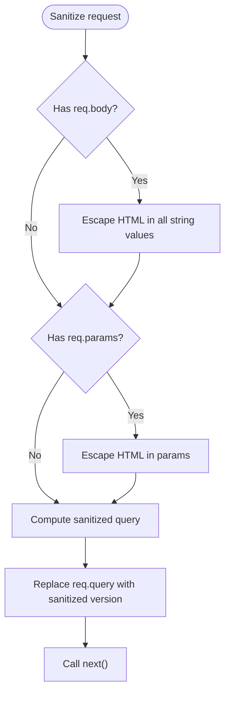
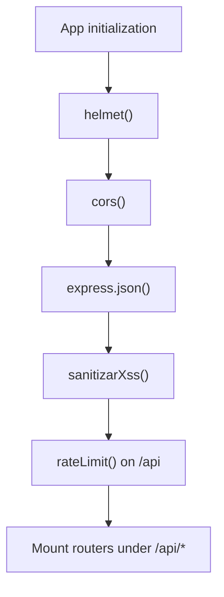
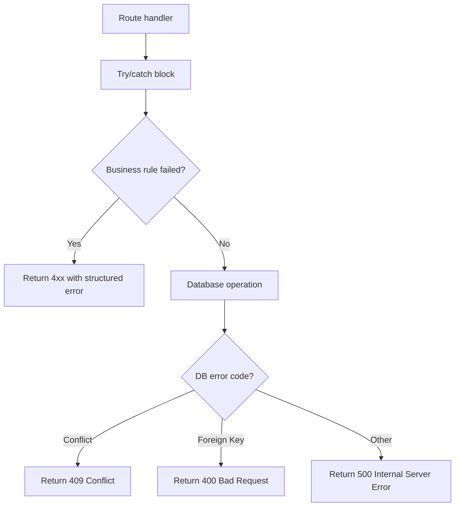
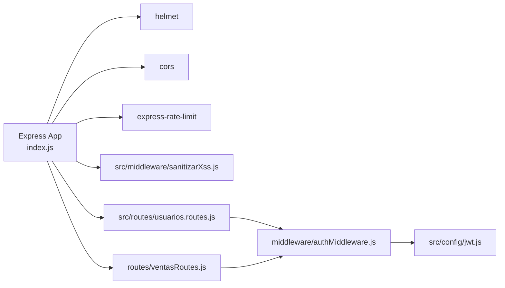

# Middleware Architecture

<cite>
**Referenced Files in This Document**
- [index.js](file://backend/index.js)
- [authMiddleware.js](file://backend/middleware/authMiddleware.js)
- [sanitizarXss.js (src)](file://backend/src/middleware/sanitizarXss.js)
- [sanitizarXss.js (root middleware)](file://backend/middleware/sanitizarXss.js)
- [jwt.js](file://backend/src/config/jwt.js)
- [usuarios.routes.js](file://backend/src/routes/usuarios.routes.js)
- [ventasRoutes.js](file://backend/routes/ventasRoutes.js)
</cite>

## Table of Contents
1. [Introduction](#introduction)
2. [Project Structure](#project-structure)
3. [Core Components](#core-components)
4. [Architecture Overview](#architecture-overview)
5. [Detailed Component Analysis](#detailed-component-analysis)
6. [Dependency Analysis](#dependency-analysis)
7. [Performance Considerations](#performance-considerations)
8. [Troubleshooting Guide](#troubleshooting-guide)
9. [Conclusion](#conclusion)

## Introduction
This document explains the middleware architecture of SIMO’s Express.js backend. It focuses on:
- Authentication and role-based access control using JWT
- XSS sanitization for input validation and security
- Request/response processing pipeline, including CORS, rate limiting, and security headers
- Error handling and response formatting across the middleware chain
- Middleware composition, execution order, and guidance for custom middleware development

The goal is to make the system understandable for both technical and non-technical readers while providing precise references to the source code.

## Project Structure
The backend application is an Express server that composes global middleware early in startup and mounts feature routers under /api prefixes. Security-related middleware runs before route handlers to ensure requests are sanitized, rate-limited, and authenticated where required.

**Diagram sources**
- [index.js:24-56](file://backend/index.js#L24-L56)
- [usuarios.routes.js:1-17](file://backend/src/routes/usuarios.routes.js#L1-L17)
- [ventasRoutes.js:1-12](file://backend/routes/ventasRoutes.js#L1-L12)

**Section sources**
- [index.js:1-56](file://backend/index.js#L1-L56)

## Core Components
- Authentication and RBAC middleware: validates JWT tokens, checks session blacklists, enforces user status, and restricts routes by roles.
- XSS sanitization middleware: escapes dangerous HTML characters in request bodies, query strings, and URL parameters.
- Global security and configuration: Helmet for security headers, CORS for cross-origin access, body parser for JSON payloads, and rate limiter for request throttling.
- Route-level integration: routers compose authentication and authorization guards before controller logic.

Key responsibilities:
- Validate incoming requests early and safely
- Protect sensitive endpoints with token verification and role checks
- Standardize error responses and maintain consistent API contracts
- Provide a clear extension point for adding new middleware

**Section sources**
- [authMiddleware.js:1-80](file://backend/middleware/authMiddleware.js#L1-L80)
- [sanitizarXss.js (src):1-47](file://backend/src/middleware/sanitizarXss.js#L1-L47)
- [index.js:24-56](file://backend/index.js#L24-L56)

## Architecture Overview
The request lifecycle flows through a well-defined sequence of middleware layers before reaching route handlers. The order matters because each layer transforms or validates the request and may short-circuit the pipeline.

**Diagram sources**
- [index.js:24-56](file://backend/index.js#L24-L56)
- [authMiddleware.js:9-49](file://backend/middleware/authMiddleware.js#L9-L49)

## Detailed Component Analysis

### Authentication and Role-Based Access Control
The authentication middleware performs:
- Token extraction from Authorization header
- JWT signature verification using a shared secret
- Session invalidation check via a blacklist table
- User account active/inactive enforcement
- Attaching decoded user data to the request object
- Role-based authorization guard supporting numeric IDs and role codes

**Diagram sources**
- [authMiddleware.js:9-49](file://backend/middleware/authMiddleware.js#L9-L49)

Role-based access control:
- The role guard accepts either numeric role IDs or role codes
- It denies access when the user’s role does not match the allowed set
- Routes can combine multiple guards to enforce fine-grained permissions

**Diagram sources**
- [authMiddleware.js:57-74](file://backend/middleware/authMiddleware.js#L57-L74)

Integration examples:
- Users router applies authentication and admin-only guards for write operations
- Sales router allows admins and sellers for specific endpoints

**Section sources**
- [authMiddleware.js:1-80](file://backend/middleware/authMiddleware.js#L1-L80)
- [usuarios.routes.js:1-17](file://backend/src/routes/usuarios.routes.js#L1-L17)
- [ventasRoutes.js:10-11](file://backend/routes/ventasRoutes.js#L10-L11)

### XSS Sanitization Middleware
Two implementations exist:
- src/middleware/sanitizarXss.js: Escapes a broader set of HTML-sensitive characters and recursively sanitizes nested objects and arrays.
- middleware/sanitizarXss.js: A lighter implementation focused on replacing angle brackets and compatible with Express 5’s read-only req.query getter.

The active sanitizer used by the app is imported from src/middleware/sanitizarXss.js and applied globally.

**Diagram sources**
- [sanitizarXss.js (src):11-44](file://backend/src/middleware/sanitizarXss.js#L11-L44)

Notes:
- The sanitizer ensures potentially dangerous characters are escaped before they reach controllers or database queries
- It supports arrays and nested objects to sanitize complex payloads
- Compatibility with Express 5 is addressed by carefully handling req.query

**Section sources**
- [sanitizarXss.js (src):1-47](file://backend/src/middleware/sanitizarXss.js#L1-L47)
- [sanitizarXss.js (root middleware):1-38](file://backend/middleware/sanitizarXss.js#L1-L38)

### Request/Response Processing Pipeline
Global middleware setup includes:
- Helmet for security headers
- CORS for cross-origin requests
- JSON body parsing
- XSS sanitization
- Rate limiting per IP on /api routes

**Diagram sources**
- [index.js:24-56](file://backend/index.js#L24-L56)

CORS configuration:
- Enabled globally with default settings; adjust origins and methods if needed for stricter policies.

Rate limiting:
- Configured for 1-minute windows with a configurable maximum number of requests per IP
- Returns a standardized error message when exceeded

Security headers:
- Helmet sets recommended headers automatically

**Section sources**
- [index.js:24-56](file://backend/index.js#L24-L56)

### Error Handling and Response Formatting
Error handling patterns observed:
- Controllers and route handlers return structured JSON errors with error and message fields
- Database-specific errors are mapped to appropriate HTTP status codes
- Authentication middleware returns consistent unauthorized/forbidden responses
- Logout endpoint handles duplicate blacklist entries gracefully

Response format conventions:
- Success responses include a message and payload
- Error responses include error and message fields
- Status codes follow REST conventions (400, 401, 403, 404, 409, 500)

**Diagram sources**
- [index.js:75-151](file://backend/index.js#L75-L151)
- [index.js:347-423](file://backend/index.js#L347-L423)
- [index.js:428-469](file://backend/index.js#L428-L469)

**Section sources**
- [index.js:75-151](file://backend/index.js#L75-L151)
- [index.js:347-423](file://backend/index.js#L347-L423)
- [index.js:428-469](file://backend/index.js#L428-L469)

### Middleware Composition and Execution Order
Recommended order:
1. Helmet (security headers)
2. CORS (cross-origin policy)
3. Body parser (JSON parsing)
4. XSS sanitizer (input sanitization)
5. Rate limiter (throttling)
6. Feature routers (with route-level auth guards)

Why this order matters:
- Security headers should be set early
- CORS must run before route handlers to handle preflight requests
- Body parsing must occur before sanitization so the sanitizer can process parsed data
- Sanitization must precede business logic to prevent injection
- Rate limiting protects downstream logic and databases

Custom middleware development guidelines:
- Keep middleware single-purpose and stateless where possible
- Use req and res extensions judiciously (e.g., attach user info after authentication)
- Always call next() unless returning a response
- Return structured error responses following the established convention

**Section sources**
- [index.js:24-56](file://backend/index.js#L24-L56)
- [authMiddleware.js:47-49](file://backend/middleware/authMiddleware.js#L47-L49)

## Dependency Analysis
The middleware stack depends on several external packages and internal modules:

**Diagram sources**
- [index.js:1-15](file://backend/index.js#L1-L15)
- [usuarios.routes.js:1-17](file://backend/src/routes/usuarios.routes.js#L1-L17)
- [ventasRoutes.js:1-12](file://backend/routes/ventasRoutes.js#L1-L12)
- [authMiddleware.js:1-4](file://backend/middleware/authMiddleware.js#L1-L4)
- [jwt.js:1-15](file://backend/src/config/jwt.js#L1-L15)

Coupling and cohesion:
- Authentication middleware is cohesive around JWT validation and RBAC
- XSS sanitizer is isolated and reusable across routes
- Global middleware is centralized in index.js for clarity and maintainability

Potential circular dependencies:
- None detected between middleware and routers; routers depend on middleware but not vice versa

External dependencies:
- helmet, cors, express-rate-limit provide core security and performance features
- jsonwebtoken provides token signing and verification
- bcrypt secures password storage during login

**Section sources**
- [index.js:1-15](file://backend/index.js#L1-L15)
- [authMiddleware.js:1-4](file://backend/middleware/authMiddleware.js#L1-L4)
- [jwt.js:1-15](file://backend/src/config/jwt.js#L1-L15)

## Performance Considerations
- Rate limiting reduces load spikes and mitigates abuse; tune windowMs and max based on expected traffic
- Helmet adds minimal overhead but improves security posture significantly
- XSS sanitization traverses request payloads; keep payloads concise and avoid deeply nested structures where possible
- Avoid unnecessary logging in hot paths; use structured logs at appropriate levels
- Prefer parameterized queries and efficient database operations to reduce latency

[No sources needed since this section provides general guidance]

## Troubleshooting Guide
Common issues and resolutions:
- Unauthorized responses without valid token: Ensure clients send Authorization: Bearer <token>
- Forbidden due to inactive user: Verify user status and re-enable accounts as needed
- Too Many Requests: Increase RATE_LIMIT_MAX for testing or optimize client retry behavior
- XSS sanitization affecting legitimate data: Review sanitizer scope and consider allowing safe HTML via a dedicated allowlist if necessary
- CORS errors: Configure CORS origins explicitly to match frontend domains

Debugging steps:
- Inspect request headers and payload structure
- Check environment variables for JWT_SECRET and RATE_LIMIT_MAX
- Validate database connectivity and blacklist table integrity
- Review route-level guards to ensure correct roles are permitted

**Section sources**
- [authMiddleware.js:9-49](file://backend/middleware/authMiddleware.js#L9-L49)
- [index.js:35-48](file://backend/index.js#L35-L48)

## Conclusion
SIMO’s middleware architecture emphasizes security, clarity, and extensibility. Authentication and RBAC protect sensitive endpoints, while XSS sanitization hardens input handling. Global middleware establishes a robust baseline for headers, CORS, parsing, and rate limiting. Consistent error responses and structured middleware composition make the system easier to maintain and extend. Following the documented patterns will help developers add new features safely and predictably.

[No sources needed since this section summarizes without analyzing specific files]