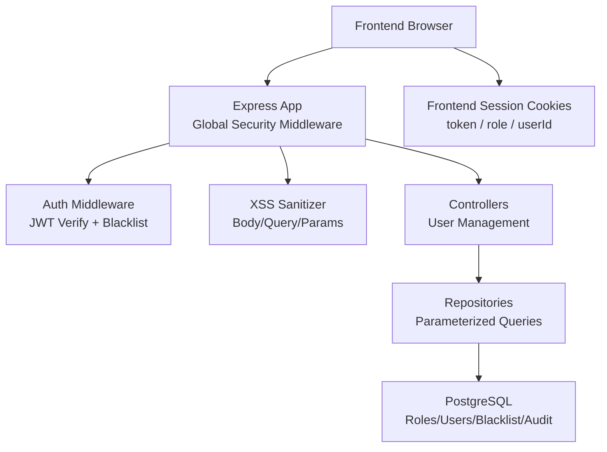
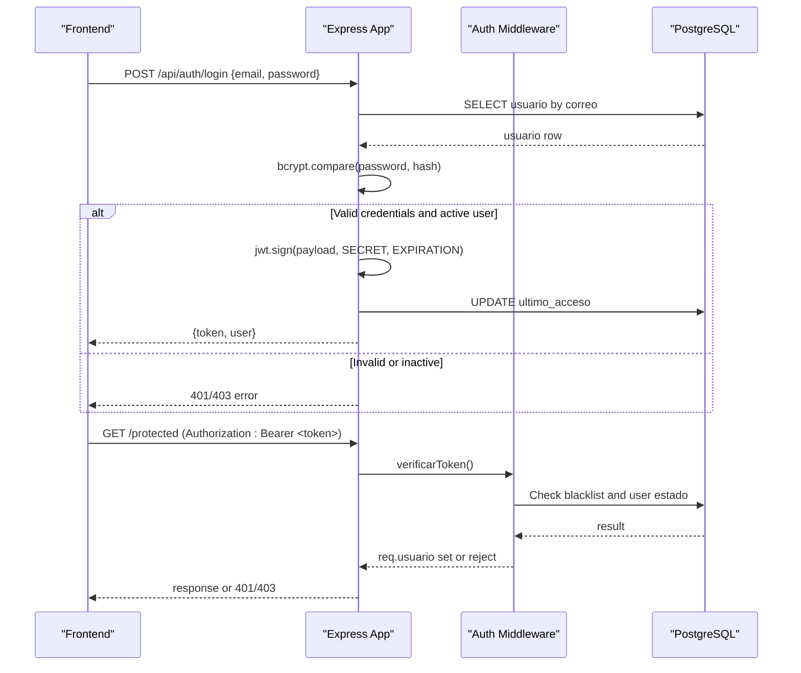
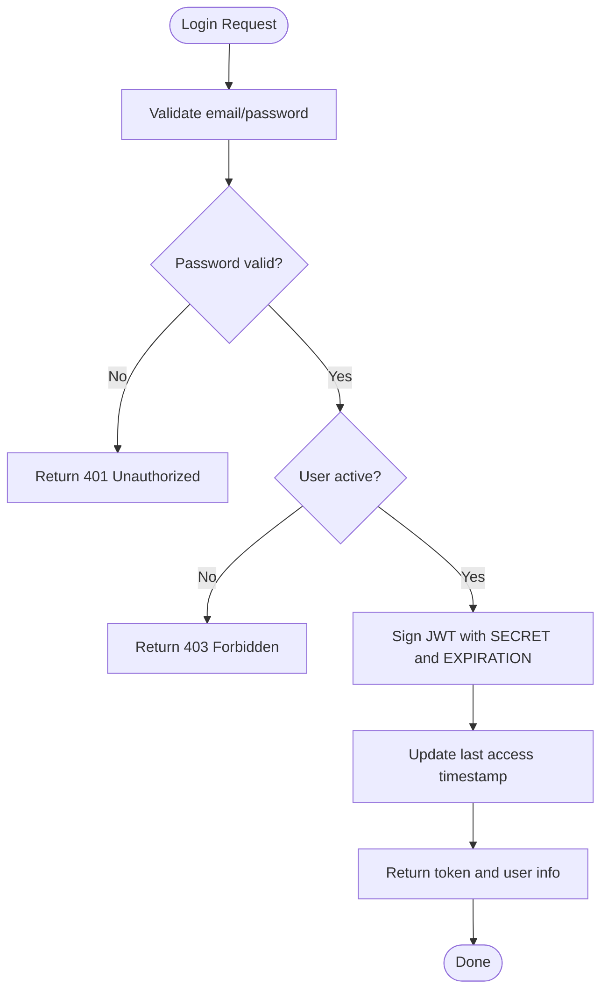
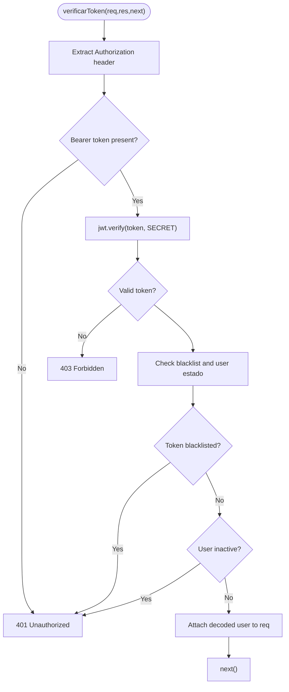
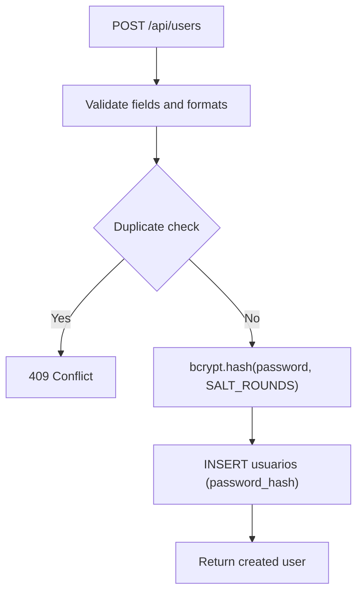
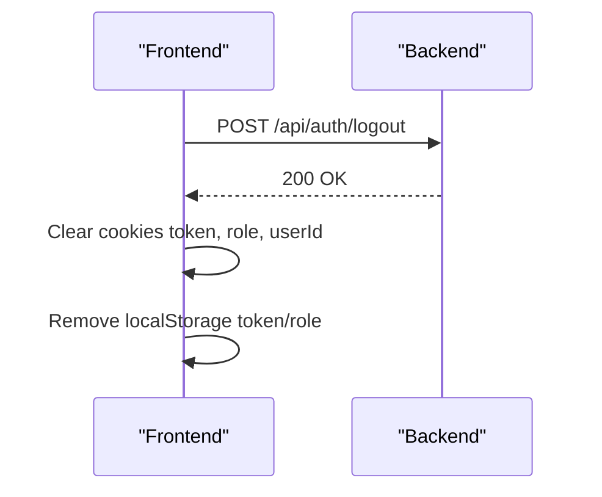
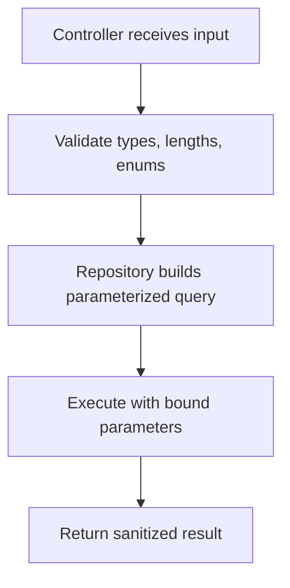
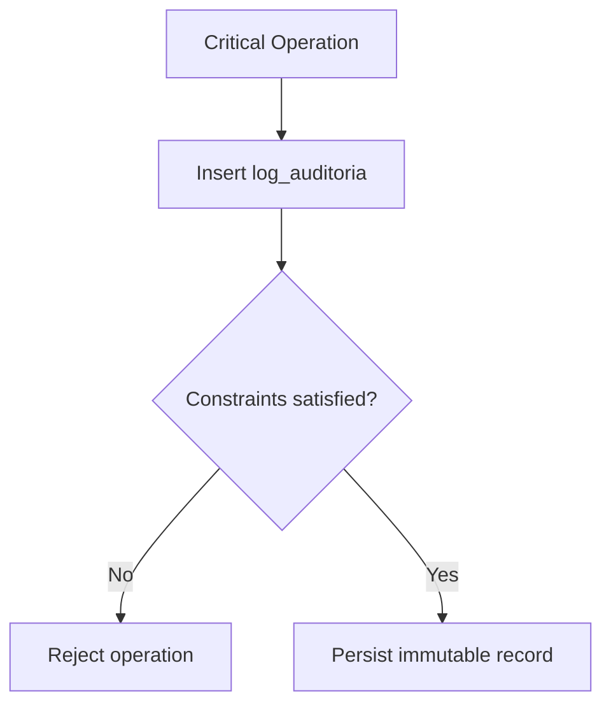
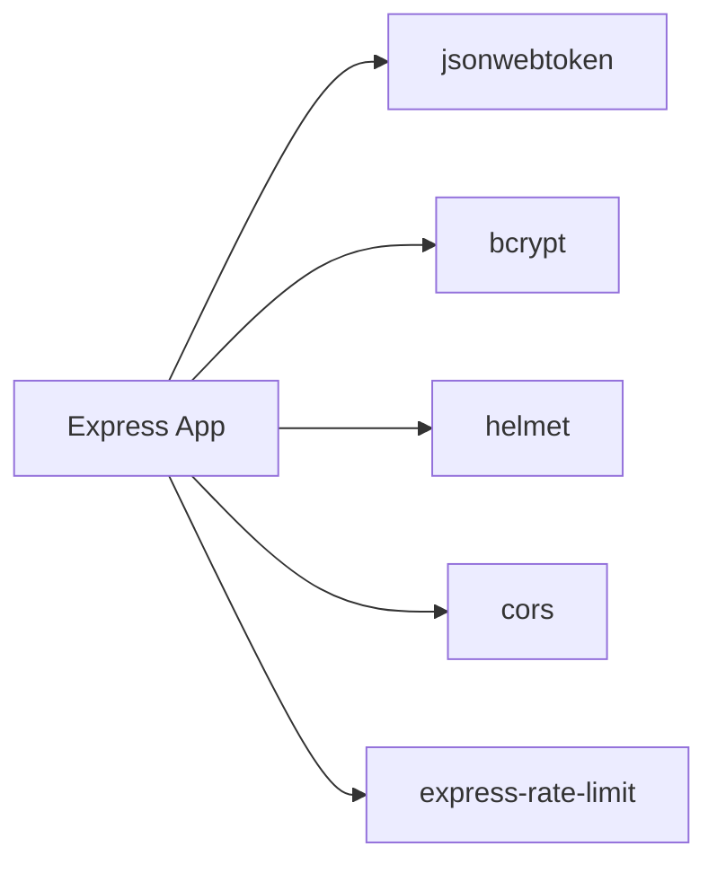

# Security Implementation

<cite>
**Referenced Files in This Document**
- [index.js](file://backend/index.js)
- [jwt.js](file://backend/src/config/jwt.js)
- [authMiddleware.js](file://backend/middleware/authMiddleware.js)
- [sanitizarXss.js (root middleware)](file://backend/middleware/sanitizarXss.js)
- [sanitizarXss.js (src middleware)](file://backend/src/middleware/sanitizarXss.js)
- [usuarios.controller.js](file://backend/src/controllers/usuarios.controller.js)
- [usuarios.repository.js](file://backend/src/repositories/usuarios.repository.js)
- [002_seguridad.sql](file://backend/db/migrations/002_seguridad.sql)
- [010_sesiones.sql](file://backend/db/migrations/010_sesiones.sql)
- [sesion.ts](file://simoapp/lib/auth/sesion.ts)
</cite>

## Table of Contents
1. [Introduction](#introduction)
2. [Project Structure](#project-structure)
3. [Core Components](#core-components)
4. [Architecture Overview](#architecture-overview)
5. [Detailed Component Analysis](#detailed-component-analysis)
6. [Dependency Analysis](#dependency-analysis)
7. [Performance Considerations](#performance-considerations)
8. [Troubleshooting Guide](#troubleshooting-guide)
9. [Conclusion](#conclusion)

## Introduction
This document explains the security implementation in SIMO’s backend. It covers JWT token generation, validation, and logout invalidation; password hashing with bcrypt; session management and cookie handling on the frontend; XSS protection through input sanitization; SQL injection prevention via parameterized queries; parameter validation; CORS configuration; rate limiting; security headers via Helmet; HTTPS enforcement guidance; sensitive data encryption practices; audit trails; logging of security events; and vulnerability assessment recommendations. It also provides secure coding patterns and common anti-patterns to avoid.

## Project Structure
The security-relevant parts are concentrated in:
- Application bootstrap and global security middleware
- JWT configuration and authentication middleware
- Input sanitization middleware
- User controller and repository for password hashing and safe database access
- Database migrations for roles, users, sessions, and audit tables
- Frontend session cookie management



**Diagram sources**
- [index.js:1-48](file://backend/index.js#L1-L48)
- [authMiddleware.js:1-81](file://backend/middleware/authMiddleware.js#L1-L81)
- [sanitizarXss.js (root middleware):1-39](file://backend/middleware/sanitizarXss.js#L1-L39)
- [usuarios.controller.js:1-295](file://backend/src/controllers/usuarios.controller.js#L1-L295)
- [usuarios.repository.js:1-242](file://backend/src/repositories/usuarios.repository.js#L1-L242)
- [002_seguridad.sql:1-91](file://backend/db/migrations/002_seguridad.sql#L1-L91)
- [010_sesiones.sql:1-20](file://backend/db/migrations/010_sesiones.sql#L1-L20)
- [sesion.ts:1-59](file://simoapp/lib/auth/sesion.ts#L1-L59)

**Section sources**
- [index.js:1-56](file://backend/index.js#L1-L56)

## Core Components
- JWT configuration: centralized secret and expiration used by login and verification.
- Authentication middleware: validates tokens, checks blacklist, enforces user active state, and supports RBAC.
- Password hashing: bcrypt with salt rounds applied during user creation and comparison at login.
- Input sanitization: custom XSS sanitizer compatible with Express 5.
- Parameterized queries: all database operations use parameter binding to prevent SQL injection.
- Rate limiting: per-IP request throttling on API routes.
- Security headers: Helmet sets recommended HTTP security headers.
- Audit trail: immutable audit table enforced by database triggers and constraints.

**Section sources**
- [jwt.js:1-16](file://backend/src/config/jwt.js#L1-L16)
- [authMiddleware.js:1-81](file://backend/middleware/authMiddleware.js#L1-L81)
- [usuarios.controller.js:1-84](file://backend/src/controllers/usuarios.controller.js#L1-L84)
- [usuarios.repository.js:1-242](file://backend/src/repositories/usuarios.repository.js#L1-L242)
- [sanitizarXss.js (root middleware):1-39](file://backend/middleware/sanitizarXss.js#L1-L39)
- [index.js:24-48](file://backend/index.js#L24-L48)
- [002_seguridad.sql:40-66](file://backend/db/migrations/002_seguridad.sql#L40-L66)
- [010_sesiones.sql:10-19](file://backend/db/migrations/010_sesiones.sql#L10-L19)

## Architecture Overview
The backend applies a layered security model:
- Global middleware secures HTTP responses and limits request volume.
- Route-level middleware protects endpoints with JWT and RBAC.
- Controllers validate inputs and delegate to repositories.
- Repositories perform parameterized queries against PostgreSQL.
- The frontend manages session cookies that mirror the backend’s JWT lifecycle.



**Diagram sources**
- [index.js:347-423](file://backend/index.js#L347-L423)
- [index.js:428-469](file://backend/index.js#L428-L469)
- [authMiddleware.js:9-50](file://backend/middleware/authMiddleware.js#L9-L50)
- [010_sesiones.sql:10-19](file://backend/db/migrations/010_sesiones.sql#L10-L19)

## Detailed Component Analysis

### JWT Token Lifecycle
- Generation: Login endpoint signs a payload containing user identifiers and role information using a shared secret and expiration from the centralized JWT config.
- Validation: Authentication middleware verifies the token signature, checks the blacklist, and ensures the user is still active.
- Logout: The logout endpoint inserts the token into a blacklist table so it cannot be reused even if not expired.



**Diagram sources**
- [index.js:347-423](file://backend/index.js#L347-L423)
- [jwt.js:11-15](file://backend/src/config/jwt.js#L11-L15)

**Section sources**
- [index.js:347-423](file://backend/index.js#L347-L423)
- [jwt.js:1-16](file://backend/src/config/jwt.js#L1-L16)

### Token Verification and Role-Based Access Control
- The middleware extracts the bearer token, verifies its signature, and rejects invalid or expired tokens.
- It queries the blacklist and user status to enforce immediate revocation and deactivation.
- A role-checking helper allows route-level authorization based on role IDs or codes.



**Diagram sources**
- [authMiddleware.js:9-50](file://backend/middleware/authMiddleware.js#L9-L50)

**Section sources**
- [authMiddleware.js:1-81](file://backend/middleware/authMiddleware.js#L1-L81)

### Password Hashing with bcrypt
- User creation hashes passwords with bcrypt before storing them.
- Login compares provided passwords against stored hashes.
- The schema stores only hashed values and never returns them in API responses.



**Diagram sources**
- [usuarios.controller.js:29-84](file://backend/src/controllers/usuarios.controller.js#L29-L84)
- [002_seguridad.sql:40-58](file://backend/db/migrations/002_seguridad.sql#L40-L58)

**Section sources**
- [usuarios.controller.js:1-84](file://backend/src/controllers/usuarios.controller.js#L1-L84)
- [002_seguridad.sql:40-58](file://backend/db/migrations/002_seguridad.sql#L40-L58)

### Session Management and Secure Cookie Handling
- The frontend stores three cookies after login: token, role, and userId.
- Cookies are written with SameSite=Lax and an explicit max-age matching the backend token lifetime.
- Logout clears these cookies and removes legacy localStorage entries.



**Diagram sources**
- [index.js:428-469](file://backend/index.js#L428-L469)
- [sesion.ts:32-48](file://simoapp/lib/auth/sesion.ts#L32-L48)

**Section sources**
- [sesion.ts:1-59](file://simoapp/lib/auth/sesion.ts#L1-L59)
- [index.js:428-469](file://backend/index.js#L428-L469)

### XSS Protection Through Input Sanitization
- Two sanitizers exist: one in root middleware and another under src/middleware. Both recursively escape dangerous HTML characters in body, query, and params.
- The root version adapts to Express 5 where req.query is read-only by defining a new property.

```mermaid
flowchart TD
Req["Incoming Request"] --> Body["req.body"]
Req --> Params["req.params"]
Req --> Query["req.query"]
Body --> Escape["Escape < > & \" ' /"]
Params --> Escape
Query --> Escape
Escape --> Cleaned["Cleaned values"]
```

**Diagram sources**
- [sanitizarXss.js (root middleware):13-35](file://backend/middleware/sanitizarXss.js#L13-L35)
- [sanitizarXss.js (src middleware):11-45](file://backend/src/middleware/sanitizarXss.js#L11-L45)

**Section sources**
- [sanitizarXss.js (root middleware):1-39](file://backend/middleware/sanitizarXss.js#L1-L39)
- [sanitizarXss.js (src middleware):1-47](file://backend/src/middleware/sanitizarXss.js#L1-L47)

### SQL Injection Prevention and Parameter Validation
- All database interactions use parameterized queries with positional placeholders.
- Controllers validate types, ranges, and formats before calling repositories.
- Repositories build dynamic WHERE clauses safely by appending parameters rather than concatenating strings.



**Diagram sources**
- [usuarios.controller.js:90-143](file://backend/src/controllers/usuarios.controller.js#L90-L143)
- [usuarios.repository.js:38-85](file://backend/src/repositories/usuarios.repository.js#L38-L85)

**Section sources**
- [usuarios.controller.js:86-143](file://backend/src/controllers/usuarios.controller.js#L86-L143)
- [usuarios.repository.js:38-85](file://backend/src/repositories/usuarios.repository.js#L38-L85)

### CORS Policy Configuration
- CORS is enabled globally with default settings. For production, restrict allowed origins, methods, and headers to the frontend domain.

**Section sources**
- [index.js:27-29](file://backend/index.js#L27-L29)

### Rate Limiting for API Protection
- A global rate limiter applies to all /api routes, allowing 100 requests per minute by default, configurable via environment variable.

**Section sources**
- [index.js:34-48](file://backend/index.js#L34-L48)

### DDoS Mitigation Strategies
- Rate limiting helps mitigate basic abuse. Additional strategies include:
  - Using a reverse proxy (e.g., Nginx) with connection limits and request size caps.
  - Enabling IP-based allowlists for admin endpoints.
  - Integrating a Web Application Firewall (WAF) at the edge.
  - Monitoring and alerting on abnormal traffic patterns.

[No sources needed since this section provides general guidance]

### Security Headers Implementation
- Helmet is applied globally to set recommended HTTP security headers such as Content-Security-Policy, X-Frame-Options, and Strict-Transport-Security.

**Section sources**
- [index.js:24-25](file://backend/index.js#L24-L25)

### HTTPS Enforcement
- The application listens on HTTP by default. To enforce HTTPS:
  - Terminate TLS at a reverse proxy or cloud load balancer.
  - Configure HSTS via Helmet and redirect HTTP to HTTPS.
  - Ensure secure cookie flags (Secure, HttpOnly, SameSite=Strict) when cookies are used server-side.

[No sources needed since this section provides general guidance]

### Sensitive Data Encryption
- Passwords are hashed with bcrypt; never store or return plaintext secrets.
- Use environment variables for secrets (JWT_SECRET). Avoid hardcoding secrets in code.
- Encrypt sensitive fields at rest if required by policy, using a KMS-backed solution.

**Section sources**
- [jwt.js:5-15](file://backend/src/config/jwt.js#L5-L15)
- [usuarios.controller.js:63-70](file://backend/src/controllers/usuarios.controller.js#L63-L70)

### Security Audit Trails and Logging
- An immutable audit table records critical operations with constraints requiring justifications and authorizers where applicable.
- Triggers prevent updates, deletes, and truncates on audit logs.
- Controllers log errors to console; consider structured logging with correlation IDs for security events.



**Diagram sources**
- [002_seguridad.sql:40-66](file://backend/db/migrations/002_seguridad.sql#L40-L66)

**Section sources**
- [002_seguridad.sql:40-66](file://backend/db/migrations/002_seguridad.sql#L40-L66)

### Vulnerability Assessment Practices
- Perform regular dependency audits and patch known vulnerabilities.
- Run static analysis and linting rules focused on security.
- Conduct penetration testing focusing on authentication, authorization, input validation, and CSRF/XSS vectors.
- Review and rotate secrets regularly; monitor for leaked credentials.

[No sources needed since this section provides general guidance]

### Secure Coding Patterns and Anti-Patterns
- Secure patterns:
  - Centralize JWT secret and expiration in a single configuration module.
  - Use parameterized queries exclusively; never concatenate user input into SQL.
  - Validate and sanitize all inputs at the boundary.
  - Apply least privilege in RBAC and verify roles on every protected route.
  - Invalidate tokens on logout and check blacklist on each request.
- Anti-patterns to avoid:
  - Hardcoding secrets in source code.
  - Returning sensitive fields like password hashes in API responses.
  - Trusting client-provided roles or permissions.
  - Disabling CORS restrictions in production.
  - Relying solely on client-side security controls.

**Section sources**
- [jwt.js:1-16](file://backend/src/config/jwt.js#L1-L16)
- [usuarios.repository.js:1-242](file://backend/src/repositories/usuarios.repository.js#L1-L242)
- [authMiddleware.js:57-75](file://backend/middleware/authMiddleware.js#L57-L75)

## Dependency Analysis
Security-related dependencies and their roles:
- jsonwebtoken: signing and verifying JWTs.
- bcrypt: hashing and comparing passwords.
- helmet: setting secure HTTP headers.
- cors: configuring cross-origin requests.
- express-rate-limit: throttling requests per IP.



**Diagram sources**
- [index.js:1-15](file://backend/index.js#L1-L15)

**Section sources**
- [index.js:1-15](file://backend/index.js#L1-L15)

## Performance Considerations
- Rate limiting adds minimal overhead but protects resources; tune thresholds based on expected traffic.
- bcrypt hashing cost should balance security and latency; adjust salt rounds according to deployment capacity.
- Parameterized queries improve safety and can leverage database indexes; ensure proper indexing on frequently filtered columns.
- Avoid returning large datasets without pagination; controllers already implement pagination for user listings.

[No sources needed since this section provides general guidance]

## Troubleshooting Guide
- Unauthorized or forbidden responses:
  - Missing or malformed Authorization header.
  - Expired or tampered JWT.
  - Token present in blacklist due to logout.
  - User account deactivated.
- Too Many Requests:
  - Exceeded rate limit; adjust RATE_LIMIT_MAX or investigate automated abuse.
- Database constraint violations:
  - Duplicate emails/usernames or SKU conflicts; handle 23505 errors gracefully.
- Audit insert failures:
  - Missing justification or authorizer for restricted actions; ensure business logic supplies required fields.

**Section sources**
- [authMiddleware.js:9-50](file://backend/middleware/authMiddleware.js#L9-L50)
- [index.js:34-48](file://backend/index.js#L34-L48)
- [usuarios.controller.js:73-84](file://backend/src/controllers/usuarios.controller.js#L73-L84)

## Conclusion
SIMO’s backend implements a robust security posture centered on JWT-based authentication, bcrypt password hashing, strict input validation and sanitization, parameterized database access, rate limiting, and comprehensive security headers. The design includes immediate session invalidation, role-based access control, and an immutable audit trail. To further strengthen security, enforce HTTPS at the edge, tighten CORS policies, adopt structured security logging, and integrate continuous vulnerability scanning and penetration testing into the development lifecycle.