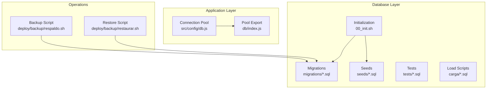
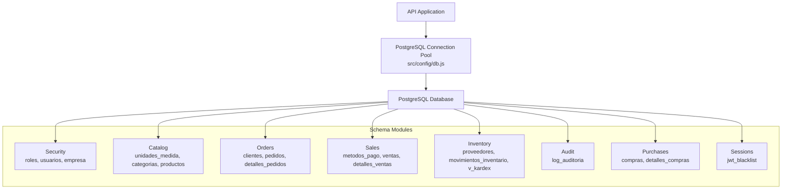
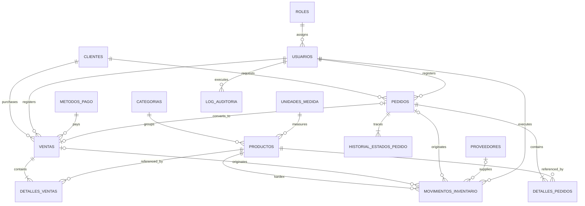
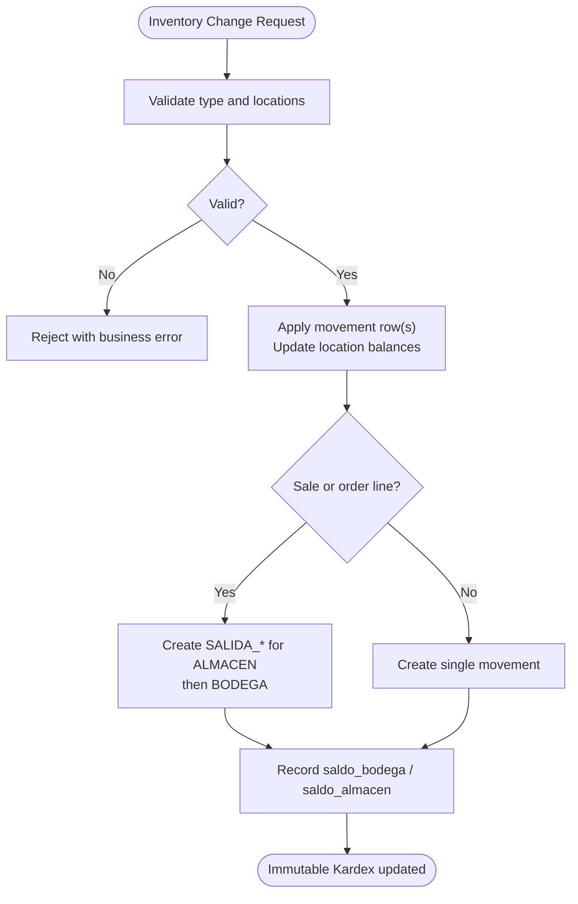
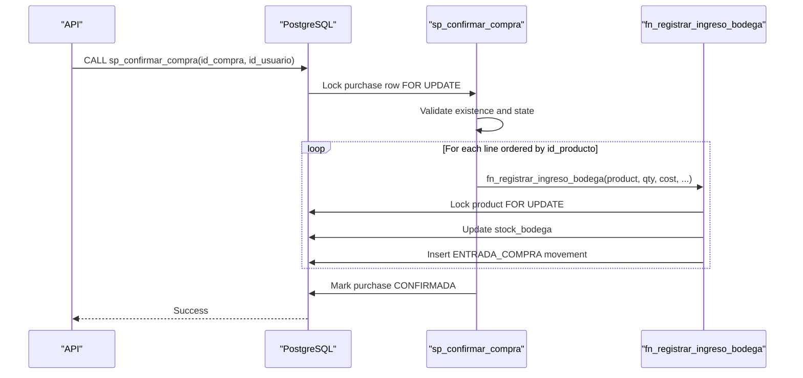
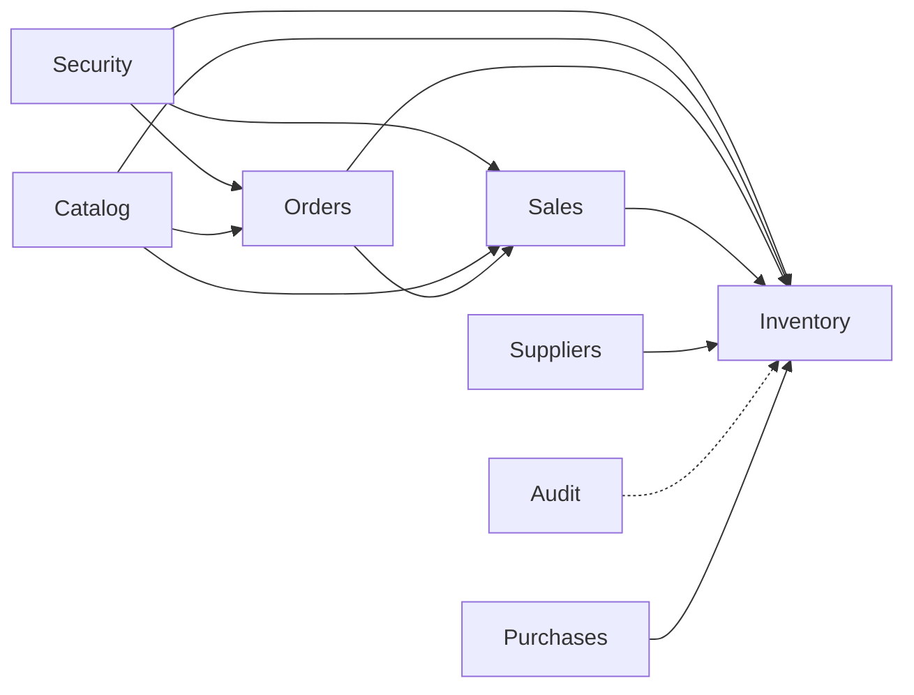

# Database Architecture

<cite>
**Referenced Files in This Document**
- [README.md](file://backend/db/README.md)
- [00_init.sh](file://backend/db/00_init.sh)
- [index.js](file://backend/db/index.js)
- [db.js](file://backend/src/config/db.js)
- [001_base.sql](file://backend/db/migrations/001_base.sql)
- [002_seguridad.sql](file://backend/db/migrations/002_seguridad.sql)
- [003_catalogo.sql](file://backend/db/migrations/003_catalogo.sql)
- [004_clientes_pedidos.sql](file://backend/db/migrations/004_clientes_pedidos.sql)
- [005_ventas.sql](file://backend/db/migrations/005_ventas.sql)
- [006_inventario.sql](file://backend/db/migrations/006_inventario.sql)
- [007_auditoria.sql](file://backend/db/migrations/007_auditoria.sql)
- [008_ingreso_bodega.sql](file://backend/db/migrations/008_ingreso_bodega.sql)
- [009_clientes.sql](file://backend/db/migrations/009_clientes.sql)
- [010_sesiones.sql](file://backend/db/migrations/010_sesiones.sql)
- [011_compras.sql](file://backend/db/migrations/011_compras.sql)
- [012_saldo_kardex.sql](file://backend/db/migrations/012_saldo_kardex.sql)
- [013_indices_ventas.sql](file://backend/db/migrations/013_indices_ventas.sql)
- [respaldo.sh](file://deploy/backup/respaldo.sh)
- [restaurar.sh](file://deploy/backup/restaurar.sh)
</cite>

## Table of Contents
1. [Introduction](#introduction)
2. [Project Structure](#project-structure)
3. [Core Components](#core-components)
4. [Architecture Overview](#architecture-overview)
5. [Detailed Component Analysis](#detailed-component-analysis)
6. [Dependency Analysis](#dependency-analysis)
7. [Performance Considerations](#performance-considerations)
8. [Troubleshooting Guide](#troubleshooting-guide)
9. [Conclusion](#conclusion)
10. [Appendices](#appendices)

## Introduction
This document explains the SIMO system database architecture built on PostgreSQL. It covers the relational schema design, normalization principles, entity relationships, migration strategy, stored procedures and triggers, business rule enforcement, dual-location inventory tracking (Warehouse and Storage), audit trail, calculated fields, indexing and query optimization, backup and recovery, data retention and archival strategies, connection pooling, and transaction management patterns.

The database is designed to enforce strict business rules at the data layer, maintain an immutable Kardex ledger for inventory movements, and provide high-performance reporting through targeted indexes and computed views.

## Project Structure
The database assets live under `backend/db`. The most important parts are:
- Migrations that define the schema, functions, triggers, and constraints.
- An initialization script that runs migrations and optional seeds.
- A Node.js connection pool configuration used by the API.
- Backup and restore scripts for operational reliability.

**Diagram sources**
- [00_init.sh:1-43](file://backend/db/00_init.sh#L1-L43)
- [db.js:1-29](file://backend/src/config/db.js#L1-L29)
- [index.js:1-23](file://backend/db/index.js#L1-L23)
- [respaldo.sh:1-89](file://deploy/backup/respaldo.sh#L1-L89)
- [restaurar.sh:1-77](file://deploy/backup/restaurar.sh#L1-L77)

**Section sources**
- [README.md:1-32](file://backend/db/README.md#L1-L32)
- [00_init.sh:1-43](file://backend/db/00_init.sh#L1-L43)

## Core Components
- Security and administration: roles, users, company settings.
- Catalog: units of measure, categories, products with dual inventory balances.
- Sales and orders: clients, orders with lifecycle validation, payment methods, sales lines.
- Inventory and Kardex: suppliers, inventory movements, Kardex view, valuation functions.
- Audit log: immutable critical operations log.
- Sessions: JWT blacklist for logout.
- Purchases: supplier purchase orders and confirmation procedure.
- Performance: targeted B-tree indexes and planner tuning.

Key implementation references:
- Base utilities and immutability helpers: [001_base.sql:1-60](file://backend/db/migrations/001_base.sql#L1-L60)
- Roles, users, company: [002_seguridad.sql:1-91](file://backend/db/migrations/002_seguridad.sql#L1-L91)
- Catalog and dual stock: [003_catalogo.sql:1-102](file://backend/db/migrations/003_catalogo.sql#L1-L102)
- Clients and orders lifecycle: [004_clientes_pedidos.sql:1-192](file://backend/db/migrations/004_clientes_pedidos.sql#L1-L192)
- Payment methods and sales: [005_ventas.sql:1-104](file://backend/db/migrations/005_ventas.sql#L1-L104)
- Inventory, Kardex view: [006_inventario.sql:1-166](file://backend/db/migrations/006_inventario.sql#L1-L166)
- Audit log: [007_auditoria.sql:1-68](file://backend/db/migrations/007_auditoria.sql#L1-L68)
- Warehouse entry function: [008_ingreso_bodega.sql:1-91](file://backend/db/migrations/008_ingreso_bodega.sql#L1-L91)
- Client identity immutability: [009_clientes.sql:1-40](file://backend/db/migrations/009_clientes.sql#L1-L40)
- JWT blacklist: [010_sesiones.sql:1-20](file://backend/db/migrations/010_sesiones.sql#L1-L20)
- Purchases and confirmation: [011_compras.sql:1-261](file://backend/db/migrations/011_compras.sql#L1-L261)
- Kardex calculation and validation: [012_saldo_kardex.sql:1-155](file://backend/db/migrations/012_saldo_kardex.sql#L1-L155)
- Sales performance indexes: [013_indices_ventas.sql:1-71](file://backend/db/migrations/013_indices_ventas.sql#L1-L71)

**Section sources**
- [README.md:62-121](file://backend/db/README.md#L62-L121)
- [001_base.sql:1-60](file://backend/db/migrations/001_base.sql#L1-L60)
- [002_seguridad.sql:1-91](file://backend/db/migrations/002_seguridad.sql#L1-L91)
- [003_catalogo.sql:1-102](file://backend/db/migrations/003_catalogo.sql#L1-L102)
- [004_clientes_pedidos.sql:1-192](file://backend/db/migrations/004_clientes_pedidos.sql#L1-L192)
- [005_ventas.sql:1-104](file://backend/db/migrations/005_ventas.sql#L1-L104)
- [006_inventario.sql:1-166](file://backend/db/migrations/006_inventario.sql#L1-L166)
- [007_auditoria.sql:1-68](file://backend/db/migrations/007_auditoria.sql#L1-L68)
- [008_ingreso_bodega.sql:1-91](file://backend/db/migrations/008_ingreso_bodega.sql#L1-L91)
- [009_clientes.sql:1-40](file://backend/db/migrations/009_clientes.sql#L1-L40)
- [010_sesiones.sql:1-20](file://backend/db/migrations/010_sesiones.sql#L1-L20)
- [011_compras.sql:1-261](file://backend/db/migrations/011_compras.sql#L1-L261)
- [012_saldo_kardex.sql:1-155](file://backend/db/migrations/012_saldo_kardex.sql#L1-L155)
- [013_indices_ventas.sql:1-71](file://backend/db/migrations/013_indices_ventas.sql#L1-L71)

## Architecture Overview
The database enforces business rules using a combination of constraints, triggers, and stored functions/procedures. The application uses a shared connection pool configured via environment variables, supporting both local Docker Postgres and cloud providers like Neon.

**Diagram sources**
- [db.js:1-29](file://backend/src/config/db.js#L1-L29)
- [002_seguridad.sql:1-91](file://backend/db/migrations/002_seguridad.sql#L1-L91)
- [003_catalogo.sql:1-102](file://backend/db/migrations/003_catalogo.sql#L1-L102)
- [004_clientes_pedidos.sql:1-192](file://backend/db/migrations/004_clientes_pedidos.sql#L1-L192)
- [005_ventas.sql:1-104](file://backend/db/migrations/005_ventas.sql#L1-L104)
- [006_inventario.sql:1-166](file://backend/db/migrations/006_inventario.sql#L1-L166)
- [007_auditoria.sql:1-68](file://backend/db/migrations/007_auditoria.sql#L1-L68)
- [011_compras.sql:1-261](file://backend/db/migrations/011_compras.sql#L1-L261)
- [010_sesiones.sql:1-20](file://backend/db/migrations/010_sesiones.sql#L1-L20)

## Detailed Component Analysis

### Schema Design and Normalization Principles
- First normal form: atomic values per column; quantities use numeric types with appropriate precision.
- Second normal form: non-key attributes depend on primary keys; e.g., product details split into line items.
- Third normal form: no transitive dependencies; e.g., units of measure and categories are separate reference tables.
- Referential integrity enforced via foreign keys and cascading policies where appropriate.
- Business rules enforced via CHECK constraints, unique constraints, triggers, and stored procedures.

Examples:
- Product SKU uniqueness and unit-of-measure linkage: [003_catalogo.sql:65-94](file://backend/db/migrations/003_catalogo.sql#L65-L94)
- Order state transitions validated by trigger: [004_clientes_pedidos.sql:114-151](file://backend/db/migrations/004_clientes_pedidos.sql#L114-L151)
- Sales totals consistency checks: [005_ventas.sql:40-67](file://backend/db/migrations/005_ventas.sql#L40-L67)
- Movement location and reference constraints: [006_inventario.sql:84-108](file://backend/db/migrations/006_inventario.sql#L84-L108)

**Section sources**
- [003_catalogo.sql:1-102](file://backend/db/migrations/003_catalogo.sql#L1-L102)
- [004_clientes_pedidos.sql:1-192](file://backend/db/migrations/004_clientes_pedidos.sql#L1-L192)
- [005_ventas.sql:1-104](file://backend/db/migrations/005_ventas.sql#L1-L104)
- [006_inventario.sql:1-166](file://backend/db/migrations/006_inventario.sql#L1-L166)

### Entity Relationships
The core entities and their relationships are summarized below.

**Diagram sources**
- [README.md:62-86](file://backend/db/README.md#L62-L86)
- [002_seguridad.sql:15-53](file://backend/db/migrations/002_seguridad.sql#L15-L53)
- [003_catalogo.sql:22-83](file://backend/db/migrations/003_catalogo.sql#L22-L83)
- [004_clientes_pedidos.sql:12-105](file://backend/db/migrations/004_clientes_pedidos.sql#L12-L105)
- [005_ventas.sql:13-97](file://backend/db/migrations/005_ventas.sql#L13-L97)
- [006_inventario.sql:25-108](file://backend/db/migrations/006_inventario.sql#L25-L108)
- [007_auditoria.sql:13-40](file://backend/db/migrations/007_auditoria.sql#L13-L40)

### Dual-Location Inventory Tracking
- Products track two balances: `stock_bodega` (Warehouse) and `stock_almacen` (Storage).
- `stock_total` is a generated column equal to the sum of both locations.
- Inventory changes occur only through `movimientos_inventario`, which records origin/destination locations and resulting balances.
- Cascading deduction rule: each sale or order line generates up to two movement rows (first from Storage, then from Warehouse). Reversals mirror the original locations.

Key elements:
- Product dual-stock columns and generated total: [003_catalogo.sql:75-90](file://backend/db/migrations/003_catalogo.sql#L75-L90)
- Movement constraints enforcing valid origins/destinations and references: [006_inventario.sql:84-108](file://backend/db/migrations/006_inventario.sql#L84-L108)
- Kardex view aggregating entries/exits per location: [006_inventario.sql:136-161](file://backend/db/migrations/006_inventario.sql#L136-L161)

**Diagram sources**
- [006_inventario.sql:44-108](file://backend/db/migrations/006_inventario.sql#L44-L108)
- [README.md:114-117](file://backend/db/README.md#L114-L117)

**Section sources**
- [003_catalogo.sql:65-90](file://backend/db/migrations/003_catalogo.sql#L65-L90)
- [006_inventario.sql:44-161](file://backend/db/migrations/006_inventario.sql#L44-L161)
- [README.md:114-117](file://backend/db/README.md#L114-L117)

### Audit Trail Implementation
- `log_auditoria` captures critical operations with user, authorizer, action, entity, justification, before/after JSONB snapshots, and IP address.
- Triggers and privileges prevent modification or truncation of audit logs.
- Certain actions require mandatory justification and authorization.

Key elements:
- Audit table structure and constraints: [007_auditoria.sql:13-40](file://backend/db/migrations/007_auditoria.sql#L13-L40)
- Immutability triggers and revocations: [007_auditoria.sql:53-66](file://backend/db/migrations/007_auditoria.sql#L53-L66)

**Section sources**
- [007_auditoria.sql:1-68](file://backend/db/migrations/007_auditoria.sql#L1-L68)

### Calculated Fields and Views
- Generated columns:
  - `productos.stock_total = stock_bodega + stock_almacen`: [003_catalogo.sql:77-77](file://backend/db/migrations/003_catalogo.sql#L77-L77)
  - `detalles_compras.subtotal_linea = round(cantidad * costo_unitario, 2)`: [011_compras.sql:55-55](file://backend/db/migrations/011_compras.sql#L55-L55)
- View:
  - `v_kardex` provides chronological entries/exits per location with derived totals: [006_inventario.sql:136-161](file://backend/db/migrations/006_inventario.sql#L136-L161)

**Section sources**
- [003_catalogo.sql:65-90](file://backend/db/migrations/003_catalogo.sql#L65-L90)
- [011_compras.sql:49-57](file://backend/db/migrations/011_compras.sql#L49-L57)
- [006_inventario.sql:136-161](file://backend/db/migrations/006_inventario.sql#L136-L161)

### Stored Procedures and Triggers
- Base utilities:
  - `fn_set_actualizado_en()`: updates `actualizado_en` on UPDATE: [001_base.sql:31-37](file://backend/db/migrations/001_base.sql#L31-L37)
  - `fn_usuario_sesion()`: reads session user context: [001_base.sql:42-45](file://backend/db/migrations/001_base.sql#L42-L45)
  - `fn_bloquear_modificacion()`: blocks UPDATE/DELETE/TRUNCATE on immutable tables: [001_base.sql:50-57](file://backend/db/migrations/001_base.sql#L50-L57)
- Order lifecycle:
  - `fn_validar_transicion_pedido()`: enforces sequential state transitions: [004_clientes_pedidos.sql:114-151](file://backend/db/migrations/004_clientes_pedidos.sql#L114-L151)
  - `fn_registrar_historial_pedido()`: records state history with user and reason: [004_clientes_pedidos.sql:155-179](file://backend/db/migrations/004_clientes_pedidos.sql#L155-L179)
- Inventory:
  - `fn_registrar_ingreso_bodega(...)`: atomic warehouse entry with locking and validation: [008_ingreso_bodega.sql:23-84](file://backend/db/migrations/008_ingreso_bodega.sql#L23-L84)
  - `sp_confirmar_compra(...)`: confirms purchase and applies all lines atomically: [011_compras.sql:217-255](file://backend/db/migrations/011_compras.sql#L217-L255)
- Kardex:
  - `fn_kardex_producto(...)`: recalculates balances and weighted average cost: [012_saldo_kardex.sql:26-108](file://backend/db/migrations/012_saldo_kardex.sql#L26-L108)
  - `fn_validar_kardex(...)`: audits Kardex consistency against product stock: [012_saldo_kardex.sql:113-149](file://backend/db/migrations/012_saldo_kardex.sql#L113-L149)

**Diagram sources**
- [011_compras.sql:217-255](file://backend/db/migrations/011_compras.sql#L217-L255)
- [011_compras.sql:146-208](file://backend/db/migrations/011_compras.sql#L146-L208)

**Section sources**
- [001_base.sql:1-60](file://backend/db/migrations/001_base.sql#L1-L60)
- [004_clientes_pedidos.sql:114-184](file://backend/db/migrations/004_clientes_pedidos.sql#L114-L184)
- [008_ingreso_bodega.sql:23-84](file://backend/db/migrations/008_ingreso_bodega.sql#L23-L84)
- [011_compras.sql:217-255](file://backend/db/migrations/011_compras.sql#L217-L255)
- [012_saldo_kardex.sql:26-149](file://backend/db/migrations/012_saldo_kardex.sql#L26-L149)

### Migration Strategy, Version Control, and Rollback
- Migrations are SQL files executed in order by `00_init.sh`. They are designed to be re-executable without errors.
- Initialization script runs migrations and optionally seeds; it also configures the application role when provided.
- Rollback approach:
  - Since migrations are additive and idempotent, rollbacks are typically achieved by applying corrective migrations or restoring from backups.
  - Immutable tables (Kardex, audit log) cannot be modified or truncated; rollback must preserve historical integrity.
  - Restore script validates the dump and can drop/recreate schemas within a transaction when explicitly requested.

Key elements:
- Initialization and execution order: [00_init.sh:1-43](file://backend/db/00_init.sh#L1-L43)
- Re-executable index migration pattern: [013_indices_ventas.sql:28-57](file://backend/db/migrations/013_indices_ventas.sql#L28-L57)
- Restore safety checks and transactional apply: [restaurar.sh:1-77](file://deploy/backup/restaurar.sh#L1-L77)

**Section sources**
- [00_init.sh:1-43](file://backend/db/00_init.sh#L1-L43)
- [013_indices_ventas.sql:1-71](file://backend/db/migrations/013_indices_ventas.sql#L1-L71)
- [restaurar.sh:1-77](file://deploy/backup/restaurar.sh#L1-L77)

### Indexing Strategies and Query Optimization
- Targeted B-tree indexes improve dashboard and history queries:
  - `idx_ventas_fecha`: supports history and last sales across all statuses.
  - `idx_ventas_fecha_completadas`: partial index for completed sales with included total.
  - `uq_detalles_ventas_producto`: unique constraint extended with INCLUDE for covering scans.
  - `idx_detalles_ventas_producto`: optimized for product sales history and units sold.
- Planner tuning:
  - `random_page_cost = 1.1` set per database to favor index usage on SSD-backed storage.

Key elements:
- Index definitions and comments: [013_indices_ventas.sql:33-57](file://backend/db/migrations/013_indices_ventas.sql#L33-L57)
- Planner setting and ANALYZE calls: [013_indices_ventas.sql:59-71](file://backend/db/migrations/013_indices_ventas.sql#L59-L71)

**Section sources**
- [013_indices_ventas.sql:1-71](file://backend/db/migrations/013_indices_ventas.sql#L1-L71)

### Connection Pooling and Transaction Management
- Connection pooling:
  - Shared pool configured via `DATABASE_URL` (cloud) or individual env vars (local/Docker).
  - SSL behavior controlled by `DB_SSL`; defaults vary by provider.
  - Pool events logged for connection success and unexpected errors.
- Transaction patterns:
  - Backend sets session-level config (`simo.id_usuario`, `simo.motivo`) within transactions to capture responsible user and reason.
  - Inventory updates lock rows (`SELECT ... FOR UPDATE`) to avoid concurrent stock corruption.
  - Purchase confirmation locks the purchase row and processes lines in deterministic order to prevent deadlocks.

Key elements:
- Pool configuration and SSL handling: [db.js:1-29](file://backend/src/config/db.js#L1-L29)
- Pool export and logging: [index.js:1-23](file://backend/db/index.js#L1-L23)
- Session user context usage: [README.md:106-118](file://backend/db/README.md#L106-L118)
- Row locking in warehouse entry: [008_ingreso_bodega.sql:53-70](file://backend/db/migrations/008_ingreso_bodega.sql#L53-L70)
- Purchase confirmation locking and ordering: [011_compras.sql:224-245](file://backend/db/migrations/011_compras.sql#L224-L245)

**Section sources**
- [db.js:1-29](file://backend/src/config/db.js#L1-L29)
- [index.js:1-23](file://backend/db/index.js#L1-L23)
- [README.md:106-118](file://backend/db/README.md#L106-L118)
- [008_ingreso_bodega.sql:53-70](file://backend/db/migrations/008_ingreso_bodega.sql#L53-L70)
- [011_compras.sql:224-245](file://backend/db/migrations/011_compras.sql#L224-L245)

### Backup, Recovery, Data Retention, and Archival
- Daily backups:
  - Script runs at a configurable hour, backing up Neon and/or local databases.
  - Backups are verified using `pg_restore --list` and written atomically.
  - Old backups are purged based on retention policy.
- Restoration:
  - Validates dump file and destination safety.
  - Optionally drops and recreates schemas within a transaction to ensure atomic restoration.
  - Verifies restored data by counting key tables and running Kardex validation.

Key elements:
- Backup scheduling, verification, and cleanup: [respaldo.sh:1-89](file://deploy/backup/respaldo.sh#L1-L89)
- Restore safety, transactional apply, and post-restore validation: [restaurar.sh:1-77](file://deploy/backup/restaurar.sh#L1-L77)

**Section sources**
- [respaldo.sh:1-89](file://deploy/backup/respaldo.sh#L1-L89)
- [restaurar.sh:1-77](file://deploy/backup/restaurar.sh#L1-L77)

## Dependency Analysis
The database modules have clear dependency boundaries:
- Security module underpins users and roles consumed by other modules.
- Catalog module defines products referenced by orders, sales, and inventory.
- Orders and sales depend on clients and users; sales may link to orders.
- Inventory depends on products, users, sales, orders, and suppliers; it is central to Kardex.
- Audit log is independent but referenced by business operations.
- Purchases extend inventory and link back to suppliers and movements.

**Diagram sources**
- [002_seguridad.sql:15-53](file://backend/db/migrations/002_seguridad.sql#L15-L53)
- [003_catalogo.sql:22-83](file://backend/db/migrations/003_catalogo.sql#L22-L83)
- [004_clientes_pedidos.sql:42-85](file://backend/db/migrations/004_clientes_pedidos.sql#L42-L85)
- [005_ventas.sql:40-97](file://backend/db/migrations/005_ventas.sql#L40-L97)
- [006_inventario.sql:62-108](file://backend/db/migrations/006_inventario.sql#L62-L108)
- [007_auditoria.sql:13-40](file://backend/db/migrations/007_auditoria.sql#L13-L40)
- [011_compras.sql:21-57](file://backend/db/migrations/011_compras.sql#L21-L57)

**Section sources**
- [002_seguridad.sql:1-91](file://backend/db/migrations/002_seguridad.sql#L1-L91)
- [003_catalogo.sql:1-102](file://backend/db/migrations/003_catalogo.sql#L1-L102)
- [004_clientes_pedidos.sql:1-192](file://backend/db/migrations/004_clientes_pedidos.sql#L1-L192)
- [005_ventas.sql:1-104](file://backend/db/migrations/005_ventas.sql#L1-L104)
- [006_inventario.sql:1-166](file://backend/db/migrations/006_inventario.sql#L1-L166)
- [007_auditoria.sql:1-68](file://backend/db/migrations/007_auditoria.sql#L1-L68)
- [011_compras.sql:1-261](file://backend/db/migrations/011_compras.sql#L1-L261)

## Performance Considerations
- Use the provided Kardex functions for accurate balance and valuation calculations rather than ad-hoc aggregation.
- Rely on the defined indexes for dashboard and history queries; avoid full-table scans by filtering on indexed columns.
- After large data loads, run `VACUUM ANALYZE` to keep statistics current and enable Index Only Scans.
- Keep session configuration (`simo.id_usuario`, `simo.motivo`) inside transactions to avoid extra lookups and ensure consistent auditing.

[No sources needed since this section provides general guidance]

## Troubleshooting Guide
Common issues and resolutions:
- Missing session user context when modifying orders:
  - Ensure `set_config('simo.id_usuario', ...)` is called before order mutations.
  - Reference: [README.md:106-118](file://backend/db/README.md#L106-L118)
- Negative stock attempts:
  - Enforced by CHECK constraints on product balances; validate input and use inventory procedures.
  - Reference: [003_catalogo.sql:75-77](file://backend/db/migrations/003_catalogo.sql#L75-L77)
- Invalid order state transitions:
  - Trigger rejects non-sequential transitions; verify allowed flows.
  - Reference: [004_clientes_pedidos.sql:114-151](file://backend/db/migrations/004_clientes_pedidos.sql#L114-L151)
- Attempting to modify immutable tables (Kardex, audit log):
  - Triggers block UPDATE/DELETE/TRUNCATE; use approved procedures.
  - References: [006_inventario.sql:121-129](file://backend/db/migrations/006_inventario.sql#L121-L129), [007_auditoria.sql:53-66](file://backend/db/migrations/007_auditoria.sql#L53-L66)
- Client identity changes:
  - Trigger prevents changes to identity fields; use correct workflow.
  - Reference: [009_clientes.sql:19-34](file://backend/db/migrations/009_clientes.sql#L19-L34)

**Section sources**
- [README.md:106-118](file://backend/db/README.md#L106-L118)
- [003_catalogo.sql:75-77](file://backend/db/migrations/003_catalogo.sql#L75-L77)
- [004_clientes_pedidos.sql:114-151](file://backend/db/migrations/004_clientes_pedidos.sql#L114-L151)
- [006_inventario.sql:121-129](file://backend/db/migrations/006_inventario.sql#L121-L129)
- [007_auditoria.sql:53-66](file://backend/db/migrations/007_auditoria.sql#L53-L66)
- [009_clientes.sql:19-34](file://backend/db/migrations/009_clientes.sql#L19-L34)

## Conclusion
SIMO’s database architecture emphasizes correctness, traceability, and performance. Business rules are enforced at the data layer through constraints, triggers, and stored procedures. The dual-location inventory model ensures precise stock control, while the immutable Kardex and audit log provide strong accountability. Targeted indexes and planner tuning optimize reporting workloads. Operational scripts support reliable backups, restores, and data retention policies. The application integrates cleanly via a shared connection pool and well-defined transaction patterns.

[No sources needed since this section summarizes without analyzing specific files]

## Appendices

### Sample Queries
- Kardex for a product with date range:
  - See usage examples in documentation: [README.md:122-132](file://backend/db/README.md#L122-L132)
- Validate Kardex consistency:
  - See usage examples in documentation: [README.md:130-132](file://backend/db/README.md#L130-L132)

**Section sources**
- [README.md:122-132](file://backend/db/README.md#L122-L132)