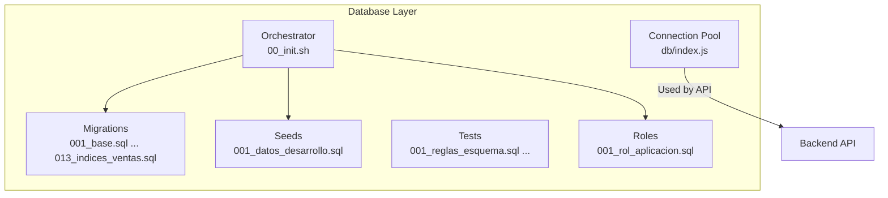
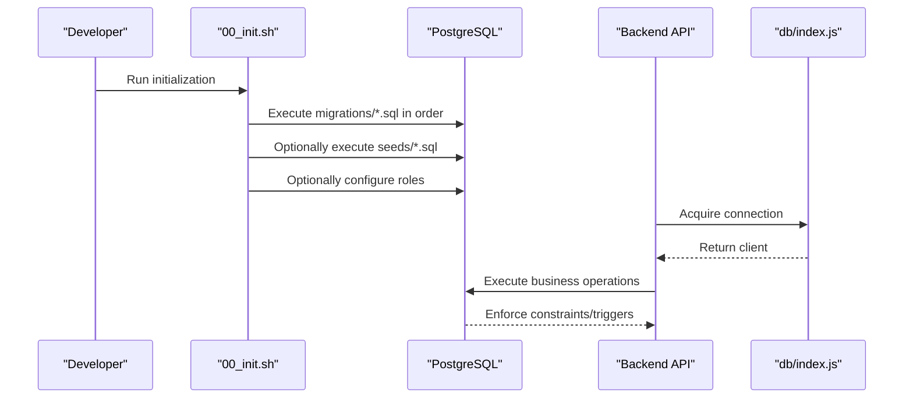
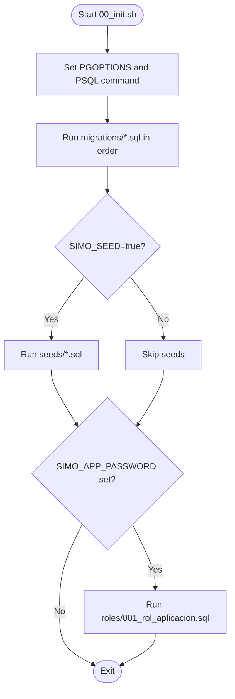
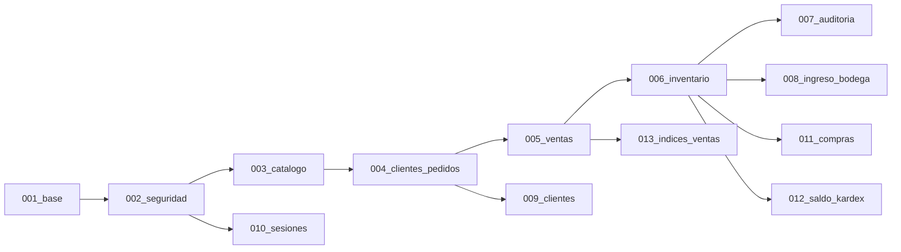

# Migration Strategy & Version Control

<cite>
**Referenced Files in This Document**
- [backend/db/README.md](file://backend/db/README.md)
- [backend/db/index.js](file://backend/db/index.js)
- [backend/db/00_init.sh](file://backend/db/00_init.sh)
- [backend/db/migrations/001_base.sql](file://backend/db/migrations/001_base.sql)
- [backend/db/migrations/002_seguridad.sql](file://backend/db/migrations/002_seguridad.sql)
- [backend/db/migrations/003_catalogo.sql](file://backend/db/migrations/003_catalogo.sql)
- [backend/db/migrations/004_clientes_pedidos.sql](file://backend/db/migrations/004_clientes_pedidos.sql)
- [backend/db/migrations/005_ventas.sql](file://backend/db/migrations/005_ventas.sql)
- [backend/db/migrations/006_inventario.sql](file://backend/db/migrations/006_inventario.sql)
- [backend/db/migrations/007_auditoria.sql](file://backend/db/migrations/007_auditoria.sql)
- [backend/db/migrations/008_ingreso_bodega.sql](file://backend/db/migrations/008_ingreso_bodega.sql)
- [backend/db/migrations/009_clientes.sql](file://backend/db/migrations/009_clientes.sql)
- [backend/db/migrations/010_sesiones.sql](file://backend/db/migrations/010_sesiones.sql)
- [backend/db/migrations/011_compras.sql](file://backend/db/migrations/011_compras.sql)
- [backend/db/migrations/012_saldo_kardex.sql](file://backend/db/migrations/012_saldo_kardex.sql)
- [backend/db/migrations/013_indices_ventas.sql](file://backend/db/migrations/013_indices_ventas.sql)
</cite>

## Table of Contents
1. [Introduction](#introduction)
2. [Project Structure](#project-structure)
3. [Core Components](#core-components)
4. [Architecture Overview](#architecture-overview)
5. [Detailed Component Analysis](#detailed-component-analysis)
6. [Dependency Analysis](#dependency-analysis)
7. [Performance Considerations](#performance-considerations)
8. [Troubleshooting Guide](#troubleshooting-guide)
9. [Conclusion](#conclusion)
10. [Appendices](#appendices)

## Introduction
This document explains SIMO’s database migration strategy and version control approach. It focuses on the numbered SQL migration files, how they are executed, how to create new migrations safely, how dependencies between migrations are handled, and how environment-specific configuration is managed. It also covers rollback considerations, backward compatibility patterns, data transformation guidance, error handling strategies, and the deployment workflow for applying migrations across environments.

The project uses PostgreSQL migrations stored as ordered SQL files under `backend/db/migrations`. A shell script orchestrates execution during container initialization or manual setup. The Node.js connection file provides a shared pool used by the API; it does not implement its own migration runner.

## Project Structure
SIMO organizes database artifacts under `backend/db`:
- `migrations/`: Ordered schema and function migrations.
- `seeds/`: Development seed data.
- `carga/`: Load testing data and performance queries.
- `tests/`: Business rule tests that do not leave persistent data.
- `roles/`: Application role setup.
- `00_init.sh`: Orchestrator that runs migrations, optional seeds, and optional role setup.
- `index.js`: Shared PostgreSQL connection pool used by the API.
- `README.md`: Documentation describing the model, rules, conventions, and usage.

**Diagram sources**
- [backend/db/00_init.sh:25-42](file://backend/db/00_init.sh#L25-L42)
- [backend/db/index.js:11-22](file://backend/db/index.js#L11-L22)

**Section sources**
- [backend/db/README.md:5-31](file://backend/db/README.md#L5-L31)
- [backend/db/00_init.sh:1-43](file://backend/db/00_init.sh#L1-L43)
- [backend/db/index.js:1-22](file://backend/db/index.js#L1-L22)

## Core Components
- Numbered migration files: Each migration is a self-contained SQL script with a numeric prefix (e.g., `001_base.sql`, `002_seguridad.sql`). The order defines the application sequence.
- Idempotent design: Migrations use `CREATE TABLE IF NOT EXISTS`, `DROP TRIGGER IF EXISTS` before recreation, `CREATE INDEX IF NOT EXISTS`, and conditional logic to allow re-execution without errors.
- Transactional boundaries: Most migrations wrap changes in `BEGIN; ... COMMIT;` blocks to ensure atomicity.
- Orchestrator: `00_init.sh` executes all SQL files in `migrations/`, optionally runs `seeds/`, and can configure an application role when a password is provided.
- Connection pool: `db/index.js` exports a shared PostgreSQL pool configured centrally via `src/config/db.js`; it logs connection events and errors.

Key responsibilities:
- Schema evolution: Tables, constraints, functions, views, indexes.
- Data integrity: Triggers, checks, and business rules enforced at the database level.
- Auditability: Inalterable audit tables and triggers.
- Performance tuning: Index creation and planner parameter adjustments.

**Section sources**
- [backend/db/migrations/001_base.sql:19-59](file://backend/db/migrations/001_base.sql#L19-L59)
- [backend/db/migrations/002_seguridad.sql:7-90](file://backend/db/migrations/002_seguridad.sql#L7-L90)
- [backend/db/migrations/006_inventario.sql:20-165](file://backend/db/migrations/006_inventario.sql#L20-L165)
- [backend/db/migrations/013_indices_ventas.sql:31-70](file://backend/db/migrations/013_indices_ventas.sql#L31-L70)
- [backend/db/00_init.sh:25-42](file://backend/db/00_init.sh#L25-L42)
- [backend/db/index.js:11-22](file://backend/db/index.js#L11-L22)

## Architecture Overview
The migration architecture is straightforward:
- SQL migrations define the desired state.
- The orchestrator applies them in lexicographic order.
- The API connects using a shared pool and relies on database-enforced rules.

**Diagram sources**
- [backend/db/00_init.sh:25-42](file://backend/db/00_init.sh#L25-L42)
- [backend/db/index.js:11-22](file://backend/db/index.js#L11-L22)

## Detailed Component Analysis

### Migration Naming Convention and Version Control
- Prefix format: Three-digit zero-padded numbers (`001_`, `002_`, etc.) ensure stable lexicographic ordering.
- File naming pattern: `<number>_<short_name>.sql`. Examples:
  - `001_base.sql`
  - `002_seguridad.sql`
  - `013_indices_ventas.sql`
- Version control: Git commits should include one migration per logical change. The filename encodes the version; the commit message should reference the feature or ticket.

Guidelines:
- Never reorder existing migrations.
- Append new migrations with the next available number.
- Keep each migration focused and idempotent.

**Section sources**
- [backend/db/README.md:8-21](file://backend/db/README.md#L8-L21)
- [backend/db/migrations/001_base.sql:1-17](file://backend/db/migrations/001_base.sql#L1-L17)
- [backend/db/migrations/013_indices_ventas.sql:1-29](file://backend/db/migrations/013_indices_ventas.sql#L1-L29)

### Migration Execution Process
The orchestrator `00_init.sh`:
- Iterates over `migrations/*.sql` and executes each with `psql`.
- Optionally runs `seeds/*.sql` unless disabled via `SIMO_SEED=false`.
- Optionally configures the application role if `SIMO_APP_PASSWORD` is set.

**Diagram sources**
- [backend/db/00_init.sh:14-42](file://backend/db/00_init.sh#L14-L42)

**Section sources**
- [backend/db/00_init.sh:1-43](file://backend/db/00_init.sh#L1-L43)

### Rollback Procedures and Backward Compatibility
- No explicit rollback scripts exist. Rollbacks must be implemented as forward migrations that reverse changes safely.
- Use defensive DDL:
  - `CREATE TABLE IF NOT EXISTS`
  - `DROP TRIGGER IF EXISTS` before recreating triggers
  - `CREATE INDEX IF NOT EXISTS`
  - Conditional constraint additions via `DO $$ ... END $$` blocks
- For breaking changes:
  - Add new columns or fields first, populate them, then deprecate old ones in a later migration.
  - Rename tables/columns by creating new objects and migrating data, then removing old objects after a transition period.
- Idempotency ensures safe re-runs during development and CI.

Examples from the codebase:
- Reusable base functions and triggers are created with `CREATE OR REPLACE FUNCTION` and guarded trigger drops.
- Inventory movement constraints and links are added conditionally.
- Indices are recreated only when needed.

**Section sources**
- [backend/db/migrations/001_base.sql:31-57](file://backend/db/migrations/001_base.sql#L31-L57)
- [backend/db/migrations/006_inventario.sql:128-140](file://backend/db/migrations/006_inventario.sql#L128-L140)
- [backend/db/migrations/011_compras.sql:128-140](file://backend/db/migrations/011_compras.sql#L128-L140)
- [backend/db/migrations/013_indices_ventas.sql:40-56](file://backend/db/migrations/013_indices_ventas.sql#L40-L56)

### Creating New Migrations
Steps:
1. Determine the next number based on existing migrations.
2. Create a new file `NNN_description.sql` under `backend/db/migrations`.
3. Wrap changes in `BEGIN; ... COMMIT;`.
4. Make the migration idempotent:
   - Use `IF NOT EXISTS` for tables and indexes.
   - Drop and recreate triggers/functions as needed.
   - Guard constraint additions with conditional blocks.
5. Document requirements and behavior in the header comments.
6. Test locally with `psql` and Docker initialization.

Safe patterns observed:
- Base utilities in `001_base.sql` provide reusable functions and triggers.
- Security and administration entities in `002_seguridad.sql` demonstrate idempotent inserts with `ON CONFLICT DO NOTHING`.
- Catalog and product definitions in `003_catalogo.sql` show generated columns and dual-stock design.

**Section sources**
- [backend/db/migrations/001_base.sql:19-59](file://backend/db/migrations/001_base.sql#L19-L59)
- [backend/db/migrations/002_seguridad.sql:15-31](file://backend/db/migrations/002_seguridad.sql#L15-L31)
- [backend/db/migrations/003_catalogo.sql:65-83](file://backend/db/migrations/003_catalogo.sql#L65-L83)

### Handling Dependencies Between Migrations
- Order matters: Later migrations depend on earlier ones (e.g., inventory depends on products; purchases depend on inventory).
- Function signature updates: When adding parameters, drop the old function and recreate it to avoid ambiguity.
- Cross-migration references:
  - `006_inventario.sql` adds FKs and constraints linking to prior entities.
  - `011_compras.sql` extends `fn_registrar_ingreso_bodega` and links movements to purchases.

Best practices:
- Explicitly declare dependencies in comments.
- Avoid circular dependencies.
- Validate existence before altering shared objects.

**Section sources**
- [backend/db/migrations/006_inventario.sql:62-108](file://backend/db/migrations/006_inventario.sql#L62-L108)
- [backend/db/migrations/011_compras.sql:142-155](file://backend/db/migrations/011_compras.sql#L142-L155)
- [backend/db/migrations/011_compras.sql:217-255](file://backend/db/migrations/011_compras.sql#L217-L255)

### Environment-Specific Configurations
- Database timezone is set to `America/Bogota` in the base migration.
- Planner cost parameter `random_page_cost` is tuned for SSD-backed databases.
- Role setup is optional and controlled by an environment variable passed to the orchestrator.

Environment variables:
- `SIMO_SEED`: Controls whether development seeds are applied.
- `SIMO_APP_PASSWORD`: Creates or updates the application role.
- `POSTGRES_USER`, `POSTGRES_DB`: Used by the orchestrator to connect to PostgreSQL.

**Section sources**
- [backend/db/migrations/001_base.sql:21-26](file://backend/db/migrations/001_base.sql#L21-L26)
- [backend/db/migrations/013_indices_ventas.sql:59-65](file://backend/db/migrations/013_indices_ventas.sql#L59-L65)
- [backend/db/00_init.sh:11-14](file://backend/db/00_init.sh#L11-L14)
- [backend/db/00_init.sh:35-42](file://backend/db/00_init.sh#L35-L42)

### Safe Migration Patterns and Data Transformation Scripts
Patterns:
- Defensive DDL with `IF NOT EXISTS` and conditional alterations.
- Trigger/function recreation with `DROP ... IF EXISTS` followed by creation.
- Constraint enforcement via `CHECK` and triggers.
- Business errors raised with custom SQLSTATE codes for consistent API translation.

Data transformation examples:
- Adding purchase linkage to inventory movements and updating function signatures.
- Recreating unique constraints with included columns for index-only scans.
- Tuning planner settings for better query plans.

Error handling strategies:
- Custom SQLSTATE classes (e.g., `SM001`–`SM013`) for business validation failures.
- Triggers blocking modifications to inalterable tables.
- Validation functions ensuring referential integrity and business rules.

**Section sources**
- [backend/db/migrations/008_ingreso_bodega.sql:23-84](file://backend/db/migrations/008_ingreso_bodega.sql#L23-L84)
- [backend/db/migrations/011_compras.sql:128-155](file://backend/db/migrations/011_compras.sql#L128-L155)
- [backend/db/migrations/013_indices_ventas.sql:40-56](file://backend/db/migrations/013_indices_ventas.sql#L40-L56)
- [backend/db/migrations/006_inventario.sql:121-129](file://backend/db/migrations/006_inventario.sql#L121-L129)

### Deployment Workflow for Applying Migrations
Local development:
- Create the database and run the orchestrator:
  - `POSTGRES_USER=postgres POSTGRES_DB=simo_retail sh db/00_init.sh`
- Or use Docker:
  - `docker compose up -d --build`
  - To reset: `docker compose down -v && docker compose up -d --build`

Production-like environments:
- Ensure the database exists and credentials are configured.
- Run the orchestrator with appropriate variables:
  - `SIMO_SEED=false` to skip development data.
  - `SIMO_APP_PASSWORD=<secure_password>` to configure the application role.

Notes:
- The orchestrator executes migrations unconditionally; there is no built-in migration tracking table.
- Idempotent migrations allow repeated runs without side effects.

**Section sources**
- [backend/db/README.md:34-58](file://backend/db/README.md#L34-L58)
- [backend/db/00_init.sh:1-43](file://backend/db/00_init.sh#L1-L43)

## Dependency Analysis
Migration dependency chain:
- `001_base.sql`: Base functions and timezone.
- `002_seguridad.sql`: Roles, users, company.
- `003_catalogo.sql`: Units, categories, products.
- `004_clientes_pedidos.sql`: Clients, orders, state history.
- `005_ventas.sql`: Payment methods, sales, sale details.
- `006_inventario.sql`: Suppliers, inventory movements, Kardex view.
- `007_auditoria.sql`: Audit log.
- `008_ingreso_bodega.sql`: Purchase receipt function.
- `009_clientes.sql`: Client document immutability.
- `010_sesiones.sql`: JWT blacklist.
- `011_compras.sql`: Purchases and confirmation procedure; updates previous function.
- `012_saldo_kardex.sql`: Kardex calculation and validation functions.
- `013_indices_ventas.sql`: Sales indexes and planner tuning.

**Diagram sources**
- [backend/db/migrations/001_base.sql:1-17](file://backend/db/migrations/001_base.sql#L1-L17)
- [backend/db/migrations/002_seguridad.sql:1-5](file://backend/db/migrations/002_seguridad.sql#L1-L5)
- [backend/db/migrations/003_catalogo.sql:1-13](file://backend/db/migrations/003_catalogo.sql#L1-L13)
- [backend/db/migrations/004_clientes_pedidos.sql:1-5](file://backend/db/migrations/004_clientes_pedidos.sql#L1-L5)
- [backend/db/migrations/005_ventas.sql:1-5](file://backend/db/migrations/005_ventas.sql#L1-L5)
- [backend/db/migrations/006_inventario.sql:1-18](file://backend/db/migrations/006_inventario.sql#L1-L18)
- [backend/db/migrations/007_auditoria.sql:1-9](file://backend/db/migrations/007_auditoria.sql#L1-L9)
- [backend/db/migrations/008_ingreso_bodega.sql:1-19](file://backend/db/migrations/008_ingreso_bodega.sql#L1-L19)
- [backend/db/migrations/009_clientes.sql:1-10](file://backend/db/migrations/009_clientes.sql#L1-L10)
- [backend/db/migrations/010_sesiones.sql:1-8](file://backend/db/migrations/010_sesiones.sql#L1-L8)
- [backend/db/migrations/011_compras.sql:1-17](file://backend/db/migrations/011_compras.sql#L1-L17)
- [backend/db/migrations/012_saldo_kardex.sql:1-22](file://backend/db/migrations/012_saldo_kardex.sql#L1-L22)
- [backend/db/migrations/013_indices_ventas.sql:1-29](file://backend/db/migrations/013_indices_ventas.sql#L1-L29)

**Section sources**
- [backend/db/README.md:8-21](file://backend/db/README.md#L8-L21)

## Performance Considerations
- Index design: Coverage indexes reduce table visits for common queries.
- Planner tuning: Adjusting `random_page_cost` improves index utilization on SSD-backed databases.
- Analyze statistics: Running `ANALYZE` after index changes helps the planner choose optimal plans.
- Constraints and triggers enforce correctness but may add overhead; ensure they align with access patterns.

Recommendations:
- Prefer index-only scans where possible.
- Use partial indexes for filtered queries.
- Monitor query plans with `EXPLAIN ANALYZE` after schema changes.

**Section sources**
- [backend/db/migrations/013_indices_ventas.sql:1-29](file://backend/db/migrations/013_indices_ventas.sql#L1-L29)
- [backend/db/migrations/013_indices_ventas.sql:59-70](file://backend/db/migrations/013_indices_ventas.sql#L59-L70)

## Troubleshooting Guide
Common issues and resolutions:
- Connection errors:
  - Verify the shared pool configuration and environment variables.
  - Check connection logs emitted by the pool.
- Migration failures:
  - Inspect the failing SQL file and ensure prerequisites exist.
  - Confirm permissions for setting database-level parameters.
- Business rule violations:
  - Errors raised with custom SQLSTATE codes indicate business validation failures.
  - Review triggers and constraints related to the affected entity.

Debugging steps:
- Run migrations manually with `psql` to isolate errors.
- Use Docker reset flow to rebuild the database when starting fresh.
- Validate data consistency with Kardex validation functions.

**Section sources**
- [backend/db/index.js:14-20](file://backend/db/index.js#L14-L20)
- [backend/db/migrations/008_ingreso_bodega.sql:38-65](file://backend/db/migrations/008_ingreso_bodega.sql#L38-L65)
- [backend/db/migrations/011_compras.sql:223-255](file://backend/db/migrations/011_compras.sql#L223-L255)
- [backend/db/migrations/012_saldo_kardex.sql:113-149](file://backend/db/migrations/012_saldo_kardex.sql#L113-L149)

## Conclusion
SIMO’s migration strategy relies on ordered, idempotent SQL migrations executed by a simple shell orchestrator. The approach emphasizes database-enforced integrity, auditability, and performance tuning. Rollbacks are implemented as forward migrations, and backward compatibility is maintained through defensive DDL and careful dependency management. The deployment workflow supports both local development and production-like environments with minimal tooling, making it straightforward to apply and validate schema changes consistently.

## Appendices

### Example Safe Migration Checklist
- Wrap changes in a transaction.
- Use `IF NOT EXISTS` for tables and indexes.
- Drop and recreate triggers/functions defensively.
- Guard constraint additions with conditional blocks.
- Document requirements and behavior in headers.
- Test re-execution to ensure idempotency.

[No sources needed since this section provides general guidance]