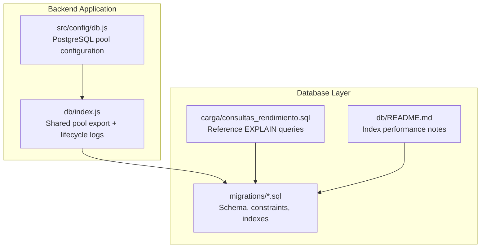
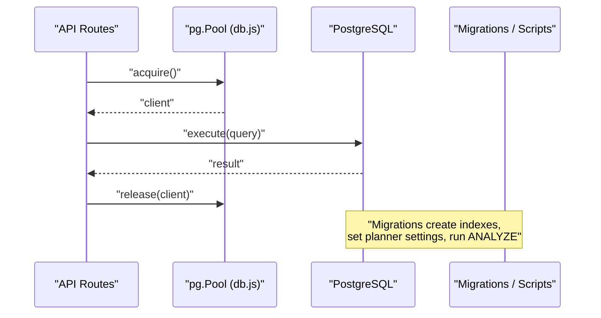
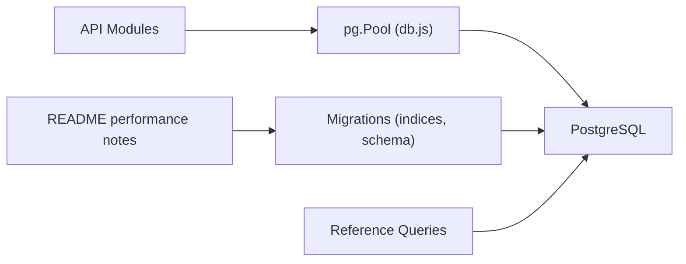

# Performance Optimization & Indexing

<cite>
**Referenced Files in This Document**
- [db.js](file://backend/src/config/db.js)
- [index.js](file://backend/db/index.js)
- [013_indices_ventas.sql](file://backend/db/migrations/013_indices_ventas.sql)
- [consultas_rendimiento.sql](file://backend/db/carga/consultas_rendimiento.sql)
- [README.md](file://backend/db/README.md)
- [001_base.sql](file://backend/db/migrations/001_base.sql)
- [003_catalogo.sql](file://backend/db/migrations/003_catalogo.sql)
- [004_clientes_pedidos.sql](file://backend/db/migrations/004_clientes_pedidos.sql)
- [007_auditoria.sql](file://backend/db/migrations/007_auditoria.sql)
</cite>

## Table of Contents
1. [Introduction](#introduction)
2. [Project Structure](#project-structure)
3. [Core Components](#core-components)
4. [Architecture Overview](#architecture-overview)
5. [Detailed Component Analysis](#detailed-component-analysis)
6. [Dependency Analysis](#dependency-analysis)
7. [Performance Considerations](#performance-considerations)
8. [Troubleshooting Guide](#troubleshooting-guide)
9. [Conclusion](#conclusion)

## Introduction
This document explains how SIMO optimizes database performance, focusing on PostgreSQL indexing, connection pooling, query optimization, execution plan analysis, monitoring, maintenance, and scaling strategies. It is intended for developers and operators who need to understand the current implementation and extend it safely as data grows.

## Project Structure
The database-related performance assets are primarily located under `backend/db`, with application-level connection pooling configured in Node.js:

**Diagram sources**
- [db.js:1-29](file://backend/src/config/db.js#L1-L29)
- [index.js:1-22](file://backend/db/index.js#L1-L22)
- [013_indices_ventas.sql:1-71](file://backend/db/migrations/013_indices_ventas.sql#L1-L71)
- [consultas_rendimiento.sql:1-19](file://backend/db/carga/consultas_rendimiento.sql#L1-L19)
- [README.md:153-180](file://backend/db/README.md#L153-L180)

**Section sources**
- [db.js:1-29](file://backend/src/config/db.js#L1-L29)
- [index.js:1-22](file://backend/db/index.js#L1-L22)
- [013_indices_ventas.sql:1-71](file://backend/db/migrations/013_indices_ventas.sql#L1-L71)
- [consultas_rendimiento.sql:1-19](file://backend/db/carga/consultas_rendimiento.sql#L1-L19)
- [README.md:153-180](file://backend/db/README.md#L153-L180)

## Core Components
- Connection pooling: a single shared `pg.Pool` instance is created from environment variables and reused across the API.
- Indexing strategy: composite, partial, and covering indexes are defined through migrations to optimize sales history, dashboard aggregations, product sales reports, and audit queries.
- Query optimization: reference queries use `EXPLAIN (ANALYZE, BUFFERS, SUMMARY ON, TIMING OFF)` to validate plans and measure performance.
- Planner tuning: the migration sets `random_page_cost = 1.1` for SSD-backed storage to favor index scans over sequential scans.
- Maintenance: the migration runs `ANALYZE` on key tables after index creation; the documentation also recommends `VACUUM ANALYZE` after large loads.

**Section sources**
- [db.js:1-29](file://backend/src/config/db.js#L1-L29)
- [index.js:1-22](file://backend/db/index.js#L1-L22)
- [013_indices_ventas.sql:1-71](file://backend/db/migrations/013_indices_ventas.sql#L1-L71)
- [consultas_rendimiento.sql:1-19](file://backend/db/carga/consultas_rendimiento.sql#L1-L19)
- [README.md:153-180](file://backend/db/README.md#L153-L180)

## Architecture Overview
The runtime path connects the Node.js API to PostgreSQL via a pooled connection, while schema evolution and performance tuning are applied through SQL migrations and reference scripts.

**Diagram sources**
- [db.js:1-29](file://backend/src/config/db.js#L1-L29)
- [index.js:1-22](file://backend/db/index.js#L1-L22)
- [013_indices_ventas.sql:59-70](file://backend/db/migrations/013_indices_ventas.sql#L59-L70)

## Detailed Component Analysis

### Connection Pooling Configuration
The application uses a single shared `pg.Pool`. It supports two configuration modes:
- Cloud service URL via `DATABASE_URL` with optional SSL controlled by `DB_SSL`.
- Local or Docker setup via `DB_HOST`, `DB_PORT`, `DB_NAME`, `DB_USER`, `DB_PASSWORD`, with SSL toggled by `DB_SSL`.

Lifecycle logging is added at the pool level to detect unexpected errors and successful connections.

Key behaviors:
- SSL behavior is derived from `DB_SSL`:
  - `true`: enable SSL with relaxed certificate validation.
  - `false`: disable SSL.
  - Default depends on whether a cloud URL is provided.
- The same pool instance is exported and reused by other modules.

Recommended operational checks:
- Verify that `DATABASE_URL` or local DB variables are set correctly per environment.
- Monitor pool error events to catch connection issues early.
- Tune pool size based on workload if needed (current code does not explicitly set pool limits).

**Section sources**
- [db.js:1-29](file://backend/src/config/db.js#L1-L29)
- [index.js:1-22](file://backend/db/index.js#L1-L22)

### Indexing Strategy

#### Composite Indexes
Composite indexes align with frequently used filter and sort combinations:
- Sales date range with ordering: supports historical listings and recent sales screens.
- Product sales detail joins: supports product-centric reports and unit totals.

Examples in the codebase:
- Sales date index with included columns for total and status.
- Sales details index on product then sale with included quantity and price fields.

These indexes allow the planner to satisfy filters, sorts, and selected projections directly from the index.

**Section sources**
- [013_indices_ventas.sql:33-38](file://backend/db/migrations/013_indices_ventas.sql#L33-L38)
- [013_indices_ventas.sql:54-57](file://backend/db/migrations/013_indices_ventas.sql#L54-L57)

#### Partial Indexes
Partial indexes target subsets of rows commonly queried:
- Completed sales filtered by date for dashboard aggregation.
- Open orders filtered by delivery date excluding delivered/cancelled states.

Benefits:
- Smaller index size.
- Faster scans for targeted queries.
- Reduced write overhead compared to full-table indexes.

**Section sources**
- [013_indices_ventas.sql:36-38](file://backend/db/migrations/013_indices_ventas.sql#L36-L38)
- [004_clientes_pedidos.sql:62-66](file://backend/db/migrations/004_clientes_pedidos.sql#L62-L66)

#### Covering Indexes
Covering indexes include non-key columns so queries can be satisfied entirely from the index without table access:
- Sales date index includes `total` and `estado`.
- Unique constraint on sales details includes `cantidad` and `subtotal_linea`.
- Sales details product index includes `cantidad` and `precio_unitario`.

Impact:
- Enables Index Only Scan for many dashboards and reports.
- Reduces I/O and CPU usage on large tables.

**Section sources**
- [013_indices_ventas.sql:33-38](file://backend/db/migrations/013_indices_ventas.sql#L33-L38)
- [013_indices_ventas.sql:40-52](file://backend/db/migrations/013_indices_ventas.sql#L40-L52)
- [013_indices_ventas.sql:54-57](file://backend/db/migrations/013_indices_ventas.sql#L54-L57)

#### Additional Domain-Specific Indexes
Other migrations add useful indexes for catalog, clients, orders, and audit:
- Product category, state, and normalized name search.
- Client name search.
- Order client, state, and open-by-delivery-date partial index.
- Audit log by date, entity, user, and action.

These support common filtering, grouping, and reporting patterns across the system.

**Section sources**
- [003_catalogo.sql:92-94](file://backend/db/migrations/003_catalogo.sql#L92-L94)
- [004_clientes_pedidos.sql:28](file://backend/db/migrations/004_clientes_pedidos.sql#L28)
- [004_clientes_pedidos.sql:62-66](file://backend/db/migrations/004_clientes_pedidos.sql#L62-L66)
- [004_clientes_pedidos.sql:89](file://backend/db/migrations/004_clientes_pedidos.sql#L89)
- [004_clientes_pedidos.sql:109](file://backend/db/migrations/004_clientes_pedidos.sql#L109)
- [007_auditoria.sql:48-51](file://backend/db/migrations/007_auditoria.sql#L48-L51)

### Query Optimization Techniques
SIMO’s query optimization approach centers on:
- Aligning indexes with actual query patterns (filters, joins, groupings, orderings).
- Using covering indexes to avoid heap lookups.
- Using partial indexes to reduce index size and improve selectivity.
- Tuning planner costs for SSD-backed storage.

Reference queries demonstrate typical workloads:
- Recent sales listing.
- Daily totals for completed sales.
- Top-selling products by month.
- Product sales history.
- Quarterly unit totals per product.
- Latest N sales.

These queries are executed with `EXPLAIN (ANALYZE, BUFFERS, SUMMARY ON, TIMING OFF)` to capture execution plans and buffer usage.

**Section sources**
- [consultas_rendimiento.sql:1-19](file://backend/db/carga/consultas_rendimiento.sql#L1-L19)
- [README.md:153-180](file://backend/db/README.md#L153-L180)

### Execution Plan Analysis
The repository provides a repeatable way to analyze query performance:
- Run the reference script against a populated database.
- Inspect the plan type (Seq Scan vs Index Scan vs Index Only Scan).
- Compare timing and buffer usage before and after index changes.
- Validate that the planner chooses the expected index.

The README documents measured improvements for several queries after applying the new indexes and planner settings.

**Section sources**
- [consultas_rendimiento.sql:1-19](file://backend/db/carga/consultas_rendimiento.sql#L1-L19)
- [README.md:153-180](file://backend/db/README.md#L153-L180)

### Database Planner Tuning
The migration adjusts the planner cost parameter for SSD storage:
- Sets `random_page_cost = 1.1` at the database level.
- Includes a privilege check to avoid failures when the migration lacks permission.
- Ensures new connections inherit the setting.

This change encourages the planner to prefer index scans over sequential scans when appropriate.

**Section sources**
- [013_indices_ventas.sql:59-65](file://backend/db/migrations/013_indices_ventas.sql#L59-L65)

### Data Integrity and Auditing Impact on Performance
Certain design choices affect write paths and read patterns:
- Inalterable tables (e.g., Kardex, order state history, audit log) prevent accidental modifications but require careful maintenance and archival strategies.
- Audit triggers and constraints ensure integrity at the cost of additional writes.
- Generated columns and constraints add validation overhead during inserts/updates.

These are important considerations when planning bulk loads and high-throughput operations.

**Section sources**
- [001_base.sql:47-57](file://backend/db/migrations/001_base.sql#L47-L57)
- [004_clientes_pedidos.sql:95-109](file://backend/db/migrations/004_clientes_pedidos.sql#L95-L109)
- [007_auditoria.sql:13-51](file://backend/db/migrations/007_auditoria.sql#L13-L51)

## Dependency Analysis
The following diagram shows how the application layer depends on the database layer and how performance assets relate:

**Diagram sources**
- [db.js:1-29](file://backend/src/config/db.js#L1-L29)
- [013_indices_ventas.sql:1-71](file://backend/db/migrations/013_indices_ventas.sql#L1-L71)
- [consultas_rendimiento.sql:1-19](file://backend/db/carga/consultas_rendimiento.sql#L1-L19)
- [README.md:153-180](file://backend/db/README.md#L153-L180)

**Section sources**
- [db.js:1-29](file://backend/src/config/db.js#L1-L29)
- [013_indices_ventas.sql:1-71](file://backend/db/migrations/013_indices_ventas.sql#L1-L71)
- [consultas_rendimiento.sql:1-19](file://backend/db/carga/consultas_rendimiento.sql#L1-L19)
- [README.md:153-180](file://backend/db/README.md#L153-L180)

## Performance Considerations

### Index Design Guidelines
- Prefer composite indexes where multiple columns appear together in WHERE clauses, JOINs, or ORDER BY.
- Use partial indexes for frequent filters on a small subset of rows (e.g., completed sales, open orders).
- Add INCLUDE columns to cover common SELECT lists to enable Index Only Scan.
- Keep indexes aligned with actual query patterns; remove unused or redundant indexes.

### Query Optimization Checklist
- Ensure WHERE clauses match indexed columns.
- Avoid functions on indexed columns unless there is a matching functional index.
- Limit result sets with LIMIT when possible.
- Use GROUP BY and aggregate functions only on necessary columns.
- Prefer explicit column lists instead of SELECT *.

### Execution Plan Review Process
- Run reference queries with `EXPLAIN (ANALYZE, BUFFERS, SUMMARY ON, TIMING OFF)`.
- Look for Seq Scan on large tables; consider adding or adjusting indexes.
- Confirm Index Only Scan where possible.
- Track buffer usage to identify excessive random I/O.

### Monitoring and Slow Query Identification
- Enable PostgreSQL slow query logging (`log_min_duration_statement`) to capture long-running statements.
- Periodically review `pg_stat_statements` to find top resource-consuming queries.
- Use `pg_stat_user_tables` and `pg_stat_user_indexes` to monitor index usage and bloat.
- Correlate application metrics (latency, throughput) with database metrics.

### Large Dataset Handling
- Partition large append-only tables (e.g., audit logs, sales history) by time ranges to simplify maintenance and improve scan performance.
- Archive old partitions out of the active database.
- Schedule regular `VACUUM` and `ANALYZE` to keep statistics fresh and reclaim space.
- Rebuild indexes periodically if bloat is detected.

### Query Caching Mechanisms
- Application-level caching: cache expensive dashboard aggregates behind short-lived caches (e.g., Redis) keyed by period and filters.
- Database-level caching: rely on PostgreSQL’s shared buffers and OS page cache; tune `shared_buffers`, `effective_cache_size`, and `work_mem` according to workload.
- Avoid caching stale data; implement invalidation on writes to affected tables.

### Maintenance Tasks
- Statistics updates: run `ANALYZE` after significant data changes; the migration already runs it on key tables after index creation.
- Vacuum operations: schedule `VACUUM` regularly; use `VACUUM (VERBOSE, ANALYZE)` during maintenance windows.
- Index rebuilding: rebuild bloated indexes using `REINDEX`; consider online options depending on deployment constraints.
- Planner settings: verify `random_page_cost` and other planner parameters match your storage backend.

[No sources needed since this section provides general guidance]

## Troubleshooting Guide

### Symptom: Dashboard Aggregations Are Slow
- Check if the query uses the partial covering index for completed sales by date.
- Verify `random_page_cost` is set appropriately for SSD storage.
- Confirm statistics are up to date with `ANALYZE`.

**Section sources**
- [013_indices_ventas.sql:36-38](file://backend/db/migrations/013_indices_ventas.sql#L36-L38)
- [013_indices_ventas.sql:59-65](file://backend/db/migrations/013_indices_ventas.sql#L59-L65)
- [013_indices_ventas.sql:69-70](file://backend/db/migrations/013_indices_ventas.sql#L69-L70)

### Symptom: Product Sales Reports Require Sequential Scans
- Ensure the unique constraint on sales details includes the required columns.
- Confirm the product-to-sale index exists and covers the needed fields.
- Re-run reference queries to validate Index Only Scan.

**Section sources**
- [013_indices_ventas.sql:40-52](file://backend/db/migrations/013_indices_ventas.sql#L40-L52)
- [013_indices_ventas.sql:54-57](file://backend/db/migrations/013_indices_ventas.sql#L54-L57)
- [consultas_rendimiento.sql:11-12](file://backend/db/carga/consultas_rendimiento.sql#L11-L12)

### Symptom: Connection Errors Under Load
- Verify pool configuration and environment variables.
- Check pool error logs.
- Consider increasing pool size or optimizing query duration.

**Section sources**
- [db.js:1-29](file://backend/src/config/db.js#L1-L29)
- [index.js:14-20](file://backend/db/index.js#L14-L20)

### Symptom: High Write Latency During Bulk Loads
- Temporarily drop non-essential indexes before bulk load, then recreate them.
- Use batched inserts and transactions.
- Run `VACUUM ANALYZE` after load.

[No sources needed since this section provides general guidance]

## Conclusion
SIMO’s database performance strategy combines well-targeted indexes (composite, partial, covering), planner tuning for SSD storage, and disciplined query analysis. The connection pooling setup centralizes configuration and provides basic lifecycle logging. For continued growth, adopt partitioning for large append-only tables, implement application-level caching for expensive aggregates, and establish routine maintenance for vacuuming, analyzing, and rebuilding indexes. Use the provided reference queries and documentation as a baseline for validating performance improvements.

[No sources needed since this section summarizes without analyzing specific files]