# Schema Design & Entity Relationships

<cite>
**Referenced Files in This Document**
- [001_base.sql](file://backend/db/migrations/001_base.sql)
- [002_seguridad.sql](file://backend/db/migrations/002_seguridad.sql)
- [003_catalogo.sql](file://backend/db/migrations/003_catalogo.sql)
- [004_clientes_pedidos.sql](file://backend/db/migrations/004_clientes_pedidos.sql)
- [005_ventas.sql](file://backend/db/migrations/005_ventas.sql)
- [006_inventario.sql](file://backend/db/migrations/006_inventario.sql)
- [007_auditoria.sql](file://backend/db/migrations/007_auditoria.sql)
- [008_ingreso_bodega.sql](file://backend/db/migrations/008_ingreso_bodega.sql)
- [011_compras.sql](file://backend/db/migrations/011_compras.sql)
- [012_saldo_kardex.sql](file://backend/db/migrations/012_saldo_kardex.sql)
- [009_clientes.sql](file://backend/db/migrations/009_clientes.sql)
- [010_sesiones.sql](file://backend/db/migrations/010_sesiones.sql)
- [013_indices_ventas.sql](file://backend/db/migrations/013_indices_ventas.sql)
</cite>

## Table of Contents
1. [Introduction](#introduction)
2. [Project Structure](#project-structure)
3. [Core Components](#core-components)
4. [Architecture Overview](#architecture-overview)
5. [Detailed Component Analysis](#detailed-component-analysis)
6. [Dependency Analysis](#dependency-analysis)
7. [Performance Considerations](#performance-considerations)
8. [Troubleshooting Guide](#troubleshooting-guide)
9. [Conclusion](#conclusion)

## Introduction
This document explains the SIMO database schema design, focusing on entity relationships among users, roles, products, customers, sales, and inventory. It covers normalization principles, primary and foreign key relationships, data integrity constraints, dual-location inventory tracking (warehouse and store), audit trail implementation with immutable tables and user attribution, calculated fields such as `saldo_kardex`, and the rationale behind data type selections and domain-specific constraints.

The schema is implemented across a series of PostgreSQL migrations that define base utilities, security, catalog, customers and orders, sales, inventory, audits, warehouse intake, purchases, Kardex validation, client identity protection, session blacklisting, and performance indexes.

## Project Structure
The database schema is organized by migration files under `backend/db/migrations`. Each migration introduces one or more tables, functions, triggers, views, or indexes, and references business requirements through comments. The most relevant files for this documentation are:

- Base utilities and immutability helpers: [001_base.sql](file://backend/db/migrations/001_base.sql)
- Security and administration: [002_seguridad.sql](file://backend/db/migrations/002_seguridad.sql)
- Product catalog: [003_catalogo.sql](file://backend/db/migrations/003_catalogo.sql)
- Customers and orders: [004_clientes_pedidos.sql](file://backend/db/migrations/004_clientes_pedidos.sql)
- Sales: [005_ventas.sql](file://backend/db/migrations/005_ventas.sql)
- Inventory and Kardex view: [006_inventario.sql](file://backend/db/migrations/006_inventario.sql)
- Audit log: [007_auditoria.sql](file://backend/db/migrations/007_auditoria.sql)
- Warehouse intake function: [008_ingreso_bodega.sql](file://backend/db/migrations/008_ingreso_bodega.sql)
- Purchases and confirmation procedure: [011_compras.sql](file://backend/db/migrations/011_compras.sql)
- Kardex calculation and validation functions: [012_saldo_kardex.sql](file://backend/db/migrations/012_saldo_kardex.sql)
- Client identity immutability: [009_clientes.sql](file://backend/db/migrations/009_clientes.sql)
- Session blacklist: [010_sesiones.sql](file://backend/db/migrations/010_sesiones.sql)
- Sales performance indexes: [013_indices_ventas.sql](file://backend/db/migrations/013_indices_ventas.sql)

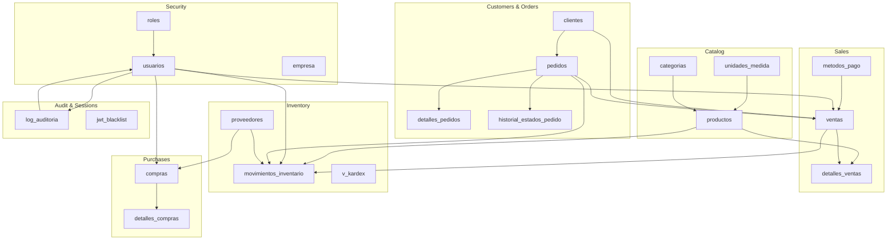

**Diagram sources**
- [002_seguridad.sql:15-53](file://backend/db/migrations/002_seguridad.sql#L15-L53)
- [003_catalogo.sql:22-83](file://backend/db/migrations/003_catalogo.sql#L22-L83)
- [004_clientes_pedidos.sql:12-105](file://backend/db/migrations/004_clientes_pedidos.sql#L12-L105)
- [005_ventas.sql:13-97](file://backend/db/migrations/005_ventas.sql#L13-L97)
- [006_inventario.sql:25-161](file://backend/db/migrations/006_inventario.sql#L25-L161)
- [011_compras.sql:21-57](file://backend/db/migrations/011_compras.sql#L21-L57)
- [007_auditoria.sql:13-40](file://backend/db/migrations/007_auditoria.sql#L13-L40)
- [010_sesiones.sql:12-15](file://backend/db/migrations/010_sesiones.sql#L12-L15)

**Section sources**
- [001_base.sql:1-60](file://backend/db/migrations/001_base.sql#L1-L60)
- [002_seguridad.sql:1-91](file://backend/db/migrations/002_seguridad.sql#L1-L91)
- [003_catalogo.sql:1-102](file://backend/db/migrations/003_catalogo.sql#L1-L102)
- [004_clientes_pedidos.sql:1-192](file://backend/db/migrations/004_clientes_pedidos.sql#L1-L192)
- [005_ventas.sql:1-104](file://backend/db/migrations/005_ventas.sql#L1-L104)
- [006_inventario.sql:1-166](file://backend/db/migrations/006_inventario.sql#L1-L166)
- [007_auditoria.sql:1-68](file://backend/db/migrations/007_auditoria.sql#L1-L68)
- [008_ingreso_bodega.sql:1-91](file://backend/db/migrations/008_ingreso_bodega.sql#L1-L91)
- [011_compras.sql:1-261](file://backend/db/migrations/011_compras.sql#L1-L261)
- [012_saldo_kardex.sql:1-155](file://backend/db/migrations/012_saldo_kardex.sql#L1-L155)
- [009_clientes.sql:1-40](file://backend/db/migrations/009_clientes.sql#L1-L40)
- [010_sesiones.sql:1-20](file://backend/db/migrations/010_sesiones.sql#L1-L20)
- [013_indices_ventas.sql:1-71](file://backend/db/migrations/013_indices_ventas.sql#L1-L71)

## Core Components
This section summarizes the core entities and their responsibilities:

- Roles and Users: RBAC profiles and authenticated users with login controls and role assignment.
- Company: Single-row company metadata used in reports and UI headers.
- Catalog: Units of measure, categories, and products with dual stock levels and SKU uniqueness.
- Customers: Identity-based customer records with protected identity fields.
- Orders: Customer orders with strict lifecycle transitions and immutable state history.
- Sales: Point-of-sale transactions with payment methods, line items, and cancellation controls.
- Inventory: Supplier information, immutable movement ledger, and Kardex view.
- Purchases: Draft-to-confirmed purchase orders that post to warehouse stock.
- Audit: Immutable critical operations log with user attribution and optional authorization.
- Sessions: JWT blacklist for logout invalidation.

Key normalization aspects:
- First Normal Form: All tables use atomic values; no repeating groups.
- Second Normal Form: Non-key attributes depend on the full primary key in detail tables (`detalles_pedidos`, `detalles_ventas`, `detalles_compras`).
- Third Normal Form: Foreign keys separate entities (e.g., `productos` links to `categorias` and `unidades_medida`; `ventas` links to `clientes`, `usuarios`, `metodos_pago`, and optionally `pedidos`).

Primary and foreign key relationships:
- `usuarios.id_usuario` referenced by `pedidos.id_usuario`, `ventas.id_usuario`, `movimientos_inventario.id_usuario`, `log_auditoria.id_usuario`, etc.
- `roles.id_rol` referenced by `usuarios.id_rol`.
- `productos.id_producto` referenced by `detalles_pedidos.id_producto`, `detalles_ventas.id_producto`, `movimientos_inventario.id_producto`, `detalles_compras.id_producto`.
- `clientes.id_cliente` referenced by `pedidos.id_cliente` and optionally `ventas.id_cliente`.
- `pedidos.id_pedido` referenced by `detalles_pedidos.id_pedido`, `movimientos_inventario.id_pedido`, and uniquely by `ventas.id_pedido`.
- `ventas.id_venta` referenced by `detalles_ventas.id_detalle_venta` and `movimientos_inventario.id_venta`.
- `metodos_pago.id_metodo_pago` referenced by `ventas.id_metodo_pago`.
- `proveedores.id_proveedor` referenced by `movimientos_inventario.id_proveedor` and `compras.id_proveedor`.
- `compras.id_compra` referenced by `detalles_compras.id_compra` and optionally by `movimientos_inventario.id_compra`.

Data integrity constraints:
- Domain checks via CHECK constraints (e.g., non-negative prices, positive quantities, valid states).
- Unique constraints on identifiers like `sku`, `identificacion`, `codigo` for roles and payment methods.
- Referential integrity enforced by FOREIGN KEYs with RESTRICT or CASCADE where appropriate.
- Business rules enforced by triggers and stored procedures/functions.

**Section sources**
- [002_seguridad.sql:15-53](file://backend/db/migrations/002_seguridad.sql#L15-L53)
- [003_catalogo.sql:65-83](file://backend/db/migrations/003_catalogo.sql#L65-L83)
- [004_clientes_pedidos.sql:42-85](file://backend/db/migrations/004_clientes_pedidos.sql#L42-L85)
- [005_ventas.sql:40-97](file://backend/db/migrations/005_ventas.sql#L40-L97)
- [006_inventario.sql:62-108](file://backend/db/migrations/006_inventario.sql#L62-L108)
- [011_compras.sql:21-57](file://backend/db/migrations/011_compras.sql#L21-L57)

## Architecture Overview
The SIMO database architecture separates concerns into clear layers:

- Security layer: roles, users, company, sessions.
- Catalog layer: units of measure, categories, products.
- Commercial layer: customers, orders, sales, payment methods.
- Inventory layer: suppliers, movements, Kardex view, purchases.
- Audit layer: immutable log of critical actions.

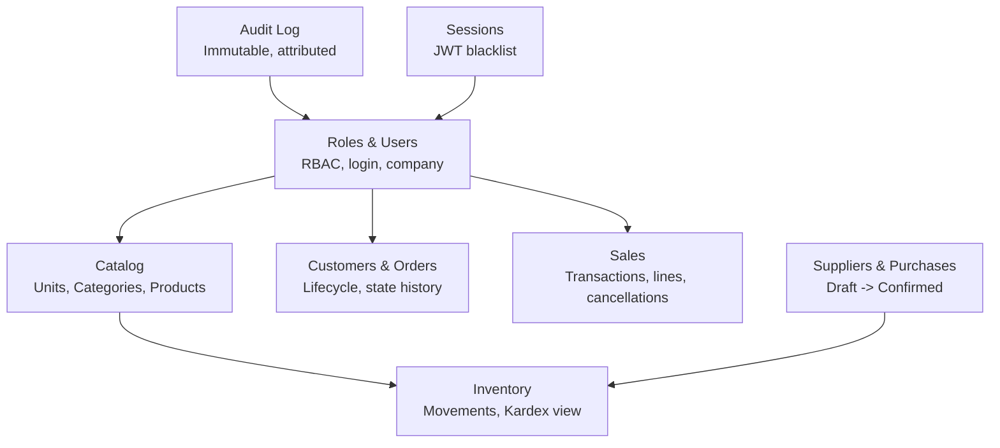

**Diagram sources**
- [002_seguridad.sql:15-53](file://backend/db/migrations/002_seguridad.sql#L15-L53)
- [003_catalogo.sql:22-83](file://backend/db/migrations/003_catalogo.sql#L22-L83)
- [004_clientes_pedidos.sql:42-105](file://backend/db/migrations/004_clientes_pedidos.sql#L42-L105)
- [005_ventas.sql:13-97](file://backend/db/migrations/005_ventas.sql#L13-L97)
- [006_inventario.sql:25-161](file://backend/db/migrations/006_inventario.sql#L25-L161)
- [011_compras.sql:21-57](file://backend/db/migrations/011_compras.sql#L21-L57)
- [007_auditoria.sql:13-40](file://backend/db/migrations/007_auditoria.sql#L13-L40)
- [010_sesiones.sql:12-15](file://backend/db/migrations/010_sesiones.sql#L12-L15)

## Detailed Component Analysis

### Security and Administration
- `roles`: Fixed set of application roles with stable codes used by middleware and JWT.
- `usuarios`: User accounts linked to roles, with email normalization, lockout fields, and timestamps.
- `empresa`: Single-row company metadata for branding and reporting.

Normalization and constraints:
- Role codes normalized to uppercase and unique.
- Email normalized to lowercase and unique.
- Username unique and non-blank.
- Password hash never exposed.
- Timestamps updated automatically via trigger.

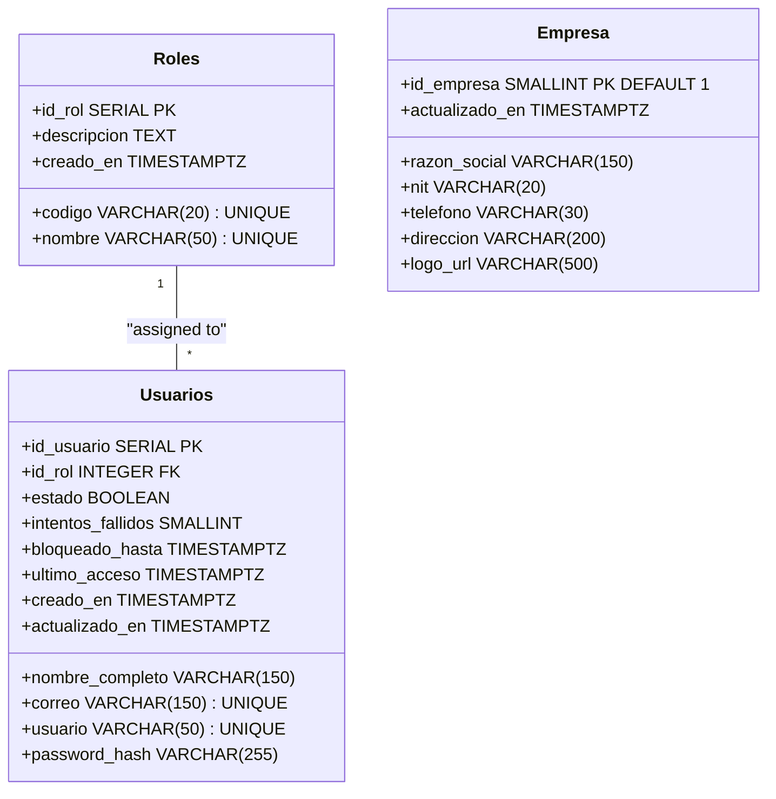

**Diagram sources**
- [002_seguridad.sql:15-53](file://backend/db/migrations/002_seguridad.sql#L15-L53)
- [002_seguridad.sql:73-81](file://backend/db/migrations/002_seguridad.sql#L73-L81)

**Section sources**
- [002_seguridad.sql:15-53](file://backend/db/migrations/002_seguridad.sql#L15-L53)
- [002_seguridad.sql:73-81](file://backend/db/migrations/002_seguridad.sql#L73-L81)

### Product Catalog
- `unidades_medida`: Units of measure with decimal allowance flag.
- `categorias`: Product categories with active/inactive state.
- `productos`: Products with SKU, pricing, and dual stock levels (`stock_bodega`, `stock_almacen`) plus computed `stock_total`.

Normalization and constraints:
- SKU unique and non-blank.
- Prices non-negative.
- Stock levels non-negative.
- Computed field `stock_total = stock_bodega + stock_almacen`.
- References to categories and units enforce referential integrity.

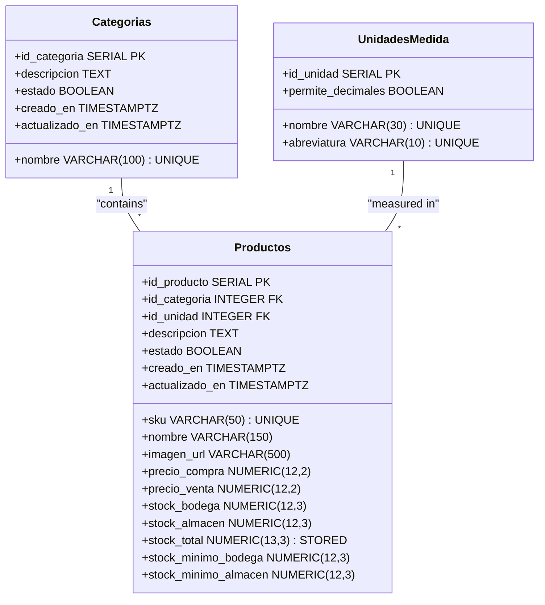

**Diagram sources**
- [003_catalogo.sql:22-83](file://backend/db/migrations/003_catalogo.sql#L22-L83)

**Section sources**
- [003_catalogo.sql:22-83](file://backend/db/migrations/003_catalogo.sql#L22-L83)

### Customers and Orders
- `clientes`: Customer records with identity type and number, contact info, and active state.
- `pedidos`: Orders with strict lifecycle transitions and delivery scheduling.
- `detalles_pedidos`: Order lines with product, quantity, unit price, and computed subtotal.
- `historial_estados_pedido`: Immutable state change history with user attribution and reason.

Normalization and constraints:
- Identity number unique per type.
- Order state restricted to allowed transitions.
- Order totals non-negative.
- Order line subtotals computed from quantity and unit price.
- State history requires user context and optional reason for cancellations.

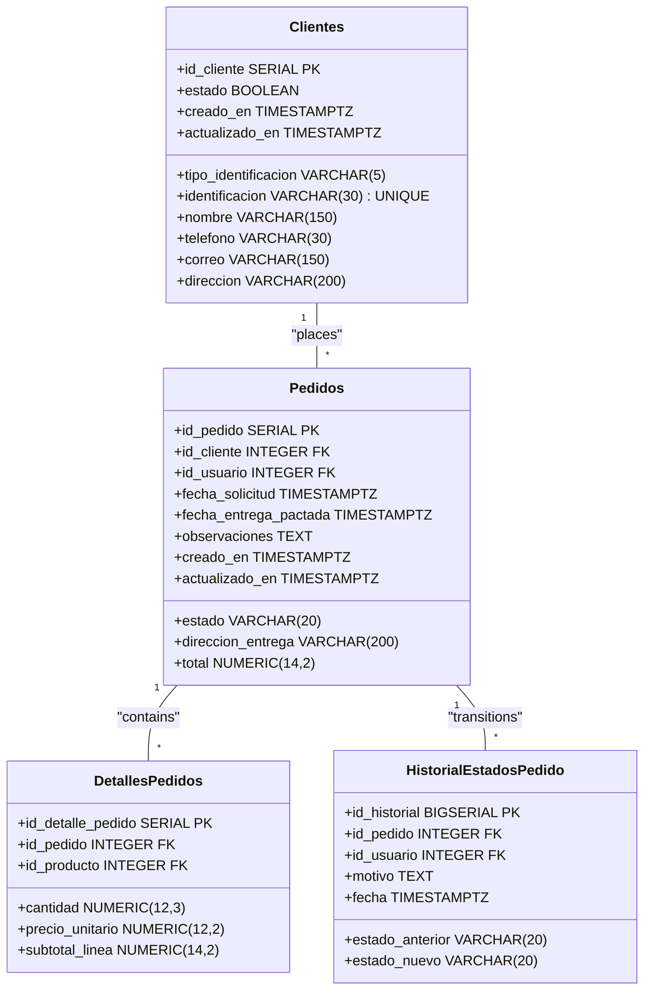

**Diagram sources**
- [004_clientes_pedidos.sql:12-105](file://backend/db/migrations/004_clientes_pedidos.sql#L12-L105)

**Section sources**
- [004_clientes_pedidos.sql:12-105](file://backend/db/migrations/004_clientes_pedidos.sql#L12-L105)

### Sales
- `metodos_pago`: Payment method reference table with codes and names.
- `ventas`: Sales transactions linking to customers, users, payment methods, and optionally orders. Includes cancellation fields and computed totals.
- `detalles_ventas`: Sale lines with product, quantity, unit price, cost at time of sale, and computed subtotal.

Normalization and constraints:
- Payment method codes normalized to uppercase and unique.
- Sale totals computed from subtotal, discount, and taxes.
- Discount cannot exceed subtotal.
- Cancellation requires authorized user and reason.
- Line subtotals computed from quantity and unit price.

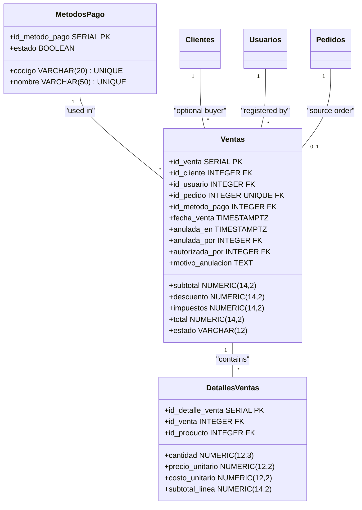

**Diagram sources**
- [005_ventas.sql:13-97](file://backend/db/migrations/005_ventas.sql#L13-L97)

**Section sources**
- [005_ventas.sql:13-97](file://backend/db/migrations/005_ventas.sql#L13-L97)

### Inventory and Dual-Location Tracking
- `proveedores`: Supplier reference table.
- `movimientos_inventario`: Immutable ledger of all stock changes with origin/destination locations (`BODEGA`, `ALMACEN`), quantities, costs, resulting balances, and references to sales, orders, suppliers, and purchases.
- `v_kardex`: View presenting chronological Kardex entries per product with location-specific entries and balances.

Dual-location design:
- Every movement specifies origin and/or destination.
- Balance columns `saldo_bodega` and `saldo_almacen` reflect post-movement stock levels.
- Movement types include purchases, internal transfers, sales/purchase exits, reversals, and adjustments.
- Constraints ensure correct combinations of origin/destination and required references per movement type.

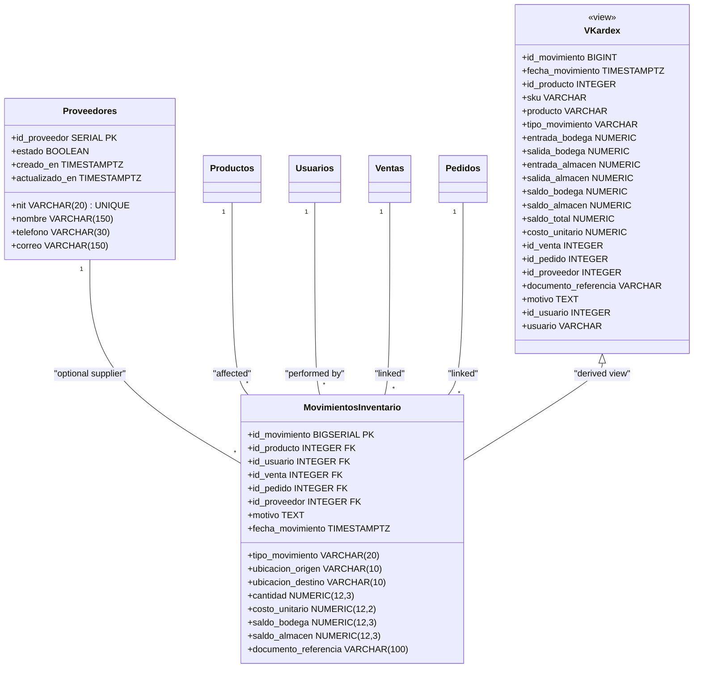

**Diagram sources**
- [006_inventario.sql:25-161](file://backend/db/migrations/006_inventario.sql#L25-L161)

**Section sources**
- [006_inventario.sql:25-161](file://backend/db/migrations/006_inventario.sql#L25-L161)

### Purchases and Warehouse Intake
- `compras`: Purchase orders in draft or confirmed state, with totals and confirmation metadata.
- `detalles_compras`: Lines with product, quantity, unit cost, and computed subtotal.
- `fn_registrar_ingreso_bodega`: Function to register warehouse intake atomically, updating `stock_bodega` and recording an `ENTRADA_COMPRA` movement.
- `sp_confirmar_compra`: Procedure to confirm a purchase, applying all lines to warehouse stock in a single transaction.

Business logic:
- Draft purchases allow line edits; confirmed purchases become immutable.
- Confirmation updates total via trigger and posts movements.
- Warehouse intake validates user and supplier status, enforces integer quantities when unit does not allow decimals, and locks product rows to prevent concurrent updates.

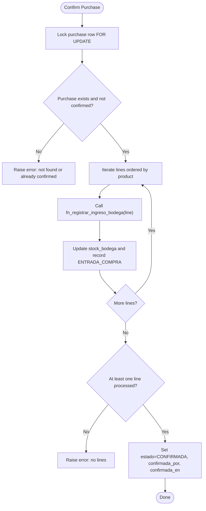

**Diagram sources**
- [011_compras.sql:217-255](file://backend/db/migrations/011_compras.sql#L217-L255)
- [008_ingreso_bodega.sql:23-84](file://backend/db/migrations/008_ingreso_bodega.sql#L23-L84)

**Section sources**
- [011_compras.sql:21-57](file://backend/db/migrations/011_compras.sql#L21-L57)
- [011_compras.sql:217-255](file://backend/db/migrations/011_compras.sql#L217-L255)
- [008_ingreso_bodega.sql:23-84](file://backend/db/migrations/008_ingreso_bodega.sql#L23-L84)

### Audit Trail Implementation
- `log_auditoria`: Immutable log of critical operations with user attribution, optional authorizer, entity type, entity ID, justification, before/after JSON snapshots, and IP address.
- Immutability enforced by triggers blocking UPDATE, DELETE, and TRUNCATE, plus revoking privileges from PUBLIC.

User attribution:
- Operations must be executed within a transaction that sets `simo.id_usuario` (and optionally `simo.motivo`) so that audit entries capture who performed the action.

Constraints:
- Justification required for specific actions (inventory adjustments, sales cancellations, order cancellations).
- Authorization required for sales cancellations.

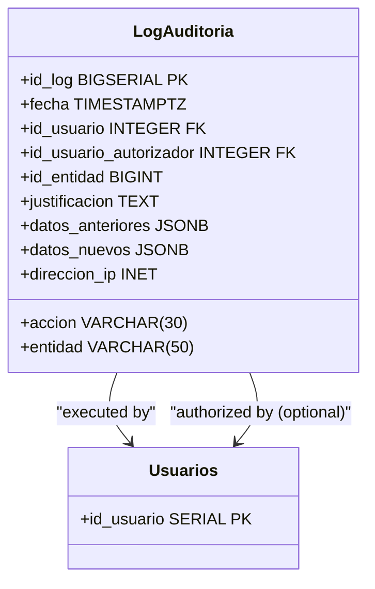

**Diagram sources**
- [007_auditoria.sql:13-40](file://backend/db/migrations/007_auditoria.sql#L13-L40)

**Section sources**
- [007_auditoria.sql:13-40](file://backend/db/migrations/007_auditoria.sql#L13-L40)
- [001_base.sql:42-57](file://backend/db/migrations/001_base.sql#L42-L57)

### Calculated Fields and Business Logic: `saldo_kardex`
- `v_kardex`: View showing chronological Kardex entries per product with location-specific entries and balances.
- `fn_kardex_producto(producto, desde, hasta)`: Recalculates balances and weighted average cost per movement, comparing stored balances with recalculated ones.
- `fn_validar_kardex(producto opcional)`: Audits consistency between recalculated balances and current product stock levels.

Business logic:
- Weighted average cost updates only on external entries (purchases, positive adjustments, reversals).
- Internal transfers and sales do not change the average cost.
- Filtering by date range affects display but recalculation always starts from the first movement to maintain correct initial balance.

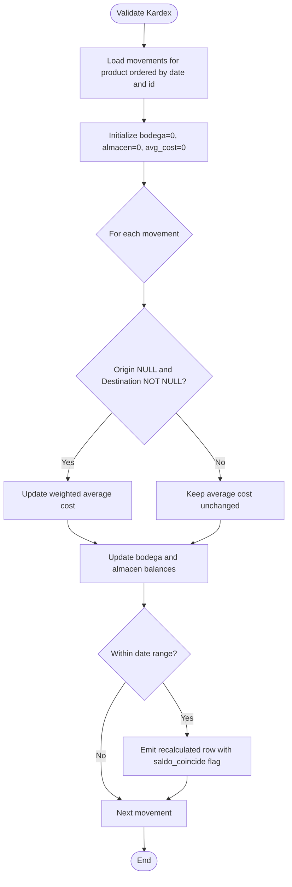

**Diagram sources**
- [012_saldo_kardex.sql:26-108](file://backend/db/migrations/012_saldo_kardex.sql#L26-L108)

**Section sources**
- [012_saldo_kardex.sql:26-108](file://backend/db/migrations/012_saldo_kardex.sql#L26-L108)
- [006_inventario.sql:136-161](file://backend/db/migrations/006_inventario.sql#L136-L161)

### Data Types Selection Rationale and Domain-Specific Constraints
- Monetary amounts: `NUMERIC(14,2)` for totals and line subtotals to avoid floating-point rounding issues.
- Quantities: `NUMERIC(12,3)` to support fractional units (e.g., kilograms, liters) while maintaining precision.
- Costs: `NUMERIC(12,2)` to align with currency precision and enable weighted average calculations.
- Identifiers: `SERIAL` or `BIGSERIAL` for auto-incrementing primary keys; `VARCHAR` for codes and names with length limits.
- Dates: `TIMESTAMPTZ` to respect timezone settings (`America/Bogota`) and ensure consistent timestamps across operations.
- Booleans: `BOOLEAN` for active/inactive flags and permission states.
- Domain constraints: CHECK constraints enforce non-negative values, valid states, and business rules (e.g., discounts not exceeding subtotals, reasons required for cancellations).

**Section sources**
- [003_catalogo.sql:65-83](file://backend/db/migrations/003_catalogo.sql#L65-L83)
- [004_clientes_pedidos.sql:42-85](file://backend/db/migrations/004_clientes_pedidos.sql#L42-L85)
- [005_ventas.sql:40-97](file://backend/db/migrations/005_ventas.sql#L40-L97)
- [006_inventario.sql:62-108](file://backend/db/migrations/006_inventario.sql#L62-L108)
- [001_base.sql:21-26](file://backend/db/migrations/001_base.sql#L21-L26)

## Dependency Analysis
The following diagram highlights direct dependencies between major entities and how they interact across modules.

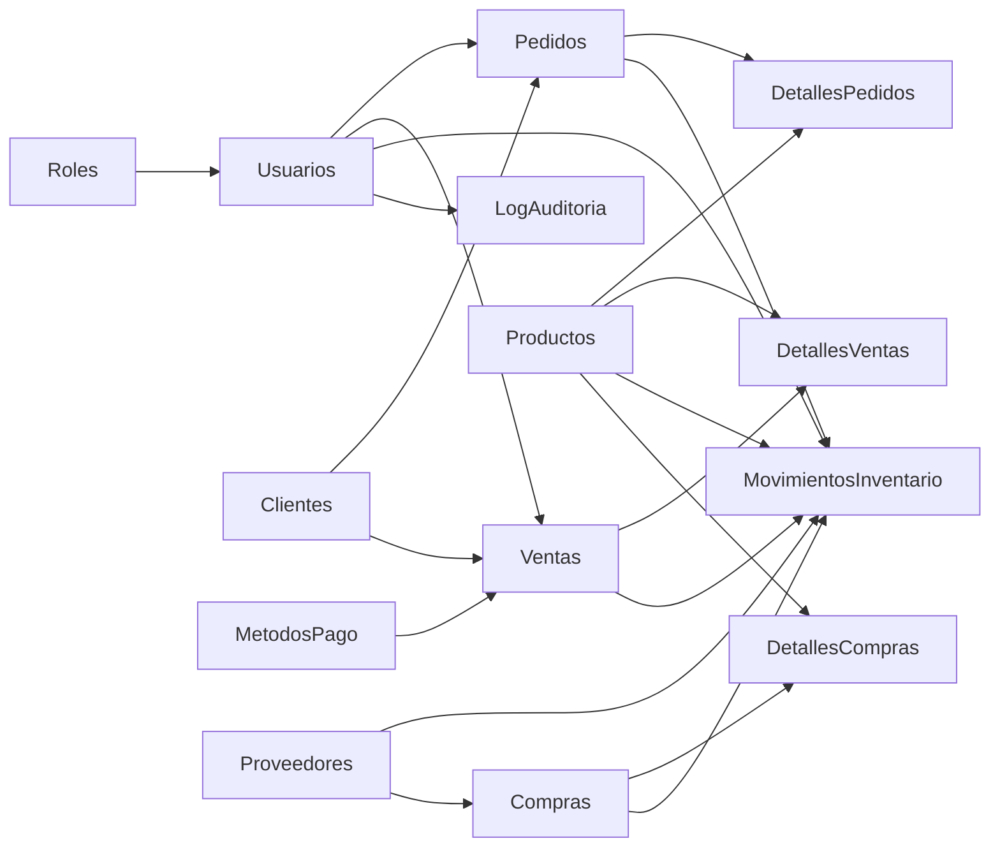

**Diagram sources**
- [002_seguridad.sql:15-53](file://backend/db/migrations/002_seguridad.sql#L15-L53)
- [003_catalogo.sql:65-83](file://backend/db/migrations/003_catalogo.sql#L65-L83)
- [004_clientes_pedidos.sql:42-105](file://backend/db/migrations/004_clientes_pedidos.sql#L42-L105)
- [005_ventas.sql:40-97](file://backend/db/migrations/005_ventas.sql#L40-L97)
- [006_inventario.sql:62-108](file://backend/db/migrations/006_inventario.sql#L62-L108)
- [011_compras.sql:21-57](file://backend/db/migrations/011_compras.sql#L21-L57)

**Section sources**
- [002_seguridad.sql:15-53](file://backend/db/migrations/002_seguridad.sql#L15-L53)
- [003_catalogo.sql:65-83](file://backend/db/migrations/003_catalogo.sql#L65-L83)
- [004_clientes_pedidos.sql:42-105](file://backend/db/migrations/004_clientes_pedidos.sql#L42-L105)
- [005_ventas.sql:40-97](file://backend/db/migrations/005_ventas.sql#L40-L97)
- [006_inventario.sql:62-108](file://backend/db/migrations/006_inventario.sql#L62-L108)
- [011_compras.sql:21-57](file://backend/db/migrations/011_compras.sql#L21-L57)

## Performance Considerations
- Indexes on frequently filtered columns:
  - `idx_usuarios_id_rol`, `idx_usuarios_estado` for user queries.
  - `idx_productos_categoria`, `idx_productos_estado`, `idx_productos_nombre` for catalog searches.
  - `idx_clientes_nombre`, `idx_clientes_identificacion_prefijo` for customer lookups.
  - `idx_pedidos_id_cliente`, `idx_pedidos_estado`, `idx_pedidos_abiertos_entrega` for order management.
  - `idx_ventas_id_cliente`, `idx_ventas_id_usuario`, `idx_ventas_fecha_completadas` for sales analytics.
  - `idx_movimientos_producto_fecha`, `idx_movimientos_fecha`, `idx_movimientos_venta`, `idx_movimientos_pedido` for inventory queries.
  - `idx_auditoria_fecha`, `idx_auditoria_entidad`, `idx_auditoria_usuario`, `idx_auditoria_accion` for audit retrieval.
- Coverage indexes and partial indexes:
  - `idx_ventas_fecha_completadas` includes `total` and filters completed sales for dashboard aggregation.
  - `uq_detalles_ventas_producto` extended with INCLUDE columns to avoid table reads in reports.
  - `idx_detalles_ventas_producto` optimized for product sales history without visiting full rows.
- Planner tuning:
  - `random_page_cost = 1.1` recommended for SSD environments to favor index scans over sequential scans.

**Section sources**
- [002_seguridad.sql:60-61](file://backend/db/migrations/002_seguridad.sql#L60-L61)
- [003_catalogo.sql:92-94](file://backend/db/migrations/003_catalogo.sql#L92-L94)
- [004_clientes_pedidos.sql:62-66](file://backend/db/migrations/004_clientes_pedidos.sql#L62-L66)
- [005_ventas.sql:75-77](file://backend/db/migrations/005_ventas.sql#L75-L77)
- [006_inventario.sql:116-119](file://backend/db/migrations/006_inventario.sql#L116-L119)
- [007_auditoria.sql:48-51](file://backend/db/migrations/007_auditoria.sql#L48-L51)
- [009_clientes.sql:16-17](file://backend/db/migrations/009_clientes.sql#L16-L17)
- [013_indices_ventas.sql:33-57](file://backend/db/migrations/013_indices_ventas.sql#L33-L57)
- [013_indices_ventas.sql:59-65](file://backend/db/migrations/013_indices_ventas.sql#L59-L65)

## Troubleshooting Guide
Common issues and resolutions:

- Missing user context for order or audit operations:
  - Ensure the backend sets `simo.id_usuario` (and optionally `simo.motivo`) before modifying orders or writing audit logs.
  - Triggers will raise errors if user context is absent.

- Invalid order state transitions:
  - Orders must follow the defined lifecycle; attempts to jump states or modify final states will fail.
  - Use the provided transition validation function and triggers.

- Negative stock or invalid movement combinations:
  - Movement types enforce origin/destination and reference constraints; violations raise errors.
  - Stock levels are validated via CHECK constraints; negative values are rejected.

- Purchase confirmation failures:
  - Confirming a purchase locks the row and applies all lines atomically; missing lines or already confirmed purchases raise errors.
  - Warehouse intake validates user and supplier status and enforces integer quantities when applicable.

- Inconsistent Kardex balances:
  - Use `fn_validar_kardex` to compare recalculated balances with current stock levels.
  - Investigate movements flagged as inconsistent and correct underlying data or processes.

- Client identity immutability:
  - Attempts to change `identificacion` or `tipo_identificacion` are blocked; use the provided function/triggers to understand the constraint.

- Session logout and token invalidation:
  - Tokens added to `jwt_blacklist` are rejected by authentication middleware even if not expired.

**Section sources**
- [004_clientes_pedidos.sql:114-189](file://backend/db/migrations/004_clientes_pedidos.sql#L114-L189)
- [006_inventario.sql:84-108](file://backend/db/migrations/006_inventario.sql#L84-L108)
- [011_compras.sql:224-255](file://backend/db/migrations/011_compras.sql#L224-L255)
- [012_saldo_kardex.sql:113-149](file://backend/db/migrations/012_saldo_kardex.sql#L113-L149)
- [009_clientes.sql:19-34](file://backend/db/migrations/009_clientes.sql#L19-L34)
- [010_sesiones.sql:12-15](file://backend/db/migrations/010_sesiones.sql#L12-L15)

## Conclusion
The SIMO database schema implements a robust, normalized design with strong data integrity and auditability. Key strengths include:

- Clear separation of concerns across security, catalog, commercial, inventory, and audit domains.
- Strict enforcement of business rules via CHECK constraints, triggers, and stored procedures.
- Dual-location inventory tracking with immutable movement ledgers and comprehensive Kardex reporting.
- Comprehensive audit trails capturing user attribution and optional authorization for sensitive operations.
- Careful selection of data types and domain-specific constraints to ensure precision and correctness.
- Performance-oriented indexing and planner tuning to support high-volume sales and inventory queries.

This design supports scalable operations for warehouse management, point-of-sale transactions, and analytical reporting while maintaining data consistency and traceability.