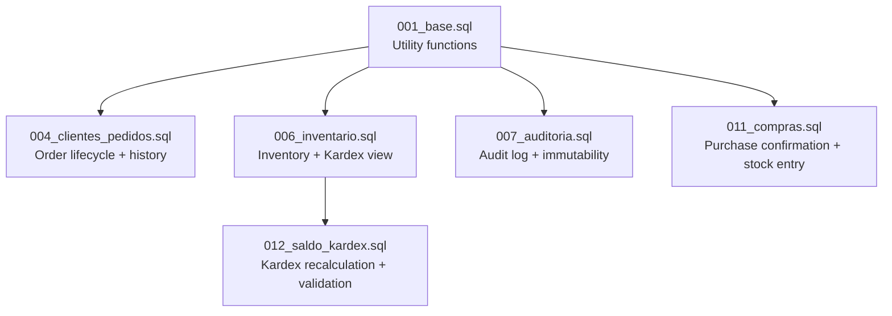
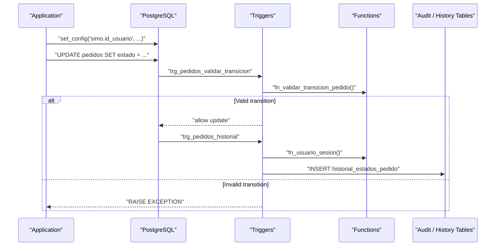
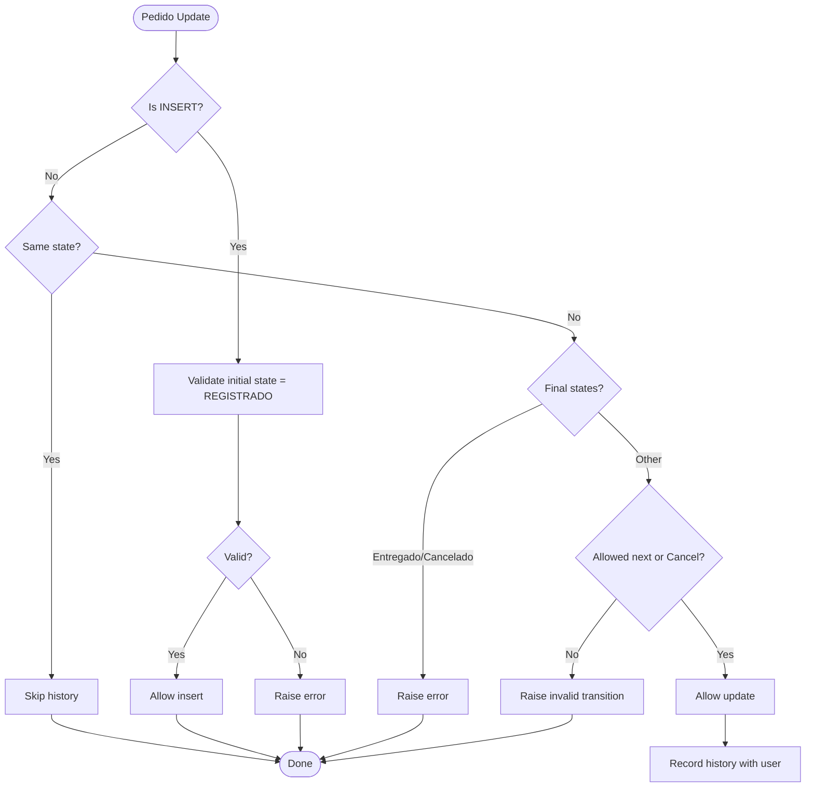
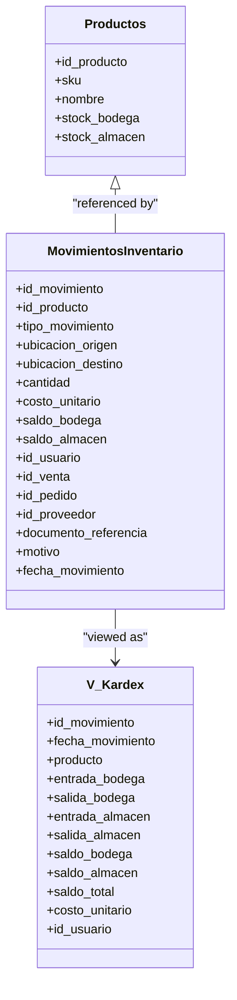
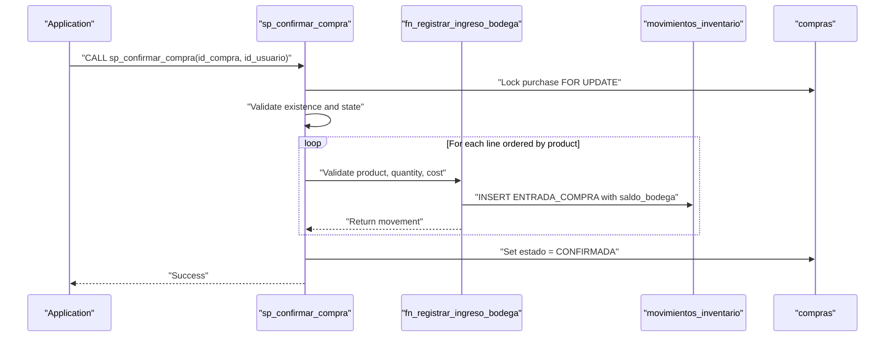
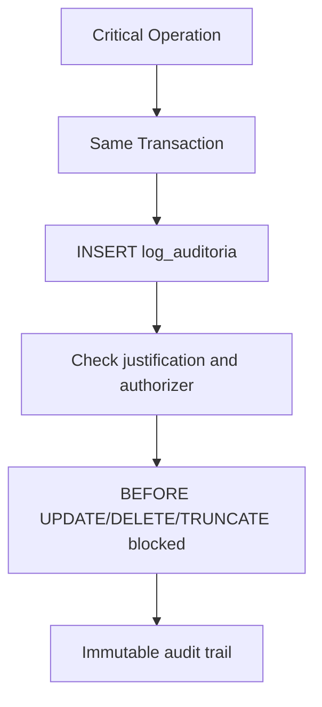
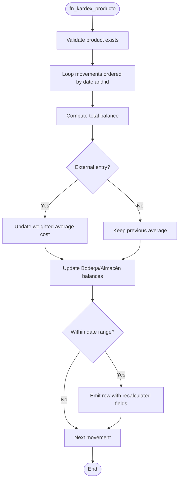
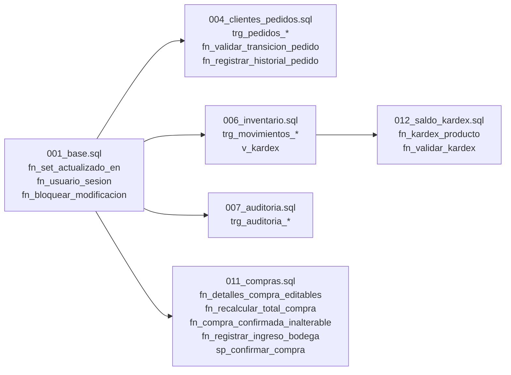

# Stored Procedures & Triggers

<cite>
**Referenced Files in This Document**
- [001_base.sql](file://backend/db/migrations/001_base.sql)
- [004_clientes_pedidos.sql](file://backend/db/migrations/004_clientes_pedidos.sql)
- [006_inventario.sql](file://backend/db/migrations/006_inventario.sql)
- [007_auditoria.sql](file://backend/db/migrations/007_auditoria.sql)
- [011_compras.sql](file://backend/db/migrations/011_compras.sql)
- [012_saldo_kardex.sql](file://backend/db/migrations/012_saldo_kardex.sql)
- [README.md](file://backend/db/README.md)
</cite>

## Table of Contents
1. [Introduction](#introduction)
2. [Project Structure](#project-structure)
3. [Core Components](#core-components)
4. [Architecture Overview](#architecture-overview)
5. [Detailed Component Analysis](#detailed-component-analysis)
6. [Dependency Analysis](#dependency-analysis)
7. [Performance Considerations](#performance-considerations)
8. [Troubleshooting Guide](#troubleshooting-guide)
9. [Conclusion](#conclusion)

## Introduction
This document explains the stored procedures, functions, and triggers that implement business rules, audit trails, inventory integrity, and session attribution in the SIMO database. It focuses on:

- Core utility functions for timestamps, user attribution, and immutability.
- Trigger-based audit trail and state history mechanisms.
- Inventory movement rules and Kardex saldo calculation.
- Transaction management patterns using PostgreSQL session configuration.
- Performance considerations and debugging techniques for PL/pgSQL code.

The goal is to make these database-level controls understandable for both developers and auditors while preserving technical precision.

## Project Structure
The database logic lives under `backend/db/migrations`. The most relevant files for this documentation are:

- Base utilities and session configuration: `001_base.sql`
- Client and order lifecycle with state history: `004_clientes_pedidos.sql`
- Inventory tables, movements, and Kardex view: `006_inventario.sql`
- Immutable audit log table and protection triggers: `007_auditoria.sql`
- Purchase workflow and stock entry procedure: `011_compras.sql`
- Kardex recalculation and validation functions: `012_saldo_kardex.sql`

**Diagram sources**
- [001_base.sql:1-17](file://backend/db/migrations/001_base.sql#L1-L17)
- [004_clientes_pedidos.sql:1-6](file://backend/db/migrations/004_clientes_pedidos.sql#L1-L6)
- [006_inventario.sql:1-18](file://backend/db/migrations/006_inventario.sql#L1-L18)
- [007_auditoria.sql:1-9](file://backend/db/migrations/007_auditoria.sql#L1-L9)
- [011_compras.sql:1-17](file://backend/db/migrations/011_compras.sql#L1-L17)
- [012_saldo_kardex.sql:1-22](file://backend/db/migrations/012_saldo_kardex.sql#L1-L22)

**Section sources**
- [001_base.sql:1-17](file://backend/db/migrations/001_base.sql#L1-L17)
- [004_clientes_pedidos.sql:1-6](file://backend/db/migrations/004_clientes_pedidos.sql#L1-L6)
- [006_inventario.sql:1-18](file://backend/db/migrations/006_inventario.sql#L1-L18)
- [007_auditoria.sql:1-9](file://backend/db/migrations/007_auditoria.sql#L1-L9)
- [011_compras.sql:1-17](file://backend/db/migrations/011_compras.sql#L1-L17)
- [012_saldo_kardex.sql:1-22](file://backend/db/migrations/012_saldo_kardex.sql#L1-L22)

## Core Components
This section documents the foundational functions and how they are used across the system.

### fn_set_actualizado_en
- Purpose: Automatically updates the `actualizado_en` column on every row update.
- Behavior: Sets the new timestamp to the current time before each row update.
- Usage: Attached via a `BEFORE UPDATE` trigger on multiple tables (users, company, categories, products, clients, orders, suppliers, purchases).

Key characteristics:
- Simple row-level trigger function.
- Ensures consistent modification timestamps without application-side logic.

**Section sources**
- [001_base.sql:28-37](file://backend/db/migrations/001_base.sql#L28-L37)
- [002_seguridad.sql:64-68](file://backend/db/migrations/002_seguridad.sql#L64-L68)
- [002_seguridad.sql:86-90](file://backend/db/migrations/002_seguridad.sql#L86-L90)
- [003_catalogo.sql:53-57](file://backend/db/migrations/003_catalogo.sql#L53-L57)
- [003_catalogo.sql:97-101](file://backend/db/migrations/003_catalogo.sql#L97-L101)
- [004_clientes_pedidos.sql:30-33](file://backend/db/migrations/004_clientes_pedidos.sql#L30-L33)
- [004_clientes_pedidos.sql:68-71](file://backend/db/migrations/004_clientes_pedidos.sql#L68-L71)
- [006_inventario.sql:38-41](file://backend/db/migrations/006_inventario.sql#L38-L41)
- [011_compras.sql:44-47](file://backend/db/migrations/011_compras.sql#L44-L47)

### fn_usuario_sesion
- Purpose: Returns the ID of the user responsible for the current transaction.
- Behavior: Reads the session setting `simo.id_usuario`; returns NULL if not set.
- Usage: Used by triggers that must record who changed data (for example, order state history).

Session configuration pattern:
- Before modifying protected entities, the backend should execute:
  - `SELECT set_config('simo.id_usuario', '<id>', true);`
  - Optionally: `SELECT set_config('simo.motivo', '<reason>', true);`
- The third parameter limits the setting to the current transaction.

**Section sources**
- [001_base.sql:39-45](file://backend/db/migrations/001_base.sql#L39-L45)
- [001_base.sql:11-16](file://backend/db/migrations/001_base.sql#L11-L16)
- [004_clientes_pedidos.sql:153-167](file://backend/db/migrations/004_clientes_pedidos.sql#L153-L167)
- [README.md:108-112](file://backend/db/README.md#L108-L112)

### fn_bloquear_modificacion
- Purpose: Prevents any modification to immutable tables such as Kardex movements, order state history, and audit logs.
- Behavior: Raises an exception for UPDATE, DELETE, or TRUNCATE operations.
- Usage: Attached as `BEFORE UPDATE OR DELETE` row-level triggers and `BEFORE TRUNCATE` statement-level triggers.

Immutability enforcement:
- Applied to `movimientos_inventario`, `historial_estados_pedido`, and `log_auditoria`.
- Combined with privilege revocations where applicable.

**Section sources**
- [001_base.sql:47-57](file://backend/db/migrations/001_base.sql#L47-L57)
- [004_clientes_pedidos.sql:186-189](file://backend/db/migrations/004_clientes_pedidos.sql#L186-L189)
- [006_inventario.sql:121-129](file://backend/db/migrations/006_inventario.sql#L121-L129)
- [007_auditoria.sql:53-65](file://backend/db/migrations/007_auditoria.sql#L53-L65)

## Architecture Overview
The database enforces business rules through a layered approach:

- Utility layer: shared functions for timestamps, user attribution, and immutability.
- Business rule layer: triggers validate state transitions, totals, and referential constraints.
- Audit layer: immutable logs capture critical actions with user attribution and optional authorization.
- Inventory layer: movements are recorded chronologically; Kardex values are recalculated and validated.

**Diagram sources**
- [001_base.sql:42-45](file://backend/db/migrations/001_base.sql#L42-L45)
- [004_clientes_pedidos.sql:114-151](file://backend/db/migrations/004_clientes_pedidos.sql#L114-L151)
- [004_clientes_pedidos.sql:155-184](file://backend/db/migrations/004_clientes_pedidos.sql#L155-L184)

## Detailed Component Analysis

### Order Lifecycle and State History
Orders follow a strict lifecycle: `REGISTRADO -> CONFIRMADO -> EN_PREPARACION -> LISTO -> ENTREGADO`, with cancellation allowed from any non-delivered state.

Key elements:
- `pedidos` table stores current state and timestamps.
- `fn_validar_transicion_pedido()` validates allowed transitions.
- `trg_pedidos_validar_transicion` enforces validation before insert or state update.
- `trg_pedidos_historial` records every state change into `historial_estados_pedido`.
- `fn_registrar_historial_pedido()` uses `fn_usuario_sesion()` to attribute changes.

**Diagram sources**
- [004_clientes_pedidos.sql:114-151](file://backend/db/migrations/004_clientes_pedidos.sql#L114-L151)
- [004_clientes_pedidos.sql:155-184](file://backend/db/migrations/004_clientes_pedidos.sql#L155-L184)

**Section sources**
- [004_clientes_pedidos.sql:42-71](file://backend/db/migrations/004_clientes_pedidos.sql#L42-L71)
- [004_clientes_pedidos.sql:95-109](file://backend/db/migrations/004_clientes_pedidos.sql#L95-L109)
- [004_clientes_pedidos.sql:114-189](file://backend/db/migrations/004_clientes_pedidos.sql#L114-L189)

### Inventory Movement Rules and Kardex View
Inventory movements are recorded in `movimientos_inventario`, which acts as an immutable ledger. Each movement includes:
- Product reference.
- Movement type (purchase entry, internal transfer, sale/pedido exit, reversals, adjustments).
- Origin and destination locations (`BODEGA`, `ALMACEN`).
- Quantities, unit cost, and resulting balances per location.
- References to sales, orders, suppliers, and users.

Business rules enforced:
- Location combinations depend on movement type.
- Required references per movement type.
- Mandatory justification for manual adjustments.
- Non-negative balances and positive quantities.

The `v_kardex` view presents chronological entries with separate entries and exits per location and shows computed total balance.

**Diagram sources**
- [006_inventario.sql:62-108](file://backend/db/migrations/006_inventario.sql#L62-L108)
- [006_inventario.sql:136-161](file://backend/db/migrations/006_inventario.sql#L136-L161)

**Section sources**
- [006_inventario.sql:25-41](file://backend/db/migrations/006_inventario.sql#L25-L41)
- [006_inventario.sql:62-119](file://backend/db/migrations/006_inventario.sql#L62-L119)
- [006_inventario.sql:121-161](file://backend/db/migrations/006_inventario.sql#L121-L161)

### Purchase Confirmation and Stock Entry
Purchases start as drafts and become confirmed through a stored procedure. On confirmation:
- All lines are processed in a single transaction.
- Stock at `BODEGA` is increased.
- A `ENTRADA_COMPRA` movement is recorded in the Kardex.
- The purchase is marked as confirmed with auditor attribution.

Key components:
- `compras` and `detalles_compras` tables.
- `fn_detalles_compra_editables()`: prevents line changes after confirmation.
- `fn_recalcular_total_compra()`: maintains purchase total as sum of line subtotals.
- `fn_compra_confirmada_inalterable()`: prevents modifications to confirmed purchases.
- `fn_registrar_ingreso_bodega()`: validates inputs, checks product and supplier status, updates stock, and inserts a movement.
- `sp_confirmar_compra()`: orchestrates confirmation, processes lines in deterministic order, and finalizes the purchase.

**Diagram sources**
- [011_compras.sql:66-83](file://backend/db/migrations/011_compras.sql#L66-L83)
- [011_compras.sql:86-100](file://backend/db/migrations/011_compras.sql#L86-L100)
- [011_compras.sql:102-123](file://backend/db/migrations/011_compras.sql#L102-L123)
- [011_compras.sql:146-208](file://backend/db/migrations/011_compras.sql#L146-L208)
- [011_compras.sql:217-255](file://backend/db/migrations/011_compras.sql#L217-L255)

**Section sources**
- [011_compras.sql:21-61](file://backend/db/migrations/011_compras.sql#L21-L61)
- [011_compras.sql:66-123](file://backend/db/migrations/011_compras.sql#L66-L123)
- [011_compras.sql:146-208](file://backend/db/migrations/011_compras.sql#L146-L208)
- [011_compras.sql:217-255](file://backend/db/migrations/011_compras.sql#L217-L255)

### Audit Trail System
The audit log captures critical operations with strong integrity guarantees:
- `log_auditoria` stores action type, entity, identifiers, justification, old/new JSONB snapshots, IP address, and user attribution.
- Constraints enforce required justification for sensitive actions and require an authorizer for certain operations.
- Triggers prevent any modification or truncation of audit records.
- Indexes optimize queries by date, entity, user, and action.

Backend integration:
- Critical operations are logged within the same transaction as the operation itself, ensuring atomicity between business changes and their audit records.

**Diagram sources**
- [007_auditoria.sql:13-40](file://backend/db/migrations/007_auditoria.sql#L13-L40)
- [007_auditoria.sql:48-65](file://backend/db/migrations/007_auditoria.sql#L48-L65)

**Section sources**
- [007_auditoria.sql:1-9](file://backend/db/migrations/007_auditoria.sql#L1-L9)
- [007_auditoria.sql:13-51](file://backend/db/migrations/007_auditoria.sql#L13-L51)
- [007_auditoria.sql:53-65](file://backend/db/migrations/007_auditoria.sql#L53-L65)

### Kardex Calculation and Validation
Two functions provide inventory integrity verification:

- `fn_kardex_producto(p_id_producto, p_desde, p_hasta)`:
  - Iterates movements chronologically.
  - Recalculates balances per location and weighted average cost.
  - Marks rows where saved balances differ from recalculated ones.
  - Date filters only affect output visibility; balances always compute from the first movement.

- `fn_validar_kardex(p_id_producto)`:
  - Audits one or all products.
  - Compares recalculated final balances with product stock columns.
  - Reports inconsistent movements and overall consistency.

Weighted average cost logic:
- External entries (purchases, positive adjustments, reversals) update the average.
- Internal transfers and exits do not change the average.

**Diagram sources**
- [012_saldo_kardex.sql:26-108](file://backend/db/migrations/012_saldo_kardex.sql#L26-L108)

**Section sources**
- [012_saldo_kardex.sql:1-22](file://backend/db/migrations/012_saldo_kardex.sql#L1-L22)
- [012_saldo_kardex.sql:26-108](file://backend/db/migrations/012_saldo_kardex.sql#L26-L108)
- [012_saldo_kardex.sql:113-152](file://backend/db/migrations/012_saldo_kardex.sql#L113-L152)

## Dependency Analysis
The following diagram maps key dependencies among core functions and triggers:

**Diagram sources**
- [001_base.sql:31-57](file://backend/db/migrations/001_base.sql#L31-L57)
- [004_clientes_pedidos.sql:114-189](file://backend/db/migrations/004_clientes_pedidos.sql#L114-L189)
- [006_inventario.sql:121-161](file://backend/db/migrations/006_inventario.sql#L121-L161)
- [007_auditoria.sql:53-65](file://backend/db/migrations/007_auditoria.sql#L53-L65)
- [011_compras.sql:66-255](file://backend/db/migrations/011_compras.sql#L66-L255)
- [012_saldo_kardex.sql:26-152](file://backend/db/migrations/012_saldo_kardex.sql#L26-L152)

**Section sources**
- [001_base.sql:31-57](file://backend/db/migrations/001_base.sql#L31-L57)
- [004_clientes_pedidos.sql:114-189](file://backend/db/migrations/004_clientes_pedidos.sql#L114-L189)
- [006_inventario.sql:121-161](file://backend/db/migrations/006_inventario.sql#L121-L161)
- [007_auditoria.sql:53-65](file://backend/db/migrations/007_auditoria.sql#L53-L65)
- [011_compras.sql:66-255](file://backend/db/migrations/011_compras.sql#L66-L255)
- [012_saldo_kardex.sql:26-152](file://backend/db/migrations/012_saldo_kardex.sql#L26-L152)

## Performance Considerations
- Use indexes wisely:
  - Movement queries benefit from composite indexes on `(id_producto, fecha_movimiento, id_movimiento)`.
  - Audit queries benefit from indexes on `fecha`, `entidad`, `id_entidad`, `id_usuario`, and `accion`.
  - Order queries benefit from indexes on `estado` and open delivery windows.
- Avoid unnecessary recomputation:
  - `fn_kardex_producto` recalculates balances from the first movement regardless of date filters; use it for audits rather than high-frequency reporting.
- Locking and concurrency:
  - `sp_confirmar_compra` locks the purchase row and processes lines in deterministic order to avoid deadlocks.
- Session settings:
  - Ensure `simo.id_usuario` is set per transaction to avoid exceptions in triggers that require user attribution.

[No sources needed since this section provides general guidance]

## Troubleshooting Guide
Common issues and diagnostics:

- Missing user attribution:
  - Symptom: Exception indicating missing responsible user when updating orders.
  - Cause: `simo.id_usuario` not set before triggering order state changes.
  - Resolution: Execute `set_config('simo.id_usuario', '<id>', true)` in the transaction.

- Attempted modification of immutable tables:
  - Symptom: Exception stating the table is immutable for the attempted operation.
  - Cause: UPDATE, DELETE, or TRUNCATE on Kardex, order history, or audit log.
  - Resolution: Do not modify these tables directly; use approved procedures or add new movements/reversals.

- Invalid order state transition:
  - Symptom: Exception indicating invalid transition.
  - Cause: Updating to a state not allowed by the lifecycle.
  - Resolution: Follow the defined sequence or cancel appropriately.

- Inconsistent Kardex balances:
  - Symptom: `fn_validar_kardex` reports inconsistencies or mismatched stock.
  - Cause: Direct manipulation of stock columns or incorrect movement balances.
  - Resolution: Investigate movements with `fn_kardex_producto`, correct root causes, and revalidate.

- Purchase confirmation errors:
  - Symptom: Exceptions for duplicate confirmation, missing lines, inactive product/supplier, or invalid quantity/cost.
  - Cause: Business rule violations during confirmation.
  - Resolution: Validate inputs and ensure the purchase has valid lines and active entities.

**Section sources**
- [004_clientes_pedidos.sql:155-167](file://backend/db/migrations/004_clientes_pedidos.sql#L155-L167)
- [001_base.sql:50-57](file://backend/db/migrations/001_base.sql#L50-L57)
- [012_saldo_kardex.sql:26-108](file://backend/db/migrations/012_saldo_kardex.sql#L26-L108)
- [011_compras.sql:162-188](file://backend/db/migrations/011_compras.sql#L162-L188)
- [011_compras.sql:224-249](file://backend/db/migrations/011_compras.sql#L224-L249)

## Conclusion
SIMO’s database design centralizes critical business logic in PL/pgSQL functions and triggers:

- Timestamps, user attribution, and immutability are consistently enforced through reusable functions.
- Order lifecycle rules and state history guarantee traceability and compliance.
- Inventory movements form an immutable ledger with robust validation and a clear Kardex view.
- Purchase confirmation consolidates stock updates and ensures auditability.
- Audit logs protect critical operations with strong integrity constraints.

These mechanisms collectively ensure data integrity, accountability, and performance at the database level, reducing reliance on application-side validation and providing a reliable foundation for auditing and reconciliation.

[No sources needed since this section summarizes without analyzing specific files]