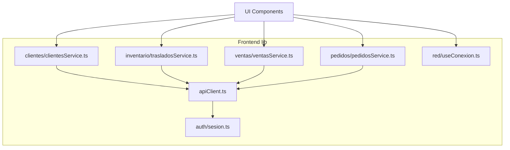
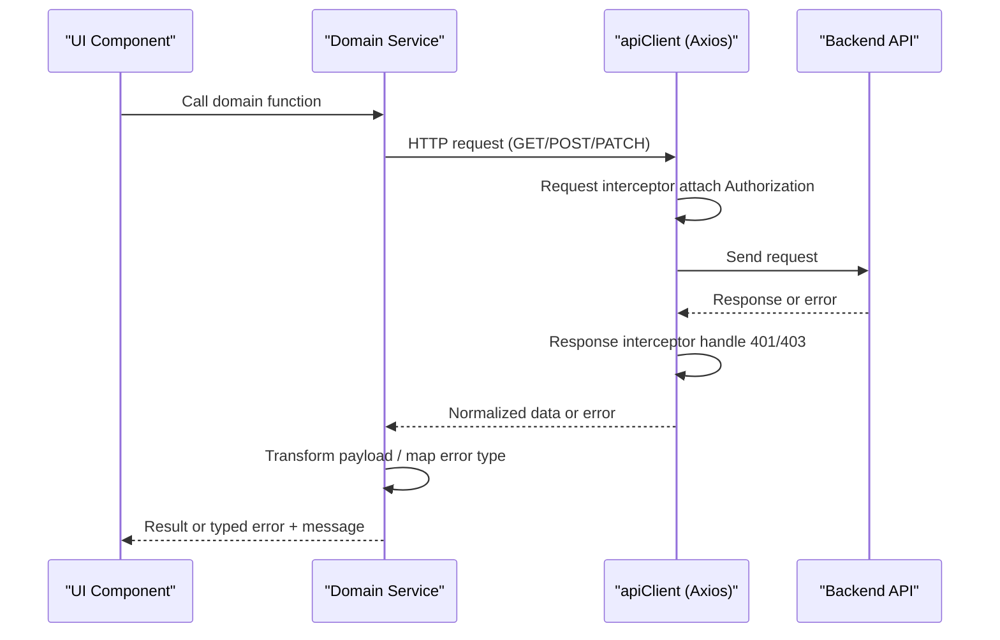
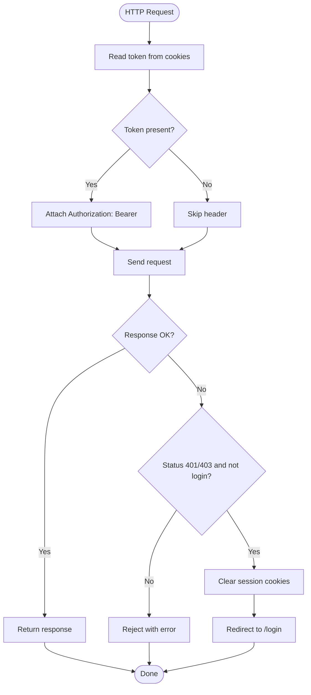
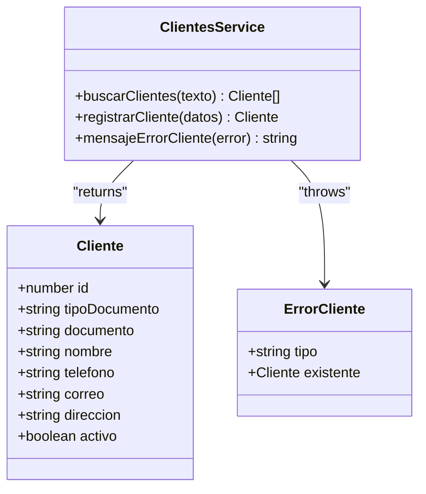
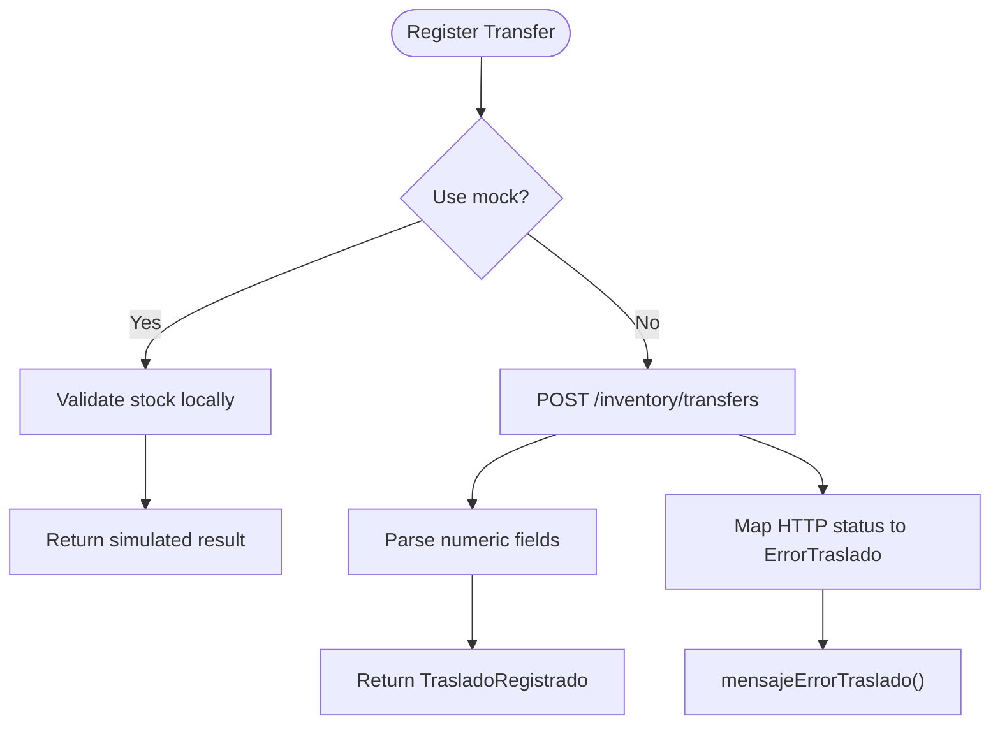
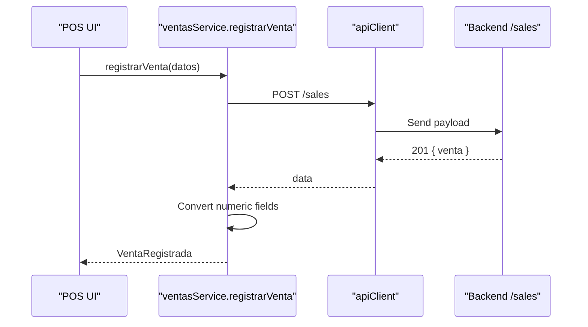
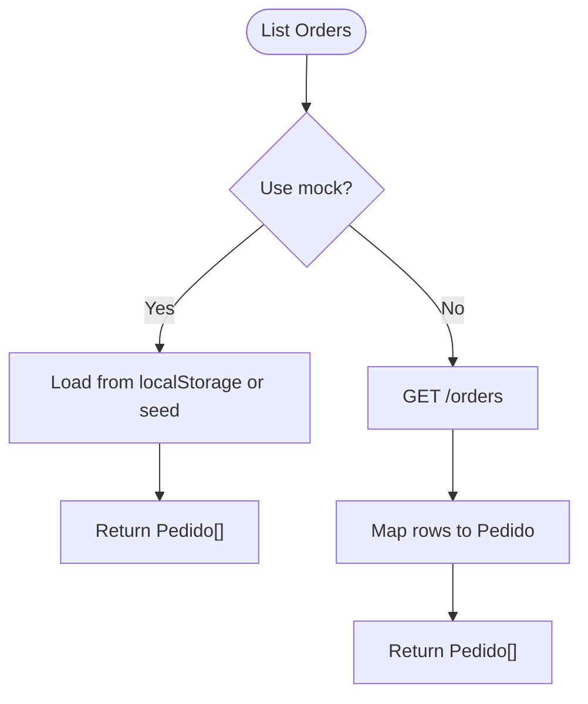
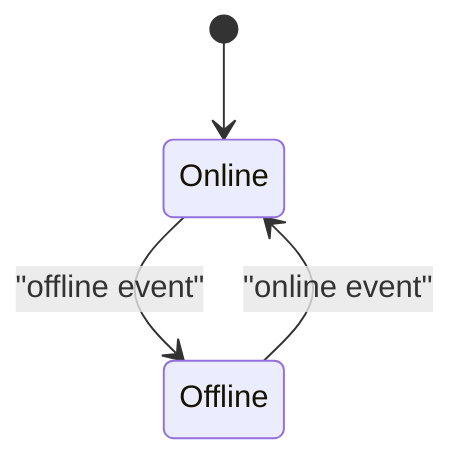
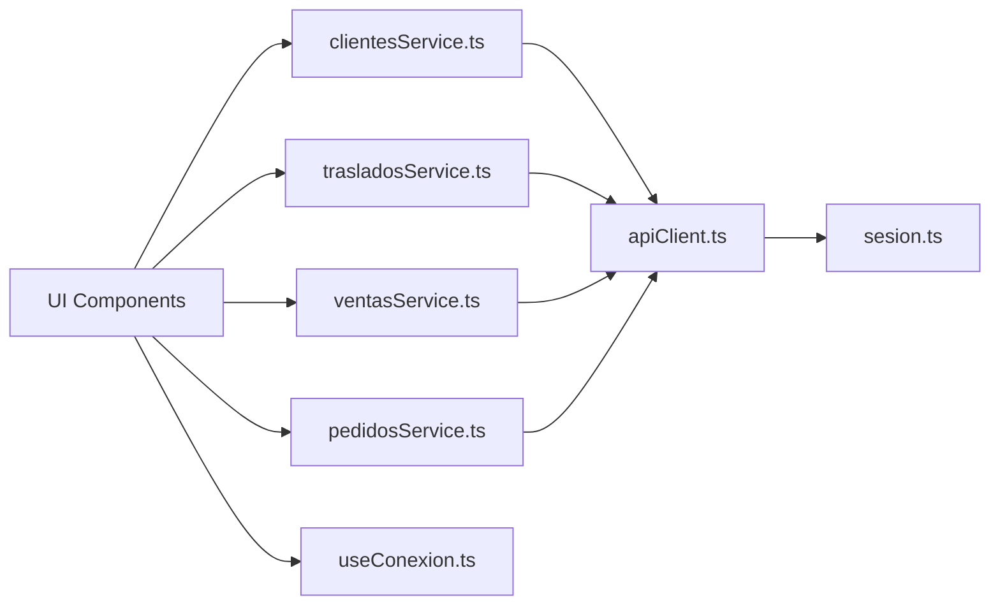

# API Integration

<cite>
**Referenced Files in This Document**
- [apiClient.ts](file://simoapp/lib/apiClient.ts)
- [sesion.ts](file://simoapp/lib/auth/sesion.ts)
- [clientesService.ts](file://simoapp/lib/clientes/clientesService.ts)
- [trasladosService.ts](file://simoapp/lib/inventario/trasladosService.ts)
- [ventasService.ts](file://simoapp/lib/ventas/ventasService.ts)
- [pedidosService.ts](file://simoapp/lib/pedidos/pedidosService.ts)
- [useConexion.ts](file://simoapp/lib/red/useConexion.ts)
</cite>

## Table of Contents
1. [Introduction](#introduction)
2. [Project Structure](#project-structure)
3. [Core Components](#core-components)
4. [Architecture Overview](#architecture-overview)
5. [Detailed Component Analysis](#detailed-component-analysis)
6. [Dependency Analysis](#dependency-analysis)
7. [Performance Considerations](#performance-considerations)
8. [Troubleshooting Guide](#troubleshooting-guide)
9. [Conclusion](#conclusion)

## Introduction
This document explains the SIMO frontend API integration layer. It focuses on the centralized HTTP client, authentication header injection, global error handling, and the modular service layer that isolates business domains (customers, inventory transfers, sales, orders). It also covers request/response interceptors, environment-driven mock vs real API behavior, data transformation patterns between backend responses and frontend models, connection awareness, and best practices for separating UI from data fetching logic.

## Project Structure
The API integration lives under simoapp/lib:
- apiClient.ts: Central Axios instance with base URL, default headers, request interceptor (JWT), and response interceptor (auth errors).
- Domain services: clientes/, inventario/, ventas/, pedidos/ each expose a single entry point per feature.
- auth/sesion.ts: Session cookie helpers used by the client to read/write tokens.
- red/useConexion.ts: Browser online/offline hook used by UI to show connectivity status.

**Diagram sources**
- [apiClient.ts:1-59](file://simoapp/lib/apiClient.ts#L1-L59)
- [sesion.ts:1-60](file://simoapp/lib/auth/sesion.ts#L1-L60)
- [clientesService.ts:1-184](file://simoapp/lib/clientes/clientesService.ts#L1-L184)
- [trasladosService.ts:1-129](file://simoapp/lib/inventario/trasladosService.ts#L1-L129)
- [ventasService.ts:1-118](file://simoapp/lib/ventas/ventasService.ts#L1-L118)
- [pedidosService.ts:1-186](file://simoapp/lib/pedidos/pedidosService.ts#L1-L186)
- [useConexion.ts:1-34](file://simoapp/lib/red/useConexion.ts#L1-L34)

**Section sources**
- [apiClient.ts:1-59](file://simoapp/lib/apiClient.ts#L1-L59)
- [sesion.ts:1-60](file://simoapp/lib/auth/sesion.ts#L1-L60)
- [clientesService.ts:1-184](file://simoapp/lib/clientes/clientesService.ts#L1-L184)
- [trasladosService.ts:1-129](file://simoapp/lib/inventario/trasladosService.ts#L1-L129)
- [ventasService.ts:1-118](file://simoapp/lib/ventas/ventasService.ts#L1-L118)
- [pedidosService.ts:1-186](file://simoapp/lib/pedidos/pedidosService.ts#L1-L186)
- [useConexion.ts:1-34](file://simoapp/lib/red/useConexion.ts#L1-L34)

## Core Components
- Centralized HTTP client: A single Axios instance sets baseURL, default headers, injects Authorization Bearer token via request interceptor, and handles 401/403 globally by clearing session and redirecting to login.
- Session management: Cookies store token, role, and userId; helper functions read/write/clear them.
- Domain services: Each domain exposes typed functions that call apiClient, transform backend payloads into frontend models, and throw domain-specific error classes with user-friendly messages.
- Connection awareness: useConexion hook listens to browser online/offline events and re-renders components accordingly.

Key responsibilities:
- Authentication: Token attached automatically; unauthorized responses trigger logout and navigation.
- Error normalization: Backend HTTP statuses mapped to domain error types and user-facing messages.
- Data transformation: Backend row shapes converted to stable frontend model shapes.
- Mock/runtime toggle: Environment variables switch between mock implementations and real endpoints.

**Section sources**
- [apiClient.ts:1-59](file://simoapp/lib/apiClient.ts#L1-L59)
- [sesion.ts:1-60](file://simoapp/lib/auth/sesion.ts#L1-L60)
- [clientesService.ts:1-184](file://simoapp/lib/clientes/clientesService.ts#L1-L184)
- [trasladosService.ts:1-129](file://simoapp/lib/inventario/trasladosService.ts#L1-L129)
- [ventasService.ts:1-118](file://simoapp/lib/ventas/ventasService.ts#L1-L118)
- [pedidosService.ts:1-186](file://simoapp/lib/pedidos/pedidosService.ts#L1-L186)
- [useConexion.ts:1-34](file://simoapp/lib/red/useConexion.ts#L1-L34)

## Architecture Overview
The API integration follows a layered approach:
- UI components call domain services.
- Domain services encapsulate HTTP calls through apiClient.
- apiClient centralizes auth and global error handling.
- Services normalize backend responses into frontend models and throw typed errors.
- UI uses useConexion to adapt UX based on network state.

**Diagram sources**
- [apiClient.ts:13-55](file://simoapp/lib/apiClient.ts#L13-L55)
- [clientesService.ts:84-116](file://simoapp/lib/clientes/clientesService.ts#L84-L116)
- [trasladosService.ts:47-79](file://simoapp/lib/inventario/trasladosService.ts#L47-L79)
- [ventasService.ts:43-75](file://simoapp/lib/ventas/ventasService.ts#L43-L75)
- [pedidosService.ts:51-72](file://simoapp/lib/pedidos/pedidosService.ts#L51-L72)

## Detailed Component Analysis

### Centralized API Client (apiClient.ts)
Responsibilities:
- Base configuration: baseURL from environment or fallback; JSON content-type.
- Request interceptor: Reads JWT from cookies and attaches Authorization header.
- Response interceptor: On 401/403 (excluding login endpoint), clears session and redirects to /login.

**Diagram sources**
- [apiClient.ts:13-55](file://simoapp/lib/apiClient.ts#L13-L55)
- [sesion.ts:32-52](file://simoapp/lib/auth/sesion.ts#L32-L52)

**Section sources**
- [apiClient.ts:1-59](file://simoapp/lib/apiClient.ts#L1-L59)
- [sesion.ts:1-60](file://simoapp/lib/auth/sesion.ts#L1-L60)

### Customer Service (clientesService.ts)
Responsibilities:
- Search active customers with query parameters.
- Register new customers with normalized inputs.
- Map backend rows to frontend Cliente model.
- Throw ErrorCliente with typed categories (duplicate, invalid data, no connection, server).
- Provide mensajeErrorCliente for user feedback.
- Toggle between mock and real API via NEXT_PUBLIC_CLIENTES_MOCK.

**Diagram sources**
- [clientesService.ts:35-82](file://simoapp/lib/clientes/clientesService.ts#L35-L82)
- [clientesService.ts:84-130](file://simoapp/lib/clientes/clientesService.ts#L84-L130)

**Section sources**
- [clientesService.ts:1-184](file://simoapp/lib/clientes/clientesService.ts#L1-L184)

### Inventory Transfers Service (trasladosService.ts)
Responsibilities:
- Register a transfer from warehouse to storage.
- Normalize backend numeric fields to numbers.
- Throw ErrorTraslado with typed categories (stock, not found, invalid data, no connection, server).
- Provide mensajeErrorTraslado for user feedback.
- Toggle between mock and real API via NEXT_PUBLIC_TRASLADOS_MOCK.

**Diagram sources**
- [trasladosService.ts:47-95](file://simoapp/lib/inventario/trasladosService.ts#L47-L95)

**Section sources**
- [trasladosService.ts:1-129](file://simoapp/lib/inventario/trasladosService.ts#L1-L129)

### Sales Service (ventasService.ts)
Responsibilities:
- Register a POS sale with payment method, optional customer, totals, and line items.
- Normalize backend numeric fields to numbers.
- Throw ErrorVenta with typed categories (stock, invalid data, no connection, server).
- Provide mensajeErrorVenta for user feedback.
- Toggle between mock and real API via NEXT_PUBLIC_VENTAS_MOCK.

**Diagram sources**
- [ventasService.ts:43-75](file://simoapp/lib/ventas/ventasService.ts#L43-L75)

**Section sources**
- [ventasService.ts:1-118](file://simoapp/lib/ventas/ventasService.ts#L1-L118)

### Orders Service (pedidosService.ts)
Responsibilities:
- List orders and update order status.
- Map backend rows to Pedido model, converting date strings and numeric totals.
- Provide mensajeErrorPedidos for generic connection/server errors.
- Toggle between mock and real API via NEXT_PUBLIC_PEDIDOS_MOCK.
- Mock implementation persists orders in localStorage for persistence across reloads.

**Diagram sources**
- [pedidosService.ts:51-79](file://simoapp/lib/pedidos/pedidosService.ts#L51-L79)
- [pedidosService.ts:120-169](file://simoapp/lib/pedidos/pedidosService.ts#L120-L169)

**Section sources**
- [pedidosService.ts:1-186](file://simoapp/lib/pedidos/pedidosService.ts#L1-L186)

### Connection Awareness Hook (useConexion.ts)
Responsibilities:
- Expose a boolean indicating whether the browser is online.
- Subscribe to window online/offline events and re-render consumers when state changes.
- Server-side default to true to avoid flashing offline banners during SSR.

**Diagram sources**
- [useConexion.ts:15-33](file://simoapp/lib/red/useConexion.ts#L15-L33)

**Section sources**
- [useConexion.ts:1-34](file://simoapp/lib/red/useConexion.ts#L1-L34)

## Dependency Analysis
High-level dependencies:
- All domain services depend on apiClient for HTTP transport.
- apiClient depends on auth/session cookie helpers.
- UI components depend on domain services and optionally on useConexion for UX adaptation.

**Diagram sources**
- [apiClient.ts:1-59](file://simoapp/lib/apiClient.ts#L1-L59)
- [sesion.ts:1-60](file://simoapp/lib/auth/sesion.ts#L1-L60)
- [clientesService.ts:1-184](file://simoapp/lib/clientes/clientesService.ts#L1-L184)
- [trasladosService.ts:1-129](file://simoapp/lib/inventario/trasladosService.ts#L1-L129)
- [ventasService.ts:1-118](file://simoapp/lib/ventas/ventasService.ts#L1-L118)
- [pedidosService.ts:1-186](file://simoapp/lib/pedidos/pedidosService.ts#L1-L186)
- [useConexion.ts:1-34](file://simoapp/lib/red/useConexion.ts#L1-L34)

**Section sources**
- [apiClient.ts:1-59](file://simoapp/lib/apiClient.ts#L1-L59)
- [sesion.ts:1-60](file://simoapp/lib/auth/sesion.ts#L1-L60)
- [clientesService.ts:1-184](file://simoapp/lib/clientes/clientesService.ts#L1-L184)
- [trasladosService.ts:1-129](file://simoapp/lib/inventario/trasladosService.ts#L1-L129)
- [ventasService.ts:1-118](file://simoapp/lib/ventas/ventasService.ts#L1-L118)
- [pedidosService.ts:1-186](file://simoapp/lib/pedidos/pedidosService.ts#L1-L186)
- [useConexion.ts:1-34](file://simoapp/lib/red/useConexion.ts#L1-L34)

## Performance Considerations
- Network overhead: Keep requests minimal and specific; leverage query params (e.g., limit, filters) as done in customer search.
- Payload normalization: Perform lightweight transformations in services to keep UI clean.
- Avoid unnecessary re-renders: Use connection-aware hooks sparingly and only where needed.
- Mock latency: Mocks simulate delays to reflect realistic UX; remove or reduce in production builds if needed.

[No sources needed since this section provides general guidance]

## Troubleshooting Guide
Common issues and resolutions:
- Unauthorized redirects: If users are redirected to login unexpectedly, verify that the request is not hitting the login endpoint and that session cookies are present. The response interceptor clears session and redirects on 401/403 except for login.
- No connection errors: Services throw typed errors for network failures; surface mensajes de error to users and allow retry flows.
- Invalid data errors: Validate inputs before calling services; map backend validation messages to user-friendly text using service-provided message helpers.
- Stock constraints: For sales and transfers, backend may reject due to insufficient stock; display precise messages provided by services.

Operational tips:
- Toggle mock vs real API using environment variables documented in each service file.
- Inspect axios error structure to determine status codes and messages when debugging.
- Ensure NEXT_PUBLIC_API_URL points to the correct backend host in development.

**Section sources**
- [apiClient.ts:33-55](file://simoapp/lib/apiClient.ts#L33-L55)
- [clientesService.ts:72-130](file://simoapp/lib/clientes/clientesService.ts#L72-L130)
- [trasladosService.ts:69-95](file://simoapp/lib/inventario/trasladosService.ts#L69-L95)
- [ventasService.ts:66-91](file://simoapp/lib/ventas/ventasService.ts#L66-L91)
- [pedidosService.ts:74-79](file://simoapp/lib/pedidos/pedidosService.ts#L74-L79)

## Conclusion
The SIMO frontend API integration layer provides a clear separation between UI and data access through a centralized HTTP client and domain-specific services. Authentication is handled centrally, errors are normalized and surfaced consistently, and data transformations ensure stable frontend models. The architecture supports easy toggling between mock and real APIs, connection-aware UX, and scalable growth as more domains are added. Following the patterns outlined here will keep the codebase maintainable and testable while delivering a robust user experience.

[No sources needed since this section summarizes without analyzing specific files]