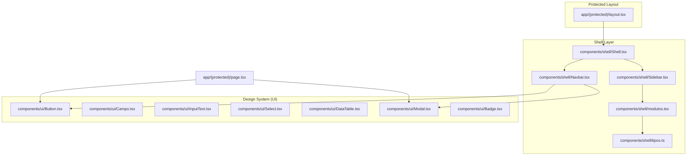
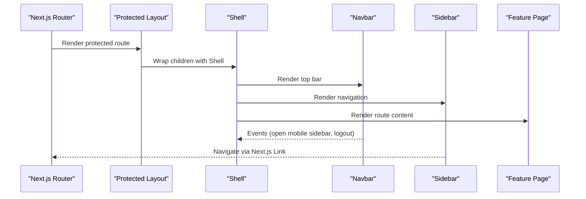
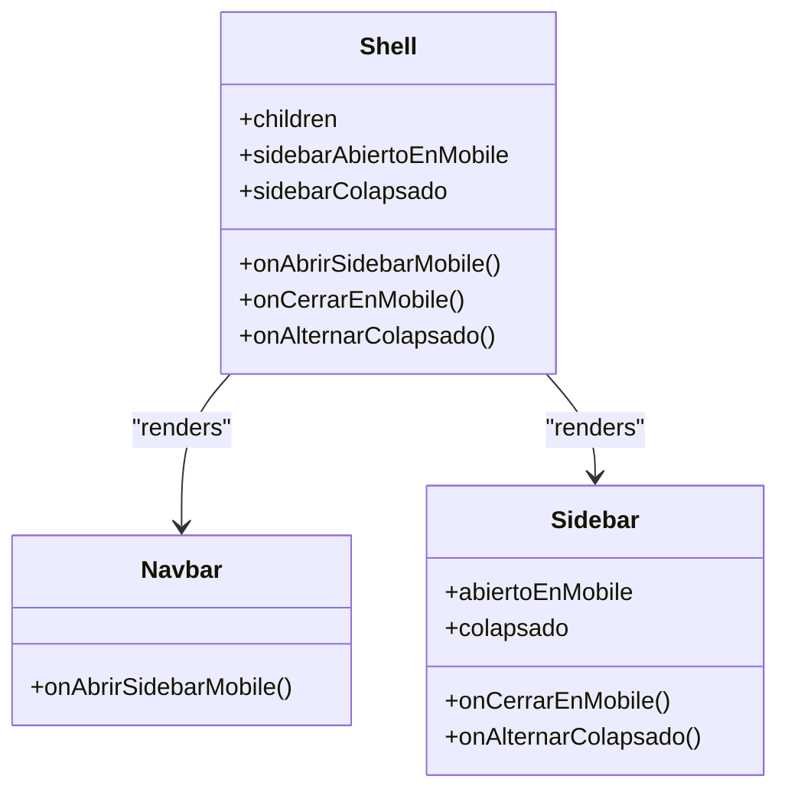
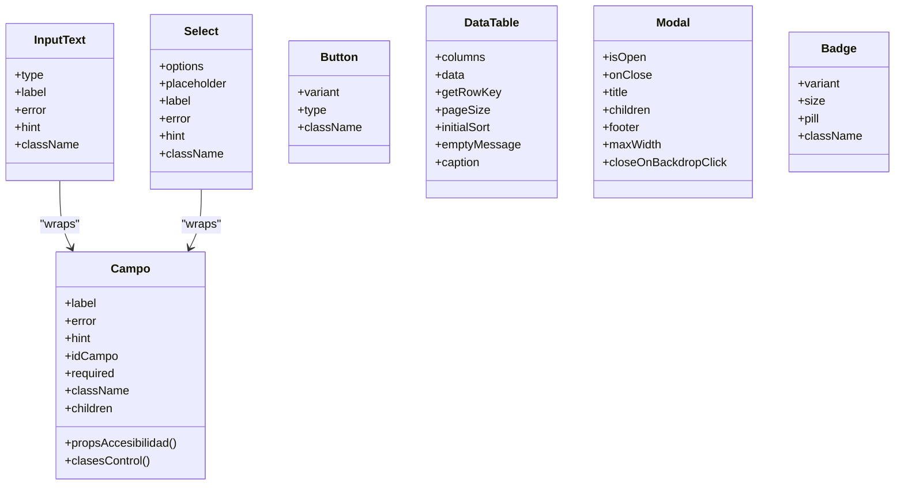
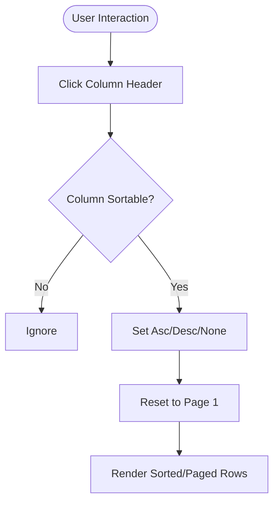
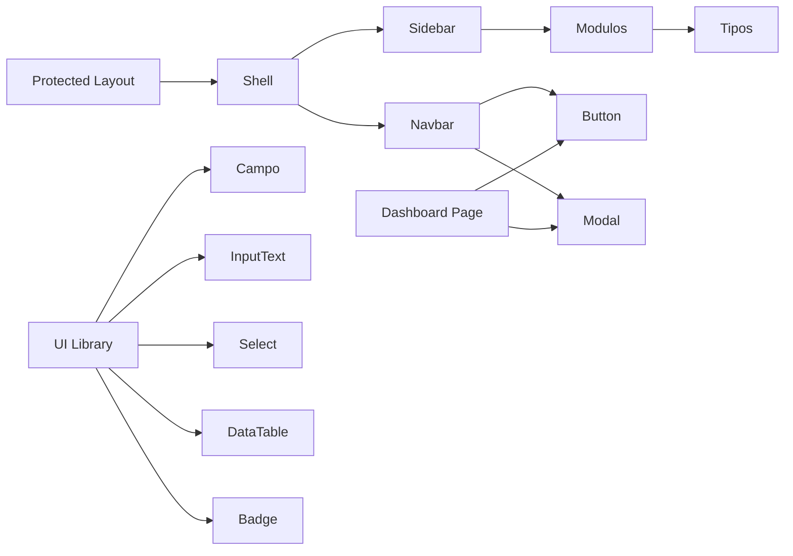

# Component Architecture

<cite>
**Referenced Files in This Document**
- [layout.tsx](file://simoapp/app/(protected)/layout.tsx)
- [Shell.tsx](file://simoapp/components/shell/Shell.tsx)
- [Navbar.tsx](file://simoapp/components/shell/Navbar.tsx)
- [Sidebar.tsx](file://simoapp/components/shell/Sidebar.tsx)
- [modulos.tsx](file://simoapp/components/shell/modulos.tsx)
- [tipos.ts](file://simoapp/components/shell/tipos.ts)
- [Button.tsx](file://simoapp/components/ui/Button.tsx)
- [Campo.tsx](file://simoapp/components/ui/Campo.tsx)
- [InputText.tsx](file://simoapp/components/ui/InputText.tsx)
- [Select.tsx](file://simoapp/components/ui/Select.tsx)
- [DataTable.tsx](file://simoapp/components/ui/DataTable.tsx)
- [Modal.tsx](file://simoapp/components/ui/Modal.tsx)
- [Badge.tsx](file://simoapp/components/ui/Badge.tsx)
- [page.tsx](file://simoapp/app/(protected)/page.tsx)
</cite>

## Table of Contents
1. [Introduction](#introduction)
2. [Project Structure](#project-structure)
3. [Core Components](#core-components)
4. [Architecture Overview](#architecture-overview)
5. [Detailed Component Analysis](#detailed-component-analysis)
6. [Dependency Analysis](#dependency-analysis)
7. [Performance Considerations](#performance-considerations)
8. [Troubleshooting Guide](#troubleshooting-guide)
9. [Conclusion](#conclusion)

## Introduction
This document explains the SIMO frontend component architecture with a focus on how the application is structured from the top-level Shell down to reusable UI primitives, and how feature pages compose these building blocks. It covers:

- The protected layout that wraps all authenticated routes with the Shell container.
- The Shell’s role in coordinating Navbar, Sidebar, and connection banner behavior.
- The design system under components/ui, including consistent prop interfaces, styling patterns, accessibility helpers, and composition strategies.
- Examples of presentational versus container responsibilities, event handling, and prop validation.
- Testing and reusability principles derived from the codebase patterns.

## Project Structure
The relevant parts for this documentation are:

- Protected layout entry point: app/(protected)/layout.tsx
- Shell and navigation: components/shell/*
- Design system (UI primitives): components/ui/*
- Dashboard page example: app/(protected)/page.tsx

**Diagram sources**
- [layout.tsx:1-11](file://simoapp/app/(protected)/layout.tsx#L1-L11)
- [Shell.tsx:1-40](file://simoapp/components/shell/Shell.tsx#L1-L40)
- [Navbar.tsx:1-185](file://simoapp/components/shell/Navbar.tsx#L1-L185)
- [Sidebar.tsx:1-98](file://simoapp/components/shell/Sidebar.tsx#L1-L98)
- [modulos.tsx:1-79](file://simoapp/components/shell/modulos.tsx#L1-L79)
- [tipos.ts:1-35](file://simoapp/components/shell/tipos.ts#L1-L35)
- [Button.tsx:1-44](file://simoapp/components/ui/Button.tsx#L1-L44)
- [Campo.tsx:1-116](file://simoapp/components/ui/Campo.tsx#L1-L116)
- [InputText.tsx:1-92](file://simoapp/components/ui/InputText.tsx#L1-L92)
- [Select.tsx:1-98](file://simoapp/components/ui/Select.tsx#L1-L98)
- [DataTable.tsx:1-394](file://simoapp/components/ui/DataTable.tsx#L1-L394)
- [Modal.tsx:1-147](file://simoapp/components/ui/Modal.tsx#L1-L147)
- [Badge.tsx:1-48](file://simoapp/components/ui/Badge.tsx#L1-L48)
- [page.tsx:1-336](file://simoapp/app/(protected)/page.tsx#L1-L336)

**Section sources**
- [layout.tsx:1-11](file://simoapp/app/(protected)/layout.tsx#L1-L11)
- [Shell.tsx:1-40](file://simoapp/components/shell/Shell.tsx#L1-L40)

## Core Components
This section summarizes the key architectural components and their responsibilities.

- Protected layout: Wraps children with a product context provider and the Shell container to ensure shared state and layout for all protected routes.
- Shell: Coordinates global layout state (mobile sidebar open/closed, desktop collapsed state), renders Navbar, Sidebar, and BannerConexion, and provides the main content area.
- Navbar: Top bar with logo, mobile menu trigger, user dropdown, and logout flow using Modal and Button.
- Sidebar: Navigation drawer/menu with active route detection, collapsible desktop mode, and mobile overlay.
- UI primitives:
  - Button: Base button with variants and native button props passthrough.
  - Campo: Shared field wrapper providing label, error/hint display, and accessibility attributes.
  - InputText: Text input built on Campo with password visibility toggle and date support.
  - Select: Dropdown select built on Campo with options and placeholder support.
  - DataTable: Reusable table with dynamic columns, sorting, pagination, and empty states.
  - Modal: Accessible modal with portal rendering, backdrop click handling, and keyboard escape.
  - Badge: Styled label with variant and size options.

**Section sources**
- [layout.tsx:1-11](file://simoapp/app/(protected)/layout.tsx#L1-L11)
- [Shell.tsx:1-40](file://simoapp/components/shell/Shell.tsx#L1-L40)
- [Navbar.tsx:1-185](file://simoapp/components/shell/Navbar.tsx#L1-L185)
- [Sidebar.tsx:1-98](file://simoapp/components/shell/Sidebar.tsx#L1-L98)
- [Button.tsx:1-44](file://simoapp/components/ui/Button.tsx#L1-L44)
- [Campo.tsx:1-116](file://simoapp/components/ui/Campo.tsx#L1-L116)
- [InputText.tsx:1-92](file://simoapp/components/ui/InputText.tsx#L1-L92)
- [Select.tsx:1-98](file://simoapp/components/ui/Select.tsx#L1-L98)
- [DataTable.tsx:1-394](file://simoapp/components/ui/DataTable.tsx#L1-L394)
- [Modal.tsx:1-147](file://simoapp/components/ui/Modal.tsx#L1-L147)
- [Badge.tsx:1-48](file://simoapp/components/ui/Badge.tsx#L1-L48)

## Architecture Overview
The application uses a layered composition model:

- Layout layer: Protected layout injects providers and Shell around route content.
- Shell layer: Manages global UI state and composes Navbar and Sidebar.
- Feature pages: Compose UI primitives and domain-specific components to render business screens.
- UI library: Provides consistent, accessible, theme-aware primitives used across features.

**Diagram sources**
- [layout.tsx:1-11](file://simoapp/app/(protected)/layout.tsx#L1-L11)
- [Shell.tsx:1-40](file://simoapp/components/shell/Shell.tsx#L1-L40)
- [Navbar.tsx:1-185](file://simoapp/components/shell/Navbar.tsx#L1-L185)
- [Sidebar.tsx:1-98](file://simoapp/components/shell/Sidebar.tsx#L1-L98)

## Detailed Component Analysis

### Shell and Navigation
The Shell coordinates global layout state and composes the top navigation and side navigation. It holds:

- Mobile sidebar open state
- Desktop sidebar collapsed state

It passes callbacks to Navbar and Sidebar to update this state.

**Diagram sources**
- [Shell.tsx:1-40](file://simoapp/components/shell/Shell.tsx#L1-L40)
- [Navbar.tsx:1-185](file://simoapp/components/shell/Navbar.tsx#L1-L185)
- [Sidebar.tsx:1-98](file://simoapp/components/shell/Sidebar.tsx#L1-L98)

Key behaviors:

- Navbar triggers opening the mobile sidebar and manages user dropdown and logout confirmation.
- Sidebar highlights the active module by comparing current pathname against configured modules.
- Modules configuration is centralized in modulos.tsx and typed in tipos.ts.

**Section sources**
- [Shell.tsx:1-40](file://simoapp/components/shell/Shell.tsx#L1-L40)
- [Navbar.tsx:1-185](file://simoapp/components/shell/Navbar.tsx#L1-L185)
- [Sidebar.tsx:1-98](file://simoapp/components/shell/Sidebar.tsx#L1-L98)
- [modulos.tsx:1-79](file://simoapp/components/shell/modulos.tsx#L1-L79)
- [tipos.ts:1-35](file://simoapp/components/shell/tipos.ts#L1-L35)

### UI Library Composition Patterns
The UI library follows consistent patterns:

- Shared field wrapper (Campo) encapsulates label, error/hint messaging, and accessibility attributes.
- InputText and Select extend Campo to provide specific input behaviors while keeping consistent UX.
- Button exposes variants and forwards native button props.
- DataTable is a complex presentational component with internal state for sorting and pagination, driven by external data and column definitions.
- Modal provides accessible dialog behavior with portal rendering and keyboard/backdrop interactions.
- Badge offers styled labels with variant and size control.

**Diagram sources**
- [Campo.tsx:1-116](file://simoapp/components/ui/Campo.tsx#L1-L116)
- [InputText.tsx:1-92](file://simoapp/components/ui/InputText.tsx#L1-L92)
- [Select.tsx:1-98](file://simoapp/components/ui/Select.tsx#L1-L98)
- [Button.tsx:1-44](file://simoapp/components/ui/Button.tsx#L1-L44)
- [DataTable.tsx:1-394](file://simoapp/components/ui/DataTable.tsx#L1-L394)
- [Modal.tsx:1-147](file://simoapp/components/ui/Modal.tsx#L1-L147)
- [Badge.tsx:1-48](file://simoapp/components/ui/Badge.tsx#L1-L48)

#### Prop Validation and Accessibility
- Campo defines a shared PropsCampo interface and exports helper functions for accessibility attributes and control classes.
- InputText and Select accept standard HTML props plus shared field props, ensuring consistent validation feedback and screen reader support.
- Modal enforces required onClose and supports keyboard Escape and backdrop click to close.

**Section sources**
- [Campo.tsx:1-116](file://simoapp/components/ui/Campo.tsx#L1-L116)
- [InputText.tsx:1-92](file://simoapp/components/ui/InputText.tsx#L1-L92)
- [Select.tsx:1-98](file://simoapp/components/ui/Select.tsx#L1-L98)
- [Modal.tsx:1-147](file://simoapp/components/ui/Modal.tsx#L1-L147)

#### Event Handling Patterns
- Shell manages global layout state and exposes callbacks to child components.
- Navbar handles user dropdown toggling and logout confirmation, integrating with Modal and Button.
- DataTable implements internal handlers for sorting and pagination, exposing controlled props to parent pages.

**Diagram sources**
- [DataTable.tsx:90-143](file://simoapp/components/ui/DataTable.tsx#L90-L143)

### Presentational vs Container Responsibilities
- Presentational components:
  - Button, Badge, Modal, DataTable, Campo, InputText, Select focus on rendering and user interaction without owning business logic.
- Container-like behavior:
  - Shell owns global layout state and composes higher-level UI.
  - Feature pages (e.g., Dashboard) own data fetching, calculations, and orchestrate multiple presentational components.

Example: The dashboard page composes metric cards, charts, and tables, while delegating presentation to UI primitives and domain-specific chart/table components.

**Section sources**
- [page.tsx:1-336](file://simoapp/app/(protected)/page.tsx#L1-L336)
- [Shell.tsx:1-40](file://simoapp/components/shell/Shell.tsx#L1-L40)

## Dependency Analysis
The following diagram shows how components depend on each other at a high level:

**Diagram sources**
- [layout.tsx:1-11](file://simoapp/app/(protected)/layout.tsx#L1-L11)
- [Shell.tsx:1-40](file://simoapp/components/shell/Shell.tsx#L1-L40)
- [Navbar.tsx:1-185](file://simoapp/components/shell/Navbar.tsx#L1-L185)
- [Sidebar.tsx:1-98](file://simoapp/components/shell/Sidebar.tsx#L1-L98)
- [modulos.tsx:1-79](file://simoapp/components/shell/modulos.tsx#L1-L79)
- [tipos.ts:1-35](file://simoapp/components/shell/tipos.ts#L1-L35)
- [Button.tsx:1-44](file://simoapp/components/ui/Button.tsx#L1-L44)
- [Campo.tsx:1-116](file://simoapp/components/ui/Campo.tsx#L1-L116)
- [InputText.tsx:1-92](file://simoapp/components/ui/InputText.tsx#L1-L92)
- [Select.tsx:1-98](file://simoapp/components/ui/Select.tsx#L1-L98)
- [DataTable.tsx:1-394](file://simoapp/components/ui/DataTable.tsx#L1-L394)
- [Modal.tsx:1-147](file://simoapp/components/ui/Modal.tsx#L1-L147)
- [Badge.tsx:1-48](file://simoapp/components/ui/Badge.tsx#L1-L48)
- [page.tsx:1-336](file://simoapp/app/(protected)/page.tsx#L1-L336)

**Section sources**
- [layout.tsx:1-11](file://simoapp/app/(protected)/layout.tsx#L1-L11)
- [Shell.tsx:1-40](file://simoapp/components/shell/Shell.tsx#L1-L40)
- [Navbar.tsx:1-185](file://simoapp/components/shell/Navbar.tsx#L1-L185)
- [Sidebar.tsx:1-98](file://simoapp/components/shell/Sidebar.tsx#L1-L98)
- [modulos.tsx:1-79](file://simoapp/components/shell/modulos.tsx#L1-L79)
- [tipos.ts:1-35](file://simoapp/components/shell/tipos.ts#L1-L35)
- [Button.tsx:1-44](file://simoapp/components/ui/Button.tsx#L1-L44)
- [Campo.tsx:1-116](file://simoapp/components/ui/Campo.tsx#L1-L116)
- [InputText.tsx:1-92](file://simoapp/components/ui/InputText.tsx#L1-L92)
- [Select.tsx:1-98](file://simoapp/components/ui/Select.tsx#L1-L98)
- [DataTable.tsx:1-394](file://simoapp/components/ui/DataTable.tsx#L1-L394)
- [Modal.tsx:1-147](file://simoapp/components/ui/Modal.tsx#L1-L147)
- [Badge.tsx:1-48](file://simoapp/components/ui/Badge.tsx#L1-L48)
- [page.tsx:1-336](file://simoapp/app/(protected)/page.tsx#L1-L336)

## Performance Considerations
- Use memoization where appropriate:
  - DataTable computes sorted and paged rows using useMemo to avoid unnecessary recalculations when data or sort state changes.
- Minimize re-renders:
  - Keep global state minimal in Shell; pass only necessary callbacks to Navbar and Sidebar.
- Avoid heavy computations in render paths:
  - Feature pages should compute derived metrics outside render or use memoization hooks.
- Prefer controlled components for predictable state:
  - Inputs and selects should be controlled via props and onChange handlers to keep UI synchronized with state.

[No sources needed since this section provides general guidance]

## Troubleshooting Guide
Common issues and resolutions based on component behavior:

- Modal does not close on Escape:
  - Ensure the Modal is mounted and isOpen is true; verify onClose is provided and not overridden.
- Field errors not visible:
  - Pass error prop to InputText/Select; Campo will show red border and message, and set aria-invalid accordingly.
- Password visibility toggle not working:
  - Confirm type="password" is used; InputText toggles between text and password internally.
- Table sorting not applied:
  - Ensure accessor is defined for sortable columns; check initialSort configuration.
- Sidebar not highlighting active route:
  - Verify modulos href values match current pathname; Sidebar compares exact matches and prefixes.

**Section sources**
- [Modal.tsx:1-147](file://simoapp/components/ui/Modal.tsx#L1-L147)
- [Campo.tsx:1-116](file://simoapp/components/ui/Campo.tsx#L1-L116)
- [InputText.tsx:1-92](file://simoapp/components/ui/InputText.tsx#L1-L92)
- [Select.tsx:1-98](file://simoapp/components/ui/Select.tsx#L1-L98)
- [DataTable.tsx:1-394](file://simoapp/components/ui/DataTable.tsx#L1-L394)
- [Sidebar.tsx:1-98](file://simoapp/components/shell/Sidebar.tsx#L1-L98)

## Conclusion
SIMO’s frontend architecture emphasizes clear separation of concerns:

- A top-level protected layout ensures consistent wrapping with providers and Shell.
- Shell centralizes global layout state and composes Navbar and Sidebar.
- The UI library provides consistent, accessible, and theme-aware primitives that are composed into feature pages.
- Complex features like dashboards and tables are built by composing smaller, reusable components, maintaining testability and reusability.

Adhering to these patterns helps maintain consistency, improve developer experience, and scale the application as new features are added.

[No sources needed since this section summarizes without analyzing specific files]