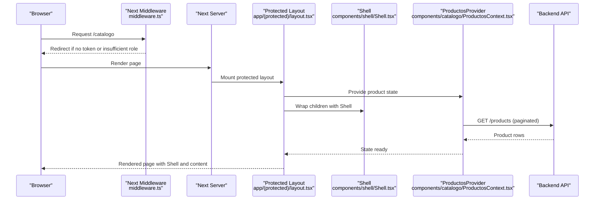
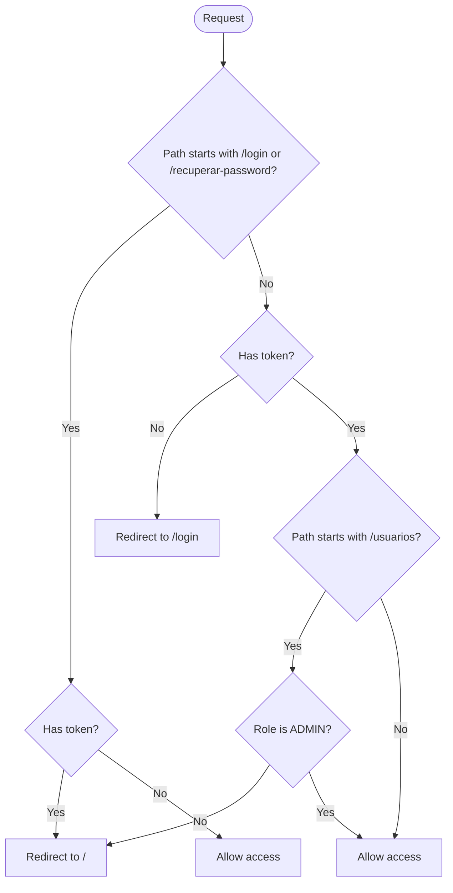
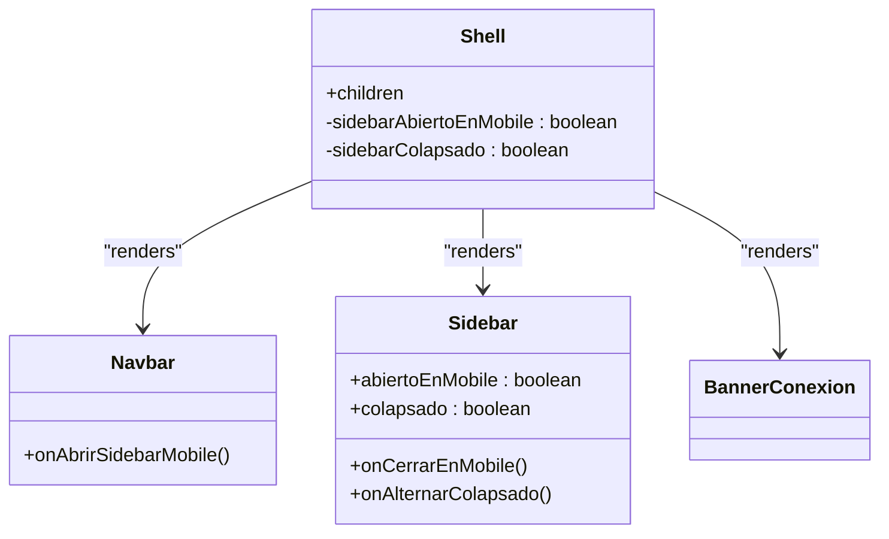
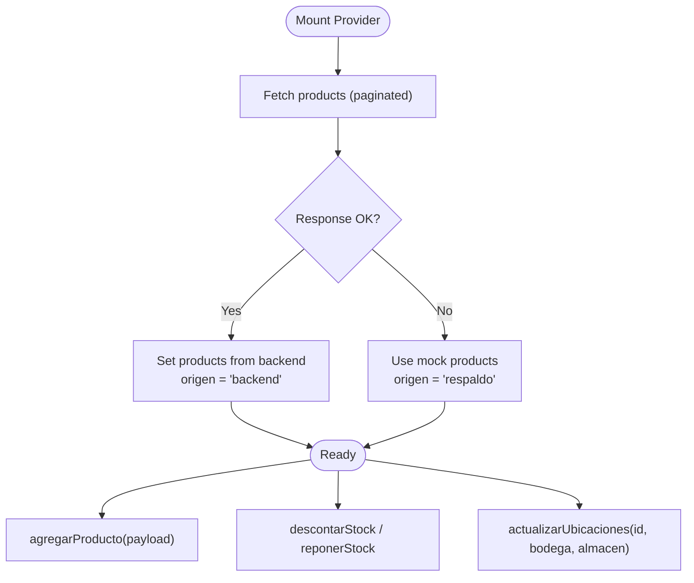
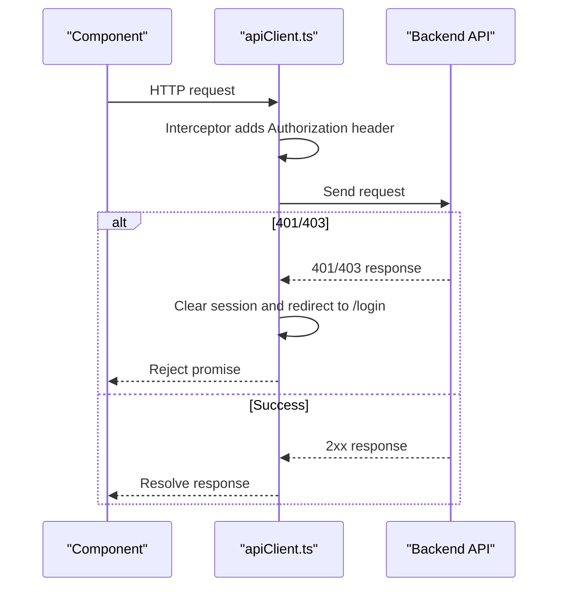
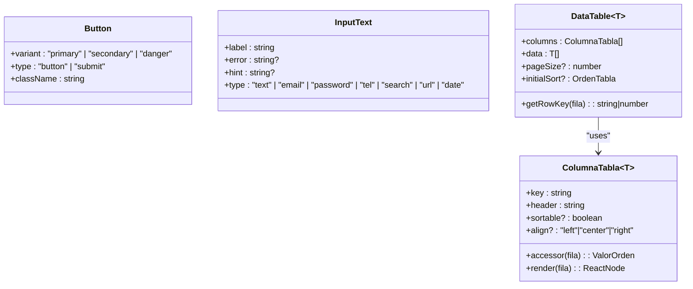
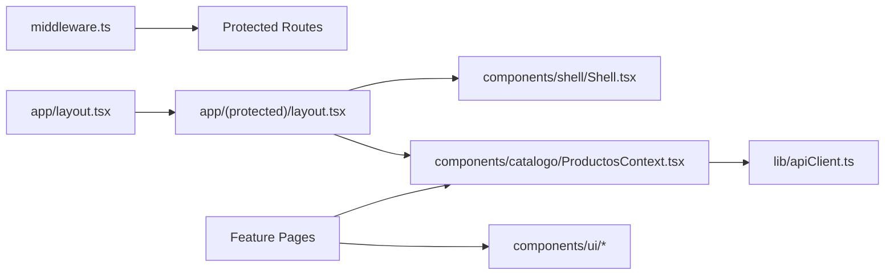

# Frontend Architecture

<cite>
**Referenced Files in This Document**
- [package.json](file://simoapp/package.json)
- [next.config.ts](file://simoapp/next.config.ts)
- [middleware.ts](file://simoapp/middleware.ts)
- [layout.tsx](file://simoapp/app/layout.tsx)
- [layout.tsx](file://simoapp/app/(protected)/layout.tsx)
- [Shell.tsx](file://simoapp/components/shell/Shell.tsx)
- [ProductosContext.tsx](file://simoapp/components/catalogo/ProductosContext.tsx)
- [apiClient.ts](file://simoapp/lib/apiClient.ts)
- [Button.tsx](file://simoapp/components/ui/Button.tsx)
- [InputText.tsx](file://simoapp/components/ui/InputText.tsx)
- [DataTable.tsx](file://simoapp/components/ui/DataTable.tsx)
</cite>

## Table of Contents
1. [Introduction](#introduction)
2. [Project Structure](#project-structure)
3. [Core Components](#core-components)
4. [Architecture Overview](#architecture-overview)
5. [Detailed Component Analysis](#detailed-component-analysis)
6. [Dependency Analysis](#dependency-analysis)
7. [Performance Considerations](#performance-considerations)
8. [Troubleshooting Guide](#troubleshooting-guide)
9. [Conclusion](#conclusion)

## Introduction
This document explains the frontend architecture of the SIMO application built with Next.js App Router, React, and TypeScript. It covers routing and protected routes, the shell component that wraps authenticated areas, state management via React Context, the API client abstraction, error handling strategies, responsive UI patterns, and performance considerations. The goal is to provide a clear mental model for both new contributors and experienced developers.

## Project Structure
The frontend lives under simoapp and follows Next.js conventions:
- app/: App Router pages and layouts
  - app/layout.tsx: Root layout (fonts, metadata, global CSS)
  - app/(protected)/layout.tsx: Protected layout wrapping Shell and shared context
  - app/(protected)/*: Feature pages under the protected route group
  - app/login, app/recuperar-password: Public authentication pages
- components/: Feature-based modules and shared UI primitives
  - components/shell/: Shell, Navbar, Sidebar, BannerConexion
  - components/catalogo/: Product catalog state and types
  - components/ui/: Reusable UI primitives (Button, InputText, DataTable, etc.)
  - Other feature folders: dashboard, inventario, pedidos, usuarios, ventas
- lib/: Shared utilities and API client
  - lib/apiClient.ts: Axios instance with interceptors for auth and error handling
- Configuration
  - next.config.ts: Next.js configuration
  - package.json: Dependencies and scripts

```mermaid
graph TB
subgraph "App Router"
Root["Root Layout<br/>app/layout.tsx"]
Protected["Protected Layout<br/>app/(protected)/layout.tsx"]
Pages["Feature Pages<br/>app/(protected)/*"]
Login["Login Page<br/>app/login/page.tsx"]
end
subgraph "Shell"
Shell["Shell<br/>components/shell/Shell.tsx"]
Navbar["Navbar"]
Sidebar["Sidebar"]
Banner["BannerConexion"]
end
subgraph "State"
ProductsCtx["ProductosProvider<br/>components/catalogo/ProductosContext.tsx"]
end
subgraph "API"
Client["Axios Client<br/>lib/apiClient.ts"]
end
subgraph "UI Library"
Btn["Button<br/>components/ui/Button.tsx"]
Inp["InputText<br/>components/ui/InputText.tsx"]
Tbl["DataTable<br/>components/ui/DataTable.tsx"]
end
Root --> Protected
Protected --> Shell
Shell --> Navbar
Shell --> Sidebar
Shell --> Banner
Protected --> ProductsCtx
Pages --> ProductsCtx
ProductsCtx --> Client
Pages --> Btn
Pages --> Inp
Pages --> Tbl
```

**Diagram sources**
- [layout.tsx:1-34](file://simoapp/app/layout.tsx#L1-L34)
- [layout.tsx:1-11](file://simoapp/app/(protected)/layout.tsx#L1-L11)
- [Shell.tsx:1-40](file://simoapp/components/shell/Shell.tsx#L1-L40)
- [ProductosContext.tsx:1-303](file://simoapp/components/catalogo/ProductosContext.tsx#L1-L303)
- [apiClient.ts:1-59](file://simoapp/lib/apiClient.ts#L1-L59)
- [Button.tsx:1-44](file://simoapp/components/ui/Button.tsx#L1-L44)
- [InputText.tsx:1-92](file://simoapp/components/ui/InputText.tsx#L1-L92)
- [DataTable.tsx:1-394](file://simoapp/components/ui/DataTable.tsx#L1-L394)

**Section sources**
- [layout.tsx:1-34](file://simoapp/app/layout.tsx#L1-L34)
- [layout.tsx:1-11](file://simoapp/app/(protected)/layout.tsx#L1-L11)
- [package.json:1-29](file://simoapp/package.json#L1-L29)

## Core Components
- Root layout sets up fonts, metadata, and global styles. It intentionally does not render the Shell or product context so public pages like login remain uncluttered.
- Protected layout wraps all authenticated routes with ProductosProvider and Shell, ensuring consistent navigation chrome and shared product state across feature pages.
- Shell composes Navbar, Sidebar, and BannerConexion, managing sidebar open/collapsed states for mobile and desktop.
- ProductosProvider centralizes product list state, loading origin, and operations such as adding products, adjusting stock, and resetting data. It fetches from the backend when available and falls back to mock data.
- apiClient provides an Axios instance with request/response interceptors to attach JWT tokens and handle unauthorized responses by clearing session and redirecting to login.

**Section sources**
- [layout.tsx:1-34](file://simoapp/app/layout.tsx#L1-L34)
- [layout.tsx:1-11](file://simoapp/app/(protected)/layout.tsx#L1-L11)
- [Shell.tsx:1-40](file://simoapp/components/shell/Shell.tsx#L1-L40)
- [ProductosContext.tsx:1-303](file://simoapp/components/catalogo/ProductosContext.tsx#L1-L303)
- [apiClient.ts:1-59](file://simoapp/lib/apiClient.ts#L1-L59)

## Architecture Overview
The application uses Next.js App Router with a protected route group. Middleware enforces authentication and role-based access at the server level before rendering pages. On the client side, the Shell provides a consistent layout, while ProductosProvider supplies shared state for product-related features. All API calls go through apiClient, which handles token injection and redirects on 401/403 errors.



**Diagram sources**
- [middleware.ts:1-37](file://simoapp/middleware.ts#L1-L37)
- [layout.tsx:1-11](file://simoapp/app/(protected)/layout.tsx#L1-L11)
- [Shell.tsx:1-40](file://simoapp/components/shell/Shell.tsx#L1-L40)
- [ProductosContext.tsx:116-127](file://simoapp/components/catalogo/ProductosContext.tsx#L116-L127)

## Detailed Component Analysis

### Routing and Authentication
- Middleware checks cookies for token and role, allowing public routes (/login, /recuperar-password) only when not authenticated, and protecting other routes by requiring a valid token. Role-based protection restricts certain paths (e.g., /usuarios) to ADMIN users.
- Protected route group ensures Shell and shared context are applied only to authenticated pages.



**Diagram sources**
- [middleware.ts:4-29](file://simoapp/middleware.ts#L4-L29)

**Section sources**
- [middleware.ts:1-37](file://simoapp/middleware.ts#L1-L37)
- [layout.tsx:1-11](file://simoapp/app/(protected)/layout.tsx#L1-L11)

### Shell Component Architecture
- Shell composes Navbar, Sidebar, and BannerConexion. It manages two pieces of state:
  - Mobile sidebar open/close
  - Desktop sidebar collapsed/expanded
- Children (feature pages) render inside main, below the connection banner.



**Diagram sources**
- [Shell.tsx:1-40](file://simoapp/components/shell/Shell.tsx#L1-L40)

**Section sources**
- [Shell.tsx:1-40](file://simoapp/components/shell/Shell.tsx#L1-L40)

### State Management with React Context (ProductosProvider)
- Provides a single source of truth for product data used across catalog and product form pages.
- Fetches paginated products from the backend; if unavailable, falls back to mock data and marks the source as fallback.
- Exposes methods to add products, adjust stock after sales or returns, update location balances, and reset to mock data.



**Diagram sources**
- [ProductosContext.tsx:116-127](file://simoapp/components/catalogo/ProductosContext.tsx#L116-L127)
- [ProductosContext.tsx:129-150](file://simoapp/components/catalogo/ProductosContext.tsx#L129-L150)
- [ProductosContext.tsx:152-219](file://simoapp/components/catalogo/ProductosContext.tsx#L152-L219)
- [ProductosContext.tsx:229-277](file://simoapp/components/catalogo/ProductosContext.tsx#L229-L277)

**Section sources**
- [ProductosContext.tsx:1-303](file://simoapp/components/catalogo/ProductosContext.tsx#L1-L303)

### API Client Abstraction and Error Handling
- axios instance configured with baseURL and default headers.
- Request interceptor attaches Authorization header using token read from cookies.
- Response interceptor clears session and redirects to login on 401/403, except for login endpoints where those codes indicate invalid credentials or inactive accounts.



**Diagram sources**
- [apiClient.ts:1-59](file://simoapp/lib/apiClient.ts#L1-L59)

**Section sources**
- [apiClient.ts:1-59](file://simoapp/lib/apiClient.ts#L1-L59)

### UI Component Library and Patterns
- Button: Base button with variants (primary, secondary, danger), accessible focus rings, and dark mode support. Accepts standard button props and additional className.
- InputText: Accessible input field with label, hint, error messaging, password visibility toggle, and date type support. Uses shared Campo for structure and accessibility.
- DataTable: Generic table with dynamic columns, sorting, pagination, alignment, and empty state messaging. Designed for reuse across Catalog, Users, and Kardex screens.



**Diagram sources**
- [Button.tsx:1-44](file://simoapp/components/ui/Button.tsx#L1-L44)
- [InputText.tsx:1-92](file://simoapp/components/ui/InputText.tsx#L1-L92)
- [DataTable.tsx:21-61](file://simoapp/components/ui/DataTable.tsx#L21-L61)

**Section sources**
- [Button.tsx:1-44](file://simoapp/components/ui/Button.tsx#L1-L44)
- [InputText.tsx:1-92](file://simoapp/components/ui/InputText.tsx#L1-L92)
- [DataTable.tsx:1-394](file://simoapp/components/ui/DataTable.tsx#L1-L394)

### Responsive Design Approach
- Tailwind CSS is used throughout for responsive layouts, spacing, typography, and dark mode.
- Shell adapts sidebar behavior for mobile vs desktop.
- DataTable scrolls horizontally within its container on narrow screens to avoid full-page scrolling.
- InputText supports native date picker and password visibility toggle for better UX across devices.

[No sources needed since this section provides general guidance]

## Dependency Analysis
The following diagram shows how core modules depend on each other:



**Diagram sources**
- [middleware.ts:1-37](file://simoapp/middleware.ts#L1-L37)
- [layout.tsx:1-34](file://simoapp/app/layout.tsx#L1-L34)
- [layout.tsx:1-11](file://simoapp/app/(protected)/layout.tsx#L1-L11)
- [Shell.tsx:1-40](file://simoapp/components/shell/Shell.tsx#L1-L40)
- [ProductosContext.tsx:1-303](file://simoapp/components/catalogo/ProductosContext.tsx#L1-L303)
- [apiClient.ts:1-59](file://simoapp/lib/apiClient.ts#L1-L59)

**Section sources**
- [middleware.ts:1-37](file://simoapp/middleware.ts#L1-L37)
- [layout.tsx:1-34](file://simoapp/app/layout.tsx#L1-L34)
- [layout.tsx:1-11](file://simoapp/app/(protected)/layout.tsx#L1-L11)
- [ProductosContext.tsx:1-303](file://simoapp/components/catalogo/ProductosContext.tsx#L1-L303)
- [apiClient.ts:1-59](file://simoapp/lib/apiClient.ts#L1-L59)

## Performance Considerations
- Data fetching strategy: ProductosProvider paginates and aggregates all product rows to enable client-side filtering and search. Consider virtualization or server-side filtering if datasets grow significantly.
- Code splitting: Next.js automatically splits code per route. Keep heavy charts or third-party libraries lazy-loaded where possible.
- Build configuration: next.config.ts is minimal; consider enabling image optimization, CDN integration, and experimental flags as needed.
- Dependencies: React 19, Next.js 16, Tailwind v4, and Recharts are used. Ensure tree-shaking and bundle size monitoring.

[No sources needed since this section provides general guidance]

## Troubleshooting Guide
- Authentication loops or unexpected redirects:
  - Verify middleware matcher excludes static assets and API routes.
  - Confirm cookies token and role are set correctly after login.
- Unauthorized API calls:
  - apiClient redirects to /login on 401/403 unless the request is to the login endpoint.
  - Ensure leerToken reads from cookies and that cookies are available in the browser context.
- Product data inconsistencies:
  - If backend is down, ProductosProvider falls back to mock data and sets origen to "respaldo". Use this indicator to inform users.
  - After mutations (add product, transfer stock), ensure local state updates reflect backend responses.

**Section sources**
- [middleware.ts:31-36](file://simoapp/middleware.ts#L31-L36)
- [apiClient.ts:14-55](file://simoapp/lib/apiClient.ts#L14-L55)
- [ProductosContext.tsx:129-150](file://simoapp/components/catalogo/ProductosContext.tsx#L129-L150)

## Conclusion
SIMO’s frontend leverages Next.js App Router for secure, modular routing, a Shell-based layout for consistent UX, and React Context for shared product state. The API client centralizes authentication and error handling, while the UI library promotes consistency and accessibility. With Tailwind CSS and thoughtful component design, the application scales across features and devices. Future improvements can include server-side filtering for large datasets, advanced charting optimizations, and expanded build configurations.