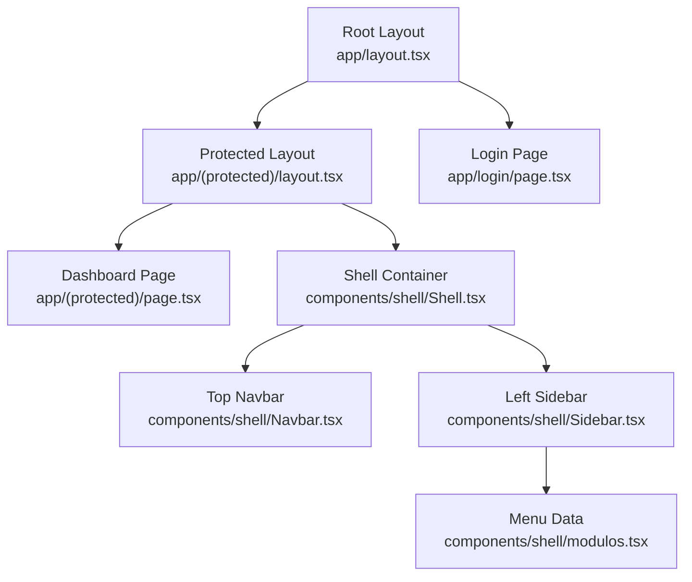
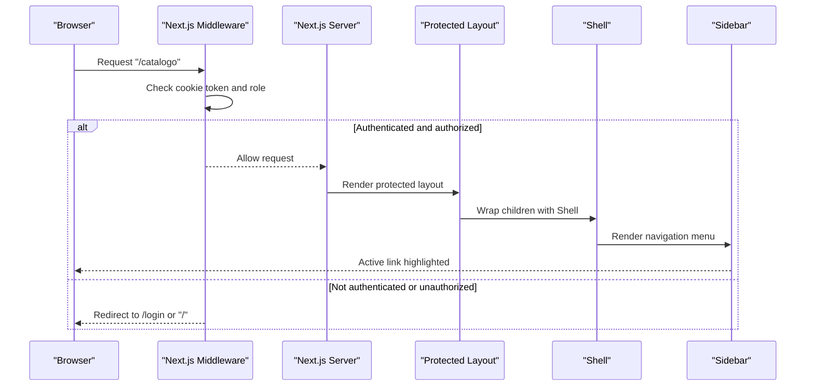
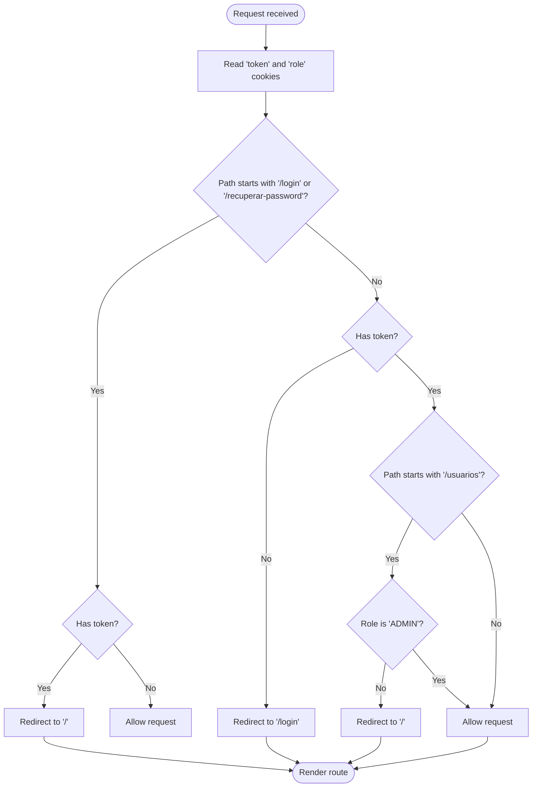
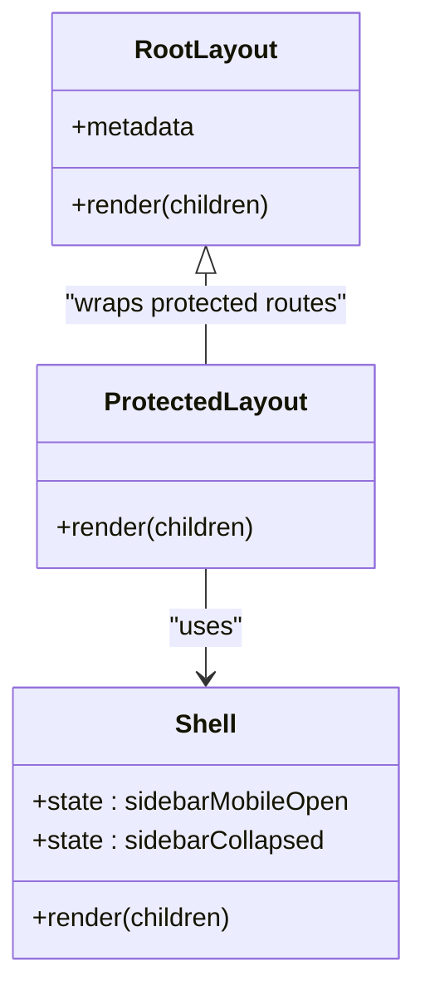
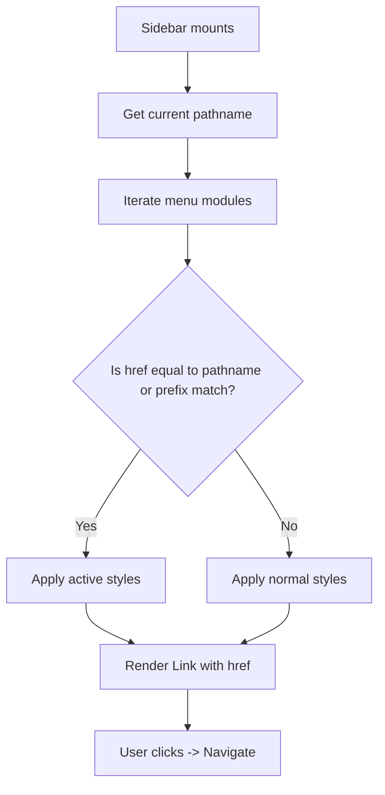
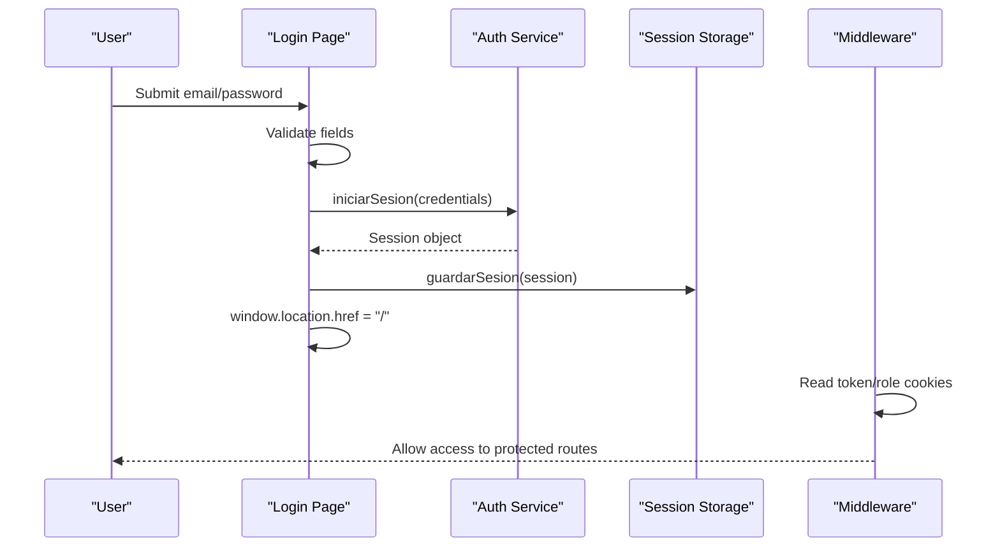
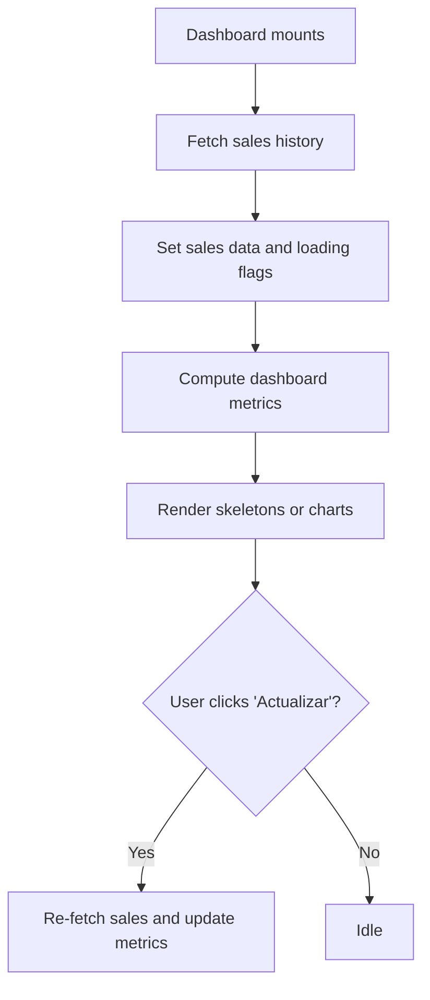
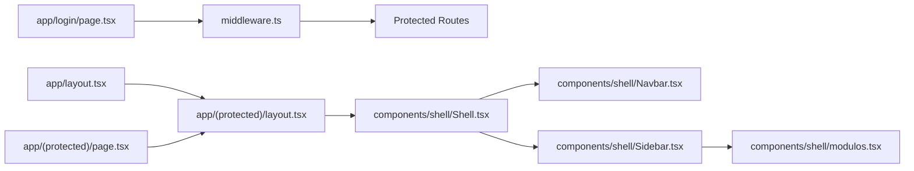

# Routing & Navigation

<cite>
**Referenced Files in This Document**
- [middleware.ts](file://simoapp/middleware.ts)
- [layout.tsx](file://simoapp/app/layout.tsx)
- [protected layout.tsx](file://simoapp/app/(protected)/layout.tsx)
- [dashboard page.tsx](file://simoapp/app/(protected)/page.tsx)
- [login page.tsx](file://simoapp/app/login/page.tsx)
- [Shell.tsx](file://simoapp/components/shell/Shell.tsx)
- [Navbar.tsx](file://simoapp/components/shell/Navbar.tsx)
- [Sidebar.tsx](file://simoapp/components/shell/Sidebar.tsx)
- [modulos.tsx](file://simoapp/components/shell/modulos.tsx)
- [tipos.ts](file://simoapp/components/shell/tipos.ts)
</cite>

## Table of Contents
1. [Introduction](#introduction)
2. [Project Structure](#project-structure)
3. [Core Components](#core-components)
4. [Architecture Overview](#architecture-overview)
5. [Detailed Component Analysis](#detailed-component-analysis)
6. [Dependency Analysis](#dependency-analysis)
7. [Performance Considerations](#performance-considerations)
8. [Troubleshooting Guide](#troubleshooting-guide)
9. [Conclusion](#conclusion)

## Introduction
This document explains the routing and navigation system in the SIMO application, focusing on the Next.js App Router implementation, protected route middleware, layout hierarchy, sidebar navigation, dynamic menu generation based on roles, and how URL structure maps to component organization. It also covers loading states, error handling patterns, SEO metadata, and programmatic navigation behavior used by the login and logout flows.

## Project Structure
SIMO uses the Next.js App Router under `simoapp/app`. Public routes such as login and password recovery live at the root of `app`, while authenticated features are grouped under a protected group folder. The root layout provides global HTML structure and site-wide metadata, while the protected layout wraps authenticated pages with the application shell and shared context providers.

**Diagram sources**
- [layout.tsx:15-33](file://simoapp/app/layout.tsx#L15-L33)
- [protected layout.tsx:1-10](file://simoapp/app/(protected)/layout.tsx#L1-L10)
- [login page.tsx:23-59](file://simoapp/app/login/page.tsx#L23-L59)
- [dashboard page.tsx:53-127](file://simoapp/app/(protected)/page.tsx#L53-L127)
- [Shell.tsx:14-39](file://simoapp/components/shell/Shell.tsx#L14-L39)
- [Navbar.tsx:31-81](file://simoapp/components/shell/Navbar.tsx#L31-L81)
- [Sidebar.tsx:24-97](file://simoapp/components/shell/Sidebar.tsx#L24-L97)
- [modulos.tsx:25-78](file://simoapp/components/shell/modulos.tsx#L25-L78)

**Section sources**
- [layout.tsx:1-33](file://simoapp/app/layout.tsx#L1-L33)
- [protected layout.tsx:1-10](file://simoapp/app/(protected)/layout.tsx#L1-L10)
- [login page.tsx:1-133](file://simoapp/app/login/page.tsx#L1-L133)
- [dashboard page.tsx:1-336](file://simoapp/app/(protected)/page.tsx#L1-L336)

## Core Components
- Middleware enforces authentication and role-based access control for all client-facing routes except static assets and API paths.
- Root layout defines global HTML, fonts, and site metadata.
- Protected layout wraps authenticated routes with the application shell and product catalog context.
- Shell composes the top navbar and left sidebar, managing responsive drawer state and collapsed sidebar state.
- Sidebar renders navigation links from a centralized menu configuration and highlights the active route.
- Login and dashboard pages demonstrate loading states, error handling, and navigation patterns.

**Section sources**
- [middleware.ts:4-28](file://simoapp/middleware.ts#L4-L28)
- [layout.tsx:15-33](file://simoapp/app/layout.tsx#L15-L33)
- [protected layout.tsx:1-10](file://simoapp/app/(protected)/layout.tsx#L1-L10)
- [Shell.tsx:14-39](file://simoapp/components/shell/Shell.tsx#L14-L39)
- [Sidebar.tsx:24-97](file://simoapp/components/shell/Sidebar.tsx#L24-L97)
- [login page.tsx:37-59](file://simoapp/app/login/page.tsx#L37-L59)
- [dashboard page.tsx:53-127](file://simoapp/app/(protected)/page.tsx#L53-L127)

## Architecture Overview
The routing architecture combines server-side protection with client-side navigation:

- Route groups:
  - Public routes: `/login`, `/recuperar-password`
  - Protected routes: `/`, `/catalogo`, `/ventas`, `/pedidos`, `/usuarios`, `/admin`, etc., under `app/(protected)`
- Middleware protects routes by checking cookies for token and role before rendering protected layouts.
- Layout hierarchy:
  - Root layout provides global HTML and metadata.
  - Protected layout adds the app shell and shared contexts.
- Navigation:
  - Declarative navigation via `Link` components in the sidebar and navbar.
  - Programmatic navigation using full-page redirects after login/logout to ensure middleware sees updated cookies.

**Diagram sources**
- [middleware.ts:4-28](file://simoapp/middleware.ts#L4-L28)
- [protected layout.tsx:1-10](file://simoapp/app/(protected)/layout.tsx#L1-L10)
- [Shell.tsx:14-39](file://simoapp/components/shell/Shell.tsx#L14-L39)
- [Sidebar.tsx:24-97](file://simoapp/components/shell/Sidebar.tsx#L24-L97)

## Detailed Component Analysis

### Protected Route Middleware
The middleware is the gatekeeper for protected routes:
- Reads `token` and `role` cookies from the request.
- Allows public routes (`/login`, `/recuperar-password`) only when no token exists; otherwise redirects to home.
- Requires a token for all other routes; otherwise redirects to `/login`.
- Restricts `/usuarios` to users with role `ADMIN`; others are redirected to home.
- Applies to all routes except API, static assets, images, and favicon.

**Diagram sources**
- [middleware.ts:4-28](file://simoapp/middleware.ts#L4-L28)

**Section sources**
- [middleware.ts:4-36](file://simoapp/middleware.ts#L4-L36)

### Layout Hierarchy
- Root layout:
  - Defines `<html>` and `<body>` structure.
  - Sets language and font variables.
  - Exports site metadata (title and description).
- Protected layout:
  - Wraps children with `ProductosProvider` and `Shell`.
  - Ensures authenticated routes share UI chrome and data context.

**Diagram sources**
- [layout.tsx:15-33](file://simoapp/app/layout.tsx#L15-L33)
- [protected layout.tsx:1-10](file://simoapp/app/(protected)/layout.tsx#L1-L10)
- [Shell.tsx:14-39](file://simoapp/components/shell/Shell.tsx#L14-L39)

**Section sources**
- [layout.tsx:1-33](file://simoapp/app/layout.tsx#L1-L33)
- [protected layout.tsx:1-10](file://simoapp/app/(protected)/layout.tsx#L1-L10)

### Sidebar Navigation and Dynamic Menu Generation
- Sidebar renders navigation items from a centralized menu configuration.
- Each menu item includes a label, href, and icon.
- Active link detection compares the current pathname against each href, including subpaths.
- Responsive behavior:
  - Mobile: drawer overlay triggered by navbar hamburger button.
  - Desktop: persistent sidebar that can be collapsed to icons-only mode.

**Diagram sources**
- [Sidebar.tsx:30-97](file://simoapp/components/shell/Sidebar.tsx#L30-L97)
- [modulos.tsx:25-78](file://simoapp/components/shell/modulos.tsx#L25-L78)

**Section sources**
- [Sidebar.tsx:1-98](file://simoapp/components/shell/Sidebar.tsx#L1-L98)
- [modulos.tsx:1-79](file://simoapp/components/shell/modulos.tsx#L1-L79)
- [tipos.ts:7-34](file://simoapp/components/shell/tipos.ts#L7-L34)

### Login Flow and Programmatic Navigation
- Login page validates credentials locally, calls the authentication service, stores session data, and performs a full-page redirect to `/` so middleware can read the new cookies.
- Logout flow clears local storage/session storage/cookies, resets shared state, and redirects to `/login` with a full-page reload.

**Diagram sources**
- [login page.tsx:37-59](file://simoapp/app/login/page.tsx#L37-L59)
- [middleware.ts:4-28](file://simoapp/middleware.ts#L4-L28)

**Section sources**
- [login page.tsx:23-59](file://simoapp/app/login/page.tsx#L23-L59)
- [Navbar.tsx:37-51](file://simoapp/components/shell/Navbar.tsx#L37-L51)

### Dashboard Page Loading States and Error Handling
- Loads sales history and product catalog on mount.
- Shows skeleton loaders while fetching data.
- Displays user-facing error messages when fetching fails.
- Provides an “Update” action to refresh metrics without reloading the page.

**Diagram sources**
- [dashboard page.tsx:64-127](file://simoapp/app/(protected)/page.tsx#L64-L127)
- [dashboard page.tsx:225-324](file://simoapp/app/(protected)/page.tsx#L225-L324)

**Section sources**
- [dashboard page.tsx:53-127](file://simoapp/app/(protected)/page.tsx#L53-L127)
- [dashboard page.tsx:225-324](file://simoapp/app/(protected)/page.tsx#L225-L324)

### Route Parameters, Query Strings, and Programmatic Navigation Patterns
- Current implementation primarily uses declarative navigation via `Link` components in the sidebar and navbar.
- Programmatic navigation is implemented through full-page redirects (`window.location.href`) after login and logout to ensure middleware reads updated cookies.
- No explicit usage of `useSearchParams` or `useRouter` was found in the analyzed files; query parameters and dynamic route segments are not currently demonstrated in these components.

**Section sources**
- [login page.tsx:50-54](file://simoapp/app/login/page.tsx#L50-L54)
- [Navbar.tsx:49-51](file://simoapp/components/shell/Navbar.tsx#L49-L51)
- [Sidebar.tsx:65-92](file://simoapp/components/shell/Sidebar.tsx#L65-L92)
- [Navbar.tsx:74-81](file://simoapp/components/shell/Navbar.tsx#L74-L81)

### SEO Considerations
- Site-wide metadata is defined in the root layout, including title and description.
- Language attribute is set on the `<html>` element.
- Font variables are applied globally for consistent typography.

**Section sources**
- [layout.tsx:15-33](file://simoapp/app/layout.tsx#L15-L33)

## Dependency Analysis
The following diagram shows key dependencies between routing-related components and files:

**Diagram sources**
- [middleware.ts:4-36](file://simoapp/middleware.ts#L4-L36)
- [layout.tsx:15-33](file://simoapp/app/layout.tsx#L15-L33)
- [protected layout.tsx:1-10](file://simoapp/app/(protected)/layout.tsx#L1-L10)
- [Shell.tsx:14-39](file://simoapp/components/shell/Shell.tsx#L14-L39)
- [Navbar.tsx:31-81](file://simoapp/components/shell/Navbar.tsx#L31-L81)
- [Sidebar.tsx:24-97](file://simoapp/components/shell/Sidebar.tsx#L24-L97)
- [modulos.tsx:25-78](file://simoapp/components/shell/modulos.tsx#L25-L78)
- [login page.tsx:37-59](file://simoapp/app/login/page.tsx#L37-L59)
- [dashboard page.tsx:53-127](file://simoapp/app/(protected)/page.tsx#L53-L127)

**Section sources**
- [middleware.ts:4-36](file://simoapp/middleware.ts#L4-L36)
- [layout.tsx:15-33](file://simoapp/app/layout.tsx#L15-L33)
- [protected layout.tsx:1-10](file://simoapp/app/(protected)/layout.tsx#L1-L10)
- [Shell.tsx:14-39](file://simoapp/components/shell/Shell.tsx#L14-L39)
- [Sidebar.tsx:24-97](file://simoapp/components/shell/Sidebar.tsx#L24-L97)
- [modulos.tsx:25-78](file://simoapp/components/shell/modulos.tsx#L25-L78)
- [login page.tsx:37-59](file://simoapp/app/login/page.tsx#L37-L59)
- [dashboard page.tsx:53-127](file://simoapp/app/(protected)/page.tsx#L53-L127)

## Performance Considerations
- Middleware runs per request and short-circuits redirects early, minimizing unnecessary rendering for unauthenticated users.
- Protected layout encapsulates shared UI and context, reducing duplication across authenticated routes.
- Dashboard page computes metrics with memoization and updates selectively, avoiding full re-renders unless data changes.
- Skeleton loaders provide perceived performance during data fetching.

[No sources needed since this section provides general guidance]

## Troubleshooting Guide
- If users cannot access protected routes:
  - Verify that cookies `token` and `role` are present after login.
  - Confirm that middleware matcher excludes static assets and API routes.
  - Ensure `/usuarios` is accessed only by users with role `ADMIN`.
- If login does not redirect properly:
  - Confirm that the login flow uses a full-page redirect after storing the session.
  - Check that the browser accepts cookies for the domain.
- If sidebar active state is incorrect:
  - Verify that the current pathname matches the expected href or its prefix.
  - Ensure the menu configuration href values align with actual route paths.

**Section sources**
- [middleware.ts:4-36](file://simoapp/middleware.ts#L4-L36)
- [login page.tsx:37-59](file://simoapp/app/login/page.tsx#L37-L59)
- [Sidebar.tsx:65-92](file://simoapp/components/shell/Sidebar.tsx#L65-L92)

## Conclusion
SIMO’s routing and navigation combine Next.js App Router conventions with robust server-side protection. The protected layout ensures authenticated routes render within a consistent shell, while the sidebar provides role-aware navigation driven by a centralized menu configuration. Authentication and authorization are enforced by middleware, and navigation patterns favor full-page redirects where necessary to keep server-side checks accurate. The dashboard demonstrates effective loading states and error handling, and the root layout centralizes SEO metadata. Future enhancements may introduce query parameters and dynamic route segments, along with expanded role-based visibility for additional modules.