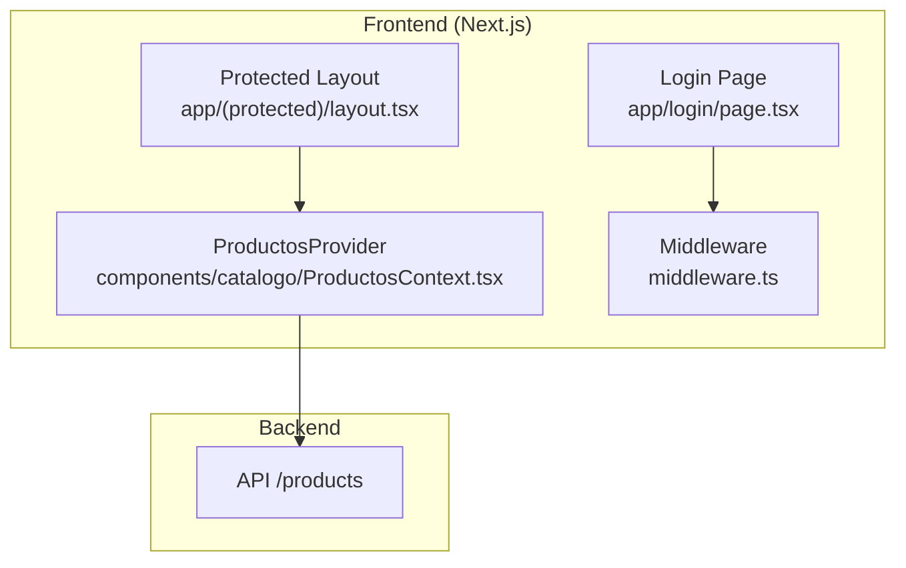
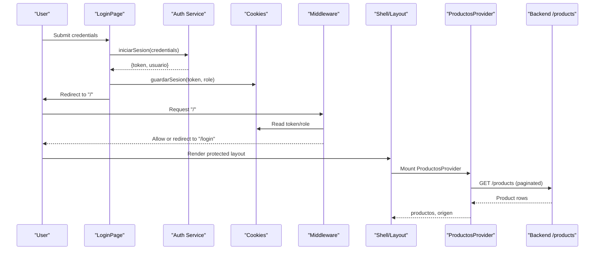
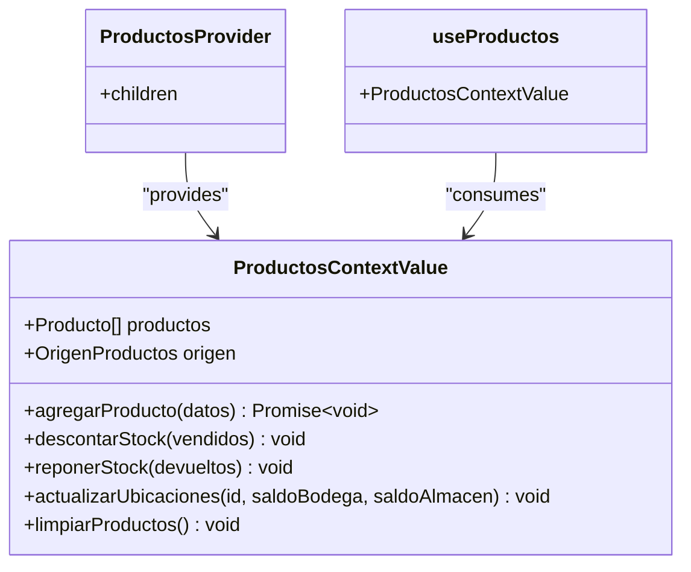
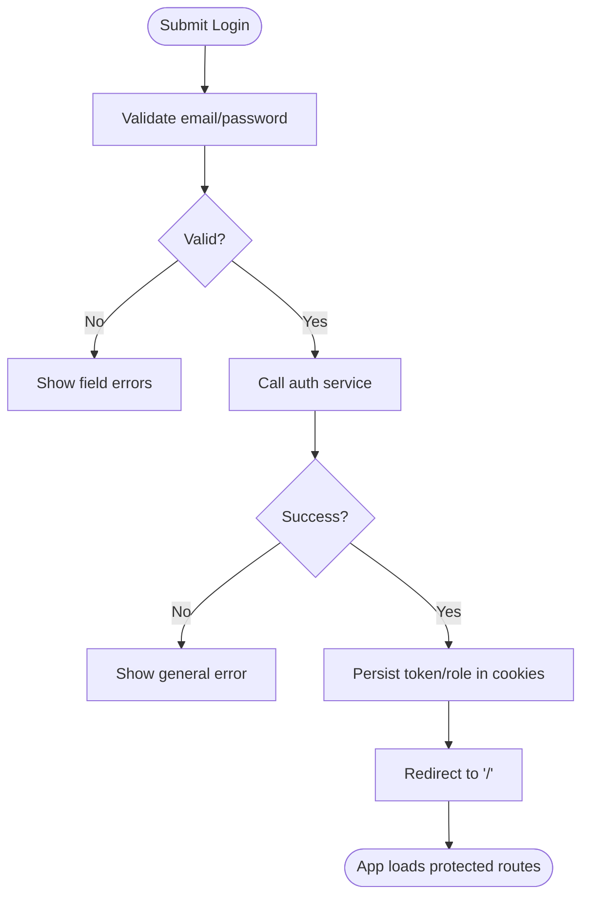
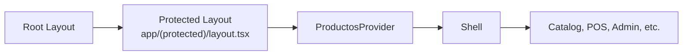
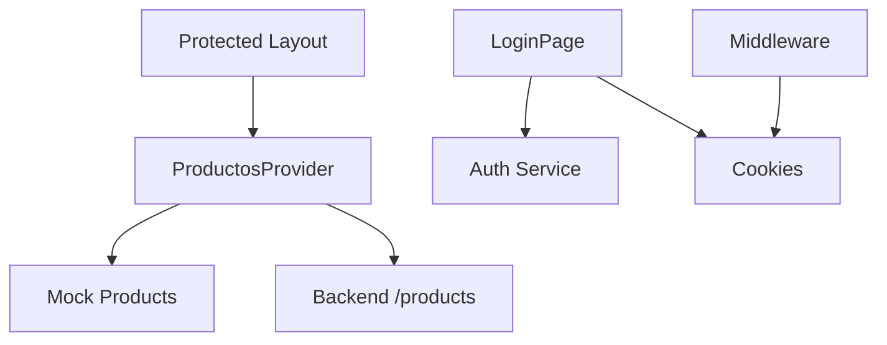

# State Management

<cite>
**Referenced Files in This Document**
- [ProductosContext.tsx](file://simoapp/components/catalogo/ProductosContext.tsx)
- [layout.tsx](file://simoapp/app/(protected)/layout.tsx)
- [page.tsx (login)](file://simoapp/app/login/page.tsx)
- [middleware.ts](file://simoapp/middleware.ts)
- [tipos.ts (auth types)](file://simoapp/lib/auth/tipos.ts)
- [productos.mock.ts](file://simoapp/components/catalogo/productos.mock.ts)
</cite>

## Table of Contents
1. [Introduction](#introduction)
2. [Project Structure](#project-structure)
3. [Core Components](#core-components)
4. [Architecture Overview](#architecture-overview)
5. [Detailed Component Analysis](#detailed-component-analysis)
6. [Dependency Analysis](#dependency-analysis)
7. [Performance Considerations](#performance-considerations)
8. [Troubleshooting Guide](#troubleshooting-guide)
9. [Conclusion](#conclusion)

## Introduction
This document explains how SIMO manages state on the frontend, focusing on:
- Global product catalog state via React Context API using ProductosContext.
- Authentication flow and session persistence across routes.
- Local component state patterns with useState and useEffect.
- Separation between server state (fetched from APIs) and client state (UI interactions).
- Provider hierarchy, initialization strategies, synchronization, error handling, and performance considerations.

## Project Structure
The relevant state management code lives under simoapp:
- Global product catalog context: components/catalogo/ProductosContext.tsx
- Protected layout that wraps routes with the provider: app/(protected)/layout.tsx
- Login page for authentication UI and flow: app/login/page.tsx
- Server-side route protection and role checks: middleware.ts
- Shared auth type definitions: lib/auth/tipos.ts
- Fallback product data used when backend is unavailable: components/catalogo/productos.mock.ts

**Diagram sources**
- [layout.tsx:1-11](file://simoapp/app/(protected)/layout.tsx#L1-L11)
- [ProductosContext.tsx:129-294](file://simoapp/components/catalogo/ProductosContext.tsx#L129-L294)
- [page.tsx (login):1-133](file://simoapp/app/login/page.tsx#L1-L133)
- [middleware.ts:1-37](file://simoapp/middleware.ts#L1-L37)

**Section sources**
- [ProductosContext.tsx:1-303](file://simoapp/components/catalogo/ProductosContext.tsx#L1-L303)
- [layout.tsx:1-11](file://simoapp/app/(protected)/layout.tsx#L1-L11)
- [page.tsx (login):1-133](file://simoapp/app/login/page.tsx#L1-L133)
- [middleware.ts:1-37](file://simoapp/middleware.ts#L1-L37)
- [tipos.ts:1-77](file://simoapp/lib/auth/tipos.ts#L1-L77)
- [productos.mock.ts:1-191](file://simoapp/components/catalogo/productos.mock.ts#L1-L191)

## Core Components
- ProductosContext: Provides global product list, source indicator, and mutation helpers (add product, stock adjustments, location updates, reset to fallback). It fetches products from the backend on mount and falls back to mock data if needed.
- Protected Layout: Wraps all protected routes with ProductosProvider so child pages can consume shared product state.
- Login Page: Handles local form state, validation, calls the auth service, persists session, and redirects to the root route.
- Middleware: Enforces authentication and role-based access by inspecting cookies on incoming requests.
- Auth Types: Defines shared TypeScript interfaces for credentials, sessions, errors, and user records.
- Mock Products: Static dataset used as a resilient fallback when the backend is unreachable.

Key responsibilities:
- Global state ownership: ProductosContext owns the canonical product list and exposes typed actions.
- Data fetching strategy: Fetch paginated products once at provider mount; persist source metadata ("cargando", "backend", "respaldo").
- Client mutations: Update local state immediately for UX while backend remains authoritative.
- Session persistence: Store token and role in cookies; protect routes via middleware.

**Section sources**
- [ProductosContext.tsx:31-49](file://simoapp/components/catalogo/ProductosContext.tsx#L31-L49)
- [ProductosContext.tsx:114-150](file://simoapp/components/catalogo/ProductosContext.tsx#L114-L150)
- [ProductosContext.tsx:152-277](file://simoapp/components/catalogo/ProductosContext.tsx#L152-L277)
- [layout.tsx:1-11](file://simoapp/app/(protected)/layout.tsx#L1-L11)
- [page.tsx (login):23-59](file://simoapp/app/login/page.tsx#L23-L59)
- [middleware.ts:4-29](file://simoapp/middleware.ts#L4-L29)
- [tipos.ts:6-24](file://simoapp/lib/auth/tipos.ts#L6-L24)
- [productos.mock.ts:1-191](file://simoapp/components/catalogo/productos.mock.ts#L1-L191)

## Architecture Overview
The application separates concerns between:
- Global product catalog state (React Context)
- Authentication and session management (cookies + Next.js middleware)
- Local UI state within components (useState/useEffect)

**Diagram sources**
- [page.tsx (login):37-59](file://simoapp/app/login/page.tsx#L37-L59)
- [middleware.ts:4-29](file://simoapp/middleware.ts#L4-L29)
- [layout.tsx:4-10](file://simoapp/app/(protected)/layout.tsx#L4-L10)
- [ProductosContext.tsx:129-150](file://simoapp/components/catalogo/ProductosContext.tsx#L129-L150)

## Detailed Component Analysis

### ProductosContext: Global Product Catalog State
Responsibilities:
- Initialize product list and source indicator.
- Fetch products from backend on mount; fall back to mock data on failure.
- Provide typed methods to add products, adjust stock, update locations, and reset to fallback.
- Expose a custom hook to safely consume context.

Data model highlights:
- Producto: Frontend product shape with id, code, name, description, category, unit, prices, stock fields, and status.
- OrigenProductos: Tracks whether data is loading, from backend, or fallback.

State lifecycle:
- On mount, fetch all pages until hasNextPage is false, map backend rows to frontend Producto, set origen to "backend".
- On network or parsing error, set origen to "respaldo" and populate with productosMock.

Mutations:
- agregarProducto: POST new product, then optimistically append mapped product to local list.
- descontarStock: Cascade deduction from Almacén first, then Bodega; keep total consistent.
- reponerStock: Restore stock after cancellation/return.
- actualizarUbicaciones: Reflect transfer results between Bodega and Almacén.
- limpiarProductos: Reset to fallback data.

Error handling:
- Network/API errors are caught and surfaced via alerts and console logs.
- Invalid responses return early without mutating state.

**Diagram sources**
- [ProductosContext.tsx:36-44](file://simoapp/components/catalogo/ProductosContext.tsx#L36-L44)
- [ProductosContext.tsx:129-294](file://simoapp/components/catalogo/ProductosContext.tsx#L129-L294)
- [ProductosContext.tsx:296-302](file://simoapp/components/catalogo/ProductosContext.tsx#L296-L302)

**Section sources**
- [ProductosContext.tsx:31-49](file://simoapp/components/catalogo/ProductosContext.tsx#L31-L49)
- [ProductosContext.tsx:90-112](file://simoapp/components/catalogo/ProductosContext.tsx#L90-L112)
- [ProductosContext.tsx:114-150](file://simoapp/components/catalogo/ProductosContext.tsx#L114-L150)
- [ProductosContext.tsx:152-277](file://simoapp/components/catalogo/ProductosContext.tsx#L152-L277)
- [ProductosContext.tsx:296-302](file://simoapp/components/catalogo/ProductosContext.tsx#L296-L302)

### Authentication Flow and Session Persistence
Flow overview:
- LoginPage validates inputs locally, disables controls during submission, and calls the auth service.
- On success, session is persisted (token and role), then the app navigates to the root route.
- Next.js middleware enforces authentication and roles by reading cookies.

Local state patterns:
- Form fields and validation errors are held in component state.
- A general error message is shown above the form when the backend returns an error.

Persistence:
- Cookies are used to store token and role.
- Middleware protects routes and redirects unauthenticated users to login.

**Diagram sources**
- [page.tsx (login):37-59](file://simoapp/app/login/page.tsx#L37-L59)
- [middleware.ts:4-29](file://simoapp/middleware.ts#L4-L29)

**Section sources**
- [page.tsx (login):23-59](file://simoapp/app/login/page.tsx#L23-L59)
- [middleware.ts:4-29](file://simoapp/middleware.ts#L4-L29)
- [tipos.ts:6-24](file://simoapp/lib/auth/tipos.ts#L6-L24)

### Provider Hierarchy and Route Protection
- ProductosProvider is mounted once in the protected layout, ensuring all nested routes share the same product catalog state.
- The shell renders navigation and content inside this provider scope.
- Middleware ensures only authenticated users can reach protected routes and restricts admin-only sections.

**Diagram sources**
- [layout.tsx:4-10](file://simoapp/app/(protected)/layout.tsx#L4-L10)

**Section sources**
- [layout.tsx:1-11](file://simoapp/app/(protected)/layout.tsx#L1-L11)
- [middleware.ts:4-29](file://simoapp/middleware.ts#L4-L29)

### Local State Patterns in Components
Common patterns observed across feature pages:
- useState for form inputs, modal visibility, filters, and temporary UI flags.
- useEffect to trigger side effects such as data refresh or analytics events.
- Separate states for loading indicators, success messages, and selection state.

Examples include:
- Admin page: empresa, modalAbierto, mostrarConfirmacion.
- Catalog page: trasladando, idTraslado, aperturas, aviso.
- Orders page: lista, recarga, rango, vista, pedidoSeleccionado, avisoExito.
- Users page: modalAbierto, aviso, accion, lista, recarga, filtros.

These patterns demonstrate clear separation between transient UI state and global server-backed state.

**Section sources**
- [page.tsx (admin):9-17](file://simoapp/app/(protected)/admin/page.tsx#L9-L17)
- [page.tsx (catalogo):26-29](file://simoapp/app/(protected)/catalogo/page.tsx#L26-L29)
- [page.tsx (pedidos):101-111](file://simoapp/app/(protected)/pedidos/page.tsx#L101-L111)
- [page.tsx (usuarios):181-190](file://simoapp/app/(protected)/usuarios/page.tsx#L181-L190)

### Server State vs. Client State
- Server state:
  - Product catalog fetched from backend via ProductosContext.
  - Paginated retrieval until no more pages remain.
  - Source metadata indicates origin ("backend" or "respaldo").
- Client state:
  - UI toggles, form values, filters, and temporary selections.
  - Optimistic updates like stock deductions before backend confirmation.

Best practices applied:
- Keep server state in context; keep UI state local.
- Use explicit loading and error indicators tied to server state.
- Mutate local state for immediate feedback; rely on backend for truth.

**Section sources**
- [ProductosContext.tsx:114-150](file://simoapp/components/catalogo/ProductosContext.tsx#L114-L150)
- [ProductosContext.tsx:221-277](file://simoapp/components/catalogo/ProductosContext.tsx#L221-L277)

### Error Handling in State Updates
- ProductosContext:
  - Catches fetch failures and sets fallback data with origen "respaldo".
  - Alerts on backend errors and logs details.
- LoginPage:
  - Displays a general error message returned by the auth service.
  - Prevents duplicate submissions while sending.

Robustness measures:
- Guard against stale updates using cleanup flags.
- Centralize error messaging for better UX.

**Section sources**
- [ProductosContext.tsx:133-150](file://simoapp/components/catalogo/ProductosContext.tsx#L133-L150)
- [ProductosContext.tsx:193-218](file://simoapp/components/catalogo/ProductosContext.tsx#L193-L218)
- [page.tsx (login):37-59](file://simoapp/app/login/page.tsx#L37-L59)

## Dependency Analysis
Relationships among key modules:
- Protected layout depends on ProductosProvider to supply global product state.
- ProductosContext depends on environment variable for API URL and uses static mock data as fallback.
- Login page depends on auth service and session persistence utilities.
- Middleware depends on cookies to enforce authentication and roles.

**Diagram sources**
- [layout.tsx:1-11](file://simoapp/app/(protected)/layout.tsx#L1-L11)
- [ProductosContext.tsx:46-49](file://simoapp/components/catalogo/ProductosContext.tsx#L46-L49)
- [ProductosContext.tsx:114-150](file://simoapp/components/catalogo/ProductosContext.tsx#L114-L150)
- [page.tsx (login):37-59](file://simoapp/app/login/page.tsx#L37-L59)
- [middleware.ts:4-29](file://simoapp/middleware.ts#L4-L29)

**Section sources**
- [layout.tsx:1-11](file://simoapp/app/(protected)/layout.tsx#L1-L11)
- [ProductosContext.tsx:46-49](file://simoapp/components/catalogo/ProductosContext.tsx#L46-L49)
- [ProductosContext.tsx:114-150](file://simoapp/components/catalogo/ProductosContext.tsx#L114-L150)
- [page.tsx (login):37-59](file://simoapp/app/login/page.tsx#L37-L59)
- [middleware.ts:4-29](file://simoapp/middleware.ts#L4-L29)

## Performance Considerations
- Minimize unnecessary re-renders:
  - Prefer stable function references or memoization for context values if many consumers exist.
  - Avoid placing heavy computations in render paths; move to useMemo where appropriate.
- Reduce context churn:
  - Group related state together to limit consumer updates.
  - Consider splitting contexts if they change independently at high frequency.
- Efficient data fetching:
  - ProductosContext fetches all pages once at mount; ensure pagination logic remains efficient.
  - Debounce or throttle frequent UI-driven operations (e.g., search/filter) if added later.
- Error boundaries and graceful degradation:
  - Fallback to mock data keeps the UI usable when backend is down.

[No sources needed since this section provides general guidance]

## Troubleshooting Guide
Common issues and resolutions:
- Products not loading:
  - Check API URL configuration and network connectivity.
  - Verify backend endpoint availability and response format.
  - Inspect console for fetch errors; confirm fallback to mock data.
- Stock discrepancies:
  - Ensure stock mutations (descontarStock/reponerStock) are called consistently after POS transactions.
  - Confirm backend updates align with optimistic UI changes.
- Authentication loops:
  - Verify cookies are set correctly after login.
  - Ensure middleware matches expected cookie names and path.
  - Confirm redirection logic does not create infinite loops.

Actionable checks:
- For ProductosContext: review fetch logic and error handling.
- For LoginPage: validate error mapping and session persistence.
- For Middleware: inspect cookie presence and role values.

**Section sources**
- [ProductosContext.tsx:114-150](file://simoapp/components/catalogo/ProductosContext.tsx#L114-L150)
- [ProductosContext.tsx:193-218](file://simoapp/components/catalogo/ProductosContext.tsx#L193-L218)
- [page.tsx (login):37-59](file://simoapp/app/login/page.tsx#L37-L59)
- [middleware.ts:4-29](file://simoapp/middleware.ts#L4-L29)

## Conclusion
SIMO’s frontend state management combines:
- Global product catalog state via React Context (ProductosContext) for cross-route consistency.
- Robust authentication flow with cookie-based session persistence and server-side route protection.
- Clear separation between server state and client state, with local hooks managing UI interactions.
- Thoughtful error handling and fallback mechanisms to maintain usability.

Adopting these patterns ensures predictable state behavior, maintainable code, and a responsive user experience across the application.