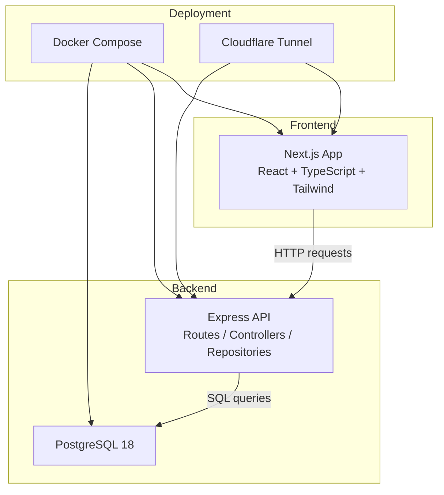
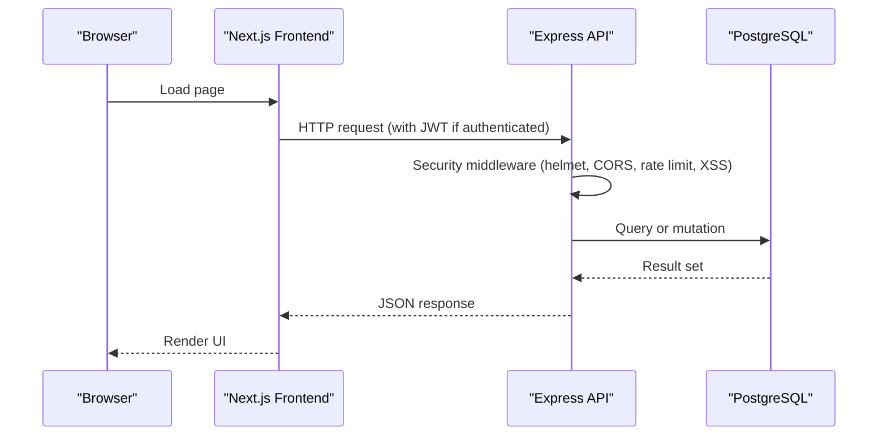
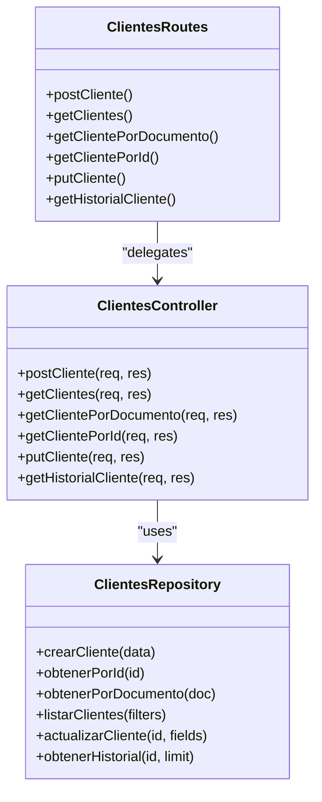
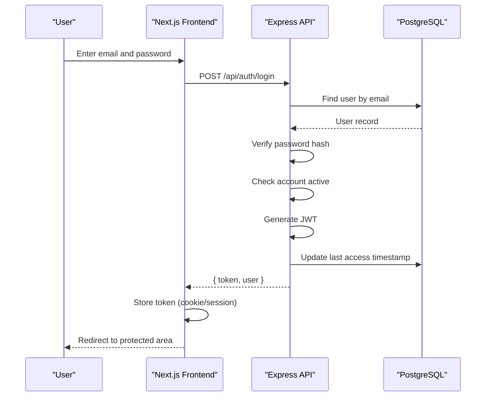
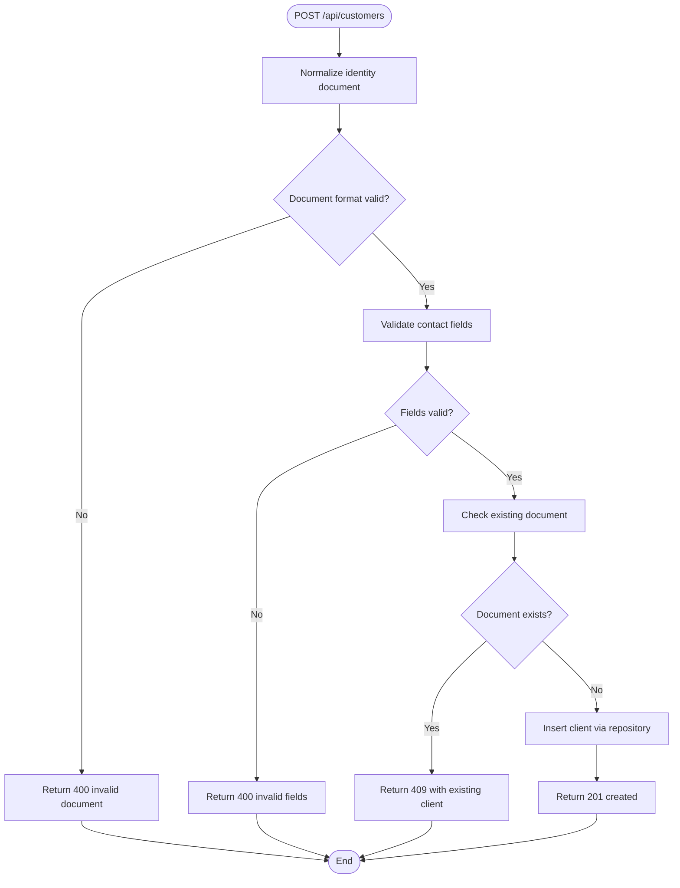
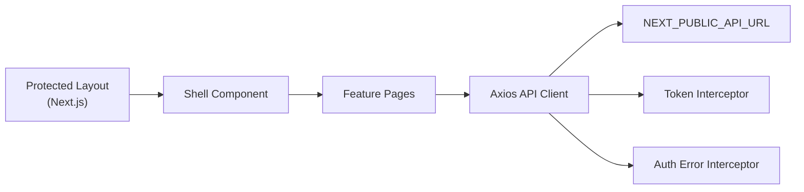
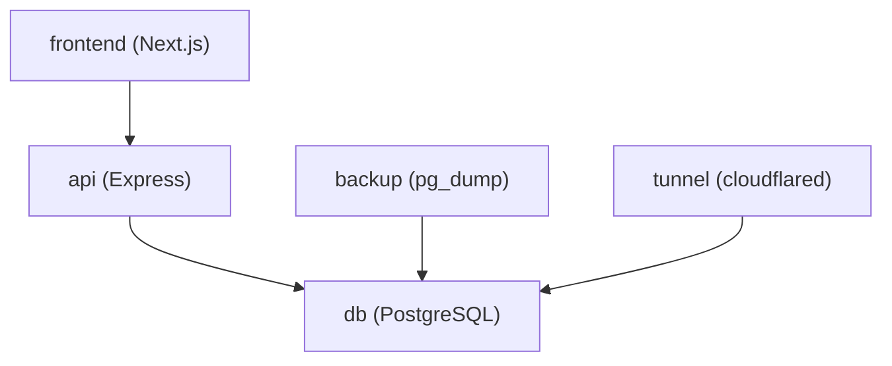

# Overall System Design

<cite>
**Referenced Files in This Document**
- [README.md](file://README.md)
- [backend/docker-compose.yml](file://backend/docker-compose.yml)
- [deploy/docker-compose.yml](file://deploy/docker-compose.yml)
- [deploy/README.md](file://deploy/README.md)
- [backend/Dockerfile](file://backend/Dockerfile)
- [deploy/frontend/Dockerfile](file://deploy/frontend/Dockerfile)
- [backend/package.json](file://backend/package.json)
- [simoapp/package.json](file://simoapp/package.json)
- [backend/index.js](file://backend/index.js)
- [backend/src/routes/clientes.routes.js](file://backend/src/routes/clientes.routes.js)
- [backend/src/controllers/clientes.controller.js](file://backend/src/controllers/clientes.controller.js)
- [backend/src/repositories/clientes.repository.js](file://backend/src/repositories/clientes.repository.js)
- [simoapp/app/(protected)/layout.tsx](file://simoapp/app/(protected)/layout.tsx)
- [simoapp/lib/apiClient.ts](file://simoapp/lib/apiClient.ts)
</cite>

## Table of Contents
1. [Introduction](#introduction)
2. [Project Structure](#project-structure)
3. [Core Components](#core-components)
4. [Architecture Overview](#architecture-overview)
5. [Detailed Component Analysis](#detailed-component-analysis)
6. [Dependency Analysis](#dependency-analysis)
7. [Performance Considerations](#performance-considerations)
8. [Troubleshooting Guide](#troubleshooting-guide)
9. [Conclusion](#conclusion)

## Introduction
SIMO is a retail management system focused on inventory, sales, and order traceability for small retail businesses. The project follows a clear frontend-backend separation: a Next.js application serves the user interface, while an Express.js API provides REST endpoints backed by PostgreSQL. Deployment is containerized with Docker Compose, and production exposure is routed through Cloudflare Tunnel to avoid opening direct ports.

The system combines modern web practices (Next.js App Router, React components, TypeScript, Tailwind CSS) with a structured backend (Express routes, controllers, repositories, JWT authentication, rate limiting, and security headers). Data persistence uses PostgreSQL migrations, seeds, and optional Neon integration.

**Section sources**
- [README.md:1-39](file://README.md#L1-L39)
- [deploy/README.md:1-28](file://deploy/README.md#L1-L28)

## Project Structure
At a high level, the repository contains:
- `simoapp`: Next.js frontend application with component-based architecture and protected routes.
- `backend`: Express.js API with route modules, controllers, repositories, middleware, database configuration, and Docker setup.
- `deploy`: Production-oriented Docker Compose orchestration including database, API, frontend, backup, and Cloudflare tunnel services.
- `backend/db`: Database migrations, roles, seeds, tests, and initialization scripts.

**Diagram sources**
- [deploy/docker-compose.yml:14-80](file://deploy/docker-compose.yml#L14-L80)
- [backend/docker-compose.yml:3-37](file://backend/docker-compose.yml#L3-L37)
- [deploy/README.md:5-18](file://deploy/README.md#L5-L18)

**Section sources**
- [README.md:7-39](file://README.md#L7-L39)
- [deploy/docker-compose.yml:14-80](file://deploy/docker-compose.yml#L14-L80)
- [backend/docker-compose.yml:3-37](file://backend/docker-compose.yml#L3-L37)

## Core Components
- Frontend (Next.js):
  - Provides a responsive UI with protected layouts and reusable components.
  - Communicates with the backend via Axios client configured with environment variables.
- Backend (Express.js):
  - Exposes REST endpoints under `/api`.
  - Implements authentication (JWT), security headers, XSS sanitization, and rate limiting.
  - Organizes code using routes, controllers, and repositories.
- Database (PostgreSQL):
  - Stores users, products, customers, inventory movements, sales, and orders.
  - Uses migrations and optional seed data; supports local and Neon configurations.

Technology stack decisions:
- Frontend: Next.js App Router, React, TypeScript, Tailwind CSS.
- Backend: Node.js runtime, Express.js, pg client, bcrypt, JWT, helmet, rate limiter.
- Database: PostgreSQL 18 Alpine image.

**Section sources**
- [simoapp/package.json:11-27](file://simoapp/package.json#L11-L27)
- [backend/package.json:15-24](file://backend/package.json#L15-L24)
- [backend/docker-compose.yml:4-12](file://backend/docker-compose.yml#L4-L12)
- [deploy/docker-compose.yml:15-25](file://deploy/docker-compose.yml#L15-L25)

## Architecture Overview
The SIMO system separates concerns across layers:
- Presentation layer: Next.js app renders pages and components, manages UI state, and calls the API.
- Application layer: Express API handles HTTP requests, enforces security, validates input, and delegates business logic.
- Data layer: PostgreSQL persists domain entities and supports complex queries and transactions.

Containerized deployment topology:
- `db` service runs PostgreSQL with persistent volumes and optional initialization scripts.
- `api` service runs the Express backend, connecting to the database via environment variables.
- `frontend` service builds and serves the Next.js app.
- `backup` service performs scheduled backups.
- `tunnel` service exposes services securely through Cloudflare.

**Diagram sources**
- [backend/index.js:20-56](file://backend/index.js#L20-L56)
- [simoapp/lib/apiClient.ts:6-11](file://simoapp/lib/apiClient.ts#L6-L11)
- [deploy/docker-compose.yml:39-80](file://deploy/docker-compose.yml#L39-L80)

**Section sources**
- [deploy/README.md:5-18](file://deploy/README.md#L5-L18)
- [backend/index.js:20-56](file://backend/index.js#L20-L56)
- [simoapp/lib/apiClient.ts:6-11](file://simoapp/lib/apiClient.ts#L6-L11)

## Detailed Component Analysis

### Backend MVC-like Organization
The backend organizes functionality into:
- Routes: Define URL paths and attach middleware (authentication, role checks).
- Controllers: Validate input, enforce business rules, and coordinate repositories.
- Repositories: Encapsulate SQL queries and data access logic.

Example flow for customer management:
- Route module mounts endpoints under `/api/customers` and applies token and role verification.
- Controller validates fields, normalizes identifiers, and delegates to repository functions.
- Repository executes parameterized queries and returns structured results.

**Diagram sources**
- [backend/src/routes/clientes.routes.js:1-27](file://backend/src/routes/clientes.routes.js#L1-L27)
- [backend/src/controllers/clientes.controller.js:1-283](file://backend/src/controllers/clientes.controller.js#L1-L283)
- [backend/src/repositories/clientes.repository.js:1-131](file://backend/src/repositories/clientes.repository.js#L1-L131)

**Section sources**
- [backend/src/routes/clientes.routes.js:1-27](file://backend/src/routes/clientes.routes.js#L1-L27)
- [backend/src/controllers/clientes.controller.js:1-283](file://backend/src/controllers/clientes.controller.js#L1-L283)
- [backend/src/repositories/clientes.repository.js:1-131](file://backend/src/repositories/clientes.repository.js#L1-L131)

### Authentication Flow
The login endpoint verifies credentials, checks account status, issues a JWT, and updates last access time. The frontend attaches the token to subsequent requests and redirects to login on unauthorized responses.

**Diagram sources**
- [backend/index.js:345-423](file://backend/index.js#L345-L423)
- [simoapp/lib/apiClient.ts:13-31](file://simoapp/lib/apiClient.ts#L13-L31)
- [simoapp/lib/apiClient.ts:33-56](file://simoapp/lib/apiClient.ts#L33-L56)

**Section sources**
- [backend/index.js:345-423](file://backend/index.js#L345-L423)
- [simoapp/lib/apiClient.ts:13-31](file://simoapp/lib/apiClient.ts#L13-L31)
- [simoapp/lib/apiClient.ts:33-56](file://simoapp/lib/apiClient.ts#L33-L56)

### Customer Creation Validation Flow
Customer creation includes normalization of identity documents, strict field validation, duplicate detection, and safe database insertion.

**Diagram sources**
- [backend/src/controllers/clientes.controller.js:70-122](file://backend/src/controllers/clientes.controller.js#L70-L122)
- [backend/src/repositories/clientes.repository.js:10-18](file://backend/src/repositories/clientes.repository.js#L10-L18)

**Section sources**
- [backend/src/controllers/clientes.controller.js:70-122](file://backend/src/controllers/clientes.controller.js#L70-L122)
- [backend/src/repositories/clientes.repository.js:10-18](file://backend/src/repositories/clientes.repository.js#L10-L18)

### Frontend Protected Layout and API Client
The protected layout wraps application content with shared providers and shell components. The API client configures base URLs, attaches JWT tokens, and handles global authentication errors.

**Diagram sources**
- [simoapp/app/(protected)/layout.tsx:1-11](file://simoapp/app/(protected)/layout.tsx#L1-L11)
- [simoapp/lib/apiClient.ts:6-11](file://simoapp/lib/apiClient.ts#L6-L11)
- [simoapp/lib/apiClient.ts:13-31](file://simoapp/lib/apiClient.ts#L13-L31)
- [simoapp/lib/apiClient.ts:33-56](file://simoapp/lib/apiClient.ts#L33-L56)

**Section sources**
- [simoapp/app/(protected)/layout.tsx:1-11](file://simoapp/app/(protected)/layout.tsx#L1-L11)
- [simoapp/lib/apiClient.ts:6-11](file://simoapp/lib/apiClient.ts#L6-L11)
- [simoapp/lib/apiClient.ts:13-31](file://simoapp/lib/apiClient.ts#L13-L31)
- [simoapp/lib/apiClient.ts:33-56](file://simoapp/lib/apiClient.ts#L33-L56)

## Dependency Analysis
Service dependencies in production deployment:
- `api` depends on `db` being healthy before starting.
- `frontend` depends on `api` availability at build/runtime via environment variable.
- `backup` depends on `db` health and writes backups to a volume.
- `tunnel` depends on `db` health and exposes services through Cloudflare.

**Diagram sources**
- [deploy/docker-compose.yml:39-80](file://deploy/docker-compose.yml#L39-L80)
- [deploy/docker-compose.yml:82-116](file://deploy/docker-compose.yml#L82-L116)

**Section sources**
- [deploy/docker-compose.yml:39-80](file://deploy/docker-compose.yml#L39-L80)
- [deploy/docker-compose.yml:82-116](file://deploy/docker-compose.yml#L82-L116)

## Performance Considerations
- Backend security and resilience:
  - Helmet sets secure HTTP headers.
  - Rate limiting protects against abuse.
  - XSS sanitization reduces injection risks.
- Database performance:
  - Parameterized queries reduce risk and improve plan reuse.
  - Pagination limits result sets and offsets.
  - Indexes are defined in migrations and referenced in repository comments.
- Container efficiency:
  - Alpine images reduce footprint.
  - Multi-stage build for frontend minimizes runtime image size.
- Health checks:
  - API and database health checks enable reliable orchestration.

[No sources needed since this section provides general guidance]

## Troubleshooting Guide
Common operational issues and resolutions:
- Service not reachable:
  - Verify containers are running and healthy (`docker compose ps`).
  - Check logs for each service (`docker compose logs -f <service>`).
- Database connectivity:
  - Ensure `DATABASE_URL` or `DB_*` variables are correctly set.
  - Confirm the database is healthy before API starts.
- Authentication failures:
  - Check token presence and expiration.
  - Review 401/403 handling in the frontend interceptor.
- Backup operations:
  - Validate backup script execution and retention settings.
  - Use manual backup command to test immediate operation.

**Section sources**
- [deploy/README.md:87-125](file://deploy/README.md#L87-L125)
- [deploy/README.md:141-163](file://deploy/README.md#L141-L163)
- [backend/index.js:62-70](file://backend/index.js#L62-L70)
- [simoapp/lib/apiClient.ts:33-56](file://simoapp/lib/apiClient.ts#L33-L56)

## Conclusion
SIMO’s system design emphasizes clear separation of concerns, secure defaults, and robust deployment practices. The Next.js frontend delivers a modern user experience, while the Express backend enforces business rules and security policies. PostgreSQL provides reliable persistence with migrations and optional Neon integration. Docker Compose orchestrates services, and Cloudflare Tunnel ensures secure external access without exposing internal ports. This architecture supports scalability, maintainability, and operational safety for retail management workflows.

[No sources needed since this section summarizes without analyzing specific files]