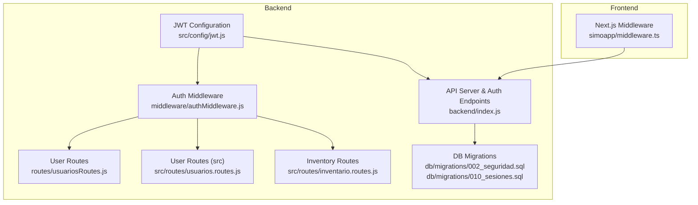
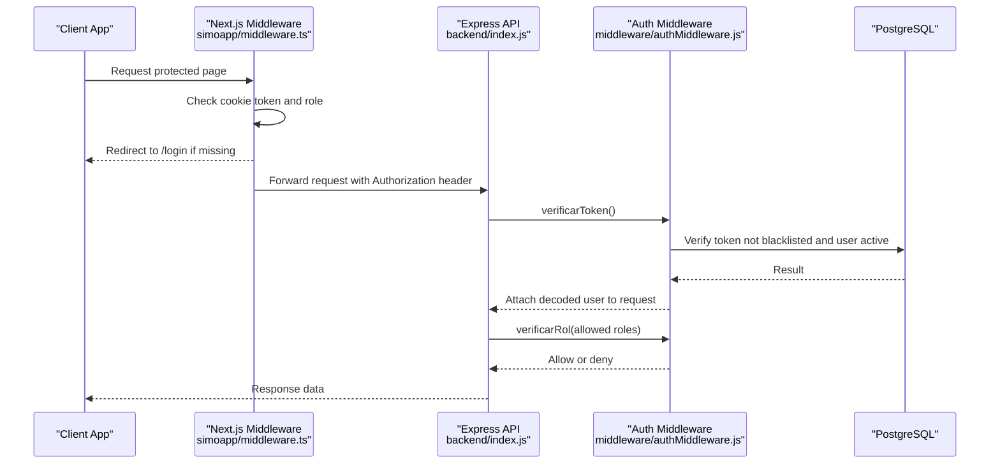
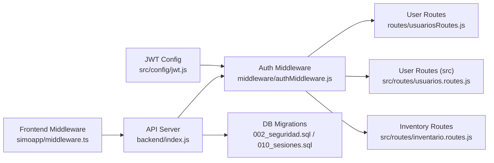

# Authentication & Authorization

<cite>
**Referenced Files in This Document**
- [jwt.js](file://backend/src/config/jwt.js)
- [authMiddleware.js](file://backend/middleware/authMiddleware.js)
- [index.js](file://backend/index.js)
- [010_sesiones.sql](file://backend/db/migrations/010_sesiones.sql)
- [002_seguridad.sql](file://backend/db/migrations/002_seguridad.sql)
- [usuariosRoutes.js](file://backend/routes/usuariosRoutes.js)
- [usuarios.routes.js](file://backend/src/routes/usuarios.routes.js)
- [inventario.routes.js](file://backend/src/routes/inventario.routes.js)
- [middleware.ts](file://simoapp/middleware.ts)
</cite>

## Table of Contents
1. [Introduction](#introduction)
2. [Project Structure](#project-structure)
3. [Core Components](#core-components)
4. [Architecture Overview](#architecture-overview)
5. [Detailed Component Analysis](#detailed-component-analysis)
6. [Dependency Analysis](#dependency-analysis)
7. [Performance Considerations](#performance-considerations)
8. [Troubleshooting Guide](#troubleshooting-guide)
9. [Conclusion](#conclusion)
10. [Appendices](#appendices)

## Introduction
This document explains the authentication and authorization system used by SIMO. It covers:
- JWT-based authentication flow, including token generation, validation, and logout invalidation.
- Role-based access control (RBAC) with application roles and permission checks.
- The middleware chain for request authentication, token verification, and authorization.
- Examples of protected routes and how to extend permissions.
- Token storage strategies, security considerations, and session management.
- Guidance for implementing custom authentication guards and extending the permission system.

The backend is an Express API that signs and verifies JSON Web Tokens using a shared secret. Protected routes use middleware to validate tokens and enforce role-based permissions. A blacklist table supports immediate logout invalidation even before token expiration.

## Project Structure
The authentication and authorization logic spans configuration, middleware, route definitions, database migrations, and frontend routing:

**Diagram sources**
- [jwt.js:1-15](file://backend/src/config/jwt.js#L1-L15)
- [authMiddleware.js:1-80](file://backend/middleware/authMiddleware.js#L1-L80)
- [index.js:350-477](file://backend/index.js#L350-L477)
- [usuariosRoutes.js:1-48](file://backend/routes/usuariosRoutes.js#L1-L48)
- [usuarios.routes.js:1-18](file://backend/src/routes/usuarios.routes.js#L1-L18)
- [inventario.routes.js:1-17](file://backend/src/routes/inventario.routes.js#L1-L17)
- [002_seguridad.sql:1-91](file://backend/db/migrations/002_seguridad.sql#L1-L91)
- [010_sesiones.sql:1-19](file://backend/db/migrations/010_sesiones.sql#L1-L19)
- [middleware.ts:1-36](file://simoapp/middleware.ts#L1-L36)

**Section sources**
- [jwt.js:1-15](file://backend/src/config/jwt.js#L1-L15)
- [authMiddleware.js:1-80](file://backend/middleware/authMiddleware.js#L1-L80)
- [index.js:350-477](file://backend/index.js#L350-L477)
- [002_seguridad.sql:1-91](file://backend/db/migrations/002_seguridad.sql#L1-L91)
- [010_sesiones.sql:1-19](file://backend/db/migrations/010_sesiones.sql#L1-L19)
- [usuariosRoutes.js:1-48](file://backend/routes/usuariosRoutes.js#L1-L48)
- [usuarios.routes.js:1-18](file://backend/src/routes/usuarios.routes.js#L1-L18)
- [inventario.routes.js:1-17](file://backend/src/routes/inventario.routes.js#L1-L17)
- [middleware.ts:1-36](file://simoapp/middleware.ts#L1-L36)

## Core Components
- JWT configuration: centralizes signing secret and token expiration.
- Authentication middleware: validates Bearer tokens, checks blacklist, and user status.
- RBAC middleware: enforces allowed roles per route.
- Login endpoint: authenticates credentials, issues JWT, updates last access time.
- Logout endpoint: blacklists the current token to invalidate it immediately.
- Database schema: defines roles, users, and blacklist table.
- Frontend middleware: protects Next.js pages based on cookies.

Key responsibilities:
- Centralized JWT settings avoid mismatched secrets between login and verification.
- Token payload includes user identity and role information consumed by RBAC.
- Blacklist enables immediate logout without waiting for token expiry.
- RBAC accepts both numeric role IDs and role codes for flexibility.

**Section sources**
- [jwt.js:1-15](file://backend/src/config/jwt.js#L1-L15)
- [authMiddleware.js:1-80](file://backend/middleware/authMiddleware.js#L1-L80)
- [index.js:350-477](file://backend/index.js#L350-L477)
- [002_seguridad.sql:1-91](file://backend/db/migrations/002_seguridad.sql#L1-L91)
- [010_sesiones.sql:1-19](file://backend/db/migrations/010_sesiones.sql#L1-L19)

## Architecture Overview
The authentication and authorization architecture follows a layered approach:

**Diagram sources**
- [middleware.ts:1-36](file://simoapp/middleware.ts#L1-L36)
- [index.js:350-477](file://backend/index.js#L350-L477)
- [authMiddleware.js:1-80](file://backend/middleware/authMiddleware.js#L1-L80)

## Detailed Component Analysis

### JWT Configuration
- Purpose: Provide a single source of truth for the signing secret and token expiration.
- Behavior: Uses environment variable when available; otherwise uses development secret with a warning in production.
- Expiration: Defaults to 30 minutes unless overridden by environment.

Security implications:
- Always set JWT_SECRET in production.
- Keep EXPIRATION short enough to limit exposure window.

**Section sources**
- [jwt.js:1-15](file://backend/src/config/jwt.js#L1-L15)

### Authentication Middleware
- Responsibilities:
  - Extract Bearer token from Authorization header.
  - Verify signature and expiration using the centralized secret.
  - Check blacklist to reject logged-out tokens.
  - Ensure user account is active.
  - Attach decoded user info to request for downstream handlers.
- Error handling:
  - Missing or malformed token returns 401.
  - Invalid/expired token returns 403.
  - Logged-out or inactive user returns 401.
  - Internal errors return 500.

Extensibility:
- Add additional claims checks here if needed.
- Integrate rate limiting or IP allowlisting around token verification.

**Section sources**
- [authMiddleware.js:1-80](file://backend/middleware/authMiddleware.js#L1-L80)

### RBAC Middleware
- Purpose: Enforce role-based access control on routes.
- Inputs: One or more allowed roles (numeric IDs or role codes).
- Logic:
  - Requires prior authentication via verificarToken.
  - Compares req.usuario.id_rol and req.usuario.rol against allowed list.
  - Denies access with 403 if not permitted.

Usage patterns:
- Numeric IDs: e.g., 1 for Admin, 2 for Manager.
- Role codes: e.g., 'ADMIN', 'GERENTE', 'INVENTARIO', 'VENDEDOR'.

Customization:
- Extend to support granular permissions beyond roles by adding a permissions array to the token payload and checking it in this middleware.

**Section sources**
- [authMiddleware.js:52-75](file://backend/middleware/authMiddleware.js#L52-L75)

### Login Flow
- Steps:
  - Validate email and password presence.
  - Fetch user with role code from database.
  - Compare password hash securely.
  - Reject inactive accounts.
  - Build token payload with user identity and role.
  - Sign token with centralized secret and configured expiration.
  - Update last access timestamp.
  - Return token and minimal user profile.

Security notes:
- Password comparison uses bcrypt.
- Inactive users are blocked at login.
- Token payload contains only necessary claims.

**Section sources**
- [index.js:350-423](file://backend/index.js#L350-L423)

### Logout Flow
- Steps:
  - Require Authorization header with Bearer token.
  - Insert token into blacklist table.
  - Ignore duplicate key errors (idempotent logout).
  - Respond with success message.

Session management:
- Blacklist ensures immediate invalidation even if token has not expired.
- Authentication middleware rejects blacklisted tokens.

**Section sources**
- [index.js:428-469](file://backend/index.js#L428-L469)
- [010_sesiones.sql:1-19](file://backend/db/migrations/010_sesiones.sql#L1-L19)
- [authMiddleware.js:29-45](file://backend/middleware/authMiddleware.js#L29-L45)

### Protected Routes and RBAC Examples
- User management routes:
  - List users: requires Admin or Manager.
  - Create user: requires Admin.
  - Get user by ID: requires Admin or Manager.
  - Update user: requires Admin.
  - Change user status: requires Admin.
- Inventory routes:
  - Warehouse entries: requires Inventory or Admin.
  - Purchase operations: requires Inventory or Admin.
  - View purchase details: requires Inventory, Admin, or Manager.

These routes demonstrate consistent usage of verificarToken followed by verificarRol with either numeric IDs or role codes.

**Section sources**
- [usuariosRoutes.js:10-46](file://backend/routes/usuariosRoutes.js#L10-L46)
- [usuarios.routes.js:9-15](file://backend/src/routes/usuarios.routes.js#L9-L15)
- [inventario.routes.js:9-14](file://backend/src/routes/inventario.routes.js#L9-L14)

### Frontend Session Management
- Next.js middleware checks cookies for token and role.
- Protects login and recovery pages from authenticated users.
- Redirects unauthenticated requests to login.
- Restricts certain pages (e.g., user management) to specific roles.

Recommendations:
- Store tokens in HttpOnly cookies to reduce XSS risk.
- Use secure flags and SameSite attributes for CSRF protection.
- Refresh tokens can be implemented server-side with rotation and revocation.

**Section sources**
- [middleware.ts:1-36](file://simoapp/middleware.ts#L1-L36)

### Data Model and Roles
- Roles:
  - ADMIN: Full administrative access.
  - GERENTE: Manager-level access for dashboards and approvals.
  - INVENTARIO: Inventory management capabilities.
  - VENDEDOR: Sales and customer operations.
- Users:
  - Include role reference, hashed password, account state, and audit fields.
- Blacklist:
  - Stores invalidated tokens with timestamps.

```mermaid
erDiagram
ROLES {
int id_rol PK
varchar codigo UK
varchar nombre UK
varchar descripcion
timestamptz creado_en
}
USUARIOS {
int id_usuario PK
int id_rol FK
varchar nombre_completo
varchar correo UK
varchar usuario UK
varchar password_hash
boolean estado
smallint intentos_fallidos
timestamptz bloqueado_hasta
timestamptz ultimo_acceso
timestamptz creado_en
timestamptz actualizado_en
}
JWT_BLACKLIST {
text token PK
timestamptz invalidado_en
}
ROLES ||--o{ USUARIOS : "assigned_to"
```

**Diagram sources**
- [002_seguridad.sql:15-53](file://backend/db/migrations/002_seguridad.sql#L15-L53)
- [010_sesiones.sql:12-15](file://backend/db/migrations/010_sesiones.sql#L12-L15)

**Section sources**
- [002_seguridad.sql:1-91](file://backend/db/migrations/002_seguridad.sql#L1-L91)
- [010_sesiones.sql:1-19](file://backend/db/migrations/010_sesiones.sql#L1-L19)

## Dependency Analysis
The authentication and authorization components have clear dependencies:

Observations:
- All protected routes depend on authMiddleware for both authentication and authorization.
- JWT configuration is shared across login and verification paths.
- Frontend middleware complements backend protections but should not replace them.

**Diagram sources**
- [jwt.js:1-15](file://backend/src/config/jwt.js#L1-L15)
- [authMiddleware.js:1-80](file://backend/middleware/authMiddleware.js#L1-L80)
- [usuariosRoutes.js:1-48](file://backend/routes/usuariosRoutes.js#L1-L48)
- [usuarios.routes.js:1-18](file://backend/src/routes/usuarios.routes.js#L1-L18)
- [inventario.routes.js:1-17](file://backend/src/routes/inventario.routes.js#L1-L17)
- [index.js:350-477](file://backend/index.js#L350-L477)
- [002_seguridad.sql:1-91](file://backend/db/migrations/002_seguridad.sql#L1-L91)
- [010_sesiones.sql:1-19](file://backend/db/migrations/010_sesiones.sql#L1-L19)
- [middleware.ts:1-36](file://simoapp/middleware.ts#L1-L36)

**Section sources**
- [jwt.js:1-15](file://backend/src/config/jwt.js#L1-L15)
- [authMiddleware.js:1-80](file://backend/middleware/authMiddleware.js#L1-L80)
- [usuariosRoutes.js:1-48](file://backend/routes/usuariosRoutes.js#L1-L48)
- [usuarios.routes.js:1-18](file://backend/src/routes/usuarios.routes.js#L1-L18)
- [inventario.routes.js:1-17](file://backend/src/routes/inventario.routes.js#L1-L17)
- [index.js:350-477](file://backend/index.js#L350-L477)
- [002_seguridad.sql:1-91](file://backend/db/migrations/002_seguridad.sql#L1-L91)
- [010_sesiones.sql:1-19](file://backend/db/migrations/010_sesiones.sql#L1-L19)
- [middleware.ts:1-36](file://simoapp/middleware.ts#L1-L36)

## Performance Considerations
- Token verification is lightweight but performs two database reads per request: blacklist check and user status check.
- Consider caching frequently accessed user status or using Redis for blacklist to reduce DB load under high concurrency.
- Keep token payloads minimal to reduce network overhead.
- Use connection pooling efficiently and ensure indexes exist on frequently queried columns (e.g., usuarios.correo, jwt_blacklist.token).

[No sources needed since this section provides general guidance]

## Troubleshooting Guide
Common issues and resolutions:
- Missing Authorization header:
  - Ensure clients send Authorization: Bearer <token>.
- Malformed token:
  - Verify correct header format and token string.
- Invalid or expired token:
  - Re-authenticate via login; verify JWT_SECRET matches between sign and verify.
- Logged-out session:
  - Token may be blacklisted; call logout again or re-login.
- Inactive user:
  - Account disabled by admin; contact administrator.
- Forbidden access:
  - User role does not match route requirements; adjust roles or route permissions.

Operational tips:
- Log detailed error messages during development; avoid leaking sensitive details in production.
- Monitor blacklist growth and consider periodic cleanup jobs.
- Validate environment variables for JWT_SECRET and JWT_EXPIRES_IN.

**Section sources**
- [authMiddleware.js:9-49](file://backend/middleware/authMiddleware.js#L9-L49)
- [index.js:428-469](file://backend/index.js#L428-L469)

## Conclusion
SIMO’s authentication and authorization system combines JWT-based token issuance with robust middleware checks and role-based access control. The design centralizes JWT configuration, enforces immediate logout via a blacklist, and applies consistent RBAC across routes. Frontend middleware adds an extra layer of protection for Next.js pages. To extend the system, you can add custom guards, expand permissions, and implement refresh token flows while maintaining strong security practices.

[No sources needed since this section summarizes without analyzing specific files]

## Appendices

### Implementing Custom Authentication Guards
- Create a new middleware function similar to verificarToken:
  - Extract and validate token.
  - Perform additional checks (e.g., tenant isolation, feature flags).
  - Attach context to request object.
- Compose it with existing verificarToken and verificarRol where appropriate.

Reference pattern:
- See [authMiddleware.js:9-49](file://backend/middleware/authMiddleware.js#L9-L49) for token extraction and validation structure.

### Extending the Permission System
- Add fine-grained permissions to the token payload during login.
- Extend verificarRol to check permissions arrays.
- Define permission constants and map them to routes.

Reference pattern:
- See [authMiddleware.js:57-75](file://backend/middleware/authMiddleware.js#L57-L75) for role-checking logic.

### Token Storage Strategies
- Backend:
  - Prefer HttpOnly, Secure, SameSite cookies for tokens.
  - Avoid storing tokens in localStorage due to XSS risks.
- Frontend:
  - Use Next.js middleware to protect routes and redirect appropriately.
  - Handle token refresh transparently when implementing refresh tokens.

Reference pattern:
- See [middleware.ts:1-36](file://simoapp/middleware.ts#L1-L36) for frontend protection example.

### Logout Procedures
- Call the logout endpoint with the current token.
- Clear client-side cookies or local storage after successful logout.
- Ensure subsequent requests are rejected due to blacklist entry.

Reference pattern:
- See [index.js:428-469](file://backend/index.js#L428-L469) for logout implementation.