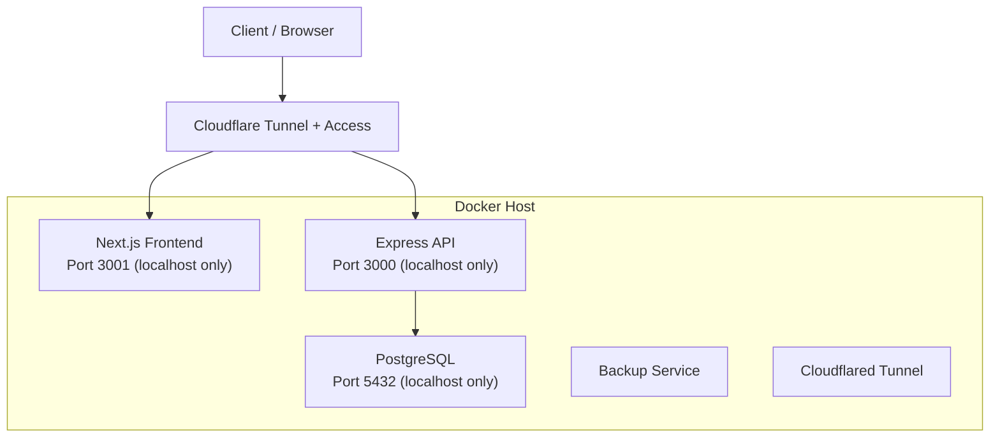
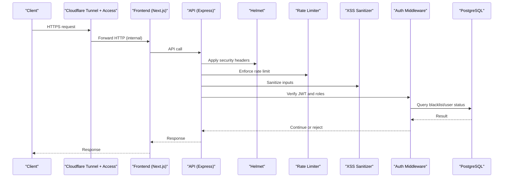
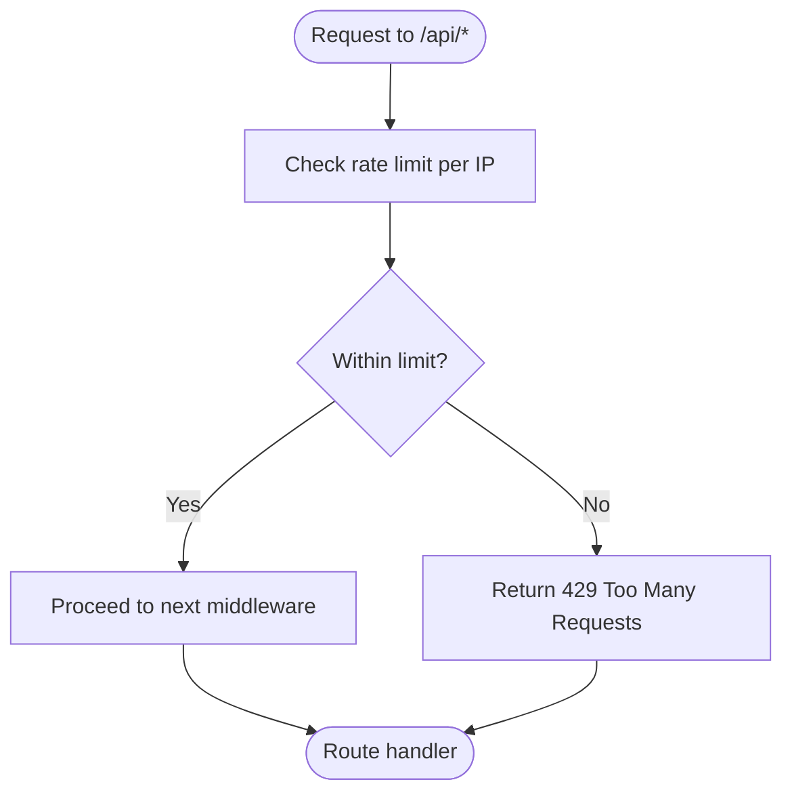
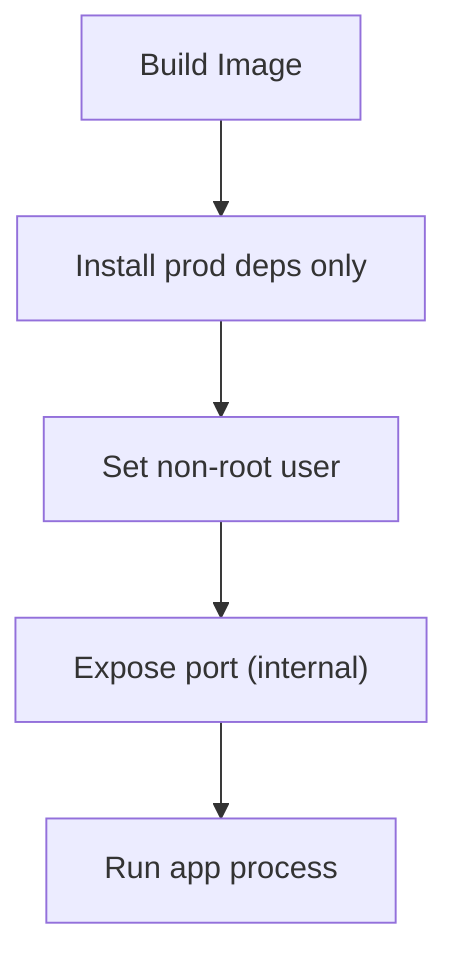
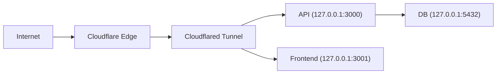
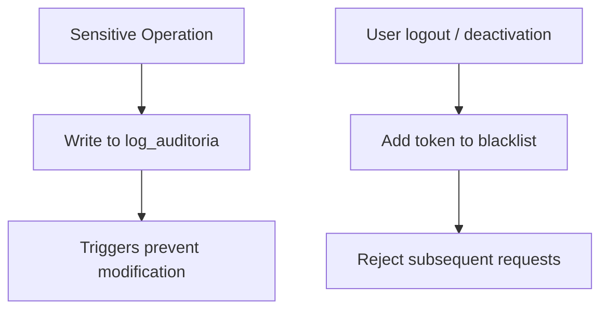
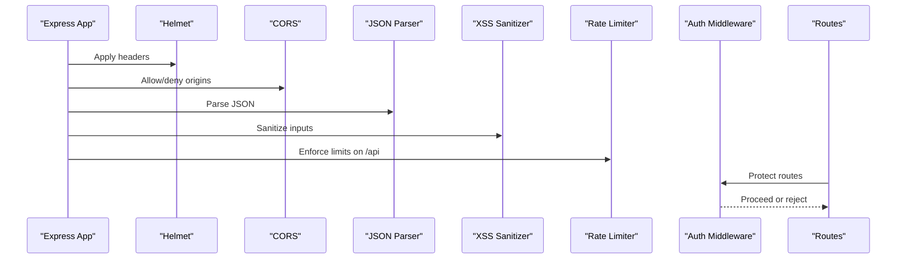
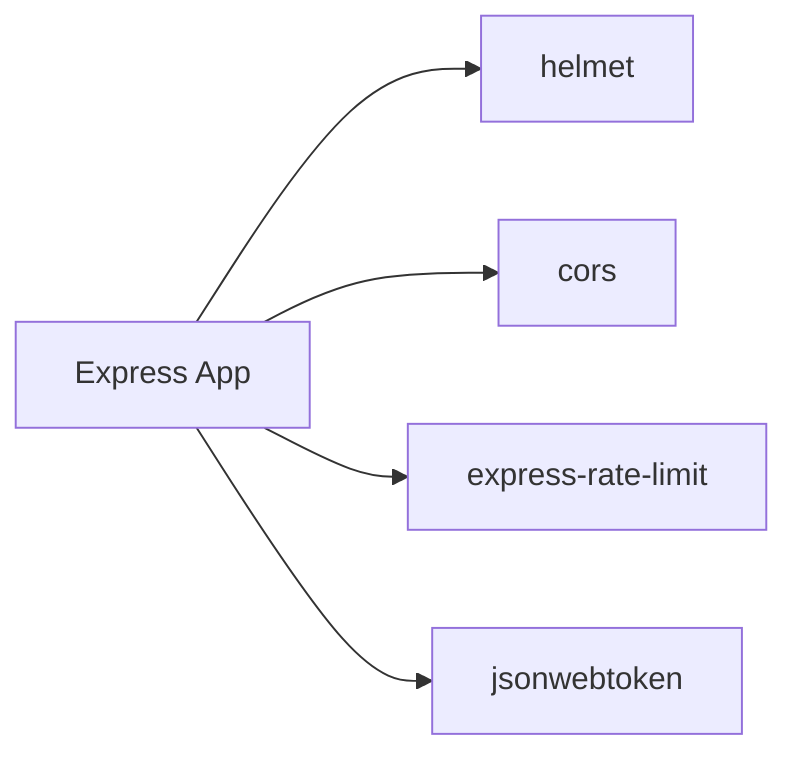

# Infrastructure Security

<cite>
**Referenced Files in This Document**
- [README.md](file://README.md)
- [backend/index.js](file://backend/index.js)
- [backend/package-lock.json](file://backend/package-lock.json)
- [backend/src/config/db.js](file://backend/src/config/db.js)
- [backend/src/config/jwt.js](file://backend/src/config/jwt.js)
- [backend/middleware/authMiddleware.js](file://backend/middleware/authMiddleware.js)
- [backend/src/middleware/sanitizarXss.js](file://backend/src/middleware/sanitizarXss.js)
- [backend/Dockerfile](file://backend/Dockerfile)
- [deploy/docker-compose.yml](file://deploy/docker-compose.yml)
- [deploy/README.md](file://deploy/README.md)
- [backend/db/migrations/007_auditoria.sql](file://backend/db/migrations/007_auditoria.sql)
</cite>

## Table of Contents
1. [Introduction](#introduction)
2. [Project Structure](#project-structure)
3. [Core Components](#core-components)
4. [Architecture Overview](#architecture-overview)
5. [Detailed Component Analysis](#detailed-component-analysis)
6. [Dependency Analysis](#dependency-analysis)
7. [Performance Considerations](#performance-considerations)
8. [Troubleshooting Guide](#troubleshooting-guide)
9. [Conclusion](#conclusion)

## Introduction
This document explains the infrastructure-level security configuration for SIMO, focusing on:
- CORS policy and request sanitization
- Rate limiting and DDoS protection at application and network layers
- Security headers via Helmet
- HTTPS, SSL/TLS, and certificate management
- Environment variable and secret management
- Container and deployment security
- Firewall rules and network isolation
- Monitoring and audit logging
- Middleware integration patterns and performance considerations

The backend is an Express API with PostgreSQL, containerized with Docker Compose, and exposed through Cloudflare Tunnel with Access policies. The frontend is a Next.js application.

## Project Structure
Security-relevant parts are primarily in:
- Backend entry point where security middleware is registered
- Database connection configuration for SSL
- JWT configuration and authentication middleware
- XSS sanitization middleware
- Docker image and compose definitions for secure runtime and network isolation
- Deployment documentation for Cloudflare Tunnel and Access controls
- Audit migration for immutable logs

**Diagram sources**
- [deploy/docker-compose.yml:1-120](file://deploy/docker-compose.yml#L1-L120)
- [deploy/README.md:35-67](file://deploy/README.md#L35-L67)

**Section sources**
- [README.md:27-64](file://README.md#L27-L64)
- [deploy/docker-compose.yml:1-120](file://deploy/docker-compose.yml#L1-L120)

## Core Components
- CORS policy: enabled globally; can be restricted to specific origins in production.
- Security headers: Helmet applied globally.
- Request sanitization: custom XSS sanitizer applied globally.
- Rate limiting: applied to all `/api` routes using `express-rate-limit`.
- Authentication and authorization: JWT-based with role checks.
- Database connectivity: supports `DATABASE_URL` with optional SSL and environment-driven behavior.
- Containerization: non-root user, minimal dependencies, healthchecks.
- Network exposure: services bound to `127.0.0.1`; external access via Cloudflare Tunnel.

**Section sources**
- [backend/index.js:1-48](file://backend/index.js#L1-L48)
- [backend/src/middleware/sanitizarXss.js:1-48](file://backend/src/middleware/sanitizarXss.js#L1-L48)
- [backend/src/config/db.js:1-28](file://backend/src/config/db.js#L1-L28)
- [backend/Dockerfile:1-26](file://backend/Dockerfile#L1-L26)
- [deploy/docker-compose.yml:1-120](file://deploy/docker-compose.yml#L1-L120)

## Architecture Overview
The security architecture combines application-layer protections with network isolation and managed edge security:

**Diagram sources**
- [backend/index.js:24-48](file://backend/index.js#L24-L48)
- [backend/middleware/authMiddleware.js:9-49](file://backend/middleware/authMiddleware.js#L9-L49)
- [deploy/docker-compose.yml:1-120](file://deploy/docker-compose.yml#L1-L120)

## Detailed Component Analysis

### CORS Policy Configuration
- CORS is enabled globally via `cors()` before JSON parsing and route registration.
- In production, restrict allowed origins to the frontend domain(s).
- Avoid wildcard origins when credentials are involved.

Recommendation:
- Configure `origin`, `methods`, and `allowedHeaders` based on the deployed frontend URL.
- Disable cookies/credentials unless explicitly required by the frontend.

**Section sources**
- [backend/index.js:28-29](file://backend/index.js#L28-L29)

### Rate Limiting Implementation
- Global limiter is applied to `/api` routes.
- Default window: 1 minute; default max requests configurable via `RATE_LIMIT_MAX`.
- Uses standard headers and returns a structured error message.

**Diagram sources**
- [backend/index.js:34-48](file://backend/index.js#L34-L48)

**Section sources**
- [backend/index.js:34-48](file://backend/index.js#L34-L48)
- [backend/package-lock.json:3028-3045](file://backend/package-lock.json#L3028-L3045)

### DDoS Protection Measures
Application layer:
- Rate limiting on `/api` mitigates simple floods.
- Input sanitization reduces payload abuse surface.

Network and edge layer:
- No ports published to public interfaces; only loopback (`127.0.0.1`).
- External traffic enters exclusively via Cloudflare Tunnel.
- Cloudflare Access enforces identity-based policies for sensitive endpoints.

Operational recommendations:
- Enable Cloudflare DDoS protection and WAF rules.
- Use Cloudflare Access for admin and API endpoints.
- Monitor request rates and block abusive IPs at the edge.

**Section sources**
- [deploy/docker-compose.yml:7-10](file://deploy/docker-compose.yml#L7-L10)
- [deploy/docker-compose.yml:26-27](file://deploy/docker-compose.yml#L26-L27)
- [deploy/docker-compose.yml:54-55](file://deploy/docker-compose.yml#L54-L55)
- [deploy/docker-compose.yml:74-75](file://deploy/docker-compose.yml#L74-L75)
- [deploy/README.md:35-48](file://deploy/README.md#L35-L48)

### Security Headers Setup
- Helmet is applied globally to set secure defaults.
- Recommended hardening:
  - Content-Security-Policy tailored to Next.js assets and APIs.
  - X-Frame-Options DENY or SAMEORIGIN.
  - Strict-Transport-Security (HSTS) enforced at the reverse proxy or CDN.
  - Referrer-Policy, Permissions-Policy, and other modern headers.

Note:
- CSP should allow only trusted script/styles/sources for the Next.js app.
- HSTS should be configured at Cloudflare or the ingress to ensure HTTPS-only traffic.

**Section sources**
- [backend/index.js:24-25](file://backend/index.js#L24-L25)
- [backend/package-lock.json:3429-3440](file://backend/package-lock.json#L3429-L3440)

### HTTPS Configuration, SSL/TLS, and Certificate Management
- External clients connect over HTTPS via Cloudflare.
- Internal containers communicate over HTTP within the host network.
- Database connections support SSL controlled by environment variables:
  - `DATABASE_URL` with built-in SSL handling.
  - `DB_SSL=true/false` toggles SSL behavior for local or Docker setups.

Certificate management:
- Cloudflare manages TLS termination for inbound traffic.
- For direct-to-API deployments, configure TLS termination at the reverse proxy or use a managed service.

**Section sources**
- [deploy/README.md:35-48](file://deploy/README.md#L35-L48)
- [backend/src/config/db.js:1-28](file://backend/src/config/db.js#L1-L28)

### Environment Variable Security and Secret Management
Secrets used:
- Database credentials: `POSTGRES_USER`, `POSTGRES_PASSWORD`, `SIMO_APP_PASSWORD`, `DATABASE_URL`.
- JWT signing key: `JWT_SECRET`.
- Rate limit threshold: `RATE_LIMIT_MAX`.
- Cloudflare tunnel token: `CLOUDFLARE_TUNNEL_TOKEN`.

Best practices implemented:
- Non-root container user.
- Minimal production dependencies.
- Healthchecks for services.
- Loopback-only port bindings.

Recommended improvements:
- Never commit `.env` files; use CI/CD secret stores.
- Rotate secrets regularly; enforce minimum length and complexity.
- Validate required env vars at startup and fail fast if missing.

**Section sources**
- [backend/Dockerfile:18-19](file://backend/Dockerfile#L18-L19)
- [backend/src/config/jwt.js:1-15](file://backend/src/config/jwt.js#L1-L15)
- [backend/index.js:34-48](file://backend/index.js#L34-L48)
- [deploy/docker-compose.yml:19-27](file://deploy/docker-compose.yml#L19-L27)
- [deploy/docker-compose.yml:43-55](file://deploy/docker-compose.yml#L43-L55)
- [deploy/docker-compose.yml:107-116](file://deploy/docker-compose.yml#L107-L116)

### Container Security Best Practices
- Base image: Alpine Linux with Node LTS.
- Production-only dependencies installed via `npm ci --omit=dev`.
- Application runs as non-root user `node`.
- Services expose ports only on loopback.
- Healthchecks verify readiness of API and frontend.

**Diagram sources**
- [backend/Dockerfile:1-26](file://backend/Dockerfile#L1-L26)

**Section sources**
- [backend/Dockerfile:1-26](file://backend/Dockerfile#L1-L26)
- [deploy/docker-compose.yml:39-63](file://deploy/docker-compose.yml#L39-L63)
- [deploy/docker-compose.yml:65-80](file://deploy/docker-compose.yml#L65-L80)

### Firewall Rules and Network Isolation Strategies
- All service ports bind to `127.0.0.1`:
  - PostgreSQL: `127.0.0.1:5432`
  - API: `127.0.0.1:3000`
  - Frontend: `127.0.0.1:3001`
- External access is routed through Cloudflare Tunnel; no direct internet exposure.
- Cloudflare Access protects sensitive hosts with email-based one-time PIN.

**Diagram sources**
- [deploy/docker-compose.yml:26-27](file://deploy/docker-compose.yml#L26-L27)
- [deploy/docker-compose.yml:54-55](file://deploy/docker-compose.yml#L54-L55)
- [deploy/docker-compose.yml:74-75](file://deploy/docker-compose.yml#L74-L75)
- [deploy/README.md:35-48](file://deploy/README.md#L35-L48)

**Section sources**
- [deploy/docker-compose.yml:26-27](file://deploy/docker-compose.yml#L26-L27)
- [deploy/docker-compose.yml:54-55](file://deploy/docker-compose.yml#L54-L55)
- [deploy/docker-compose.yml:74-75](file://deploy/docker-compose.yml#L74-L75)
- [deploy/README.md:35-48](file://deploy/README.md#L35-L48)

### Monitoring Suspicious Activities and Auditing
- Audit table with immutable triggers prevents updates/deletes/truncation.
- Logs capture actor, entity, action, timestamps, and IP address.
- Blacklist mechanism invalidates sessions immediately upon logout or deactivation.

**Diagram sources**
- [backend/db/migrations/007_auditoria.sql:25-67](file://backend/db/migrations/007_auditoria.sql#L25-L67)
- [backend/middleware/authMiddleware.js:29-49](file://backend/middleware/authMiddleware.js#L29-L49)

**Section sources**
- [backend/db/migrations/007_auditoria.sql:25-67](file://backend/db/migrations/007_auditoria.sql#L25-L67)
- [backend/middleware/authMiddleware.js:9-49](file://backend/middleware/authMiddleware.js#L9-L49)

### Security Middleware Integration Examples
- Helmet: global security headers.
- CORS: global cross-origin policy.
- JSON parser: parse request bodies securely.
- XSS sanitizer: escape dangerous HTML characters in body/query/params.
- Rate limiter: protect `/api` from abuse.
- Auth middleware: validate JWT, check session validity and user status, enforce roles.

**Diagram sources**
- [backend/index.js:24-48](file://backend/index.js#L24-L48)
- [backend/middleware/authMiddleware.js:9-49](file://backend/middleware/authMiddleware.js#L9-L49)

**Section sources**
- [backend/index.js:24-48](file://backend/index.js#L24-L48)
- [backend/src/middleware/sanitizarXss.js:1-48](file://backend/src/middleware/sanitizarXss.js#L1-L48)
- [backend/middleware/authMiddleware.js:1-81](file://backend/middleware/authMiddleware.js#L1-L81)

## Dependency Analysis
Key security-related dependencies:
- `helmet`: sets secure HTTP headers.
- `cors`: handles cross-origin requests.
- `express-rate-limit`: enforces request rate limits.
- `jsonwebtoken`: signs and verifies tokens.

**Diagram sources**
- [backend/package-lock.json:2609-2625](file://backend/package-lock.json#L2609-L2625)
- [backend/package-lock.json:3028-3045](file://backend/package-lock.json#L3028-L3045)
- [backend/package-lock.json:3429-3440](file://backend/package-lock.json#L3429-L3440)

**Section sources**
- [backend/package-lock.json:2609-2625](file://backend/package-lock.json#L2609-L2625)
- [backend/package-lock.json:3028-3045](file://backend/package-lock.json#L3028-L3045)
- [backend/package-lock.json:3429-3440](file://backend/package-lock.json#L3429-L3440)

## Performance Considerations
- Keep rate limits reasonable; tune `RATE_LIMIT_MAX` for testing vs production.
- Prefer strict CORS origins to reduce unnecessary preflight overhead.
- Use Helmet’s defaults and selectively enable/disable features to avoid header bloat.
- Ensure database SSL is enabled in production; avoid disabling verification unless necessary.
- Minimize middleware chain depth; apply sanitization only where needed if performance becomes critical.
- Leverage Cloudflare caching and WAF to offload common attacks and static content.

[No sources needed since this section provides general guidance]

## Troubleshooting Guide
Common issues and resolutions:
- CORS errors:
  - Verify frontend origin matches CORS configuration.
  - Ensure credentials are handled correctly if cookies are used.
- 429 Too Many Requests:
  - Adjust `RATE_LIMIT_MAX` or increase window size temporarily during load tests.
  - Investigate potential abuse patterns.
- Unauthorized/Forbidden responses:
  - Confirm JWT secret is set and consistent across login and verification.
  - Check user status and token blacklist entries.
- Database connection failures:
  - Validate `DATABASE_URL` or DB_* variables.
  - Confirm SSL settings (`DB_SSL`) match provider requirements.
- Container not starting:
  - Check healthcheck endpoints and logs.
  - Ensure required environment variables are present.

**Section sources**
- [backend/index.js:34-48](file://backend/index.js#L34-L48)
- [backend/src/config/jwt.js:1-15](file://backend/src/config/jwt.js#L1-L15)
- [backend/middleware/authMiddleware.js:9-49](file://backend/middleware/authMiddleware.js#L9-L49)
- [backend/src/config/db.js:1-28](file://backend/src/config/db.js#L1-L28)
- [deploy/docker-compose.yml:59-63](file://deploy/docker-compose.yml#L59-L63)
- [deploy/docker-compose.yml:76-80](file://deploy/docker-compose.yml#L76-L80)

## Conclusion
SIMO implements a layered security model:
- Application-level protections via Helmet, CORS, input sanitization, and rate limiting.
- Strong authentication and authorization with JWT and role checks.
- Secure containerization and network isolation with loopback-only ports and Cloudflare Tunnel.
- Managed TLS and access control at the edge.
- Auditing and immutability for critical operations.

To further harden the system:
- Restrict CORS to known origins.
- Harden Helmet with explicit CSP and HSTS.
- Centralize secrets in a secure vault and rotate them regularly.
- Enable Cloudflare WAF rules and monitor for anomalies.
- Continuously review and update dependencies and base images.

[No sources needed since this section summarizes without analyzing specific files]