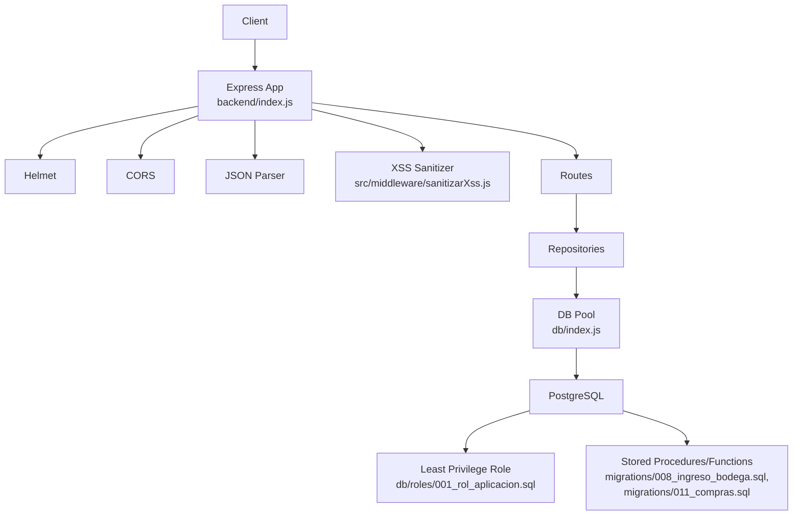
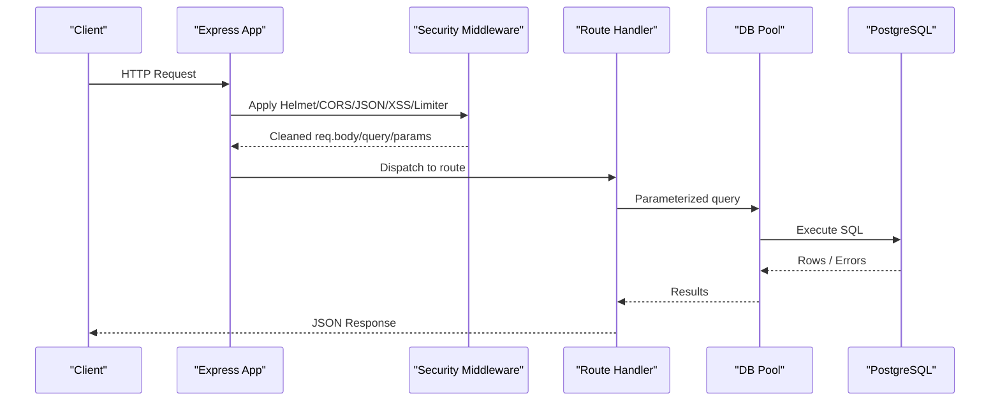
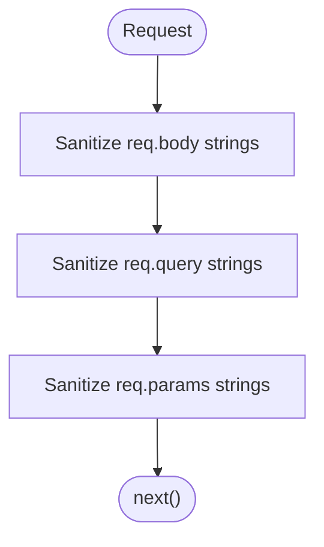
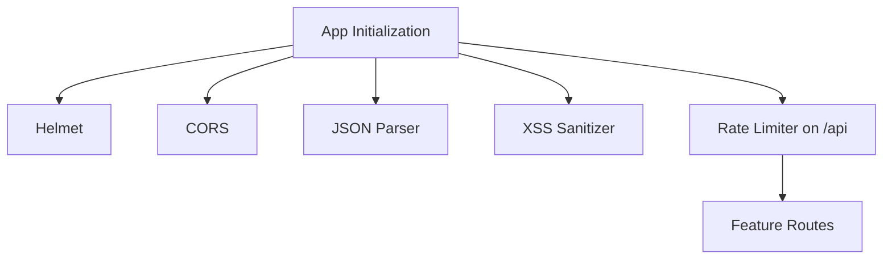
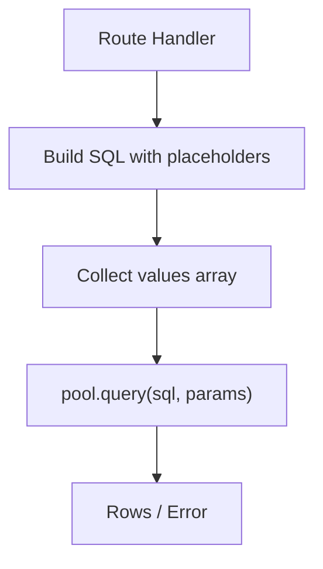
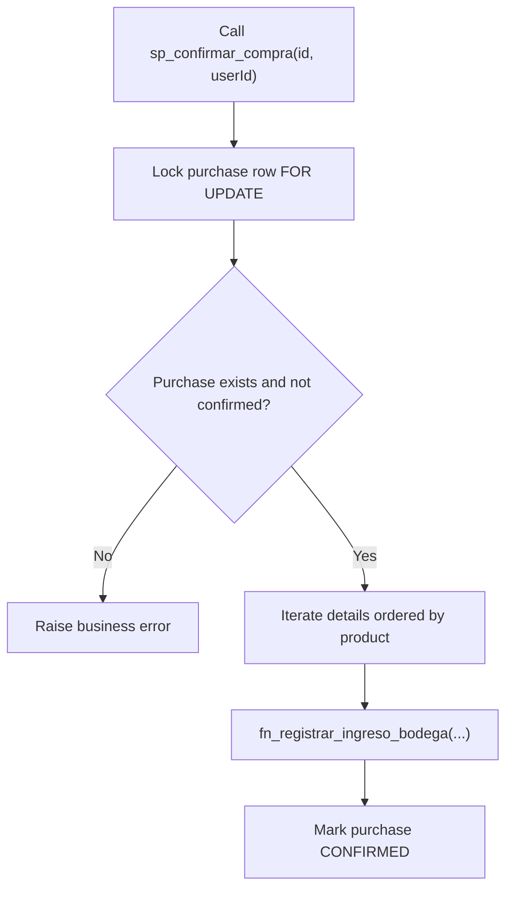
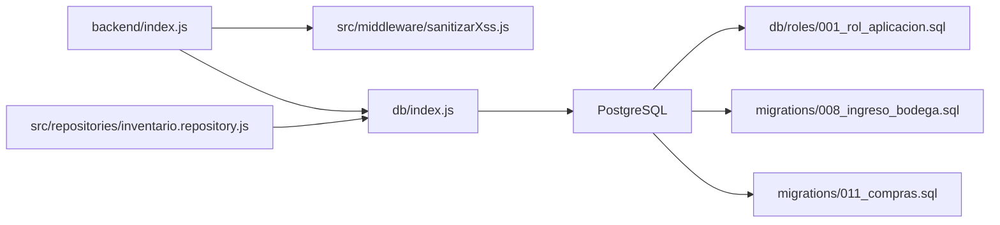

# Input Validation & Sanitization

<cite>
**Referenced Files in This Document**
- [backend/index.js](file://backend/index.js)
- [backend/src/middleware/sanitizarXss.js](file://backend/src/middleware/sanitizarXss.js)
- [backend/middleware/sanitizarXss.js](file://backend/middleware/sanitizarXss.js)
- [backend/db/index.js](file://backend/db/index.js)
- [backend/db/roles/001_rol_aplicacion.sql](file://backend/db/roles/001_rol_aplicacion.sql)
- [backend/db/migrations/008_ingreso_bodega.sql](file://backend/db/migrations/008_ingreso_bodega.sql)
- [backend/db/migrations/011_compras.sql](file://backend/db/migrations/011_compras.sql)
- [backend/src/repositories/inventario.repository.js](file://backend/src/repositories/inventario.repository.js)
- [simoapp/lib/clientes/validaciones.ts](file://simoapp/lib/clientes/validaciones.ts)
- [simoapp/lib/inventario/validaciones.ts](file://simoapp/lib/inventario/validaciones.ts)
</cite>

## Table of Contents
1. [Introduction](#introduction)
2. [Project Structure](#project-structure)
3. [Core Components](#core-components)
4. [Architecture Overview](#architecture-overview)
5. [Detailed Component Analysis](#detailed-component-analysis)
6. [Dependency Analysis](#dependency-analysis)
7. [Performance Considerations](#performance-considerations)
8. [Troubleshooting Guide](#troubleshooting-guide)
9. [Conclusion](#conclusion)

## Introduction
This document explains how SIMO validates and sanitizes input to protect against XSS, SQL injection, malformed data, and business rule violations. It covers the custom XSS protection middleware, HTML entity encoding, request traversal over body/query/params, custom validation functions for forms and APIs, error handling patterns, parameterized queries, stored procedure security, and guidelines for implementing custom validators and integrating libraries.

## Project Structure
Input validation and sanitization span multiple layers:
- Express application bootstrap applies global security middleware (Helmet, CORS, JSON parsing, XSS sanitization, rate limiting).
- Custom XSS sanitizers are implemented in two locations; the active one is imported by the application entry point.
- Database access uses a shared connection pool with parameterized queries.
- PostgreSQL roles enforce least privilege and immutability rules.
- Stored procedures and functions encapsulate business logic and additional validations.
- Frontend TypeScript modules provide client-side validation aligned with backend rules.

**Diagram sources**
- [backend/index.js:24-48](file://backend/index.js#L24-L48)
- [backend/src/middleware/sanitizarXss.js:40-45](file://backend/src/middleware/sanitizarXss.js#L40-L45)
- [backend/db/index.js:11-22](file://backend/db/index.js#L11-L22)
- [backend/db/roles/001_rol_aplicacion.sql:21-43](file://backend/db/roles/001_rol_aplicacion.sql#L21-L43)
- [backend/db/migrations/008_ingreso_bodega.sql:23-84](file://backend/db/migrations/008_ingreso_bodega.sql#L23-L84)
- [backend/db/migrations/011_compras.sql:146-207](file://backend/db/migrations/011_compras.sql#L146-L207)

**Section sources**
- [backend/index.js:24-48](file://backend/index.js#L24-L48)
- [backend/db/index.js:11-22](file://backend/db/index.js#L11-L22)

## Core Components
- XSS sanitization middleware that escapes dangerous HTML characters across all string values in req.body, req.query, and req.params.
- Application bootstrap wiring global security middleware and route registration.
- Parameterized database queries via a shared connection pool.
- PostgreSQL role-based least privilege configuration.
- Stored procedures/functions enforcing business rules and safe data mutations.
- Frontend validation utilities mirroring backend constraints.

**Section sources**
- [backend/src/middleware/sanitizarXss.js:11-45](file://backend/src/middleware/sanitizarXss.js#L11-L45)
- [backend/index.js:24-56](file://backend/index.js#L24-L56)
- [backend/db/index.js:11-22](file://backend/db/index.js#L11-L22)
- [backend/db/roles/001_rol_aplicacion.sql:21-43](file://backend/db/roles/001_rol_aplicacion.sql#L21-L43)
- [backend/db/migrations/008_ingreso_bodega.sql:23-84](file://backend/db/migrations/008_ingreso_bodega.sql#L23-L84)
- [backend/db/migrations/011_compras.sql:146-207](file://backend/db/migrations/011_compras.sql#L146-L207)

## Architecture Overview
The request lifecycle includes:
1. Request enters Express.
2. Global middleware runs: Helmet sets secure headers, CORS allows cross-origin, JSON parser decodes payloads, XSS sanitizer escapes dangerous characters, rate limiter throttles abuse.
3. Route handlers perform domain-specific validation and call repositories or direct queries.
4. Repositories use parameterized queries through the shared pool.
5. PostgreSQL enforces schema constraints, triggers, and stored procedures.

**Diagram sources**
- [backend/index.js:24-48](file://backend/index.js#L24-L48)
- [backend/src/middleware/sanitizarXss.js:40-45](file://backend/src/middleware/sanitizarXss.js#L40-L45)
- [backend/db/index.js:11-22](file://backend/db/index.js#L11-L22)

## Detailed Component Analysis

### XSS Protection Middleware
Two implementations exist:
- Active implementation at src/middleware/sanitizarXss.js escapes &, <, >, ", ', and / across all string values recursively in req.body, req.query, and req.params.
- Legacy implementation at middleware/sanitizarXss.js escapes only < and > and handles Express 5 read-only req.query by defining a new property.

Key behaviors:
- HTML entity encoding prevents script execution when values are rendered in browsers.
- Recursive traversal ensures nested objects and arrays are sanitized.
- The active version provides broader escaping than the legacy version.

**Diagram sources**
- [backend/src/middleware/sanitizarXss.js:11-45](file://backend/src/middleware/sanitizarXss.js#L11-L45)
- [backend/middleware/sanitizarXss.js:13-36](file://backend/middleware/sanitizarXss.js#L13-L36)

**Section sources**
- [backend/src/middleware/sanitizarXss.js:11-45](file://backend/src/middleware/sanitizarXss.js#L11-L45)
- [backend/middleware/sanitizarXss.js:13-36](file://backend/middleware/sanitizarXss.js#L13-L36)

### Application Security Wiring
The application entry point:
- Enables Helmet for secure HTTP headers.
- Enables CORS and JSON parsing.
- Applies the XSS sanitizer globally.
- Configures rate limiting on /api routes.
- Mounts feature routes under /api prefixes.

**Diagram sources**
- [backend/index.js:24-56](file://backend/index.js#L24-L56)

**Section sources**
- [backend/index.js:24-56](file://backend/index.js#L24-L56)

### Form Data Sanitization Examples
Frontend validation utilities demonstrate consistent rules with backend expectations:
- Client registration fields validate document format, name length, phone pattern, email format, address length, and signature confirmation.
- Inventory transfer validation checks quantity positivity, decimal allowance per unit, maximum decimals, available stock, responsible person selection, justification length, and signature.

These validations occur before sending requests to reduce invalid payloads and improve UX.

**Section sources**
- [simoapp/lib/clientes/validaciones.ts:9-63](file://simoapp/lib/clientes/validaciones.ts#L9-L63)
- [simoapp/lib/inventario/validaciones.ts:36-64](file://simoapp/lib/inventario/validaciones.ts#L36-L64)

### API Request Validation Patterns
Backend endpoints demonstrate:
- Presence checks for required fields.
- Business rule enforcement (e.g., selling price must be greater than purchase price).
- Numeric range validation for pagination parameters.
- Consistent error responses with structured error and message fields.

These patterns ensure robust server-side validation even if frontend validation is bypassed.

**Section sources**
- [backend/index.js:75-101](file://backend/index.js#L75-L101)
- [backend/index.js:157-168](file://backend/index.js#L157-L168)

### Database Query Parameter Cleaning and SQL Injection Prevention
All database interactions use parameterized queries via the shared pool:
- Values are passed as an array to prevent SQL injection.
- No string concatenation of user inputs into SQL strings.
- The pool is centralized in db/index.js and reused across the application.

Examples include product listing search, login credential lookup, and inventory operations.

**Diagram sources**
- [backend/index.js:157-211](file://backend/index.js#L157-L211)
- [backend/index.js:347-366](file://backend/index.js#L347-L366)
- [backend/db/index.js:11-22](file://backend/db/index.js#L11-L22)

**Section sources**
- [backend/index.js:157-211](file://backend/index.js#L157-L211)
- [backend/index.js:347-366](file://backend/index.js#L347-L366)
- [backend/db/index.js:11-22](file://backend/db/index.js#L11-L22)

### Stored Procedure and Function Security
Business-critical operations are encapsulated in PostgreSQL functions/procedures:
- fn_registrar_ingreso_bodega validates quantities, costs, users, suppliers, units, and updates stock atomically while recording movements.
- sp_confirmar_compra locks rows, iterates lines in deterministic order, calls the function for each line, and marks purchases confirmed safely.
- These routines enforce business rules at the database layer, providing defense-in-depth.

**Diagram sources**
- [backend/db/migrations/011_compras.sql:217-255](file://backend/db/migrations/011_compras.sql#L217-L255)
- [backend/db/migrations/008_ingreso_bodega.sql:23-84](file://backend/db/migrations/008_ingreso_bodega.sql#L23-L84)

**Section sources**
- [backend/db/migrations/008_ingreso_bodega.sql:23-84](file://backend/db/migrations/008_ingreso_bodega.sql#L23-L84)
- [backend/db/migrations/011_compras.sql:146-207](file://backend/db/migrations/011_compras.sql#L146-L207)
- [backend/db/migrations/011_compras.sql:217-255](file://backend/db/migrations/011_compras.sql#L217-L255)

### Repository Integration with Stored Functions
Inventory repository code demonstrates calling stored functions with parameterized arguments, ensuring safe invocation of database logic from Node.js.

**Section sources**
- [backend/src/repositories/inventario.repository.js:21-27](file://backend/src/repositories/inventario.repository.js#L21-L27)

### Least Privilege Database Role
The application connects using a dedicated role with minimal permissions:
- Grants connect, schema usage, CRUD on tables, sequence usage, and function execution.
- Revokes destructive operations on audit and movement tables.
- Restricts catalog tables to read-only for the app role.

This reduces risk even if an attacker injects malicious SQL.

**Section sources**
- [backend/db/roles/001_rol_aplicacion.sql:21-43](file://backend/db/roles/001_rol_aplicacion.sql#L21-L43)

## Dependency Analysis
The following diagram shows how components depend on each other for input validation and sanitization:

**Diagram sources**
- [backend/index.js:24-56](file://backend/index.js#L24-L56)
- [backend/src/middleware/sanitizarXss.js:40-45](file://backend/src/middleware/sanitizarXss.js#L40-L45)
- [backend/db/index.js:11-22](file://backend/db/index.js#L11-L22)
- [backend/db/roles/001_rol_aplicacion.sql:21-43](file://backend/db/roles/001_rol_aplicacion.sql#L21-L43)
- [backend/db/migrations/008_ingreso_bodega.sql:23-84](file://backend/db/migrations/008_ingreso_bodega.sql#L23-L84)
- [backend/db/migrations/011_compras.sql:146-207](file://backend/db/migrations/011_compras.sql#L146-L207)
- [backend/src/repositories/inventario.repository.js:21-27](file://backend/src/repositories/inventario.repository.js#L21-L27)

**Section sources**
- [backend/index.js:24-56](file://backend/index.js#L24-L56)
- [backend/src/middleware/sanitizarXss.js:40-45](file://backend/src/middleware/sanitizarXss.js#L40-L45)
- [backend/db/index.js:11-22](file://backend/db/index.js#L11-L22)

## Performance Considerations
- XSS sanitization traverses all string values in body/query/params; keep payloads concise and avoid deeply nested structures where possible.
- Rate limiting protects against brute-force and abuse; tune limits based on expected traffic.
- Parameterized queries avoid overhead of dynamic SQL construction and reduce parsing risks.
- Stored procedures centralize complex logic, reducing round-trips and improving consistency.

[No sources needed since this section provides general guidance]

## Troubleshooting Guide
Common issues and resolutions:
- If requests fail due to read-only query properties in newer Express versions, ensure the active XSS sanitizer defines a writable query property rather than reassigning it directly.
- If XSS payloads still appear in logs or downstream systems, verify that the active sanitizer is applied globally before routes.
- If SQL errors occur unexpectedly, confirm that all queries use parameterized placeholders and that the application role has appropriate permissions.
- For business rule failures, inspect stored procedure/function error codes and map them to user-friendly messages.

**Section sources**
- [backend/middleware/sanitizarXss.js:28-36](file://backend/middleware/sanitizarXss.js#L28-L36)
- [backend/index.js:24-48](file://backend/index.js#L24-L48)
- [backend/db/roles/001_rol_aplicacion.sql:21-43](file://backend/db/roles/001_rol_aplicacion.sql#L21-L43)

## Conclusion
SIMO implements layered input validation and sanitization:
- Global XSS sanitization escapes dangerous HTML characters across all incoming text.
- Backend endpoints enforce presence and business rule validations.
- All database interactions use parameterized queries through a shared pool.
- PostgreSQL roles restrict privileges, and stored procedures enforce critical business rules.
- Frontend validators mirror backend constraints to improve UX and reduce invalid submissions.

Adhering to these practices minimizes XSS, SQL injection, malformed data, and business logic vulnerabilities while maintaining clarity and maintainability.

[No sources needed since this section summarizes without analyzing specific files]