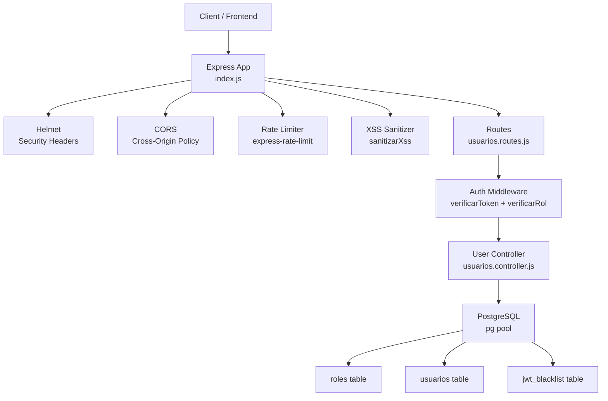
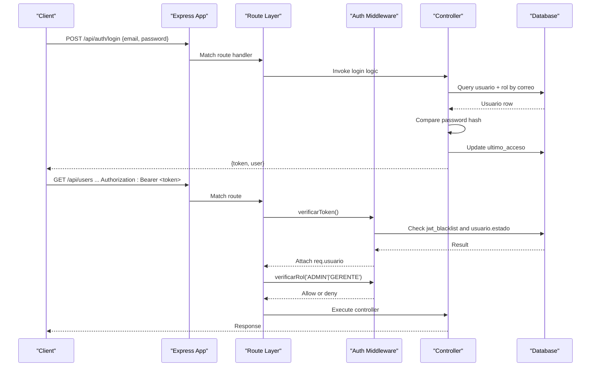
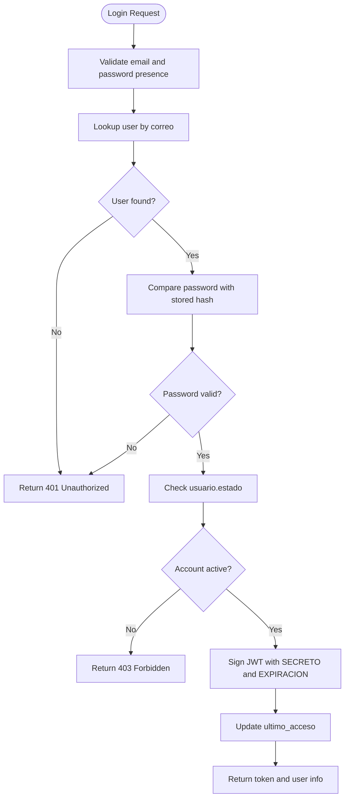
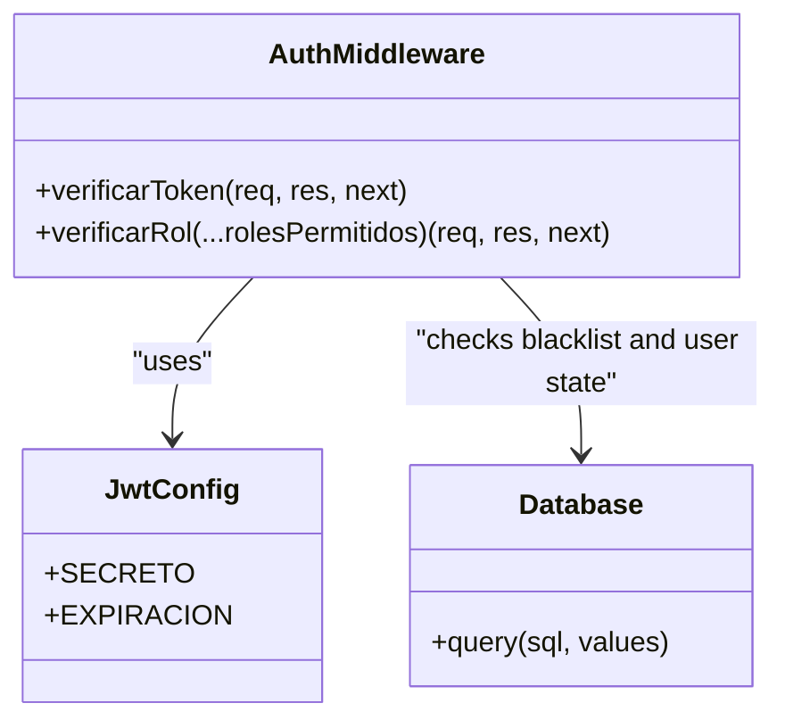
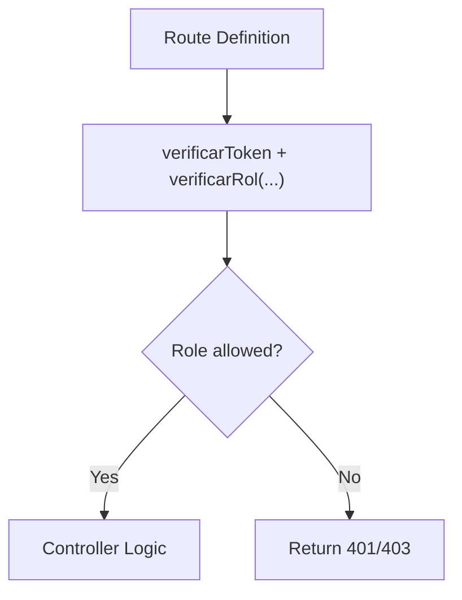
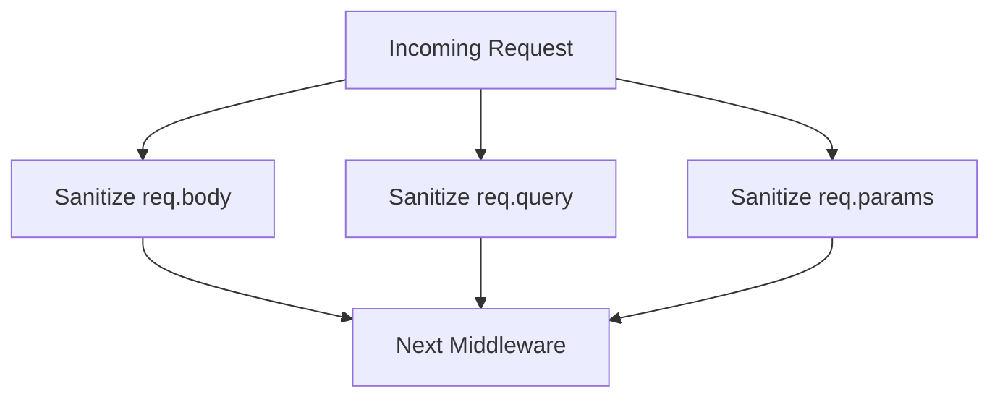
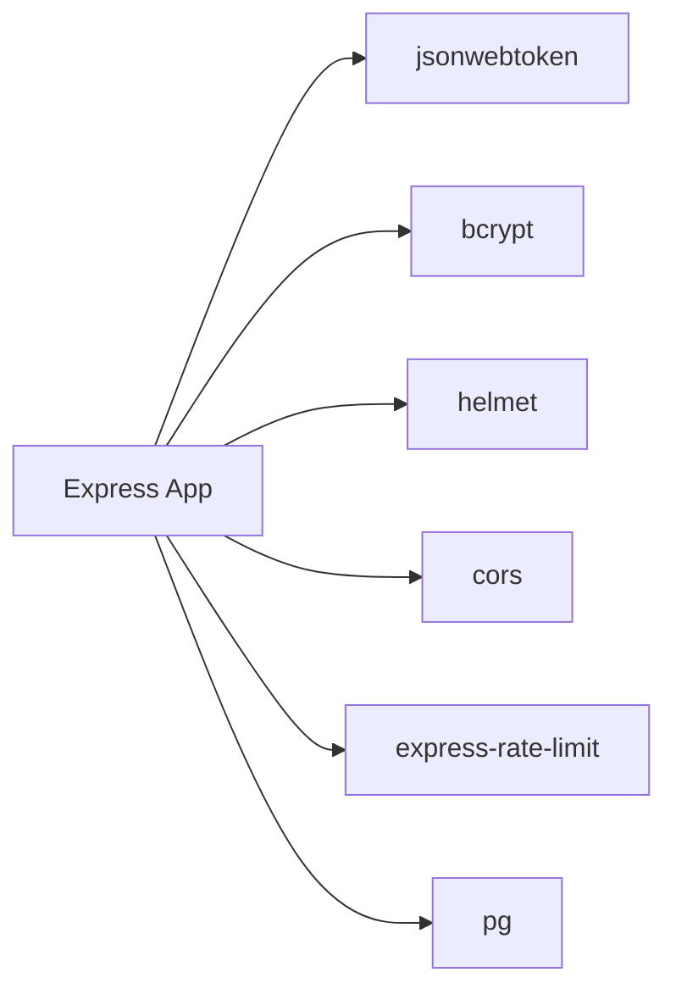

# Security Architecture

<cite>
**Referenced Files in This Document**
- [index.js](file://backend/index.js)
- [jwt.js](file://backend/src/config/jwt.js)
- [authMiddleware.js](file://backend/middleware/authMiddleware.js)
- [sanitizarXss.js](file://backend/src/middleware/sanitizarXss.js)
- [sanitizarXss.js](file://backend/middleware/sanitizarXss.js)
- [usuarios.controller.js](file://backend/src/controllers/usuarios.controller.js)
- [usuarios.routes.js](file://backend/src/routes/usuarios.routes.js)
- [002_seguridad.sql](file://backend/db/migrations/002_seguridad.sql)
- [010_sesiones.sql](file://backend/db/migrations/010_sesiones.sql)
- [package.json](file://backend/package.json)
</cite>

## Table of Contents
1. [Introduction](#introduction)
2. [Project Structure](#project-structure)
3. [Core Components](#core-components)
4. [Architecture Overview](#architecture-overview)
5. [Detailed Component Analysis](#detailed-component-analysis)
6. [Dependency Analysis](#dependency-analysis)
7. [Performance Considerations](#performance-considerations)
8. [Troubleshooting Guide](#troubleshooting-guide)
9. [Conclusion](#conclusion)
10. [Appendices](#appendices)

## Introduction
This document describes the security architecture of the SIMO system backend. It explains how authentication, authorization, input validation, session management, and infrastructure protections are implemented. The focus is on:
- JWT-based authentication and token lifecycle
- Role-based access control (RBAC) and permission checks
- XSS protection and input validation patterns
- SQL injection prevention through parameterized queries
- CORS configuration, rate limiting, and DDoS mitigation
- Secure password hashing, token expiration, and logout invalidation
- Security headers via Helmet and HTTPS considerations
- Examples of middleware usage and custom validation functions
- Security testing strategies and vulnerability assessment procedures

## Project Structure
The backend is an Express application that centralizes security concerns at the application bootstrap layer and enforces them per route using middleware. Key security-related files include:
- Application bootstrap and global security middleware
- JWT configuration
- Authentication and RBAC middleware
- XSS sanitization middleware
- User controller with secure password handling
- Route definitions enforcing authentication and roles
- Database migrations for roles, users, and token blacklisting

**Diagram sources**
- [index.js:24-56](file://backend/index.js#L24-L56)
- [usuarios.routes.js:9-15](file://backend/src/routes/usuarios.routes.js#L9-L15)
- [authMiddleware.js:9-75](file://backend/middleware/authMiddleware.js#L9-L75)
- [usuarios.controller.js:1-295](file://backend/src/controllers/usuarios.controller.js#L1-L295)
- [002_seguridad.sql:15-58](file://backend/db/migrations/002_seguridad.sql#L15-L58)
- [010_sesiones.sql:12-15](file://backend/db/migrations/010_sesiones.sql#L12-L15)

**Section sources**
- [index.js:1-56](file://backend/index.js#L1-L56)
- [usuarios.routes.js:1-18](file://backend/src/routes/usuarios.routes.js#L1-L18)

## Core Components
- JWT configuration: centralized secret and expiration settings used by login and verification.
- Authentication middleware: validates tokens, checks blacklist, and user status.
- RBAC middleware: restricts routes to allowed roles or role IDs.
- XSS sanitizer: escapes dangerous HTML characters across body, query, and params.
- Password handling: bcrypt hashing and comparison during user creation and login.
- Session invalidation: logout adds tokens to a blacklist checked by the auth middleware.
- Global protections: Helmet for security headers, CORS policy, and rate limiting.

**Section sources**
- [jwt.js:1-16](file://backend/src/config/jwt.js#L1-L16)
- [authMiddleware.js:1-81](file://backend/middleware/authMiddleware.js#L1-L81)
- [sanitizarXss.js:1-48](file://backend/src/middleware/sanitizarXss.js#L1-L48)
- [usuarios.controller.js:1-84](file://backend/src/controllers/usuarios.controller.js#L1-L84)
- [index.js:24-48](file://backend/index.js#L24-L48)

## Architecture Overview
The security architecture follows a layered approach:
- Transport and HTTP layer: Helmet sets secure headers; CORS defines allowed origins; rate limiter throttles requests.
- Request processing layer: XSS sanitizer cleans inputs before they reach controllers.
- Authorization layer: JWT verification ensures identity; RBAC ensures permissions.
- Data layer: Parameterized queries prevent SQL injection; sensitive fields like password hashes are never returned.

**Diagram sources**
- [index.js:347-423](file://backend/index.js#L347-L423)
- [index.js:428-469](file://backend/index.js#L428-L469)
- [authMiddleware.js:9-75](file://backend/middleware/authMiddleware.js#L9-L75)
- [usuarios.routes.js:9-15](file://backend/src/routes/usuarios.routes.js#L9-L15)

## Detailed Component Analysis

### JWT-Based Authentication Flow
- Login endpoint accepts email and password, verifies credentials against stored bcrypt hash, checks account status, and issues a signed JWT containing user identifiers and role information.
- Token payload includes user ID, role ID, email, and role code.
- Expiration is configured centrally and applied when signing the token.
- Logout endpoint stores the current token in a blacklist table so it cannot be reused even if not expired.

**Diagram sources**
- [index.js:347-423](file://backend/index.js#L347-L423)
- [jwt.js:11-15](file://backend/src/config/jwt.js#L11-L15)

**Section sources**
- [index.js:347-423](file://backend/index.js#L347-L423)
- [jwt.js:1-16](file://backend/src/config/jwt.js#L1-L16)

### Token Management and Session Handling
- Token verification middleware extracts the bearer token, verifies its signature, and checks:
  - Whether the token is present in the blacklist (logout).
  - Whether the associated user is still active.
- On success, the decoded payload is attached to the request object for downstream use.
- Logout inserts the token into the blacklist; duplicate insertions are tolerated to avoid errors on repeated logouts.

**Diagram sources**
- [authMiddleware.js:9-75](file://backend/middleware/authMiddleware.js#L9-L75)
- [jwt.js:11-15](file://backend/src/config/jwt.js#L11-L15)
- [010_sesiones.sql:12-15](file://backend/db/migrations/010_sesiones.sql#L12-L15)

**Section sources**
- [authMiddleware.js:1-81](file://backend/middleware/authMiddleware.js#L1-L81)
- [index.js:428-469](file://backend/index.js#L428-L469)
- [010_sesiones.sql:1-20](file://backend/db/migrations/010_sesiones.sql#L1-L20)

### Role-Based Access Control (RBAC)
- Roles are defined in the database with stable codes: ADMIN, GERENTE, INVENTARIO, VENDEDOR.
- Routes protect endpoints using verificarToken and verificarRol with allowed role codes or IDs.
- Controllers do not perform role checks themselves; middleware enforces authorization consistently.

**Diagram sources**
- [usuarios.routes.js:9-15](file://backend/src/routes/usuarios.routes.js#L9-L15)
- [authMiddleware.js:57-75](file://backend/middleware/authMiddleware.js#L57-L75)
- [002_seguridad.sql:15-31](file://backend/db/migrations/002_seguridad.sql#L15-L31)

**Section sources**
- [usuarios.routes.js:1-18](file://backend/src/routes/usuarios.routes.js#L1-L18)
- [authMiddleware.js:52-75](file://backend/middleware/authMiddleware.js#L52-L75)
- [002_seguridad.sql:9-31](file://backend/db/migrations/002_seguridad.sql#L9-L31)

### Permission Checking Mechanisms
- verificarRol accepts multiple allowed roles (by ID or code) and compares them against the authenticated user’s id_rol and rol fields.
- If no match, the request is denied with a forbidden response.
- This mechanism provides fine-grained authorization at the route level.

**Section sources**
- [authMiddleware.js:52-75](file://backend/middleware/authMiddleware.js#L52-L75)

### Authorization Middleware Usage
- Protected routes apply both authentication and role checks before invoking controllers.
- Example: user administration endpoints require ADMIN; listing and reading users require ADMIN or GERENTE.

**Section sources**
- [usuarios.routes.js:9-15](file://backend/src/routes/usuarios.routes.js#L9-L15)

### XSS Protection Strategies
- Custom sanitizers escape dangerous HTML characters across request bodies, query parameters, and path parameters.
- Two implementations exist:
  - One escapes a broader set of characters including quotes and slashes.
  - Another replaces angle brackets and is compatible with Express 5 where req.query is read-only.
- Both are designed to replace xss-clean which is incompatible with Express 5.

**Diagram sources**
- [sanitizarXss.js:1-48](file://backend/src/middleware/sanitizarXss.js#L1-L48)
- [sanitizarXss.js:1-39](file://backend/middleware/sanitizarXss.js#L1-L39)

**Section sources**
- [sanitizarXss.js:1-48](file://backend/src/middleware/sanitizarXss.js#L1-L48)
- [sanitizarXss.js:1-39](file://backend/middleware/sanitizarXss.js#L1-L39)

### Input Validation Patterns
- Controllers validate required fields, types, formats (e.g., email regex), length limits, and business rules.
- Pagination parameters are validated and bounded to maximum limits.
- Duplicate checks are performed before insertion and updates.

Examples of validation patterns:
- Email format validation using a regular expression.
- Positive integer validation for IDs and pagination.
- Length constraints for names and usernames.
- Business rule enforcement such as sale price greater than purchase price.

**Section sources**
- [usuarios.controller.js:16-84](file://backend/src/controllers/usuarios.controller.js#L16-L84)
- [usuarios.controller.js:90-143](file://backend/src/controllers/usuarios.controller.js#L90-L143)
- [usuarios.controller.js:172-255](file://backend/src/controllers/usuarios.controller.js#L172-L255)

### SQL Injection Prevention Techniques
- All database interactions use parameterized queries with placeholders and value arrays.
- No string concatenation is used to build dynamic SQL from user input.
- Error handling maps specific database error codes to meaningful responses.

**Section sources**
- [index.js:103-122](file://backend/index.js#L103-L122)
- [index.js:188-211](file://backend/index.js#L188-L211)
- [index.js:281-312](file://backend/index.js#L281-L312)

### CORS Configuration
- CORS is enabled globally with default behavior allowing cross-origin requests.
- For production, consider restricting allowed origins, methods, and headers explicitly.

**Section sources**
- [index.js:28](file://backend/index.js#L28)

### Rate Limiting Implementation
- Rate limiting is applied to all API routes under /api.
- Default limit is 100 requests per minute per IP, configurable via RATE_LIMIT_MAX environment variable.
- Standard headers are enabled; legacy headers are disabled.

**Section sources**
- [index.js:34-48](file://backend/index.js#L34-L48)
- [package.json:19](file://backend/package.json#L19)

### DDoS Protection Measures
- Rate limiting mitigates brute-force and resource exhaustion attacks.
- Combined with Helmet security headers and input sanitization, it reduces attack surface.
- Additional measures such as WAF, connection limits, and CDN-level protections should be considered at deployment.

[No sources needed since this section provides general guidance]

### Secure Password Hashing
- Passwords are hashed using bcrypt with a salt rounds constant.
- Login compares provided passwords against stored hashes securely.
- Password hashes are never included in API responses.

**Section sources**
- [usuarios.controller.js:16-63](file://backend/src/controllers/usuarios.controller.js#L16-L63)
- [index.js:380-384](file://backend/index.js#L380-L384)
- [002_seguridad.sql:40-58](file://backend/db/migrations/002_seguridad.sql#L40-L58)

### Token Expiration Handling
- Token expiration is configured centrally and applied when signing tokens.
- Expired tokens are rejected by the verification middleware.
- Refresh token strategy is not implemented; clients must re-authenticate after expiration.

**Section sources**
- [jwt.js:11-15](file://backend/src/config/jwt.js#L11-L15)
- [index.js:401](file://backend/index.js#L401)
- [authMiddleware.js:22-27](file://backend/middleware/authMiddleware.js#L22-L27)

### Refresh Token Strategy
- Not currently implemented.
- Recommended approach: issue short-lived access tokens and long-lived refresh tokens stored securely; rotate refresh tokens on use; invalidate refresh tokens on logout.

[No sources needed since this section provides general guidance]

### Security Headers Configuration
- Helmet is applied globally to set recommended security headers.
- Ensure HTTPS is enforced at the reverse proxy or load balancer in production.

**Section sources**
- [index.js:25](file://backend/index.js#L25)

### HTTPS Enforcement
- The application listens on HTTP by default.
- Production deployments should enforce HTTPS via TLS termination at the edge (reverse proxy, CDN, or platform).

**Section sources**
- [index.js:474-476](file://backend/index.js#L474-L476)

### Data Encryption Approaches
- Passwords are hashed with bcrypt.
- Sensitive data at rest should be encrypted at the database or storage layer depending on compliance requirements.
- Transport encryption (HTTPS/TLS) is required in production.

**Section sources**
- [usuarios.controller.js:63](file://backend/src/controllers/usuarios.controller.js#L63)
- [002_seguridad.sql:40-58](file://backend/db/migrations/002_seguridad.sql#L40-L58)

### Examples of Security Middleware Usage
- Global middleware order:
  1. Helmet for security headers
  2. CORS
  3. JSON parsing
  4. XSS sanitizer
  5. Rate limiter on /api
- Route-level middleware:
  - verificarToken ensures authenticated requests
  - verificarRol restricts access by role

**Section sources**
- [index.js:24-48](file://backend/index.js#L24-L48)
- [usuarios.routes.js:9-15](file://backend/src/routes/usuarios.routes.js#L9-L15)

### Custom Validation Functions
- Email regex validation
- Positive integer validation for IDs and pagination
- Length and format checks for names and usernames
- Business rule validation (e.g., sale price > purchase price)

**Section sources**
- [usuarios.controller.js:16-20](file://backend/src/controllers/usuarios.controller.js#L16-L20)
- [usuarios.controller.js:44-53](file://backend/src/controllers/usuarios.controller.js#L44-L53)
- [index.js:89-101](file://backend/index.js#L89-L101)

## Dependency Analysis
External dependencies relevant to security:
- jsonwebtoken: JWT signing and verification
- bcrypt: password hashing and comparison
- helmet: security headers
- cors: cross-origin policy
- express-rate-limit: request throttling
- pg: parameterized PostgreSQL queries

**Diagram sources**
- [package.json:15-23](file://backend/package.json#L15-L23)

**Section sources**
- [package.json:15-23](file://backend/package.json#L15-L23)

## Performance Considerations
- Rate limiting can impact performance under high traffic; tune windowMs and max based on expected load.
- JWT verification includes database lookups; consider caching user state if appropriate while maintaining security.
- Avoid returning large payloads; paginate and filter aggressively.
- Use prepared statements and indexes (already present for roles and estado) to optimize queries.

[No sources needed since this section provides general guidance]

## Troubleshooting Guide
Common issues and resolutions:
- Unauthorized or Forbidden responses:
  - Missing or malformed Authorization header
  - Expired or invalid JWT
  - Token blacklisted due to logout
  - Inactive user account
- Too Many Requests:
  - Exceeded rate limit; adjust RATE_LIMIT_MAX for tests or scale infrastructure
- XSS sanitization errors:
  - Ensure compatibility with Express 5; use the provided sanitizers instead of xss-clean
- Database constraint violations:
  - Unique constraints on correo and usuario; handle conflict responses gracefully

**Section sources**
- [authMiddleware.js:10-49](file://backend/middleware/authMiddleware.js#L10-L49)
- [index.js:34-48](file://backend/index.js#L34-L48)
- [sanitizarXss.js:1-39](file://backend/middleware/sanitizarXss.js#L1-L39)

## Conclusion
SIMO’s backend implements a robust security architecture centered around JWT authentication, RBAC, input sanitization, parameterized queries, and infrastructure protections. While core mechanisms are solid, enhancements such as explicit CORS policies, refresh tokens, and stricter rate limiting configurations will further harden the system for production environments.

[No sources needed since this section summarizes without analyzing specific files]

## Appendices

### Security Testing Strategies
- Unit tests for validation functions and sanitizers
- Integration tests for authentication flows, RBAC, and logout invalidation
- End-to-end tests simulating malicious inputs and rate limit scenarios
- Vulnerability scanning for dependencies and static analysis for code patterns

**Section sources**
- [package.json:6-10](file://backend/package.json#L6-L10)

### Vulnerability Assessment Procedures
- Regular dependency audits and updates
- Penetration testing focusing on authentication, authorization, and input validation
- Review of database schema and triggers for security implications
- Monitoring and alerting for anomalous request patterns

[No sources needed since this section provides general guidance]