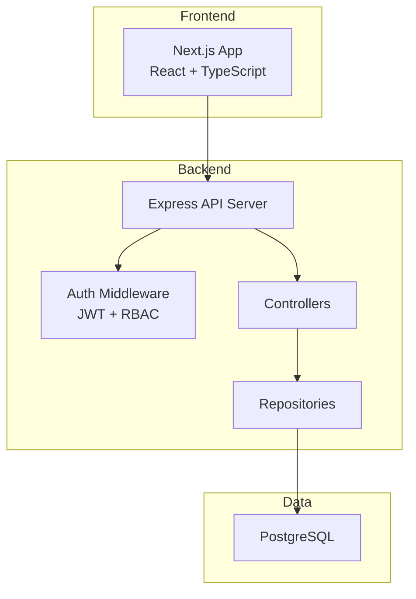
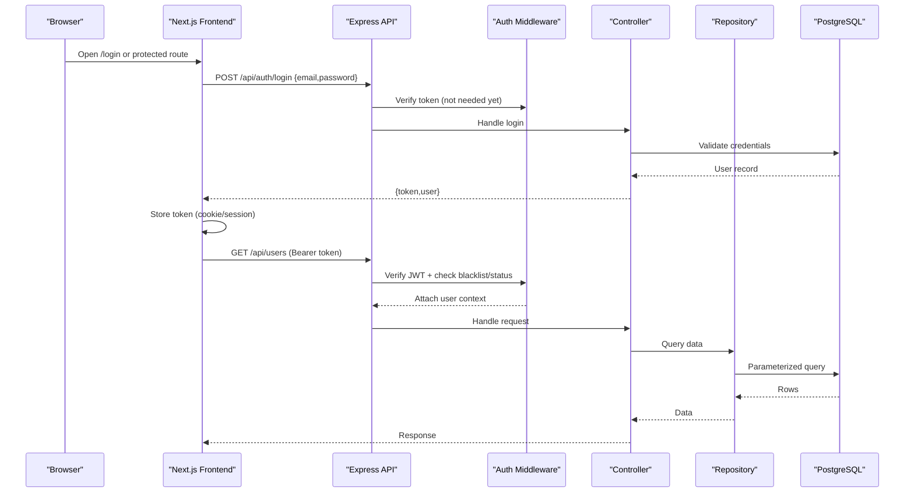
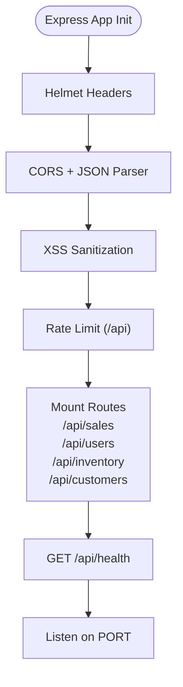
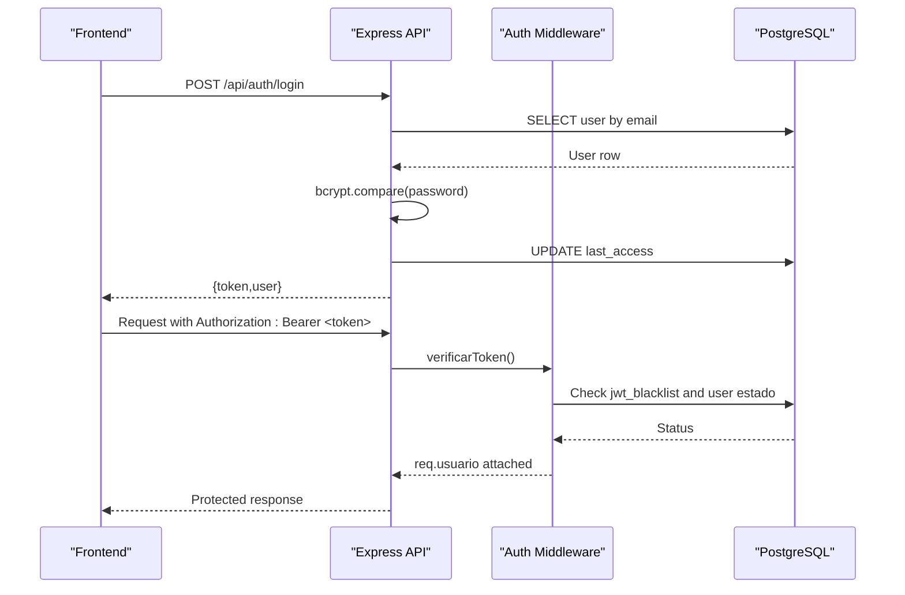
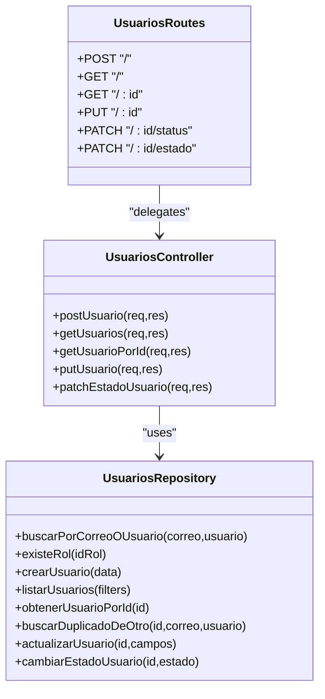
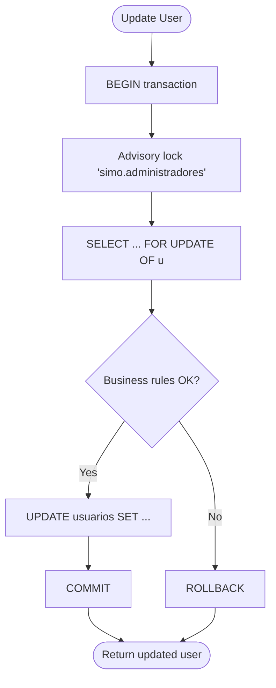
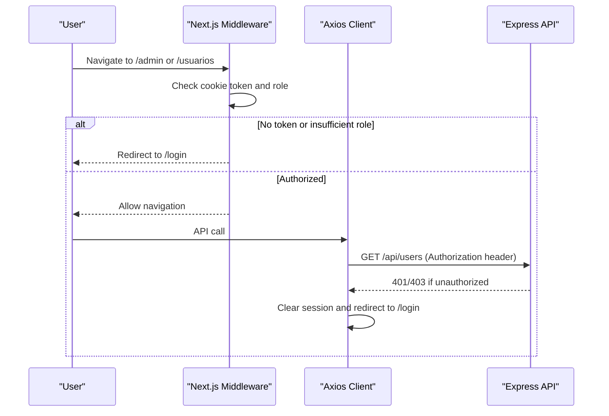
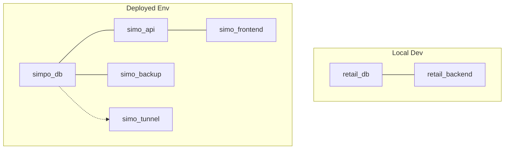
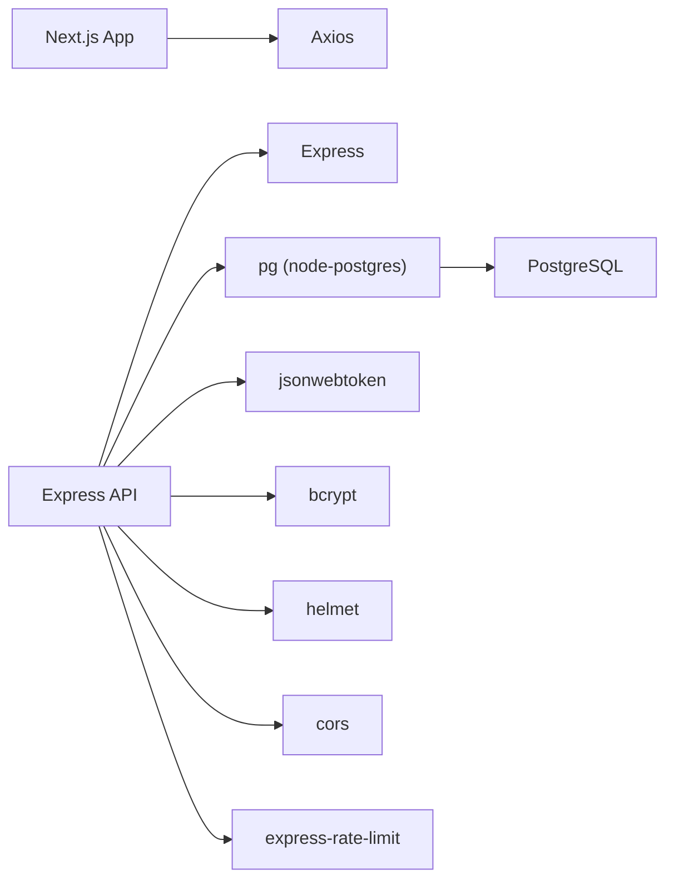

# System Architecture

<cite>
**Referenced Files in This Document**
- [README.md](file://README.md)
- [backend/docker-compose.yml](file://backend/docker-compose.yml)
- [deploy/docker-compose.yml](file://deploy/docker-compose.yml)
- [backend/Dockerfile](file://backend/Dockerfile)
- [deploy/frontend/Dockerfile](file://deploy/frontend/Dockerfile)
- [backend/index.js](file://backend/index.js)
- [backend/src/config/db.js](file://backend/src/config/db.js)
- [backend/src/config/jwt.js](file://backend/src/config/jwt.js)
- [backend/middleware/authMiddleware.js](file://backend/middleware/authMiddleware.js)
- [backend/src/routes/usuarios.routes.js](file://backend/src/routes/usuarios.routes.js)
- [backend/src/controllers/usuarios.controller.js](file://backend/src/controllers/usuarios.controller.js)
- [backend/src/repositories/usuarios.repository.js](file://backend/src/repositories/usuarios.repository.js)
- [simoapp/package.json](file://simoapp/package.json)
- [simoapp/lib/apiClient.ts](file://simoapp/lib/apiClient.ts)
- [simoapp/middleware.ts](file://simoapp/middleware.ts)
</cite>

## Table of Contents
1. [Introduction](#introduction)
2. [Project Structure](#project-structure)
3. [Core Components](#core-components)
4. [Architecture Overview](#architecture-overview)
5. [Detailed Component Analysis](#detailed-component-analysis)
6. [Dependency Analysis](#dependency-analysis)
7. [Performance Considerations](#performance-considerations)
8. [Troubleshooting Guide](#troubleshooting-guide)
9. [Conclusion](#conclusion)

## Introduction
SIMO is a retail management system for small retail businesses, covering inventory, sales, and order traceability. The system follows a clear frontend-backend separation:
- Frontend: Next.js application with React, TypeScript, Tailwind CSS, and Recharts.
- Backend: Express API server (Node.js) exposing REST endpoints.
- Database: PostgreSQL relational database.

The project is containerized using Docker Compose for local development and production-like deployment. The backend uses an MVC-like structure with controllers, repositories, and routes, while the frontend is component-based and protected by Next.js middleware. Authentication uses JWT with role-based access control (RBAC).

## Project Structure
At a high level, the repository contains:
- simoapp: Next.js frontend application.
- backend: Express API server, configuration, routes, controllers, repositories, and database config.
- deploy: Production-oriented Docker Compose orchestration including DB, API, frontend, backup, and Cloudflare Tunnel.
- README.md: User-facing documentation and API examples.

**Diagram sources**
- [simoapp/package.json:11-16](file://simoapp/package.json#L11-L16)
- [backend/index.js:1-16](file://backend/index.js#L1-L16)
- [backend/middleware/authMiddleware.js:1-10](file://backend/middleware/authMiddleware.js#L1-L10)
- [backend/src/config/db.js:1-15](file://backend/src/config/db.js#L1-L15)

**Section sources**
- [README.md:7-19](file://README.md#L7-L19)
- [README.md:27-40](file://README.md#L27-L40)
- [simoapp/package.json:1-29](file://simoapp/package.json#L1-L29)

## Core Components
- Frontend (Next.js): Provides UI pages and components; communicates with the backend via Axios client configured with environment variables.
- Backend (Express): Central entry point registers security middleware, rate limiting, XSS sanitization, and routes for users, sales, inventory, and customers.
- Data Access Layer: Repository pattern encapsulates SQL queries and business rules around data consistency.
- Security: JWT-based authentication with token blacklist support and RBAC middleware.
- Containerization: Docker Compose defines services for DB, API, frontend, backups, and tunneling.

Key responsibilities:
- Express app wires global security and routes.
- Controllers validate input and orchestrate use cases.
- Repositories perform parameterized queries and enforce constraints.
- Auth middleware validates tokens and enforces roles.
- Next.js middleware protects routes based on cookies.

**Section sources**
- [backend/index.js:20-56](file://backend/index.js#L20-L56)
- [backend/src/controllers/usuarios.controller.js:1-25](file://backend/src/controllers/usuarios.controller.js#L1-L25)
- [backend/src/repositories/usuarios.repository.js:1-10](file://backend/src/repositories/usuarios.repository.js#L1-L10)
- [backend/middleware/authMiddleware.js:1-10](file://backend/middleware/authMiddleware.js#L1-L10)
- [simoapp/middleware.ts:1-16](file://simoapp/middleware.ts#L1-L16)

## Architecture Overview
The system boundary includes:
- Browser accessing the Next.js frontend.
- Next.js serving static assets and SSR pages, calling the Express API.
- Express API enforcing security, routing to controllers, delegating to repositories.
- PostgreSQL storing all persistent data.

**Diagram sources**
- [backend/index.js:347-423](file://backend/index.js#L347-L423)
- [backend/middleware/authMiddleware.js:9-50](file://backend/middleware/authMiddleware.js#L9-L50)
- [backend/src/controllers/usuarios.controller.js:86-143](file://backend/src/controllers/usuarios.controller.js#L86-L143)
- [backend/src/repositories/usuarios.repository.js:38-85](file://backend/src/repositories/usuarios.repository.js#L38-L85)

## Detailed Component Analysis

### Backend Entry Point and Routing
The Express application initializes security middleware (Helmet, CORS, JSON parsing, XSS sanitization), applies rate limiting, and mounts feature routes under /api. It also exposes a health endpoint used by orchestrators.

**Diagram sources**
- [backend/index.js:20-56](file://backend/index.js#L20-L56)
- [backend/index.js:62-70](file://backend/index.js#L62-L70)

**Section sources**
- [backend/index.js:1-16](file://backend/index.js#L1-L16)
- [backend/index.js:20-56](file://backend/index.js#L20-L56)
- [backend/index.js:62-70](file://backend/index.js#L62-L70)

### Authentication Flow and Security
Authentication uses JWT:
- Login endpoint verifies credentials, checks account status, issues a signed token with configurable expiration.
- Logout inserts the token into a blacklist table to invalidate it immediately.
- Auth middleware verifies tokens, checks blacklist and active status, and attaches user context.
- Role-based access control restricts routes by role codes or IDs.

**Diagram sources**
- [backend/index.js:347-423](file://backend/index.js#L347-L423)
- [backend/index.js:428-469](file://backend/index.js#L428-L469)
- [backend/middleware/authMiddleware.js:9-50](file://backend/middleware/authMiddleware.js#L9-L50)
- [backend/src/config/jwt.js:1-16](file://backend/src/config/jwt.js#L1-L16)

**Section sources**
- [backend/index.js:347-469](file://backend/index.js#L347-L469)
- [backend/middleware/authMiddleware.js:1-81](file://backend/middleware/authMiddleware.js#L1-L81)
- [backend/src/config/jwt.js:1-16](file://backend/src/config/jwt.js#L1-L16)

### Users Module: MVC Pattern
The users module demonstrates the MVC-like separation:
- Routes define HTTP endpoints and apply auth/RBAC middleware.
- Controllers validate inputs, enforce business rules, and delegate to repositories.
- Repositories encapsulate SQL logic, transactions, and concurrency safeguards.

**Diagram sources**
- [backend/src/routes/usuarios.routes.js:1-18](file://backend/src/routes/usuarios.routes.js#L1-L18)
- [backend/src/controllers/usuarios.controller.js:1-25](file://backend/src/controllers/usuarios.controller.js#L1-L25)
- [backend/src/repositories/usuarios.repository.js:1-10](file://backend/src/repositories/usuarios.repository.js#L1-L10)

**Section sources**
- [backend/src/routes/usuarios.routes.js:1-18](file://backend/src/routes/usuarios.routes.js#L1-L18)
- [backend/src/controllers/usuarios.controller.js:26-84](file://backend/src/controllers/usuarios.controller.js#L26-L84)
- [backend/src/controllers/usuarios.controller.js:86-143](file://backend/src/controllers/usuarios.controller.js#L86-L143)
- [backend/src/controllers/usuarios.controller.js:166-255](file://backend/src/controllers/usuarios.controller.js#L166-L255)
- [backend/src/controllers/usuarios.controller.js:257-292](file://backend/src/controllers/usuarios.controller.js#L257-L292)
- [backend/src/repositories/usuarios.repository.js:38-85](file://backend/src/repositories/usuarios.repository.js#L38-L85)
- [backend/src/repositories/usuarios.repository.js:115-172](file://backend/src/repositories/usuarios.repository.js#L115-L172)
- [backend/src/repositories/usuarios.repository.js:178-230](file://backend/src/repositories/usuarios.repository.js#L178-L230)

### Data Access and Concurrency Controls
The repository layer uses parameterized queries, advisory locks, and explicit transactions to ensure consistency when updating admin roles or user statuses.

**Diagram sources**
- [backend/src/repositories/usuarios.repository.js:115-172](file://backend/src/repositories/usuarios.repository.js#L115-L172)
- [backend/src/repositories/usuarios.repository.js:178-230](file://backend/src/repositories/usuarios.repository.js#L178-L230)

**Section sources**
- [backend/src/repositories/usuarios.repository.js:115-172](file://backend/src/repositories/usuarios.repository.js#L115-L172)
- [backend/src/repositories/usuarios.repository.js:178-230](file://backend/src/repositories/usuarios.repository.js#L178-L230)

### Frontend Integration and Protection
The frontend:
- Uses Axios with a base URL from environment variables.
- Intercepts requests to attach the JWT token from cookies.
- Intercepts responses to redirect to login on 401/403.
- Protects routes via Next.js middleware checking cookies and roles.

**Diagram sources**
- [simoapp/lib/apiClient.ts:1-31](file://simoapp/lib/apiClient.ts#L1-L31)
- [simoapp/lib/apiClient.ts:33-56](file://simoapp/lib/apiClient.ts#L33-L56)
- [simoapp/middleware.ts:4-29](file://simoapp/middleware.ts#L4-L29)

**Section sources**
- [simoapp/lib/apiClient.ts:1-59](file://simoapp/lib/apiClient.ts#L1-L59)
- [simoapp/middleware.ts:1-37](file://simoapp/middleware.ts#L1-L37)

### Containerization and Deployment Topology
Two Compose configurations are provided:
- backend/docker-compose.yml: Development setup with DB and API services.
- deploy/docker-compose.yml: Production-like setup including DB, API, frontend, backup, and Cloudflare Tunnel.

**Diagram sources**
- [backend/docker-compose.yml:1-41](file://backend/docker-compose.yml#L1-L41)
- [deploy/docker-compose.yml:14-119](file://deploy/docker-compose.yml#L14-L119)

**Section sources**
- [backend/docker-compose.yml:1-41](file://backend/docker-compose.yml#L1-L41)
- [deploy/docker-compose.yml:1-120](file://deploy/docker-compose.yml#L1-L120)
- [backend/Dockerfile:1-26](file://backend/Dockerfile#L1-L26)
- [deploy/frontend/Dockerfile:1-33](file://deploy/frontend/Dockerfile#L1-L33)

## Dependency Analysis
High-level dependencies:
- Frontend depends on Next.js runtime and Axios for HTTP calls.
- Backend depends on Express, pg (node-postgres), jsonwebtoken, bcrypt, helmet, cors, express-rate-limit, and custom modules.
- Database connection supports both DATABASE_URL (cloud provider like Neon) and local DB parameters.

**Diagram sources**
- [simoapp/package.json:11-16](file://simoapp/package.json#L11-L16)
- [backend/index.js:1-16](file://backend/index.js#L1-L16)
- [backend/src/config/db.js:1-15](file://backend/src/config/db.js#L1-L15)

**Section sources**
- [simoapp/package.json:1-29](file://simoapp/package.json#L1-L29)
- [backend/index.js:1-16](file://backend/index.js#L1-L16)
- [backend/src/config/db.js:1-29](file://backend/src/config/db.js#L1-L29)

## Performance Considerations
- Database pool: Use a connection pool to manage concurrent queries efficiently.
- Pagination: All list endpoints support pagination to limit payload sizes.
- Indexes: Migrations include performance-related indexes for sales and other tables.
- Rate limiting: Global rate limiter protects against abuse.
- Build optimization: Multi-stage Docker builds reduce image size and improve startup time.
- Health checks: Services expose health endpoints for orchestrator readiness.

[No sources needed since this section provides general guidance]

## Troubleshooting Guide
Common issues and diagnostics:
- Authentication failures:
  - Missing or malformed Authorization header returns Unauthorized.
  - Expired or invalid tokens return Forbidden.
  - Blacklisted tokens or inactive accounts return Unauthorized.
- Database connectivity:
  - Health endpoint reports database availability; 503 indicates DB unavailable.
  - Ensure DATABASE_URL or DB_* variables are correctly set.
- Deployment:
  - Use docker compose logs to inspect service output.
  - Verify ports bound to 127.0.0.1 and external access via Cloudflare Tunnel.

**Section sources**
- [backend/middleware/authMiddleware.js:9-50](file://backend/middleware/authMiddleware.js#L9-L50)
- [backend/index.js:62-70](file://backend/index.js#L62-L70)
- [backend/src/config/db.js:1-29](file://backend/src/config/db.js#L1-L29)
- [deploy/docker-compose.yml:33-63](file://deploy/docker-compose.yml#L33-L63)

## Conclusion
SIMO’s architecture cleanly separates concerns across frontend, backend, and database layers, with strong security through JWT and RBAC, robust data access patterns, and containerized deployment. The design supports scalability through connection pooling, pagination, rate limiting, and modular services orchestrated by Docker Compose. The Next.js frontend integrates securely with the Express API, providing a responsive and maintainable user experience for retail operations.

[No sources needed since this section summarizes without analyzing specific files]