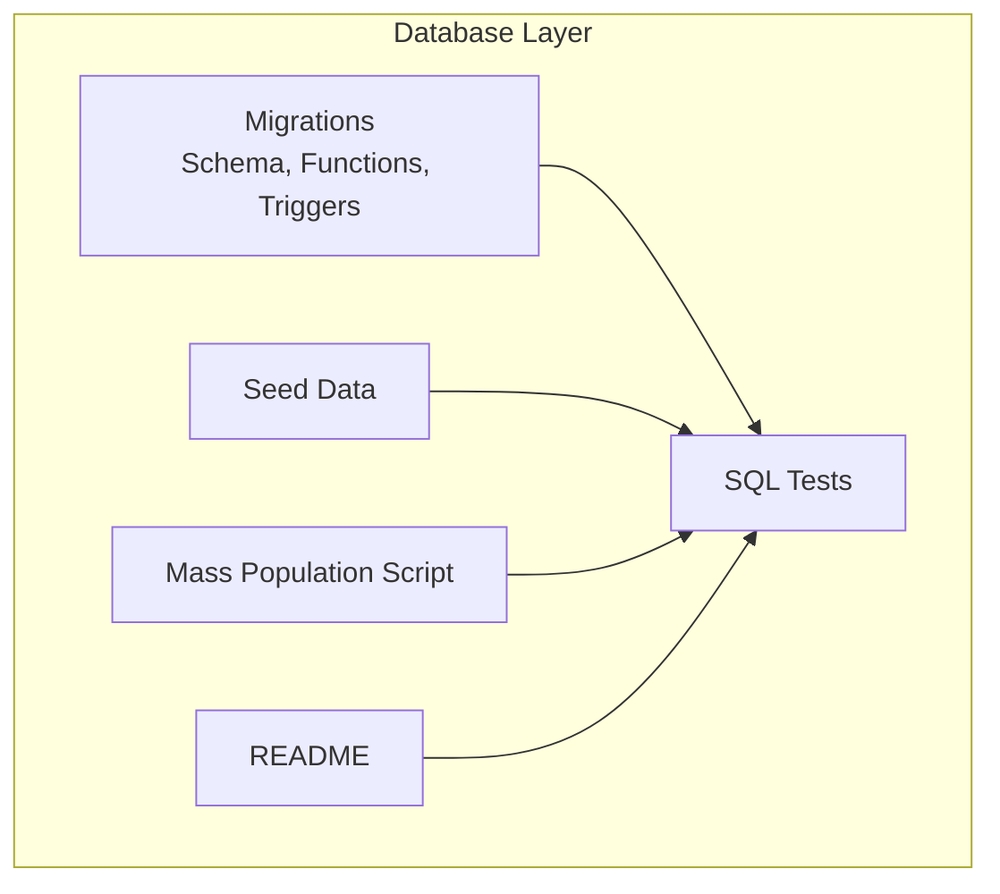
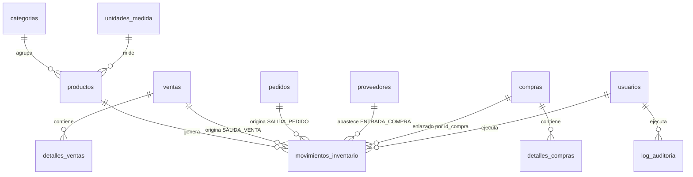
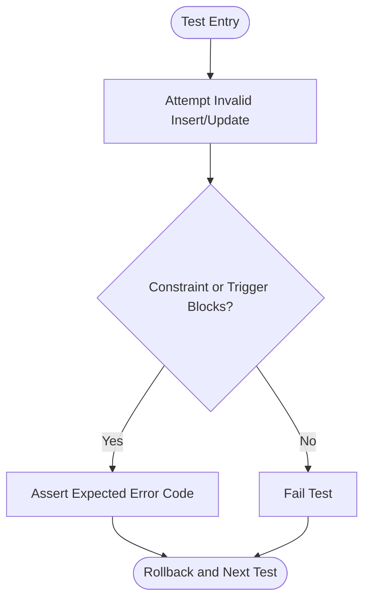
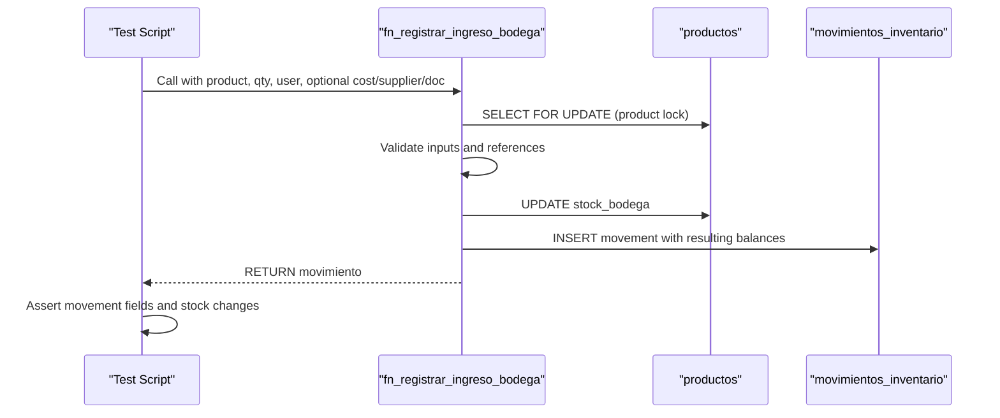
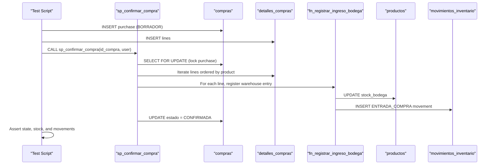
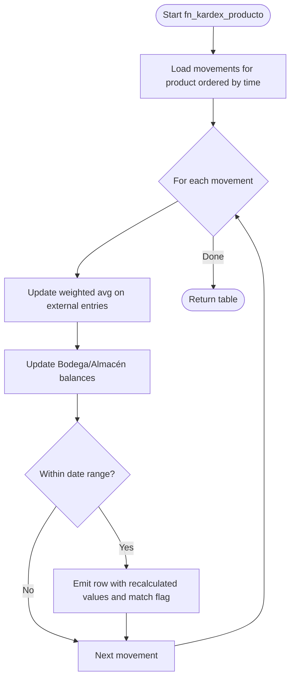
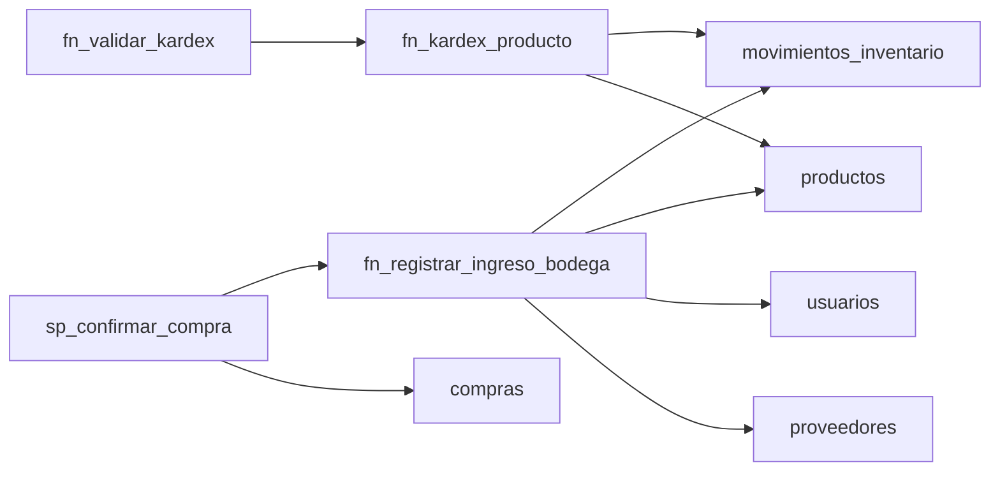

# Database Testing

<cite>
**Referenced Files in This Document**
- [README.md](file://backend/db/README.md)
- [001_base.sql](file://backend/db/migrations/001_base.sql)
- [006_inventario.sql](file://backend/db/migrations/006_inventario.sql)
- [008_ingreso_bodega.sql](file://backend/db/migrations/008_ingreso_bodega.sql)
- [011_compras.sql](file://backend/db/migrations/011_compras.sql)
- [012_saldo_kardex.sql](file://backend/db/migrations/012_saldo_kardex.sql)
- [001_reglas_esquema.sql](file://backend/db/tests/001_reglas_esquema.sql)
- [002_ingreso_bodega.sql](file://backend/db/tests/002_ingreso_bodega.sql)
- [003_compras.sql](file://backend/db/tests/003_compras.sql)
- [004_saldo_kardex.sql](file://backend/db/tests/004_saldo_kardex.sql)
- [poblar_masivo.sql](file://backend/db/carga/poblar_masivo.sql)
</cite>

## Table of Contents
1. Introduction
2. Project Structure
3. Core Components
4. Architecture Overview
5. Detailed Component Analysis
6. Dependency Analysis
7. Performance Considerations
8. Troubleshooting Guide
9. Conclusion

## Introduction
This document provides comprehensive database testing guidance for SIMO’s PostgreSQL schema and stored procedures. It covers SQL-based strategies to validate constraints, triggers, stored procedures, and complex queries; test data generation; transaction rollback patterns; performance testing with large datasets; inventory calculations; audit trail enforcement; business rule validation; migration testing; schema validation; and data integrity verification.

The repository ships a consolidated relational schema, seed data, migrations, and a set of pure-SQL tests that run inside transactions and roll back automatically, ensuring no residual data is left after execution.

## Project Structure
The database layer under `backend/db` contains:
- Migrations defining the schema, functions, triggers, views, and indexes.
- Seed data for development users and reference entities.
- Tests written as plain SQL scripts executed via `psql`.
- A mass population script for load testing.
- A README describing the model, rules, and usage.

**Diagram sources**
- [README.md:5-31](file://backend/db/README.md#L5-L31)

**Section sources**
- [README.md:5-31](file://backend/db/README.md#L5-L31)

## Core Components
Key components relevant to testing:
- Base utilities and session context: timezone configuration, updated timestamps, session user retrieval, and immutability helpers.
- Inventory ledger (Kardex): immutable movement log with location-aware balances and a view exposing chronological history.
- Warehouse entry function: atomic stock update plus movement creation with business error codes.
- Purchase workflow: draft purchase orders, line-level integrity, confirmation procedure that updates stock atomically.
- Kardex calculation and validation: recomputes balances and weighted average cost, and audits consistency against product stock.

Testing strategy highlights:
- Use `BEGIN; ... ROLLBACK;` in every test script to ensure isolation.
- Validate both positive paths and negative paths using custom helper functions that assert expected SQLSTATE codes.
- Exercise triggers and constraints by attempting invalid operations and asserting failures.
- Verify derived data through functions like `fn_kardex_producto` and `fn_validar_kardex`.

**Section sources**
- [001_base.sql:21-57](file://backend/db/migrations/001_base.sql#L21-L57)
- [006_inventario.sql:25-163](file://backend/db/migrations/006_inventario.sql#L25-L163)
- [008_ingreso_bodega.sql:23-88](file://backend/db/migrations/008_ingreso_bodega.sql#L23-L88)
- [011_compras.sql:21-258](file://backend/db/migrations/011_compras.sql#L21-L258)
- [012_saldo_kardex.sql:26-152](file://backend/db/migrations/012_saldo_kardex.sql#L26-L152)

## Architecture Overview
The database enforces business rules primarily through constraints, triggers, and stored functions/procedures. The following diagram maps core objects and their relationships.

**Diagram sources**
- [README.md:64-86](file://backend/db/README.md#L64-L86)
- [006_inventario.sql:62-163](file://backend/db/migrations/006_inventario.sql#L62-L163)
- [011_compras.sql:21-140](file://backend/db/migrations/011_compras.sql#L21-L140)

## Detailed Component Analysis

### Schema Rules and Constraints Testing
Strategy:
- Assert uniqueness and non-null constraints (e.g., duplicate emails, SKUs).
- Enforce domain checks (e.g., non-negative stock, valid locations).
- Validate referential integrity (e.g., cannot delete categories with products).
- Confirm immutability of audit and ledger tables (UPDATE/DELETE/TRUNCATE blocked).

Examples from tests:
- Duplicate email, uppercase email normalization, invalid role, single company row.
- SKU uniqueness, negative stock prevention, read-only computed columns.
- Movement location rules, required justification for adjustments, sale exits require associated sales.
- Ledger immutability via triggers.

**Diagram sources**
- [001_reglas_esquema.sql:12-30](file://backend/db/tests/001_reglas_esquema.sql#L12-L30)
- [001_reglas_esquema.sql:34-169](file://backend/db/tests/001_reglas_esquema.sql#L34-L169)

**Section sources**
- [001_reglas_esquema.sql:34-169](file://backend/db/tests/001_reglas_esquema.sql#L34-L169)
- [006_inventario.sql:84-129](file://backend/db/migrations/006_inventario.sql#L84-L129)

### Warehouse Entry Function (`fn_registrar_ingreso_bodega`)
Purpose:
- Atomically increase warehouse stock and record an `ENTRADA_COMPRA` movement.
- Validate inputs (quantity, unit decimals, active product/user/supplier).
- Return the created movement for downstream assertions.

Testing approach:
- Positive path: verify movement type, destination, stock increments, saved balances, cost fallback, user/supplier/document linkage, and Kardex visibility.
- Negative path: assert specific SQLSTATE codes for invalid quantity, decimal units, inactive product/user/supplier, negative cost.

**Diagram sources**
- [008_ingreso_bodega.sql:23-88](file://backend/db/migrations/008_ingreso_bodega.sql#L23-L88)
- [002_ingreso_bodega.sql:44-97](file://backend/db/tests/002_ingreso_bodega.sql#L44-L97)

**Section sources**
- [008_ingreso_bodega.sql:23-88](file://backend/db/migrations/008_ingreso_bodega.sql#L23-L88)
- [002_ingreso_bodega.sql:44-97](file://backend/db/tests/002_ingreso_bodega.sql#L44-L97)

### Purchases Workflow and Confirmation (`sp_confirmar_compra`)
Purpose:
- Maintain draft purchases with lines and totals.
- On confirmation, atomically apply all lines to warehouse stock and create movements linked to the purchase.
- Ensure immutability once confirmed.

Testing approach:
- Create a purchase with multiple lines and confirm it.
- Assert purchase state, confirmation metadata, per-product stock increases, and one movement per line linked to the purchase.
- Assert immutability: cannot reconfirm, cannot modify lines, cannot change header fields.
- Assert atomicity: if any line fails validation, no stock changes are applied and purchase remains in draft.

**Diagram sources**
- [011_compras.sql:217-258](file://backend/db/migrations/011_compras.sql#L217-L258)
- [011_compras.sql:146-208](file://backend/db/migrations/011_compras.sql#L146-L208)
- [003_compras.sql:42-98](file://backend/db/tests/003_compras.sql#L42-L98)

**Section sources**
- [011_compras.sql:21-258](file://backend/db/migrations/011_compras.sql#L21-L258)
- [003_compras.sql:42-98](file://backend/db/tests/003_compras.sql#L42-L98)

### Kardex Calculation and Validation (`fn_kardex_producto`, `fn_validar_kardex`)
Purpose:
- Recalculate per-location balances and weighted average cost chronologically.
- Flag inconsistent rows where stored balances differ from recalculated ones.
- Audit overall consistency between Kardex final balances and product stock.

Testing approach:
- Build a controlled sequence of movements (purchase, transfer, shrinkage, adjustment).
- Assert chronological order, per-step balances, separation of entries/exits by location, weighted average progression, and valorized inventory value.
- Assert date filtering does not alter cumulative balance logic.
- Introduce inconsistencies (alter stock outside Kardex, insert movement with wrong balance) and assert detection.

**Diagram sources**
- [012_saldo_kardex.sql:26-108](file://backend/db/migrations/012_saldo_kardex.sql#L26-L108)
- [004_saldo_kardex.sql:47-86](file://backend/db/tests/004_saldo_kardex.sql#L47-L86)

**Section sources**
- [012_saldo_kardex.sql:26-152](file://backend/db/migrations/012_saldo_kardex.sql#L26-L152)
- [004_saldo_kardex.sql:47-86](file://backend/db/tests/004_saldo_kardex.sql#L47-L86)

### Transaction Rollback Strategy
All test scripts wrap their work in a transaction and roll back at the end, ensuring:
- No side effects remain after test runs.
- Failures abort the transaction and prevent partial data leakage.
- Helper functions encapsulate pass/fail semantics and expected SQLSTATE codes.

Execution pattern:
- Begin transaction.
- Define helper functions for assertion.
- Run positive and negative scenarios.
- Roll back at the end.

**Section sources**
- [001_reglas_esquema.sql:10-30](file://backend/db/tests/001_reglas_esquema.sql#L10-L30)
- [001_reglas_esquema.sql:171-174](file://backend/db/tests/001_reglas_esquema.sql#L171-L174)
- [002_ingreso_bodega.sql:9-33](file://backend/db/tests/002_ingreso_bodega.sql#L9-L33)
- [002_ingreso_bodega.sql:99-102](file://backend/db/tests/002_ingreso_bodega.sql#L99-L102)
- [003_compras.sql:8-30](file://backend/db/tests/003_compras.sql#L8-L30)
- [003_compras.sql:105-108](file://backend/db/tests/003_compras.sql#L105-L108)
- [004_saldo_kardex.sql:16-23](file://backend/db/tests/004_saldo_kardex.sql#L16-L23)
- [004_saldo_kardex.sql:99-102](file://backend/db/tests/004_saldo_kardex.sql#L99-L102)

### Test Data Generation and Mass Loading
Use the mass population script to generate coherent, reproducible datasets:
- Generates products, clients, initial stock via purchases, internal transfers, and sales with cascading deductions.
- Ensures Kardex consistency at the end; otherwise, it raises an exception.
- Protects shared databases by blocking execution unless explicitly forced.

Usage:
- Run with parameters for number of products, clients, and sales.
- Recognize generated data by SKU prefixes and document identifiers.

**Section sources**
- [poblar_masivo.sql:1-46](file://backend/db/carga/poblar_masivo.sql#L1-L46)
- [poblar_masivo.sql:48-110](file://backend/db/carga/poblar_masivo.sql#L48-L110)
- [poblar_masivo.sql:112-228](file://backend/db/carga/poblar_masivo.sql#L112-L228)

### Business Rule Enforcement Examples
- Stock never negative: enforced by CHECK constraints on stock columns.
- Purchases only enter Warehouse: enforced by movement location constraints.
- Internal transfer only Warehouse → Storehouse: enforced by movement location constraints.
- Manual adjustments require justification: enforced by movement reason constraint.
- Sequential order flow: enforced by trigger validating transitions.
- Order cancellation requires cause: enforced by trigger.
- Sale annulment requires authorizer and cause: enforced by trigger.
- One sale per order: enforced by unique constraint.
- Totals coherence: enforced by CHECK constraints on totals and subtotals.
- Immutable audit log: enforced by triggers and revokes.
- Immutable client document: enforced by trigger with custom error code.

**Section sources**
- [README.md:88-104](file://backend/db/README.md#L88-L104)
- [006_inventario.sql:84-129](file://backend/db/migrations/006_inventario.sql#L84-L129)

### Migration Testing and Schema Validation
Approach:
- Apply migrations in order and then run tests to validate schema behavior.
- Use psql with `ON_ERROR_STOP=1` to fail fast on errors.
- Validate that functions, triggers, and constraints behave as expected across different scenarios.

Recommended steps:
- Initialize the database with migrations and seeds.
- Execute each test file individually to isolate failures.
- After mass loading, run `ANALYZE` and use `EXPLAIN ANALYZE` on critical queries to validate plans.

**Section sources**
- [README.md:34-58](file://backend/db/README.md#L34-L58)
- [README.md:159-180](file://backend/db/README.md#L159-L180)

### Data Integrity Verification Approaches
- Use `fn_validar_kardex()` to detect mismatches between recalculated balances and stored stock.
- Inspect `saldo_coincide` per movement to pinpoint inconsistent rows.
- Combine with mass population to ensure realistic scenarios remain consistent.

**Section sources**
- [012_saldo_kardex.sql:113-152](file://backend/db/migrations/012_saldo_kardex.sql#L113-L152)
- [004_saldo_kardex.sql:68-86](file://backend/db/tests/004_saldo_kardex.sql#L68-L86)
- [poblar_masivo.sql:213-228](file://backend/db/carga/poblar_masivo.sql#L213-L228)

## Dependency Analysis
Core dependencies among tested components:
- `fn_registrar_ingreso_bodega` depends on product, unit, user, supplier references and writes to `movimientos_inventario`.
- `sp_confirmar_compra` orchestrates multiple calls to `fn_registrar_ingreso_bodega` and updates purchase state.
- `fn_kardex_producto` reads `movimientos_inventario` and computes balances and costs.
- `fn_validar_kardex` aggregates results from `fn_kardex_producto` and compares with product stock.

**Diagram sources**
- [011_compras.sql:217-258](file://backend/db/migrations/011_compras.sql#L217-L258)
- [008_ingreso_bodega.sql:23-88](file://backend/db/migrations/008_ingreso_bodega.sql#L23-L88)
- [012_saldo_kardex.sql:26-152](file://backend/db/migrations/012_saldo_kardex.sql#L26-L152)

**Section sources**
- [011_compras.sql:217-258](file://backend/db/migrations/011_compras.sql#L217-L258)
- [008_ingreso_bodega.sql:23-88](file://backend/db/migrations/008_ingreso_bodega.sql#L23-L88)
- [012_saldo_kardex.sql:26-152](file://backend/db/migrations/012_saldo_kardex.sql#L26-L152)

## Performance Considerations
- Use the provided performance query set and measure with `EXPLAIN ANALYZE` over large datasets generated by the mass population script.
- Leverage coverage indexes defined for sales queries to achieve Index Only Scans where applicable.
- After mass loads, run `VACUUM ANALYZE` to keep planner statistics current and enable efficient scans.
- Monitor plan changes when adding new queries or indexes.

**Section sources**
- [README.md:159-180](file://backend/db/README.md#L159-L180)
- [poblar_masivo.sql:228-236](file://backend/db/carga/poblar_masivo.sql#L228-L236)

## Troubleshooting Guide
Common issues and resolutions:
- Unexpected success on invalid operations: verify helper functions and expected SQLSTATE codes in tests.
- Missing session context: ensure backend sets `simo.id_usuario` and optionally `simo.motivo` within the same transaction before modifying protected tables.
- Ledger immutability errors: confirm triggers are present and not overridden.
- Inconsistent Kardex: run `fn_validar_kardex()` and inspect inconsistent rows; correct underlying movements or stock values.
- Purchase confirmation failures: check line validations (e.g., decimal quantities for integer units) and ensure all lines are valid before confirming.

**Section sources**
- [README.md:106-119](file://backend/db/README.md#L106-L119)
- [001_base.sql:40-57](file://backend/db/migrations/001_base.sql#L40-L57)
- [006_inventario.sql:121-129](file://backend/db/migrations/006_inventario.sql#L121-L129)
- [012_saldo_kardex.sql:113-152](file://backend/db/migrations/012_saldo_kardex.sql#L113-L152)

## Conclusion
SIMO’s database testing strategy centers on pure-SQL tests that exercise constraints, triggers, stored procedures, and derived computations while guaranteeing isolation via transaction rollback. The tests cover inventory calculations, audit trail enforcement, business rule validation, and data integrity checks. With mass population and performance query references, teams can validate correctness and scalability. Applying migrations in order, running tests with strict error stopping, and auditing Kardex consistency provide a robust foundation for maintaining data integrity across the system.