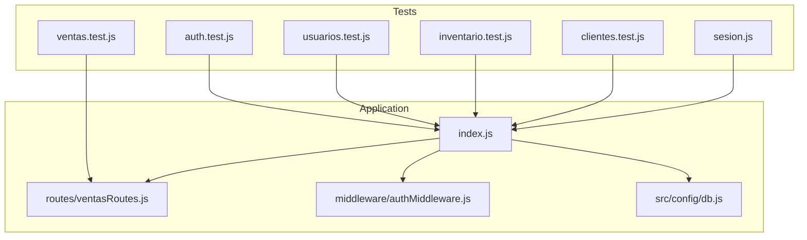
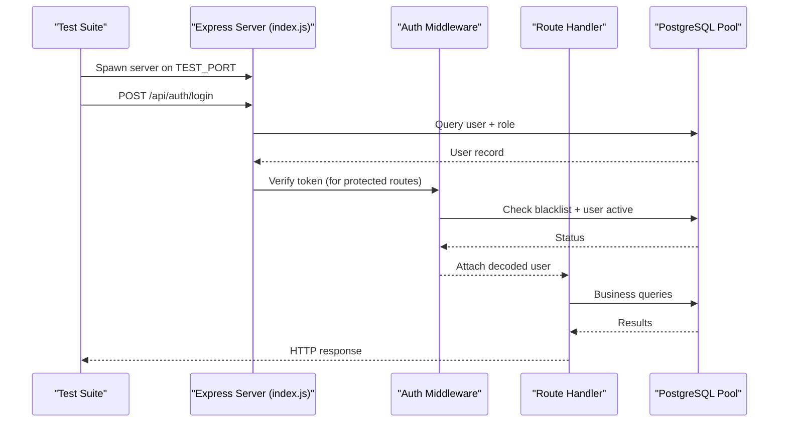
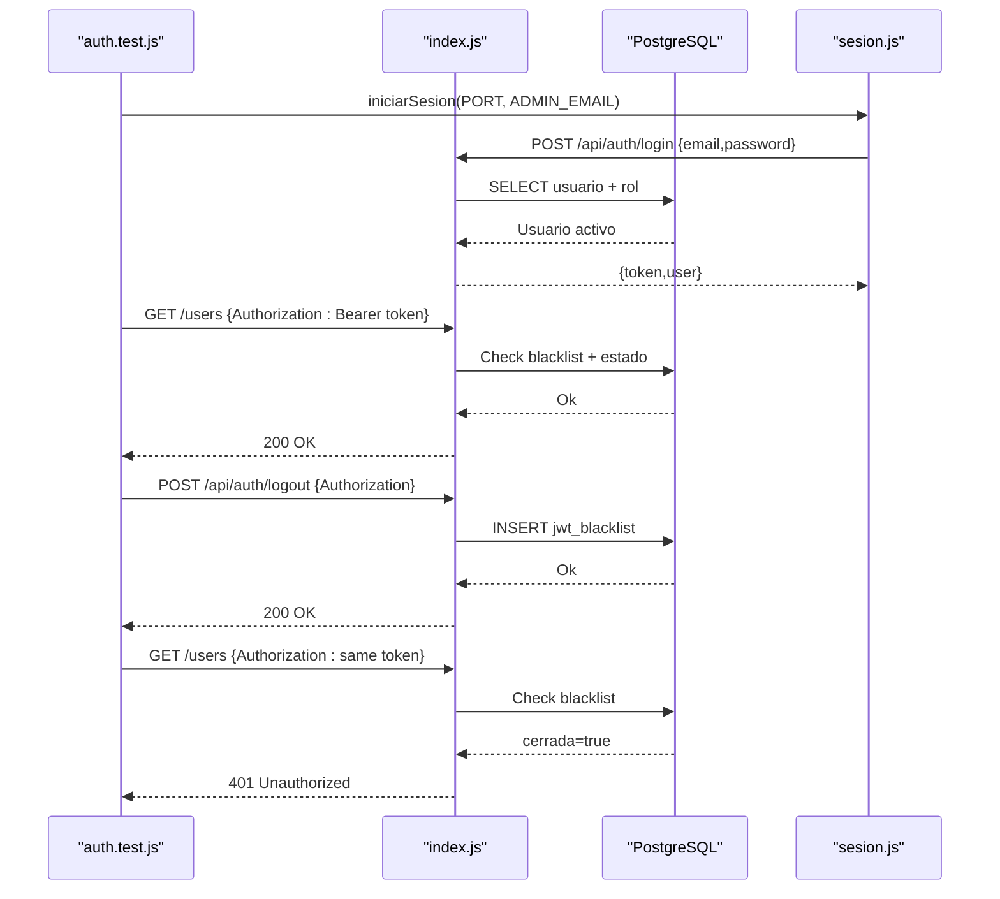
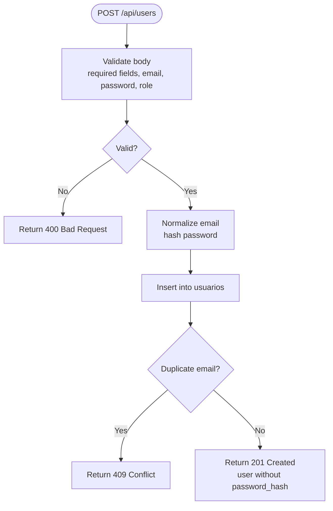
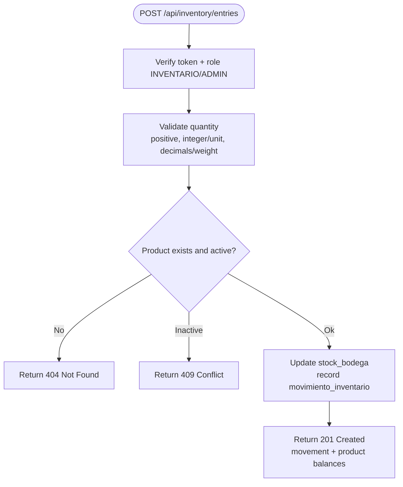
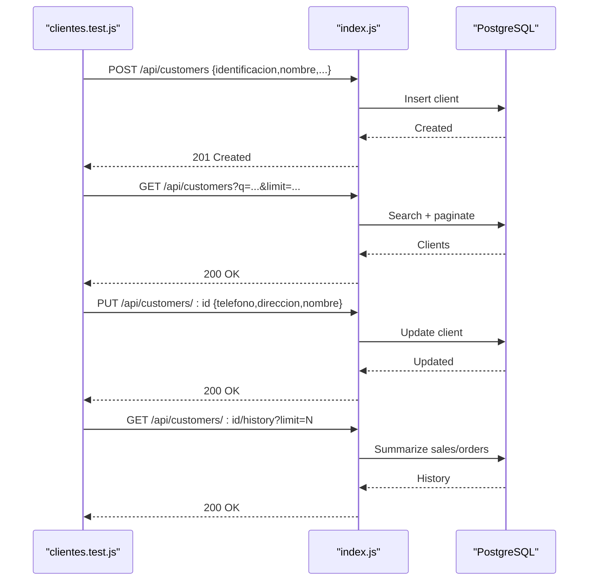
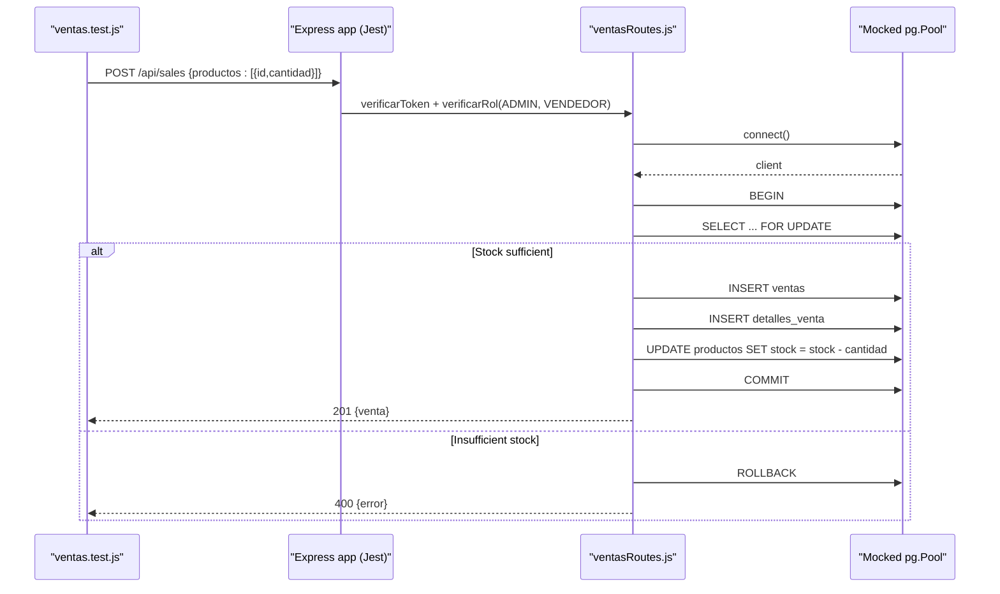
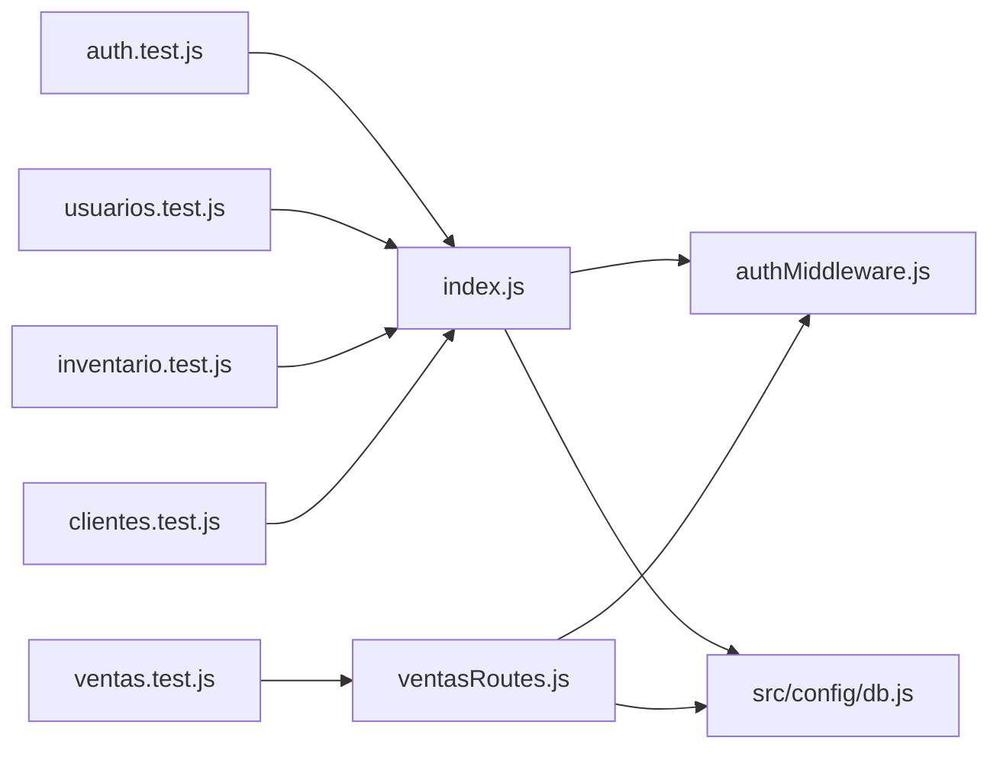

# Integration Testing

<cite>
**Referenced Files in This Document**   
- [package.json](file://backend/package.json)
- [index.js](file://backend/index.js)
- [db.js](file://backend/src/config/db.js)
- [authMiddleware.js](file://backend/middleware/authMiddleware.js)
- [ventasRoutes.js](file://backend/routes/ventasRoutes.js)
- [sesion.js](file://backend/tests/integracion/sesion.js)
- [auth.test.js](file://backend/tests/integracion/auth.test.js)
- [usuarios.test.js](file://backend/tests/integracion/usuarios.test.js)
- [inventario.test.js](file://backend/tests/integracion/inventario.test.js)
- [clientes.test.js](file://backend/tests/integracion/clientes.test.js)
- [ventas.test.js](file://backend/tests/ventas.test.js)
</cite>

## Table of Contents
1. [Introduction](#introduction)
2. [Project Structure](#project-structure)
3. [Core Components](#core-components)
4. [Architecture Overview](#architecture-overview)
5. [Detailed Component Analysis](#detailed-component-analysis)
6. [Dependency Analysis](#dependency-analysis)
7. [Performance Considerations](#performance-considerations)
8. [Troubleshooting Guide](#troubleshooting-guide)
9. [Conclusion](#conclusion)

## Introduction
This document explains how SIMO’s integration tests validate API endpoints and cross-component interactions. It covers test server setup, database seeding strategies, test data management, authentication flows, user management operations, inventory transactions, sales processing workflows, environment configuration, connection pooling for tests, cleanup procedures, middleware validation, route handler behavior, and end-to-end HTTP request/response assertions.

The repository uses two testing approaches:
- Node `node:test` with a real Express server process spawned per test suite.
- Jest-based unit/integration tests that mock the database and auth middleware to isolate route logic.

## Project Structure
Integration tests live under `backend/tests`. The main application entry point is `backend/index.js`, which wires routes, security middleware, rate limiting, and the PostgreSQL connection pool. Database connections are configured through `backend/src/config/db.js`. Authentication and role checks are implemented in `backend/middleware/authMiddleware.js`. Sales route logic is defined in `backend/routes/ventasRoutes.js`. Test utilities include `backend/tests/integracion/sesion.js` for obtaining JWT tokens from seeded users.

**Diagram sources**
- [index.js:1-56](file://backend/index.js#L1-L56)
- [ventasRoutes.js:1-10](file://backend/routes/ventasRoutes.js#L1-L10)
- [authMiddleware.js:1-10](file://backend/middleware/authMiddleware.js#L1-L10)
- [db.js:1-29](file://backend/src/config/db.js#L1-L29)
- [sesion.js:1-20](file://backend/tests/integracion/sesion.js#L1-L20)

**Section sources**
- [package.json:6-10](file://backend/package.json#L6-L10)
- [index.js:1-56](file://backend/index.js#L1-L56)
- [db.js:1-29](file://backend/src/config/db.js#L1-L29)

## Core Components
- Test runner scripts:
  - `npm test` runs Jest tests (ignores integration suites).
  - `npm run test:integracion` runs Node `node:test` suites under `tests/integracion`.
- Real server spawning:
  - Each integration test spawns `index.js` on an isolated port using `child_process.spawn`.
  - Tests wait for the server log containing “corriendo” before issuing requests.
- Database access:
  - Tests import the shared PostgreSQL pool from `src/config/db.js` to seed, assert, and clean up data.
- Authentication helper:
  - `sesion.js` logs in as a seeded user and returns a JWT token used by other tests.

Key responsibilities:
- `auth.test.js`: Login, logout, RBAC, session invalidation.
- `usuarios.test.js`: User CRUD, pagination, filtering, validation, last-admin protection, status changes.
- `inventario.test.js`: Inventory entries, purchases, concurrency, validations, stock updates.
- `clientes.test.js`: Customer registration, search, edit, history, concurrency.
- `ventas.test.js`: Mocked sales transaction flow with Jest.

**Section sources**
- [package.json:6-10](file://backend/package.json#L6-L10)
- [auth.test.js:1-45](file://backend/tests/integracion/auth.test.js#L1-L45)
- [usuarios.test.js:1-61](file://backend/tests/integracion/usuarios.test.js#L1-L61)
- [inventario.test.js:1-81](file://backend/tests/integracion/inventario.test.js#L1-L81)
- [clientes.test.js:1-57](file://backend/tests/integracion/clientes.test.js#L1-L57)
- [ventas.test.js:1-47](file://backend/tests/ventas.test.js#L1-L47)
- [sesion.js:1-20](file://backend/tests/integracion/sesion.js#L1-L20)

## Architecture Overview
Integration tests exercise the full stack:
- HTTP layer: Express app with security headers, CORS, JSON parsing, XSS sanitization, and rate limiting.
- Middleware: JWT verification and role checks.
- Routes: Sales, users, inventory, customers.
- Data layer: PostgreSQL via a connection pool.

**Diagram sources**
- [index.js:20-56](file://backend/index.js#L20-L56)
- [authMiddleware.js:9-49](file://backend/middleware/authMiddleware.js#L9-L49)
- [ventasRoutes.js:10-111](file://backend/routes/ventasRoutes.js#L10-L111)
- [db.js:17-26](file://backend/src/config/db.js#L17-L26)

## Detailed Component Analysis

### Authentication Flow Testing
The authentication test suite validates login, logout, and access control.

- Login contract:
  - Accepts `email` or `correo`.
  - Returns a JWT and user object with `id`, `email`, `rol`.
  - Enforces 30-minute expiration.
- Error handling:
  - Missing credentials return 400.
  - Wrong email/password return 401 with a uniform message.
  - Inactive accounts return 403.
- Access control:
  - Protected routes without token return 401.
  - Invalid token returns 403.
  - Role-based access enforces allowed roles per route.
- Logout:
  - Adds token to blacklist; subsequent requests with that token return 401.

**Diagram sources**
- [auth.test.js:49-128](file://backend/tests/integracion/auth.test.js#L49-L128)
- [index.js:347-469](file://backend/index.js#L347-L469)
- [authMiddleware.js:9-49](file://backend/middleware/authMiddleware.js#L9-L49)
- [sesion.js:6-17](file://backend/tests/integracion/sesion.js#L6-L17)

**Section sources**
- [auth.test.js:1-140](file://backend/tests/integracion/auth.test.js#L1-L140)
- [index.js:347-469](file://backend/index.js#L347-L469)
- [authMiddleware.js:9-49](file://backend/middleware/authMiddleware.js#L9-L49)
- [sesion.js:1-20](file://backend/tests/integracion/sesion.js#L1-L20)

### User Management Operations Testing
User tests cover listing, filtering, pagination, creation, update, and status change.

- Listing:
  - Paginated results exclude password hashes.
  - Filters by role code, id_rol, and estado.
  - Text search across name, email, username treats wildcards literally.
- Creation:
  - Normalizes email, stores bcrypt hash, returns user without password_hash.
  - Rejects duplicate emails case-insensitively.
  - Validates required fields, email format, password strength, and role existence.
- Update:
  - Updates partial fields while preserving unchanged values.
  - Prevents changing to another user’s email/username.
  - Protects the last active admin from losing admin role.
- Status change:
  - PATCH toggles estado; rejects invalid bodies.
  - Prevents deactivating the last active admin.
  - Deactivation immediately invalidates open sessions and blocks login.

**Diagram sources**
- [usuarios.test.js:135-167](file://backend/tests/integracion/usuarios.test.js#L135-L167)

**Section sources**
- [usuarios.test.js:1-366](file://backend/tests/integracion/usuarios.test.js#L1-L366)

### Inventory Transactions Testing
Inventory tests validate purchase entries and purchases with strong consistency guarantees.

- Entry creation:
  - Adds quantity only to warehouse stock.
  - Records movement in Kardex with responsible user.
  - Supports SKU lookup, optional supplier/document/cost/notes.
  - Allows decimal quantities for weight-based units; rejects decimals for unit-based products.
- Validation:
  - Rejects zero/negative/non-numeric quantities.
  - Returns 404 for missing products; 409 for inactive products.
  - Requires valid supplier and positive cost when provided.
- Authorization:
  - Requires INVENTARIO or ADMIN roles; ignores id_usuario in body, uses session user.
- Concurrency:
  - Simultaneous entries do not lose units; each sees a distinct balance.
- Purchases:
  - Confirming a purchase inserts multiple lines and updates stock atomically.
  - Draft purchases do not affect stock.
  - Invalid lines cause rollback; no purchase recorded.

**Diagram sources**
- [inventario.test.js:85-178](file://backend/tests/integracion/inventario.test.js#L85-L178)

**Section sources**
- [inventario.test.js:1-297](file://backend/tests/integracion/inventario.test.js#L1-L297)

### Client Management Testing
Client tests validate registration, search, editing, and history.

- Registration:
  - Normalizes document, name, email; supports CC/NIT types.
  - Rejects duplicates and invalid formats.
  - Concurrent registrations for the same document create exactly one client.
- Search:
  - Prefix search on document (POS autocomplete), case-insensitive name search, pagination.
  - Rejects invalid query parameters.
- Editing:
  - Updates contact info; allows clearing optional fields.
  - Document is immutable at API and DB level.
  - Validates empty body, empty name, boolean estado, and non-existent clients.
- History:
  - Aggregates completed sales totals and counts orders; excludes canceled sales.
  - Respects limit parameter; returns 404 for unknown clients.

**Diagram sources**
- [clientes.test.js:61-243](file://backend/tests/integracion/clientes.test.js#L61-L243)

**Section sources**
- [clientes.test.js:1-256](file://backend/tests/integracion/clientes.test.js#L1-L256)

### Sales Processing Workflow Testing
Sales route tests use Jest to mock the database and auth middleware, validating transactional behavior.

- Successful sale:
  - Begins a transaction, locks rows with `FOR UPDATE`, calculates totals, inserts sale and details, updates stock, commits.
  - Returns 201 with sale summary.
- Insufficient stock:
  - Rolls back transaction and returns 400 with error message.

**Diagram sources**
- [ventas.test.js:33-105](file://backend/tests/ventas.test.js#L33-L105)
- [ventasRoutes.js:10-111](file://backend/routes/ventasRoutes.js#L10-L111)

**Section sources**
- [ventas.test.js:1-106](file://backend/tests/ventas.test.js#L1-L106)
- [ventasRoutes.js:1-149](file://backend/routes/ventasRoutes.js#L1-L149)

## Dependency Analysis
Integration tests depend on:
- Application entry point (`index.js`) for routing and middleware.
- Auth middleware (`authMiddleware.js`) for JWT verification and role checks.
- Database pool (`src/config/db.js`) for direct assertions and cleanup.
- Route handlers (`routes/ventasRoutes.js`) for business logic validation.

**Diagram sources**
- [index.js:1-56](file://backend/index.js#L1-L56)
- [ventasRoutes.js:1-10](file://backend/routes/ventasRoutes.js#L1-L10)
- [authMiddleware.js:1-10](file://backend/middleware/authMiddleware.js#L1-L10)
- [db.js:1-29](file://backend/src/config/db.js#L1-L29)

**Section sources**
- [index.js:1-56](file://backend/index.js#L1-L56)
- [ventasRoutes.js:1-10](file://backend/routes/ventasRoutes.js#L1-L10)
- [authMiddleware.js:1-10](file://backend/middleware/authMiddleware.js#L1-L10)
- [db.js:1-29](file://backend/src/config/db.js#L1-L29)

## Performance Considerations
- Connection pooling:
  - The PostgreSQL pool is shared across modules and tests. Tests should avoid holding connections longer than necessary.
  - For long-running assertions, prefer querying via the pool and releasing connections promptly.
- Rate limiting:
  - The application applies rate limiting to `/api`; tests can adjust `RATE_LIMIT_MAX` to avoid throttling during rapid test execution.
- Concurrency:
  - Inventory and client tests simulate concurrent operations to ensure data integrity. Ensure test databases support row-level locking and consistent isolation levels.
- Test isolation:
  - Each integration test spawns its own server process on a unique port to prevent interference.

[No sources needed since this section provides general guidance]

## Troubleshooting Guide
Common issues and resolutions:
- Server startup failures:
  - Ensure the spawned server logs “corriendo”. If it exits early, check environment variables and database connectivity.
- Database connection errors:
  - Verify `DATABASE_URL` or `DB_*` variables. SSL settings are controlled by `DB_SSL`.
- Authentication failures:
  - Confirm seeded users exist and passwords match `sesion.js`.
  - Check that the blacklist table exists for logout tests.
- Permission errors:
  - Ensure the test user has permissions to insert/update/delete in relevant tables.
- Cleanup problems:
  - Use the provided cleanup routines to deactivate or delete test records and kill the server process.

**Section sources**
- [db.js:11-26](file://backend/src/config/db.js#L11-L26)
- [auth.test.js:30-45](file://backend/tests/integracion/auth.test.js#L30-L45)
- [usuarios.test.js:44-61](file://backend/tests/integracion/usuarios.test.js#L44-L61)
- [inventario.test.js:56-81](file://backend/tests/integracion/inventario.test.js#L56-L81)
- [clientes.test.js:39-57](file://backend/tests/integracion/clientes.test.js#L39-L57)

## Conclusion
SIMO’s integration tests provide comprehensive coverage of authentication, user management, inventory transactions, customer operations, and sales workflows. They combine real server processes with direct database assertions to validate both HTTP contracts and business rules. The test architecture emphasizes isolation, deterministic data management, and robust cleanup, ensuring reliable CI execution and confidence in production behavior.

[No sources needed since this section summarizes without analyzing specific files]