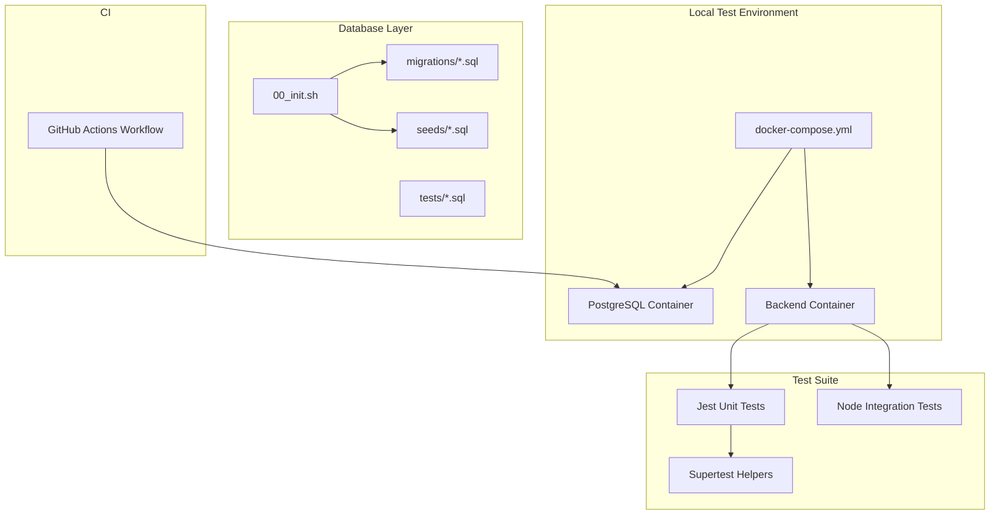
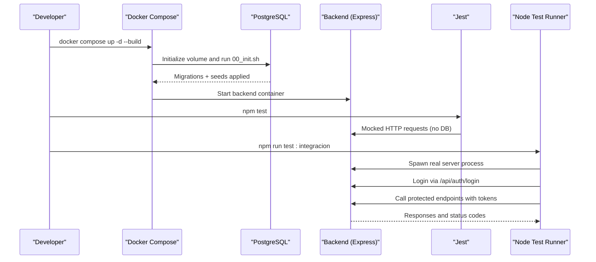
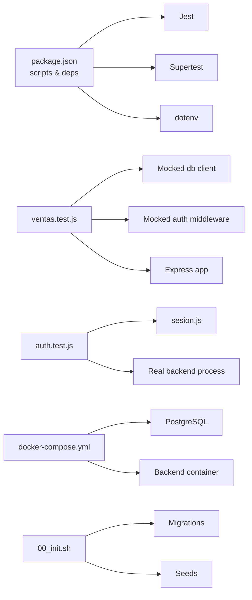

# Test Infrastructure

<cite>
**Referenced Files in This Document**   
- [respaldo-neon.yml](file://.github/workflows/respaldo-neon.yml)
- [docker-compose.yml](file://backend/docker-compose.yml)
- [Dockerfile](file://backend/Dockerfile)
- [package.json](file://backend/package.json)
- [00_init.sh](file://backend/db/00_init.sh)
- [README.md](file://backend/db/README.md)
- [001_reglas_esquema.sql](file://backend/db/tests/001_reglas_esquema.sql)
- [ventas.test.js](file://backend/tests/ventas.test.js)
- [auth.test.js](file://backend/tests/integracion/auth.test.js)
- [sesion.js](file://backend/tests/integracion/sesion.js)
- [001_datos_desarrollo.sql](file://backend/db/seeds/001_datos_desarrollo.sql)
</cite>

## Table of Contents
1. [Introduction](#introduction)
2. [Project Structure](#project-structure)
3. [Core Components](#core-components)
4. [Architecture Overview](#architecture-overview)
5. [Detailed Component Analysis](#detailed-component-analysis)
6. [Dependency Analysis](#dependency-analysis)
7. [Performance Considerations](#performance-considerations)
8. [Troubleshooting Guide](#troubleshooting-guide)
9. [Conclusion](#conclusion)

## Introduction
This document describes the test infrastructure for the project, focusing on how to set up a Docker-based test environment, initialize and seed the database, run unit and integration tests, and execute CI workflows. It also explains shared testing utilities, data management scripts, and techniques for debugging failing tests and profiling performance.

The repository uses:
- PostgreSQL as the database with schema migrations and seed data.
- Node.js Express for the backend API.
- Jest for unit tests and Node’s built-in test runner for integration tests.
- Supertest for HTTP assertions in unit-style tests.
- GitHub Actions for scheduled backup and artifact storage.

## Project Structure
The testing-related parts are primarily under `backend/`:
- `backend/docker-compose.yml` defines the local test database and application containers.
- `backend/Dockerfile` builds the backend container image.
- `backend/db/` contains database initialization, migrations, seeds, load data, and SQL-based business rule tests.
- `backend/tests/` contains Jest unit tests and Node integration tests.
- `.github/workflows/` contains a scheduled backup workflow that can be used as a reference for CI configuration patterns.

**Diagram sources**
- [docker-compose.yml:1-41](file://backend/docker-compose.yml#L1-L41)
- [00_init.sh:1-43](file://backend/db/00_init.sh#L1-L43)
- [package.json:1-38](file://backend/package.json#L1-L38)
- [respaldo-neon.yml:1-58](file://.github/workflows/respaldo-neon.yml#L1-L58)

**Section sources**
- [docker-compose.yml:1-41](file://backend/docker-compose.yml#L1-L41)
- [Dockerfile:1-26](file://backend/Dockerfile#L1-L26)
- [package.json:1-38](file://backend/package.json#L1-L38)
- [README.md:1-180](file://backend/db/README.md#L1-L180)

## Core Components
- Docker Compose environment: spins up PostgreSQL and the backend, mounts migration and seed directories, and exposes ports for local testing.
- Database initialization script: runs migrations and optional seeds when the volume is first created; supports an optional application role setup.
- Seed data: provides test users, company, categories, products, clients, and suppliers with known credentials for tests.
- SQL-based business rule tests: validate constraints, triggers, and business rules without leaving data behind.
- Jest unit tests: mock database and middleware to assert API behavior without a live database.
- Node integration tests: start the real server process, authenticate via the API, and verify access control and session invalidation against a seeded database.
- Shared session helper: centralizes login flow and seed password for integration tests.

**Section sources**
- [docker-compose.yml:1-41](file://backend/docker-compose.yml#L1-L41)
- [00_init.sh:1-43](file://backend/db/00_init.sh#L1-L43)
- [001_datos_desarrollo.sql:1-62](file://backend/db/seeds/001_datos_desarrollo.sql#L1-L62)
- [001_reglas_esquema.sql:1-174](file://backend/db/tests/001_reglas_esquema.sql#L1-L174)
- [ventas.test.js:1-106](file://backend/tests/ventas.test.js#L1-L106)
- [auth.test.js:1-140](file://backend/tests/integracion/auth.test.js#L1-L140)
- [sesion.js:1-20](file://backend/tests/integracion/sesion.js#L1-L20)

## Architecture Overview
The test architecture combines containerized services, deterministic database state, and layered tests:

**Diagram sources**
- [docker-compose.yml:1-41](file://backend/docker-compose.yml#L1-L41)
- [00_init.sh:1-43](file://backend/db/00_init.sh#L1-L43)
- [package.json:1-38](file://backend/package.json#L1-L38)
- [auth.test.js:1-140](file://backend/tests/integracion/auth.test.js#L1-L140)

## Detailed Component Analysis

### Docker-Based Test Environment
- The Compose file defines:
  - A PostgreSQL service with environment variables for user, password, database name, and a flag to run seeds.
  - A volume mount for migrations and seeds so they are executed during first-time initialization.
  - An application service that depends on the database and exposes port 3000.
- The Dockerfile builds a production-oriented Node image, installs only production dependencies, and runs the app directly.

Operational notes:
- Use Compose to create or recreate the test database by bringing it down with volumes removed and rebuilding.
- The backend expects database connection variables such as user, host, port, and database name.

**Section sources**
- [docker-compose.yml:1-41](file://backend/docker-compose.yml#L1-L41)
- [Dockerfile:1-26](file://backend/Dockerfile#L1-L26)

### Database Initialization and Schema Tests
- `00_init.sh` orchestrates:
  - Running all files under `migrations/` in order.
  - Optionally running `seeds/` based on an environment variable.
  - Optionally configuring an application role using a provided password.
- The README documents how to create the database with Docker or psql, how to run SQL-based tests, and lists the default test users and passwords.
- SQL tests under `db/tests/` use transactional blocks and helper functions to assert expected failures and successes for business rules.

Key behaviors:
- Tests wrap operations in transactions and roll back at the end, ensuring no residual data.
- Helper functions encapsulate “must fail” and “must pass” expectations for SQL statements.

**Section sources**
- [00_init.sh:1-43](file://backend/db/00_init.sh#L1-L43)
- [README.md:34-60](file://backend/db/README.md#L34-L60)
- [001_reglas_esquema.sql:1-174](file://backend/db/tests/001_reglas_esquema.sql#L1-L174)

### Seed Data Management
- The development seed creates:
  - Users per role with a known bcrypt hash for a shared test password.
  - Company, categories, products, clients, and suppliers.
- The seed ensures stock starts at zero and must be modified through inventory movements, aligning with business rules.

Usage guidance:
- The seed is automatically applied when `SIMO_SEED=true` during initial database creation.
- Integration tests rely on these users and roles to exercise authentication and authorization flows.

**Section sources**
- [001_datos_desarrollo.sql:1-62](file://backend/db/seeds/001_datos_desarrollo.sql#L1-L62)
- [README.md:54-60](file://backend/db/README.md#L54-L60)

### Unit Testing with Jest and Supertest
- The unit test file demonstrates:
  - Mocking the database client to avoid hitting Neon or any external database.
  - Mocking the authentication middleware to simulate a logged-in admin user.
  - Creating a temporary Express app and routing sales endpoints.
  - Asserting HTTP status codes, response bodies, and specific database calls such as updates and rollbacks.

Patterns:
- Reset mocks before each test to ensure isolation.
- Verify both success and failure paths, including insufficient stock scenarios.

**Section sources**
- [ventas.test.js:1-106](file://backend/tests/ventas.test.js#L1-L106)
- [package.json:25-36](file://backend/package.json#L25-L36)

### Integration Testing with Node Test Runner
- The integration test suite:
  - Spawns the real backend process with a configurable port.
  - Waits for the server to be ready by listening for a startup message.
  - Uses fetch to call `/api/auth/login` and other endpoints.
  - Validates JWT structure, expiration, and RBAC enforcement.
  - Verifies logout invalidates the token.
  - Cleans up test-specific users and kills the spawned server after execution.

Shared helpers:
- A session helper centralizes login logic and exposes the seed password constant.

**Section sources**
- [auth.test.js:1-140](file://backend/tests/integracion/auth.test.js#L1-L140)
- [sesion.js:1-20](file://backend/tests/integracion/sesion.js#L1-L20)

### CI Pipeline Configuration and Coverage Reporting
- The repository includes a GitHub Actions workflow that:
  - Runs on a schedule and can be triggered manually.
  - Executes in a PostgreSQL container to perform backups from Neon.
  - Verifies the dump and encrypts it, then uploads it as a GitHub Action artifact with retention.

Recommendations for extending CI:
- Add jobs to build the backend image, run Jest unit tests, and run integration tests against a temporary PostgreSQL instance.
- Configure coverage reporting with Jest by enabling coverage in the Jest configuration and publishing artifacts.
- Reuse the same environment variables and secrets pattern shown in the backup workflow for database connectivity and encryption keys.

**Section sources**
- [respaldo-neon.yml:1-58](file://.github/workflows/respaldo-neon.yml#L1-L58)
- [package.json:6-10](file://backend/package.json#L6-L10)

## Dependency Analysis
The following diagram shows how test components depend on each other and on runtime services:

**Diagram sources**
- [package.json:1-38](file://backend/package.json#L1-L38)
- [ventas.test.js:1-106](file://backend/tests/ventas.test.js#L1-L106)
- [auth.test.js:1-140](file://backend/tests/integracion/auth.test.js#L1-L140)
- [sesion.js:1-20](file://backend/tests/integracion/sesion.js#L1-L20)
- [docker-compose.yml:1-41](file://backend/docker-compose.yml#L1-L41)
- [00_init.sh:1-43](file://backend/db/00_init.sh#L1-L43)

**Section sources**
- [package.json:1-38](file://backend/package.json#L1-L38)
- [docker-compose.yml:1-41](file://backend/docker-compose.yml#L1-L41)
- [00_init.sh:1-43](file://backend/db/00_init.sh#L1-L43)

## Performance Considerations
- Keep unit tests fast by mocking I/O and avoiding real network or database calls.
- Run integration tests against a local PostgreSQL instance to reduce flakiness and latency.
- For database-heavy scenarios, use the provided load data scripts to generate realistic datasets and measure query performance.
- Ensure indexes and statistics are updated after large loads to get accurate EXPLAIN ANALYZE results.

[No sources needed since this section provides general guidance]

## Troubleshooting Guide
Common issues and resolutions:

- Database not initialized:
  - Ensure migrations and seeds are mounted into the PostgreSQL container and that the initialization script runs on first volume creation.
  - Recreate the volume if you need to reapply changes.

- Integration tests cannot connect:
  - Confirm the backend process is started with the correct database environment variables.
  - Verify the seed users exist and the password matches the shared constant.

- Authentication tests fail due to stale sessions:
  - Ensure logout invalidates tokens and that subsequent requests return unauthorized responses.
  - Clean up test-specific users after each run.

- Unit tests hit the real database:
  - Verify mocks are applied before importing modules that establish connections.
  - Reset mocks between tests to prevent cross-test contamination.

- CI job fails due to missing secrets:
  - Provide required secrets for database URLs and encryption keys in the repository settings.
  - Validate secret presence early in the workflow and fail fast with clear messages.

**Section sources**
- [docker-compose.yml:1-41](file://backend/docker-compose.yml#L1-L41)
- [00_init.sh:1-43](file://backend/db/00_init.sh#L1-L43)
- [auth.test.js:1-140](file://backend/tests/integracion/auth.test.js#L1-L140)
- [ventas.test.js:1-106](file://backend/tests/ventas.test.js#L1-L106)
- [respaldo-neon.yml:1-58](file://.github/workflows/respaldo-neon.yml#L1-L58)

## Conclusion
The test infrastructure combines Dockerized services, deterministic database state, and layered tests to ensure reliability across unit and integration scenarios. By leveraging the provided scripts, seeds, and shared helpers, teams can maintain consistent environments, automate validation, and extend CI pipelines with confidence.

[No sources needed since this section summarizes without analyzing specific files]