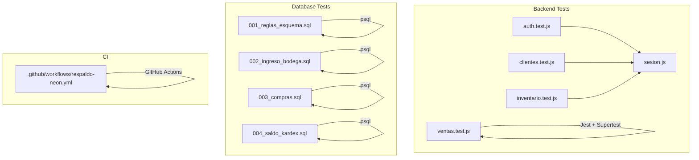
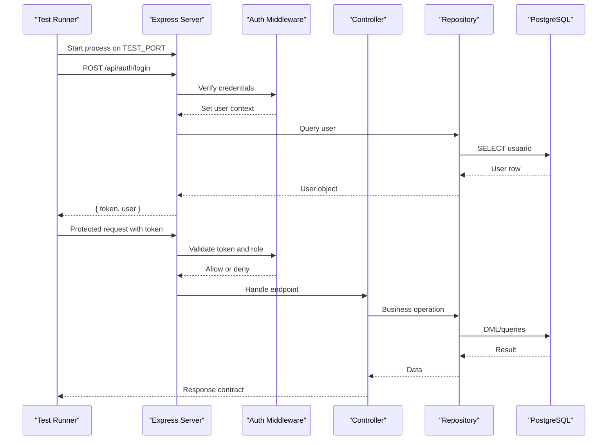
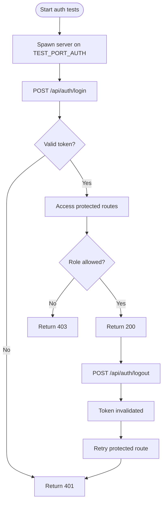
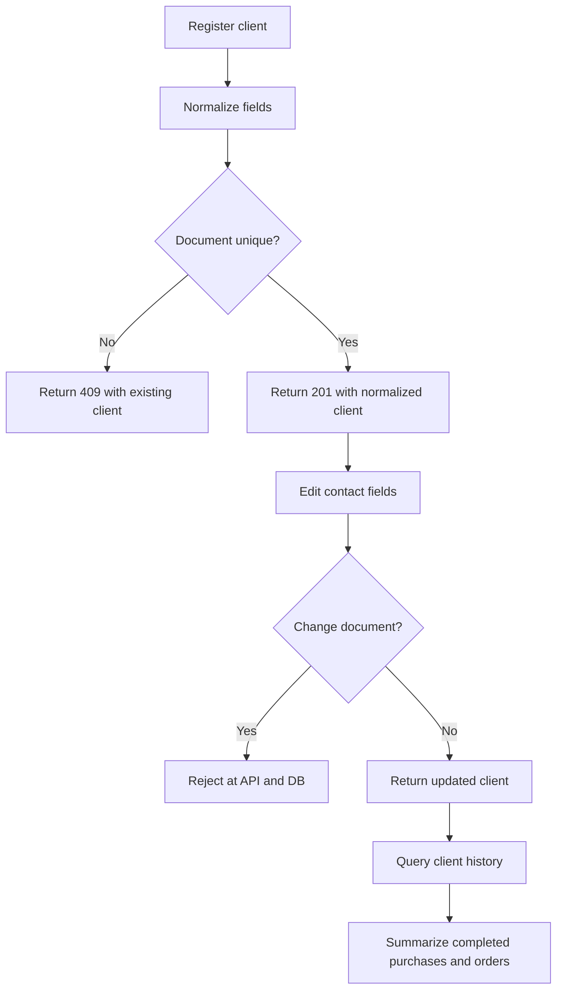
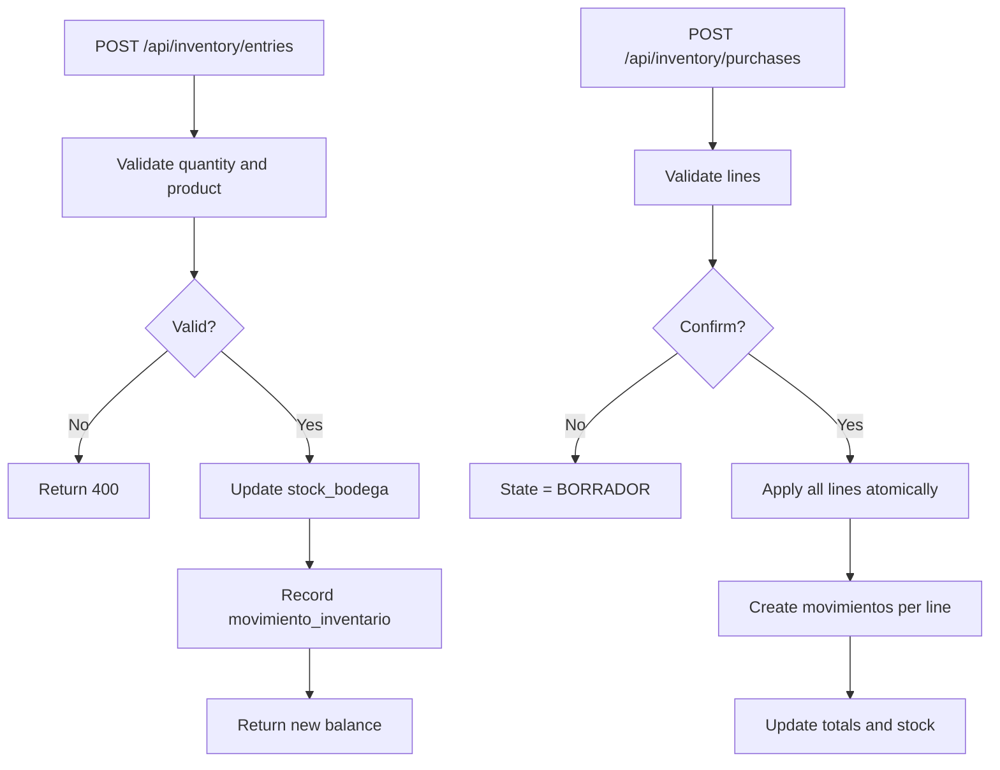
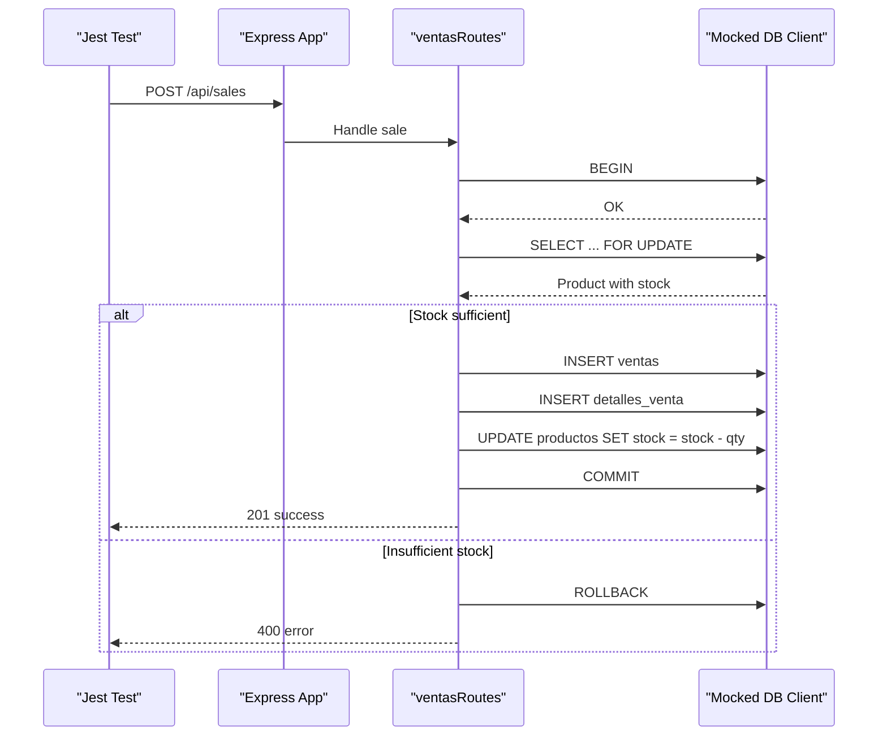
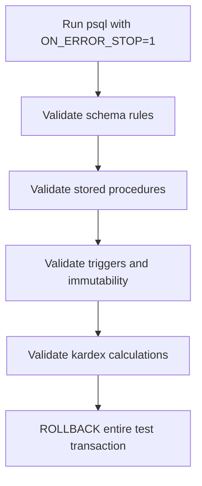
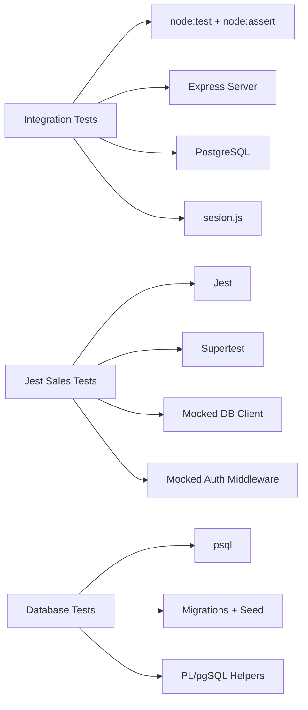

# Testing Strategy

<cite>
**Referenced Files in This Document**
- [backend/tests/integracion/auth.test.js](file://backend/tests/integracion/auth.test.js)
- [backend/tests/integracion/clientes.test.js](file://backend/tests/integracion/clientes.test.js)
- [backend/tests/integracion/inventario.test.js](file://backend/tests/integracion/inventario.test.js)
- [backend/tests/ventas.test.js](file://backend/tests/ventas.test.js)
- [backend/tests/integracion/sesion.js](file://backend/tests/integracion/sesion.js)
- [backend/package.json](file://backend/package.json)
- [backend/db/tests/001_reglas_esquema.sql](file://backend/db/tests/001_reglas_esquema.sql)
- [backend/db/tests/002_ingreso_bodega.sql](file://backend/db/tests/002_ingreso_bodega.sql)
- [backend/db/tests/003_compras.sql](file://backend/db/tests/003_compras.sql)
- [backend/db/tests/004_saldo_kardex.sql](file://backend/db/tests/004_saldo_kardex.sql)
- [backend/db/migrations/006_inventario.sql](file://backend/db/migrations/006_inventario.sql)
- [backend/db/README.md](file://backend/db/README.md)
- [.github/workflows/respaldo-neon.yml](file://.github/workflows/respaldo-neon.yml)
</cite>

## Table of Contents
1. [Introduction](#introduction)
2. [Project Structure](#project-structure)
3. [Core Components](#core-components)
4. [Architecture Overview](#architecture-overview)
5. [Detailed Component Analysis](#detailed-component-analysis)
6. [Dependency Analysis](#dependency-analysis)
7. [Performance Considerations](#performance-considerations)
8. [Troubleshooting Guide](#troubleshooting-guide)
9. [Conclusion](#conclusion)

## Introduction
This document explains SIMO’s multi-layered testing strategy. It covers:
- Unit and integration tests for backend controllers, repositories, and API endpoints.
- Database-level tests for stored procedures, functions, triggers, and schema rules.
- Test data management, mocking strategies, and environment setup.
- Continuous integration patterns and CI-related artifacts.
- Concrete examples for authentication flows, inventory operations, and sales processing.
- Best practices, performance considerations, and debugging techniques for failing tests.

The repository uses a layered approach:
- Node.js built-in test runner for integration tests that start the real server.
- Jest with Supertest for unit-style API tests using mocks.
- PostgreSQL scripts for database rule, function, and trigger validation.

## Project Structure
Testing is organized by scope:
- `backend/tests/integracion`: Integration tests that launch the Express server and call real API endpoints against a real database.
- `backend/tests/ventas.test.js`: Jest-based unit/integration test for sales routes using mocked database and middleware.
- `backend/db/tests`: SQL scripts executed with `psql` to validate schema rules, stored procedures, and Kardex calculations.
- `.github/workflows`: GitHub Actions workflow for Neon backups (not a test runner, but part of CI).

**Diagram sources**
- [backend/tests/integracion/auth.test.js:1-140](file://backend/tests/integracion/auth.test.js#L1-L140)
- [backend/tests/integracion/clientes.test.js:1-256](file://backend/tests/integracion/clientes.test.js#L1-L256)
- [backend/tests/integracion/inventario.test.js:1-297](file://backend/tests/integracion/inventario.test.js#L1-L297)
- [backend/tests/ventas.test.js:1-106](file://backend/tests/ventas.test.js#L1-L106)
- [backend/tests/integracion/sesion.js:1-20](file://backend/tests/integracion/sesion.js#L1-L20)
- [backend/db/tests/001_reglas_esquema.sql:1-174](file://backend/db/tests/001_reglas_esquema.sql#L1-L174)
- [backend/db/tests/002_ingreso_bodega.sql:1-102](file://backend/db/tests/002_ingreso_bodega.sql#L1-L102)
- [backend/db/tests/003_compras.sql:1-108](file://backend/db/tests/003_compras.sql#L1-L108)
- [backend/db/tests/004_saldo_kardex.sql:1-102](file://backend/db/tests/004_saldo_kardex.sql#L1-L102)
- [.github/workflows/respaldo-neon.yml:1-58](file://.github/workflows/respaldo-neon.yml#L1-L58)

**Section sources**
- [backend/tests/integracion/auth.test.js:1-140](file://backend/tests/integracion/auth.test.js#L1-L140)
- [backend/tests/integracion/clientes.test.js:1-256](file://backend/tests/integracion/clientes.test.js#L1-L256)
- [backend/tests/integracion/inventario.test.js:1-297](file://backend/tests/integracion/inventario.test.js#L1-L297)
- [backend/tests/ventas.test.js:1-106](file://backend/tests/ventas.test.js#L1-L106)
- [backend/db/tests/001_reglas_esquema.sql:1-174](file://backend/db/tests/001_reglas_esquema.sql#L1-L174)
- [backend/db/tests/002_ingreso_bodega.sql:1-102](file://backend/db/tests/002_ingreso_bodega.sql#L1-L102)
- [backend/db/tests/003_compras.sql:1-108](file://backend/db/tests/003_compras.sql#L1-L108)
- [backend/db/tests/004_saldo_kardex.sql:1-102](file://backend/db/tests/004_saldo_kardex.sql#L1-L102)
- [.github/workflows/respaldo-neon.yml:1-58](file://.github/workflows/respaldo-neon.yml#L1-L58)

## Core Components
SIMO’s testing strategy is composed of four main components:

1. **Integration test harness**
   - Uses Node’s built-in `node:test` and `node:assert/strict`.
   - Spawns the real Express server via `child_process.spawn`.
   - Calls HTTP endpoints with `fetch`, asserting status codes and response contracts.
   - Shares session helpers to authenticate as seeded users.

2. **Jest-based sales route tests**
   - Uses Jest and Supertest to mount an Express app with mocked dependencies.
   - Mocks the database client and auth middleware to isolate controller logic.
   - Asserts HTTP responses and verifies database calls through mock inspection.

3. **Database rule and procedure tests**
   - Executed with `psql` using `ON_ERROR_STOP=1`.
   - Wraps assertions in PL/pgSQL helper functions to assert expected failures or successes.
   - Validates schema constraints, triggers, stored procedures, and Kardex calculations.

4. **Test utilities and configuration**
   - Shared session helper for login and token retrieval.
   - Per-test unique suffixes to avoid collisions.
   - Environment variables for isolated ports and DB connections.

**Section sources**
- [backend/tests/integracion/auth.test.js:1-140](file://backend/tests/integracion/auth.test.js#L1-L140)
- [backend/tests/integracion/clientes.test.js:1-256](file://backend/tests/integracion/clientes.test.js#L1-L256)
- [backend/tests/integracion/inventario.test.js:1-297](file://backend/tests/integracion/inventario.test.js#L1-L297)
- [backend/tests/ventas.test.js:1-106](file://backend/tests/ventas.test.js#L1-L106)
- [backend/tests/integracion/sesion.js:1-20](file://backend/tests/integracion/sesion.js#L1-L20)
- [backend/package.json:1-38](file://backend/package.json#L1-L38)

## Architecture Overview
The testing architecture spans three layers:

- **API layer**: Integration tests exercise real endpoints; Jest tests verify route behavior with mocks.
- **Business layer**: Controllers and repositories are validated indirectly through API contracts and directly through Jest mocks.
- **Data layer**: PostgreSQL scripts enforce business rules at the database level, ensuring integrity even if application code changes.

**Diagram sources**
- [backend/tests/integracion/auth.test.js:20-28](file://backend/tests/integracion/auth.test.js#L20-L28)
- [backend/tests/integracion/auth.test.js:30-45](file://backend/tests/integracion/auth.test.js#L30-L45)
- [backend/tests/integracion/auth.test.js:49-61](file://backend/tests/integracion/auth.test.js#L49-L61)
- [backend/tests/integracion/auth.test.js:95-116](file://backend/tests/integracion/auth.test.js#L95-L116)

## Detailed Component Analysis

### Authentication Flow Tests
Authentication tests cover login, logout, and access control:
- Login returns a JWT with expected claims and expiration.
- Alternate email field names are supported.
- Invalid credentials and inactive accounts return appropriate errors.
- Protected routes require valid tokens and roles.
- Logout invalidates the token so subsequent requests fail.

**Diagram sources**
- [backend/tests/integracion/auth.test.js:30-45](file://backend/tests/integracion/auth.test.js#L30-L45)
- [backend/tests/integracion/auth.test.js:49-61](file://backend/tests/integracion/auth.test.js#L49-L61)
- [backend/tests/integracion/auth.test.js:95-116](file://backend/tests/integracion/auth.test.js#L95-L116)
- [backend/tests/integracion/auth.test.js:120-128](file://backend/tests/integracion/auth.test.js#L120-L128)

Key behaviors verified:
- Token structure and expiration.
- Consistent error messages for missing or wrong credentials.
- RBAC enforcement across multiple endpoints.
- Session invalidation after logout.

**Section sources**
- [backend/tests/integracion/auth.test.js:1-140](file://backend/tests/integracion/auth.test.js#L1-L140)
- [backend/tests/integracion/sesion.js:1-20](file://backend/tests/integracion/sesion.js#L1-L20)

### Client Management Tests
Client tests validate registration, normalization, uniqueness, updates, filtering, and history:
- Registration normalizes identifiers, names, emails, and phone numbers.
- Duplicate documents return conflict responses with existing client details.
- Optional fields can be cleared during edits.
- Document identity is immutable at both API and database levels.
- History aggregates completed purchases and orders correctly.

**Diagram sources**
- [backend/tests/integracion/clientes.test.js:61-85](file://backend/tests/integracion/clientes.test.js#L61-L85)
- [backend/tests/integracion/clientes.test.js:165-174](file://backend/tests/integracion/clientes.test.js#L165-L174)
- [backend/tests/integracion/clientes.test.js:202-237](file://backend/tests/integracion/clientes.test.js#L202-L237)

Important validations:
- Concurrency safety when creating clients with the same document.
- Pagination and parameter validation.
- Exact document lookup and ID lookup.
- State filtering for active/inactive clients.

**Section sources**
- [backend/tests/integracion/clientes.test.js:1-256](file://backend/tests/integracion/clientes.test.js#L1-L256)

### Inventory Inbound and Purchase Tests
Inventory tests validate inbound stock entries and purchase confirmations:
- Inbound entries increase warehouse stock only and record movements.
- Decimal quantities are allowed for weight-based products.
- Strict validation rejects invalid quantities, inactive products, and unauthorized roles.
- Concurrent entries preserve stock integrity and produce ordered balances.
- Purchase confirmation creates movements per line and totals correctly.
- Draft purchases do not affect stock until confirmed.
- Atomicity ensures partial failures roll back completely.

**Diagram sources**
- [backend/tests/integracion/inventario.test.js:85-95](file://backend/tests/integracion/inventario.test.js#L85-L95)
- [backend/tests/integracion/inventario.test.js:133-151](file://backend/tests/integracion/inventario.test.js#L133-L151)
- [backend/tests/integracion/inventario.test.js:188-199](file://backend/tests/integracion/inventario.test.js#L188-L199)
- [backend/tests/integracion/inventario.test.js:217-238](file://backend/tests/integracion/inventario.test.js#L217-L238)
- [backend/tests/integracion/inventario.test.js:248-266](file://backend/tests/integracion/inventario.test.js#L248-L266)

Concurrency and atomicity guarantees:
- Multiple simultaneous entries result in correct cumulative balances.
- Invalid lines in a purchase prevent any side effects.

**Section sources**
- [backend/tests/integracion/inventario.test.js:1-297](file://backend/tests/integracion/inventario.test.js#L1-L297)

### Sales Processing Tests
Sales tests use Jest and Supertest to isolate route behavior:
- Mock the database client and auth middleware.
- Assert successful sale flow returns 201 and decrements stock.
- Assert insufficient stock returns 400 and rolls back the transaction.
- Inspect mock calls to verify SQL statements and parameters.

**Diagram sources**
- [backend/tests/ventas.test.js:5-23](file://backend/tests/ventas.test.js#L5-L23)
- [backend/tests/ventas.test.js:29-31](file://backend/tests/ventas.test.js#L29-L31)
- [backend/tests/ventas.test.js:49-81](file://backend/tests/ventas.test.js#L49-L81)
- [backend/tests/ventas.test.js:83-105](file://backend/tests/ventas.test.js#L83-L105)

**Section sources**
- [backend/tests/ventas.test.js:1-106](file://backend/tests/ventas.test.js#L1-L106)

### Database Schema and Procedure Tests
Database tests ensure business rules are enforced at the data layer:
- Schema rules validate security, catalog integrity, inventory movement constraints, sales totals, order state transitions, and audit log immutability.
- Inbound storage procedure tests verify successful entries, accumulation, decimal handling, and validation errors.
- Purchase confirmation tests validate totals, movement creation, immutability, and atomicity.
- Kardex tests verify moving averages, valued balances, date filters, and consistency checks.

**Diagram sources**
- [backend/db/tests/001_reglas_esquema.sql:10-30](file://backend/db/tests/001_reglas_esquema.sql#L10-L30)
- [backend/db/tests/001_reglas_esquema.sql:35-169](file://backend/db/tests/001_reglas_esquema.sql#L35-L169)
- [backend/db/tests/002_ingreso_bodega.sql:11-33](file://backend/db/tests/002_ingreso_bodega.sql#L11-L33)
- [backend/db/tests/002_ingreso_bodega.sql:44-99](file://backend/db/tests/002_ingreso_bodega.sql#L44-L99)
- [backend/db/tests/003_compras.sql:10-30](file://backend/db/tests/003_compras.sql#L10-L30)
- [backend/db/tests/003_compras.sql:42-105](file://backend/db/tests/003_compras.sql#L42-L105)
- [backend/db/tests/004_saldo_kardex.sql:18-23](file://backend/db/tests/004_saldo_kardex.sql#L18-L23)
- [backend/db/tests/004_saldo_kardex.sql:47-73](file://backend/db/tests/004_saldo_kardex.sql#L47-L73)

Key guarantees:
- Negative stock is prevented.
- Purchases only enter warehouse stock.
- Internal transfers follow allowed directions.
- Manual adjustments require justification.
- Kardex is immutable and consistent.
- Order state transitions are sequential and auditable.
- Audit logs are immutable and require authorization.

**Section sources**
- [backend/db/tests/001_reglas_esquema.sql:1-174](file://backend/db/tests/001_reglas_esquema.sql#L1-L174)
- [backend/db/tests/002_ingreso_bodega.sql:1-102](file://backend/db/tests/002_ingreso_bodega.sql#L1-L102)
- [backend/db/tests/003_compras.sql:1-108](file://backend/db/tests/003_compras.sql#L1-L108)
- [backend/db/tests/004_saldo_kardex.sql:1-102](file://backend/db/tests/004_saldo_kardex.sql#L1-L102)
- [backend/db/migrations/006_inventario.sql:44-51](file://backend/db/migrations/006_inventario.sql#L44-L51)
- [backend/db/README.md:88-104](file://backend/db/README.md#L88-L104)

## Dependency Analysis
Testing dependencies and relationships:

- Integration tests depend on:
  - Node’s built-in test runner and assertion library.
  - The real Express server process.
  - A running PostgreSQL instance with migrations and seed data.
  - Shared session helper for authenticated requests.

- Jest tests depend on:
  - Jest runtime and Supertest.
  - Mocked database client and auth middleware.
  - Temporary Express app mounting routes under test.

- Database tests depend on:
  - `psql` execution with strict error stopping.
  - Seed data and migration-defined schema.
  - PL/pgSQL helper functions for assertions.

**Diagram sources**
- [backend/tests/integracion/auth.test.js:4-11](file://backend/tests/integracion/auth.test.js#L4-L11)
- [backend/tests/integracion/clientes.test.js:11-16](file://backend/tests/integracion/clientes.test.js#L11-L16)
- [backend/tests/integracion/inventario.test.js:11-16](file://backend/tests/integracion/inventario.test.js#L11-L16)
- [backend/tests/ventas.test.js:2-23](file://backend/tests/ventas.test.js#L2-L23)
- [backend/tests/integracion/sesion.js:1-20](file://backend/tests/integracion/sesion.js#L1-L20)
- [backend/package.json:6-10](file://backend/package.json#L6-L10)
- [backend/package.json:25-36](file://backend/package.json#L25-L36)

**Section sources**
- [backend/tests/integracion/auth.test.js:1-140](file://backend/tests/integracion/auth.test.js#L1-L140)
- [backend/tests/integracion/clientes.test.js:1-256](file://backend/tests/integracion/clientes.test.js#L1-L256)
- [backend/tests/integracion/inventario.test.js:1-297](file://backend/tests/integracion/inventario.test.js#L1-L297)
- [backend/tests/ventas.test.js:1-106](file://backend/tests/ventas.test.js#L1-L106)
- [backend/tests/integracion/sesion.js:1-20](file://backend/tests/integracion/sesion.js#L1-L20)
- [backend/package.json:1-38](file://backend/package.json#L1-L38)

## Performance Considerations
- Integration tests spawn a real server and connect to a real database; they are heavier than unit tests.
- Concurrency tests simulate simultaneous operations to validate locking and ordering guarantees.
- Database tests run within transactions and roll back changes, avoiding long-term data pollution.
- Use isolated ports per test suite to prevent port conflicts.
- Prefer targeted queries and minimal seed data to reduce test execution time.
- For large datasets, consider separate performance test scripts outside the default test command.

[No sources needed since this section provides general guidance]

## Troubleshooting Guide
Common issues and remedies:

- **Server startup failures in integration tests**
  - Ensure the server prints its readiness signal before proceeding.
  - Check that the configured `TEST_PORT_*` is free.
  - Verify the server process exits cleanly after tests.

- **Authentication failures**
  - Confirm seed users exist and passwords match the shared constant.
  - Validate token claims and expiration expectations.
  - Ensure RBAC roles align with endpoint permissions.

- **Database constraint violations**
  - Review schema rules and triggers for immutability and validation.
  - Use SQLSTATE codes to identify specific constraint failures.
  - Run database tests with `ON_ERROR_STOP=1` to catch failures early.

- **Jest mock misconfiguration**
  - Reset mocks between tests to avoid cross-test contamination.
  - Verify mock query sequences match the controller’s transactional flow.
  - Inspect mock call arguments to ensure correct parameters.

- **Port and environment conflicts**
  - Use environment variables for test ports and database URLs.
  - Avoid sharing mutable global state across tests.

**Section sources**
- [backend/tests/integracion/auth.test.js:30-45](file://backend/tests/integracion/auth.test.js#L30-L45)
- [backend/tests/integracion/clientes.test.js:39-57](file://backend/tests/integracion/clientes.test.js#L39-L57)
- [backend/tests/integracion/inventario.test.js:56-81](file://backend/tests/integracion/inventario.test.js#L56-L81)
- [backend/tests/ventas.test.js:36-47](file://backend/tests/ventas.test.js#L36-L47)
- [backend/db/tests/001_reglas_esquema.sql:10-30](file://backend/db/tests/001_reglas_esquema.sql#L10-L30)

## Conclusion
SIMO’s testing strategy combines:
- Real-server integration tests for authentication, clients, and inventory.
- Jest-based unit tests for sales routes with mocked dependencies.
- PostgreSQL scripts for schema, procedure, and trigger validation.
- Clear separation of concerns, robust data isolation, and strong assertions.

This layered approach ensures correctness at every level: API contracts, business logic, and data integrity. By following the documented patterns, teams can extend coverage confidently while maintaining reliability and performance.

[No sources needed since this section summarizes without analyzing specific files]