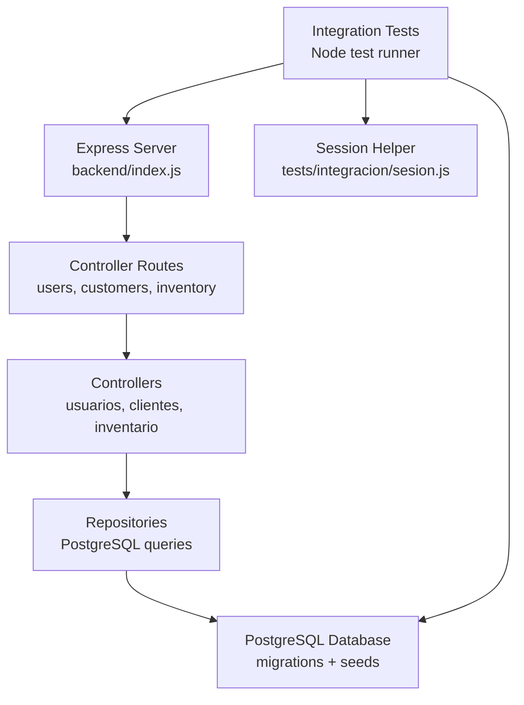
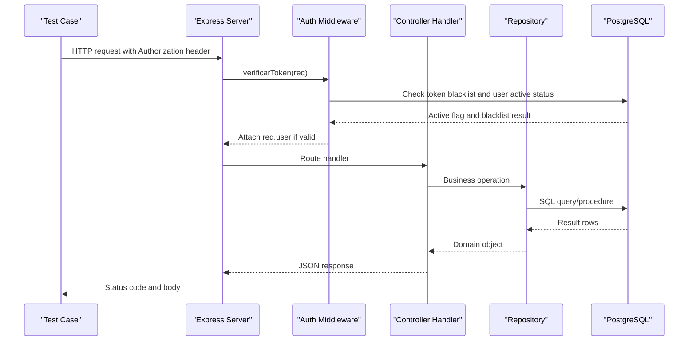
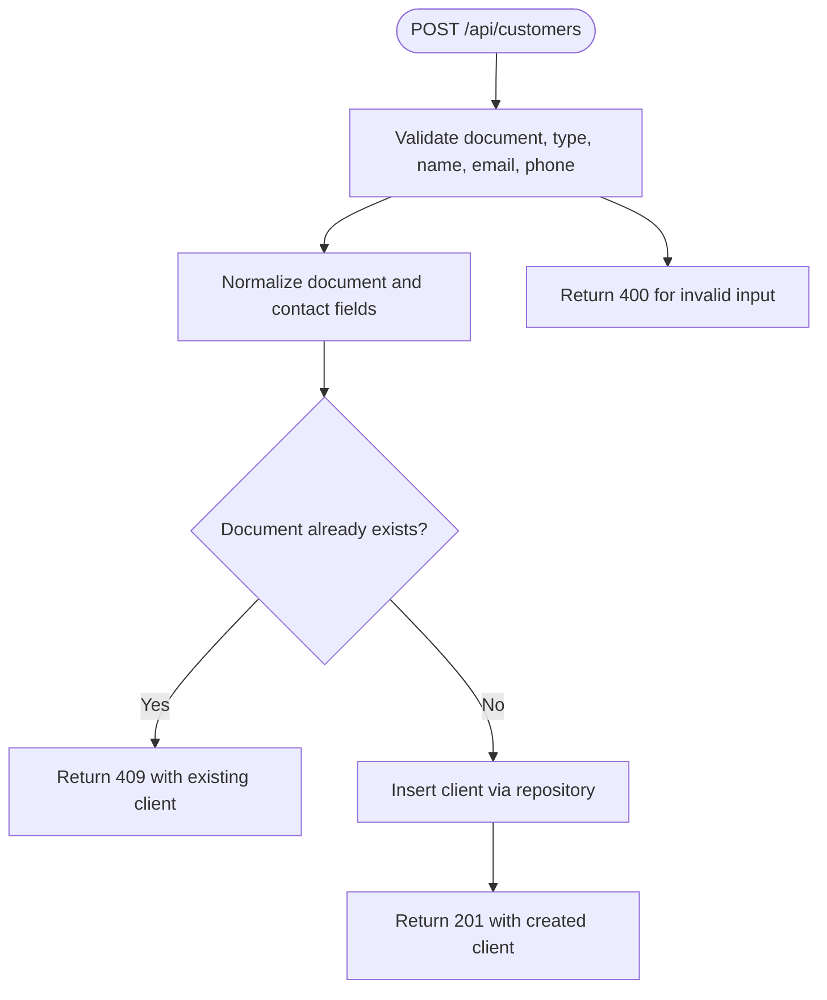
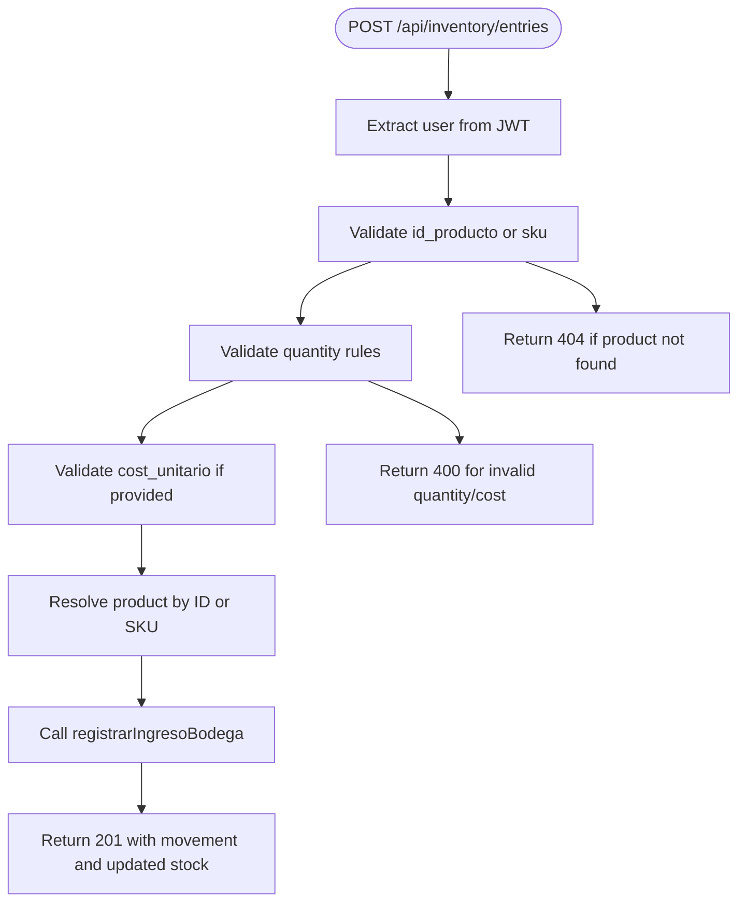
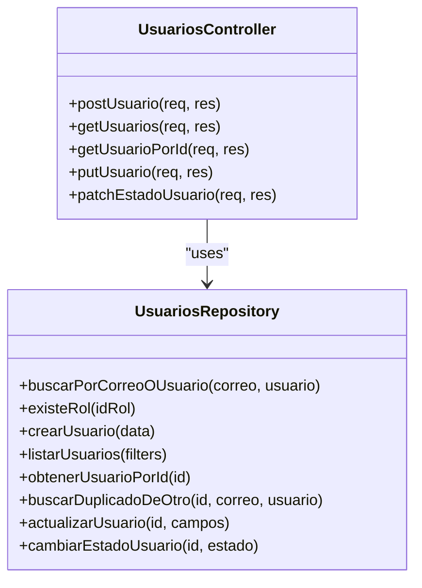
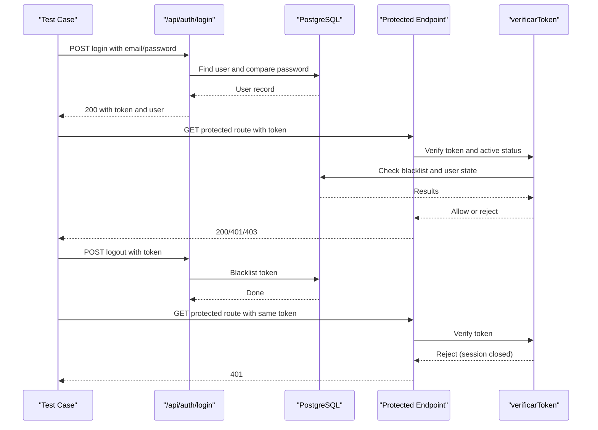
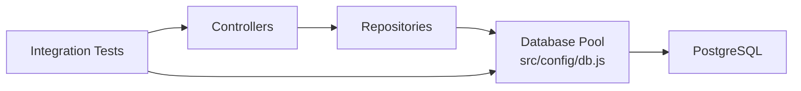

# Controller Testing

<cite>
**Referenced Files in This Document**   
- [clientes.test.js](file://backend/tests/integracion/clientes.test.js)
- [inventario.test.js](file://backend/tests/integracion/inventario.test.js)
- [usuarios.test.js](file://backend/tests/integracion/usuarios.test.js)
- [auth.test.js](file://backend/tests/integracion/auth.test.js)
- [sesion.js](file://backend/tests/integracion/sesion.js)
- [clientes.controller.js](file://backend/src/controllers/clientes.controller.js)
- [inventario.controller.js](file://backend/src/controllers/inventario.controller.js)
- [usuarios.controller.js](file://backend/src/controllers/usuarios.controller.js)
- [clientes.repository.js](file://backend/src/repositories/clientes.repository.js)
- [inventario.repository.js](file://backend/src/repositories/inventario.repository.js)
- [usuarios.repository.js](file://backend/src/repositories/usuarios.repository.js)
- [authMiddleware.js](file://backend/middleware/authMiddleware.js)
- [db.js](file://backend/src/config/db.js)
- [index.js](file://backend/index.js)
</cite>

## Table of Contents
1. [Introduction](#introduction)
2. [Project Structure](#project-structure)
3. [Core Components](#core-components)
4. [Architecture Overview](#architecture-overview)
5. [Detailed Component Analysis](#detailed-component-analysis)
6. [Dependency Analysis](#dependency-analysis)
7. [Performance Considerations](#performance-considerations)
8. [Troubleshooting Guide](#troubleshooting-guide)
9. [Conclusion](#conclusion)

## Introduction
This document explains how SIMO’s backend controller tests validate business logic, request and response handling, authentication middleware integration, and error scenarios. It focuses on the integration test suite that starts a real Express server, authenticates users, calls HTTP endpoints, and asserts status codes, payloads, database state, and concurrency behavior. The goal is to help developers understand:
- How to simulate requests and assert responses.
- How repository dependencies are exercised through a real PostgreSQL database.
- How authentication and role-based access control are validated.
- How to isolate test data using unique prefixes and cleanup routines.
- How concurrent operations are tested without losing inventory units or violating admin constraints.

## Project Structure
The testing strategy lives under `backend/tests/integracion`. Each feature has its own test file:
- Customer management: `clientes.test.js`
- Inventory entries and purchases: `inventario.test.js`
- User administration: `usuarios.test.js`
- Authentication and authorization: `auth.test.js`

All tests share common patterns:
- Spawn `backend/index.js` with an isolated port.
- Authenticate via `/api/auth/login` using seed users.
- Use `fetch` to call controller routes.
- Assert HTTP status codes and JSON bodies.
- Query the database directly for state verification.
- Clean up test data by marking records inactive or deleting them.

**Diagram sources**
- [index.js:53-56](file://backend/index.js#L53-L56)
- [clientes.controller.js:70-282](file://backend/src/controllers/clientes.controller.js#L70-L282)
- [inventario.controller.js:43-268](file://backend/src/controllers/inventario.controller.js#L43-L268)
- [usuarios.controller.js:26-294](file://backend/src/controllers/usuarios.controller.js#L26-L294)
- [clientes.repository.js:10-130](file://backend/src/repositories/clientes.repository.js#L10-L130)
- [inventario.repository.js:12-101](file://backend/src/repositories/inventario.repository.js#L12-L101)
- [usuarios.repository.js:12-241](file://backend/src/repositories/usuarios.repository.js#L12-L241)
- [sesion.js:6-17](file://backend/tests/integracion/sesion.js#L6-L17)

**Section sources**
- [clientes.test.js:11-57](file://backend/tests/integracion/clientes.test.js#L11-L57)
- [inventario.test.js:11-81](file://backend/tests/integracion/inventario.test.js#L11-L81)
- [usuarios.test.js:8-61](file://backend/tests/integracion/usuarios.test.js#L8-L61)
- [auth.test.js:4-45](file://backend/tests/integracion/auth.test.js#L4-L45)

## Core Components
The core components under test are:
- Customer controller: registration, search, lookup by document or ID, update, and history.
- Inventory controller: warehouse entry, purchase creation and confirmation, purchase retrieval.
- User controller: user listing, creation, update, and status change.
- Authentication middleware: JWT validation, session blacklist, active account check, and role enforcement.

Testing approach highlights:
- Business logic validation: input normalization, duplicate detection, numeric precision rules, pagination limits, and domain constraints like “document cannot be changed” or “last administrator must remain active.”
- Request/response handling: consistent JSON structure, correct HTTP status codes, and field presence/absence.
- Error scenarios: 400 for invalid input, 401/403 for authentication/authorization failures, 404 for missing entities, 409 for conflicts, and 500 for unexpected errors.
- Repository dependencies: tests use a real database pool; they do not mock repositories but instead assert database state after controller operations.
- Authentication middleware integration: login/logout flows, token expiration, blacklist behavior, and RBAC per route.

**Section sources**
- [clientes.controller.js:70-282](file://backend/src/controllers/clientes.controller.js#L70-L282)
- [inventario.controller.js:43-268](file://backend/src/controllers/inventario.controller.js#L43-L268)
- [usuarios.controller.js:26-294](file://backend/src/controllers/usuarios.controller.js#L26-L294)
- [authMiddleware.js:9-75](file://backend/middleware/authMiddleware.js#L9-L75)

## Architecture Overview
The integration tests exercise the full stack from HTTP to database. The following sequence shows a typical authenticated controller call.

**Diagram sources**
- [authMiddleware.js:9-49](file://backend/middleware/authMiddleware.js#L9-L49)
- [clientes.controller.js:70-122](file://backend/src/controllers/clientes.controller.js#L70-L122)
- [inventario.controller.js:48-147](file://backend/src/controllers/inventario.controller.js#L48-L147)
- [usuarios.controller.js:29-84](file://backend/src/controllers/usuarios.controller.js#L29-L84)
- [clientes.repository.js:10-18](file://backend/src/repositories/clientes.repository.js#L10-L18)
- [inventario.repository.js:12-27](file://backend/src/repositories/inventario.repository.js#L12-L27)
- [usuarios.repository.js:25-36](file://backend/src/repositories/usuarios.repository.js#L25-L36)

## Detailed Component Analysis

### Customer Management Testing
Customer tests cover:
- Registration with document normalization and duplicate conflict handling.
- Search by document prefix and name, including pagination and parameter validation.
- Lookup by document and ID, including 404 and 400 cases.
- Update with immutability of the identity document and optional fields.
- History endpoint summarizing completed sales and open orders.

Key testing strategies:
- Unique document prefix per run avoids collisions.
- Concurrency test ensures only one customer is created when multiple simultaneous registrations target the same document.
- Direct database assertions verify normalization, state changes, and constraint enforcement.

**Diagram sources**
- [clientes.controller.js:70-122](file://backend/src/controllers/clientes.controller.js#L70-L122)
- [clientes.repository.js:10-18](file://backend/src/repositories/clientes.repository.js#L10-L18)

Concrete examples from tests:
- Successful registration returns 201 and normalized fields.
- Duplicate document returns 409 with the existing client payload.
- Invalid inputs return 400 with descriptive messages.
- Concurrent registrations produce exactly one success and multiple conflicts.
- Search supports partial document matching and case-insensitive name search.
- Update rejects attempts to change the identity document and enforces field validation.
- History endpoint returns summaries and lists of sales and orders.

**Section sources**
- [clientes.test.js:61-119](file://backend/tests/integracion/clientes.test.js#L61-L119)
- [clientes.test.js:123-189](file://backend/tests/integracion/clientes.test.js#L123-L189)
- [clientes.test.js:193-243](file://backend/tests/integracion/clientes.test.js#L193-L243)
- [clientes.controller.js:70-282](file://backend/src/controllers/clientes.controller.js#L70-L282)
- [clientes.repository.js:10-130](file://backend/src/repositories/clientes.repository.js#L10-L130)

### Inventory Operations Testing
Inventory tests cover:
- Warehouse entry with product identification by ID or SKU.
- Numeric validation for quantities and unit costs, including decimal rules.
- Role-based access control requiring INVENTARIO or ADMIN roles.
- Purchase creation with multiple lines, draft vs confirmed states, and atomicity.
- Stock and Kardex verification via direct database queries.

Key testing strategies:
- Products are created with unique SKUs per test run.
- Quantity rules enforce integers for unit products and limited decimals for weight products.
- Concurrency test verifies no lost units across simultaneous entries.
- Purchase validation checks line duplication, product existence, and provider validity.
- Draft purchases do not move stock; confirmed purchases update inventory atomically.

**Diagram sources**
- [inventario.controller.js:48-147](file://backend/src/controllers/inventario.controller.js#L48-L147)
- [inventario.repository.js:12-27](file://backend/src/repositories/inventario.repository.js#L12-L27)

Concrete examples from tests:
- Entry creates a movement, updates warehouse stock, and reflects in Kardex view.
- SKU-based entry accepts optional provider, reference document, and observation.
- Decimal quantities are allowed for kilogram products but rejected for unit products.
- Missing or invalid product returns 404; inactive product returns 409.
- Unauthorized or wrong-role requests return 401/403.
- Concurrent entries produce monotonically increasing balances without lost units.
- Purchase with multiple lines confirms stock movement and preserves responsibility attribution.
- Draft purchase does not affect stock; invalid lines cause rollback.

**Section sources**
- [inventario.test.js:85-178](file://backend/tests/integracion/inventario.test.js#L85-L178)
- [inventario.test.js:188-283](file://backend/tests/integracion/inventario.test.js#L188-L283)
- [inventario.controller.js:43-268](file://backend/src/controllers/inventario.controller.js#L43-L268)
- [inventario.repository.js:12-101](file://backend/src/repositories/inventario.repository.js#L12-L101)

### User Administration Testing
User tests cover:
- Paginated listing with filters by role code, role ID, status, and text search.
- Creation with email normalization, password hashing, and duplicate detection.
- Update allowing partial edits while protecting sensitive fields like password and state.
- Status change endpoint enforcing last-admin protection and immediate session invalidation.

Key testing strategies:
- Users are created with unique suffixes to avoid collisions.
- Passwords are hashed with bcrypt; tests verify hash format and successful comparison.
- Duplicate email or username returns 409.
- Last-admin protection prevents removing or deactivating the final active administrator.
- Concurrency test ensures at least one administrator remains active after parallel role changes.
- Frontend contract tests assert required fields in POST and GET responses.

**Diagram sources**
- [usuarios.controller.js:26-294](file://backend/src/controllers/usuarios.controller.js#L26-L294)
- [usuarios.repository.js:12-241](file://backend/src/repositories/usuarios.repository.js#L12-L241)

Concrete examples from tests:
- GET returns paginated data without password hashes and includes role metadata.
- POST creates a user, normalizes email, hashes password, and returns public fields.
- PUT allows partial updates and rejects password/state modifications.
- PATCH toggles user state and immediately invalidates sessions for deactivated accounts.
- Last-admin constraints return 409 with clear messages.
- Concurrent admin role removal leaves exactly one active administrator.

**Section sources**
- [usuarios.test.js:65-131](file://backend/tests/integracion/usuarios.test.js#L65-L131)
- [usuarios.test.js:135-167](file://backend/tests/integracion/usuarios.test.js#L135-L167)
- [usuarios.test.js:191-278](file://backend/tests/integracion/usuarios.test.js#L191-L278)
- [usuarios.test.js:284-329](file://backend/tests/integracion/usuarios.test.js#L284-L329)
- [usuarios.controller.js:26-294](file://backend/src/controllers/usuarios.controller.js#L26-L294)
- [usuarios.repository.js:12-241](file://backend/src/repositories/usuarios.repository.js#L12-L241)

### Authentication and Authorization Testing
Authentication tests cover:
- Login returning a JWT with expected claims and expiration.
- Acceptance of both `email` and `correo` fields.
- Consistent error message for invalid credentials.
- Inactive account login returning 403.
- Protected routes returning 401 without token and 403 for invalid tokens.
- Role-based access control restricting users to permitted routes.
- Logout blacklisting the token so subsequent requests fail.

Key testing strategies:
- Uses seed users and shared password helper.
- Decodes JWT to assert internal claims and expiration duration.
- Exercises RBAC by logging in as different roles and asserting route access.
- Verifies logout invalidates the token immediately.

**Diagram sources**
- [auth.test.js:49-128](file://backend/tests/integracion/auth.test.js#L49-L128)
- [index.js:347-469](file://backend/index.js#L347-L469)
- [authMiddleware.js:9-49](file://backend/middleware/authMiddleware.js#L9-L49)

Concrete examples from tests:
- Login returns token with correct user shape and JWT claims.
- Empty credentials return 400.
- Inactive account returns 403 with appropriate message.
- Unauthenticated requests to protected routes return 401.
- Invalid token returns 403.
- RBAC restricts users to their allowed modules.
- Logout invalidates token; subsequent requests receive 401.

**Section sources**
- [auth.test.js:49-128](file://backend/tests/integracion/auth.test.js#L49-L128)
- [sesion.js:6-17](file://backend/tests/integracion/sesion.js#L6-L17)
- [index.js:347-469](file://backend/index.js#L347-L469)
- [authMiddleware.js:9-75](file://backend/middleware/authMiddleware.js#L9-L75)

## Dependency Analysis
The controllers depend on repositories for data access. The repositories use a shared PostgreSQL connection pool configured via environment variables. Tests do not mock repositories; they rely on a real database initialized by migrations and seeds.

**Diagram sources**
- [clientes.controller.js:3-10](file://backend/src/controllers/clientes.controller.js#L3-L10)
- [inventario.controller.js:3-10](file://backend/src/controllers/inventario.controller.js#L3-L10)
- [usuarios.controller.js:4-14](file://backend/src/controllers/usuarios.controller.js#L4-L14)
- [clientes.repository.js:3-18](file://backend/src/repositories/clientes.repository.js#L3-L18)
- [inventario.repository.js:3-27](file://backend/src/repositories/inventario.repository.js#L3-L27)
- [usuarios.repository.js:4-36](file://backend/src/repositories/usuarios.repository.js#L4-L36)
- [db.js:17-28](file://backend/src/config/db.js#L17-L28)

Coupling and cohesion:
- Controllers are cohesive around HTTP handling and business validation.
- Repositories encapsulate SQL queries and transactions.
- Tests couple to HTTP endpoints and database state rather than internal functions.

Potential circular dependencies:
- None observed; controllers import repositories, repositories import config, tests import controllers indirectly via routes.

External dependencies:
- PostgreSQL via `pg` pool.
- JWT library for token generation and verification.
- bcrypt for password hashing.
- Express for routing and middleware.

**Section sources**
- [db.js:1-29](file://backend/src/config/db.js#L1-L29)
- [clientes.repository.js:1-130](file://backend/src/repositories/clientes.repository.js#L1-L130)
- [inventario.repository.js:1-101](file://backend/src/repositories/inventario.repository.js#L1-L101)
- [usuarios.repository.js:1-241](file://backend/src/repositories/usuarios.repository.js#L1-L241)

## Performance Considerations
- Pagination limits are enforced in controllers to prevent excessive data transfer.
- Database queries use indexed lookups where applicable (e.g., document prefix search).
- Concurrency tests validate correctness under load without relying on mocks.
- Rate limiting is applied globally to the API to protect against abuse during tests and production.

Recommendations:
- Keep pagination parameters bounded and validated.
- Prefer batch operations and stored procedures for complex inventory updates.
- Use advisory locks for critical business rules like last-admin protection.
- Avoid unnecessary joins in list endpoints; project only required columns.

[No sources needed since this section provides general guidance]

## Troubleshooting Guide
Common issues and resolutions:
- Database connection failures: Ensure `DATABASE_URL` or `DB_*` environment variables are set correctly. The pool configuration supports SSL toggling via `DB_SSL`.
- Seed user login failures: Confirm the seed database is loaded and the shared password matches the test helper.
- Port conflicts: Tests use configurable ports via environment variables (`TEST_PORT`, `TEST_PORT_CLIENTES`, `TEST_PORT_INVENTARIO`, `TEST_PORT_AUTH`).
- Rate limiting interference: Increase `RATE_LIMIT_MAX` if tests exceed the default limit.
- Cleanup failures: Tests mark test records inactive or delete them; ensure permissions allow these operations.

**Section sources**
- [db.js:1-29](file://backend/src/config/db.js#L1-L29)
- [sesion.js:1-19](file://backend/tests/integracion/sesion.js#L1-L19)
- [clientes.test.js:18-57](file://backend/tests/integracion/clientes.test.js#L18-L57)
- [inventario.test.js:18-81](file://backend/tests/integracion/inventario.test.js#L18-L81)
- [usuarios.test.js:16-61](file://backend/tests/integracion/usuarios.test.js#L16-L61)
- [auth.test.js:13-45](file://backend/tests/integracion/auth.test.js#L13-L45)

## Conclusion
SIMO’s backend controller tests provide comprehensive coverage of business logic, request/response contracts, authentication middleware integration, and error handling. They use a realistic integration approach with a live database, ensuring that validation rules, concurrency safety, and role-based access control behave as intended. The patterns demonstrated here—unique test data prefixes, explicit status code assertions, direct database verification, and session helpers—are reusable templates for extending controller tests to additional endpoints.

[No sources needed since this section summarizes without analyzing specific files]