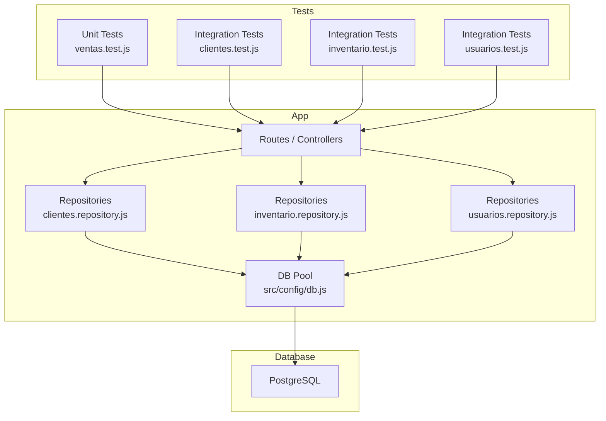
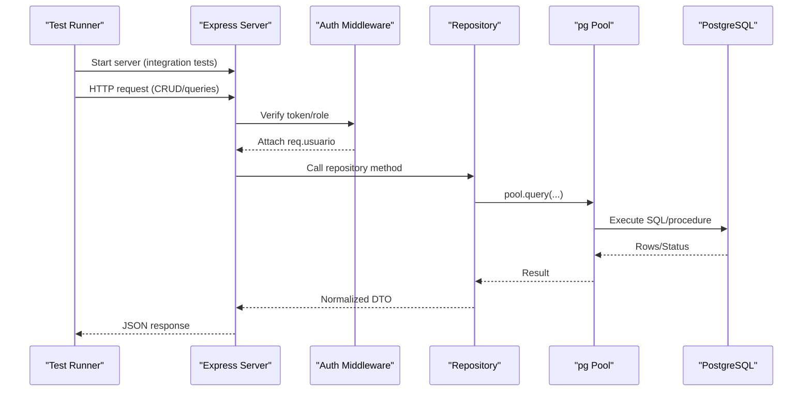
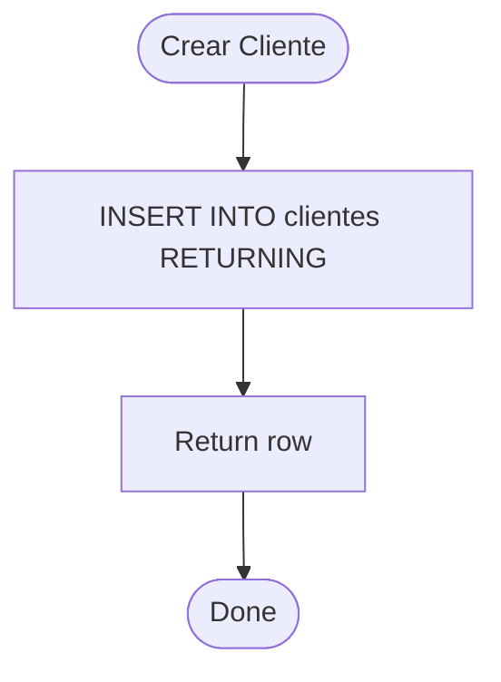
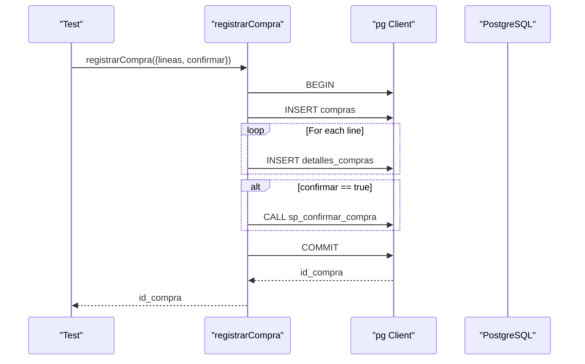
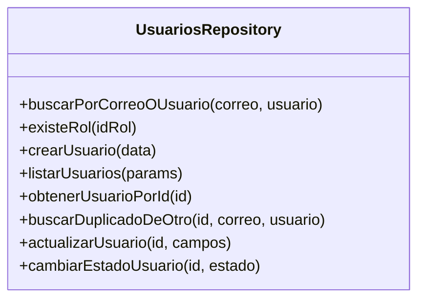
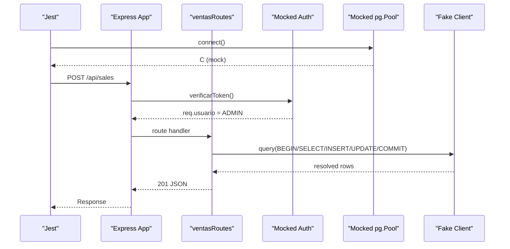
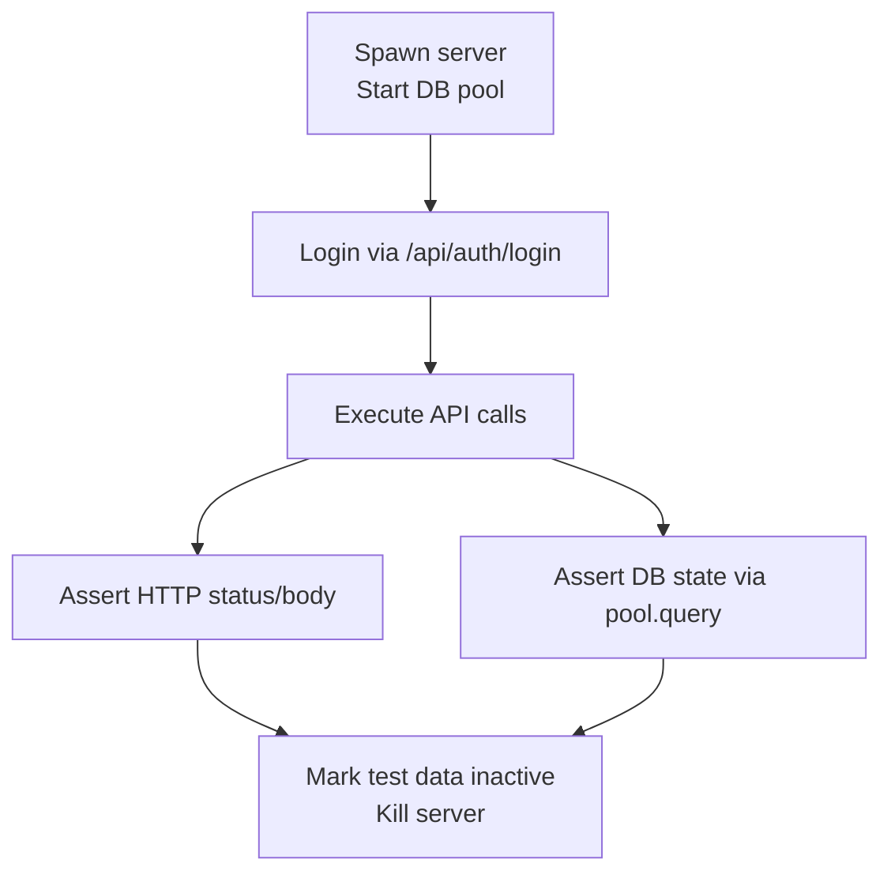
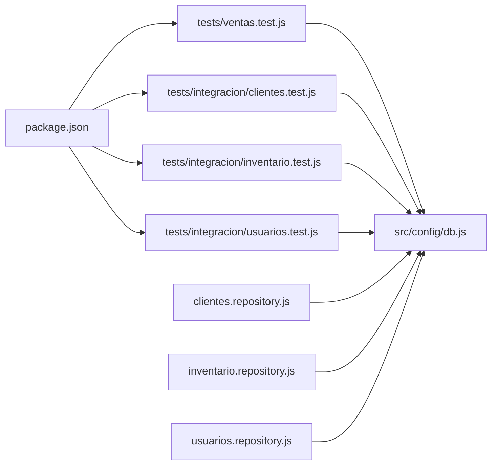

# Repository Testing

<cite>
**Referenced Files in This Document**
- [package.json](file://backend/package.json)
- [db.js](file://backend/src/config/db.js)
- [clientes.repository.js](file://backend/src/repositories/clientes.repository.js)
- [inventario.repository.js](file://backend/src/repositories/inventario.repository.js)
- [usuarios.repository.js](file://backend/src/repositories/usuarios.repository.js)
- [ventas.test.js](file://backend/tests/ventas.test.js)
- [sesion.js](file://backend/tests/integracion/sesion.js)
- [clientes.test.js](file://backend/tests/integracion/clientes.test.js)
- [inventario.test.js](file://backend/tests/integracion/inventario.test.js)
- [usuarios.test.js](file://backend/tests/integracion/usuarios.test.js)
</cite>

## Table of Contents
1. [Introduction](#introduction)
2. [Project Structure](#project-structure)
3. [Core Components](#core-components)
4. [Architecture Overview](#architecture-overview)
5. [Detailed Component Analysis](#detailed-component-analysis)
6. [Dependency Analysis](#dependency-analysis)
7. [Performance Considerations](#performance-considerations)
8. [Troubleshooting Guide](#troubleshooting-guide)
9. [Conclusion](#conclusion)

## Introduction
This document explains how to test SIMO’s data access layer, focusing on database queries, stored procedures, and data transformation logic. It covers strategies for mocking PostgreSQL connections, testing SQL query results, validating integrity constraints, and exercising CRUD operations, complex joins, and transaction handling. It also documents the existing testing utilities for fixtures, test data generation, and connection pooling simulation.

The repository uses:
- Jest for unit tests with mocked dependencies
- Node’s built-in test runner for integration tests that spin up a real server and connect to a real PostgreSQL instance
- A shared connection pool configured via environment variables

## Project Structure
The testing strategy is split into two layers:
- Unit tests (Jest): mock the database and middleware to validate request/response contracts and business rules without touching PostgreSQL
- Integration tests (Node test runner): start the Express server, authenticate via the login endpoint, and assert behavior against a real database

**Diagram sources**
- [ventas.test.js:1-106](file://backend/tests/ventas.test.js#L1-L106)
- [clientes.test.js:1-256](file://backend/tests/integracion/clientes.test.js#L1-L256)
- [inventario.test.js:1-297](file://backend/tests/integracion/inventario.test.js#L1-L297)
- [usuarios.test.js:1-366](file://backend/tests/integracion/usuarios.test.js#L1-L366)
- [clientes.repository.js:1-131](file://backend/src/repositories/clientes.repository.js#L1-L131)
- [inventario.repository.js:1-102](file://backend/src/repositories/inventario.repository.js#L1-L102)
- [usuarios.repository.js:1-242](file://backend/src/repositories/usuarios.repository.js#L1-L242)
- [db.js:1-29](file://backend/src/config/db.js#L1-L29)

**Section sources**
- [package.json:1-38](file://backend/package.json#L1-L38)

## Core Components
- Connection pool configuration:
  - Supports DATABASE_URL or individual DB_* variables
  - SSL controlled by DB_SSL
- Repositories encapsulate all SQL:
  - clientes.repository.js: CRUD, search, pagination, history with joins
  - inventario.repository.js: inventory entry via stored function, purchase transactions, lookups
  - usuarios.repository.js: user lifecycle, role changes, state transitions with advisory locks
- Test suites:
  - ventas.test.js: Jest-based unit tests mocking pg and auth middleware
  - integracion/*.test.js: Node test runner suites that spawn the server and use real DB

Key responsibilities:
- Mocking: Jest mocks for pg.Pool.connect and auth middleware in unit tests
- Fixtures: Seed users and roles; integration tests create unique records per run
- Transactions: Explicit BEGIN/COMMIT/ROLLBACK in repositories and tests
- Integrity: Constraints enforced at DB level and validated by tests

**Section sources**
- [db.js:1-29](file://backend/src/config/db.js#L1-L29)
- [clientes.repository.js:1-131](file://backend/src/repositories/clientes.repository.js#L1-L131)
- [inventario.repository.js:1-102](file://backend/src/repositories/inventario.repository.js#L1-L102)
- [usuarios.repository.js:1-242](file://backend/src/repositories/usuarios.repository.js#L1-L242)
- [ventas.test.js:1-106](file://backend/tests/ventas.test.js#L1-L106)
- [clientes.test.js:1-256](file://backend/tests/integracion/clientes.test.js#L1-L256)
- [inventario.test.js:1-297](file://backend/tests/integracion/inventario.test.js#L1-L297)
- [usuarios.test.js:1-366](file://backend/tests/integracion/usuarios.test.js#L1-L366)

## Architecture Overview
The data access layer follows a repository pattern over a shared PostgreSQL connection pool. Integration tests exercise the full stack (routes/controllers → repositories → DB), while unit tests isolate application logic by mocking the database and authentication.

**Diagram sources**
- [clientes.test.js:29-51](file://backend/tests/integracion/clientes.test.js#L29-L51)
- [inventario.test.js:28-75](file://backend/tests/integracion/inventario.test.js#L28-L75)
- [usuarios.test.js:44-54](file://backend/tests/integracion/usuarios.test.js#L44-L54)
- [clientes.repository.js:10-68](file://backend/src/repositories/clientes.repository.js#L10-L68)
- [inventario.repository.js:12-62](file://backend/src/repositories/inventario.repository.js#L12-L62)
- [usuarios.repository.js:115-172](file://backend/src/repositories/usuarios.repository.js#L115-L172)
- [db.js:17-26](file://backend/src/config/db.js#L17-L26)

## Detailed Component Analysis

### Clientes Repository
Responsibilities:
- Create client with normalized fields
- Read by id or document
- Search with prefix matching on document and ILIKE on name, with pagination
- Update only allowed fields (document immutable)
- Fetch history with aggregated sales and orders using joins and filters

Testing guidance:
- Use integration tests to assert normalization, uniqueness, validation, and history aggregation
- Validate immutability of document field via API and direct DB update constraint
- Exercise concurrent creation to ensure uniqueness constraints prevent duplicates

**Diagram sources**
- [clientes.repository.js:10-18](file://backend/src/repositories/clientes.repository.js#L10-L18)

**Section sources**
- [clientes.repository.js:10-131](file://backend/src/repositories/clientes.repository.js#L10-L131)
- [clientes.test.js:59-189](file://backend/tests/integracion/clientes.test.js#L59-L189)

### Inventario Repository
Responsibilities:
- Lookup product by SKU
- Register warehouse entry via stored function fn_registrar_ingreso_bodega
- Register purchases with optional confirmation via sp_confirmar_compra in a transaction
- Query purchase details with lines and current stock snapshots

Testing guidance:
- Assert atomicity of entries and purchases
- Validate decimal handling per unit type
- Stress-test concurrency to ensure no lost updates
- Confirm audit trail and responsible user propagation

**Diagram sources**
- [inventario.repository.js:32-62](file://backend/src/repositories/inventario.repository.js#L32-L62)

**Section sources**
- [inventario.repository.js:5-102](file://backend/src/repositories/inventario.repository.js#L5-L102)
- [inventario.test.js:83-297](file://backend/tests/integracion/inventario.test.js#L83-L297)

### Usuarios Repository
Responsibilities:
- Create user with public columns (no password_hash)
- Paginated list with filters by state, role code, and text search
- Update user with advisory lock to protect admin count
- Toggle user state with same protection

Testing guidance:
- Validate that password_hash is never returned
- Ensure duplicate checks for email/username across other users
- Verify last-admin protection under concurrent updates
- Confirm session invalidation when deactivating active users

**Diagram sources**
- [usuarios.repository.js:12-241](file://backend/src/repositories/usuarios.repository.js#L12-L241)

**Section sources**
- [usuarios.repository.js:12-241](file://backend/src/repositories/usuarios.repository.js#L12-L241)
- [usuarios.test.js:63-352](file://backend/tests/integracion/usuarios.test.js#L63-L352)

### Unit Testing Strategy (ventas.test.js)
Approach:
- Mock pg.Pool.connect to return a fake client with query and release
- Mock auth middleware to inject a synthetic user and bypass authorization
- Configure an in-memory Express app mounting the routes under test
- Assert HTTP status codes, response bodies, and exact SQL calls made to the mock client

**Diagram sources**
- [ventas.test.js:1-106](file://backend/tests/ventas.test.js#L1-L106)

**Section sources**
- [ventas.test.js:1-106](file://backend/tests/ventas.test.js#L1-L106)

### Integration Testing Strategy
Common patterns:
- Spawn the server process on a dedicated port per suite
- Authenticate using the seed users via a helper that logs in and returns a JWT
- Create unique test data per run (e.g., prefixed identifiers) to avoid collisions
- Clean up by soft-deleting or marking test entities inactive
- Assert both API responses and database state

**Diagram sources**
- [clientes.test.js:39-57](file://backend/tests/integracion/clientes.test.js#L39-L57)
- [inventario.test.js:56-81](file://backend/tests/integracion/inventario.test.js#L56-L81)
- [usuarios.test.js:44-61](file://backend/tests/integracion/usuarios.test.js#L44-L61)
- [sesion.js:1-20](file://backend/tests/integracion/sesion.js#L1-L20)

**Section sources**
- [clientes.test.js:1-256](file://backend/tests/integracion/clientes.test.js#L1-L256)
- [inventario.test.js:1-297](file://backend/tests/integracion/inventario.test.js#L1-L297)
- [usuarios.test.js:1-366](file://backend/tests/integracion/usuarios.test.js#L1-L366)
- [sesion.js:1-20](file://backend/tests/integracion/sesion.js#L1-L20)

## Dependency Analysis
- Integration tests depend on:
  - Real PostgreSQL instance configured via environment variables
  - Seed data providing initial roles and users
  - The running Express server
- Unit tests depend on:
  - Jest mocks for pg.Pool.connect and auth middleware
  - An isolated Express app instance

**Diagram sources**
- [package.json:1-38](file://backend/package.json#L1-L38)
- [db.js:1-29](file://backend/src/config/db.js#L1-L29)
- [clientes.repository.js:1-131](file://backend/src/repositories/clientes.repository.js#L1-L131)
- [inventario.repository.js:1-102](file://backend/src/repositories/inventario.repository.js#L1-L102)
- [usuarios.repository.js:1-242](file://backend/src/repositories/usuarios.repository.js#L1-L242)
- [ventas.test.js:1-106](file://backend/tests/ventas.test.js#L1-L106)
- [clientes.test.js:1-256](file://backend/tests/integracion/clientes.test.js#L1-L256)
- [inventario.test.js:1-297](file://backend/tests/integracion/inventario.test.js#L1-L297)
- [usuarios.test.js:1-366](file://backend/tests/integracion/usuarios.test.js#L1-L366)

**Section sources**
- [package.json:1-38](file://backend/package.json#L1-L38)

## Performance Considerations
- Use integration tests sparingly; they require a live database and server startup
- Prefer unit tests for fast feedback on request/response contracts and business rules
- When testing high-concurrency scenarios, limit the number of parallel requests to keep CI stable
- Avoid heavy seed datasets in integration tests; generate minimal fixtures per test case

## Troubleshooting Guide
Common issues and resolutions:
- Missing or incorrect DB credentials:
  - Ensure DATABASE_URL or DB_HOST/DB_PORT/DB_NAME/DB_USER/DB_PASSWORD are set
  - Check DB_SSL values if connecting to managed databases
- Authentication failures in integration tests:
  - Verify seed users exist and passwords match the helper constant
- Port conflicts:
  - Set TEST_PORT, TEST_PORT_CLIENTES, or TEST_PORT_INVENTARIO to avoid clashes
- Test data cleanup:
  - Mark created records inactive rather than deleting them to respect referential integrity
- Transaction rollbacks:
  - Confirm that error paths trigger ROLLBACK and that tests assert no side effects

**Section sources**
- [db.js:1-29](file://backend/src/config/db.js#L1-L29)
- [sesion.js:1-20](file://backend/tests/integracion/sesion.js#L1-L20)
- [clientes.test.js:53-57](file://backend/tests/integracion/clientes.test.js#L53-L57)
- [inventario.test.js:77-81](file://backend/tests/integracion/inventario.test.js#L77-L81)
- [usuarios.test.js:56-61](file://backend/tests/integracion/usuarios.test.js#L56-L61)

## Conclusion
SIMO’s data access layer is tested through a dual approach:
- Jest-based unit tests mock the database and middleware to validate contracts and control flow quickly
- Node-based integration tests exercise the full stack against a real PostgreSQL instance to validate queries, stored procedures, transactions, and integrity constraints

Adopt these patterns to extend coverage:
- Mock pg.Pool.connect for new unit tests
- Use helpers to log in and obtain tokens for integration tests
- Generate unique fixtures per run and clean up by soft-deletion
- Assert both API outcomes and database state to ensure correctness and resilience under concurrency.