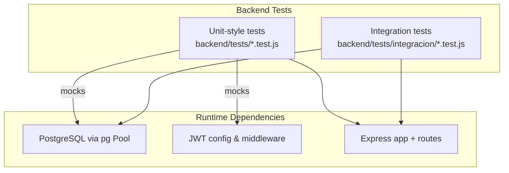
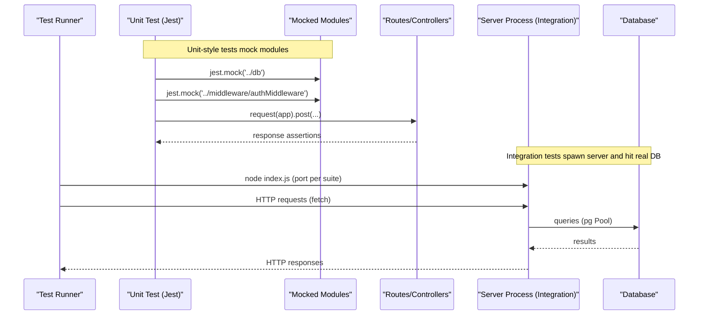
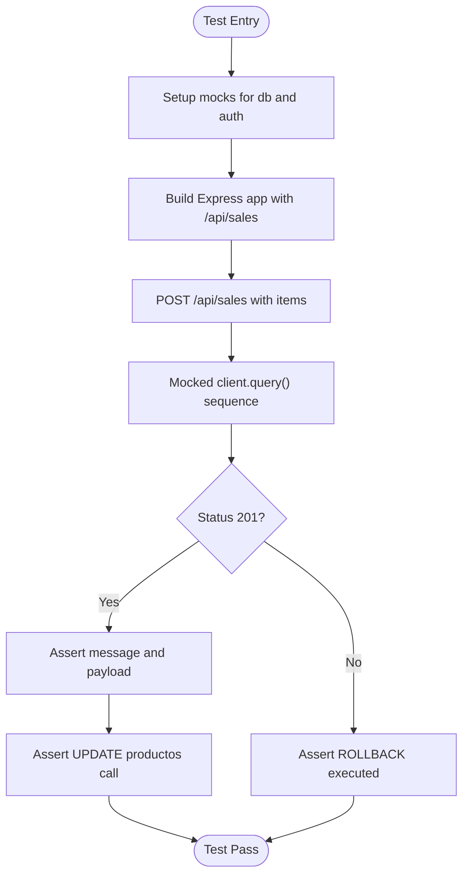
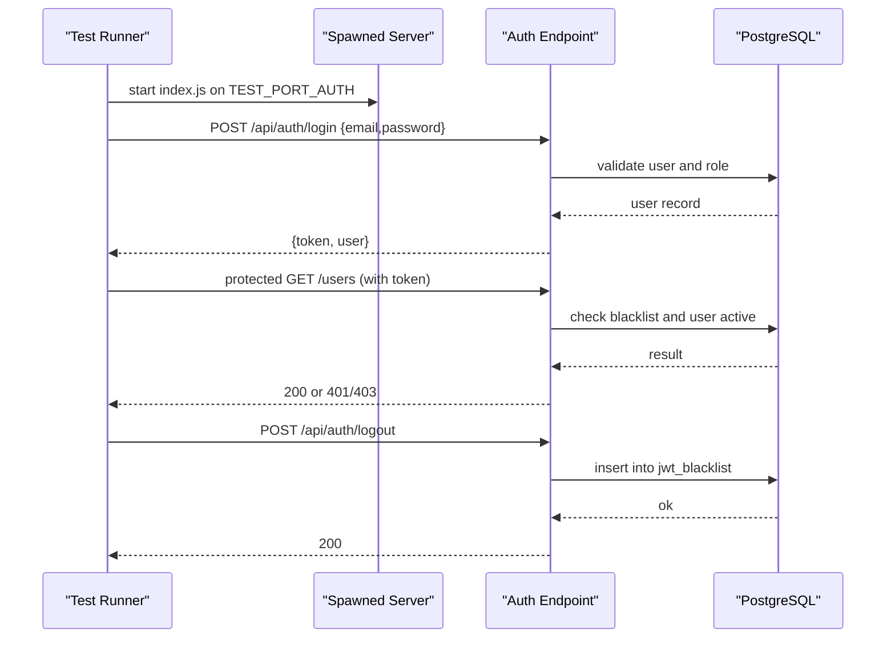
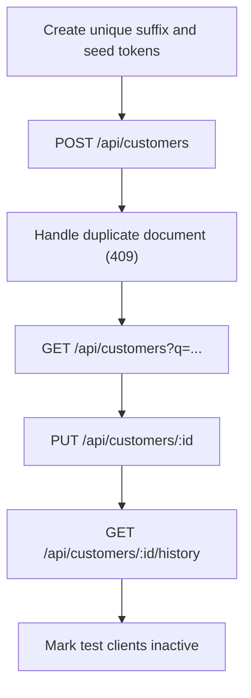
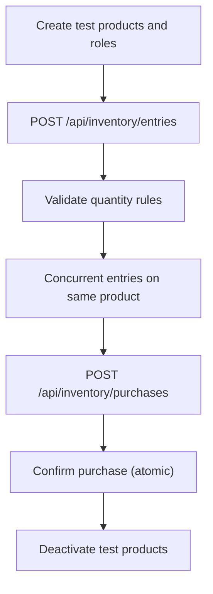
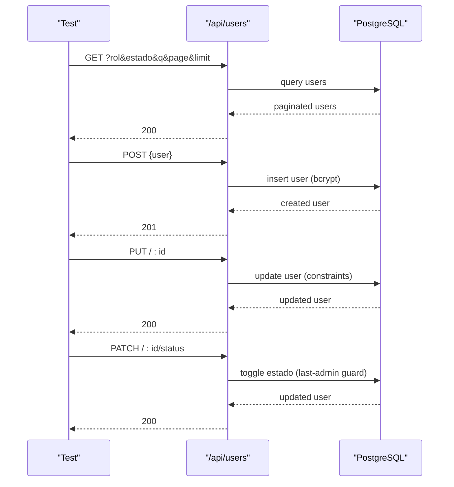
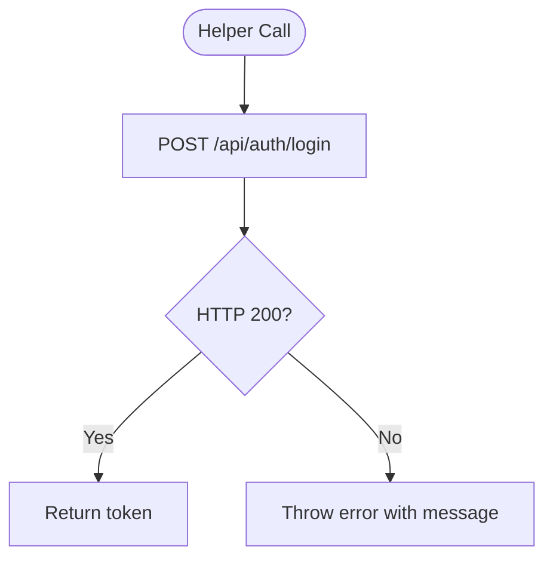
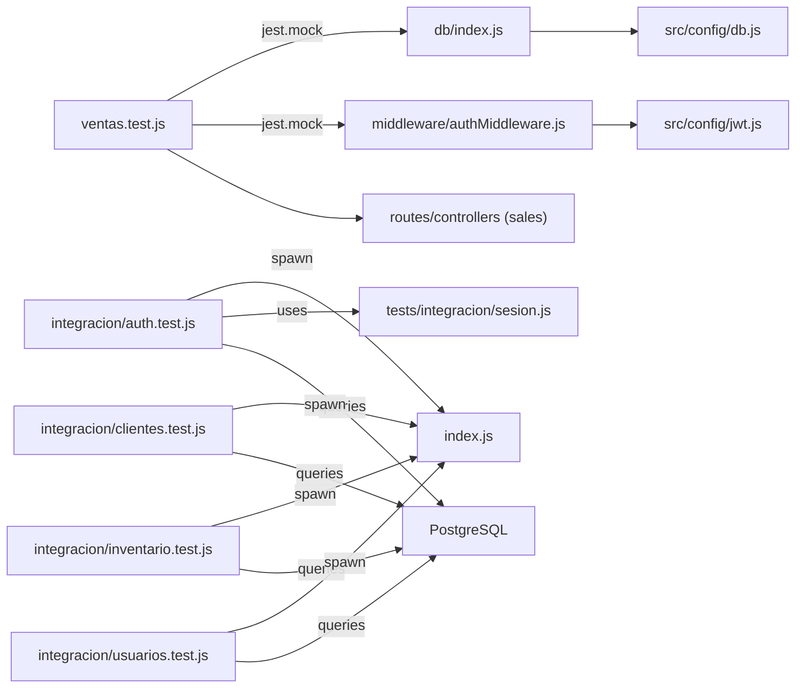

# Unit Testing

<cite>
**Referenced Files in This Document**
- [package.json](file://backend/package.json)
- [ventas.test.js](file://backend/tests/ventas.test.js)
- [auth.test.js](file://backend/tests/integracion/auth.test.js)
- [clientes.test.js](file://backend/tests/integracion/clientes.test.js)
- [inventario.test.js](file://backend/tests/integracion/inventario.test.js)
- [usuarios.test.js](file://backend/tests/integracion/usuarios.test.js)
- [sesion.js](file://backend/tests/integracion/sesion.js)
- [db.js](file://backend/src/config/db.js)
- [db_index.js](file://backend/db/index.js)
- [jwt.js](file://backend/src/config/jwt.js)
- [authMiddleware.js](file://backend/middleware/authMiddleware.js)
- [index.js](file://backend/index.js)
</cite>

## Table of Contents
1. [Introduction](#introduction)
2. [Project Structure](#project-structure)
3. [Core Components](#core-components)
4. [Architecture Overview](#architecture-overview)
5. [Detailed Component Analysis](#detailed-component-analysis)
6. [Dependency Analysis](#dependency-analysis)
7. [Performance Considerations](#performance-considerations)
8. [Troubleshooting Guide](#troubleshooting-guide)
9. [Conclusion](#conclusion)

## Introduction
This document explains the unit and integration testing strategy for SIMO’s backend components using Node.js test tools. It covers:
- How to isolate tests from external systems (database, auth middleware).
- How to mock database dependencies, configuration objects, and authentication.
- Patterns for asserting controller behavior and repository/data-access flows.
- Test isolation, setup/teardown procedures, and assertion styles.
- Shared utilities and fixtures used across the codebase.

The repository uses Jest for unit tests and Node’s built-in test runner for integration tests. Supertest is available but not required; many integration tests use native fetch against a spawned server process.

## Project Structure
Testing-related files are organized under backend/tests:
- Unit-style tests that mock dependencies live at the top level (for example, ventas.test.js).
- Integration tests that run against a real Express server and PostgreSQL live under backend/tests/integracion.

**Diagram sources**
- [ventas.test.js:1-48](file://backend/tests/ventas.test.js#L1-L48)
- [auth.test.js:1-45](file://backend/tests/integracion/auth.test.js#L1-L45)
- [db.js:1-28](file://backend/src/config/db.js#L1-L28)
- [jwt.js:1-15](file://backend/src/config/jwt.js#L1-L15)
- [authMiddleware.js:1-37](file://backend/middleware/authMiddleware.js#L1-L37)

**Section sources**
- [package.json:6-10](file://backend/package.json#L6-L10)
- [package.json:31-36](file://backend/package.json#L31-L36)

## Core Components
- Test runners and scripts:
  - Jest is configured as the default test runner and ignores integration tests by path pattern.
  - A separate script runs integration tests with Node’s built-in test runner.
- Unit-style sales flow test:
  - Uses Jest mocks to replace the database pool and auth middleware.
  - Builds an in-memory Express app to route requests through the sales endpoint.
- Integration tests:
  - Spawn the actual server process on a dedicated port per suite.
  - Use shared helpers to authenticate and issue HTTP requests.
  - Assert both HTTP contracts and database state where appropriate.

Key responsibilities:
- ventas.test.js: Demonstrates mocking strategies for db and auth, and asserts transactional behavior (BEGIN/COMMIT/ROLLBACK) and stock updates.
- integracion/*: Validate end-to-end business rules (RBAC, validation, concurrency, persistence).

**Section sources**
- [package.json:6-10](file://backend/package.json#L6-L10)
- [package.json:31-36](file://backend/package.json#L31-L36)
- [ventas.test.js:1-48](file://backend/tests/ventas.test.js#L1-L48)
- [auth.test.js:1-45](file://backend/tests/integracion/auth.test.js#L1-L45)

## Architecture Overview
The testing architecture separates concerns between unit-style tests (with mocks) and integration tests (with a real server and database):

**Diagram sources**
- [ventas.test.js:5-26](file://backend/tests/ventas.test.js#L5-L26)
- [auth.test.js:30-45](file://backend/tests/integracion/auth.test.js#L30-L45)
- [db.js:17-26](file://backend/src/config/db.js#L17-L26)

## Detailed Component Analysis

### Sales Flow Test (Unit-style with Mocks)
This test demonstrates:
- Mocking the database pool so no real database is touched.
- Mocking the auth middleware to bypass security checks during tests.
- Building a temporary Express app to route requests through the sales endpoint.
- Asserting HTTP status codes, response bodies, and specific SQL calls (including UPDATE and ROLLBACK).

**Diagram sources**
- [ventas.test.js:5-31](file://backend/tests/ventas.test.js#L5-L31)
- [ventas.test.js:49-105](file://backend/tests/ventas.test.js#L49-L105)

**Section sources**
- [ventas.test.js:5-14](file://backend/tests/ventas.test.js#L5-L14)
- [ventas.test.js:16-23](file://backend/tests/ventas.test.js#L16-L23)
- [ventas.test.js:28-31](file://backend/tests/ventas.test.js#L28-L31)
- [ventas.test.js:36-47](file://backend/tests/ventas.test.js#L36-L47)
- [ventas.test.js:49-105](file://backend/tests/ventas.test.js#L49-L105)

### Authentication Integration Test
Highlights:
- Spawns the real server process and waits for it to be ready.
- Uses a helper to log in and obtain a JWT token.
- Validates login contract, error messages, RBAC, and logout invalidation.

**Diagram sources**
- [auth.test.js:30-45](file://backend/tests/integracion/auth.test.js#L30-L45)
- [auth.test.js:49-61](file://backend/tests/integracion/auth.test.js#L49-L61)
- [auth.test.js:95-128](file://backend/tests/integracion/auth.test.js#L95-L128)
- [index.js:428-458](file://backend/index.js#L428-L458)
- [authMiddleware.js:9-37](file://backend/middleware/authMiddleware.js#L9-L37)

**Section sources**
- [auth.test.js:30-45](file://backend/tests/integracion/auth.test.js#L30-L45)
- [auth.test.js:49-74](file://backend/tests/integracion/auth.test.js#L49-L74)
- [auth.test.js:95-128](file://backend/tests/integracion/auth.test.js#L95-L128)

### Clients Integration Test
Highlights:
- Creates unique test data per run using a suffix.
- Asserts normalization, validation, idempotent creation under concurrency, search, pagination, editability constraints, and history aggregation.
- Cleans up by marking test records inactive rather than deleting immutable rows.

**Diagram sources**
- [clientes.test.js:39-57](file://backend/tests/integracion/clientes.test.js#L39-L57)
- [clientes.test.js:61-119](file://backend/tests/integracion/clientes.test.js#L61-L119)
- [clientes.test.js:121-189](file://backend/tests/integracion/clientes.test.js#L121-L189)
- [clientes.test.js:191-243](file://backend/tests/integracion/clientes.test.js#L191-L243)

**Section sources**
- [clientes.test.js:39-57](file://backend/tests/integracion/clientes.test.js#L39-L57)
- [clientes.test.js:61-119](file://backend/tests/integracion/clientes.test.js#L61-L119)
- [clientes.test.js:121-189](file://backend/tests/integracion/clientes.test.js#L121-L189)
- [clientes.test.js:191-243](file://backend/tests/integracion/clientes.test.js#L191-L243)

### Inventory Integration Test
Highlights:
- Verifies inventory entries update only Bodega stock and Kardex correctly.
- Validates numeric constraints, product existence, and role-based access.
- Proves atomicity and concurrency safety when multiple simultaneous entries target the same product.
- Exercises purchase creation and confirmation flows.

**Diagram sources**
- [inventario.test.js:56-81](file://backend/tests/integracion/inventario.test.js#L56-L81)
- [inventario.test.js:85-129](file://backend/tests/integracion/inventario.test.js#L85-L129)
- [inventario.test.js:131-199](file://backend/tests/integracion/inventario.test.js#L131-L199)
- [inventario.test.js:217-283](file://backend/tests/integracion/inventario.test.js#L217-L283)

**Section sources**
- [inventario.test.js:56-81](file://backend/tests/integracion/inventario.test.js#L56-L81)
- [inventario.test.js:85-129](file://backend/tests/integracion/inventario.test.js#L85-L129)
- [inventario.test.js:131-199](file://backend/tests/integracion/inventario.test.js#L131-L199)
- [inventario.test.js:217-283](file://backend/tests/integracion/inventario.test.js#L217-L283)

### Users Integration Test
Highlights:
- Validates list, filter, search, pagination, create, update, and status change endpoints.
- Enforces uniqueness constraints and protects the last active admin.
- Confirms session invalidation upon deactivation and reactivation restores access.

**Diagram sources**
- [usuarios.test.js:44-61](file://backend/tests/integracion/usuarios.test.js#L44-L61)
- [usuarios.test.js:65-131](file://backend/tests/integracion/usuarios.test.js#L65-L131)
- [usuarios.test.js:135-167](file://backend/tests/integracion/usuarios.test.js#L135-L167)
- [usuarios.test.js:191-278](file://backend/tests/integracion/usuarios.test.js#L191-L278)
- [usuarios.test.js:284-329](file://backend/tests/integracion/usuarios.test.js#L284-L329)

**Section sources**
- [usuarios.test.js:44-61](file://backend/tests/integracion/usuarios.test.js#L44-L61)
- [usuarios.test.js:65-131](file://backend/tests/integracion/usuarios.test.js#L65-L131)
- [usuarios.test.js:135-167](file://backend/tests/integracion/usuarios.test.js#L135-L167)
- [usuarios.test.js:191-278](file://backend/tests/integracion/usuarios.test.js#L191-L278)
- [usuarios.test.js:284-329](file://backend/tests/integracion/usuarios.test.js#L284-L329)

### Shared Session Helper
A small utility to log in with seeded users and return a JWT token for subsequent requests.

**Diagram sources**
- [sesion.js:1-20](file://backend/tests/integracion/sesion.js#L1-L20)

**Section sources**
- [sesion.js:1-20](file://backend/tests/integracion/sesion.js#L1-L20)

## Dependency Analysis
The following diagram maps how tests depend on runtime modules and how they are isolated:

**Diagram sources**
- [ventas.test.js:5-26](file://backend/tests/ventas.test.js#L5-L26)
- [auth.test.js:30-45](file://backend/tests/integracion/auth.test.js#L30-L45)
- [clientes.test.js:39-57](file://backend/tests/integracion/clientes.test.js#L39-L57)
- [inventario.test.js:56-81](file://backend/tests/integracion/inventario.test.js#L56-L81)
- [usuarios.test.js:44-61](file://backend/tests/integracion/usuarios.test.js#L44-L61)
- [db_index.js:1-22](file://backend/db/index.js#L1-L22)
- [db.js:17-26](file://backend/src/config/db.js#L17-L26)
- [jwt.js:11-15](file://backend/src/config/jwt.js#L11-L15)
- [authMiddleware.js:1-4](file://backend/middleware/authMiddleware.js#L1-L4)

**Section sources**
- [ventas.test.js:5-26](file://backend/tests/ventas.test.js#L5-L26)
- [auth.test.js:30-45](file://backend/tests/integracion/auth.test.js#L30-L45)
- [db_index.js:1-22](file://backend/db/index.js#L1-L22)
- [db.js:17-26](file://backend/src/config/db.js#L17-L26)
- [jwt.js:11-15](file://backend/src/config/jwt.js#L11-L15)
- [authMiddleware.js:1-4](file://backend/middleware/authMiddleware.js#L1-L4)

## Performance Considerations
- Prefer unit-style tests with mocked dependencies for fast feedback loops.
- Keep integration tests focused on critical paths (auth, inventory concurrency, purchases).
- Avoid heavy seeding in integration tests; create minimal data per test and clean up efficiently.
- Reuse a single server process per test file to reduce startup overhead.

[No sources needed since this section provides general guidance]

## Troubleshooting Guide
Common issues and resolutions:
- Database connection errors:
  - Ensure DATABASE_URL or DB_* variables are set appropriately for local/Docker environments.
  - Verify SSL settings via DB_SSL if connecting to managed databases.
- Auth failures in integration tests:
  - Confirm the server started successfully and is listening on the expected port.
  - Use the session helper to obtain a valid token before calling protected endpoints.
- Flaky tests due to shared state:
  - Always isolate test data with unique suffixes and mark records inactive instead of deleting immutable rows.
- Mock misconfiguration:
  - Reset mocks in afterEach to avoid cross-test contamination.

**Section sources**
- [db.js:1-28](file://backend/src/config/db.js#L1-L28)
- [auth.test.js:30-45](file://backend/tests/integracion/auth.test.js#L30-L45)
- [clientes.test.js:53-57](file://backend/tests/integracion/clientes.test.js#L53-L57)
- [inventario.test.js:77-81](file://backend/tests/integracion/inventario.test.js#L77-L81)
- [ventas.test.js:45-47](file://backend/tests/ventas.test.js#L45-L47)

## Conclusion
SIMO’s backend tests combine fast, isolated unit-style tests with robust integration tests that exercise real routes and database interactions. The patterns demonstrated here—module mocking, server spawning, shared session helpers, and careful cleanup—provide a scalable foundation for expanding coverage across controllers and repositories while maintaining reliability and speed.

[No sources needed since this section summarizes without analyzing specific files]