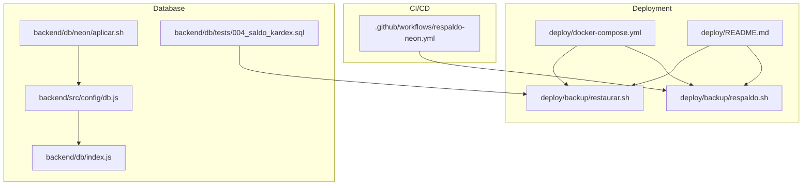
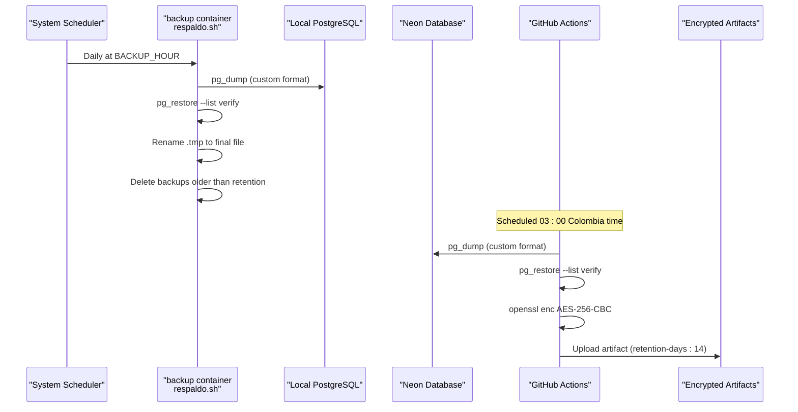
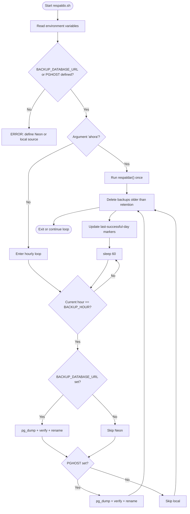
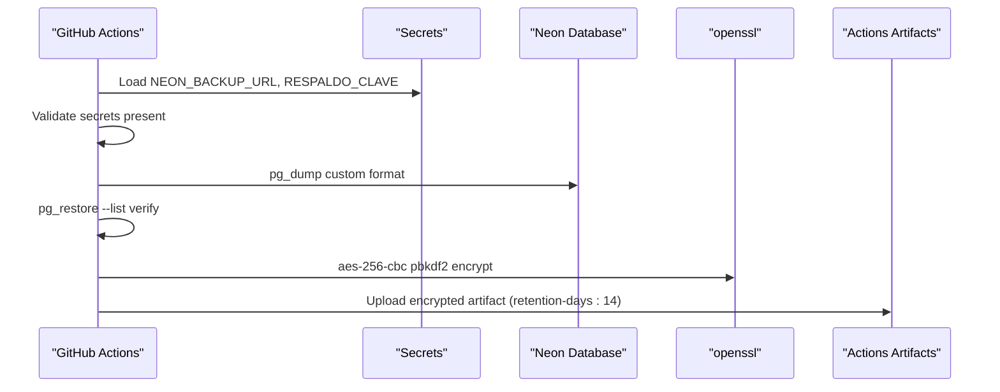
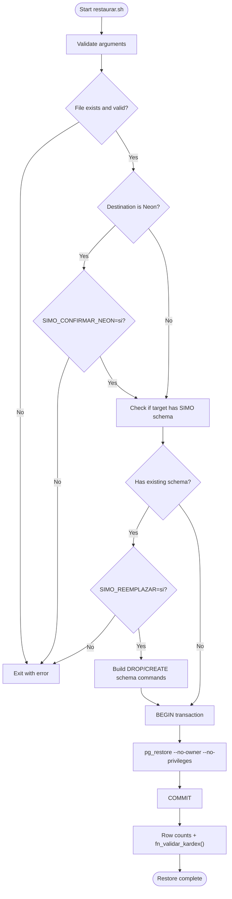
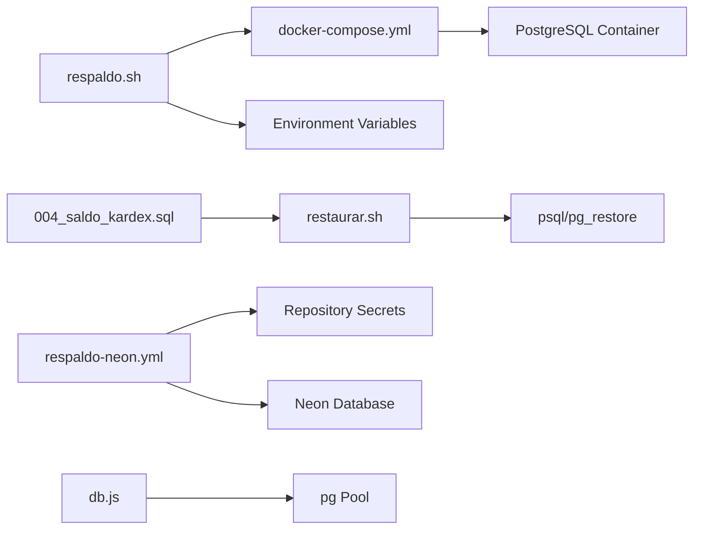

# Backup & Recovery

<cite>
**Referenced Files in This Document**
- [respaldo.sh](file://deploy/backup/respaldo.sh)
- [restaurar.sh](file://deploy/backup/restaurar.sh)
- [respaldo-neon.yml](file://.github/workflows/respaldo-neon.yml)
- [docker-compose.yml](file://deploy/docker-compose.yml)
- [README.md](file://deploy/README.md)
- [db.js](file://backend/src/config/db.js)
- [index.js](file://backend/db/index.js)
- [aplicar.sh](file://backend/db/neon/aplicar.sh)
- [004_saldo_kardex.sql](file://backend/db/tests/004_saldo_kardex.sql)
</cite>

## Table of Contents
1. [Introduction](#introduction)
2. [Project Structure](#project-structure)
3. [Core Components](#core-components)
4. [Architecture Overview](#architecture-overview)
5. [Detailed Component Analysis](#detailed-component-analysis)
6. [Dependency Analysis](#dependency-analysis)
7. [Performance Considerations](#performance-considerations)
8. [Troubleshooting Guide](#troubleshooting-guide)
9. [Conclusion](#conclusion)
10. [Appendices](#appendices)

## Introduction
This document defines the complete backup and recovery procedures for SIMO. It covers:
- Automated daily backups using `deploy/backup/respaldo.sh`
- GitHub Actions automated encrypted backups from Neon
- Manual backup and restore operations
- Data validation and integrity checks
- Disaster recovery scenarios, failover, and restoration from different sources (Neon and local PostgreSQL)
- Retention policies, storage management, and verification procedures
- Testing recovery and validating restored data integrity

The goal is to ensure that SIMO’s production data remains safe, recoverable, and verifiable under normal operations and failure conditions.

## Project Structure
Backup and recovery are implemented across deployment scripts, Docker Compose configuration, GitHub Actions, and database utilities:

**Diagram sources**
- [docker-compose.yml:82-105](file://deploy/docker-compose.yml#L82-L105)
- [README.md:101-163](file://deploy/README.md#L101-L163)
- [respaldo.sh:1-88](file://deploy/backup/respaldo.sh#L1-L88)
- [restaurar.sh:1-77](file://deploy/backup/restaurar.sh#L1-L77)
- [respaldo-neon.yml:1-58](file://.github/workflows/respaldo-neon.yml#L1-L58)
- [db.js:1-28](file://backend/src/config/db.js#L1-L28)
- [index.js:1-22](file://backend/db/index.js#L1-L22)
- [aplicar.sh:1-34](file://backend/db/neon/aplicar.sh#L1-L34)
- [004_saldo_kardex.sql:60-78](file://backend/db/tests/004_saldo_kardex.sql#L60-L78)

**Section sources**
- [docker-compose.yml:82-105](file://deploy/docker-compose.yml#L82-L105)
- [README.md:101-163](file://deploy/README.md#L101-L163)

## Core Components
- Automated local backup service (`respaldo.sh`) running inside a dedicated container
- GitHub Actions workflow for encrypted Neon backups
- Restore script with transactional safety and post-restore validation
- Docker Compose environment wiring for backup variables and volumes
- Database connection configuration supporting Neon and local PostgreSQL
- Schema application utility for Neon environments
- Validation function used during restore verification

Key responsibilities:
- Generate custom-format dumps for Neon and local PostgreSQL
- Validate dump integrity before finalizing files
- Enforce retention policy by deleting old backups
- Provide manual immediate backup triggers
- Encrypt and store Neon backups as CI artifacts
- Safely restore into empty or existing databases with safeguards
- Verify restored data counts and Kardex consistency

**Section sources**
- [respaldo.sh:1-88](file://deploy/backup/respaldo.sh#L1-L88)
- [restaurar.sh:1-77](file://deploy/backup/restaurar.sh#L1-L77)
- [respaldo-neon.yml:1-58](file://.github/workflows/respaldo-neon.yml#L1-L58)
- [docker-compose.yml:82-105](file://deploy/docker-compose.yml#L82-L105)
- [db.js:1-28](file://backend/src/config/db.js#L1-L28)
- [aplicar.sh:1-34](file://backend/db/neon/aplicar.sh#L1-L34)
- [004_saldo_kardex.sql:60-78](file://backend/db/tests/004_saldo_kardex.sql#L60-L78)

## Architecture Overview
The backup architecture combines an always-on local backup service with an independent CI-based Neon backup pipeline. The restore process is centralized through a single script that enforces safety checks and validates restored data.

**Diagram sources**
- [respaldo.sh:25-56](file://deploy/backup/respaldo.sh#L25-L56)
- [respaldo-neon.yml:30-57](file://.github/workflows/respaldo-neon.yml#L30-L57)
- [docker-compose.yml:82-105](file://deploy/docker-compose.yml#L82-L105)

## Detailed Component Analysis

### Automated Local Backups with respaldo.sh
Responsibilities:
- Read configuration from environment variables
- Create timestamped custom-format dumps for Neon and local PostgreSQL
- Validate each dump via `pg_restore --list` before finalizing
- Enforce retention policy by deleting old backups
- Support immediate manual backup execution
- Log operational status and errors

Configuration variables:
- `BACKUP_DATABASE_URL`: Direct connection string to Neon (without pooler)
- `PGHOST`, `PGUSER`, `PGPASSWORD`, `PGDATABASE`: Local PostgreSQL connection via libpq
- `BACKUP_HOUR`: Hourly schedule (0–23), default 3
- `BACKUP_RETENTION_DAYS`: Number of days to retain backups, default 14
- `BACKUP_DIR`: Destination directory for backups, default `/backups`

Operational behavior:
- Writes to `.tmp` first; only renames after successful verification
- Tracks last successful backup per source to avoid repeating on failures
- Cleans up old backups matching pattern `simo_*.dump`

**Diagram sources**
- [respaldo.sh:21-88](file://deploy/backup/respaldo.sh#L21-L88)

**Section sources**
- [respaldo.sh:1-88](file://deploy/backup/respaldo.sh#L1-L88)
- [docker-compose.yml:82-105](file://deploy/docker-compose.yml#L82-L105)
- [README.md:101-125](file://deploy/README.md#L101-L125)

### GitHub Actions Encrypted Neon Backups
Responsibilities:
- Schedule daily backups at 03:00 Colombia time
- Require secrets for secure operation
- Generate custom-format dumps from Neon
- Verify dump integrity
- Encrypt backups with AES-256-CBC using PBKDF2
- Upload encrypted artifacts with 14-day retention

Required repository secrets:
- `NEON_BACKUP_URL`: Direct Neon connection string (without `-pooler`)
- `RESPALDO_CLAVE`: Encryption passphrase

Operational notes:
- Runs in a `postgres:18-alpine` container
- Uses `openssl` for encryption
- Fails fast if secrets are missing
- Produces named artifacts for easy retrieval

**Diagram sources**
- [respaldo-neon.yml:1-58](file://.github/workflows/respaldo-neon.yml#L1-L58)

**Section sources**
- [respaldo-neon.yml:1-58](file://.github/workflows/respaldo-neon.yml#L1-L58)
- [README.md:141-163](file://deploy/README.md#L141-L163)

### Restore Process with restaurar.sh
Responsibilities:
- Accept a backup file and destination connection string
- Validate input file existence and format
- Protect against accidental overwrites on non-empty databases
- Optionally clear schemas within a transaction when replacing content
- Enforce explicit confirmation for Neon restores
- Apply restore in a single transaction for atomicity
- Post-restore validation including row counts and Kardex audit

Safety flags:
- `SIMO_REEMPLAZAR=si`: Allow replacing existing schema contents
- `SIMO_CONFIRMAR_NEON=si`: Required when restoring directly to Neon

Validation steps:
- Count rows in core tables: `usuarios`, `productos`, `clientes`, `ventas`, `compras`, `movimientos_inventario`
- Execute `fn_validar_kardex()` to check Kardex consistency

**Diagram sources**
- [restaurar.sh:22-77](file://deploy/backup/restaurar.sh#L22-L77)

**Section sources**
- [restaurar.sh:1-77](file://deploy/backup/restaurar.sh#L1-L77)
- [README.md:165-200](file://deploy/README.md#L165-L200)

### Docker Compose Configuration for Backup Service
Responsibilities:
- Define the `backup` service using `postgres:18-alpine`
- Mount backup scripts read-only and backups volume
- Configure environment variables for Neon and local PostgreSQL
- Ensure dependency on healthy database service
- Set timezone to Colombia time for consistent scheduling

Key environment variables:
- `BACKUP_DATABASE_URL`: Optional Neon direct connection
- `PGHOST`, `PGUSER`, `PGPASSWORD`, `PGDATABASE`: Local PostgreSQL connection
- `BACKUP_HOUR`: Default 3
- `BACKUP_RETENTION_DAYS`: Default 14
- `TZ`: `<-05>5` for Colombia time

Volumes:
- `./backup:/opt/backup:ro`: Scripts mounted read-only
- `./backups:/backups`: Persistent backup storage

**Section sources**
- [docker-compose.yml:82-105](file://deploy/docker-compose.yml#L82-L105)

### Database Connection Configuration
Responsibilities:
- Support two connection modes: Neon via `DATABASE_URL` and local via individual variables
- Manage SSL settings based on environment flags
- Expose shared connection pool for API modules

Connection modes:
- Neon: `DATABASE_URL` with SSL enabled unless `DB_SSL=false`
- Local: `DB_HOST`, `DB_PORT`, `DB_NAME`, `DB_USER`, `DB_PASSWORD`; SSL disabled unless `DB_SSL=true`

Notes:
- Pool logs connection success and unexpected errors
- Development uses dotenv; production relies on environment variables

**Section sources**
- [db.js:1-28](file://backend/src/config/db.js#L1-L28)
- [index.js:1-22](file://backend/db/index.js#L1-L22)

### Schema Application Utility for Neon
Responsibilities:
- Apply migration order: prior schema move, migrations, optional seeds
- Require `DATABASE_URL` pointing to direct Neon connection (without pooler)
- Use `psql` with strict error stopping

Usage:
- Can be run locally or via Docker container
- Supports optional seed data with `--con-seed`

**Section sources**
- [aplicar.sh:1-34](file://backend/db/neon/aplicar.sh#L1-L34)

### Data Validation and Integrity Checks
Responsibilities:
- Validate Kardex consistency using `fn_validar_kardex()`
- Test expected outcomes for consistent and inconsistent states
- Ensure saldo calculations match expected values

Integration with restore:
- Restore script executes `fn_validar_kardex()` and reports consistent vs inconsistent product counts
- Tests demonstrate detection of stock mismatches outside Kardex

**Section sources**
- [restaurar.sh:64-77](file://deploy/backup/restaurar.sh#L64-L77)
- [004_saldo_kardex.sql:60-78](file://backend/db/tests/004_saldo_kardex.sql#L60-L78)

## Dependency Analysis
The backup and recovery system depends on several components:

**Diagram sources**
- [respaldo.sh:1-88](file://deploy/backup/respaldo.sh#L1-L88)
- [restaurar.sh:1-77](file://deploy/backup/restaurar.sh#L1-L77)
- [respaldo-neon.yml:1-58](file://.github/workflows/respaldo-neon.yml#L1-L58)
- [docker-compose.yml:82-105](file://deploy/docker-compose.yml#L82-L105)
- [db.js:1-28](file://backend/src/config/db.js#L1-L28)
- [004_saldo_kardex.sql:60-78](file://backend/db/tests/004_saldo_kardex.sql#L60-L78)

**Section sources**
- [respaldo.sh:1-88](file://deploy/backup/respaldo.sh#L1-L88)
- [restaurar.sh:1-77](file://deploy/backup/restaurar.sh#L1-L77)
- [respaldo-neon.yml:1-58](file://.github/workflows/respaldo-neon.yml#L1-L58)
- [docker-compose.yml:82-105](file://deploy/docker-compose.yml#L82-L105)
- [db.js:1-28](file://backend/src/config/db.js#L1-L28)
- [004_saldo_kardex.sql:60-78](file://backend/db/tests/004_saldo_kardex.sql#L60-L78)

## Performance Considerations
- Custom-format dumps reduce I/O overhead and support partial restores
- Atomic rename of `.tmp` files prevents partial backups from being mistaken as valid
- Per-source retry logic avoids redundant work when one source fails
- Retention cleanup runs alongside backup to prevent unbounded storage growth
- CI encryption adds CPU overhead but ensures secure artifact storage
- Transactional restore minimizes lock duration and ensures all-or-nothing semantics

[No sources needed since this section provides general guidance]

## Troubleshooting Guide
Common issues and resolutions:
- Missing environment variables: Ensure `BACKUP_DATABASE_URL` or `PGHOST` is defined for local backups; configure `NEON_BACKUP_URL` and `RESPALDO_CLAVE` for CI
- Invalid backup file: Verify file path and permissions; use `pg_restore --list` to validate
- Neon restore protection: Set `SIMO_CONFIRMAR_NEON=si` explicitly when restoring to Neon
- Existing schema conflict: Set `SIMO_REEMPLAZAR=si` to allow schema replacement within a transaction
- Timezone inconsistencies: Confirm `TZ=<-05>5` is set for Colombia time
- Connectivity failures: Verify database credentials and network access; check container health dependencies

Operational checks:
- Inspect backup service logs: `docker compose logs --tail 20 backup`
- Verify artifact availability in GitHub Actions artifacts
- Validate restored data counts and Kardex consistency after restore

**Section sources**
- [README.md:101-163](file://deploy/README.md#L101-L163)
- [respaldo.sh:60-68](file://deploy/backup/respaldo.sh#L60-L68)
- [restaurar.sh:22-52](file://deploy/backup/restaurar.sh#L22-L52)

## Conclusion
SIMO’s backup and recovery strategy combines robust automated processes with strong safety guarantees:
- Daily local backups via `respaldo.sh` with validation and retention enforcement
- Independent encrypted Neon backups via GitHub Actions
- Safe, transactional restore process with comprehensive validation
- Clear configuration and operational procedures for both Neon and local PostgreSQL environments

Following these procedures ensures data durability, recoverability, and integrity across normal operations and disaster scenarios.

[No sources needed since this section summarizes without analyzing specific files]

## Appendices

### Backup Retention Policies and Storage Management
- Local backups: Deleted after `BACKUP_RETENTION_DAYS` (default 14)
- CI artifacts: Retained for 14 days via GitHub Actions
- Storage location: `deploy/backups/` mounted as `/backups` in the backup container
- Naming convention: `simo_neon_AAAAMMDD_HHMM.dump` and `simo_AAAAMMDD_HHMM.dump`

**Section sources**
- [respaldo.sh:53-56](file://deploy/backup/respaldo.sh#L53-L56)
- [respaldo-neon.yml:51-57](file://.github/workflows/respaldo-neon.yml#L51-L57)
- [docker-compose.yml:100-102](file://deploy/docker-compose.yml#L100-L102)

### Verification Procedures
- Backup verification: `pg_restore --list` executed immediately after dump creation
- Restore verification: Row counts for core tables and `fn_validar_kardex()` audit
- CI verification: Explicit log messages confirming verified backup size

**Section sources**
- [respaldo.sh:30-33](file://deploy/backup/respaldo.sh#L30-L33)
- [restaurar.sh:64-77](file://deploy/backup/restaurar.sh#L64-L77)
- [respaldo-neon.yml:43-45](file://.github/workflows/respaldo-neon.yml#L43-L45)

### Testing Recovery Procedures
Recommended test cadence:
- Once per sprint: Restore the latest Neon backup into a local empty database
- Validate row counts and Kardex consistency
- Document any discrepancies and investigate root causes

Steps:
1. Create an empty local database
2. Run restore script against the latest Neon backup
3. Review verification output for consistency
4. Compare key metrics with known-good baselines

**Section sources**
- [README.md:171-180](file://deploy/README.md#L171-L180)
- [restaurar.sh:64-77](file://deploy/backup/restaurar.sh#L64-L77)