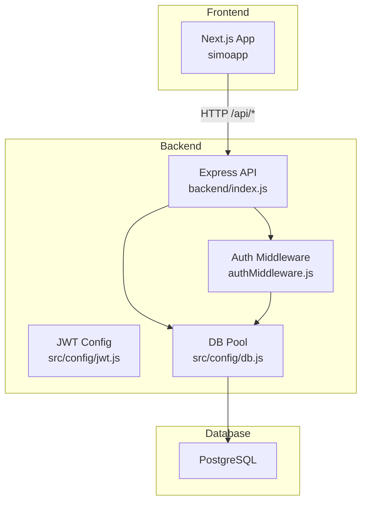
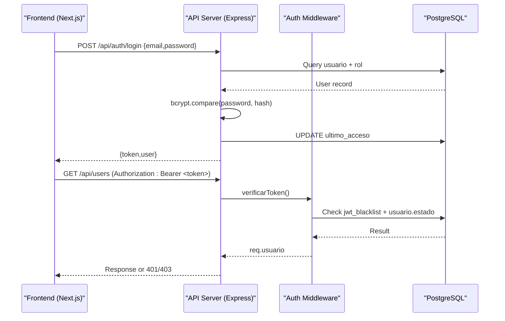
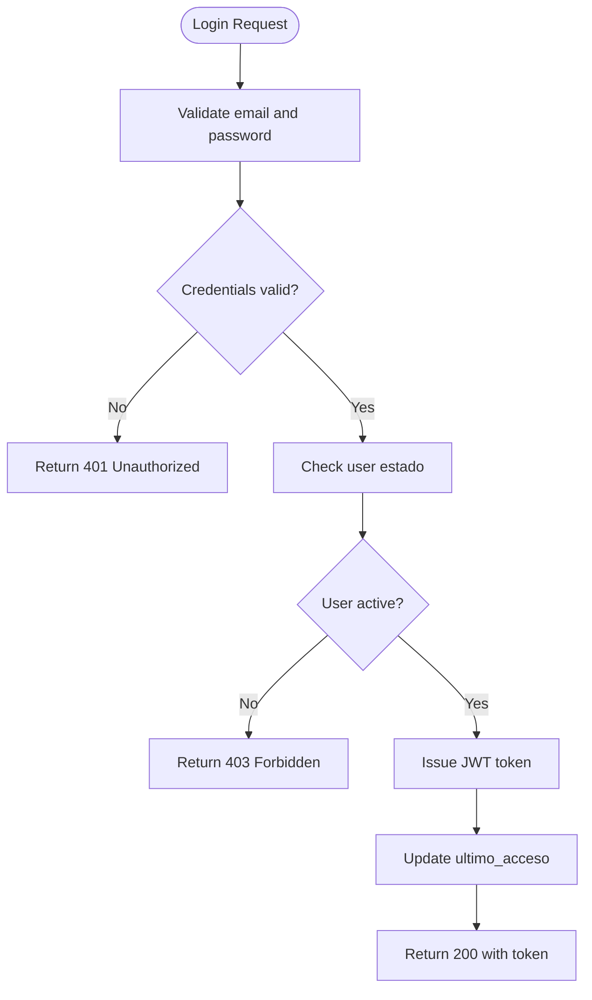
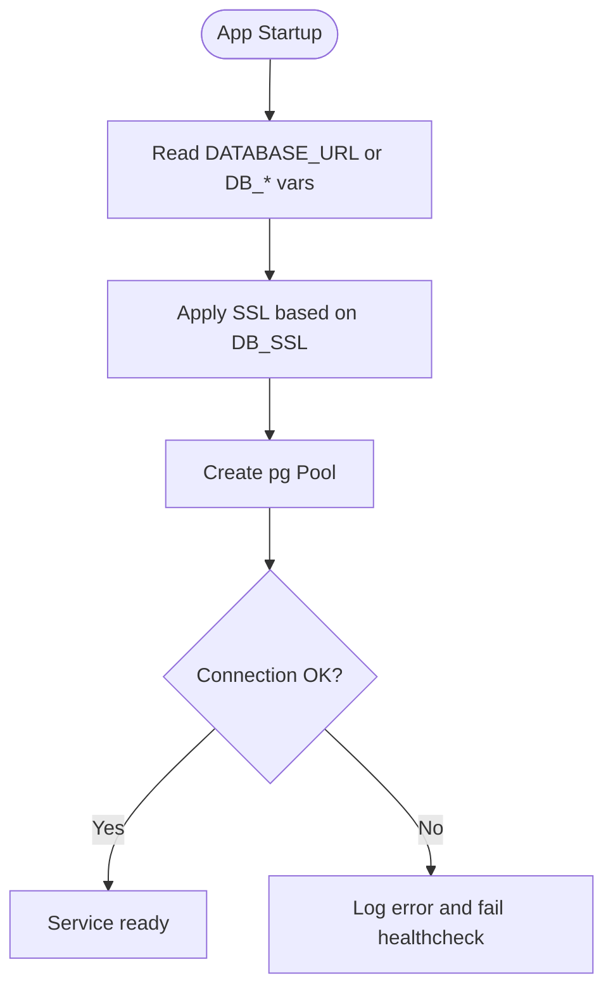
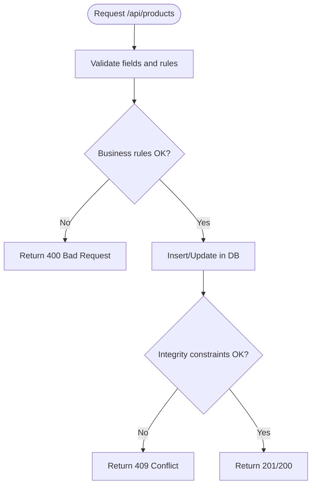
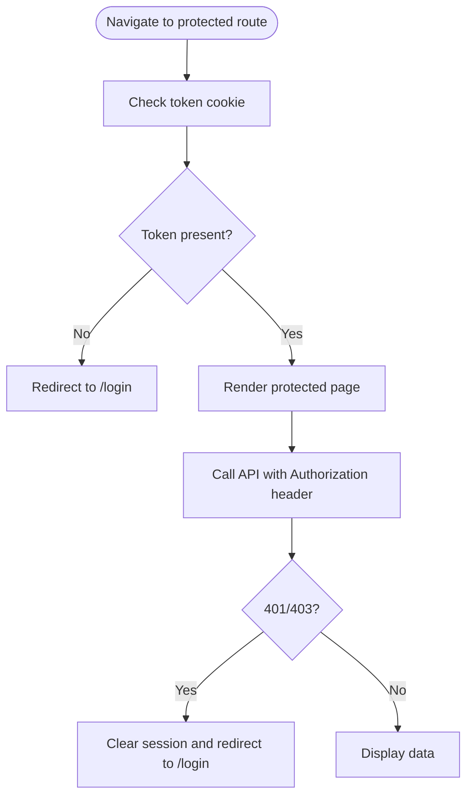
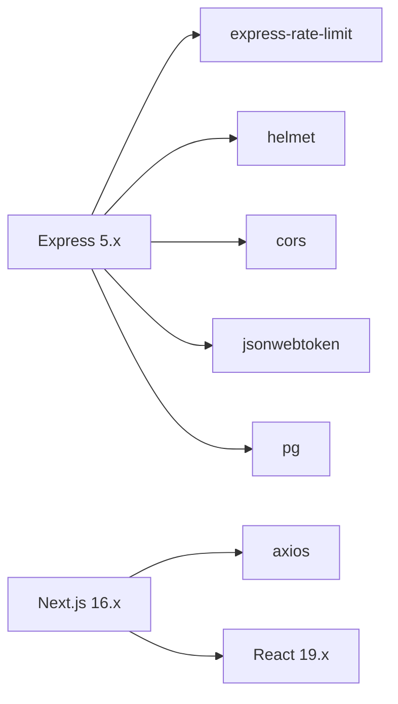

# Common Issues & Solutions

<cite>
**Referenced Files in This Document**
- [README.md](file://README.md)
- [backend/index.js](file://backend/index.js)
- [backend/src/config/db.js](file://backend/src/config/db.js)
- [backend/db/index.js](file://backend/db/index.js)
- [backend/src/config/jwt.js](file://backend/src/config/jwt.js)
- [backend/middleware/authMiddleware.js](file://backend/middleware/authMiddleware.js)
- [backend/middleware/sanitizarXss.js](file://backend/middleware/sanitizarXss.js)
- [backend/src/middleware/sanitizarXss.js](file://backend/src/middleware/sanitizarXss.js)
- [backend/package.json](file://backend/package.json)
- [simoapp/lib/apiClient.ts](file://simoapp/lib/apiClient.ts)
- [simoapp/middleware.ts](file://simoapp/middleware.ts)
- [simoapp/app/login/page.tsx](file://simoapp/app/login/page.tsx)
- [simoapp/components/shell/BannerConexion.tsx](file://simoapp/components/shell/BannerConexion.tsx)
- [backend/db/migrations/010_sesiones.sql](file://backend/db/migrations/010_sesiones.sql)
- [deploy/docker-compose.yml](file://deploy/docker-compose.yml)
- [backend/docker-compose.yml](file://backend/docker-compose.yml)
</cite>

## Table of Contents
1. [Introduction](#introduction)
2. [Project Structure](#project-structure)
3. [Core Components](#core-components)
4. [Architecture Overview](#architecture-overview)
5. [Detailed Component Analysis](#detailed-component-analysis)
6. [Dependency Analysis](#dependency-analysis)
7. [Performance Considerations](#performance-considerations)
8. [Troubleshooting Guide](#troubleshooting-guide)
9. [Conclusion](#conclusion)

## Introduction
This document provides a practical troubleshooting guide for SIMO, covering authentication failures, database connection problems, API endpoint errors, and frontend rendering issues. It includes specific error messages, root cause analysis, step-by-step resolutions, diagnostic commands, and log entries to help administrators, developers, and operators quickly identify and fix common problems.

## Project Structure
SIMO consists of:
- Backend API (Node.js + Express) with PostgreSQL
- Frontend application (Next.js App Router)
- Docker Compose configurations for local development and deployment
- Database migrations and seed scripts

**Diagram sources**
- [backend/index.js:1-18](file://backend/index.js#L1-L18)
- [backend/middleware/authMiddleware.js:1-10](file://backend/middleware/authMiddleware.js#L1-L10)
- [backend/src/config/jwt.js:1-15](file://backend/src/config/jwt.js#L1-L15)
- [backend/src/config/db.js:1-28](file://backend/src/config/db.js#L1-L28)

**Section sources**
- [README.md:7-64](file://README.md#L7-L64)
- [backend/index.js:1-18](file://backend/index.js#L1-L18)

## Core Components
- Authentication flow: login endpoint issues JWT; middleware validates tokens and checks blacklist and user status.
- Database connectivity: shared pool configuration supports both DATABASE_URL and DB_* variables, with SSL toggling.
- API endpoints: healthcheck, products CRUD, users management, inventory, customers, sales routes.
- Frontend client: axios client attaches token from cookie and redirects on 401/403.
- Deployment: Docker Compose services for db, api, frontend, backup, tunnel.

**Section sources**
- [backend/index.js:62-70](file://backend/index.js#L62-L70)
- [backend/index.js:347-423](file://backend/index.js#L347-L423)
- [backend/middleware/authMiddleware.js:9-49](file://backend/middleware/authMiddleware.js#L9-L49)
- [backend/src/config/db.js:11-26](file://backend/src/config/db.js#L11-L26)
- [simoapp/lib/apiClient.ts:14-55](file://simoapp/lib/apiClient.ts#L14-L55)
- [deploy/docker-compose.yml:14-80](file://deploy/docker-compose.yml#L14-L80)

## Architecture Overview
The backend exposes REST endpoints under `/api`. The frontend calls the API via an axios client that injects the Authorization header from a cookie. Authentication is enforced by middleware that verifies JWT signature, expiration, blacklist, and user active status.

**Diagram sources**
- [backend/index.js:347-423](file://backend/index.js#L347-L423)
- [backend/middleware/authMiddleware.js:9-49](file://backend/middleware/authMiddleware.js#L9-L49)
- [backend/db/migrations/010_sesiones.sql:12-15](file://backend/db/migrations/010_sesiones.sql#L12-L15)

## Detailed Component Analysis

### Authentication Failures
Symptoms:
- Login returns 401 Unauthorized with message indicating incorrect credentials.
- After logout, requests still succeed until token expires.
- Requests return 401 Unauthorized after account deactivation even if token is valid.

Root causes:
- Incorrect email/password or inactive account at login time.
- Missing or malformed Authorization header on protected endpoints.
- Token present in jwt_blacklist due to logout.
- User deactivated while token still valid.

Resolution steps:
1. Verify login payload contains email and password.
2. Ensure the frontend sets the Authorization header with Bearer token.
3. Confirm the jwt_blacklist table exists and is populated after logout.
4. If the user was deactivated, re-enable the account or force re-login.

Diagnostic commands and logs:
- Test login: `curl -X POST http://localhost:3000/api/auth/login -H "Content-Type: application/json" -d '{"email":"user@example.com","password":"..."}'`
- Test protected endpoint: `curl -H "Authorization: Bearer <token>" http://localhost:3000/api/users`
- Backend logs: look for “Error en el proceso de login” and “Error durante el logout”.
- DB check: query `jwt_blacklist` to see invalidated tokens.

**Diagram sources**
- [backend/index.js:347-423](file://backend/index.js#L347-L423)

**Section sources**
- [backend/index.js:347-423](file://backend/index.js#L347-L423)
- [backend/middleware/authMiddleware.js:9-49](file://backend/middleware/authMiddleware.js#L9-L49)
- [backend/db/migrations/010_sesiones.sql:12-15](file://backend/db/migrations/010_sesiones.sql#L12-L15)

### Database Connection Problems
Symptoms:
- Backend fails to start or responds with 503 on healthcheck.
- Logs show connection errors or unexpected pool errors.
- Local vs cloud database mismatches (SSL).

Root causes:
- Missing or incorrect DB environment variables.
- DATABASE_URL not set when expecting Neon/cloud connection.
- SSL misconfiguration (DB_SSL true/false).
- Network/firewall blocking port 5432.

Resolution steps:
1. Set DATABASE_URL for cloud databases or DB_HOST/DB_PORT/DB_NAME/DB_USER/DB_PASSWORD for local/Docker.
2. Configure DB_SSL appropriately (true/false).
3. Ensure PostgreSQL service is healthy and reachable.
4. Verify Docker Compose ports and volumes are correct.

Diagnostic commands and logs:
- Healthcheck: `curl http://localhost:3000/api/health`
- Docker logs: `docker compose -f deploy/docker-compose.yml logs -f db`
- DB readiness: `pg_isready -U postgres -d simo_retail`
- Backend logs: “Conexión exitosa a PostgreSQL” or “Error inesperado en el pool de conexiones”.

**Diagram sources**
- [backend/src/config/db.js:11-26](file://backend/src/config/db.js#L11-L26)
- [backend/db/index.js:14-20](file://backend/db/index.js#L14-L20)

**Section sources**
- [backend/src/config/db.js:1-28](file://backend/src/config/db.js#L1-L28)
- [backend/db/index.js:1-22](file://backend/db/index.js#L1-L22)
- [deploy/docker-compose.yml:14-38](file://deploy/docker-compose.yml#L14-L38)

### API Endpoint Errors
Symptoms:
- 400 Bad Request for invalid parameters.
- 404 Not Found for missing resources.
- 409 Conflict for duplicate SKU or inactive product.
- 500 Internal Server Error on unexpected exceptions.

Root causes:
- Invalid input values (e.g., page/limit out of range, non-numeric IDs).
- Referential integrity violations (invalid foreign keys).
- Business rule violations (selling price must be greater than purchase price).
- Unhandled exceptions during DB operations.

Resolution steps:
1. Validate request payloads according to endpoint contracts.
2. Ensure referenced entities exist before updates/inserts.
3. Review business rules enforced in controllers/routes.
4. Inspect backend logs for stack traces and error codes.

Diagnostic commands and logs:
- Products: `curl http://localhost:3000/api/products?page=1&limit=10`
- Create product: `curl -X POST http://localhost:3000/api/products -H "Content-Type: application/json" -d '{...}'`
- Backend logs: “Error al insertar producto”, “Error al actualizar producto”, “Error al obtener los productos”.

**Diagram sources**
- [backend/index.js:75-152](file://backend/index.js#L75-L152)
- [backend/index.js:237-342](file://backend/index.js#L237-L342)

**Section sources**
- [backend/index.js:75-152](file://backend/index.js#L75-L152)
- [backend/index.js:157-232](file://backend/index.js#L157-L232)
- [backend/index.js:237-342](file://backend/index.js#L237-L342)

### Frontend Rendering Issues
Symptoms:
- Redirected to /login unexpectedly.
- Protected pages do not render or show blank screens.
- API calls fail due to wrong base URL or missing token.

Root causes:
- Next.js middleware requires a token cookie; absence triggers redirect to /login.
- NEXT_PUBLIC_API_URL not configured or points to wrong host/port.
- Axios interceptor not attaching Authorization header because token is not stored in cookie.

Resolution steps:
1. Ensure login stores token in a cookie accessible to the browser.
2. Configure NEXT_PUBLIC_API_URL to point to the running backend.
3. Verify Next.js middleware matcher excludes API routes.
4. Check browser console for network errors and verify cookies.

Diagnostic commands and logs:
- Frontend dev server: `npm run dev` in simoapp directory.
- Inspect cookies for token and role.
- Network tab: confirm requests go to correct baseURL and include Authorization header.

**Diagram sources**
- [simoapp/middleware.ts:4-28](file://simoapp/middleware.ts#L4-L28)
- [simoapp/lib/apiClient.ts:14-55](file://simoapp/lib/apiClient.ts#L14-L55)

**Section sources**
- [simoapp/middleware.ts:4-36](file://simoapp/middleware.ts#L4-L36)
- [simoapp/lib/apiClient.ts:1-59](file://simoapp/lib/apiClient.ts#L1-L59)
- [simoapp/app/login/page.tsx:37-59](file://simoapp/app/login/page.tsx#L37-L59)

### Environment Configuration Problems
Symptoms:
- Backend runs on unexpected port or cannot connect to DB.
- Frontend cannot reach API.
- Development vs production JWT secret mismatch.

Root causes:
- PORT not set or overridden by container defaults.
- DATABASE_URL vs DB_* variables confusion.
- JWT_SECRET not defined in production, causing fallback to development secret.

Resolution steps:
1. For local dev: ensure DB_USER/DB_PASSWORD/DB_HOST/DB_PORT/DB_NAME are set.
2. For cloud DB: set DATABASE_URL and optionally DB_SSL=false.
3. In production, define JWT_SECRET and optionally JWT_EXPIRES_IN.
4. Align NEXT_PUBLIC_API_URL with deployed API host.

Diagnostic commands and logs:
- Backend startup log: “Servidor de inventario corriendo en http://0.0.0.0:<port>”.
- JWT warning: “JWT_SECRET no está definido: se usa la clave de desarrollo.”
- Docker compose env: inspect environment variables per service.

**Section sources**
- [backend/index.js:18](file://backend/index.js#L18)
- [backend/src/config/jwt.js:7-14](file://backend/src/config/jwt.js#L7-L14)
- [backend/src/config/db.js:17-26](file://backend/src/config/db.js#L17-L26)
- [deploy/docker-compose.yml:43-55](file://deploy/docker-compose.yml#L43-L55)

### Dependency Conflicts
Symptoms:
- XSS sanitization middleware breaks all requests.
- Rate limiting blocks legitimate traffic.
- Node version incompatibilities.

Root causes:
- xss-clean incompatible with Express 5; replaced by custom sanitizarXss.
- RATE_LIMIT_MAX too low for tests or heavy usage.
- Node engine requirements not met.

Resolution steps:
1. Use the provided sanitizarXss middleware instead of xss-clean.
2. Increase RATE_LIMIT_MAX for testing environments.
3. Ensure Node version meets package requirements.

Diagnostic commands and logs:
- Backend logs: check for rate limit messages “Too Many Requests”.
- Package engines: review backend/package.json dependencies and engines.

**Section sources**
- [backend/middleware/sanitizarXss.js:1-38](file://backend/middleware/sanitizarXss.js#L1-L38)
- [backend/src/middleware/sanitizarXss.js:1-47](file://backend/src/middleware/sanitizarXss.js#L1-L47)
- [backend/index.js:34-48](file://backend/index.js#L34-L48)
- [backend/package.json:15-24](file://backend/package.json#L15-L24)

### Deployment-Related Issues
Symptoms:
- Services not starting or failing healthchecks.
- Database not seeded or schema missing tables.
- Frontend cannot access API behind tunnel.

Root causes:
- Missing required environment variables (POSTGRES_PASSWORD, SIMO_APP_PASSWORD, CLOUDFLARE_TUNNEL_TOKEN).
- Migrations not applied or init scripts not executed.
- NEXT_PUBLIC_API_URL not set in frontend build args.

Resolution steps:
1. Populate deploy/.env with required variables.
2. Run `docker compose up -d --build` in deploy directory.
3. Verify healthchecks pass for db, api, frontend.
4. Check backups and tunnel containers are running.

Diagnostic commands and logs:
- `docker compose -f deploy/docker-compose.yml ps`
- `docker compose -f deploy/docker-compose.yml logs -f api`
- Healthcheck endpoints: `/api/health`, `/login`

**Section sources**
- [deploy/docker-compose.yml:1-120](file://deploy/docker-compose.yml#L1-L120)
- [backend/docker-compose.yml:1-41](file://backend/docker-compose.yml#L1-L41)

## Dependency Analysis
Key runtime dependencies:
- Express 5.x, cors, helmet, express-rate-limit, jsonwebtoken, bcrypt, pg
- Frontend: Next.js 16.x, React 19.x, axios, recharts

Potential conflicts:
- Express 5.x requires compatible middleware; xss-clean is incompatible.
- Node engine versions must satisfy dependency constraints.

**Diagram sources**
- [backend/package.json:15-24](file://backend/package.json#L15-L24)
- [simoapp/package.json:11-27](file://simoapp/package.json#L11-L27)

**Section sources**
- [backend/package.json:15-24](file://backend/package.json#L15-L24)
- [simoapp/package.json:11-27](file://simoapp/package.json#L11-L27)

## Performance Considerations
- Use pagination and search filters on list endpoints to reduce payload size.
- Avoid excessive logging in production; keep only essential error logs.
- Tune rate limits according to expected traffic patterns.
- Reuse DB connections via the shared pool; avoid creating new pools per request.

[No sources needed since this section provides general guidance]

## Troubleshooting Guide

### By Role

#### Administrator
Focus areas:
- User accounts and roles
- System health and database availability
- Backups and deployment configuration

Common issues and resolutions:
- Users cannot log in due to inactive accounts:
  - Verify user estado field and reactivate if necessary.
  - Check that jwt_blacklist does not contain active sessions requiring refresh.
- Database unavailable:
  - Confirm PostgreSQL service health and connectivity.
  - Validate DATABASE_URL or DB_* variables and SSL settings.
- Deployment not exposing services correctly:
  - Ensure Cloudflare Tunnel token is set and tunnel container is running.
  - Verify healthchecks for all services.

Diagnostics:
- Healthcheck: `curl http://localhost:3000/api/health`
- Docker status: `docker compose -f deploy/docker-compose.yml ps`
- DB readiness: `pg_isready -U postgres -d simo_retail`

**Section sources**
- [backend/index.js:62-70](file://backend/index.js#L62-L70)
- [backend/middleware/authMiddleware.js:29-49](file://backend/middleware/authMiddleware.js#L29-L49)
- [deploy/docker-compose.yml:82-116](file://deploy/docker-compose.yml#L82-L116)

#### Developer
Focus areas:
- API contracts and validation
- Authentication and authorization logic
- Frontend integration and routing

Common issues and resolutions:
- 400 Bad Request on endpoints:
  - Validate request body and query parameters against documented contracts.
  - Fix business rule violations (e.g., selling price > purchase price).
- 401/403 on protected routes:
  - Ensure Authorization header is present and valid.
  - Confirm token is not expired or blacklisted.
- Frontend redirects to /login unexpectedly:
  - Verify token cookie presence and correctness.
  - Check NEXT_PUBLIC_API_URL and axios interceptor behavior.

Diagnostics:
- Test endpoints with curl or Postman.
- Inspect browser DevTools for network and cookies.
- Review backend logs for detailed error messages.

**Section sources**
- [backend/index.js:75-152](file://backend/index.js#L75-L152)
- [backend/index.js:347-423](file://backend/index.js#L347-L423)
- [simoapp/lib/apiClient.ts:14-55](file://simoapp/lib/apiClient.ts#L14-L55)
- [simoapp/middleware.ts:4-28](file://simoapp/middleware.ts#L4-L28)

#### Operator
Focus areas:
- Service uptime and healthchecks
- Log monitoring and alerting
- Backup and restore procedures

Common issues and resolutions:
- API rate limiting triggered:
  - Increase RATE_LIMIT_MAX for high-traffic periods.
  - Investigate potential abuse or misconfigured clients.
- Frontend cannot reach API:
  - Confirm NEXT_PUBLIC_API_URL matches deployed API host.
  - Validate DNS and tunnel configuration.
- Database migration failures:
  - Ensure migrations and seeds are applied on fresh volumes.
  - Check init scripts and permissions.

Diagnostics:
- Monitor logs: `docker compose -f deploy/docker-compose.yml logs -f`
- Check health endpoints: `/api/health`, `/login`
- Validate backups: inspect backup container logs and output directories.

**Section sources**
- [backend/index.js:34-48](file://backend/index.js#L34-L48)
- [deploy/docker-compose.yml:43-80](file://deploy/docker-compose.yml#L43-L80)
- [backend/db/index.js:14-20](file://backend/db/index.js#L14-L20)

### Diagnostic Commands Summary
- Backend health: `curl http://localhost:3000/api/health`
- Login test: `curl -X POST http://localhost:3000/api/auth/login -H "Content-Type: application/json" -d '{"email":"...","password":"..."}'`
- Protected endpoint test: `curl -H "Authorization: Bearer <token>" http://localhost:3000/api/users`
- Docker logs: `docker compose -f deploy/docker-compose.yml logs -f`
- DB readiness: `pg_isready -U postgres -d simo_retail`

**Section sources**
- [backend/index.js:62-70](file://backend/index.js#L62-L70)
- [backend/index.js:347-423](file://backend/index.js#L347-L423)
- [deploy/docker-compose.yml:59-63](file://deploy/docker-compose.yml#L59-L63)

## Conclusion
This guide consolidates the most frequent issues across SIMO’s authentication, database connectivity, API endpoints, and frontend rendering. By following the diagnostic steps, checking logs, and validating environment configurations, administrators, developers, and operators can resolve problems efficiently and maintain system reliability.

[No sources needed since this section summarizes without analyzing specific files]