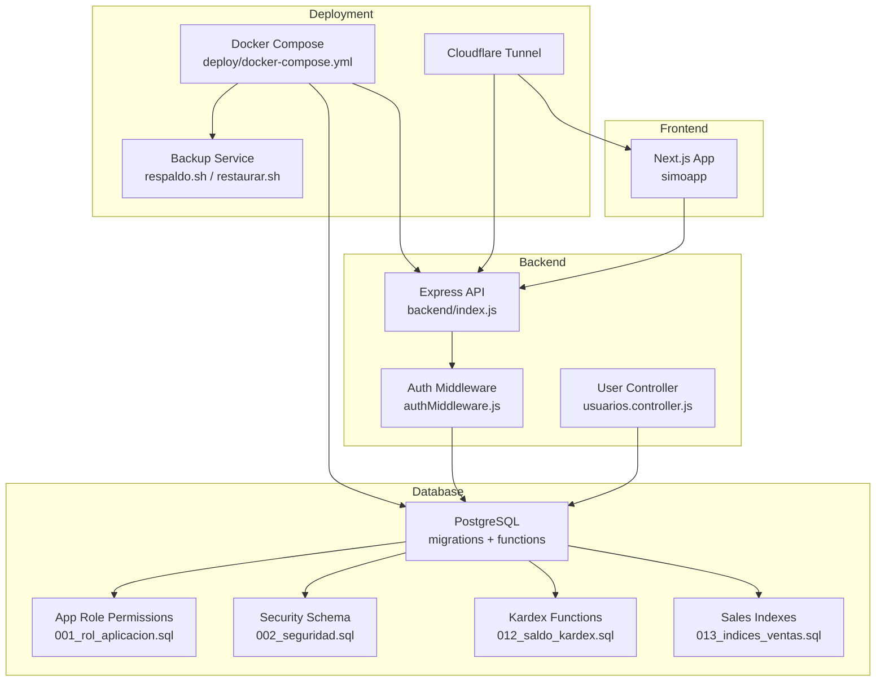
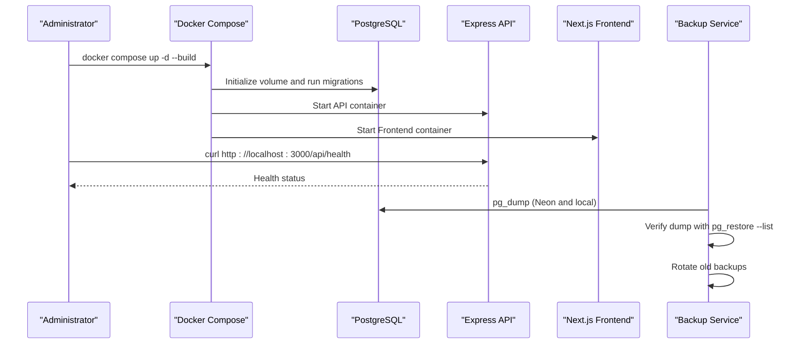
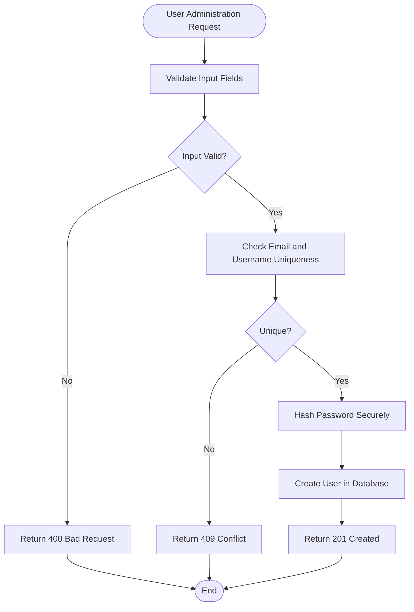
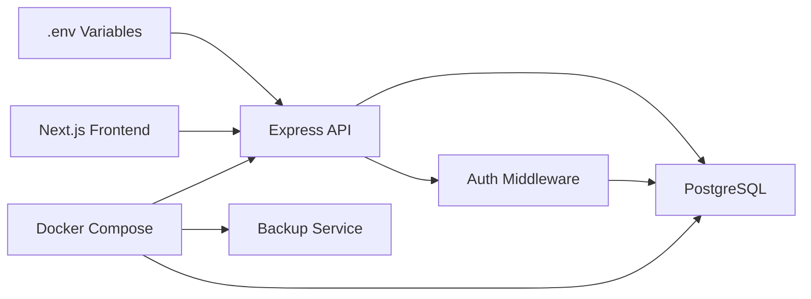

# Maintenance Procedures

<cite>
**Referenced Files in This Document**
- [README.md](file://README.md)
- [backend/db/README.md](file://backend/db/README.md)
- [deploy/README.md](file://deploy/README.md)
- [backend/db/migrations/013_indices_ventas.sql](file://backend/db/migrations/013_indices_ventas.sql)
- [backend/db/migrations/012_saldo_kardex.sql](file://backend/db/migrations/012_saldo_kardex.sql)
- [backend/db/migrations/002_seguridad.sql](file://backend/db/migrations/002_seguridad.sql)
- [backend/db/roles/001_rol_aplicacion.sql](file://backend/db/roles/001_rol_aplicacion.sql)
- [backend/src/controllers/usuarios.controller.js](file://backend/src/controllers/usuarios.controller.js)
- [backend/middleware/authMiddleware.js](file://backend/middleware/authMiddleware.js)
- [deploy/backup/respaldo.sh](file://deploy/backup/respaldo.sh)
- [deploy/backup/restaurar.sh](file://deploy/backup/restaurar.sh)
- [deploy/.env.example](file://deploy/.env.example)
</cite>

## Table of Contents
1. [Introduction](#introduction)
2. [Project Structure](#project-structure)
3. [Core Components](#core-components)
4. [Architecture Overview](#architecture-overview)
5. [Detailed Component Analysis](#detailed-component-analysis)
6. [Dependency Analysis](#dependency-analysis)
7. [Performance Considerations](#performance-considerations)
8. [Troubleshooting Guide](#troubleshooting-guide)
9. [Conclusion](#conclusion)

## Introduction
This document defines maintenance procedures for the SIMO retail system. It covers database optimization, index management, performance tuning, user administration and access control, system upgrades and migrations, security maintenance, backup and restore operations, preventive schedules, capacity planning, and health assessment. The guidance is based on the repository’s backend, database schema, deployment scripts, and operational documentation.

## Project Structure
SIMO consists of:
- A Next.js frontend under `simoapp`.
- An Express backend under `backend`.
- A PostgreSQL database with migration-driven schema and business logic functions.
- A Docker-based deployment under `deploy`, including a backup service and Cloudflare tunnel exposure.

**Diagram sources**
- [README.md:27-64](file://README.md#L27-L64)
- [deploy/README.md:1-28](file://deploy/README.md#L1-L28)
- [backend/db/README.md:1-32](file://backend/db/README.md#L1-L32)
- [backend/middleware/authMiddleware.js:1-81](file://backend/middleware/authMiddleware.js#L1-L81)
- [backend/src/controllers/usuarios.controller.js:1-295](file://backend/src/controllers/usuarios.controller.js#L1-L295)
- [backend/db/migrations/013_indices_ventas.sql:1-71](file://backend/db/migrations/013_indices_ventas.sql#L1-L71)
- [backend/db/migrations/012_saldo_kardex.sql:1-155](file://backend/db/migrations/012_saldo_kardex.sql#L1-L155)
- [backend/db/migrations/002_seguridad.sql:1-91](file://backend/db/migrations/002_seguridad.sql#L1-L91)
- [backend/db/roles/001_rol_aplicacion.sql:1-46](file://backend/db/roles/001_rol_aplicacion.sql#L1-L46)

**Section sources**
- [README.md:27-64](file://README.md#L27-L64)
- [deploy/README.md:1-28](file://deploy/README.md#L1-L28)
- [backend/db/README.md:1-32](file://backend/db/README.md#L1-L32)

## Core Components
- Database schema and business rules are defined by ordered migrations under `backend/db/migrations`.
- Security roles and users are created by `002_seguridad.sql`; application least-privilege role permissions are managed by `001_rol_aplicacion.sql`.
- Sales performance indexes are maintained by `013_indices_ventas.sql`.
- Kardex balance calculation and validation functions are provided by `012_saldo_kardex.sql`.
- User administration endpoints are implemented in `usuarios.controller.js` and protected by `authMiddleware.js`.
- Deployment and backups are orchestrated via Docker Compose and scripts under `deploy/backup`.

**Section sources**
- [backend/db/migrations/002_seguridad.sql:1-91](file://backend/db/migrations/002_seguridad.sql#L1-L91)
- [backend/db/roles/001_rol_aplicacion.sql:1-46](file://backend/db/roles/001_rol_aplicacion.sql#L1-L46)
- [backend/db/migrations/013_indices_ventas.sql:1-71](file://backend/db/migrations/013_indices_ventas.sql#L1-L71)
- [backend/db/migrations/012_saldo_kardex.sql:1-155](file://backend/db/migrations/012_saldo_kardex.sql#L1-L155)
- [backend/src/controllers/usuarios.controller.js:1-295](file://backend/src/controllers/usuarios.controller.js#L1-L295)
- [backend/middleware/authMiddleware.js:1-81](file://backend/middleware/authMiddleware.js#L1-L81)
- [deploy/README.md:101-145](file://deploy/README.md#L101-L145)

## Architecture Overview
The production environment runs PostgreSQL, the Express API, the Next.js frontend, a backup service, and a Cloudflare tunnel. The API connects to PostgreSQL using a least-privilege application role. Backups are automated daily and can be restored safely with transactional integrity checks.

**Diagram sources**
- [deploy/README.md:50-85](file://deploy/README.md#L50-L85)
- [deploy/README.md:101-145](file://deploy/README.md#L101-L145)
- [deploy/backup/respaldo.sh:1-89](file://deploy/backup/respaldo.sh#L1-L89)

**Section sources**
- [deploy/README.md:1-28](file://deploy/README.md#L1-L28)
- [deploy/README.md:50-85](file://deploy/README.md#L50-L85)
- [deploy/README.md:101-145](file://deploy/README.md#L101-L145)

## Detailed Component Analysis

### Database Optimization and Index Management
- Maintain sales query performance through B-tree covering indexes defined in the sales indexes migration. These indexes optimize history queries, dashboard aggregations, product sales reports, and recent sales lists.
- After large data loads or significant table changes, run `VACUUM ANALYZE` so that planner statistics remain accurate and Index Only Scans continue to perform well.
- Review planner cost settings; the sales indexes migration sets `random_page_cost` to a value suitable for SSD storage.

Recommended routine tasks:
- Validate index existence and definitions after each migration.
- Run `ANALYZE ventas;` and `ANALYZE detalles_ventas;` after bulk inserts or updates.
- Monitor slow queries and compare execution plans before and after index changes.

**Section sources**
- [backend/db/migrations/013_indices_ventas.sql:1-71](file://backend/db/migrations/013_indices_ventas.sql#L1-L71)
- [backend/db/README.md:159-180](file://backend/db/README.md#L159-L180)

### Database Integrity and Kardex Validation
- Use the Kardex validation function to audit inventory balances. It compares recalculated balances from movements with current product stock and flags inconsistencies.
- For targeted audits, pass a specific product ID; otherwise, validate all products.
- Include Kardex validation as part of restore verification and periodic health checks.

Operational steps:
- Run the Kardex validation function against the active database.
- Investigate any inconsistent rows immediately and trace them to movement records.
- Schedule regular validation after high-volume sales or inventory adjustments.

**Section sources**
- [backend/db/migrations/012_saldo_kardex.sql:1-155](file://backend/db/migrations/012_saldo_kardex.sql#L1-L155)
- [backend/db/README.md:122-142](file://backend/db/README.md#L122-L142)

### Performance Tuning Guidelines
- Ensure planner statistics are fresh after major data changes by running `ANALYZE` on affected tables.
- Keep SSD-appropriate planner costs configured for optimal index usage.
- Avoid full table scans on large tables by relying on covering indexes where available.
- Use the performance reference queries under `backend/db/carga/consultas_rendimiento.sql` to benchmark critical paths.

[No sources needed since this section provides general guidance]

### User Administration and Access Control Maintenance
- Roles and users are defined in the security migration. The four supported roles are `ADMIN`, `GERENTE`, `INVENTARIO`, and `VENDEDOR`.
- The user controller implements creation, listing, retrieval, update, and status change endpoints. It validates inputs, enforces uniqueness, protects the last active administrator, and hashes passwords securely.
- Authentication middleware verifies JWT tokens, checks session blacklists, and enforces immediate logout when a user is deactivated.
- RBAC is enforced by checking both numeric role IDs and role codes stored in the token.

Maintenance procedures:
- Create users only through the admin endpoint with validated payloads.
- Rotate passwords and enforce minimum length requirements.
- Deactivate compromised or inactive accounts promptly; deactivation invalidates open sessions.
- Audit role assignments regularly and ensure no user holds more privileges than required.
- Monitor failed login attempts and temporary lockout behavior if enabled.

**Diagram sources**
- [backend/src/controllers/usuarios.controller.js:29-84](file://backend/src/controllers/usuarios.controller.js#L29-L84)

**Section sources**
- [backend/db/migrations/002_seguridad.sql:1-91](file://backend/db/migrations/002_seguridad.sql#L1-L91)
- [backend/src/controllers/usuarios.controller.js:1-295](file://backend/src/controllers/usuarios.controller.js#L1-L295)
- [backend/middleware/authMiddleware.js:1-81](file://backend/middleware/authMiddleware.js#L1-L81)

### System Upgrade Procedures and Migration Management
- Apply new database migrations directly to the database container using `psql`. Do not drop volumes in production because that deletes data.
- After creating new tables, reapply the application role permissions script so the API role gains access to new objects.
- For Neon environments, use the documented apply script with the owner connection string, then regrant permissions to the application role.

Upgrade workflow:
1. Stop the API container during schema-altering migrations if necessary.
2. Apply the migration file with `ON_ERROR_STOP=1`.
3. Re-run the application role permissions script.
4. Restart the API container.
5. Verify health and critical endpoints.

**Section sources**
- [deploy/README.md:127-139](file://deploy/README.md#L127-L139)
- [deploy/README.md:236-244](file://deploy/README.md#L236-L244)
- [backend/db/roles/001_rol_aplicacion.sql:1-46](file://backend/db/roles/001_rol_aplicacion.sql#L1-L46)

### Version Compatibility Checks
- Confirm the Node runtime version matches the deployment configuration.
- Confirm the PostgreSQL version used in development aligns with the deployed version.
- Validate that migrations are idempotent and safe to re-run where applicable.
- Test migrations against a copy of production data before applying to Neon.

[No sources needed since this section provides general guidance]

### Security Maintenance Tasks
- Enforce least privilege: the API uses the `simo_app` role, which cannot alter the Kardex, order state history, or audit log.
- Protect the database behind Cloudflare Access and require PostgreSQL credentials.
- Rotate secrets such as `JWT_SECRET`, `POSTGRES_PASSWORD`, and `SIMO_APP_PASSWORD`.
- Keep `.env` files out of version control and restrict access to backup directories.
- Regularly review Cloudflare Access policies and tunnel hostnames.

**Section sources**
- [backend/db/roles/001_rol_aplicacion.sql:1-46](file://backend/db/roles/001_rol_aplicacion.sql#L1-L46)
- [deploy/README.md:208-215](file://deploy/README.md#L208-L215)
- [deploy/.env.example:1-39](file://deploy/.env.example#L1-L39)

### Certificate Management
- The repository does not include application TLS certificates; HTTPS termination is handled by Cloudflare.
- Manage Cloudflare Access policies and tunnel tokens centrally rather than embedding secrets in containers.
- If direct API exposure is introduced later, configure proper TLS at the reverse proxy or load balancer.

[No sources needed since this section provides general guidance]

### Vulnerability Scanning
- Run dependency vulnerability scans for both backend and frontend packages.
- Scan container images before building production images.
- Integrate scanning into CI workflows and block builds with known critical vulnerabilities.

[No sources needed since this section provides general guidance]

### Preventive Maintenance Schedule
Daily:
- Verify backup service logs and confirm successful dumps.
- Check container health and API health endpoint.

Weekly:
- Validate Kardex consistency.
- Review user account activity and suspicious login patterns.
- Inspect disk space and container logs for growth trends.

Monthly:
- Analyze slow queries and review planner statistics freshness.
- Rotate secrets and review access policies.
- Test restore procedure against a non-production database.

Quarterly:
- Review role assignments and remove unused accounts.
- Benchmark critical queries and adjust indexes if needed.
- Plan capacity upgrades based on growth metrics.

[No sources needed since this section provides general guidance]

### Capacity Planning Guidelines
- Track growth of sales, details, and inventory movement tables.
- Monitor index sizes and table bloat; schedule `VACUUM` and `ANALYZE` after large loads.
- Size storage and compute based on peak transaction rates and report latency targets.
- Plan Neon branch strategy for testing migrations and restores without impacting production.

[No sources needed since this section provides general guidance]

### System Health Assessment Procedures
- Verify all containers are running and healthy.
- Call the API health endpoint.
- Validate that backups exist and are recent.
- Run Kardex validation and check for inconsistencies.
- Confirm Cloudflare tunnel hostnames are reachable and protected.

**Section sources**
- [deploy/README.md:69-85](file://deploy/README.md#L69-L85)
- [deploy/backup/respaldo.sh:1-89](file://deploy/backup/respaldo.sh#L1-L89)
- [backend/db/migrations/012_saldo_kardex.sql:113-155](file://backend/db/migrations/012_saldo_kardex.sql#L113-L155)

## Dependency Analysis
The backend depends on PostgreSQL for persistence and on environment variables for configuration. The deployment layer orchestrates services and automates backups. The frontend depends on the API URL configured at build time.

**Diagram sources**
- [deploy/.env.example:1-39](file://deploy/.env.example#L1-L39)
- [backend/middleware/authMiddleware.js:1-81](file://backend/middleware/authMiddleware.js#L1-L81)
- [deploy/README.md:1-28](file://deploy/README.md#L1-L28)

**Section sources**
- [deploy/.env.example:1-39](file://deploy/.env.example#L1-L39)
- [backend/middleware/authMiddleware.js:1-81](file://backend/middleware/authMiddleware.js#L1-L81)
- [deploy/README.md:1-28](file://deploy/README.md#L1-L28)

## Performance Considerations
- Prefer covering indexes for read-heavy dashboards and history queries.
- Keep planner statistics updated after bulk operations.
- Avoid manual stock edits; always use the controlled movement functions and triggers.
- Monitor query plans for regression after schema or index changes.

[No sources needed since this section provides general guidance]

## Troubleshooting Guide
Common issues and resolutions:
- Backup failures: verify connection strings, network access, and destination permissions. Check backup logs and retry within the scheduled hour.
- Restore errors: ensure the target database is empty or explicitly allow replacement. Confirm Neon restoration requires explicit confirmation.
- API authentication failures: check JWT secret configuration, token expiration, and user activation status.
- Index performance regressions: re-analyze tables and validate index definitions after migrations.

**Section sources**
- [deploy/backup/respaldo.sh:1-89](file://deploy/backup/respaldo.sh#L1-L89)
- [deploy/backup/restaurar.sh:1-77](file://deploy/backup/restaurar.sh#L1-L77)
- [backend/middleware/authMiddleware.js:1-81](file://backend/middleware/authMiddleware.js#L1-L81)

## Conclusion
Maintaining SIMO requires disciplined database hygiene, careful migration management, strong access controls, and reliable backups. By following the procedures outlined here—index maintenance, Kardex validation, least-privilege role management, secure deployment practices, and scheduled health checks—you can keep the system performant, consistent, and secure across development, staging, and production environments.