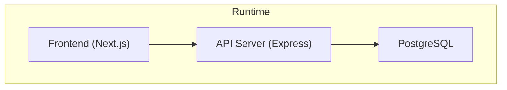
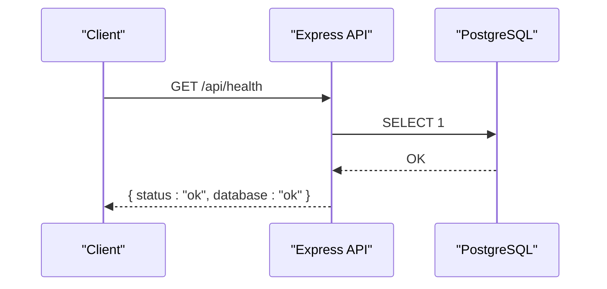
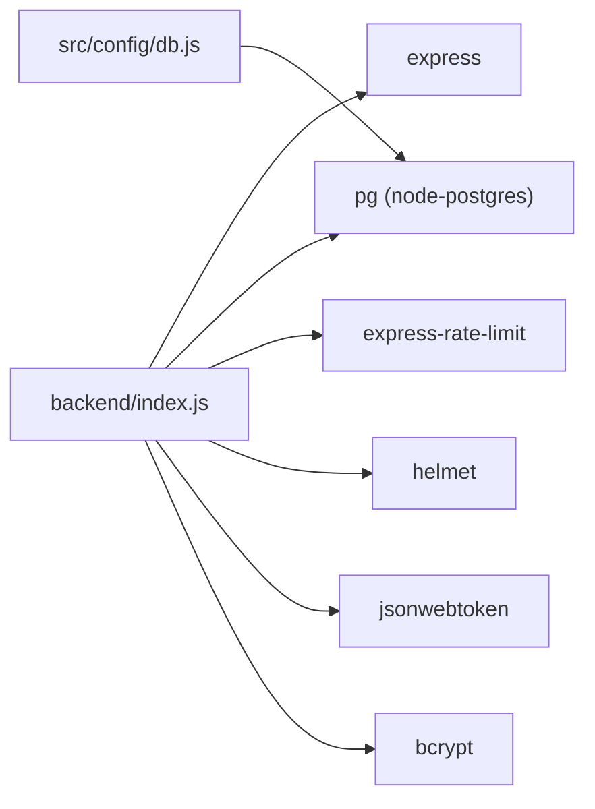

# Monitoring & Alerting

<cite>
**Referenced Files in This Document**
- [README.md](file://README.md)
- [backend/index.js](file://backend/index.js)
- [backend/db/index.js](file://backend/db/index.js)
- [backend/src/config/db.js](file://backend/src/config/db.js)
- [backend/package.json](file://backend/package.json)
- [backend/Dockerfile](file://backend/Dockerfile)
- [backend/docker-compose.yml](file://backend/docker-compose.yml)
- [deploy/docker-compose.yml](file://deploy/docker-compose.yml)
- [railway.json](file://railway.json)
- [backend/db/carga/consultas_rendimiento.sql](file://backend/db/carga/consultas_rendimiento.sql)
- [backend/db/README.md](file://backend/db/README.md)
</cite>

## Table of Contents
1. [Introduction](#introduction)
2. [Project Structure](#project-structure)
3. [Core Components](#core-components)
4. [Architecture Overview](#architecture-overview)
5. [Detailed Component Analysis](#detailed-component-analysis)
6. [Dependency Analysis](#dependency-analysis)
7. [Performance Considerations](#performance-considerations)
8. [Troubleshooting Guide](#troubleshooting-guide)
9. [Conclusion](#conclusion)
10. [Appendices](#appendices)

## Introduction
This document defines the monitoring and alerting strategy for the SIMO system, covering key performance indicators (KPIs), health check endpoints, system metrics, log collection and analysis, alert thresholds, database performance monitoring, application response time tracking, resource utilization, and integration with external observability platforms. It is designed to be accessible to both technical and non-technical stakeholders while providing actionable guidance for setting up dashboards and notifications.

## Project Structure
SIMO consists of:
- A Node.js Express API backend exposing REST endpoints and a health endpoint.
- A PostgreSQL database used by the API.
- A Next.js frontend that consumes the API.
- Docker Compose configurations for local and deployed environments.
- Deployment configuration for Railway with a built-in healthcheck path.

**Diagram sources**
- [backend/index.js:17-56](file://backend/index.js#L17-L56)
- [backend/src/config/db.js:17-26](file://backend/src/config/db.js#L17-L26)
- [deploy/docker-compose.yml:39-63](file://deploy/docker-compose.yml#L39-L63)

**Section sources**
- [README.md:27-64](file://README.md#L27-L64)
- [deploy/docker-compose.yml:14-80](file://deploy/docker-compose.yml#L14-L80)

## Core Components
- Health Check Endpoint: The API exposes `/api/health` to verify service availability and database connectivity.
- Rate Limiting: Global rate limiting is applied to all `/api` routes.
- Database Pool: Shared connection pool with connection and error event logging.
- Containerization: Docker images and compose files define services, ports, environment variables, and healthchecks.
- Platform Healthcheck: Railway uses `/api/health` as its healthcheck path.

Key responsibilities:
- API server: request handling, security middleware, routing, and health endpoint.
- Database layer: connection pooling and SSL configuration.
- Containers: service orchestration and health probes.

**Section sources**
- [backend/index.js:62-70](file://backend/index.js#L62-L70)
- [backend/index.js:34-48](file://backend/index.js#L34-L48)
- [backend/db/index.js:14-20](file://backend/db/index.js#L14-L20)
- [backend/src/config/db.js:11-26](file://backend/src/config/db.js#L11-L26)
- [deploy/docker-compose.yml:59-63](file://deploy/docker-compose.yml#L59-L63)
- [railway.json:7-13](file://railway.json#L7-L13)

## Architecture Overview
The runtime architecture includes the frontend, API server, and database. Observability hooks are present at the API level (health endpoint, console logs) and container level (Docker healthchecks).

**Diagram sources**
- [backend/index.js:62-70](file://backend/index.js#L62-L70)

## Detailed Component Analysis

### Health Check and Service Availability
- Endpoint: `GET /api/health`
- Behavior: Executes a minimal query against PostgreSQL; returns success when reachable, otherwise returns a 503 with an unavailable database status.
- Integration: Used by Railway’s platform healthcheck and can be polled by external monitors.

Recommended KPIs:
- Health endpoint availability (uptime).
- Database reachability (success rate of health checks).
- Error responses from health checks (count and rate).

Suggested thresholds:
- Uptime SLA: ≥ 99.9% over rolling windows (e.g., 24h, 7d).
- Error rate on health endpoint: < 0.1%.
- Database connectivity failures: 0 per hour (alert immediately).

Monitoring queries and dashboards:
- Prometheus/Grafana: scrape HTTP metrics or use blackbox exporter to probe `/api/health`.
- Cloud monitoring: configure synthetic checks to hit `/api/health` every minute.

**Section sources**
- [backend/index.js:62-70](file://backend/index.js#L62-L70)
- [railway.json:7-13](file://railway.json#L7-L13)

### Request Throughput and Error Rates
- Scope: All API routes under `/api/*`.
- Built-in controls:
  - Rate limiter configured globally for `/api` routes.
  - Helmet and CORS enabled.
- Metrics to collect:
  - Requests per second (RPS) by route and method.
  - Response status code distribution (2xx, 4xx, 5xx).
  - Latency percentiles (p50, p95, p99).
  - Rate limit hits (429 responses).

Alerting thresholds:
- 5xx error rate > 1% over 5 minutes.
- p95 latency > 500 ms for critical endpoints (e.g., login, sales).
- 429 rate spikes indicating abuse or misconfiguration.

Implementation guidance:
- Add structured logging with request IDs, method, path, status, duration.
- Integrate an APM library (e.g., OpenTelemetry) to capture spans and metrics.

**Section sources**
- [backend/index.js:24-32](file://backend/index.js#L24-L32)
- [backend/index.js:34-48](file://backend/index.js#L34-L48)

### Database Performance Monitoring
- Connection pool: shared across the API; emits connect and error events.
- SSL configuration: supports DATABASE_URL or individual DB_* variables; SSL behavior controlled via DB_SSL.
- Performance reference queries: provided for sales-related workloads to analyze execution plans and buffers.

Metrics to collect:
- Active/idle connections, connection errors.
- Query latency and slow queries.
- Index usage and scan types (Index Only Scan vs Seq Scan).
- Vacuum/analyze frequency and effectiveness.

Alerting thresholds:
- Connection pool saturation (> 80% active connections).
- Slow queries (> 1s) exceeding a defined count per minute.
- Frequent sequential scans on large tables where indexes exist.

Operational notes:
- Use EXPLAIN ANALYZE on reference queries to validate index effectiveness.
- After bulk loads, run VACUUM ANALYZE to keep planner statistics current.

**Section sources**
- [backend/db/index.js:14-20](file://backend/db/index.js#L14-L20)
- [backend/src/config/db.js:11-26](file://backend/src/config/db.js#L11-L26)
- [backend/db/carga/consultas_rendimiento.sql:1-18](file://backend/db/carga/consultas_rendimiento.sql#L1-L18)
- [backend/db/README.md:173-179](file://backend/db/README.md#L173-L179)

### Application Response Times and Resource Utilization
- Application-level:
  - Track per-route latency and error rates.
  - Capture CPU, memory, and event loop lag if using APM.
- Container-level:
  - Monitor CPU and memory usage of API and DB containers.
  - Watch disk I/O and storage growth for PostgreSQL data volume.

Recommended baselines:
- API p95 latency: < 500 ms for typical reads/writes.
- Memory usage: stable with headroom for GC; alert on sustained high usage.
- CPU utilization: avoid sustained > 80% on small instances.

**Section sources**
- [backend/Dockerfile:1-25](file://backend/Dockerfile#L1-L25)
- [backend/docker-compose.yml:23-37](file://backend/docker-compose.yml#L23-L37)

### Log Collection Strategies and Analysis Techniques
Current state:
- Console logs for connection events and errors.
- No centralized logging framework yet.

Strategy:
- Centralize logs:
  - In Docker Compose: pipe stdout/stderr to a log driver (e.g., json-file, gelf, loki).
  - On managed platforms: forward logs to a log aggregator (CloudWatch, Datadog, Loki).
- Structured logging:
  - Include request ID, user context (when available), route, status, duration.
- Retention and rotation:
  - Define retention policies per environment (e.g., 7 days dev, 30 days prod).

Analysis techniques:
- Error correlation: group by error message and stack trace.
- Top offenders: identify slowest routes and most frequent errors.
- Trend analysis: track error rates and latency over time.

**Section sources**
- [backend/db/index.js:14-20](file://backend/db/index.js#L14-L20)
- [backend/index.js:130-151](file://backend/index.js#L130-L151)
- [backend/index.js:225-231](file://backend/index.js#L225-L231)
- [backend/index.js:320-341](file://backend/index.js#L320-L341)
- [backend/index.js:416-422](file://backend/index.js#L416-L422)
- [backend/index.js:462-468](file://backend/index.js#L462-L468)

### Alerting Thresholds and Notification Setup
Proposed alerts:
- Service health:
  - Trigger if `/api/health` fails for 3 consecutive checks.
- Error rates:
  - 5xx > 1% over 5 minutes.
- Latency:
  - p95 > 500 ms for critical endpoints over 5 minutes.
- Database:
  - Connection errors or pool saturation.
  - Slow query count threshold exceeded.

Notification channels:
- Email, Slack, PagerDuty, or platform-native alerts.
- Escalation policy: warning → critical after repeated violations.

Example setup:
- Prometheus + Alertmanager: define rules for HTTP error rate, latency, and database metrics; route to channels.
- Cloud provider monitoring: create synthetic checks and anomaly-based alerts.

**Section sources**
- [backend/index.js:62-70](file://backend/index.js#L62-L70)

### Database Performance Monitoring Queries
Use the provided reference queries to evaluate performance of sales-related workloads:
- Monthly sales listing.
- Daily totals for dashboard aggregation.
- Top-selling products by revenue.
- Product sales history.
- Quarterly unit sales for a product.
- Recent sales list.

Execution:
- Run with EXPLAIN ANALYZE to inspect timing and buffer usage.
- Validate index coverage and plan stability.

**Section sources**
- [backend/db/carga/consultas_rendimiento.sql:1-18](file://backend/db/carga/consultas_rendimiento.sql#L1-L18)

### External Monitoring Tools and Integrations
Options:
- APM: OpenTelemetry, New Relic, DataDog APM for tracing and profiling.
- Metrics: Prometheus + Grafana for custom metrics and dashboards.
- Logs: Loki, ELK Stack, or cloud-native log services.
- Synthetic checks: Blackbox Exporter or platform probes for `/api/health`.

Integration steps:
- Instrument API with APM SDK to emit traces and metrics.
- Configure log shipping to your log aggregator.
- Set up Prometheus scrapers for Node.js metrics and database metrics.
- Create Grafana dashboards for request latency, error rates, and DB performance.

**Section sources**
- [backend/package.json:15-23](file://backend/package.json#L15-L23)
- [deploy/docker-compose.yml:59-63](file://deploy/docker-compose.yml#L59-L63)

## Dependency Analysis
The API depends on Express, pg, and several security/rate-limiting libraries. The database connection is configured centrally and reused across modules.

**Diagram sources**
- [backend/index.js:1-15](file://backend/index.js#L1-L15)
- [backend/src/config/db.js:9-26](file://backend/src/config/db.js#L9-L26)
- [backend/package.json:15-23](file://backend/package.json#L15-L23)

**Section sources**
- [backend/index.js:1-15](file://backend/index.js#L1-L15)
- [backend/src/config/db.js:9-26](file://backend/src/config/db.js#L9-L26)
- [backend/package.json:15-23](file://backend/package.json#L15-L23)

## Performance Considerations
- Keep health checks lightweight; avoid heavy operations.
- Use pagination and indexing for large datasets; validate with EXPLAIN ANALYZE.
- Tune database planner settings for SSD-backed storage as indicated in documentation.
- Monitor and cap rate limits to protect resources.
- Ensure containers have appropriate resource limits and requests.

[No sources needed since this section provides general guidance]

## Troubleshooting Guide
Common issues and diagnostics:
- Health endpoint failing:
  - Verify database connectivity and credentials.
  - Check container healthchecks and restart policies.
- High error rates:
  - Inspect console logs for stack traces and error codes.
  - Correlate with request logs and APM traces.
- Database performance degradation:
  - Review slow queries and index usage.
  - Run VACUUM ANALYZE after bulk operations.

Actionable checks:
- Confirm `/api/health` responds successfully.
- Validate Docker healthchecks for API and DB services.
- Review connection pool errors and retry behavior.

**Section sources**
- [backend/index.js:62-70](file://backend/index.js#L62-L70)
- [backend/db/index.js:14-20](file://backend/db/index.js#L14-L20)
- [deploy/docker-compose.yml:33-37](file://deploy/docker-compose.yml#L33-L37)
- [deploy/docker-compose.yml:59-63](file://deploy/docker-compose.yml#L59-L63)

## Conclusion
SIMO currently provides a basic health endpoint and container healthchecks, with console logging for connection and error events. To achieve robust observability, implement structured logging, APM instrumentation, and centralized metrics/logs. Establish clear KPIs and alert thresholds around health, error rates, latency, and database performance. Integrate with external tools such as Prometheus, Grafana, and log aggregators to build comprehensive dashboards and automated notifications.

[No sources needed since this section summarizes without analyzing specific files]

## Appendices

### Health Check Endpoints Summary
- `GET /api/health`: Service and database connectivity check.

**Section sources**
- [backend/index.js:62-70](file://backend/index.js#L62-L70)

### Environment Variables Relevant to Monitoring
- PORT: API server port.
- DB_* / DATABASE_URL: Database connection parameters.
- DB_SSL: Controls SSL behavior for database connections.
- RATE_LIMIT_MAX: Configures global rate limit for `/api`.

**Section sources**
- [backend/index.js:18](file://backend/index.js#L18)
- [backend/index.js:34-48](file://backend/index.js#L34-L48)
- [backend/src/config/db.js:11-26](file://backend/src/config/db.js#L11-L26)

### Docker and Deployment Health Probes
- Local Compose: API healthcheck calls `/api/health`.
- Railway: healthcheckPath set to `/api/health`.

**Section sources**
- [deploy/docker-compose.yml:59-63](file://deploy/docker-compose.yml#L59-L63)
- [railway.json:7-13](file://railway.json#L7-L13)