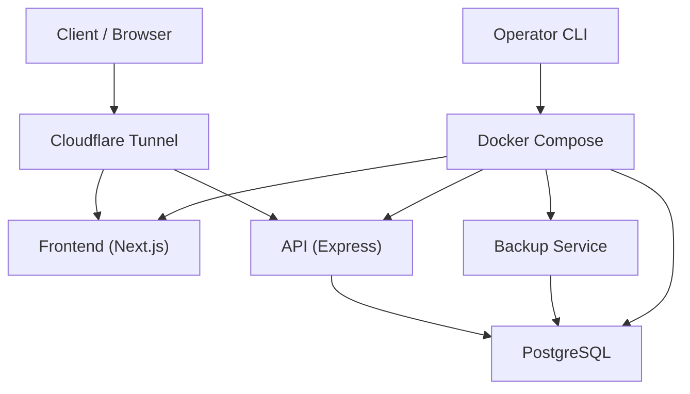
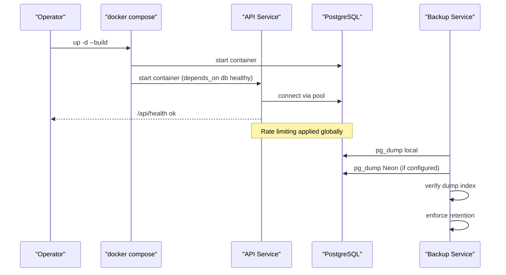
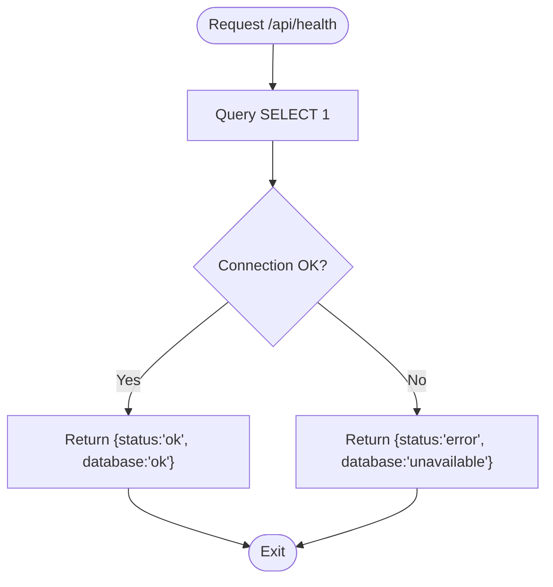
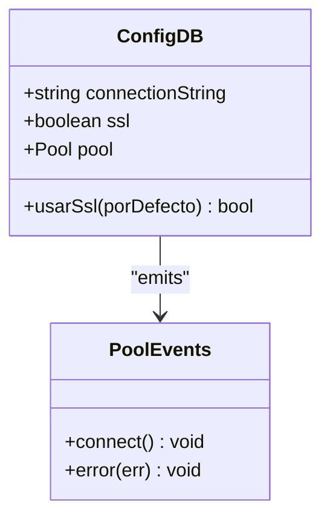
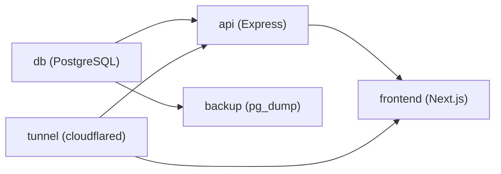
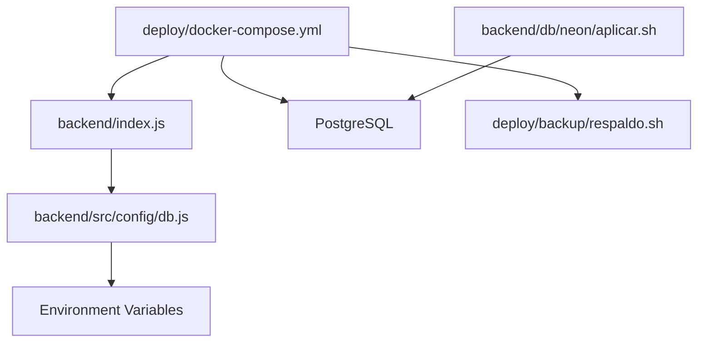

# Troubleshooting & Maintenance

<cite>
**Referenced Files in This Document**   
- [README.md](file://README.md)
- [deploy/README.md](file://deploy/README.md)
- [backend/db/README.md](file://backend/db/README.md)
- [deploy/docker-compose.yml](file://deploy/docker-compose.yml)
- [deploy/backup/respaldo.sh](file://deploy/backup/respaldo.sh)
- [deploy/backup/restaurar.sh](file://deploy/backup/restaurar.sh)
- [backend/db/neon/aplicar.sh](file://backend/db/neon/aplicar.sh)
- [backend/index.js](file://backend/index.js)
- [backend/src/config/db.js](file://backend/src/config/db.js)
- [backend/db/index.js](file://backend/db/index.js)
- [backend/middleware/authMiddleware.js](file://backend/middleware/authMiddleware.js)
- [backend/routes/ventasRoutes.js](file://backend/routes/ventasRoutes.js)
- [backend/src/controllers/inventario.controller.js](file://backend/src/controllers/inventario.controller.js)
- [backend/src/controllers/clientes.controller.js](file://backend/src/controllers/clientes.controller.js)
- [backend/src/controllers/usuarios.controller.js](file://backend/src/controllers/usuarios.controller.js)
- [backend/tests/integracion/sesion.js](file://backend/tests/integracion/sesion.js)
- [backend/db/migrations/013_indices_ventas.sql](file://backend/db/migrations/013_indices_ventas.sql)
- [railway.json](file://railway.json)
</cite>

## Table of Contents
1. [Introduction](#introduction)
2. [Project Structure](#project-structure)
3. [Core Components](#core-components)
4. [Architecture Overview](#architecture-overview)
5. [Detailed Component Analysis](#detailed-component-analysis)
6. [Dependency Analysis](#dependency-analysis)
7. [Performance Considerations](#performance-considerations)
8. [Troubleshooting Guide](#troubleshooting-guide)
9. [Backup and Recovery Procedures](#backup-and-recovery-procedures)
10. [Database Maintenance Tasks](#database-maintenance-tasks)
11. [System Health Checks](#system-health-checks)
12. [Automated Maintenance Scripts](#automated-maintenance-scripts)
13. [Escalation Procedures and Support](#escalation-procedures-and-support)
14. [Preventive Maintenance Schedule](#preventive-maintenance-schedule)
15. [Capacity Planning](#capacity-planning)
16. [System Upgrade Procedures](#system-upgrade-procedures)
17. [Conclusion](#conclusion)

## Introduction
This document provides comprehensive troubleshooting, maintenance, and operational guidance for SIMO. It covers common issues, log analysis techniques, debugging procedures, performance monitoring, backup and recovery, database maintenance, system health checks, automated scripts, escalation paths, preventive schedules, capacity planning, and upgrade procedures. The content is grounded in the repository’s deployment configuration, backend implementation, database schema documentation, and operational scripts.

## Project Structure
SIMO consists of:
- A Next.js frontend under `simoapp/`.
- An Express backend under `backend/`, with routes, controllers, repositories, middleware, and PostgreSQL migrations.
- A production deployment stack under `deploy/` that runs PostgreSQL, the API, the frontend, a daily backup service, and a Cloudflare tunnel.
- Database schema, tests, load data, and performance queries under `backend/db/`.

**Diagram sources**
- [deploy/docker-compose.yml:14-117](file://deploy/docker-compose.yml#L14-L117)
- [deploy/README.md:1-28](file://deploy/README.md#L1-L28)

**Section sources**
- [README.md:27-66](file://README.md#L27-L66)
- [deploy/README.md:1-28](file://deploy/README.md#L1-L28)

## Core Components
- **API Health Check**: `/api/health` validates connectivity to PostgreSQL and returns status.
- **Rate Limiting**: Global rate limiter protects endpoints from excessive requests.
- **Database Pool**: Shared connection pool supports Neon (`DATABASE_URL`) or local Docker PostgreSQL via `DB_*` variables.
- **Deployment Services**: `db`, `api`, `frontend`, `backup`, and `tunnel` are orchestrated by Docker Compose.
- **Backup Service**: Runs daily backups of Neon and local databases, verifies dumps, and enforces retention.
- **Restore Script**: Restores a dump into a target database within a transaction and validates Kardex consistency.
- **Migration Tool**: Applies schema migrations and optional seeds to remote Neon databases.

**Section sources**
- [backend/index.js:63-70](file://backend/index.js#L63-L70)
- [backend/index.js:35-48](file://backend/index.js#L35-L48)
- [backend/src/config/db.js:1-28](file://backend/src/config/db.js#L1-L28)
- [deploy/docker-compose.yml:14-117](file://deploy/docker-compose.yml#L14-L117)
- [deploy/backup/respaldo.sh:1-89](file://deploy/backup/respaldo.sh#L1-L89)
- [deploy/backup/restaurar.sh:1-77](file://deploy/backup/restaurar.sh#L1-L77)
- [backend/db/neon/aplicar.sh:1-35](file://backend/db/neon/aplicar.sh#L1-L35)

## Architecture Overview
The production environment exposes services through Cloudflare Access and a tunnel. The API connects to PostgreSQL using least-privilege credentials. Backups run independently and verify integrity before finalizing files.

**Diagram sources**
- [deploy/docker-compose.yml:39-63](file://deploy/docker-compose.yml#L39-L63)
- [deploy/docker-compose.yml:82-105](file://deploy/docker-compose.yml#L82-L105)
- [backend/index.js:35-48](file://backend/index.js#L35-L48)
- [backend/index.js:63-70](file://backend/index.js#L63-L70)
- [deploy/backup/respaldo.sh:25-51](file://deploy/backup/respaldo.sh#L25-L51)

## Detailed Component Analysis

### API Health and Error Handling
- `/api/health` performs a simple query against PostgreSQL; returns `ok` when reachable, otherwise `unavailable`.
- Controllers and routes log errors with `console.error` and return structured error responses.
- Authentication middleware logs token invalidation list errors.
- Sales route throws business validation errors for missing products and insufficient stock.

**Diagram sources**
- [backend/index.js:63-70](file://backend/index.js#L63-L70)

**Section sources**
- [backend/index.js:63-70](file://backend/index.js#L63-L70)
- [backend/routes/ventasRoutes.js:39-45](file://backend/routes/ventasRoutes.js#L39-L45)
- [backend/routes/ventasRoutes.js:103-141](file://backend/routes/ventasRoutes.js#L103-L141)
- [backend/middleware/authMiddleware.js:43](file://backend/middleware/authMiddleware.js#L43)
- [backend/src/controllers/inventario.controller.js:144-263](file://backend/src/controllers/inventario.controller.js#L144-L263)
- [backend/src/controllers/clientes.controller.js:119-270](file://backend/src/controllers/clientes.controller.js#L119-L270)
- [backend/src/controllers/usuarios.controller.js:81-140](file://backend/src/controllers/usuarios.controller.js#L81-L140)

### Database Connection Pool
- The shared pool supports Neon via `DATABASE_URL` with SSL enabled by default unless overridden.
- For local/Docker usage, it uses `DB_HOST`, `DB_PORT`, `DB_NAME`, `DB_USER`, `DB_PASSWORD`.
- Connection events log success and unexpected pool errors.

**Diagram sources**
- [backend/src/config/db.js:1-28](file://backend/src/config/db.js#L1-L28)
- [backend/db/index.js:1-22](file://backend/db/index.js#L1-L22)

**Section sources**
- [backend/src/config/db.js:1-28](file://backend/src/config/db.js#L1-L28)
- [backend/db/index.js:1-22](file://backend/db/index.js#L1-L22)

### Deployment Services and Healthchecks
- `db`: PostgreSQL with healthcheck using `pg_isready`.
- `api`: Express app with healthcheck calling `/api/health`.
- `frontend`: Next.js app with healthcheck hitting `/login`.
- `backup`: Daily backup loop using `respaldo.sh`.
- `tunnel`: Cloudflare tunnel container.

**Diagram sources**
- [deploy/docker-compose.yml:14-117](file://deploy/docker-compose.yml#L14-L117)

**Section sources**
- [deploy/docker-compose.yml:14-117](file://deploy/docker-compose.yml#L14-L117)

## Dependency Analysis
- The API depends on PostgreSQL via the shared connection pool.
- Docker Compose orchestrates services with explicit dependencies and health conditions.
- Backup depends on both Neon (optional) and local PostgreSQL.
- Migration tool requires `psql` and a direct Neon connection string without pooler.

**Diagram sources**
- [backend/index.js:63-70](file://backend/index.js#L63-L70)
- [backend/src/config/db.js:1-28](file://backend/src/config/db.js#L1-L28)
- [deploy/docker-compose.yml:14-117](file://deploy/docker-compose.yml#L14-L117)
- [backend/db/neon/aplicar.sh:1-35](file://backend/db/neon/aplicar.sh#L1-L35)

**Section sources**
- [backend/index.js:63-70](file://backend/index.js#L63-L70)
- [backend/src/config/db.js:1-28](file://backend/src/config/db.js#L1-L28)
- [deploy/docker-compose.yml:14-117](file://deploy/docker-compose.yml#L14-L117)
- [backend/db/neon/aplicar.sh:1-35](file://backend/db/neon/aplicar.sh#L1-L35)

## Performance Considerations
- **Rate Limiting**: Protects the API from request floods; tune via `RATE_LIMIT_MAX`.
- **Index Optimization**: Migrations add B-tree indexes for sales queries and coverage indexes to avoid table scans.
- **Planner Tuning**: Sets `random_page_cost = 1.1` for SSD-backed storage to favor index scans.
- **Load Testing**: Use mass population script to simulate realistic workloads and validate performance improvements.

Key references:
- Index migration details and rationale.
- Mass population script parameters and expected times.
- Performance query reference file.

**Section sources**
- [backend/index.js:35-48](file://backend/index.js#L35-L48)
- [backend/db/migrations/013_indices_ventas.sql:1-71](file://backend/db/migrations/013_indices_ventas.sql#L1-L71)
- [backend/db/README.md:134-180](file://backend/db/README.md#L134-L180)

## Troubleshooting Guide

### Common Issues and Solutions
- **API cannot reach database**:
  - Verify `/api/health` returns `ok`.
  - Confirm `DATABASE_URL` or `DB_*` variables are set correctly.
  - Check PostgreSQL container health and logs.
- **Too Many Requests**:
  - Review rate limit configuration and client request patterns.
  - Increase `RATE_LIMIT_MAX` if needed for testing.
- **Business Validation Errors**:
  - Inspect sales route errors for missing products or insufficient stock.
  - Validate input payloads and inventory state.
- **Authentication Token List Errors**:
  - Check middleware logs for token invalidation list retrieval failures.
- **User Management Errors**:
  - Review user creation/listing endpoints for parameter validation and duplicate constraints.

Diagnostic commands:
- Check API health: `curl http://localhost:3000/api/health`
- View service logs: `docker compose logs -f api`
- Inspect database readiness: `docker compose exec db pg_isready -U postgres -d simo_retail`

**Section sources**
- [backend/index.js:63-70](file://backend/index.js#L63-L70)
- [backend/index.js:35-48](file://backend/index.js#L35-L48)
- [backend/routes/ventasRoutes.js:39-45](file://backend/routes/ventasRoutes.js#L39-L45)
- [backend/middleware/authMiddleware.js:43](file://backend/middleware/authMiddleware.js#L43)
- [backend/src/controllers/usuarios.controller.js:81-140](file://backend/src/controllers/usuarios.controller.js#L81-L140)

### Log Analysis Techniques
- Backend logs use `console.error` in controllers and routes; filter by service name.
- Database logs can be reviewed via Docker logs for the `db` service.
- Backup logs show success/failure per base and retention cleanup messages.

Example log inspection:
- `docker compose logs --tail 20 api`
- `docker compose logs --tail 20 backup`
- `docker compose logs --tail 20 db`

**Section sources**
- [backend/src/controllers/inventario.controller.js:144-263](file://backend/src/controllers/inventario.controller.js#L144-L263)
- [backend/src/controllers/clientes.controller.js:119-270](file://backend/src/controllers/clientes.controller.js#L119-L270)
- [backend/routes/ventasRoutes.js:103-141](file://backend/routes/ventasRoutes.js#L103-L141)
- [deploy/backup/respaldo.sh:70-88](file://deploy/backup/respaldo.sh#L70-L88)

### Debugging Procedures
- **Login Flow**:
  - Ensure authentication middleware is active and tokens are validated.
  - Use integration test helper to confirm login behavior.
- **Inventory Operations**:
  - Validate product existence and stock levels before operations.
  - Check controller error logs for detailed failure reasons.
- **Client Management**:
  - Verify document uniqueness and field validations.
  - Inspect history endpoint for customer purchase summaries.

Debug tips:
- Reproduce with minimal payload and check response codes/messages.
- Use `ON_ERROR_STOP=1` when running SQL scripts to fail fast.
- Validate environment variables with `docker compose config` (inspect values).

**Section sources**
- [backend/tests/integracion/sesion.js:14](file://backend/tests/integracion/sesion.js#L14)
- [backend/src/controllers/inventario.controller.js:144-263](file://backend/src/controllers/inventario.controller.js#L144-L263)
- [backend/src/controllers/clientes.controller.js:119-270](file://backend/src/controllers/clientes.controller.js#L119-L270)

## Backup and Recovery Procedures

### Daily Backups
- The backup service runs at `BACKUP_HOUR` (default 03:00 Colombia time).
- Backs up Neon (if `BACKUP_DATABASE_URL` is set) and local PostgreSQL.
- Uses `pg_dump` custom format, verifies with `pg_restore --list`, and enforces retention.

Operational commands:
- Manual backup: `docker compose exec backup sh /opt/backup/respaldo.sh ahora`
- Check backup logs: `docker compose logs --tail 20 backup`

**Section sources**
- [deploy/README.md:101-125](file://deploy/README.md#L101-L125)
- [deploy/backup/respaldo.sh:1-89](file://deploy/backup/respaldo.sh#L1-L89)

### Restore Process
- The restore script applies a dump in a single transaction and validates row counts and Kardex consistency.
- Requires an empty target database or explicit replacement flags.
- Neon restoration requires confirmation flag due to safety constraints.

Operational commands:
- Create test database: `docker compose exec db createdb -U postgres simo_restaurada`
- Restore Neon dump: `docker compose exec backup sh -c 'sh /opt/backup/restaurar.sh "$(ls -t /backups/simo_neon_*.dump | head -1)" "postgres://$PGUSER:$PGPASSWORD@db:5432/simo_restaurada"'`
- Replace local database: `docker compose exec -e SIMO_REEMPLAZAR=si backup sh -c 'sh /opt/backup/restaurar.sh /backups/simo_AAAAMMDD_HHMM.dump "postgres://$PGUSER:$PGPASSWORD@db:5432/$PGDATABASE"'`

**Section sources**
- [deploy/README.md:165-200](file://deploy/README.md#L165-L200)
- [deploy/backup/restaurar.sh:1-77](file://deploy/backup/restaurar.sh#L1-L77)

## Database Maintenance Tasks

### Schema and Roles
- Apply migrations in order; re-executable migrations ensure idempotency.
- After creating new tables, reapply roles to grant permissions to `simo_app`.

Commands:
- Apply migration: `docker compose exec -T db psql -v ON_ERROR_STOP=1 -U postgres -d simo_retail < ../backend/db/migrations/008_nombre.sql`
- Reapply roles: `docker compose exec -T db psql -v ON_ERROR_STOP=1 -U postgres -d simo_retail -v app_password="$(grep SIMO_APP_PASSWORD .env | cut -d= -f2-)" < ../backend/db/roles/001_rol_aplicacion.sql`

**Section sources**
- [deploy/README.md:127-139](file://deploy/README.md#L127-L139)

### Index and Planner Tuning
- Index migration adds optimized indexes for sales queries and sets planner cost for SSD.
- Run `VACUUM ANALYZE` after large loads to maintain optimal query plans.

Reference:
- Index migration file includes comments explaining each index and planner setting.

**Section sources**
- [backend/db/migrations/013_indices_ventas.sql:1-71](file://backend/db/migrations/013_indices_ventas.sql#L1-L71)
- [backend/db/README.md:159-180](file://backend/db/README.md#L159-L180)

### Data Integrity and Auditing
- Use Kardex functions to audit balance consistency and value calculations.
- Bulk load script respects business rules and validates Kardex at the end.

Commands:
- Kardex function: `SELECT * FROM fn_kardex_producto(1);`
- Kardex validation: `SELECT * FROM fn_validar_kardex() WHERE NOT consistente;`

**Section sources**
- [backend/db/README.md:122-141](file://backend/db/README.md#L122-L141)

## System Health Checks

### API Health Endpoint
- `/api/health` returns service and database status.
- Used by Docker healthcheck and external monitoring.

Command:
- `curl http://localhost:3000/api/health`

**Section sources**
- [backend/index.js:63-70](file://backend/index.js#L63-L70)

### Container Healthchecks
- PostgreSQL: `pg_isready`
- API: HTTP GET `/api/health`
- Frontend: HTTP GET `/login`

Configuration:
- Defined in Docker Compose for each service.

**Section sources**
- [deploy/docker-compose.yml:33-37](file://deploy/docker-compose.yml#L33-L37)
- [deploy/docker-compose.yml:59-63](file://deploy/docker-compose.yml#L59-L63)
- [deploy/docker-compose.yml:76-80](file://deploy/docker-compose.yml#L76-L80)

### Platform Health Configuration
- Railway platform defines healthcheck path and timeout for the backend.

**Section sources**
- [railway.json:7-13](file://railway.json#L7-L13)

## Automated Maintenance Scripts

### Backup Script
- Automates daily backups of Neon and local databases.
- Verifies dump integrity and cleans old backups based on retention policy.

Key behaviors:
- Writes `.tmp` files and renames only after successful verification.
- Retries failed bases every minute during the scheduled hour.

**Section sources**
- [deploy/backup/respaldo.sh:1-89](file://deploy/backup/respaldo.sh#L1-L89)

### Restore Script
- Applies dumps in a transaction and validates core tables and Kardex.
- Prevents accidental overwrite of existing schemas unless explicitly allowed.

Safety features:
- Refuses to restore onto Neon without confirmation flag.
- Drops and recreates schemas contained in the dump when replacement is requested.

**Section sources**
- [deploy/backup/restaurar.sh:1-77](file://deploy/backup/restaurar.sh#L1-L77)

### Migration Application Script
- Applies schema migrations and optional seeds to remote Neon databases.
- Requires direct connection string without pooler.

Usage:
- `DATABASE_URL='postgresql://...' sh db/neon/aplicar.sh [--con-seed]`

**Section sources**
- [backend/db/neon/aplicar.sh:1-35](file://backend/db/neon/aplicar.sh#L1-L35)

## Escalation Procedures and Support

### Internal Escalation Path
- **Level 1**: Operator monitors logs and health endpoints; resolves basic connectivity and configuration issues.
- **Level 2**: Database administrator reviews schema changes, indexes, and data integrity using Kardex validation functions.
- **Level 3**: Development team addresses code-level bugs, middleware issues, and business logic errors.

### External Support
- **Neon Support**: For cloud database issues, consult Neon dashboard and support channels.
- **Cloudflare Support**: For tunnel and Access policy issues, refer to Cloudflare Zero Trust documentation.

### Community Resources
- Repository README and deployment guide provide operational context.
- Database README includes schema rules, model diagram, and performance notes.

**Section sources**
- [README.md:241-244](file://README.md#L241-L244)
- [deploy/README.md:208-244](file://deploy/README.md#L208-L244)
- [backend/db/README.md:1-32](file://backend/db/README.md#L1-L32)

## Preventive Maintenance Schedule

### Daily
- Monitor API health and database readiness.
- Review backup logs for success/failure and retention cleanup.
- Check Cloudflare tunnel status and Access policies.

### Weekly
- Validate Kardex consistency using `fn_validar_kardex()`.
- Review slow queries and index usage via EXPLAIN ANALYZE on performance queries.
- Inspect rate limit hits and adjust thresholds if necessary.

### Monthly
- Test restore procedure against a staging database.
- Review user access and role assignments.
- Assess disk usage and plan capacity expansion if approaching limits.

### Quarterly
- Evaluate schema migrations and apply planned updates.
- Perform load testing with mass population script to validate performance.
- Update dependencies and review security advisories.

[No sources needed since this section provides general guidance]

## Capacity Planning

### Metrics to Track
- API request volume and latency.
- Database connection pool utilization.
- Disk space for PostgreSQL data and backups.
- Backup size trends and retention impact.

### Scaling Strategies
- Scale API horizontally behind Cloudflare if request volume increases.
- Upgrade PostgreSQL instance tier for higher I/O and memory.
- Adjust backup retention to balance storage costs and compliance.

### Thresholds and Alerts
- Alert on `/api/health` failures.
- Alert on backup failures or unusually large backup sizes.
- Alert on high rate limit rejection rates.

[No sources needed since this section provides general guidance]

## System Upgrade Procedures

### Backend Upgrade
- Pull latest code and rebuild containers: `docker compose up -d --build api frontend`
- Verify health endpoint and functional tests.

### Database Upgrade
- Apply migrations in order using psql or the Neon application script.
- Reapply roles to grant permissions to `simo_app` after schema changes.

### Rollback Plan
- Restore from last verified backup if critical issues arise.
- Use Neon branch strategy to test restores safely before switching production.

**Section sources**
- [deploy/README.md:95-99](file://deploy/README.md#L95-L99)
- [deploy/README.md:127-139](file://deploy/README.md#L127-L139)
- [backend/db/neon/aplicar.sh:1-35](file://backend/db/neon/aplicar.sh#L1-L35)

## Conclusion
SIMO’s operational model emphasizes reliability, security, and maintainability. Health checks, rate limiting, least-privilege database access, automated backups, and robust restore procedures form the foundation of day-to-day operations. By following the diagnostic steps, maintenance schedules, and upgrade procedures outlined here, operators can proactively manage system health, resolve issues efficiently, and scale confidently as demand grows.