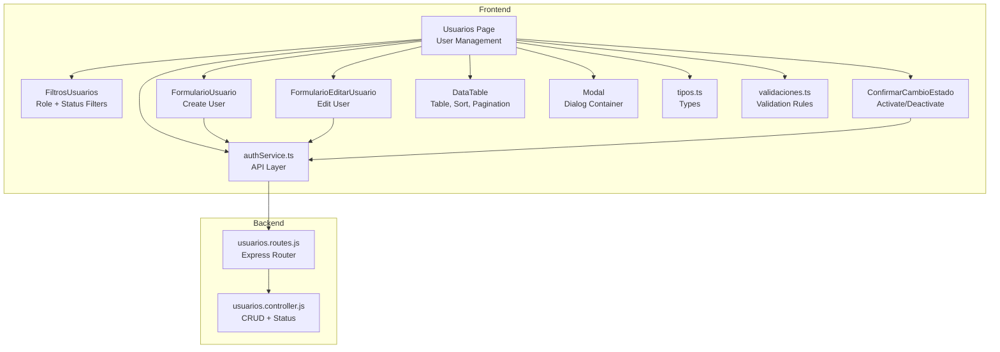
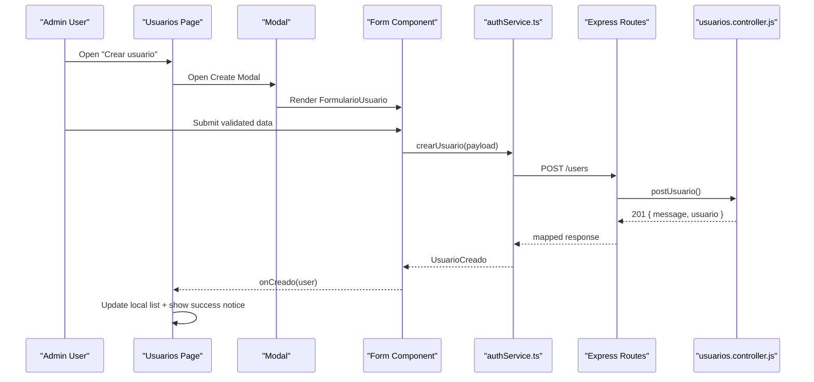
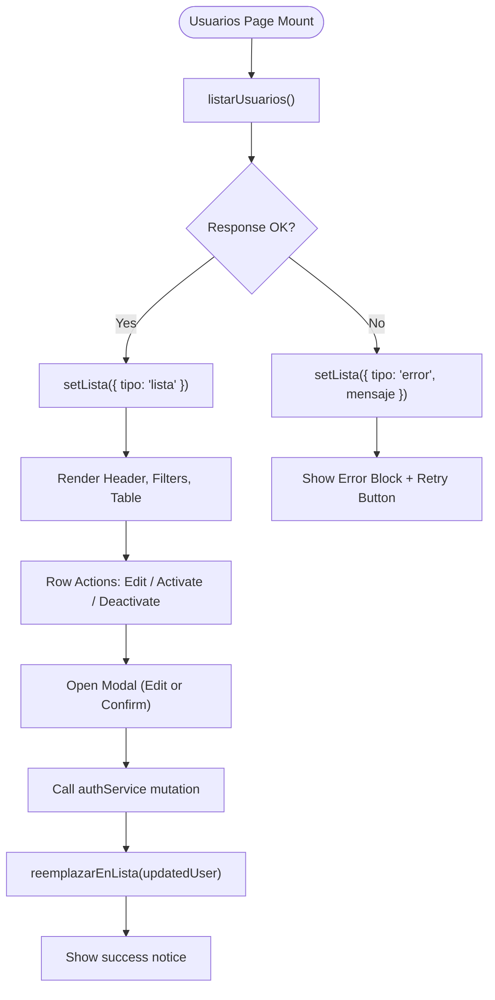
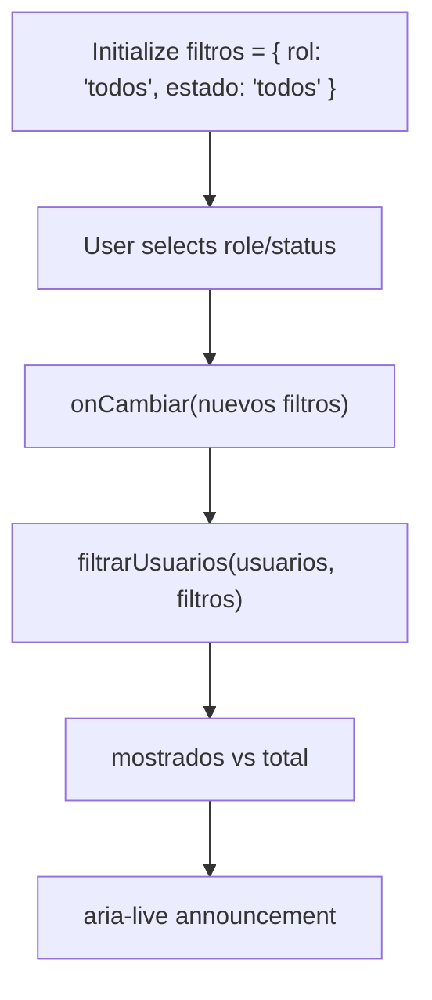
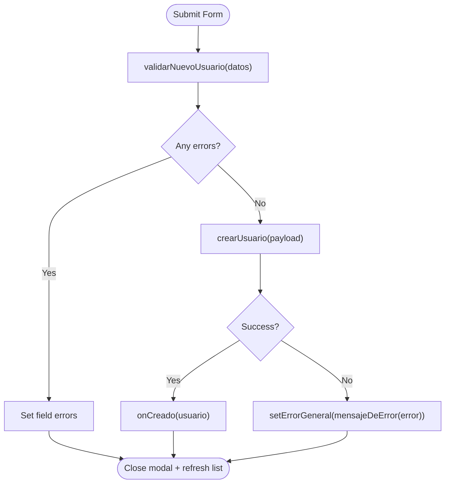
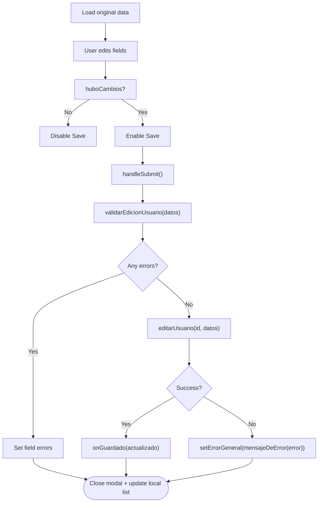
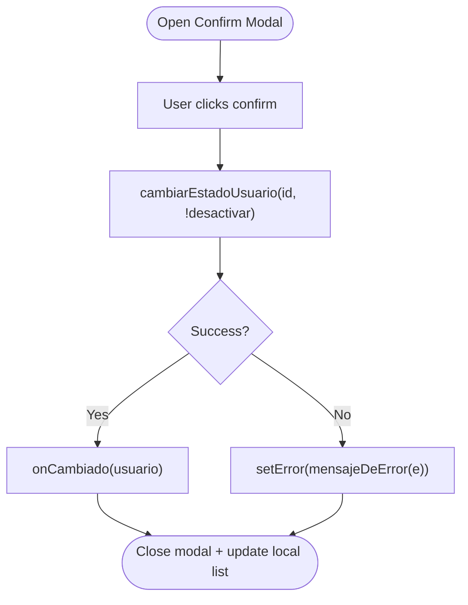
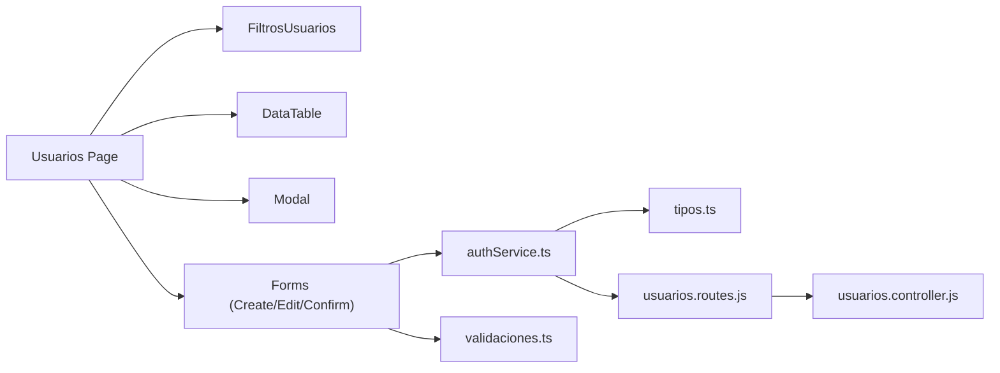

# Admin Interface Components

<cite>
**Referenced Files in This Document**
- [page.tsx](file://simoapp/app/(protected)/usuarios/page.tsx)
- [FiltrosUsuarios.tsx](file://simoapp/components/usuarios/FiltrosUsuarios.tsx)
- [FormularioUsuario.tsx](file://simoapp/components/usuarios/FormularioUsuario.tsx)
- [FormularioEditarUsuario.tsx](file://simoapp/components/usuarios/FormularioEditarUsuario.tsx)
- [ConfirmarCambioEstado.tsx](file://simoapp/components/usuarios/ConfirmarCambioEstado.tsx)
- [authService.ts](file://simoapp/lib/auth/authService.ts)
- [validaciones.ts](file://simoapp/lib/auth/validaciones.ts)
- [tipos.ts](file://simoapp/lib/auth/tipos.ts)
- [DataTable.tsx](file://simoapp/components/ui/DataTable.tsx)
- [Modal.tsx](file://simoapp/components/ui/Modal.tsx)
- [layout.tsx](file://simoapp/app/(protected)/layout.tsx)
- [usuarios.controller.js](file://backend/src/controllers/usuarios.controller.js)
- [usuarios.routes.js](file://backend/src/routes/usuarios.routes.js)
</cite>

## Table of Contents
1. [Introduction](#introduction)
2. [Project Structure](#project-structure)
3. [Core Components](#core-components)
4. [Architecture Overview](#architecture-overview)
5. [Detailed Component Analysis](#detailed-component-analysis)
6. [Dependency Analysis](#dependency-analysis)
7. [Performance Considerations](#performance-considerations)
8. [Troubleshooting Guide](#troubleshooting-guide)
9. [Conclusion](#conclusion)

## Introduction
This document explains the admin interface components used for user management. It covers the main user management page, the user creation form, the user editing form, the filter component, and the confirmation modal for activating or deactivating users. It also documents state management patterns, API integration, error handling, responsive design considerations, and accessibility features implemented across these components.

The admin user management flow is centered around a protected Next.js route that renders a table of users, allows filtering by role and status, supports creating new users, editing existing users, and toggling their active/inactive state. The frontend communicates with a Node.js backend through a shared API client, using typed data models and centralized error mapping.

## Project Structure
The admin user management feature spans several directories:

- Protected route: `simoapp/app/(protected)/usuarios/page.tsx`
- User management components: `simoapp/components/usuarios/*`
- Shared UI primitives: `simoapp/components/ui/*`
- Auth layer and types: `simoapp/lib/auth/*`
- Backend controllers and routes: `backend/src/controllers/usuarios.controller.js`, `backend/src/routes/usuarios.routes.js`

**Diagram sources**
- [page.tsx:30-48](file://simoapp/app/(protected)/usuarios/page.tsx#L30-L48)
- [FiltrosUsuarios.tsx:1-10](file://simoapp/components/usuarios/FiltrosUsuarios.tsx#L1-L10)
- [FormularioUsuario.tsx:1-25](file://simoapp/components/usuarios/FormularioUsuario.tsx#L1-L25)
- [FormularioEditarUsuario.tsx:1-32](file://simoapp/components/usuarios/FormularioEditarUsuario.tsx#L1-L32)
- [ConfirmarCambioEstado.tsx:1-17](file://simoapp/components/usuarios/ConfirmarCambioEstado.tsx#L1-L17)
- [DataTable.tsx:1-15](file://simoapp/components/ui/DataTable.tsx#L1-L15)
- [Modal.tsx:1-14](file://simoapp/components/ui/Modal.tsx#L1-L14)
- [authService.ts:1-23](file://simoapp/lib/auth/authService.ts#L1-L23)
- [tipos.ts:1-8](file://simoapp/lib/auth/tipos.ts#L1-L8)
- [validaciones.ts:1-17](file://simoapp/lib/auth/validaciones.ts#L1-L17)
- [usuarios.routes.js:1-17](file://backend/src/routes/usuarios.routes.js#L1-L17)
- [usuarios.controller.js:1-20](file://backend/src/controllers/usuarios.controller.js#L1-L20)

**Section sources**
- [page.tsx:1-416](file://simoapp/app/(protected)/usuarios/page.tsx#L1-L416)
- [layout.tsx:1-11](file://simoapp/app/(protected)/layout.tsx#L1-L11)

## Core Components
- **Usuarios Page**: Orchestrates the user management workflow, including listing users, opening modals for create/edit/status changes, applying filters, and updating the local list after mutations.
- **FiltrosUsuarios**: Provides role and status dropdowns, clears filters, and exposes a filter function to compute visible rows.
- **FormularioUsuario**: Handles user creation with field validation, role selection, password rules, and submission to the API.
- **FormularioEditarUsuario**: Handles editing user fields (name, email, username, role), prevents self-role modification for the current admin, and validates before saving.
- **ConfirmarCambioEstado**: Confirms activation/deactivation, calls the status mutation, and displays errors.
- **DataTable**: Reusable table with sorting, pagination, alignment, and accessible headers.
- **Modal**: Accessible dialog container with backdrop, keyboard support, and animation states.
- **authService.ts**: Centralized API layer for user operations, error mapping, and mock switching.
- **validaciones.ts**: Shared validation rules for new and edited users.
- **tipos.ts**: TypeScript definitions for roles, user shapes, and auth errors.

**Section sources**
- [page.tsx:180-416](file://simoapp/app/(protected)/usuarios/page.tsx#L180-L416)
- [FiltrosUsuarios.tsx:13-109](file://simoapp/components/usuarios/FiltrosUsuarios.tsx#L13-L109)
- [FormularioUsuario.tsx:27-176](file://simoapp/components/usuarios/FormularioUsuario.tsx#L27-L176)
- [FormularioEditarUsuario.tsx:34-173](file://simoapp/components/usuarios/FormularioEditarUsuario.tsx#L34-L173)
- [ConfirmarCambioEstado.tsx:19-95](file://simoapp/components/usuarios/ConfirmarCambioEstado.tsx#L19-L95)
- [DataTable.tsx:21-61](file://simoapp/components/ui/DataTable.tsx#L21-L61)
- [Modal.tsx:6-14](file://simoapp/components/ui/Modal.tsx#L6-L14)
- [authService.ts:103-224](file://simoapp/lib/auth/authService.ts#L103-L224)
- [validaciones.ts:22-119](file://simoapp/lib/auth/validaciones.ts#L22-L119)
- [tipos.ts:6-77](file://simoapp/lib/auth/tipos.ts#L6-L77)

## Architecture Overview
The admin interface follows a layered architecture:

- Presentation layer: React components render the UI and manage local state.
- Service layer: `authService.ts` encapsulates HTTP requests and maps Axios errors into domain-specific `ErrorAuth`.
- Data layer: Backend Express routes and controller handle authorization, validation, persistence, and business rules.

**Diagram sources**
- [page.tsx:323-348](file://simoapp/app/(protected)/usuarios/page.tsx#L323-L348)
- [FormularioUsuario.tsx:56-75](file://simoapp/components/usuarios/FormularioUsuario.tsx#L56-L75)
- [authService.ts:103-131](file://simoapp/lib/auth/authService.ts#L103-L131)
- [usuarios.routes.js:9-9](file://backend/src/routes/usuarios.routes.js#L9-L9)
- [usuarios.controller.js:29-84](file://backend/src/controllers/usuarios.controller.js#L29-L84)

## Detailed Component Analysis

### Main User Management Page
Responsibilities:
- Fetches the user list and manages loading/error/list states.
- Renders the header, “Create user” button, success notices, and error blocks with retry.
- Composes column definitions dynamically to include actions and a “Tú” badge for the current admin.
- Opens modals for creating, editing, and changing user status.
- Applies filters from `FiltrosUsuarios` and updates the filtered dataset without refetching.
- Optimistically updates the local list after successful mutations.

Key implementation highlights:
- State machine for list state (`cargando`, `error`, `lista`).
- Column factory function to inject row actions and current user context.
- Local replacement strategy to avoid full refetch after edit/status change.
- Integration with `DataTable` for sorting, pagination, and empty messages.

**Diagram sources**
- [page.tsx:180-235](file://simoapp/app/(protected)/usuarios/page.tsx#L180-L235)
- [page.tsx:237-320](file://simoapp/app/(protected)/usuarios/page.tsx#L237-L320)
- [page.tsx:323-412](file://simoapp/app/(protected)/usuarios/page.tsx#L323-L412)

**Section sources**
- [page.tsx:50-139](file://simoapp/app/(protected)/usuarios/page.tsx#L50-L139)
- [page.tsx:180-235](file://simoapp/app/(protected)/usuarios/page.tsx#L180-L235)
- [page.tsx:237-320](file://simoapp/app/(protected)/usuarios/page.tsx#L237-L320)
- [page.tsx:323-412](file://simoapp/app/(protected)/usuarios/page.tsx#L323-L412)

### Filter Component (FiltrosUsuarios)
Responsibilities:
- Provide dropdowns for role and status.
- Expose initial filter values and a function to clear filters.
- Compute visible count vs total and announce results via `aria-live`.
- Provide a pure filter function to apply both filters simultaneously.

Behavior:
- Role options are derived from shared `ROLES`, ensuring consistency with forms.
- Status options map to boolean active state.
- When filters are active, a “Clear filters” button appears.
- Accessibility: uses `aria-live="polite"` to announce filtered results.

**Diagram sources**
- [FiltrosUsuarios.tsx:21-52](file://simoapp/components/usuarios/FiltrosUsuarios.tsx#L21-L52)
- [FiltrosUsuarios.tsx:62-109](file://simoapp/components/usuarios/FiltrosUsuarios.tsx#L62-L109)

**Section sources**
- [FiltrosUsuarios.tsx:13-52](file://simoapp/components/usuarios/FiltrosUsuarios.tsx#L13-L52)
- [FiltrosUsuarios.tsx:62-109](file://simoapp/components/usuarios/FiltrosUsuarios.tsx#L62-L109)

### User Creation Form (FormularioUsuario)
Responsibilities:
- Collect user data: full name, email, username, role, password, confirm password.
- Validate fields locally using shared rules.
- Disable all controls while submitting to prevent duplicate submissions.
- Call `crearUsuario` and handle backend errors via `mensajeDeError`.
- Emit `onCreado` with the created user so the parent can update the list and show a success notice.

Validation rules:
- Required fields: full name, email, username, role, password, confirm password.
- Email format validation.
- Password minimum length enforced.
- Password confirmation must match.

Role selection:
- Uses shared `ROLES` array for consistent labels and codes.

Duplicate checking:
- Real-time duplicate detection is not implemented in this form; duplicates are detected by the backend and surfaced via error mapping.

**Diagram sources**
- [FormularioUsuario.tsx:56-75](file://simoapp/components/usuarios/FormularioUsuario.tsx#L56-L75)
- [validaciones.ts:93-111](file://simoapp/lib/auth/validaciones.ts#L93-L111)
- [authService.ts:103-131](file://simoapp/lib/auth/authService.ts#L103-L131)

**Section sources**
- [FormularioUsuario.tsx:27-176](file://simoapp/components/usuarios/FormularioUsuario.tsx#L27-L176)
- [validaciones.ts:93-111](file://simoapp/lib/auth/validaciones.ts#L93-L111)
- [authService.ts:103-131](file://simoapp/lib/auth/authService.ts#L103-L131)

### User Editing Form (FormularioEditarUsuario)
Responsibilities:
- Pre-fill with current user data.
- Allow editing full name, email, username, and role.
- Prevent role changes for the currently logged-in admin.
- Detect whether any meaningful changes occurred before enabling submit.
- Validate using shared rules and call `editarUsuario`.
- Handle backend errors and emit `onGuardado` with updated user.

Validation rules:
- Same base rules as creation for name, email, username, and role.
- No password fields in this form.

Self-protection:
- If editing the current admin, the role select is disabled with an explanatory hint.

**Diagram sources**
- [FormularioEditarUsuario.tsx:61-92](file://simoapp/components/usuarios/FormularioEditarUsuario.tsx#L61-L92)
- [validaciones.ts:113-119](file://simoapp/lib/auth/validaciones.ts#L113-L119)
- [authService.ts:175-198](file://simoapp/lib/auth/authService.ts#L175-L198)

**Section sources**
- [FormularioEditarUsuario.tsx:34-173](file://simoapp/components/usuarios/FormularioEditarUsuario.tsx#L34-L173)
- [validaciones.ts:113-119](file://simoapp/lib/auth/validaciones.ts#L113-L119)
- [authService.ts:175-198](file://simoapp/lib/auth/authService.ts#L175-L198)

### Status Change Confirmation (ConfirmarCambioEstado)
Responsibilities:
- Explain the consequence of activating or deactivating a user.
- Call `cambiarEstadoUsuario` with the desired active state.
- Disable buttons during request to prevent double submissions.
- Display backend errors and allow retry.

Behavior:
- Uses danger variant when deactivating and primary when activating.
- Emits `onCambiado` with the updated user so the parent can update the local list.

**Diagram sources**
- [ConfirmarCambioEstado.tsx:34-44](file://simoapp/components/usuarios/ConfirmarCambioEstado.tsx#L34-L44)
- [authService.ts:205-224](file://simoapp/lib/auth/authService.ts#L205-L224)

**Section sources**
- [ConfirmarCambioEstado.tsx:19-95](file://simoapp/components/usuarios/ConfirmarCambioEstado.tsx#L19-L95)
- [authService.ts:205-224](file://simoapp/lib/auth/authService.ts#L205-L224)

### Table Component (DataTable)
Responsibilities:
- Render dynamic columns with optional custom renderers.
- Support ascending/descending sort per column.
- Paginate rows with configurable page size.
- Provide accessible headers and navigation.
- Handle horizontal scrolling on narrow screens.

Accessibility:
- Uses `caption` for screen readers.
- Sets `aria-sort` on sortable headers.
- Provides `aria-label` on pagination buttons.

Responsive:
- Wraps table in a horizontally scrollable container.

**Section sources**
- [DataTable.tsx:21-61](file://simoapp/components/ui/DataTable.tsx#L21-L61)
- [DataTable.tsx:90-242](file://simoapp/components/ui/DataTable.tsx#L90-L242)
- [DataTable.tsx:264-338](file://simoapp/components/ui/DataTable.tsx#L264-L338)

### Modal Component (Modal)
Responsibilities:
- Manage open/close state with portal rendering.
- Prevent body scroll when open.
- Handle Escape key to close.
- Provide animated transitions and backdrop click behavior.
- Ensure accessible dialog attributes.

Accessibility:
- Uses `role="dialog"`, `aria-modal="true"`, and labeled title.
- Focus trap is not implemented here; consumers should manage focus if needed.

**Section sources**
- [Modal.tsx:6-14](file://simoapp/components/ui/Modal.tsx#L6-L14)
- [Modal.tsx:16-54](file://simoapp/components/ui/Modal.tsx#L16-L54)
- [Modal.tsx:87-145](file://simoapp/components/ui/Modal.tsx#L87-L145)

## Dependency Analysis
The admin interface depends on shared types and validations, a service layer for API calls, and reusable UI primitives. The backend enforces authorization and business rules.

**Diagram sources**
- [page.tsx:30-48](file://simoapp/app/(protected)/usuarios/page.tsx#L30-L48)
- [authService.ts:24-43](file://simoapp/lib/auth/authService.ts#L24-L43)
- [usuarios.routes.js:1-17](file://backend/src/routes/usuarios.routes.js#L1-L17)
- [usuarios.controller.js:1-20](file://backend/src/controllers/usuarios.controller.js#L1-L20)

**Section sources**
- [page.tsx:30-48](file://simoapp/app/(protected)/usuarios/page.tsx#L30-L48)
- [authService.ts:24-43](file://simoapp/lib/auth/authService.ts#L24-L43)
- [usuarios.routes.js:1-17](file://backend/src/routes/usuarios.routes.js#L1-L17)
- [usuarios.controller.js:1-20](file://backend/src/controllers/usuarios.controller.js#L1-L20)

## Performance Considerations
- Local list updates: After edit or status change, the page replaces only the affected row instead of refetching the entire list, reducing network overhead and improving responsiveness.
- Client-side filtering: Filtering by role and status is computed in-memory, avoiding extra API calls.
- Pagination: The table paginates locally; the API fetches up to 100 users initially. If the dataset grows beyond 100, server-side pagination should be integrated.
- Debouncing search: Not implemented yet; consider debouncing text search if added to filters.
- Avoid unnecessary re-renders: Use stable column definitions and memoization where appropriate.

[No sources needed since this section provides general guidance]

## Troubleshooting Guide
Common issues and resolutions:

- Duplicate email or username:
  - Frontend shows a generic error via `mensajeDeError`.
  - Backend returns 409 Conflict with a descriptive message.
  - Resolution: Ask the user to choose a different email or username.

- Permission denied:
  - Occurs when non-admin tries to create/edit users.
  - Frontend maps 401/403 to “sin_permiso”.
  - Resolution: Log in as an administrator.

- Network or server errors:
  - Frontend shows connection or server error messages.
  - Users can retry list loading via the error block’s “Retry” button.

- Last admin protection:
  - Backend prevents removing admin role from the last active admin and deactivating them.
  - Frontend disables role editing for the current admin and prevents deactivating themselves.

**Section sources**
- [authService.ts:229-251](file://simoapp/lib/auth/authService.ts#L229-L251)
- [usuarios.controller.js:237-243](file://backend/src/controllers/usuarios.controller.js#L237-L243)
- [usuarios.controller.js:278-283](file://backend/src/controllers/usuarios.controller.js#L278-L283)
- [FormularioEditarUsuario.tsx:140-154](file://simoapp/components/usuarios/FormularioEditarUsuario.tsx#L140-L154)
- [page.tsx:108-137](file://simoapp/app/(protected)/usuarios/page.tsx#L108-L137)

## Conclusion
The admin user management interface provides a robust, accessible, and responsive experience for administrators to create, edit, filter, and control user accounts. It leverages shared validation rules, typed data models, and a centralized API layer to ensure consistency and maintainability. The backend enforces security and business constraints, while the frontend focuses on usability, performance, and accessibility. Future enhancements could include server-side search and pagination, real-time duplicate checks, and improved focus management within modals.

[No sources needed since this section summarizes without analyzing specific files]